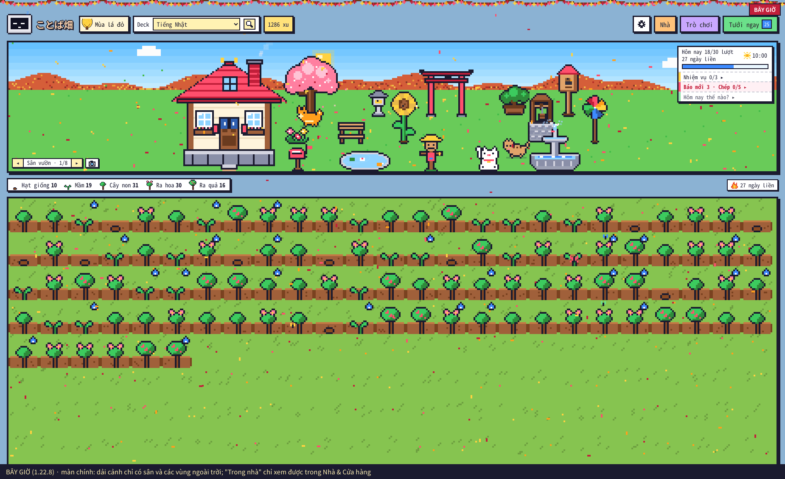
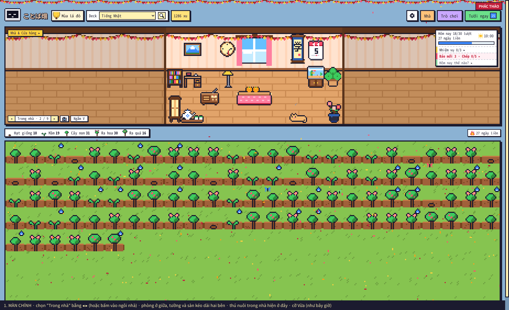
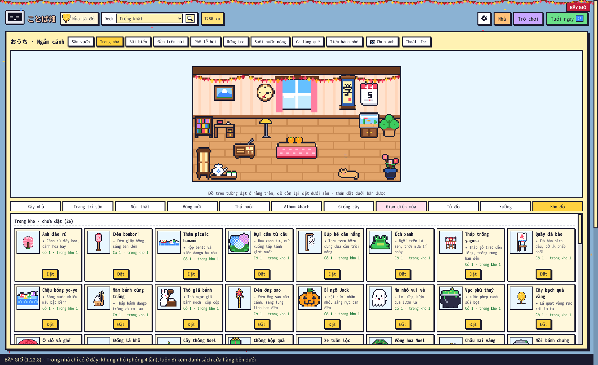
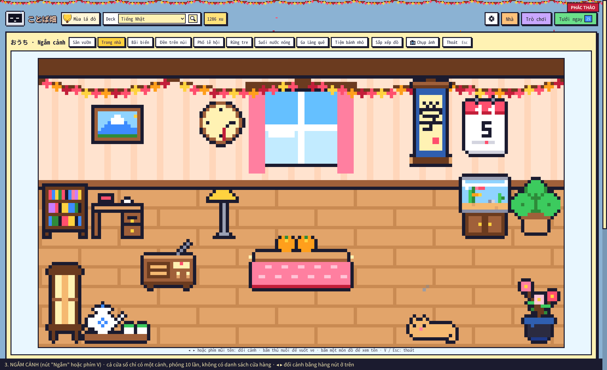
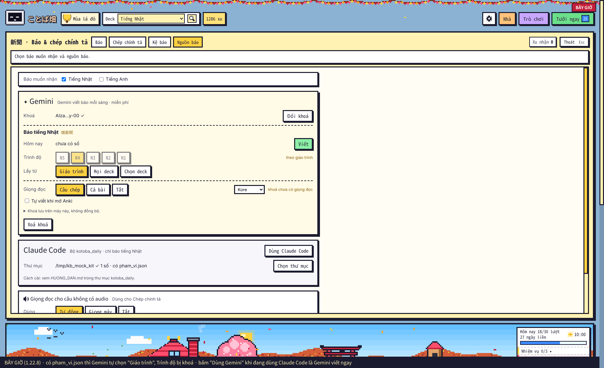
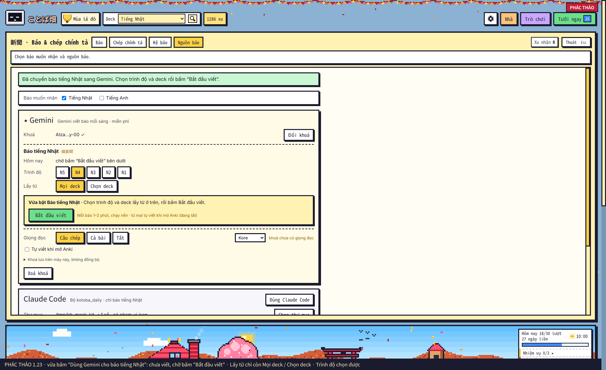
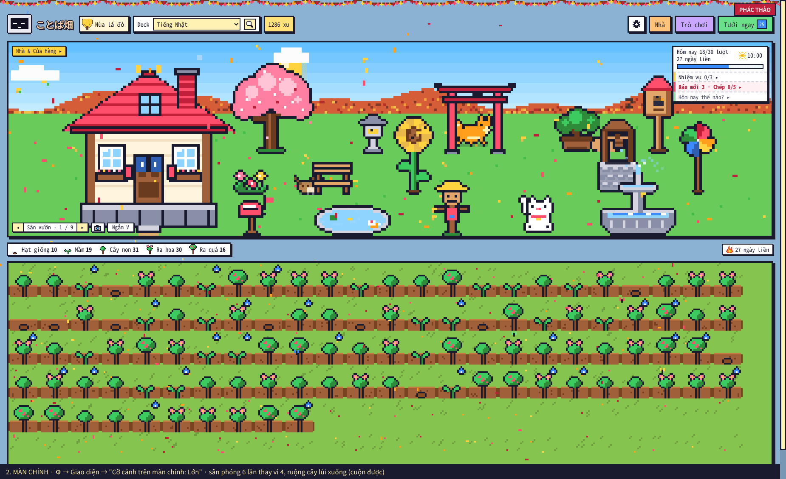
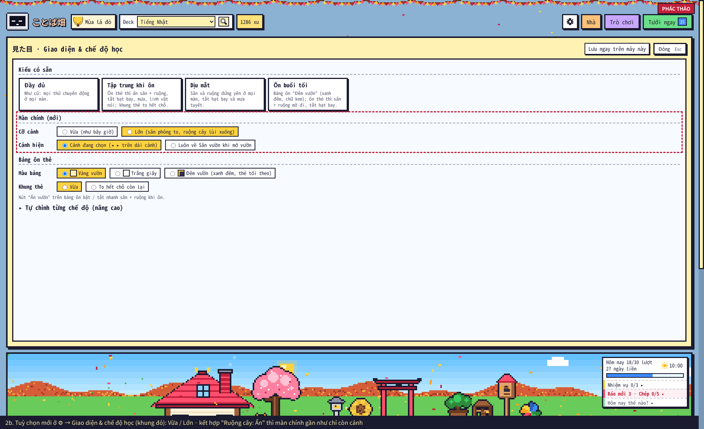
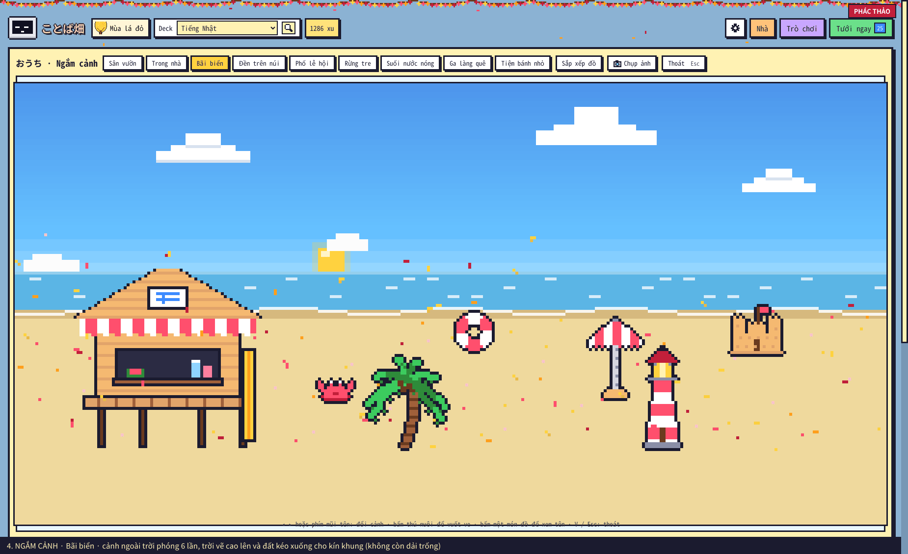
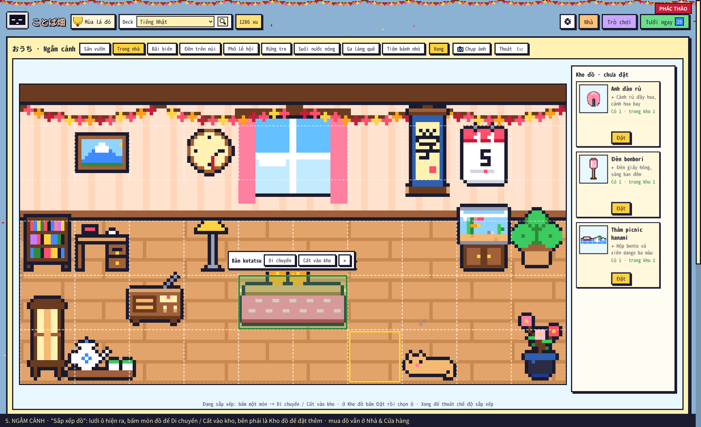

# Kế hoạch ことば畑 1.23.0 (bản nháp, chưa làm)

Ngày 05/11/2026. File này chỉ là kế hoạch: chưa sửa mã. Làm xong bản 1.23.0 thì chuyển phần đã làm vào `PHAT_TRIEN.md` (mục 2.6, 7, 11) rồi xoá file này, như các kế hoạch trước.

| # | Việc | Loại |
|---|---|---|
| 1 | Xem nhà và các vùng: màn chính đổi được cảnh (cả Trong nhà), cỡ cảnh Lớn, màn Ngắm cảnh | tính năng |
| 2 | Gemini chỉ chọn deck (bỏ "Giáo trình") | sửa theo ý người dùng |
| 3 | Chuyển sang Gemini là tự viết báo ngay, không chờ cấu hình (3 đường lọt) | lỗi |
| 4 | Kệ báo chỉ hiện số của nguồn đang dùng (số Claude Code biến khỏi kệ) | lỗi |
| 5 | Bản test nhiều xu (add-on phụ riêng, không nằm trong bản phát hành) | công cụ |
| 6 | Danh sách cần test | kiểm thử |

### Ảnh phác thảo (dựng trong Anki thật bằng hình, nút, chữ của chính add-on, cửa sổ 1850 × 1130)

Chỉ là ảnh minh hoạ: chèn tạm vào trang đang chạy, chưa sửa mã. Ảnh "Bây giờ" là giao diện 1.22.8 để so.

| Bây giờ | Sau khi làm (phác thảo) |
|---|---|
|  |  |
|  |  |
|  |  |

Các màn mới khác:

| Màn chính, cỡ Lớn | Tuỳ chọn mới ở ⚙ → Giao diện |
|---|---|
|  |  |
| **Ngắm cảnh · Bãi biển** | **Ngắm cảnh · Sắp xếp đồ** |
|  |  |

---

## 1. Xem nhà và các vùng

### 1.1 Hiện trạng (đọc mã + ảnh chụp của người dùng)

- Màn chính chỉ chuyển được giữa **các cảnh ngoài trời** đã mở: Sân vườn, 6 vùng, vùng tự tạo (`outdoorList()` trong `web/home.js`). **Trong nhà không bao giờ hiện ở màn chính.**
- Chưa mở vùng nào thì nút ◂ ▸ cũng ẩn (`nav.hidden = list.length < 2`). Người chỉ có sân + trong nhà không chuyển được gì.
- Nội thất đã mua và thú nuôi đã chuyển vào nhà (mèo, thỏ, rùa) chỉ thấy được khi mở **Nhà & Cửa hàng**. Ở đó cảnh luôn đi kèm danh sách đồ bán bên dưới.
- Khung cảnh trong bảng Nhà bị giới hạn cao 470 px để chừa chỗ cho danh sách đồ. Màn 1920 × 1200: phòng chỉ phóng 4 lần (640 × 352), hơn nửa khung để trống.
- Cỡ cảnh ở màn chính tự chọn theo chiều cao cửa sổ: cao dưới 860 px phóng 2 lần, dưới 1000 px phóng 3 lần, còn lại 4 lần. Người dùng chưa chỉnh được.

### 1.2 Màn chính đổi được cảnh: có, làm được

Trả lời câu hỏi "không thay đổi giao diện ngoài được hả": **được**. Màn chính sẽ đổi được sang mọi cảnh, kể cả Trong nhà. Ngắm cảnh (mục 1.3) chỉ là thêm một chỗ xem to hơn, không thay cho màn chính.

- **Nút ◂ ▸ ở màn chính** có thêm **Trong nhà**, theo thứ tự: Sân vườn → Trong nhà → 6 vùng → vùng tự tạo. Nút luôn hiện khi đã vào được nhà (bước "Lắp cửa & cửa sổ"), kể cả khi chưa mở vùng nào.
- **Trong nhà ở màn chính:**
  - Phòng vẽ cùng cỡ phóng với sân (2 / 3 / 4 lần theo cửa sổ).
  - Tường và sàn kéo dài ra hai bên cho kín bề ngang, mép tối như nhìn vào một ngôi nhà búp bê.
  - Phòng cao 88 ô, sân 76 ô, nên khi đang xem trong nhà dải cảnh cao thêm khoảng 12 ô (48 px ở cỡ 4 lần).
- **Cảnh đang xem được nhớ** như bây giờ (trên máy, không đồng bộ). Thú nuôi ở trong nhà, đồ treo tường, cửa sổ sáng / tối theo giờ đều hiện ở màn chính.
- **Tuỳ chọn mới trong ⚙ → Giao diện & chế độ học: "Cỡ cảnh trên màn chính"**
  - **Vừa** (mặc định, như cũ).
  - **Lớn**: phóng thêm, ví dụ màn 1920 × 1200 thì sân 6 lần (1536 × 456), trong nhà 5 lần (800 × 440). Ruộng cây lùi xuống, cuộn được.
  - Kết hợp tuỳ chọn có sẵn **"Ruộng cây: Ẩn"** thì màn chính gần như chỉ còn cảnh.
  - Thêm **"Cảnh hiện"**: *Cảnh đang chọn* (nhớ cảnh chọn bằng ◂ ▸, mặc định) hoặc *Luôn về Sân vườn khi mở vườn*.
  - Hai mục này nằm ở một nhóm mới **"Màn chính"**, ngay trên nhóm "Bảng ôn thẻ" (ảnh 2b).
- **Bấm vào ngôi nhà ở màn chính** để vào Trong nhà ngay trên màn chính (bây giờ bấm nhà chỉ có tác dụng trong bảng Nhà).

### 1.3 Màn "Ngắm cảnh" (cả cửa sổ)

Phác thảo: ảnh 3, 4, 5 ở đầu file.

- **Cả cửa sổ chỉ có một cảnh**, không có danh sách cửa hàng.
  - Phóng nguyên lần to nhất vừa cửa sổ, pixel không nhoè. Màn 1920 × 1200: trong nhà khoảng 11 lần, ngoài trời khoảng 7 lần.
  - Cảnh ngoài trời vẽ trời và đất kéo dài lên / xuống cho kín khung, không để dải trống.
- **Đổi cảnh** bằng ◂ ▸ hoặc phím mũi tên, cùng danh sách với màn chính.
- **Mọi thứ vẫn sống:** thú nuôi đi lại, khách ghé, trời theo giờ thật, mưa / tuyết, nhạc của cảnh. Bấm thú để vuốt ve, bấm đồ để xem tên.
- **Nút:** Chụp ảnh (dùng lại 3 cỡ ảnh có sẵn), Sắp xếp đồ (mục 1.4), Thoát (Esc).
- **Mở bằng:**
  - nút **Ngắm** cạnh nút chụp ảnh trên dải cảnh ở màn chính;
  - nút **Ngắm** trong bảng Nhà;
  - phím **V** (chưa dùng).
- **F11** (toàn màn hình, có sẵn) + Ngắm cảnh = để Anki như một khung ảnh động.

### 1.4 Sắp xếp đồ trên khung lớn

- Trong Ngắm cảnh, bấm **Sắp xếp đồ**: di chuyển, cất vào kho, đặt từ kho ngay trên khung lớn. Dùng lại đúng luật đặt đồ của bảng Nhà (`check_spot`, Python vẫn là nơi quyết định).
- **Mua đồ vẫn ở Nhà & Cửa hàng.** Tách vai trò: cửa hàng để mua, Ngắm cảnh để ngắm và bày.
- Bảng Nhà giữ nguyên, để người đã quen không phải học lại.

### 1.5 Cần chốt với người dùng

- Có làm cả 1.2 (màn chính) lẫn 1.3 (Ngắm cảnh), hay chỉ 1.2 trước?
- Tường / sàn kéo dài hai bên phòng ở màn chính, hay để phòng ở giữa với hai bên là cảnh sân mờ đi?
- Cỡ "Lớn" có cần thêm mức "Rất lớn" không?

---

## 2. Gemini chỉ chọn deck

- **Hiện trạng:** máy có `pham_vi.json` của kotoba_daily thì thẻ Gemini có thêm lựa chọn **"Giáo trình"** và **mặc định chọn luôn** (`gemini_scope: "auto"`). Lúc đó Trình độ bị khoá ("theo giáo trình").
- **Sửa:**
  - Thẻ Gemini chỉ còn **Mọi deck / Chọn deck**. Trình độ N5–N1 luôn chọn được.
  - `_ai_scope()` không đọc `pham_vi.json` nữa. `gemini_scope: "auto"` cũ hiểu như `"deck"`, người dùng không phải sửa config.
  - Bỏ dòng "theo giáo trình (kotoba_daily)" ở Nhật ký của thẻ Gemini.
  - `config.md`: bỏ câu "dùng kotoba_daily thì theo giáo trình" ở `gemini_level` và `gemini_scope`.
- **Không đổi:** báo **Claude Code** (kotoba_daily) vẫn theo giáo trình. Các từ "sắp quên" và "chép sai" vẫn đưa vào báo Gemini như cũ.
- **Ảnh hưởng:** từ hôm sau, báo Gemini của người dùng lấy từ trong deck đã chọn (ví dụ Dũng Mori N4) theo trình độ đã chọn, không theo chương GUNGUN nữa.

---

## 3. Lỗi: chuyển sang Gemini là viết báo ngay, không chờ cấu hình

### 3.1 Nguyên nhân gốc

- Mỗi lần vườn làm mới, `refresh()` gọi `ai_start_all("auto")`: báo nào chưa có số hôm nay mà nguồn là Gemini thì viết luôn.
- "Chờ bấm Bắt đầu viết" mới chỉ có cho **2 trường hợp**: dán khoá lần đầu (`gemini_wait_start`, 1.22.3) và tick thêm báo (`gemini_wait_langs`, 1.22.4).
- Đường nào khác dẫn tới "nguồn = Gemini" đều lọt qua. Vì vá từng đường một nên lỗi này lặp lại nhiều lần.

### 3.2 Ba đường còn lọt (đã đọc mã)

1. **Bấm "Dùng Gemini cho báo tiếng Nhật"** trong thẻ Gemini (lỗi người dùng gặp): `_on_ai` lưu `bao_source="gemini"` rồi `refresh()`, nên báo viết ngay.
2. **Bấm "Đổi khoá" khi đang dùng Claude Code:** thử khoá đúng thì `ai_test_key()` lưu luôn `bao_source="gemini"`. Nguồn báo **tự đổi sang Gemini mà không hỏi**, rồi viết ngay.
3. **Thư mục kotoba_daily tạm thời không thấy** (ổ ngoài chưa cắm, đổi tên, Syncthing chưa đồng bộ xong), hoặc xoá `bao_dir`, khi `bao_source` là `"auto"`:
   - Nguồn lặng lẽ thành Gemini và viết một số. Khi thư mục có lại thì quay về Claude Code.
   - 1.22.8 thêm một đường vào đây: `bao_source: "claude"` mà `bao_dir` trống thì coi như `auto`.

### 3.3 Sửa tận gốc: một quy tắc chung

- **Mỗi báo nhớ "nguồn đã xác nhận"** (khoá config mới, ví dụ `paper_confirmed: {"ja": "claude"}`, chỉ lưu trên máy).
- **Trong `ai_start_all("auto")`** (chỗ duy nhất tự viết báo): nếu nguồn hiện tại của báo đó là Gemini mà nguồn đã xác nhận không phải Gemini, thì đưa báo đó vào hàng chờ (`gemini_wait_langs`) và không viết. Thẻ Gemini hiện **Bắt đầu viết** để chọn trình độ và deck trước.
- **Chỉ bấm "Bắt đầu viết" hoặc "Viết"** mới ghi nguồn đã xác nhận là Gemini.
- **Lần đầu chạy bản 1.23** (chưa có khoá mới): ghi nguồn hiện tại làm nguồn đã xác nhận, để người đang dùng Gemini không bị bắt bấm lại.
- **"Đổi khoá" không đổi nguồn báo nữa.** Chỉ dán khoá **lần đầu** mới chọn Gemini, như cũ.
- **Thư mục kotoba_daily mất khi đang dùng Claude Code:** thẻ Claude Code báo "✗ không thấy thư mục" như hiện tại. Gemini chờ, không tự viết thay. Hôm đó người dùng tự chọn: cắm lại ổ, hoặc bấm Bắt đầu viết.
- Quy tắc nằm ở một chỗ nên các đường sau này (nếu thêm cách đổi nguồn) cũng không lọt.

### 3.4 Test sẽ viết (Anki thật, `e2e_123.js`)

- Mỗi đường 1 / 2 / 3: không có lượt gọi Gemini nào (máy chủ Gemini giả đếm lượt), thẻ Gemini hiện "Bắt đầu viết".
- Mở lại Anki và mở hồ sơ (bản 1.22 tự viết sau 8 giây): vẫn chờ.
- Bấm Bắt đầu viết: viết đúng **một** số, sau đó tự viết như bình thường từ hôm sau.
- Người đang dùng Gemini sẵn: lên 1.23 vẫn tự viết, không bị chờ.
- Đổi khoá khi đang dùng Claude Code: nguồn vẫn là Claude Code.

---

## 4. Lỗi: Kệ báo chỉ hiện số của nguồn đang dùng

- **Hiện trạng:** `_library("ja")` chỉ trả thư mục của nguồn đang dùng. Chuyển sang Gemini thì 5 số Claude Code biến khỏi Kệ báo (file vẫn còn trên máy). Chuyển lại thì số Gemini biến.
- **Sửa:**
  - Kệ báo tiếng Nhật gộp cả hai nguồn, xếp theo ngày, mỗi số ghi nguồn ("Claude Code" / "Gemini").
  - Hai nguồn cùng có số một ngày thì hiện cả hai.
  - Hòm thư "Báo mới" và tự viết vẫn theo nguồn đang dùng. Xu của mỗi số vẫn chỉ nhận một lần.
  - Tiến độ đọc / câu đã làm vẫn tách theo từng thư mục như bây giờ, không trộn.
- **Test:** chuyển nguồn qua lại, kệ vẫn đủ số của cả hai; đọc một số Claude Code khi đang dùng Gemini vẫn chấm và trả xu đúng.

---

## 5. Bản test nhiều xu

### 5.1 Hình thức

- **Một add-on phụ riêng**, ví dụ `kotoba_batake_test.ankiaddon`, cài cạnh ことば畑. **Không nằm trong bản phát hành.** Gói ことば畑 đăng AnkiWeb không có nút hay khoá config nào để thêm xu.
- **Menu Tools → "ことば畑 · Công cụ test":**
  - **Sao lưu ví** (xu, nhà, đồ, vùng, giao diện mùa, nhật ký) ra file trước khi làm gì. **Khôi phục ví** về đúng như trước khi test.
  - **+1.000 / +100.000 / +1.000.000 xu.**
  - Đưa ví về **0 xu** (thử kiểu ít xu).
  - Xây xong nhà ngay; mở hết vùng; mở hết giao diện mùa (để thử nhanh mà không mất công mua).
  - Xoá số báo Gemini hôm nay (để thử lại luồng viết báo, nhất là mục 3).
  - Giả lập "thư mục kotoba_daily mất" / "có lại".
  - Bật / tắt máy chủ Gemini giả (thử báo không tốn lượt thật).
- **Mỗi lần dùng đều ghi vào nhật ký Báo lỗi** ("đã dùng công cụ test: +100.000 xu"), để khi đọc báo cáo biết dữ liệu đã bị chỉnh.

### 5.2 Cách test an toàn (quan trọng)

- **Xu, nhà, đồ lưu trong collection và đồng bộ qua AnkiWeb.** Test trên hồ sơ thật thì 1.000.000 xu sẽ đồng bộ sang điện thoại và máy khác. Nên:
  - Tạo **hồ sơ Anki riêng** để test (File → Switch Profile → Add, đặt tên "Test"). **Không đăng nhập AnkiWeb** ở hồ sơ đó.
  - Xuất deck thật ra `.apkg` (có lịch sử ôn) rồi nhập vào hồ sơ Test, để vườn giống thật.
  - Hoặc test trên hồ sơ thật nhưng bấm **Sao lưu ví** trước, **Khôi phục ví** sau, và **tắt đồng bộ** trong lúc test.
- Khoá Gemini lưu theo máy (config add-on), dùng chung cho mọi hồ sơ. Thử báo trên hồ sơ Test vẫn tốn lượt Gemini thật, trừ khi bật máy chủ Gemini giả.

### 5.3 Người dùng có tự tăng xu được không?

- **Có, và không chặn hẳn được.** Add-on chạy trên máy người dùng, dữ liệu nằm trong collection của họ. Ai biết vọc một chút đều sửa được: bảng gỡ lỗi của Anki (Ctrl+Shift+;) chạy được Python, sửa thẳng mã add-on, hoặc sửa dữ liệu collection.
- **Lỗ dễ nhất hiện có, không cần biết lập trình:** trong Config, `daily_bonus` và `game_daily_coins` cho đặt tới 100.000. Đặt `daily_bonus: 100000` là mỗi ngày đạt mục tiêu được 100.000 xu.

| Cách | Chặn được ai | Giá phải trả |
|---|---|---|
| Không làm gì | không ai | không |
| **Giới hạn config hợp lý**: `daily_bonus` ≤ 100, `game_daily_coins` ≤ 200, `daily_goal` ≥ 10 | người chỉ sửa Config | rất ít (thêm vào `CONFIG_RANGES`) |
| Mã kiểm tra (chữ ký) trên ví | người sửa dữ liệu bằng tay | dễ báo nhầm khi hai máy đồng bộ ghi đè nhau → có thể làm người dùng thật mất xu; ai đọc mã vẫn vượt được |
| Mã hoá / làm rối mã nguồn | gần như không ai | khó sửa lỗi, AnkiWeb không khuyến khích, người dùng mất lòng tin |

- **Đề xuất:**
  - Chỉ làm **giới hạn config hợp lý**, bỏ qua phần còn lại.
  - Đây là trò chơi một người: không có bảng xếp hạng, không mua bán, không tiền thật. Ai tự thêm xu chỉ làm mất vui của chính họ. Thêm "chống gian lận" còn có nguy cơ làm người dùng thật mất dữ liệu.
  - Công cụ test để riêng, không đăng kèm.

---

## 6. Danh sách cần test

Cách ghi: mỗi dòng là một việc làm → điều phải thấy. Sai ở đâu thì chụp màn hình + **Tools → ことば畑 · Báo lỗi → Chép**, ghi số mục (ví dụ "D3").

### Chuẩn bị
- [ ] Tạo hồ sơ "Test", nhập deck thật (`.apkg` có lịch sử ôn), không đăng nhập AnkiWeb.
- [ ] Cài bản cần test + công cụ test. Bấm **Sao lưu ví**.
- [ ] Ghi lại: hệ điều hành, bản Anki (Help → About), cỡ màn hình, tỉ lệ phóng (100 % / 125 % / 150 %).

### A. Cài đặt, cập nhật, mở vườn
- [ ] A1. Cài từ file `.ankiaddon` → khởi động lại Anki → có nút ことば畑 trên thanh trên cùng.
- [ ] A2. Mở vườn bằng nút, bằng Ctrl+Shift+K, bằng Tools → ことば畑 · Vườn từ vựng.
- [ ] A3. Cài đè bản mới lên bản cũ đang có dữ liệu → xu, nhà, đồ, nhật ký còn nguyên.
- [ ] A4. Tools → ことば畑 · Tạo biểu tượng trên màn hình nền → bấm biểu tượng (Anki đang tắt / đang mở) → vào thẳng vườn.
- [ ] A5. Tắt nút trên thanh trên cùng (`toolbar_button: false` trong Config) → nút mất, phím tắt vẫn chạy.

### B. Vườn và ôn thẻ
- [ ] B1. Đổi deck ở ô Deck, tìm deck bằng kính lúp và phím / → cây đổi theo deck.
- [ ] B2. Số cây theo giai đoạn (Hạt giống … Ra quả) khớp cảm nhận về deck.
- [ ] B3. Tưới ngay → ôn 10 thẻ → mỗi thẻ nhớ +1 xu, cây lên giai đoạn có hiệu ứng + xu thưởng.
- [ ] B4. Sau khi ôn trong vườn, mở màn ôn bình thường của Anki → lịch ôn đúng, không ôn lại thẻ vừa ôn.
- [ ] B5. Chấm rồi bấm Dừng / Esc / đổi deck ngay → bảng ôn không tự bật lại, xu không trả hai lần.
- [ ] B6. Thẻ có audio, hình, MathJax, mẫu thẻ của bạn → hiện như màn ôn Anki. Anki chế độ tối → thẻ đọc được.
- [ ] B7. Bấm vào một cây → thẻ thông tin (từ, nghĩa, giai đoạn, lần ôn tới).
- [ ] B8. Cây khát (thẻ đến hạn), cây héo (bật FSRS, thẻ lâu không ôn).

### C. Xu, mục tiêu, nhiệm vụ, rương
- [ ] C1. Ôn đủ mục tiêu ngày → +15 xu, chúc mừng một lần.
- [ ] C2. Làm đủ 3 nhiệm vụ → mở rương → được một món hiếm.
- [ ] C3. Đưa ví về 0 xu → mọi nút mua ghi "Còn thiếu … xu", không mua được, không lỗi.
- [ ] C4. +1.000.000 xu → mua liền tay nhiều món, bấm đúp nút mua → chỉ trừ một lần.

### D. Nhà
- [ ] D1. Xây đủ 7 bước → mỗi bước trừ đúng giá, nhà đổi hình.
- [ ] D2. Mua và đổi 3 kiểu nhà (minka, nhà trà, lâu đài mini), đổi qua lại miễn phí.
- [ ] D3. Bảo dưỡng nhà: để lâu không sửa (cần công cụ chỉnh ngày, xem mục 8) → rêu, sơn bong… → sửa đúng giá.
- [ ] D4. Trong nhà: đặt đồ treo tường (chỉ hàng trên, không đè cửa sổ), đồ dưới sàn, thảm dưới bàn.
- [ ] D5. Di chuyển / cất vào kho / đặt lại từ Kho đồ.

### E. Vùng
- [ ] E1. Mở lần lượt 6 vùng → trừ đúng giá, vùng có cảnh riêng.
- [ ] E2. Mua đủ 6 món của từng vùng, đặt ra vùng đó.
- [ ] E3. Xưởng vùng: tạo vùng tự tạo (vẽ công trình + cảnh nền, chọn nền / màu đất / đồi) → 5.000 xu; sửa tên miễn phí, vẽ lại 50 xu.
- [ ] E4. Màn chính: ◂ ▸ chuyển giữa sân và các vùng; tắt / mở lại vườn → nhớ cảnh đang xem.

### F. Đồ đạc, thú nuôi, khách
- [ ] F1. Mua và đặt mọi món trang trí sân, nội thất.
- [ ] F2. Đồ hiếm (18 món) đặt từ Kho đồ.
- [ ] F3. Tủ đồ: mặc / cởi 17 món cho StackChan, đổi 7 biểu cảm → linh vật ở góc trái đổi theo.
- [ ] F4. Thú nuôi: nhận 6 con, đặt tên, cho ăn, chuyển chỗ ở (sân / trong nhà / vùng), tự cho ăn; bỏ đói 2 ngày → đi chơi, cho ăn → về.
- [ ] F5. Khách ghé vườn: để vườn mở một lúc ở các cảnh → có khách → Album khách ghi ngày gặp đầu.

### G. Xưởng, giống cây, mã chia sẻ, chụp ảnh
- [ ] G1. Xưởng: vẽ bằng mọi công cụ, 3 cỡ, 3 loại (ngoài trời / trong nhà / treo tường), hiệu ứng → chế tác đúng giá → đặt được.
- [ ] G2. Chọn ảnh… → ảnh thành pixel (thử ảnh có nền phức tạp, ảnh hồng / đỏ) → màu đúng.
- [ ] G3. Giống cây: mua, gieo theo deck / loại note / tag, Trộn; giống cây tự vẽ 5 giai đoạn.
- [ ] G4. Mã chia sẻ: xuất mã món / vùng / giống cây → dán trên hồ sơ khác → xem trước → làm → giống hệt.
- [ ] G5. Chụp ảnh vườn 3 cỡ (thường / lớn / hình nền 1920 × 1080) ở sân, trong nhà, vùng → ảnh đúng cảnh, có khung + ngày.

### H. Giao diện mùa, trời, nhạc
- [ ] H1. Mở giao diện mùa bằng xu và bằng chuỗi ngày ôn; Xem thử; Tự động / Tắt.
- [ ] H2. Đổi từng giao diện → màu trời, núi, dây cờ, hạt bay, nhạc đổi theo; vùng và trò chơi cũng đổi.
- [ ] H3. Trời theo giờ: sáng / chiều / tối / đêm; mưa / tuyết (⚙ → Trời: chọn giờ, thời tiết).
- [ ] H4. Nhạc: bật / tắt / âm lượng; ôn thẻ thì im; vào Nhà là hộp nhạc; trò chơi là nhạc nhanh.

### I. Trò chơi
- [ ] I1. Chơi đủ 5 trò × mọi chế độ × từ vựng / chữ Hán / ngữ pháp (nếu có deck).
- [ ] I2. Kiếm tới trần 40 xu / ngày → không cộng thêm, có báo.
- [ ] I3. Đang chơi bấm Esc / Thoát / đổi deck → không lỗi, không ghi vào lịch ôn.

### J. Báo và chép chính tả
- [ ] J1. Lần đầu dán khoá Gemini → Thử khoá → **chưa viết**, chờ Bắt đầu viết.
- [ ] J2. Tick thêm Báo tiếng Anh → báo đó chờ Bắt đầu viết, báo tiếng Nhật vẫn bình thường.
- [ ] J3. Đang dùng Claude Code → bấm "Dùng Gemini cho báo tiếng Nhật" → **chưa viết**, chờ Bắt đầu viết (lỗi mục 3).
- [ ] J4. Đang dùng Claude Code → Đổi khoá → nguồn **vẫn là Claude Code**.
- [ ] J5. Rút ổ / đổi tên thư mục kotoba_daily → thẻ Claude Code báo "✗ không thấy thư mục", Gemini **không tự viết**.
- [ ] J6. Thẻ Gemini chỉ có Mọi deck / Chọn deck, Trình độ chọn được (mục 2).
- [ ] J7. Kệ báo có đủ số của cả Claude Code lẫn Gemini sau khi chuyển nguồn qua lại (mục 4).
- [ ] J8. Đọc báo: furigana bật / tắt, bấm từ tra nghĩa, ▶ nghe, ▶ Chậm, câu hỏi, chép câu → xu đúng, mỗi số nhận một lần.
- [ ] J9. Chép chính tả hằng ngày: 5 câu, gõ đúng / sai / romaji / katakana → chấm đúng; deck không có câu ví dụ → nghe từ.
- [ ] J10. Hết lượt Gemini miễn phí (dùng nhiều trong ngày) → báo rõ, hôm sau viết tiếp.
- [ ] J11. Xoá khoá → không còn gọi Gemini, số cũ vẫn trong kệ.

### K. Lịch hoa, nhật ký
- [ ] K1. Lịch tháng: ngày ôn có hoa, ngày nhiều lượt hoa to hơn; lịch năm.
- [ ] K2. Viết nhật ký + sticker cho vài ngày, sửa, xoá → lưu đúng.
- [ ] K3. Luyện viết: Gemini sửa 1 lần / ngày; hết lượt thì chờ.
- [ ] K4. Cuốn nhật ký: lật trang, Xuất PDF → mở được, đúng chữ Nhật / Việt, có hình.

### L. Đồng bộ, điện thoại, nhiều máy (chỉ ở hồ sơ thật, sau khi Khôi phục ví)
- [ ] L1. Ôn trên điện thoại → đồng bộ → mở vườn trên máy tính → bù xu đúng số lượt, không bù hai lần.
- [ ] L2. Máy thứ hai (nếu có) cài add-on → đồng bộ → thấy cùng nhà, đồ, xu, nhật ký.
- [ ] L3. Gỡ add-on → thẻ và lịch ôn không đổi; cài lại → dữ liệu vườn còn.

### M. Giao diện
- [ ] M1. Cửa sổ nhỏ (1024 × 700, 720 × 520), laptop Windows 125 % / 150 % → không tràn, không cắt chữ.
- [ ] M2. Phóng to cửa sổ, F11 toàn màn hình.
- [ ] M3. ⚙ → Giao diện & chế độ học: đổi từng mục (cảnh sân, ruộng cây, hạt bay, thú nuôi…) theo từng chế độ.
- [ ] M4. Phím tắt R / N / T / B / L / Q / / / mũi tên / Esc.
- [ ] M5. Mới ở 1.23: Trong nhà ở màn chính, cỡ cảnh Lớn, Ngắm cảnh (V), Sắp xếp đồ trên khung lớn.

### N. Lỗi và độ bền
- [ ] N1. Sửa Config sai kiểu (chữ thay số, để trống) → vườn vẫn mở, giá trị về mặc định.
- [ ] N2. Đổi hồ sơ khi vườn đang mở → vườn đóng theo; mở lại bình thường.
- [ ] N3. Tắt Anki khi Gemini đang viết báo → mở lại không hỏng báo, viết tiếp được.
- [ ] N4. Tools → ことば畑 · Báo lỗi → báo cáo không chứa khoá Gemini, không có đường dẫn cá nhân đầy đủ.
- [ ] N5. Collection lớn (nhiều nghìn thẻ) → mở vườn nhanh, cuộn mượt.

### O. Hệ điều hành, bản Anki
- [ ] O1. Windows 10 / 11 (nhờ người khác nếu cần).
- [ ] O2. macOS (Intel / Apple Silicon).
- [ ] O3. Một bản Anki cũ trong khoảng hỗ trợ (ví dụ 23.12 hoặc 24.06).

### Kết thúc
- [ ] Bấm **Khôi phục ví** (nếu test trên hồ sơ thật), gỡ công cụ test.
- [ ] Gửi danh sách mục sai + báo cáo Báo lỗi.

---

## 7. Thứ tự làm (khi người dùng duyệt)

1. Mục 3 + 2 (lỗi tự viết báo, Gemini chỉ chọn deck): nhỏ, gây khó chịu nhất.
2. Mục 4 (Kệ báo gộp hai nguồn).
3. Mục 5: công cụ test, để người dùng test được ngay trong tuần.
4. Mục 1.2 (màn chính đổi được cảnh + cỡ Lớn), rồi 1.3 + 1.4 (Ngắm cảnh, Sắp xếp đồ).
5. Giới hạn config hợp lý (mục 5.3).
6. Test tự động trong Anki thật (`e2e_123.js` + chạy lại bộ cũ trên 26.9.4 và 23.10), ảnh trước / sau, cập nhật README / ảnh / video nếu giao diện đổi, đóng gói 1.23.0.

## 8. Câu hỏi cần chốt

- Mục 1.5 (ba câu về cách xem cảnh).
- Có làm giới hạn config hợp lý (mục 5.3) không, và mức giới hạn.
- Công cụ test có cần thêm việc gì (ví dụ chỉnh ngày để thử chuỗi ngày ôn / bảo dưỡng nhà)?
