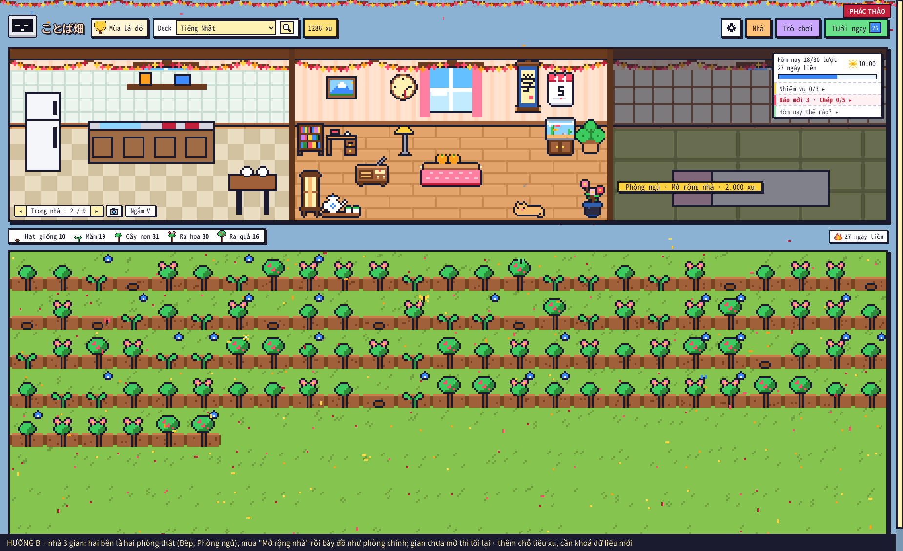

# Kế hoạch ことば畑 1.24 — nhà 3 gian (chưa làm)

Ngày 07/11/2026. Phần **B** của kế hoạch 1.23 (mục 1.2 "Trong nhà ở màn chính", người dùng chốt **B + C**): "B (nhà 3 gian) làm ngay sau, cùng bản 1.23 nếu kịp, không thì 1.24". Bản 1.23.0 đã làm **C** (Ngắm cảnh, `PHAT_TRIEN.md` mục 2.6q) và mọi mục khác của kế hoạch 1.23; nhà 3 gian để bản này.

> **Bàn giao:** mã nguồn ở `kotoba_batake/` (đóng gói `tests/tools/pack.py`). Ngắm cảnh (`home.js`: `viewOpen`, `drawView`, `viewList`…) đang có "Trong nhà" = phòng chính 160 × 88. Có nhà 3 gian rồi thì: "Trong nhà" vào danh sách ◂ ▸ của **màn chính** (`outdoorList()` → danh sách chung), Ngắm cảnh vẽ cả 3 gian, bảng Nhà chuyển được giữa 3 gian, ảnh chụp có cỡ nguyên nhà. Công cụ test nhiều xu (`kotoba_batake_test.ankiaddon`) giúp thử nhanh (xây xong nhà, +xu).

Ảnh phác thảo (dựng trong Anki thật bằng hình của add-on, chưa phải mã thật):

## 1. Nhà 3 gian (hướng B, người dùng đã chốt 05/11)

- **Gian:** Bếp (bên trái) · phòng chính (như bây giờ) · Phòng ngủ (bên phải). Mỗi gian bên 9 ô ngang × 4 hàng (hàng trên là tường), như phòng chính.
- **Mở gian:**
  - Sau khi xây xong nhà (bước 7), tab **Xây nhà** có thêm "Mở rộng nhà: Bếp" và "Mở rộng nhà: Phòng ngủ". Đề xuất 2.000 xu mỗi gian, mở theo thứ tự nào cũng được.
  - Gian chưa mở thì tối lại, có biển giá (ảnh B).
- **Đồ mới cho hai gian** (khoảng 12 món, 100–400 xu, tab **Nội thất** có nhóm "Bếp" / "Phòng ngủ"):
  - Bếp: tủ lạnh, bếp + bồn rửa, bàn ăn, nồi cơm, kệ chén.
  - Phòng ngủ: giường / chăn đệm, tủ áo, đèn ngủ, bàn trang điểm, gối ôm.
  - Đồ nội thất cũ đặt được ở cả ba gian.
- **Thú nuôi** trong nhà (mèo, thỏ, rùa) đi lại giữa ba gian.
- **Ở đâu cũng thấy:**
  - Màn chính: "Trong nhà" vào ◂ ▸, cả nhà 3 gian kín dải cảnh.
  - Ngắm cảnh · Trong nhà: cả 3 gian; bấm một gian để phóng to gian đó.
  - Nhà & Cửa hàng: khung xem chuyển được giữa 3 gian.
  - Chụp ảnh: có cả cỡ chụp nguyên nhà.
- **Dữ liệu:**
  - Hai gian bên lưu ở **khoá collection riêng** (như các phần mở rộng khác, có `_clean_*`). Bản cũ không đọc khoá này nên không xoá đồ của gian bên, chỉ không thấy hai gian.
  - Phòng chính giữ nguyên toạ độ cũ, bản cũ vẫn đọc đúng.
- **Test:**
  - Mở gian: trừ đúng xu, bấm đúp không trừ hai lần.
  - Đặt / di chuyển / cất đồ ở từng gian; không đặt đè cột ngăn.
  - Bản 1.22 mở cùng collection không mất đồ gian bên.
  - Đồng bộ sang máy khác.
  - Cửa sổ nhỏ.

## 2. Những gì bị ảnh hưởng (đọc mã 1.22.8, kiểm lại trên 1.23)
- **Dữ liệu:**
  - Khoá collection mới cho hai gian bên. Đồ đặt ở gian bên vẫn tính vào `owned` / `placed_count`.
  - **Rủi ro đồng bộ với bản cũ:** máy còn 1.22 không thấy đồ ở gian bên nên tưởng còn trong kho, cho đặt thêm ra sân. Đồng bộ về thì số đồ đặt có thể vượt số đang có.
  - Cần quy tắc khi tải: vượt thì cất bớt **đồ ở gian bên** trước (không xoá đồ đã mua).
- **Mua / đặt:**
  - `check_spot`, `place` / `move` / `take`; Kho đồ "Đặt" phải chọn được gian.
  - Bảo dưỡng nhà (1.14) có tính cả gian bên không.
  - Kiểu nhà (minka, nhà trà, lâu đài) có đổi giấy dán / sàn của gian bên không.
- **Ngôi nhà ngoài sân:** có vẽ thêm chái nhà khi đã mở gian không. Nhà đang chiếm cột 0–3 của sân, **nới rộng sẽ đè đồ ngoài sân**. Đề xuất: không nới, chỉ thêm chi tiết nhỏ (ví dụ ống khói bếp).
- **Danh mục:** khoảng 12 món mới (bếp, phòng ngủ) + hình pixel trong `home.js` / `rare_art.js`.
  - Mã chia sẻ, Xưởng (món tự làm loại "Trong nhà" đặt được ở gian bên).
  - Ảnh vườn.
  - Album khách (khách trong nhà, nếu sau này có).
- **Cân bằng xu** (`PHAT_TRIEN.md` mục 6): thêm khoảng 4.000 xu gian + đồ mới.

## 3. Câu hỏi còn mở
- Giá mỗi gian (đề xuất 2.000 xu) và danh sách đồ bếp / phòng ngủ (mục 1).
- Cỡ "Lớn" của màn chính (đã có ở 1.23) có cần thêm mức "Rất lớn" không.
