# ことば畑 · Vườn từ vựng cho Anki

**Mỗi từ bạn học là một cái cây.** ことば畑 (*kotoba batake*, "ruộng chữ") là add-on cho Anki trên máy tính. Nó biến deck từ vựng tiếng Nhật hoặc tiếng Anh thành một khu vườn pixel. Cây lớn theo trí nhớ thật của bạn: ôn đều thì vườn xanh, ra hoa, ra quả; bỏ bê thì cây khát nước và héo. Xu kiếm được khi ôn dùng để xây nhà, trang trí sân, nuôi mèo và đổi giao diện theo mùa. Mỗi sáng còn có một tờ báo nhỏ viết bằng chính những từ bạn đang học.

*A pixel-art garden for Anki: every note grows into a plant as your memory gets stronger. Vietnamese interface; works with Japanese and English decks.*

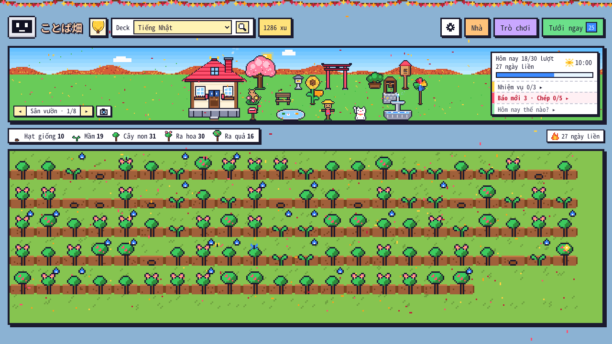

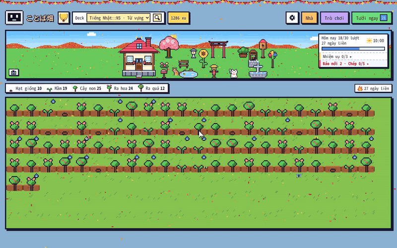

▶ **[Video đầy đủ (1 phút 34 giây, MP4, có nhạc)](docs/video/tour.mp4)**: ôn thẻ trong vườn, Nhà, trong nhà, 6 vùng và vùng tự tạo, Xưởng chuyển ảnh thành pixel, trò chơi Chợ sáng, đọc báo, Lịch hoa và cuốn nhật ký, 4 giao diện mùa, vườn ban đêm. Nhạc trong video là chính các bản nhạc 8-bit của add-on (vườn, nhà, trò chơi, từng giao diện mùa).

> Mọi ảnh và video trên trang này được chụp trong Anki 26.9.4 thật, với một bộ thẻ mẫu.

---

## Có gì trong vườn

### Vườn lớn theo trí nhớ của bạn

Mỗi note là một cây, lớn qua 5 giai đoạn **Hạt giống → Mầm → Cây non → Ra hoa → Ra quả** theo độ bền trí nhớ của FSRS. Thẻ đến hạn thì cây **khát nước** (giọt nước xanh trên cây). Từ sắp quên thì cây **héo**. Nhìn vườn là biết mình đang nhớ tới đâu.

Bấm **Tưới ngay** để ôn ngay trong vườn. Đây là lượt ôn Anki bình thường: lịch ôn, FSRS và đồng bộ AnkiWeb y như ôn ở màn hình chính. Mỗi thẻ nhớ được +1 xu. Cây lên giai đoạn thì thưởng thêm.

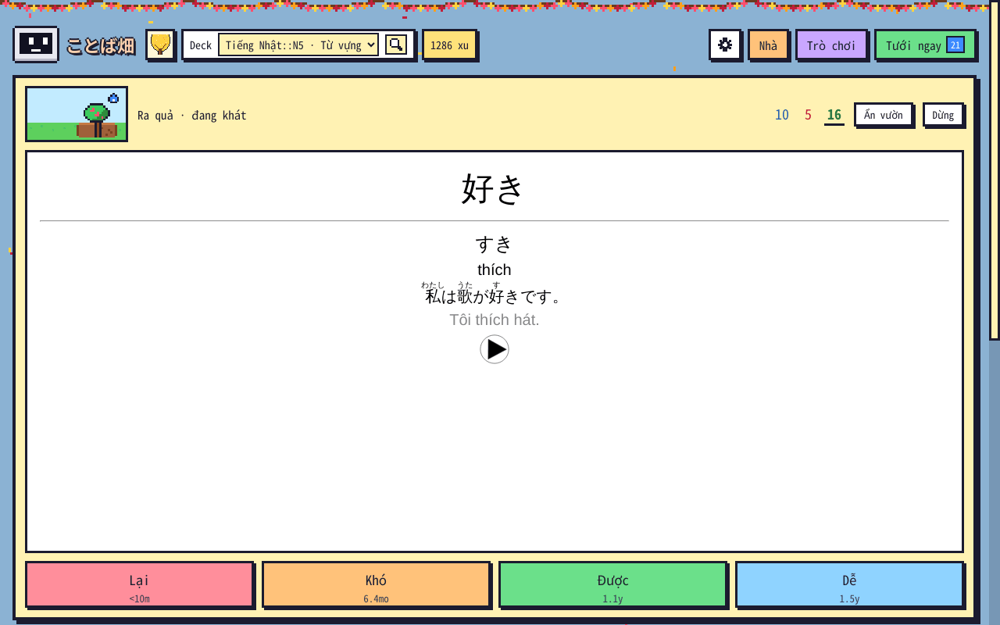

### 14 giao diện mùa

Vườn thay áo theo mùa: Tết, hoa anh đào, mùa mưa cẩm tú cầu, lễ hội mùa hè, Thất Tịch, Trung thu, lá đỏ, Halloween, Giáng sinh, năm mới Nhật Bản và bốn mùa xuân, hạ, thu, đông. Mỗi giao diện đổi màu trời, núi, dây cờ, hạt bay, **nhạc nền riêng**, và phủ cả các vùng lẫn màn trò chơi. Mở một giao diện bằng 1000 xu hoặc bằng chuỗi 7–10 ngày ôn liên tục, kèm quà là các món đồ của mùa đó. Ở chế độ **Tự động**, giao diện đã mở tự bật đúng dịp trong năm.

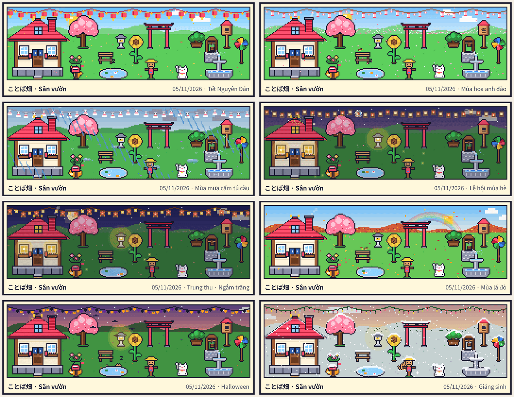

Trời còn đổi theo giờ thật (sáng, hoàng hôn, đêm có đèn lồng và đom đóm), có mưa và tuyết.

### Nhà & Cửa hàng

Xây nhà từng bước, từ bãi đất trống tới gác mái có đèn lồng, rồi đổi kiểu nhà (nhà mái tranh minka, nhà trà chashitsu, lâu đài mini). Trang trí sân, bày nội thất, nuôi thú, mở thêm 6 vùng mới như bãi biển hay đền thần. Thỉnh thoảng có **khách ghé vườn**, như chim sẻ, cáo hay hươu Nara, tuỳ đồ bạn đặt và tuỳ mùa. Khách đã gặp được ghi vào Album khách.

| Sân vườn | Trong nhà |
|---|---|
| 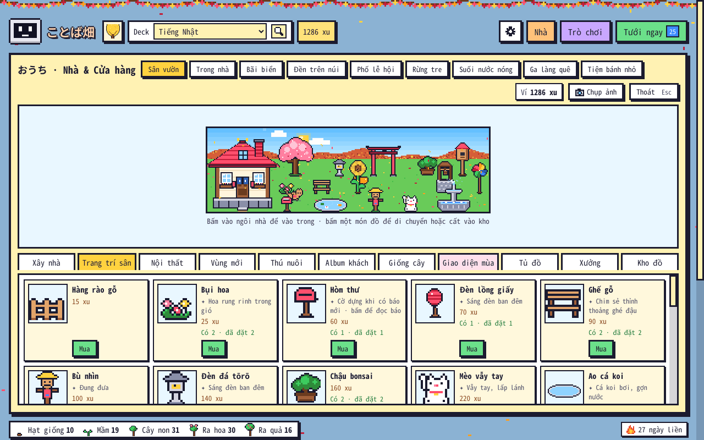 | 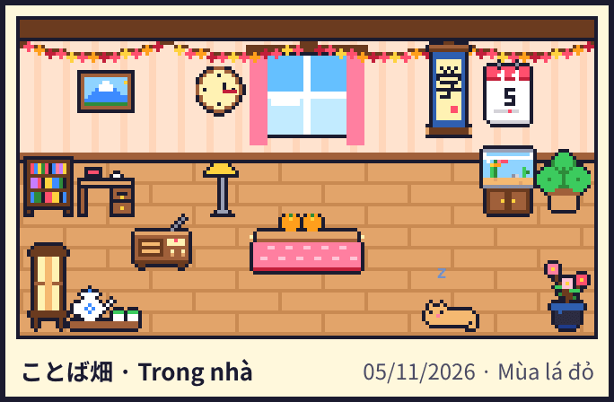 |

### 6 vùng mới và vùng tự tạo

Ngoài sân nhà còn 6 vùng mở bằng xu: **Bãi biển, Đền trên núi, Phố lễ hội, Rừng tre, Suối nước nóng, Ga làng quê**. Mỗi vùng có cảnh riêng, công trình riêng và 6 món đồ riêng (hải đăng, cáo thần, quầy vớt cá vàng, gấu trúc, khỉ tắm suối, máy bán hàng…). Muốn thêm nữa thì **tự tạo vùng**: tự vẽ công trình và cảnh nền, chọn nền đất, màu đồi, đặt tên, rồi bày đồ như ở sân.

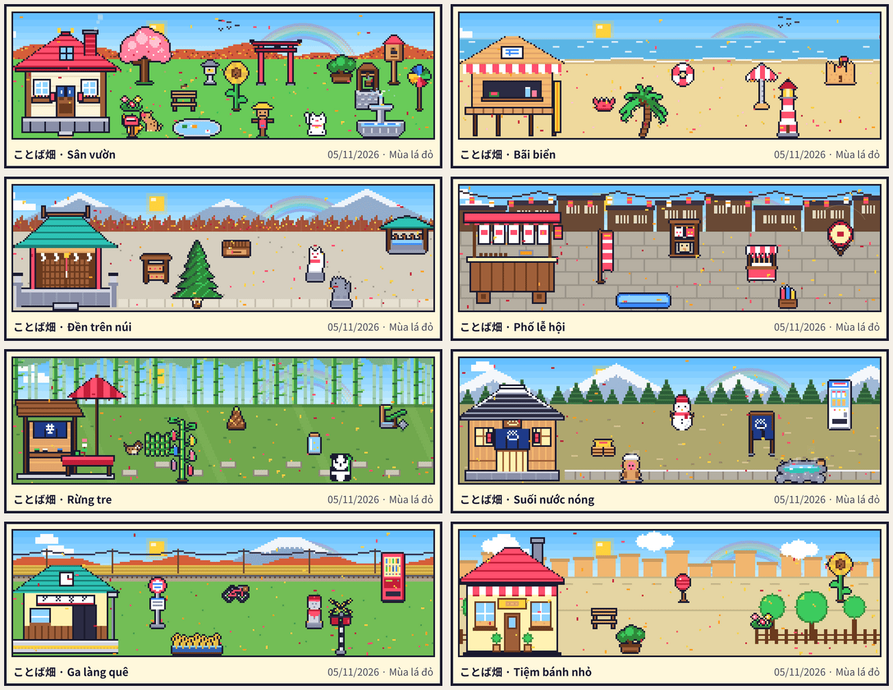

### Đồ đạc, tủ đồ, kho đồ

- **133 món đồ**: 91 món ngoài sân (cổng torii, ao cá koi, cây anh đào, đài phun nước…), 24 món nội thất (kotatsu, bể cá, radio cổ…) và 18 món hiếm chỉ có trong rương quà nhiệm vụ.
- **6 thú nuôi**: gà, vịt, thỏ, rùa, mèo mướp, chó Shiba. Thú có tên, có độ thân, đi lại khắp sân.
- **Tủ đồ**: 17 món cho StackChan (linh vật ở góc trái): mũ rơm, nón lá, kính tròn, khăn quàng, vỏ màu sakura… cùng 7 biểu cảm.
- **Kho đồ**: mọi món đã có, kể cả quà của giao diện mùa. Đặt ra sân, di chuyển hay cất lại lúc nào cũng được, không mất gì.
- **Xưởng**: tự vẽ đồ pixel (bút, đổ màu, kẻ thẳng, đối xứng, 3 cỡ 16 / 24 / 32), giống cây riêng và vùng riêng, hoặc chọn một tấm ảnh để chuyển thành pixel. Thiết kế chia sẻ được cho bạn bè bằng một đoạn mã.

| Tủ đồ | Kho đồ |
|---|---|
| 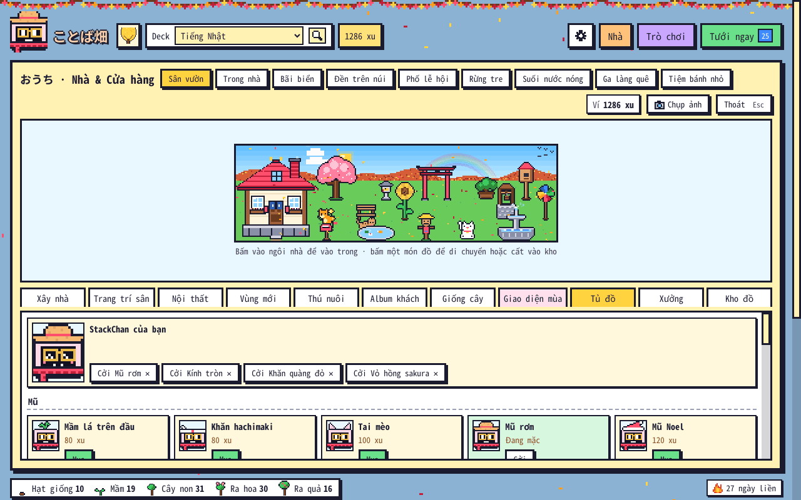 | 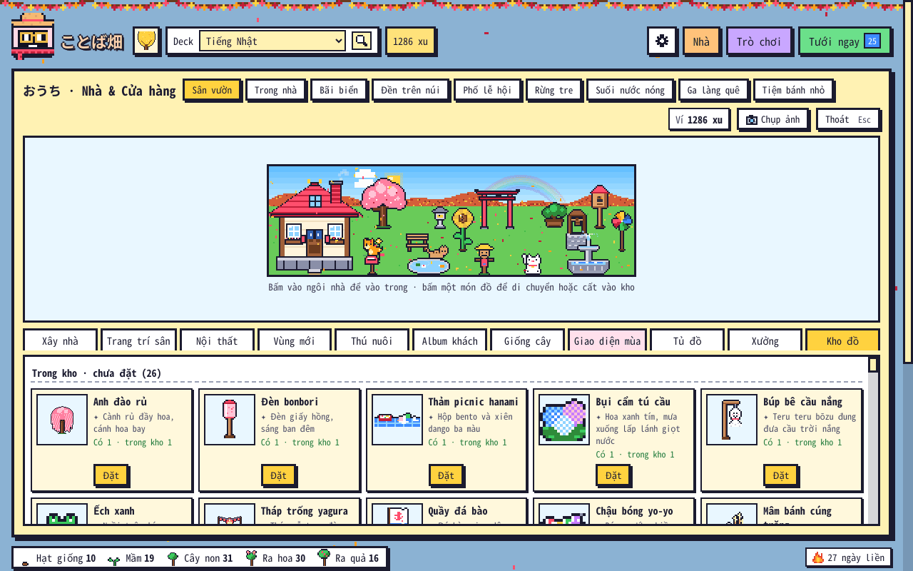 |

| Xưởng: chuyển ảnh thành pixel | Xưởng vùng: vẽ công trình |
|---|---|
| 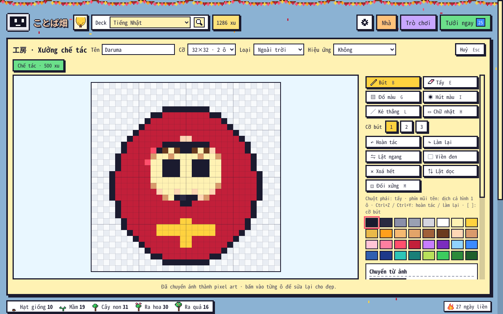 | 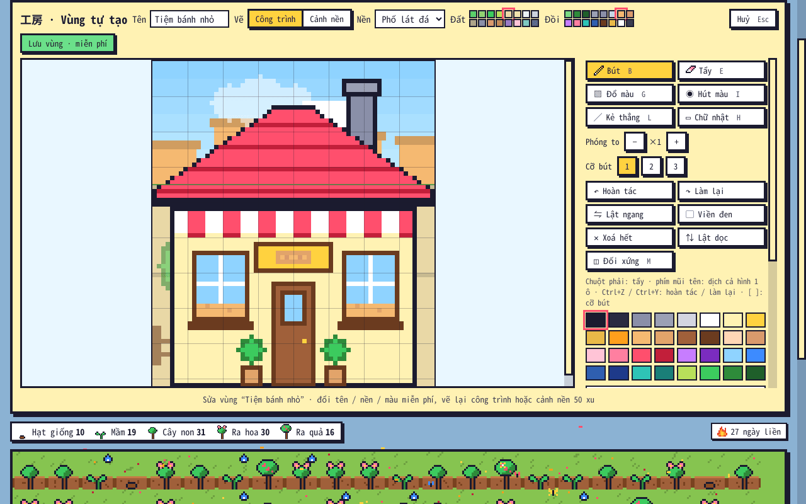 |

Nút **Chụp ảnh** lưu khu vườn thành ảnh, có cỡ hình nền 1920 × 1080:

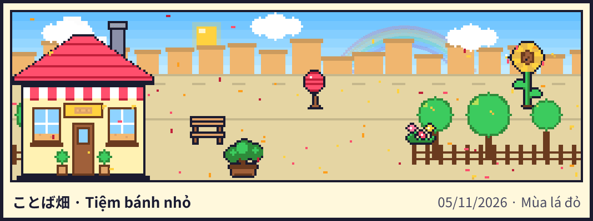

### 花暦 · Lịch hoa và nhật ký

Mỗi ngày bạn ôn là một chậu hoa trên lịch, loài hoa đổi theo giao diện mùa. Ngày ôn càng nhiều, hoa càng lớn. Bấm vào một ngày để viết **nhật ký một dòng** (tối đa 200 ký tự) và chọn **sticker tâm trạng**. Nhật ký đồng bộ qua AnkiWeb và không gửi cho Gemini.

Hết tháng, nhật ký tự đóng thành **một cuốn** trên kệ sách: ảnh vườn của tháng, số ngày ôn, ngày ôn nhiều nhất, tâm trạng cả tháng, từng dòng nhật ký. Cuốn nhật ký **xuất được ra PDF** khổ A5 để in hay giữ làm kỷ niệm. Có thêm ô **luyện viết** một hai câu tiếng Nhật hoặc tiếng Anh, Gemini sửa một lần mỗi ngày.

| Lịch tháng + nhật ký | Cuốn nhật ký |
|---|---|
| 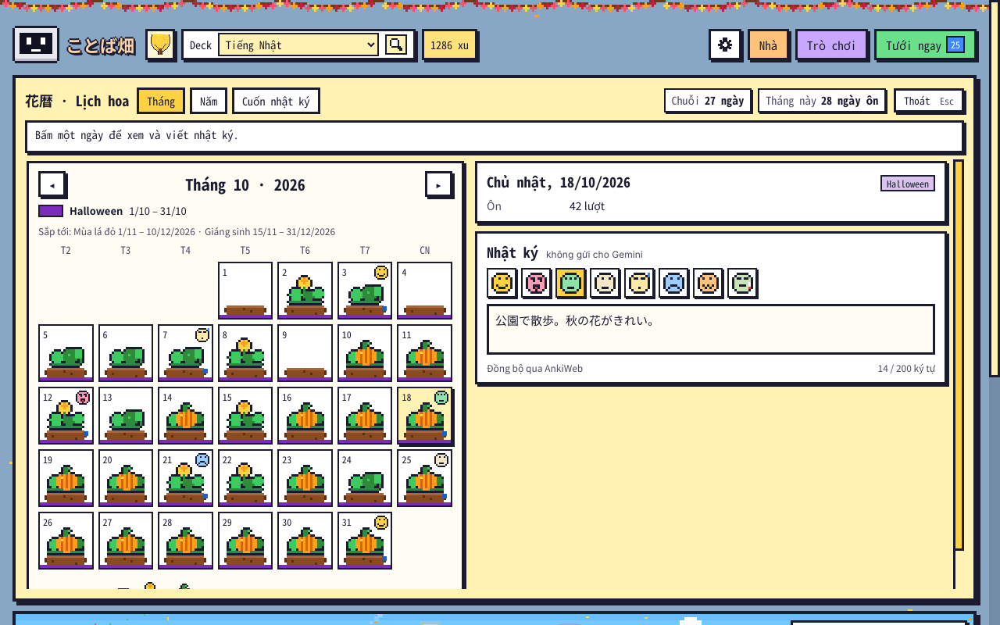 | 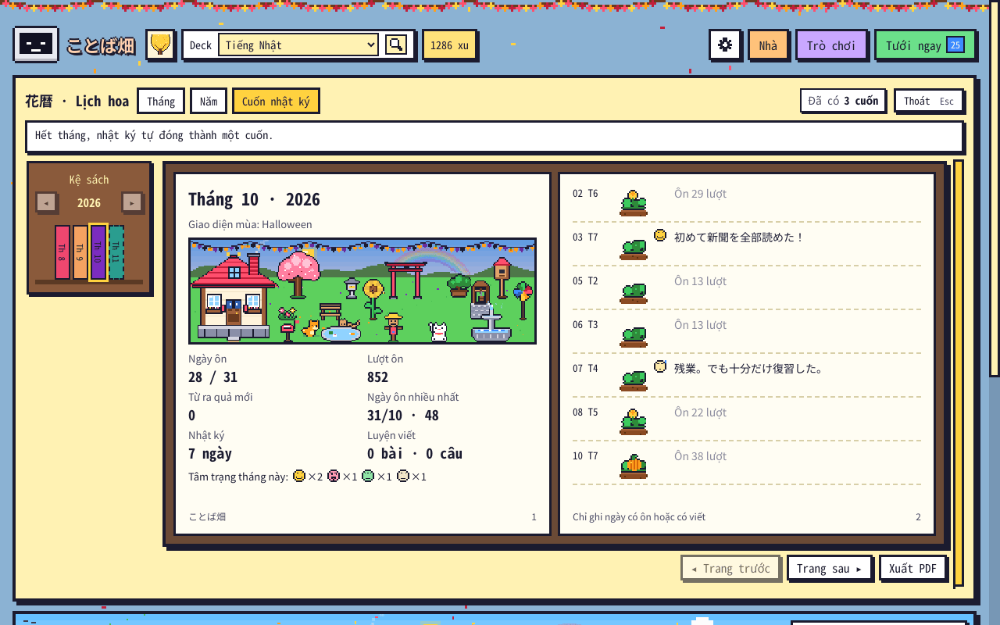 |

### 5 trò chơi ôn từ

**Nghe tìm cây**, **Chợ sáng** (khách hỏi mua theo nghĩa, bạn chọn đúng món), **Đuổi quạ** (gõ từ trước khi quạ bay tới), **Lật cặp** và **Điền vào câu**. Trò chơi dùng chính từ trong deck, có chế độ cho từ vựng, chữ Hán và ngữ pháp. Mỗi ngày kiếm tối đa 40 xu từ trò chơi. **Trò chơi không ghi vào lịch ôn của Anki.**

| Chọn trò | Chợ sáng |
|---|---|
| 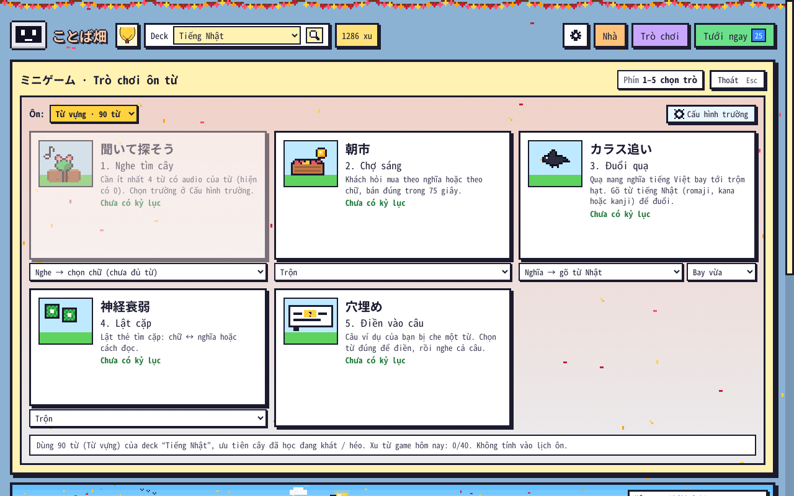 | 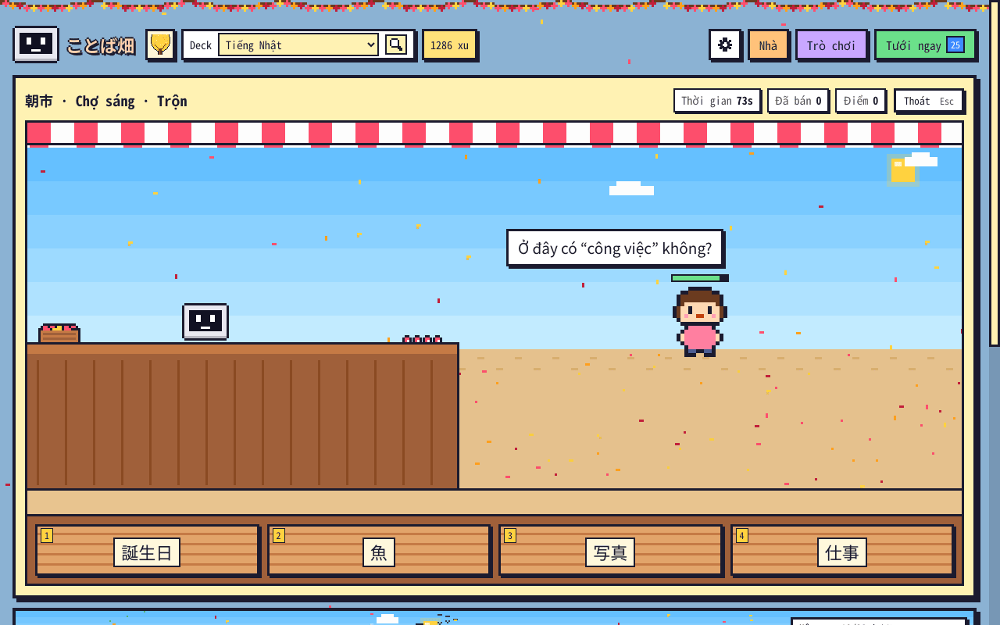 |

### Báo mỗi sáng và chép chính tả

Mỗi sáng có một số báo tiếng Nhật 畑新聞 (hoặc báo tiếng Anh *The Garden Gazette*) viết bằng từ bạn đang học. Báo có furigana, bấm vào từ để tra nghĩa, có giọng đọc, câu hỏi đọc hiểu và truyện dài kỳ. Báo do **Gemini** viết bằng khoá miễn phí của chính bạn (xem [cách lấy khoá](#báo-mỗi-sáng-bằng-gemini-miễn-phí)).

**Chép chính tả** chạy với mọi deck: nghe câu ví dụ (hoặc từ) rồi gõ lại. Câu nào không có audio thì dùng giọng Gemini hoặc giọng tiếng Nhật của máy.

| Báo | Chép chính tả |
|---|---|
| 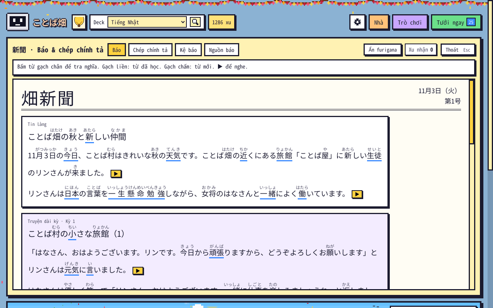 | 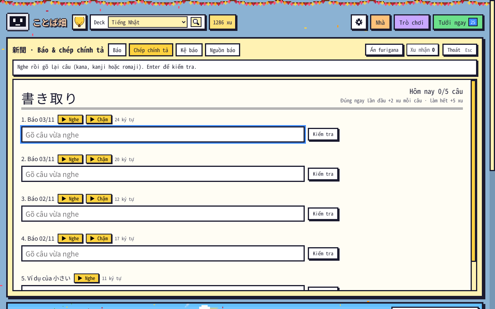 |

### Mục tiêu nhỏ mỗi ngày

- Mục tiêu 30 lượt ôn mỗi ngày (đổi được), thưởng +15 xu.
- 3 nhiệm vụ mỗi ngày. Làm đủ cả 3 thì mở rương quà có đồ hiếm.
- Chuỗi ngày ôn liên tục.
- Không có điểm trừ, không mất đồ, không có gì bắt bạn phải chơi: học là chính.

---

## Cài đặt

**Cần:** Anki **23.10 trở lên** (đã thử trên mọi bản từ 23.10 tới 26.9.4), trên Windows, macOS hoặc Linux. Nên bật **FSRS** (Deck options → FSRS) để cây lớn và héo theo trí nhớ.

<!-- Khi đã đăng AnkiWeb: thêm "Tools → Add-ons → Get Add-ons… → dán mã <mã AnkiWeb>" làm cách 1. -->
1. Tải file [`kotoba_batake.ankiaddon`](kotoba_batake.ankiaddon).
2. Mở Anki → **Tools → Add-ons → Install from file…** → chọn file vừa tải (hoặc bấm đúp vào file).
3. Khởi động lại Anki.

**Mở vườn** bằng một trong ba cách:

- nút **ことば畑** trên thanh trên cùng của Anki;
- phím **Ctrl+Shift+K** (macOS: ⌘⇧K);
- **Tools → ことば畑 · Vườn từ vựng**.

Muốn có biểu tượng ngoài màn hình nền để vào thẳng vườn: **Tools → ことば畑 · Tạo biểu tượng trên màn hình nền**.

## Bắt đầu trong 5 phút

1. **Chọn deck** ở ô Deck trên cùng. Cây mọc theo note của deck đó.
2. Nếu thẻ **Hôm nay** có dòng ⚠ **Cấu hình trường**, bấm vào để chỉ cho vườn biết trường nào là *Từ*, *Nghĩa*, *Câu ví dụ*… Vườn tự đoán sẵn, bạn chỉ cần kiểm lại rồi bấm Lưu.
3. Bấm **Tưới ngay** để ôn các thẻ đến hạn và nhận xu.
4. Bấm **Nhà** để xây bước đầu tiên của ngôi nhà.
5. (Tuỳ chọn) Bấm **B** để mở báo, sang tab **Nguồn báo** và dán khoá Gemini.

Phím tắt trong vườn: **R** Tưới ngay · **N** Nhà · **T** Trò chơi · **B** Báo · **L** Lịch hoa · **Q** Nhiệm vụ · **/** tìm deck · **Esc** đóng bảng đang mở. Nhạc, hiệu ứng và giao diện từng chế độ (ví dụ ẩn sân khi ôn) chỉnh ở nút ⚙.

## Báo mỗi sáng bằng Gemini (miễn phí)

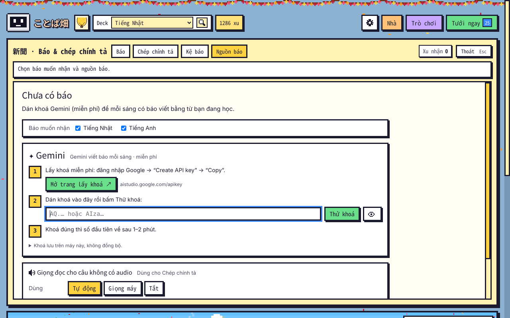

1. Mở báo (phím **B**) → tab **Nguồn báo** → **Mở trang lấy khoá** (aistudio.google.com/apikey).
2. Đăng nhập Google → **Create API key** → **Copy**.
3. Dán khoá vào ô → **Thử khoá**.
4. Chọn báo muốn nhận (tiếng Nhật, tiếng Anh), trình độ và deck lấy từ → **Bắt đầu viết**. Số đầu tiên về sau 1–2 phút. Từ hôm sau, Gemini tự viết khi bạn mở Anki.

**Riêng tư:**

- Khoá chỉ lưu trên máy này. Khoá không đồng bộ AnkiWeb và không nằm trong báo cáo lỗi.
- Gemini nhận danh sách từ bạn đang học, nội dung báo, câu cần giọng đọc, và đoạn luyện viết nếu bạn nhờ sửa.
- Với gói miễn phí, Google có thể dùng dữ liệu đó để cải thiện sản phẩm.

Không dán khoá thì add-on **không gửi gì lên mạng**; vườn, trò chơi, lịch và chép chính tả vẫn chạy đầy đủ.

### Nâng cao: báo do Claude Code viết (tuỳ chọn)

Cách này dành cho số ít người đã dùng [Claude Code](https://claude.com/claude-code) và muốn báo bám **đúng giáo trình** mình đang học (chương nào, ngữ pháp nào), kèm giọng đọc VOICEVOX. Mỗi sáng, Claude Code chạy theo lịch trên máy bạn, đọc phạm vi đã học rồi viết một số báo vào thư mục `kotoba_daily`. Add-on chỉ đọc thư mục đó.

1. Chép thư mục [`kotoba_daily/`](kotoba_daily/) về máy và làm theo [`kotoba_daily/HUONG_DAN.md`](kotoba_daily/HUONG_DAN.md). Cần Claude Code, Python 3 và PDF giáo trình của bạn.
2. Trong Anki: **Tools → Add-ons → ことば畑 → Config**, đặt `"bao_dir": "<đường dẫn tới kotoba_daily>"`.
3. Mở lại vườn. Tab **Nguồn báo** có thêm thẻ **Claude Code** để chọn thư mục và đổi qua lại với Gemini.

Để `bao_dir` trống (mặc định) thì thẻ này không hiện. Chi tiết từng mục cấu hình nằm ở trang Config của add-on.

---

## Câu hỏi thường gặp

**Add-on có làm sai lịch ôn của tôi không?**
Không. Ôn trong vườn là lượt ôn Anki bình thường. Xu, nhà, trò chơi và báo không bao giờ đụng tới lịch ôn hay FSRS.

**Tôi ôn trên điện thoại (AnkiDroid / AnkiMobile) thì sao?**
Điện thoại không chạy được add-on, nhưng lượt ôn trên điện thoại vẫn làm cây lớn. Sau khi đồng bộ, lần mở vườn trên máy tính sẽ **bù xu** cho các lượt đó (+1 mỗi lượt nhớ), tính cả nhiệm vụ và mục tiêu ngày.

**Xu, nhà và đồ đạc lưu ở đâu? Gỡ add-on có mất thẻ không?**
Mọi thứ lưu trong collection nên đồng bộ qua AnkiWeb sang máy khác (máy đó cũng cần cài add-on). Gỡ add-on không ảnh hưởng tới thẻ hay lịch ôn.

**Deck của tôi không phải tiếng Nhật?**
Deck **tiếng Anh** có đủ vườn, trò chơi, chép chính tả và báo tiếng Anh. Ngôn ngữ khác vẫn có vườn và các trò chơi chung.

**Giao diện có tiếng Anh không?**
Hiện chỉ có tiếng Việt (kèm chữ Nhật trang trí).

**Máy yếu, vườn chạy nặng?**
Vào ⚙ để tắt hiệu ứng hoặc đổi giao diện từng chế độ (ví dụ ẩn sân khi ôn thẻ).

## Báo lỗi và góp ý

Vào **Tools → ことば畑 · Báo lỗi**, ghi vài dòng ở mục *Mô tả lỗi*, bấm **Chép**, rồi dán vào một [issue trên GitHub](https://github.com/dungmt2808/kotoba-anki/issues). Báo cáo có nhật ký lỗi và phiên bản Anki. Khoá Gemini và đường dẫn trên máy bạn được tự động che đi, và bạn sửa hay xoá bớt được trước khi gửi. Add-on không tự gửi gì lên mạng.

## Cho người phát triển

- Tài liệu phát triển (kiến trúc, dữ liệu, luật chơi, quyết định đã chốt, lịch sử phiên bản): [`PHAT_TRIEN.md`](PHAT_TRIEN.md).
- Bộ test (offline, Gemini thật, giao diện trong Anki thật trên nhiều bản Anki): [`tests/README.md`](tests/README.md).
- Ảnh và video trên trang này làm lại được bằng `tests/anki/readme_media.js` và `tests/tools/make_media.sh`.
- Mã nguồn add-on nằm trong file `kotoba_batake.ankiaddon` (file zip).
