# ことば畑 · Vườn từ vựng cho Anki

**Mỗi từ bạn học là một cái cây.** ことば畑 (*kotoba batake*, "ruộng chữ") là add-on cho Anki trên máy tính. Nó biến deck từ vựng (tiếng Nhật, Anh, Trung, Hàn, Đức, Pháp…) thành một khu vườn pixel. Cây lớn theo trí nhớ thật của bạn: ôn đều thì vườn xanh, ra hoa, ra quả; bỏ bê thì cây khát nước và héo. Xu kiếm được khi ôn dùng để xây nhà, trang trí sân, nuôi mèo và đổi giao diện theo mùa. Mỗi sáng còn có một tờ báo nhỏ viết bằng chính những từ bạn đang học.

*A pixel-art garden for Anki: every note grows into a plant as your memory gets stronger. Vietnamese interface; works with Japanese and English decks.*

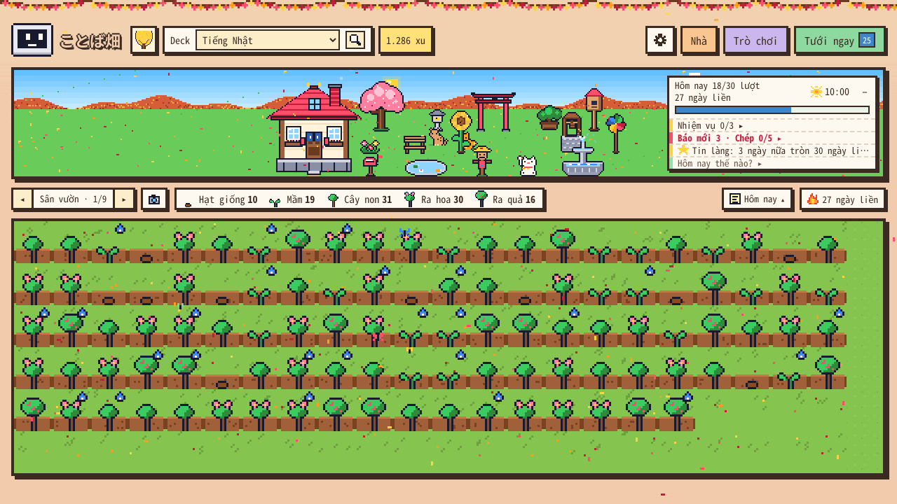

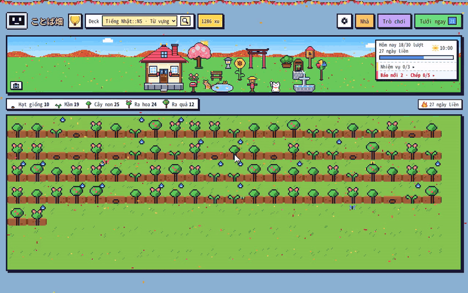

▶ **[Video đầy đủ (1 phút 34 giây, MP4, có nhạc)](docs/video/tour.mp4)**: ôn thẻ trong vườn, Nhà, trong nhà, 6 vùng và vùng tự tạo, Xưởng chuyển ảnh thành pixel, trò chơi Chợ sáng, đọc báo, Lịch hoa và cuốn nhật ký, 4 giao diện mùa, vườn ban đêm. Nhạc trong video là chính các bản nhạc 8-bit của add-on (vườn, nhà, trò chơi, từng giao diện mùa).

> Mọi ảnh và video trên trang này được chụp trong Anki 26.9.4 thật, với một bộ thẻ mẫu.

---

## Có gì trong vườn

### Vườn lớn theo trí nhớ của bạn

Mỗi note là một cây, lớn qua 5 giai đoạn **Hạt giống → Mầm → Cây non → Ra hoa → Ra quả** theo độ bền trí nhớ của FSRS. Thẻ đến hạn thì cây **khát nước** (giọt nước xanh trên cây). Từ sắp quên thì cây **héo**. Nhìn vườn là biết mình đang nhớ tới đâu.

Bấm **Tưới ngay** để ôn ngay trong vườn. Đây là lượt ôn Anki bình thường: lịch ôn, FSRS và đồng bộ AnkiWeb y như ôn ở màn hình chính. Mỗi thẻ nhớ được +1 xu. Cây lên giai đoạn thì thưởng thêm.

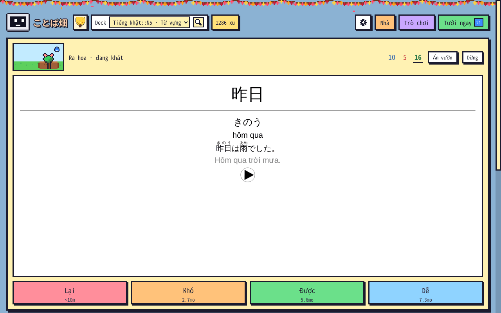

### 14 giao diện mùa

Vườn thay áo theo mùa: Tết, hoa anh đào, mùa mưa cẩm tú cầu, lễ hội mùa hè, Thất Tịch, Trung thu, lá đỏ, Halloween, Giáng sinh, năm mới Nhật Bản và bốn mùa xuân, hạ, thu, đông. Mỗi giao diện đổi màu trời, núi, dây cờ, hạt bay, **nhạc nền riêng**, và phủ cả các vùng lẫn màn trò chơi. Mở một giao diện bằng 1000 xu hoặc bằng chuỗi 7–10 ngày ôn liên tục, kèm quà là các món đồ của mùa đó. Ở chế độ **Tự động**, giao diện đã mở tự bật đúng dịp trong năm.

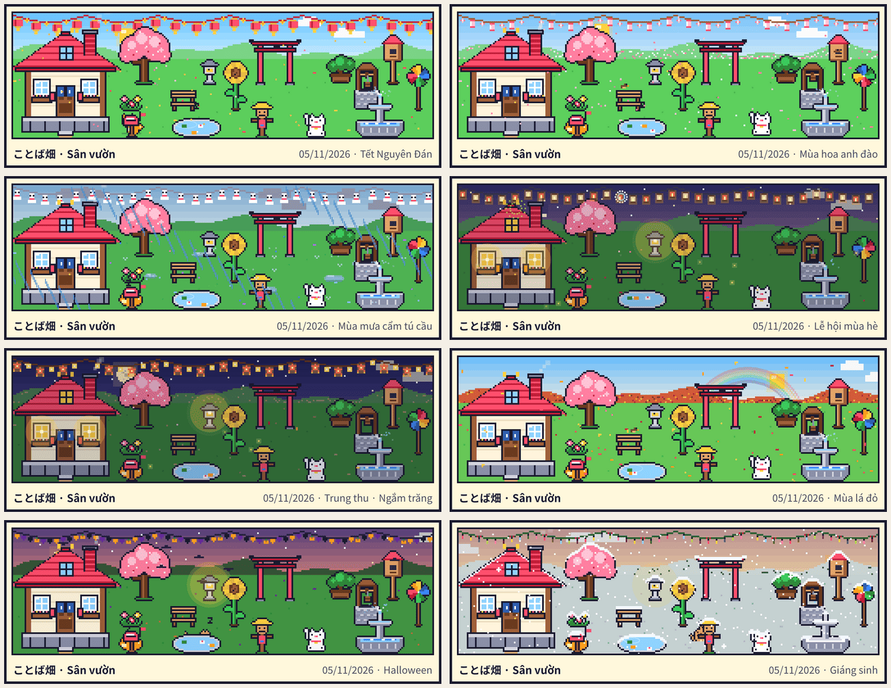

Trời còn đổi theo giờ thật (sáng, hoàng hôn, đêm có đèn lồng và đom đóm), có mưa và tuyết.

### Sự kiện Giáng sinh: Lịch chờ Giáng sinh, thiệp, ông già Noel (mới ở 1.36)

Từ 1/12 tới 24/12, mỗi ngày có ôn thẻ (ôn trên điện thoại cũng tính) là mở được một ngăn của **tủ lịch gỗ 24 ngăn**. Lần đầu mở vườn trong tháng 12, vườn tặng tủ lịch (treo ở tường phòng khách) và một cây thông Noel nếu bạn chưa có. Mỗi ngăn là một món trang trí để giữ làm kỷ niệm: cây thông trơn đầy dần quả châu, dây đèn, kim tuyến, kẹo gậy và ngôi sao; nhà khoác vòng hoa, dây lá thông và đèn viền mái; sân sáng đèn ban đêm với người tuyết, tuần lộc đèn, dây đèn võng; trong nhà có tất Noel, bánh kem dâu, đèn ngủ ngôi sao, bàn bánh quy + sữa, giấy dán tường và sàn Noel. Ba hộp quà bí mật dưới gốc cây — lắc thử đoán xem, mở từ sáng 25/12. Lỡ ngày thì ôn 15 lượt trong một ngày để mở bù một ngăn (tối đa 2 ngăn bù mỗi ngày, tới hết 31/12). Không có xu, không chuỗi — chỉ để vườn đẹp lên cùng bạn. Có thêm 7 bài nhạc Giáng sinh 8-bit để chọn. Không thích thì tắt ở ⚙ → Sự kiện mùa.

Từ 1.36.1: **làm thiệp Giáng sinh** — chọn khung, dán sticker là hình trong vườn (cây thông, quà, StackChan đội mũ Noel, các món đã mở ở tủ lịch…), viết lời chúc, thêm câu chúc bằng 7 thứ tiếng; mặt sau viết **điều ước** bằng tiếng Việt hoặc tiếng bạn đang học (bấm "Nhờ Gemini sửa" để Gemini sửa lỗi). Treo thiệp lên cây thông trước 18:00 ngày 24 — **tối 24 ông già Noel đáp xe tuần lộc xuống chính sân vườn của bạn** lấy thiệp (nhạc Silent Night), **sáng 25 có thư của ông** dưới gốc cây, bánh quy chỉ còn vụn. Lưu thiệp thành ảnh PNG hoặc chép mã gửi bạn bè; dán mã của bạn ở Album → Kỷ niệm để giữ thiệp. Sang năm mới StackChan cất đồ Noel vào kho; tủ lịch, thiệp và thư ở lại trong Album → Kỷ niệm.

### Nhà & Cửa hàng

Xây nhà từng bước, từ bãi đất trống tới gác mái có đèn lồng, rồi đổi kiểu nhà (nhà mái tranh minka, nhà trà chashitsu, lâu đài mini). Xây xong thì **mở rộng nhà** một lần (2.000 xu) được cả **Bếp** và **Phòng ngủ** hai bên phòng chính, với 12 món đồ riêng như tủ lạnh, nồi cơm, giường, đèn ngủ, dây đèn sao. Ba gian theo kiểu nhà đang dùng (nhà gỗ: giấy dán tường hoa, sàn gỗ; minka: tường đất, chiếu tatami, cửa lùa vẽ sóng; nhà trà: cửa sổ tròn, hốc tokonoma; lâu đài: vách lá vàng vẽ tùng, cửa sổ hình chuông), đổi kiểu nhà là đổi cả ba gian. Ở màn chính bấm ◂ ▸ sang cảnh **Trong nhà** để thấy cả ngôi nhà đứng giữa vườn, mèo đi lại khắp nhà. Trang trí sân, bày nội thất, nuôi thú, mở thêm 6 vùng mới như bãi biển hay đền thần. Thỉnh thoảng có **khách ghé vườn**, như chim sẻ, cáo hay hươu Nara, tuỳ đồ bạn đặt và tuỳ mùa. Khách đã gặp được ghi vào Album khách.

Mở bảng Nhà & Cửa hàng bằng nút **Nhà & Cửa hàng ▸** (hiện khi rê chuột lên vườn), nút **Nhà** trên cùng hoặc phím **N**. Bấm vào thú nuôi hay khách thì hiện một thẻ nhỏ có tên và nút vào xem; bấm chỗ khác trên vườn không mở cửa hàng.

**Trang trí thử** (mới ở 1.34): bấm nút **Trang trí thử** trong bảng Nhà để bày thử đồ, kể cả đồ chưa mua (hiện mờ, có chữ "thử"). Mỗi cảnh lưu được 3 bản thử. Ưng rồi thì bấm **Dùng bản này**: vườn mua đủ món còn thiếu và bày đúng như bản thử, hỏi bạn một lần trước khi trả xu.

| Sân vườn | Trong nhà |
|---|---|
| 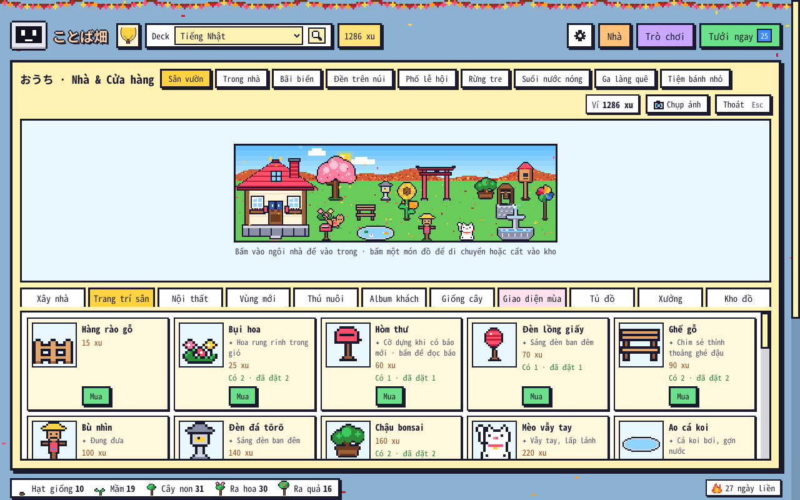 | 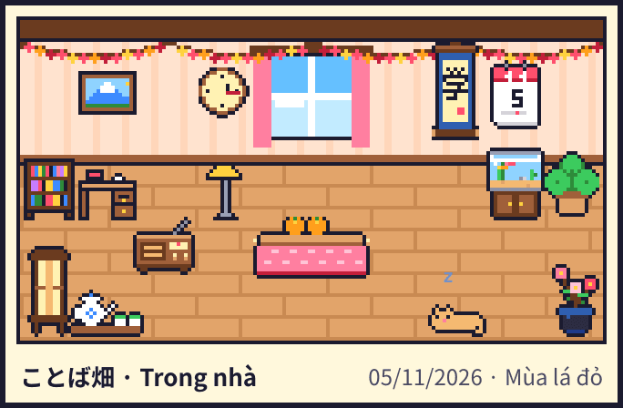 |

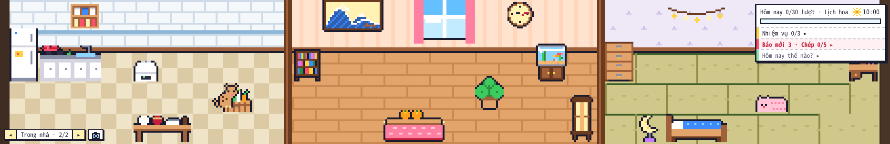

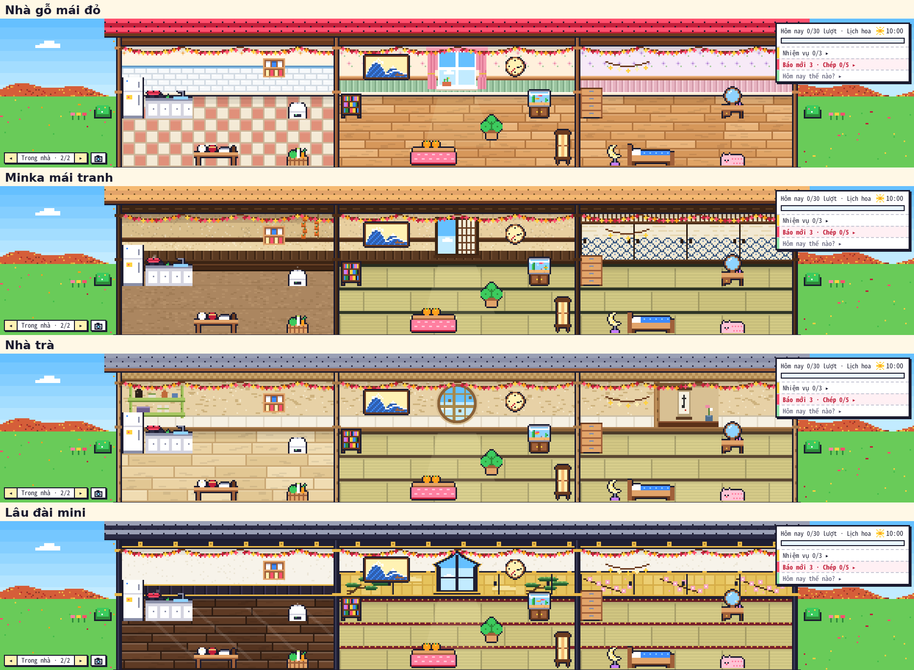

Muốn dải cảnh ở màn chính to hơn: ⚙ → Giao diện → Màn chính → Cỡ cảnh **Lớn**. Không thích dây trang trí theo mùa (dải trên cùng cửa sổ, dây ngoài sân, trong nhà): ⚙ → Giao diện → Màn chính → Dây trang trí **Ẩn**.

### 6 vùng mới và vùng tự tạo

Ngoài sân nhà còn 6 vùng mở bằng xu: **Bãi biển, Đền trên núi, Phố lễ hội, Rừng tre, Suối nước nóng, Ga làng quê**. Mỗi vùng có cảnh riêng, công trình riêng và 6 món đồ riêng (hải đăng, cáo thần, quầy vớt cá vàng, gấu trúc, khỉ tắm suối, máy bán hàng…). Muốn thêm nữa thì **tự tạo vùng**: tự vẽ công trình và cảnh nền, chọn nền đất, màu đồi, đặt tên, rồi bày đồ như ở sân.

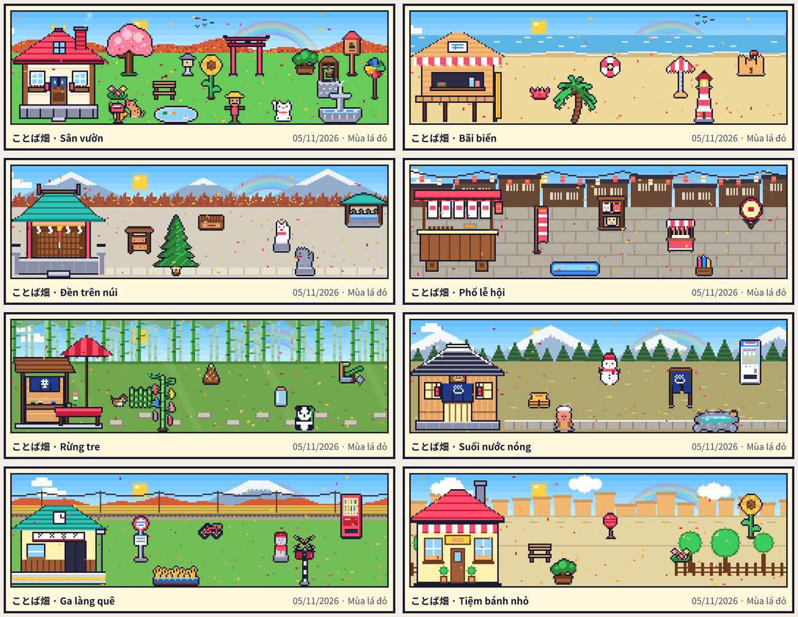

### StackChan sinh hoạt trong nhà, ngoài sân và ở từng vùng (mới ở 1.30)

StackChan giờ **sống trong ngôi nhà của bạn**. Cứ vài phút bạn ấy làm một việc hợp với **giờ trong vườn** và **đồ bạn đã đặt**:

- **Buổi sáng** tập thể dục, pha trà, nấu cơm, tưới chậu cây, ra hòm thư lấy thư. **Buổi trưa** ăn cơm, rửa bát, ngủ trưa trên thảm. **Buổi chiều** học bài ở bàn học, đọc sách cạnh kệ sách, chơi đàn koto. **Buổi tối** xem TV, sưởi lửa, ngồi bàn sưởi kotatsu, viết nhật ký. **22:30** thì lên giường ngủ tới sáng.
- Có đồ nào thì có việc đó: đặt bể cá thì bạn ấy cho cá ăn, đặt xích đu thì ra chơi xích đu. Thẻ món đồ ở cửa hàng ghi sẵn món đó mở ra việc gì. Nhà chưa có đồ vẫn có việc để làm (quét nhà, đọc báo, ngắm ngoài cửa sổ, nghe mưa, ngắm sao).
- **Mỗi vùng có việc riêng**, mua vùng không chỉ để ngắm: **tắm biển**, xây lâu đài cát, câu cá, ngắm hoàng hôn ở Bãi biển; **tắm suối nước nóng**, uống sữa sau khi tắm ở Suối nước nóng; viếng đền, rung chuông ở Đền trên núi; vớt cá vàng, ăn kẹo táo, xem pháo hoa ở Phố lễ hội; ngồi thiền, đào măng, ngắm đom đóm ở Rừng tre; đợi tàu, vẫy tay chào tàu ở Ga làng quê.
- **Mỗi việc một câu tiếng Nhật.** Bấm vào StackChan để xem câu, cách đọc và nghĩa: お茶を入れる (おちゃをいれる) · pha trà. **Sổ sinh hoạt** (Nhà → Album → Sinh hoạt) ghi lại 67 việc bạn đã thấy; ô chưa thấy có gợi ý cần món gì, giờ nào.
- Không có xu, không có chuỗi, không phải chăm. Bỏ lỡ hôm nay thì mai việc đó lại có. Muốn vườn yên tĩnh thì tắt ở ⚙ → Giao diện.

| Buổi sáng nấu ăn trong Bếp | Bấm StackChan: câu tiếng Nhật của việc đang làm |
|---|---|
| 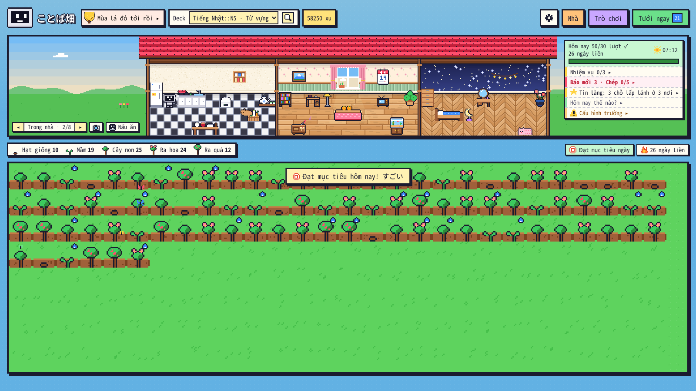 | 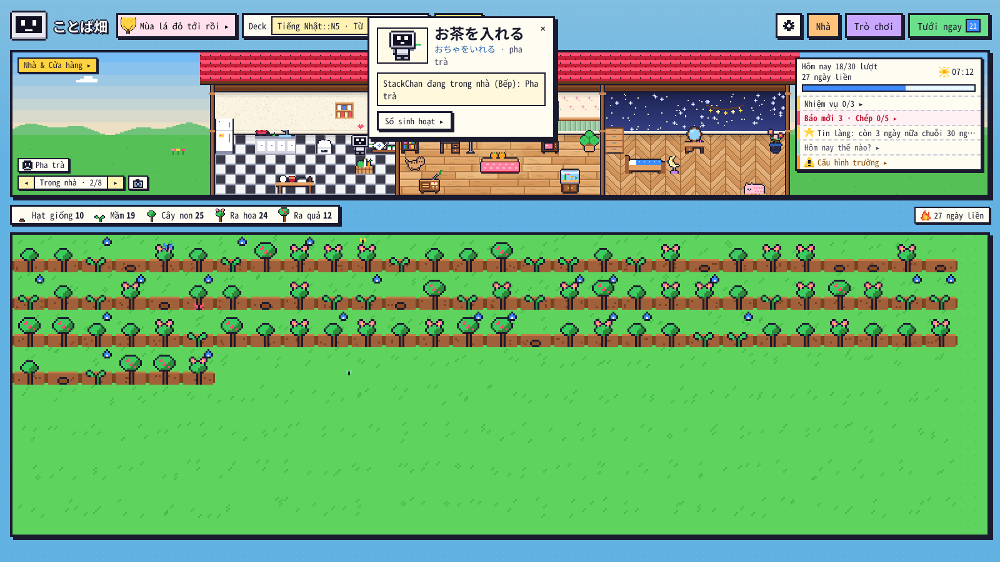 |

| Tắm suối nước nóng | Tắm biển |
|---|---|
| 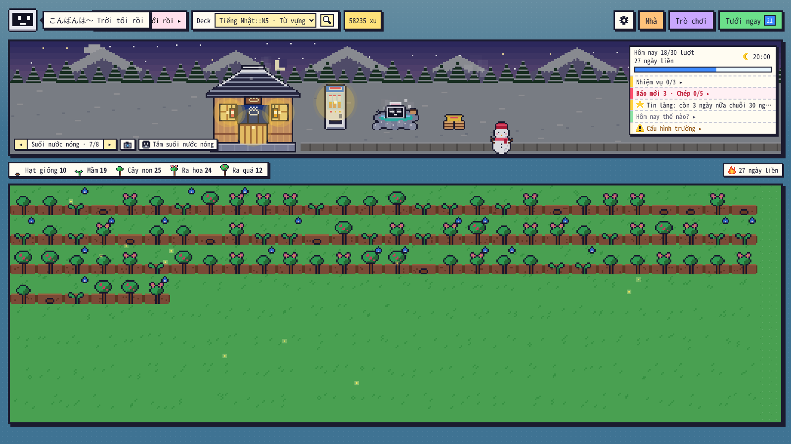 | 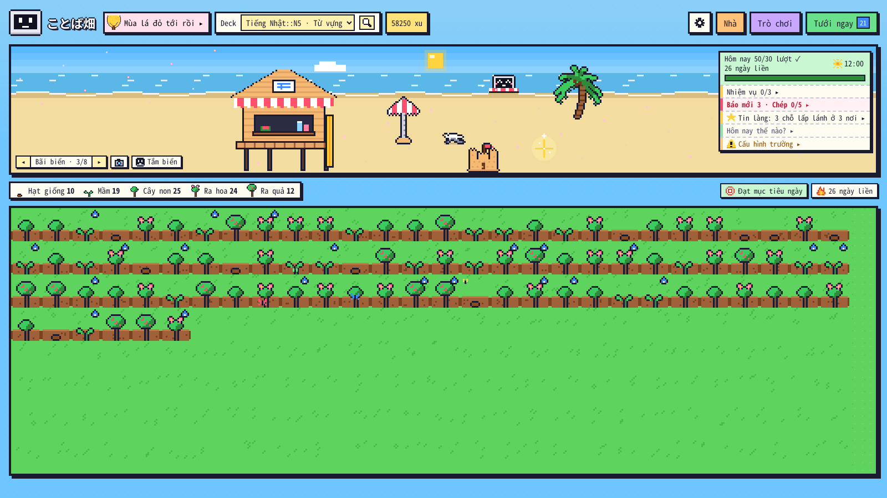 |

| 23:00 ngủ trên giường | Sổ sinh hoạt |
|---|---|
| 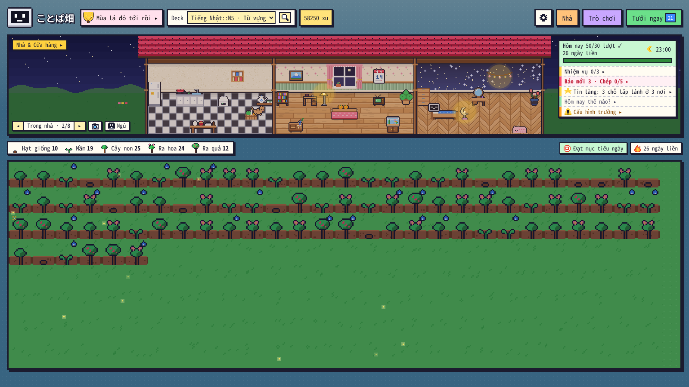 | 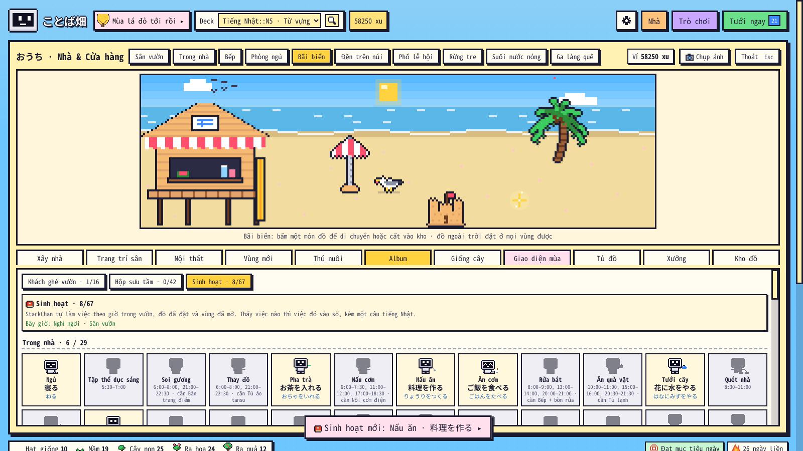 |

### Giấy dán tường và sàn cho từng gian (mới ở 1.30)

- Nhà → Nội thất → **Tường & sàn**: 12 mẫu giấy dán tường (vữa kem, cánh anh đào, sóng seigaiha, vách shoji, trời sao…) và 9 mẫu sàn (gỗ xương cá, tatami mới, gạch ô cờ, thảm len…). Mỗi gian chọn riêng; mua một lần dùng được cho mọi gian; rê chuột để xem thử trước khi mua.
- Muốn mẫu của riêng mình thì **tự vẽ một ô 16×16** trong Xưởng, vườn sẽ lát lặp lại ô đó lên cả bức tường hoặc mặt sàn.

| Chọn tường và sàn cho từng gian | Vẽ mẫu sàn của riêng mình |
|---|---|
| 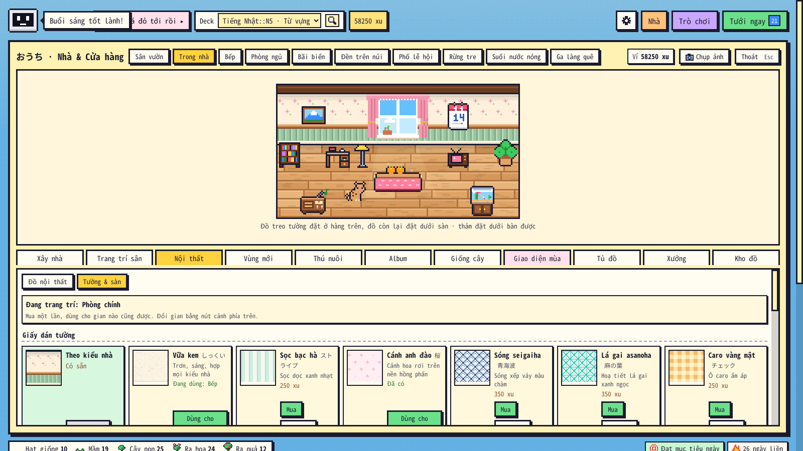 | 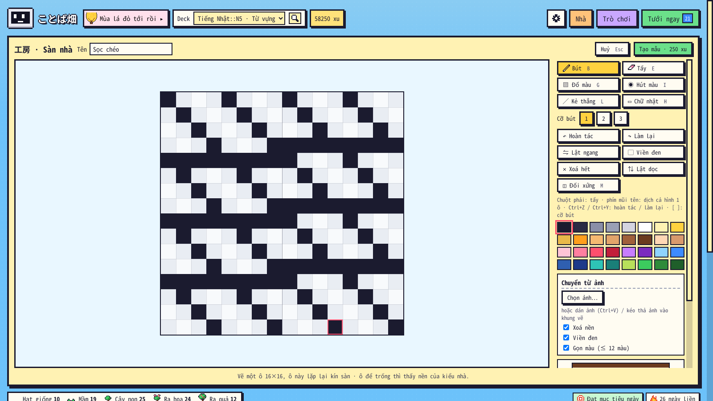 |

### Nhặt đồ theo vùng và gánh hàng rong (mới ở 1.28)

- **Chỗ lấp lánh**: cứ **10 lượt ôn** trong ngày (ôn ở màn ôn thường hay trên điện thoại cũng tính, bấm Lại cũng tính) là một chỗ lấp lánh hiện ra ở sân hoặc một vùng đã mở, tối đa 3 chỗ một ngày. Bấm vào để nhặt: vỏ sò 貝殻, bùa お守り, vé tàu cũ 切符… mỗi món có **chữ Nhật, cách đọc và nghĩa**. Dòng Tin làng cho biết chỗ lấp lánh ở đâu, bấm là tới.
- **Hộp sưu tầm** (Nhà → Album): 42 món chia 7 bộ theo cảnh. Món chưa có được ưu tiên, nhặt trùng đổi 3 xu. Đủ một bộ được tặng một món trang trí (tủ kính bày đồ sưu tầm, chuông gió vỏ sò, đèn lồng cá vàng…). Món theo mùa năm sau có lại; lỡ ngày nào cũng không mất gì.
- **Gánh hàng rong** ghé vào **thứ Tư và Chủ nhật** (ở Ga làng quê nếu đã mở, không thì ở sân): một món chỉ gánh hàng mới có (đèn kéo quân, nón lá, đồng hồ quả lắc…, khoảng 4 tuần quay lại một lần), ba món cửa hàng và một giống cây giảm 25 %.

| Chỗ lấp lánh → nhặt được | Hộp sưu tầm |
|---|---|
| 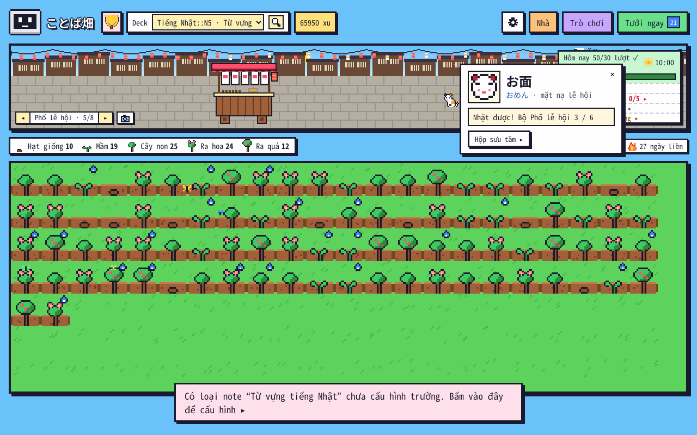 | 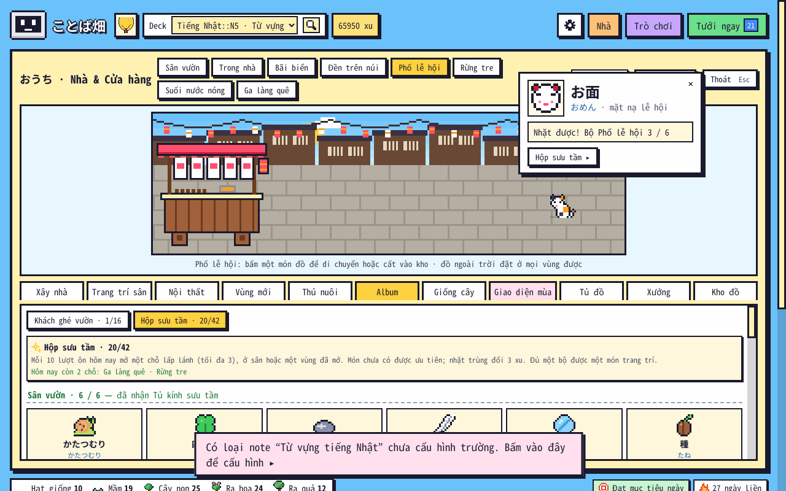 |

| Gánh hàng rong ở Ga làng quê | Đồ mới ban đêm |
|---|---|
| 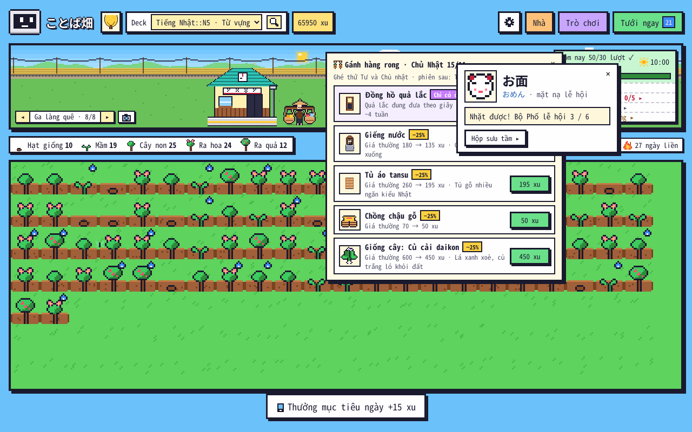 | 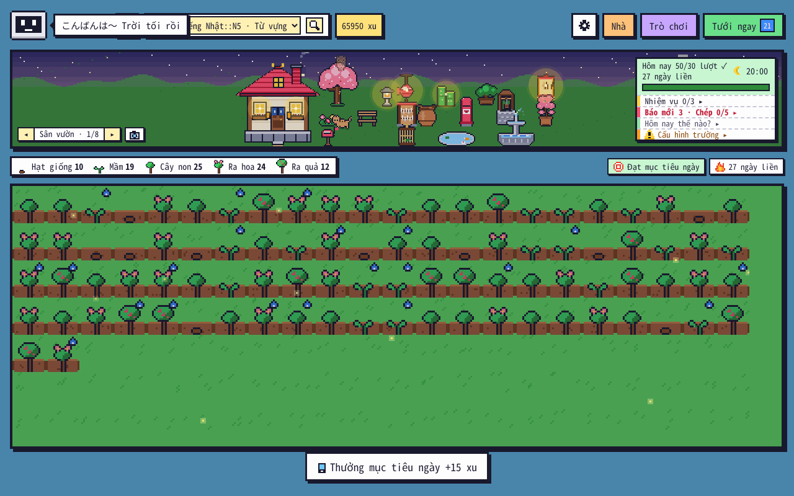 |

### Đồ đạc, tủ đồ, kho đồ

- **160 món đồ**: hơn 100 món ngoài sân và các vùng (cổng torii, ao cá koi, cây anh đào, đài phun nước…), 50 món nội thất cho cả ba gian (kotatsu, bể cá, tủ lạnh, giường…), 18 món hiếm chỉ có trong rương quà nhiệm vụ và 15 món của Hộp sưu tầm / gánh hàng rong.
- **6 thú nuôi**: gà, vịt, thỏ, rùa, mèo mướp, chó Shiba. Thú có tên, có độ thân, đi lại khắp sân. Mỗi con có món ưa thích: mèo nằm cạnh bàn sưởi và ngắm bể cá, chó nằm cạnh ghế gỗ, vịt ra ao (1.30).
- **Tủ đồ**: 17 món cho StackChan (linh vật ở góc trái): mũ rơm, nón lá, kính tròn, khăn quàng, vỏ màu sakura… cùng 7 biểu cảm. Muốn món riêng thì **tự vẽ** mũ, đồ đeo mặt, đồ đeo cổ (vẽ thẳng lên hình StackChan ở Xưởng) hoặc chọn hai màu cho vỏ (1.31). StackChan đang sinh hoạt trong nhà, ngoài sân cũng **mặc đúng bộ đồ đó**.
- **Kho đồ**: mọi món đã có, kể cả quà của giao diện mùa. Đặt ra sân, di chuyển hay cất lại lúc nào cũng được, không mất gì.
- **Xưởng**: tự vẽ đồ pixel (bút, đổ màu, kẻ thẳng, đối xứng, 3 cỡ 16 / 24 / 32), giống cây riêng và vùng riêng, hoặc chọn một tấm ảnh để chuyển thành pixel. Thiết kế chia sẻ được cho bạn bè bằng một đoạn mã — và gửi lên [trang Mã cộng đồng](https://dungmt2808.github.io/kotoba-anki/#cong-dong) cho mọi người cùng chép.

| Tự vẽ mũ cho StackChan ở Xưởng | StackChan trong nhà đội mũ vừa vẽ |
|---|---|
| 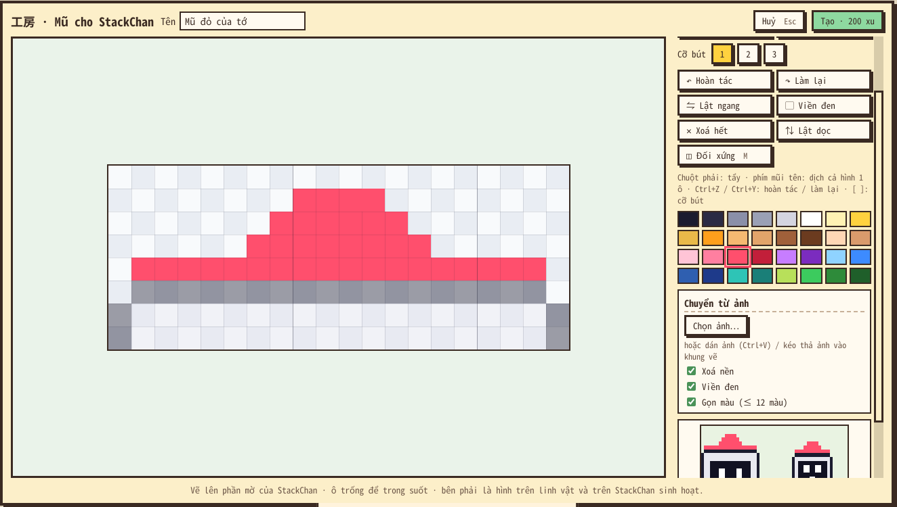 | 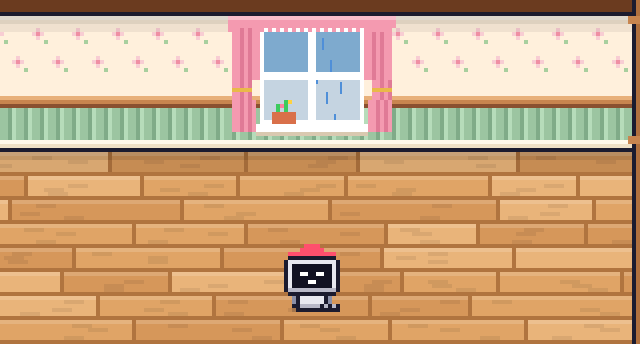 |

| Tủ đồ | Kho đồ |
|---|---|
| 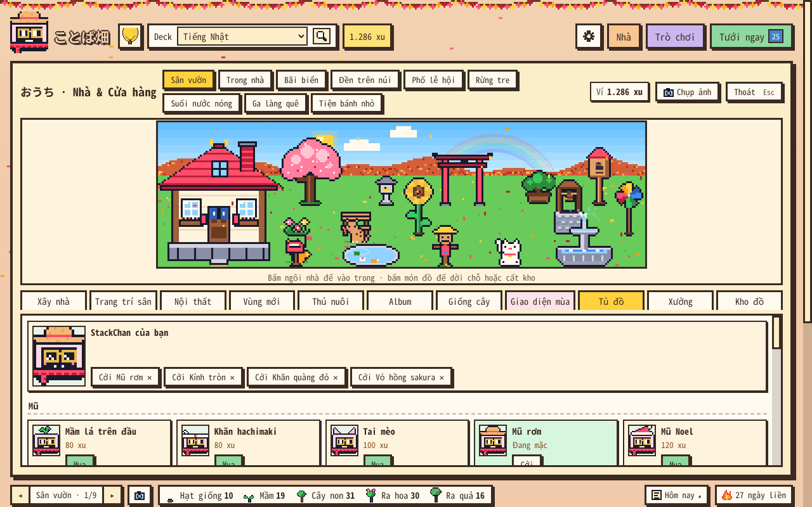 | 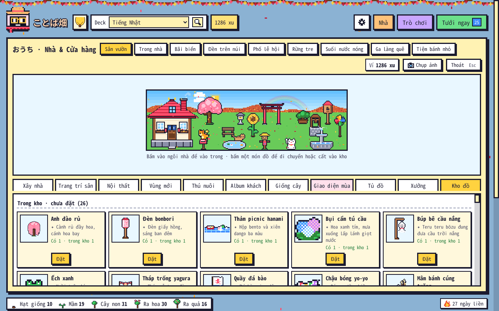 |

| Xưởng: chuyển ảnh thành pixel | Xưởng vùng: vẽ công trình |
|---|---|
| 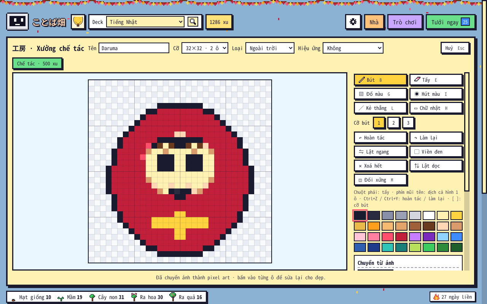 | 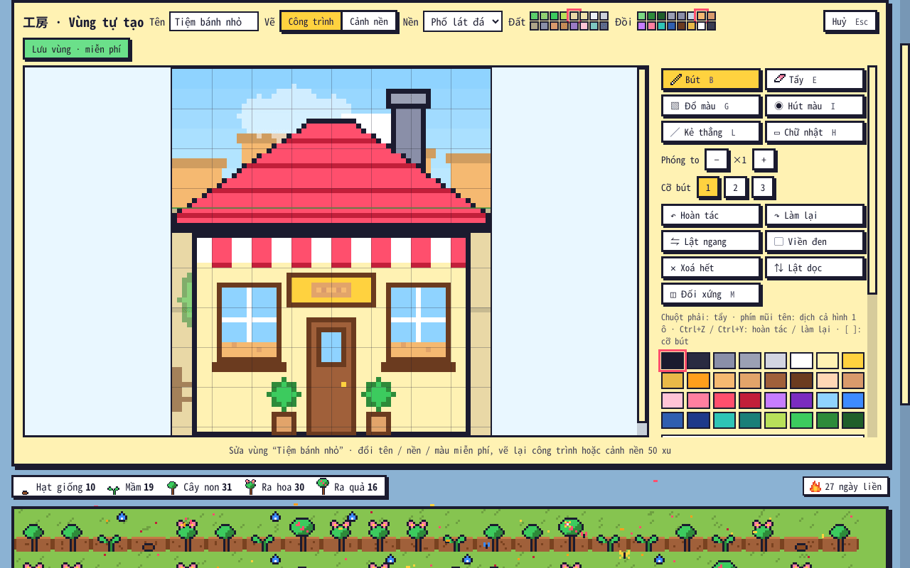 |

Nút **Chụp ảnh** lưu khu vườn thành ảnh, có cỡ hình nền 1920 × 1080:

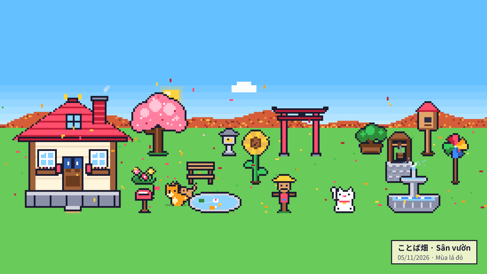

### 花暦 · Lịch hoa và nhật ký

Mỗi ngày bạn ôn là một chậu hoa trên lịch, loài hoa đổi theo giao diện mùa. Ngày ôn càng nhiều, hoa càng lớn. Bấm vào một ngày để viết **nhật ký một dòng** (tối đa 200 ký tự) và chọn **sticker tâm trạng**. Nhật ký đồng bộ qua AnkiWeb và không gửi cho Gemini.

Sợ đứt chuỗi ngày ôn? Mua **vé giữ chuỗi** ngay trong Lịch hoa (150 xu một vé, giữ tối đa 2 vé). Hôm nào quên ôn, vườn tự dùng một vé và chuỗi không đứt. Ngày dùng vé có bông tuyết trên lịch. Vé chỉ giữ con số chuỗi, không đổi lịch ôn thẻ.

Hết tháng, nhật ký tự đóng thành **một cuốn** trên kệ sách: ảnh vườn của tháng, số ngày ôn, ngày ôn nhiều nhất, tâm trạng cả tháng, từng dòng nhật ký. Cuốn nhật ký **xuất được ra PDF** khổ A5 để in hay giữ làm kỷ niệm. Có thêm ô **luyện viết** một hai câu bằng tiếng bạn đang học (Nhật, Anh, Trung, Hàn, Đức hoặc Pháp), Gemini sửa một lần mỗi ngày.

| Lịch tháng + nhật ký | Cuốn nhật ký |
|---|---|
| 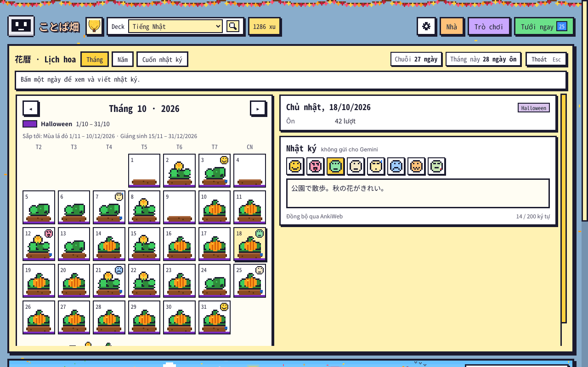 | 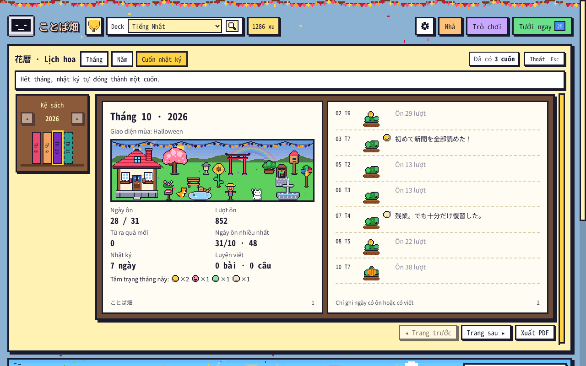 |

### 5 trò chơi ôn từ

**Nghe tìm cây**, **Chợ sáng** (khách hỏi mua theo nghĩa, bạn chọn đúng món), **Đuổi quạ** (gõ từ trước khi quạ bay tới), **Lật cặp** và **Điền vào câu**. Trò chơi dùng chính từ trong deck, có chế độ cho từ vựng, chữ Hán và ngữ pháp. Mỗi ngày kiếm tối đa 40 xu từ trò chơi. **Trò chơi không ghi vào lịch ôn của Anki.**

| Chọn trò | Chợ sáng |
|---|---|
| 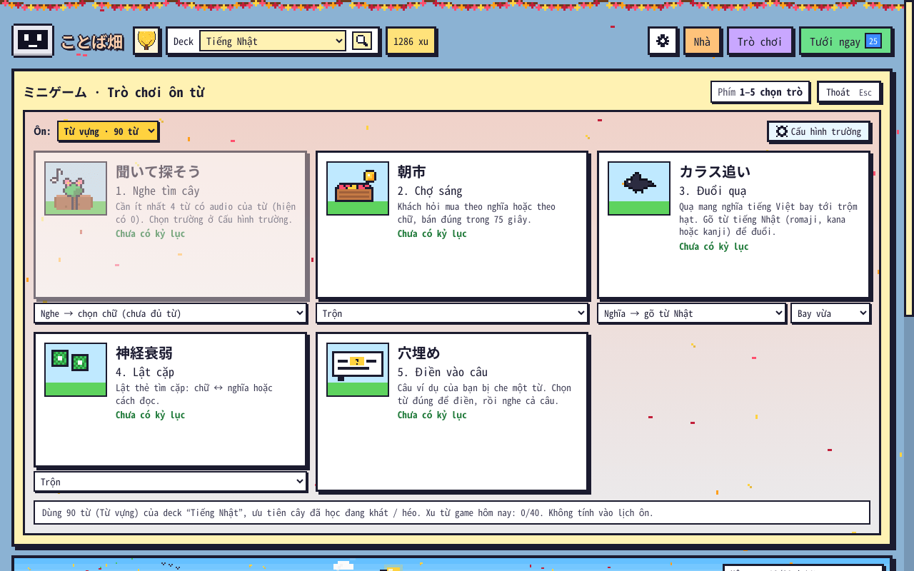 | 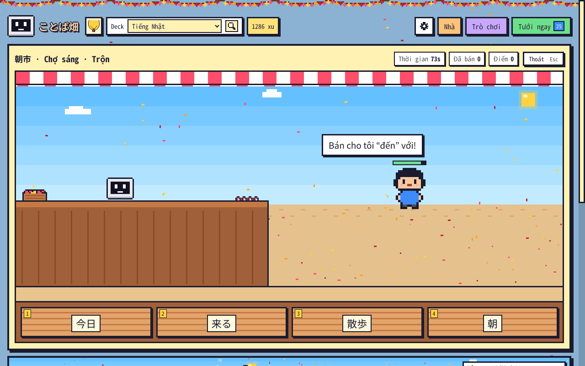 |

### Báo mỗi sáng và chép chính tả

Mỗi sáng có một số báo tiếng Nhật 畑新聞 (hoặc báo tiếng Anh *The Garden Gazette*, báo tiếng Trung 词田晨报, báo tiếng Hàn 말밭 신문, báo tiếng Đức *Der Wortgarten*, báo tiếng Pháp *Le Jardin des Mots* — nhận tối đa 2 báo) viết bằng từ trong các deck bạn chọn — chưa có deck thì viết theo trình độ. **Một làng, một truyện**: mỗi ngày làng có một kỳ truyện và vài tin làng chung; các báo kể lại cùng câu chuyện theo trình độ của bạn, thời tiết trong báo đúng như trời trong vườn hôm đó. Báo có furigana, bấm vào từ để tra nghĩa, có giọng đọc, câu hỏi đọc hiểu và **truyện dài kỳ** (Gemini lập mạch truyện, viết, rồi một "biên tập viên" chấm điểm và bắt viết lại nếu nhạt). Mỗi đoạn có **bản dịch tiếng Việt ẩn sẵn**: kẹt câu nào thì bấm **Dịch** để kiểm tra mình hiểu đúng chưa. Dưới truyện có nút **Kỳ này hay / Nhạt** để Gemini viết kỳ sau hợp ý bạn; **chủ đề truyện** chọn được nhiều (ấm áp, hài, dễ thương, kinh dị nhẹ, bí ẩn, phiêu lưu, lãng mạn nhẹ, kỳ ảo). Truyện có **Sổ tay làng**: nhớ các đợt truyện, nhân vật phụ và những điều đã xảy ra từ số đầu tiên, nên chuyện cũ không bị lặp và nhân vật cũ có thể quay lại; nghỉ vài ngày thì truyện biết thời gian đã trôi. Báo do **Gemini** viết bằng khoá miễn phí của chính bạn (xem [cách lấy khoá](#báo-mỗi-sáng-bằng-gemini-miễn-phí)); mỗi số mới cần **gói báo mua bằng xu** (1 tuần 100 xu, 1 tháng 300 xu, 7 ngày đầu miễn phí).

**Báo tiếng Trung** (HSK 1–6) có pinyin trên từng chữ (ẩn được), bấm từ để tra nghĩa kèm âm Hán Việt, chép chính tả chấm từng chữ. **Báo tiếng Hàn** (TOPIK 1–6): bấm từ để tra, nhận cả từ có tiểu từ / đuôi (학교에 → 학교), chép chính tả chấm theo cụm. **Báo tiếng Đức / tiếng Pháp** (A1–C1): bấm từ để tra, nhận cả từ đã chia / số nhiều (Blätter → das Blatt, yeux → l'œil); chép chính tả gõ không dấu cũng được (ä = ae, ß = ss, é = e).

**Báo tiếng Việt** *Báo Làng Kotoba* (cho người không học tiếng Nhật / tiếng Anh, chọn "Chỉ tiếng Việt"): cùng truyện dài kỳ và tin làng ấy bằng tiếng Việt, có câu hỏi đọc hiểu để nhận xu; không có giọng đọc, chép chính tả.

| Báo tiếng Việt | Báo muốn nhận, gói báo |
|---|---|
| 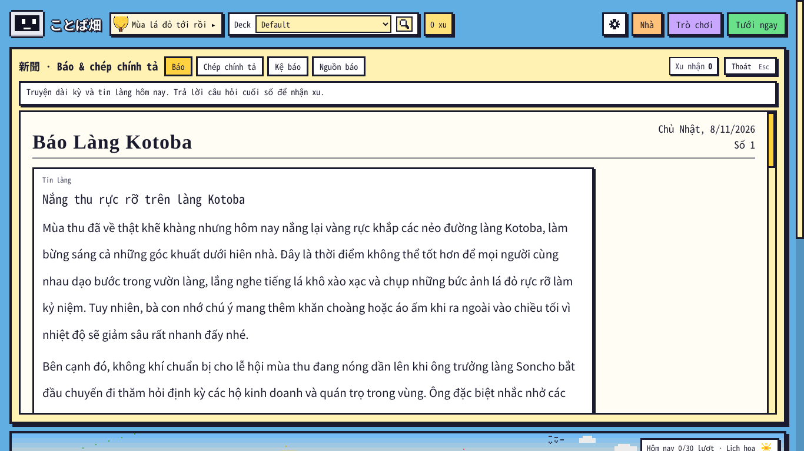 | 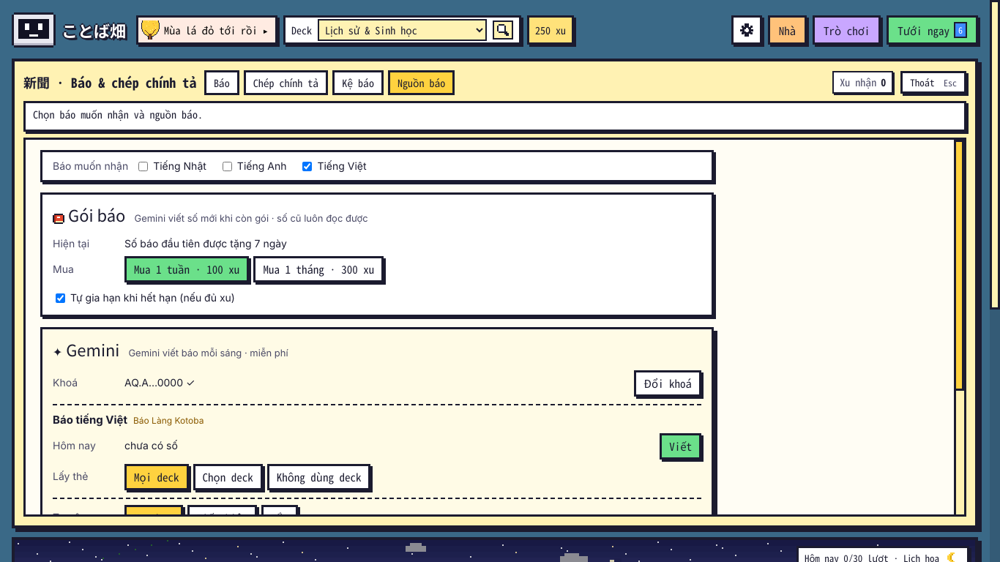 |

**Chép chính tả** chạy với mọi deck: nghe câu ví dụ (hoặc từ) rồi gõ lại. Câu nào không có audio thì dùng giọng Gemini hoặc giọng tiếng Nhật của máy.

| Báo | Chép chính tả |
|---|---|
| 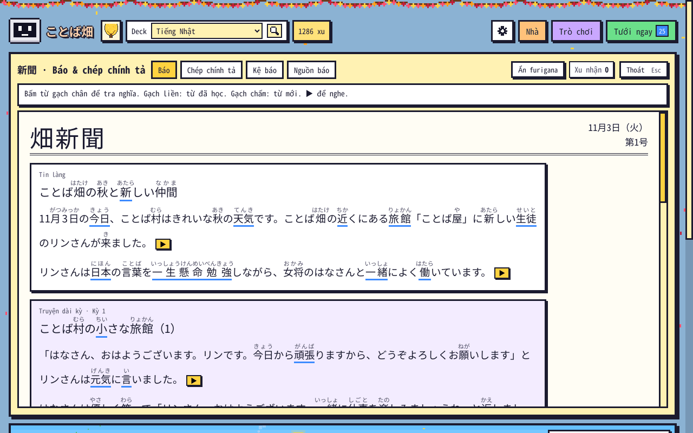 | 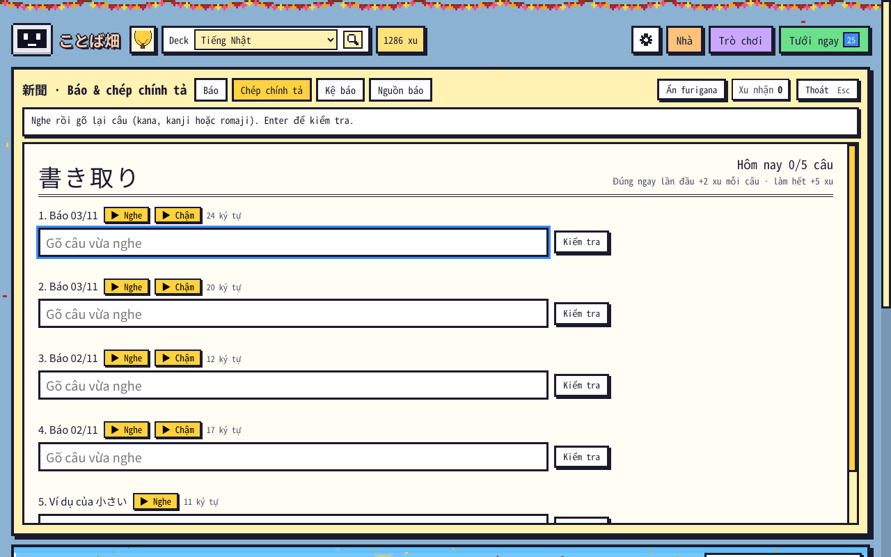 |

### Mục tiêu nhỏ mỗi ngày

- Mục tiêu 30 lượt ôn mỗi ngày (đổi được), thưởng +15 xu.
- 3 nhiệm vụ mỗi ngày. Làm đủ cả 3 thì mở rương quà có đồ hiếm.
- Chuỗi ngày ôn liên tục (tính từ ngày bạn cài ことば畑, bắt đầu từ 0), có **vé giữ chuỗi** cho hôm lỡ quên.
- Cứ 10 lượt ôn mở một **chỗ lấp lánh** để nhặt đồ; thứ Tư, Chủ nhật có **gánh hàng rong**.
- Lần mở vườn đầu tiên mỗi ngày, **thú nuôi của bạn chạy ra chào** (ngày lễ có câu chào riêng) và kể vài tin hôm nay. Dòng **Tin làng** trong thẻ Hôm nay báo khách có thể ghé, mốc học sắp chạm, mùa lễ sắp tới. Tắt được ở ⚙.
- Không có điểm trừ, không mất đồ, không có gì bắt bạn phải chơi: học là chính.

---

## Kho hình & mã thiết kế (trang web)

**[dungmt2808.github.io/kotoba-anki](https://dungmt2808.github.io/kotoba-anki/)** — xem mọi hình pixel trong vườn (hơn 340 hình: đồ đạc, thú nuôi, khách, cây, StackChan, tường & sàn, nhà, cảnh các vùng; xem từng khung hình động, tải PNG), và **Mã cộng đồng**: thiết kế người chơi tự vẽ trong Xưởng. Thấy món thích thì bấm **Chép mã**, mở **Nhà & Cửa hàng → Xưởng**, dán vào ô **“Dán mã thiết kế”** là có.

Trong vườn: tab **Xưởng** → nút **Mã cộng đồng ▸** (cạnh ô Dán mã thiết kế) mở thẳng trang này. Vẽ được món đẹp? Bấm **Mã chia sẻ** ở món tự làm / vùng tự tạo / giống tự vẽ rồi **Gửi lên trang ▸** (gửi qua GitHub hoặc email). Thiết kế được duyệt sẽ lên trang kèm tên bạn.

| Kho hình | Xem một hình: các khung, bảng màu, tải PNG |
|---|---|
| 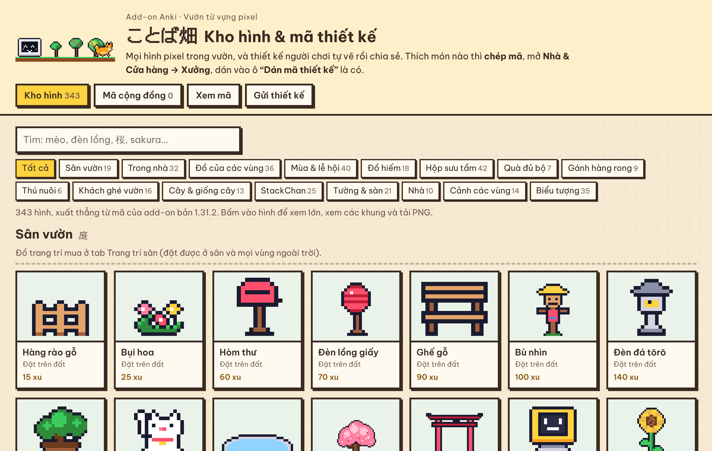 | 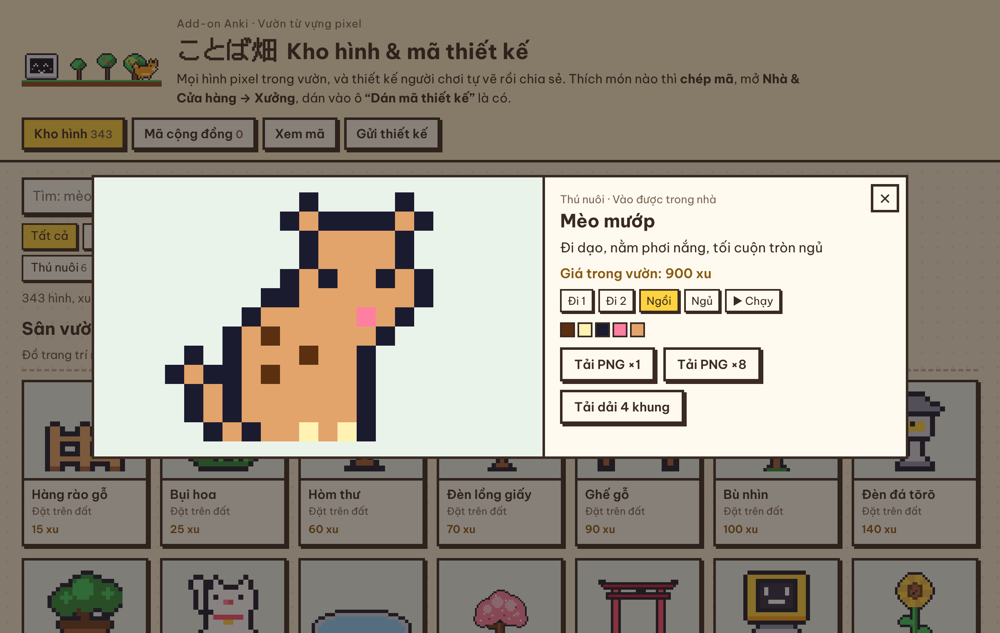 |

## Cài đặt

**Cần:** Anki **23.10 trở lên** (đã thử trên mọi bản từ 23.10 tới 26.9.4), trên Windows, macOS hoặc Linux. Nên bật **FSRS** (Deck options → FSRS) để cây lớn và héo theo trí nhớ.

<!-- Khi đã đăng AnkiWeb: thêm "Tools → Add-ons → Get Add-ons… → dán mã <mã AnkiWeb>" làm cách 1. -->
1. Tải file [`kotoba_batake.ankiaddon`](kotoba_batake.ankiaddon).
2. Mở Anki → **Tools → Add-ons → Install from file…** → chọn file vừa tải (hoặc bấm đúp vào file).
3. Khởi động lại Anki.

**Mở vườn** bằng một trong ba cách:

- nút **ことば畑** trên thanh trên cùng của Anki;
- phím **Ctrl+Shift+K** (macOS: ⌘⇧K);
- **Tools → ことば畑 · Vườn từ vựng**.

Muốn có biểu tượng ngoài màn hình nền để vào thẳng vườn: **Tools → ことば畑 · Tạo biểu tượng trên màn hình nền**.

## Bắt đầu trong 5 phút

Lần đầu mở vườn có **hướng dẫn 3 bước** ngay trên màn hình (chọn deck → ôn → xem cây lớn); xem lại ở ⚙ → *Hướng dẫn 3 bước*.

1. **Chọn deck** ở ô Deck trên cùng. Cây mọc theo note của deck đó.
2. Nếu thẻ **Hôm nay** có dòng ⚠ **Cấu hình trường**, bấm vào để chỉ cho vườn biết trường nào là *Từ*, *Nghĩa*, *Câu ví dụ*… Vườn tự đoán sẵn, bạn chỉ cần kiểm lại rồi bấm Lưu.
3. Bấm **Tưới ngay** để ôn các thẻ đến hạn và nhận xu.
4. Bấm **Nhà** để xây bước đầu tiên của ngôi nhà.
5. (Tuỳ chọn) Bấm **B** để mở báo, sang tab **Nguồn báo** và dán khoá Gemini.

Phím tắt trong vườn: **R** Tưới ngay · **N** Nhà · **T** Trò chơi · **B** Báo · **L** Lịch hoa · **Q** Nhiệm vụ · **/** chọn deck (cây deck như Anki, gõ để tìm) · **Esc** đóng bảng đang mở. Khi ôn thẻ: **Space** / **Enter** lật thẻ · **1–4** chấm (số ghi trên nút) · **R** (hoặc **F5**) nghe lại âm thanh · **F** phóng to (chỉ còn thẻ + nút chấm, hợp với thẻ dài) · **Ctrl+Z** hoàn tác lượt chấm vừa rồi (trả lại cả xu của lượt đó) · **E** (hoặc nút ✎ Sửa ở góc dưới bên trái) sửa thẻ đang ôn bằng cửa sổ sửa của Anki. Thẻ trắc nghiệm tự lật khi bấm đáp án (như trong Anki). Nhạc, hiệu ứng và giao diện từng chế độ (ví dụ ẩn sân khi ôn) chỉnh ở nút ⚙.

## Báo mỗi sáng bằng Gemini (miễn phí)

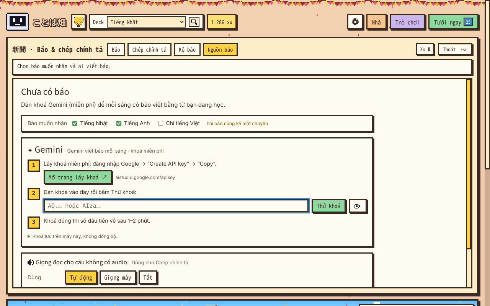

1. Mở báo (phím **B**) → tab **Nguồn báo** → **Mở trang lấy khoá** (aistudio.google.com/apikey).
2. Đăng nhập Google → **Create API key** → **Copy**.
3. Dán khoá vào ô → **Thử khoá**.
4. Chọn báo muốn nhận (tối đa 2 trong tiếng Nhật, Anh, Trung, Hàn, Đức, Pháp; hoặc chỉ tiếng Việt — add-on chọn sẵn báo theo deck bạn đang học), trình độ và deck lấy từ (hoặc **Không dùng deck**) → **Bắt đầu viết**. Số đầu tiên về sau 1–2 phút. Từ hôm sau, Gemini tự viết khi bạn mở Anki.
5. **Gói báo**: số đầu tiên được tặng 7 ngày. Sau đó mua ở thẻ **Gói báo** (1 tuần 100 xu, 1 tháng 300 xu); **Tự gia hạn** (bật sẵn) tự mua tiếp khi hết hạn nếu đủ xu. Hết gói thì không có số mới, số cũ vẫn đọc được.

**Riêng tư:**

- Khoá chỉ lưu trên máy này. Khoá không đồng bộ AnkiWeb và không nằm trong báo cáo lỗi.
- Gemini nhận danh sách từ bạn đang học, nội dung báo và truyện các kỳ trước, câu cần giọng đọc, dòng nhận xét truyện bạn gõ, và đoạn luyện viết nếu bạn nhờ sửa.
- Với gói miễn phí, Google có thể dùng dữ liệu đó để cải thiện sản phẩm.

Không dán khoá thì add-on **không gửi gì lên mạng**; vườn, trò chơi, lịch và chép chính tả vẫn chạy đầy đủ.

### Nâng cao: báo do Claude Code viết (tuỳ chọn)

Cách này dành cho số ít người đã dùng [Claude Code](https://claude.com/claude-code) và muốn báo bám **đúng giáo trình** mình đang học (chương nào, ngữ pháp nào), kèm giọng đọc VOICEVOX. Mỗi sáng, Claude Code chạy theo lịch trên máy bạn, đọc phạm vi đã học rồi viết một số báo vào thư mục `kotoba_daily`. Add-on đọc thư mục đó (chỉ ghi tiến độ đọc `tien_do.json` và truyện chung `truyen_chung.json`).

1. Chép thư mục [`kotoba_daily/`](kotoba_daily/) về máy và làm theo [`kotoba_daily/HUONG_DAN.md`](kotoba_daily/HUONG_DAN.md). Cần Claude Code, Python 3 và PDF giáo trình của bạn.
2. Trong Anki: **Tools → Add-ons → ことば畑 → Config**, đặt `"bao_dir": "<đường dẫn tới kotoba_daily>"`.
3. Mở lại vườn. Tab **Nguồn báo** có thêm thẻ **Claude Code** để chọn thư mục và đổi qua lại với Gemini.

Từ bộ `kotoba_daily` 2.4 (add-on 1.25.8), báo Claude Code và báo Gemini **kể cùng một truyện**: hôm nào Gemini viết thay (bạn đổi nguồn sang Gemini) hay báo tiếng Anh viết trước, Gemini viết tiếp đúng kỳ Claude đã đăng; add-on ghi các kỳ đó vào `kotoba_daily/truyen_chung.json` để sáng hôm sau Claude viết nối tiếp. Cần add-on thấy thư mục `kotoba_daily` (`bao_dir` đặt sẵn) — máy khác không có thư mục này thì Gemini ở máy đó vẫn viết truyện riêng.

Từ bộ `kotoba_daily` 2.3, số báo Claude Code viết cũng có **bản dịch tiếng Việt ẩn sẵn** từng đoạn như báo Gemini. Đang dùng bộ cũ thì chép đè `tools/`, `prompts/`, `vi_du/`, `HUONG_DAN.md` (giữ nguyên dữ liệu của bạn); số cũ thêm bản dịch bằng `prompts/them_ban_dich.md`.

Để `bao_dir` trống (mặc định) thì thẻ này không hiện. Chi tiết từng mục cấu hình nằm ở trang Config của add-on.

---

## Câu hỏi thường gặp

**Add-on có làm sai lịch ôn của tôi không?**
Không. Ôn trong vườn là lượt ôn Anki bình thường. Xu, nhà, trò chơi và báo không bao giờ đụng tới lịch ôn hay FSRS.

**Tôi ôn trên điện thoại (AnkiDroid / AnkiMobile) thì sao?**
Điện thoại không chạy được add-on, nhưng lượt ôn trên điện thoại vẫn làm cây lớn. Sau khi đồng bộ, lần mở vườn trên máy tính sẽ **bù xu** cho các lượt đó (+1 mỗi lượt nhớ), tính cả nhiệm vụ và mục tiêu ngày.

**Tôi dùng cả điện thoại lẫn máy tính, vườn có bị lệch không?**
Không. Điện thoại chỉ giữ hộ một bản dữ liệu vườn cũ, và Anki có thể đẩy bản cũ đó lên khi bạn ôn trên điện thoại rồi mới đồng bộ. Lần đồng bộ sau trên máy tính, vườn tự giữ lại bản mới nhất của mình (xu, nhà, đồ, nhật ký), bạn không phải làm gì. Dùng **hai máy tính** thì cứ để Anki tự đồng bộ khi mở và khi đóng: chơi vườn trên hai máy cùng lúc khi chưa đồng bộ thì máy chơi sau sẽ thắng.

**Xu, nhà và đồ đạc lưu ở đâu? Gỡ add-on có mất thẻ không?**
Mọi thứ lưu trong collection nên đồng bộ qua AnkiWeb sang máy khác (máy đó cũng cần cài add-on). Gỡ add-on không ảnh hưởng tới thẻ hay lịch ôn. Máy này còn giữ một bản sao lưu cho từng hồ sơ Anki trong thư mục `user_files/ho_so/` của add-on. Nếu Anki báo lỗi khi lưu (ổ đĩa đầy…), vườn báo "Anki báo lỗi khi lưu nên chưa đổi gì": xu không bị trừ, bản vẽ ở Xưởng và chữ nhật ký vẫn còn để lưu lại.

**Deck của tôi không phải tiếng Nhật?**
Deck **tiếng Anh**, **tiếng Trung**, **tiếng Hàn**, **tiếng Đức**, **tiếng Pháp** có đủ vườn, trò chơi, chép chính tả và báo của tiếng đó; ⚙ → **Ngôn ngữ trong vườn** cho StackChan, khách, đồ vật nói tiếng bạn đang học. Ngôn ngữ khác và deck kiến thức (lịch sử, y khoa…) có vườn, các trò chơi chung (cả Đuổi quạ: gõ đúng từ / câu trả lời ngắn) và **báo tiếng Việt** (truyện dài kỳ + tin làng).

**Lời nhắc (prompt) gửi Gemini là gì?**
Xem nguyên văn ở [docs/LOI_NHAC_GEMINI.md](docs/LOI_NHAC_GEMINI.md).

**Báo có đọc thành tiếng không? Windows, macOS, Linux cần cài gì?**
Báo tiếng Nhật / Anh / Trung / Hàn / Đức / Pháp có hai nguồn giọng đọc. Báo tiếng Việt chỉ để đọc, không có giọng.

- **Giọng Gemini** (mọi máy): tạo bằng chính khoá Gemini của bạn. Mặc định chỉ đọc **câu chép chính tả**. Muốn nghe **từng đoạn** thì vào báo (phím **B**) → tab **Nguồn báo** → **Giọng đọc: Cả bài**. Bản miễn phí khoảng 10 lượt tạo giọng / ngày; hết lượt thì dùng giọng của máy.
- **Giọng của máy** (Windows, macOS): đọc những đoạn chưa có giọng Gemini. Cần cài giọng tiếng Nhật (hoặc tiếng Trung / tiếng Hàn / tiếng Đức / tiếng Pháp) một lần (giọng tiếng Anh thường có sẵn), rồi mở lại Anki:
  - Windows: **Cài đặt → Thời gian & ngôn ngữ → Giọng nói → Thêm giọng nói → Tiếng Nhật**.
  - macOS: **Cài đặt hệ thống → Trợ năng → Nội dung đọc → Giọng hệ thống → Quản lý giọng nói → Tiếng Nhật**.
- **Linux**: Anki không có giọng của máy, nên chỉ nghe được giọng Gemini và audio có sẵn trong deck. Anki cần **mpv** để phát âm thanh (cũng là âm thanh của thẻ):

  ```bash
  sudo apt install mpv
  ```

Nút **Chậm** đọc chậm được mọi giọng; riêng audio có sẵn trong deck thì cần Anki đang dùng mpv.

**Giao diện có tiếng Anh không?**
Hiện chỉ có tiếng Việt (kèm chữ Nhật trang trí).

**Máy yếu, vườn chạy nặng?**
Vào ⚙ để tắt hiệu ứng hoặc đổi giao diện từng chế độ (ví dụ ẩn sân khi ôn thẻ).

## Báo lỗi và góp ý

Vào **Tools → ことば畑 · Báo lỗi**, ghi vài dòng ở mục *Mô tả lỗi*, bấm **Gửi email…** (báo cáo được chép sẵn, dán vào thư gửi **maitrongdung10@gmail.com**) hoặc **Gửi qua GitHub…** (báo cáo được chép sẵn, mở mẫu [Báo lỗi / góp ý](https://github.com/dungmt2808/kotoba-anki/issues/new?template=bao_loi.yml) — dán vào ô *Báo cáo của add-on*). Cách làm có ở mục [Báo lỗi](https://dungmt2808.github.io/kotoba-anki/#bao-loi) của trang web. Góp ý, ý tưởng cũng gửi về email này (⚙ → **Góp ý qua email…**). Báo cáo có nhật ký lỗi và phiên bản Anki. Khoá Gemini và đường dẫn trên máy bạn được tự động che đi, và bạn sửa hay xoá bớt được trước khi gửi. Add-on không tự gửi gì lên mạng.

Thấy hình có sẵn bị lỗi (thiếu một điểm viền, lệch màu…)? Mở **Nhà**, ở thẻ món bạn đã có bấm **Góp ý hình**, vẽ lại (cả khung động như hươu cúi chào, tủ lạnh mở, đài phun nước đóng băng…) rồi **Lưu file góp ý**, đính kèm file đó vào issue. Vườn của bạn không đổi; bản sửa được nhận sẽ có ở bản cập nhật sau cho mọi người.

## Giấy phép

ことば畑 © 2026 dungmt2808. Mã nguồn, hình pixel và nhạc của add-on và trang web phát hành theo **GNU AGPL-3.0** (hoặc bản mới hơn — cùng giấy phép với Anki), toàn văn ở [`LICENSE`](LICENSE).
Bạn được dùng, sửa và chia sẻ lại; bản sửa đăng ra (kể cả chạy như một dịch vụ trên mạng) phải kèm mã nguồn theo cùng giấy phép và giữ ghi chú bản quyền.
Thiết kế ở mục [Mã cộng đồng](https://dungmt2808.github.io/kotoba-anki/#cong-dong) thuộc về người vẽ, được đăng để mọi người chép vào vườn.

## Cho người phát triển

- Tài liệu phát triển (kiến trúc, dữ liệu, luật chơi, quyết định đã chốt, lịch sử phiên bản): [`PHAT_TRIEN.md`](PHAT_TRIEN.md).
- Bộ test (offline, Gemini thật, giao diện trong Anki thật trên nhiều bản Anki): [`tests/README.md`](tests/README.md).
- Ảnh và video trên trang này làm lại được bằng `tests/anki/readme_media.js` và `tests/tools/make_media.sh`.
- Mã nguồn add-on nằm ở thư mục [`kotoba_batake/`](kotoba_batake/); file cài đặt `kotoba_batake.ankiaddon` đóng gói từ thư mục đó.
- Trang web Kho hình & Mã cộng đồng: thư mục [`site/`](site/), cách bật / duyệt mã / cập nhật hình ở [`docs/TRANG_WEB.md`](docs/TRANG_WEB.md).
