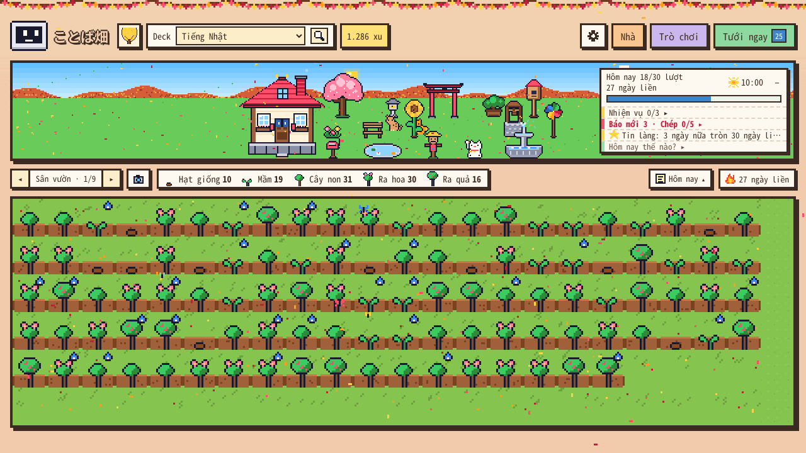
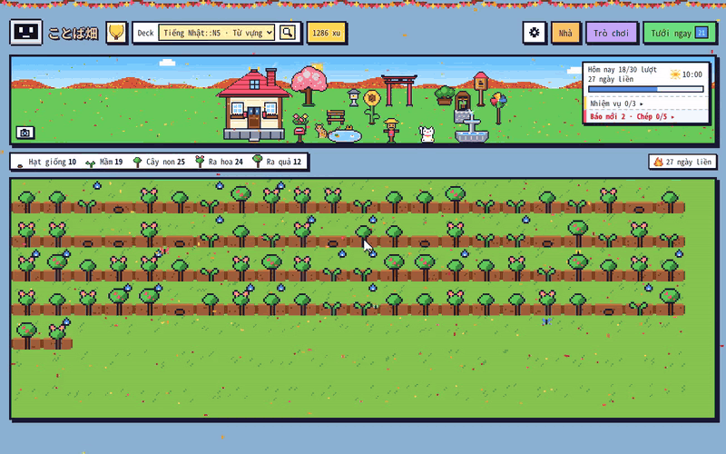
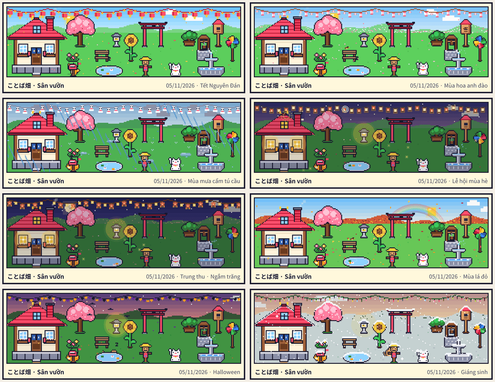
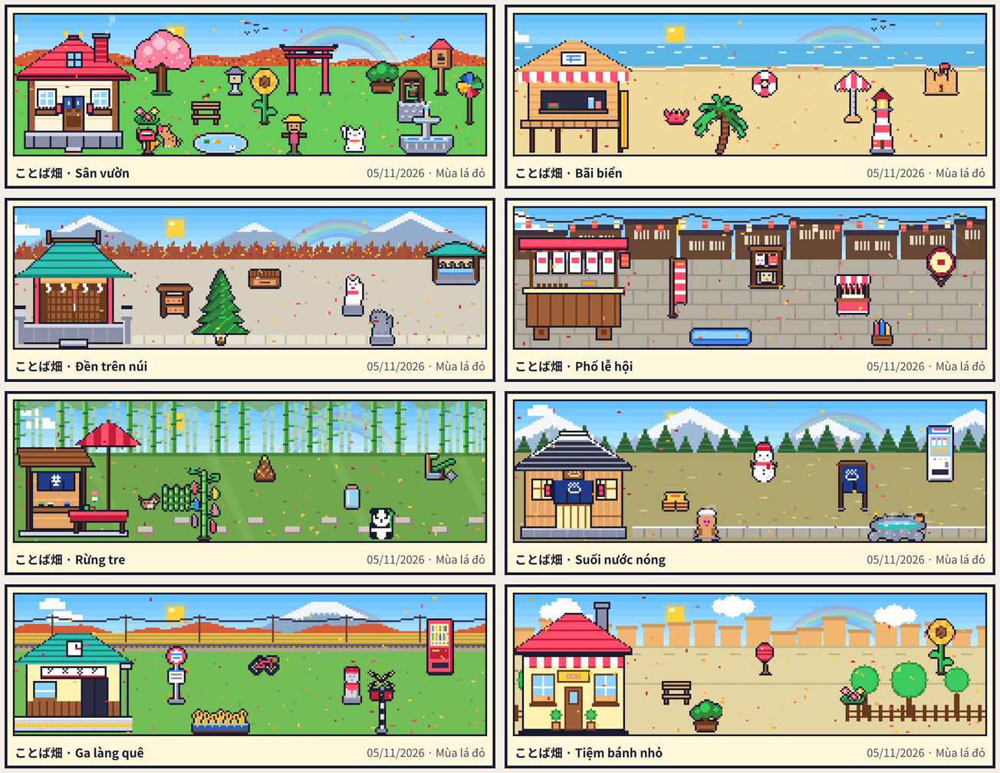

# Đăng ことば畑 lên AnkiWeb

Trang tải lên: **ankiweb.net/shared/addons** → đăng nhập → **Upload** (cùng tài khoản AnkiWeb dùng để đồng bộ là được).
Sau khi đăng, AnkiWeb cho một **mã số** (vd. `1234567890`) — người dùng cài bằng **Tools → Add-ons → Get Add-ons… → dán mã**.
Gửi mã đó cho Claude để điền vào `README.md` (mục Cài đặt), trang web chung và tài liệu.

> Ô mô tả của AnkiWeb (từ 8/2023) đọc **Markdown cơ bản**: chữ đậm, danh sách, đường dẫn, ảnh. **Không** có tiêu đề `#`, không có
> đường dẫn tương đối (mọi link / ảnh phải là `https://…` đầy đủ).
> **Ảnh**: AnkiWeb không cho tải ảnh lên — mô tả **trỏ tới ảnh đặt trên mạng** bằng ``. Ảnh dưới đây là file
> trong `docs/anh/` + `docs/video/` của repo, lấy qua `raw.githubusercontent.com` (cách các add-on lớn trên AnkiWeb vẫn làm, vd.
> mô tả của glutanimate). Repo phải **công khai** và ảnh phải ở nhánh `master`. Thêm ảnh: chép file vào `docs/anh/`, đẩy lên `master`,
> thêm một dòng ``.

## 1. Các ô cần điền

| Ô | Điền |
|---|---|
| **File** | `kotoba_batake.ankiaddon` ở gốc repo (bản **1.36.4** — gồm 1.36.0–1.36.3, sự kiện Giáng sinh; đóng bằng `python3 tests/tools/pack.py`). **Không** tải `tests/tools/kotoba_batake_test.ankiaddon` (công cụ test cho nhiều xu). |
| **Title** | `ことば畑 Kotoba Batake – pixel vocabulary garden (Vietnamese UI)` |
| **Tags** | `japanese english vocabulary gamification garden pixel vietnamese fsrs` |
| **Support page** | `https://github.com/dungmt2808/kotoba-anki/issues` (hoặc `https://dungmt2808.github.io/kotoba-anki/#bao-loi`) |
| **Anki tối thiểu / tối đa** (nếu form hỏi) | 23.10 / 26.9.4 — khớp `min_point_version` 231000 / `max_point_version` 260904 trong `manifest.json` (số tối đa là "đã thử tới", Anki không chặn bản mới hơn) |
| **Description** | khối ở mục 2 (chép từ dòng `**Every note grows…` tới hết) |

Mỗi lần ra bản mới: **Update** trên trang add-on của mình → tải file mới; sửa mô tả nếu tính năng đổi.

## 2. Mô tả (chép nguyên khối)

````markdown
**Every note grows into a pixel-art plant as your memory gets stronger.** Review in the garden, earn coins, build a house, decorate, raise pets, and read a little morning newspaper written with the words you are learning.
**Interface: Vietnamese only.** Works with Japanese and English decks (other decks get the garden, games and a Vietnamese newspaper). Anki 23.10 or newer.



**Mỗi từ bạn học là một cái cây.** ことば畑 biến deck từ vựng (tiếng Nhật, Anh, Trung, Hàn, Đức, Pháp…) thành một khu vườn pixel. Cây lớn theo trí nhớ thật (FSRS): ôn đều thì ra hoa, ra quả; đến hạn thì khát nước; sắp quên thì héo. Nhìn vườn là biết mình đang nhớ tới đâu.



**Có gì trong vườn**

- **Tưới ngay**: ôn thẻ ngay trong vườn. Đây là lượt ôn Anki bình thường — lịch ôn, FSRS và đồng bộ AnkiWeb không đổi. Mỗi thẻ nhớ được +1 xu.
- **Mới: Lịch chờ Giáng sinh (1/12 – 31/12)** — tủ lịch 24 ngăn, mỗi ngày có ôn thẻ (ôn trên điện thoại cũng tính) mở một ngăn quà trang trí: cây thông đầy dần, nhà khoác áo Noel, sân sáng đèn ban đêm; lỡ ngày thì ôn thêm để mở bù. Làm thiệp, tự vẽ lên thiệp và vẽ quả châu treo cây, viết điều ước — tối 24 có bất ngờ. Không tốn xu, tắt được ở ⚙ → Sự kiện mùa.
- **14 giao diện mùa** có nhạc riêng: Tết, hoa anh đào, mùa mưa, Thất Tịch, lễ hội mùa hè, Trung thu, lá đỏ, Halloween, Giáng sinh, năm mới Nhật… tự bật đúng dịp trong năm.
- **Nhà 3 gian & 160 món đồ**: xây nhà từng bậc, 4 kiểu nhà, Bếp và Phòng ngủ, giấy dán tường và sàn cho từng gian, đồ sân vườn, nội thất, đồ hiếm trong rương nhiệm vụ.
- **6 vùng mới** (bãi biển, đền trên núi, phố lễ hội, rừng tre, suối nước nóng, ga làng quê) và **vùng tự tạo**.
- **Thú nuôi, khách ghé vườn, StackChan sinh hoạt**: 6 thú nuôi, 16 vị khách theo mùa / giờ / thời tiết, linh vật StackChan nấu ăn, ngủ trưa, ngâm suối nước nóng, bơi ở bãi biển… mỗi việc kèm một câu tiếng Nhật.
- **Nhặt đồ & gánh hàng rong**: chỗ lấp lánh mở theo lượt ôn, 42 món sưu tầm có tên tiếng Nhật; gánh hàng rong ghé thứ Tư và Chủ nhật.
- **Xưởng**: tự vẽ đồ pixel, giống cây, mũ cho StackChan, mẫu tường / sàn, cả một vùng riêng, hoặc chuyển ảnh thành pixel. Chia sẻ thiết kế bằng một đoạn mã.
- **Lịch hoa & nhật ký**: mỗi ngày ôn là một chậu hoa; nhật ký một dòng kèm sticker tâm trạng, hết tháng đóng thành cuốn, xuất PDF.
- **5 trò chơi ôn từ** bằng chính từ trong deck (không ghi vào lịch ôn).
- **Báo mỗi sáng** (tuỳ chọn, Gemini với khoá miễn phí của bạn): tiếng Nhật có furigana / tiếng Anh / tiếng Việt, có giọng đọc, câu hỏi và truyện dài kỳ. Chép chính tả cho mọi deck.





**Cách dùng**
Cài xong, khởi động lại Anki rồi bấm nút **ことば畑** trên thanh trên cùng (hoặc Ctrl+Shift+K). Lần đầu có hướng dẫn 3 bước: chọn deck → bấm **Tưới ngay** → xem cây lớn. Nên bật FSRS để cây lớn và héo theo trí nhớ.

**Điện thoại & đồng bộ**
AnkiDroid / AnkiMobile không chạy add-on, nhưng lượt ôn trên điện thoại vẫn làm cây lớn và được bù xu sau khi đồng bộ. Xu, nhà, đồ đạc lưu trong collection nên đồng bộ qua AnkiWeb; vườn tự giữ bản mới nhất khi điện thoại đồng bộ bản cũ. Gỡ add-on không ảnh hưởng tới thẻ hay lịch ôn.

**Riêng tư**
Không dán khoá Gemini thì add-on không gửi gì lên mạng. Khoá chỉ lưu trên máy bạn, không đồng bộ, không nằm trong báo cáo lỗi.

**Kho hình & mã thiết kế**: [dungmt2808.github.io/kotoba-anki](https://dungmt2808.github.io/kotoba-anki/) — mọi hình pixel của vườn và thiết kế người chơi chia sẻ.
**Hướng dẫn đầy đủ, ảnh, video**: [github.com/dungmt2808/kotoba-anki](https://github.com/dungmt2808/kotoba-anki)
**Giấy phép**: GNU AGPL-3.0 — mã nguồn mở trên GitHub.
**Gặp lỗi?** Tools → ことば畑 · Báo lỗi → **Gửi qua GitHub…** hoặc **Gửi email…**. Vui lòng báo lỗi ở đó thay vì chấm điểm thấp — mình sẽ sửa sớm.
````

## 3. Sau khi đăng

1. Thử cài bằng mã trên một hồ sơ Anki mới (Tools → Add-ons → Get Add-ons…).
2. Gửi mã cho Claude: thêm "Cách 1: cài bằng mã" vào `README.md` (đã có chỗ đánh dấu ở mục Cài đặt), trang web chung, `kotoba_batake/README.md`.
3. Thỉnh thoảng vào trang add-on trên AnkiWeb xem đánh giá / câu hỏi của người dùng.
