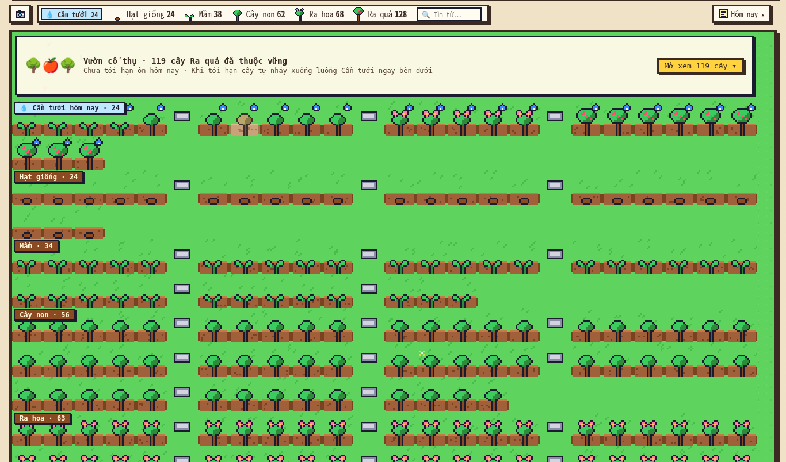

# Rà soát tổng thể Giao diện (UI/UX) & Đề xuất Cải tiến `kotoba_batake` (`1.33.2`)

> Tài liệu này tổng hợp kết quả rà soát toàn bộ 10 màn hình/bảng chức năng của **ことば畑 – Khu vườn từ vựng** (phiên bản `1.33.2`), đi sâu vào bài toán **"Vườn nhiều cây bị rối mắt"** từ phản hồi thực tế của người dùng Việt Nam, đồng thời chỉ ra các điểm nghẽn bố cục (đặc biệt trên màn hình laptop phổ biến `1366×768`) và lộ trình tối ưu cụ thể.

---

## Phần 1: Giải bài toán “Vườn nhiều cây hiển thị bị rối mắt” (`#kb-field`)

### 1.1. Nguyên nhân gốc rễ (Vì sao chỉ tăng cỡ vườn hoặc giảm `max_plants` là chưa đủ?)

Khi một deck có từ **200–500+ từ** (rất phổ biến với người học Minna, N5–N3, Core 2k, IELTS…), nếu chỉ phóng to ô cây (`SCALE`) thì người dùng phải cuộn chuột rất dài; nếu giảm `max_plants` xuống 100–150 thì người học mất cảm giác "nhìn thấy thành quả tích luỹ của cả bộ thẻ".

Qua kiểm tra mã nguồn [`garden_core.build_garden()`](../../kotoba_batake/garden_core.py#L728-L785) và [`web/garden.js`](../../kotoba_batake/web/garden.js#L118-L215), hiện tượng rối mắt đến từ **4 nguyên nhân thị giác**:

1. **Xếp cây theo thứ tự tạo note (`order by id`) gây "nhiễu tần số cao" (Checkerboard noise)**:
   - Hạt giống (thấp, nâu), Mầm (xanh nhạt), Cây non (tròn), Ra hoa (hồng), Ra quả (cao, đỏ) đứng xen kẽ ngẫu nhiên trên từng hàng ([`vg_00_hien_tai.png`](../ke_hoach_vuon_gon/vg_00_hien_tai.png)). Mắt người không tìm được điểm neo thị giác.
2. **Dải đất nâu dính liền 22 cột không có lối đi dọc**:
   - Trong [`drawTile()`](../../kotoba_batake/web/garden.js#L150-L189), mỗi ô cây vẽ một mô đất nâu `16×7` sát mép ô bên cạnh. Khi xếp 22 cây/hàng, 22 mô đất nối thành một "thanh ngang màu nâu sẫm" chạy suốt chiều ngang màn hình, lặp lại 15–20 hàng liên tiếp.
3. **Giọt nước xanh (`thirsty`) rải rác khắp mặt ruộng**:
   - Cây đến hạn ôn nằm rải rác từ hàng 1 đến hàng 15, buộc mắt phải quét toàn bộ lưới để tìm xem hôm nay những từ nào đang khát.
4. **Cây `Ra quả` (Stage 4) chiếm 50–70% diện tích ở deck học lâu năm**:
   - Với người học đều đặn sau 1–2 tháng, phần lớn từ đã ở giai đoạn `Ra quả` (nhớ vững, chưa tới hạn ôn). Việc vẽ 150–300 cây táo giống hệt nhau từng ô một vừa đơn điệu, vừa đẩy các cây đang lớn (`Hạt`, `Mầm`, `Cây non`) trôi tuột xuống dưới.

---

### 1.2. 6 Giải pháp cải tiến ruộng cây (không cần giảm `max_plants`)

Bộ ảnh đối chiếu trực quan trên cùng một vườn **320 cây** được lưu tại [`docs/ke_hoach_vuon_gon/KE_HOACH.md`](../ke_hoach_vuon_gon/KE_HOACH.md):

| Mã phương án | Tên giải pháp | Mô tả & Tác dụng thị giác | Độ khó kỹ thuật | Ảnh minh hoạ |
| :--- | :--- | :--- | :---: | :--- |
| **PA 1** | **Chia luống theo giai đoạn + Biển gỗ nhỏ** | Gom cây cùng giai đoạn về một luống, cắm biển gỗ nhỏ ở đầu luống (`Ra quả · 128`, `Ra hoa · 68`…), phần cuối mỗi luống chừa nền cỏ tự nhiên làm "khoảng thở" (bỏ dải đất trống kéo ngang). | Thấp | [`vg_01b_bien_go.png`](../ke_hoach_vuon_gon/vg_01b_bien_go.png)<br>[`vg_01c_da_lat.png`](../ke_hoach_vuon_gon/vg_01c_da_lat.png)<br>[`vg_01d_vien_hoa.png`](../ke_hoach_vuon_gon/vg_01d_vien_hoa.png) |
| **PA 2** | **Đưa luống `💧 Cần tưới hôm nay` lên hàng đầu** | Gom toàn bộ cây `thirsty` (hoặc `wilted`) thành một luống riêng ở ngay đầu ruộng (biển màu xanh nước). Người dùng mở vườn là thấy ngay toàn bộ từ cần ôn hôm nay trong 1–2 hàng đầu tiên. | Rất thấp | [`vg_02_can_tuoi_len_dau.png`](../ke_hoach_vuon_gon/vg_02_can_tuoi_len_dau.png) |
| **PA 3** | **Thanh chú thích tương tác (Bấm để lọc sáng/mờ) + Ô tìm từ** | Bấm vào từng mục trên `#kb-legend` (`💧 Cần tưới`, `Hạt giống`, `Mầm`, `Cây non`, `Ra hoa`, `Ra quả`) để làm mờ các giai đoạn khác (`opacity: 0.22`). Thêm ô `🔍 Tìm từ…` nhỏ gọn ngay cuối thanh chú thích để gõ từ/nghĩa là sáng đúng cây đó trên ruộng. | Thấp | [`vg_03_loc_ra_hoa.png`](../ke_hoach_vuon_gon/vg_03_loc_ra_hoa.png) |
| **PA 4** | **Thu gọn cây `Ra quả` chưa tới hạn vào “🌳 Vườn cổ thụ / Vườn quả”** | Các cây `Ra quả` chưa đến ngày ôn được gom vào một dải **Vườn cổ thụ** cao bằng 2 hàng ở đầu ruộng (có nút `Mở xem N cây ▾` nếu muốn bung hết). Khi tới hạn ôn, cây tự động nhảy xuống luống `💧 Cần tưới`. Giảm **40–60%** chiều dài cuộn của ruộng! | Trung bình | [`vg_04_vuon_qua.png`](../ke_hoach_vuon_gon/vg_04_vuon_qua.png) |
| **PA 5** | **Chia ô luống dọc mỗi 5 cây bằng lối đi đá lát + Sắp xếp liền mạch** | Cứ mỗi **5 cây** trên một hàng 22 cột thì chừa **1 cột lối đi cỏ có đá lát nhỏ** (`5 cây · lối đá · 5 cây · lối đá · 5 cây · lối đá · 6 cây`). Phá vỡ hoàn toàn "vạch đất nâu dài 22 cây", biến ruộng thành các ô luống vuông vắn như vườn thật mà không tốn thêm hàng trống ngang. | Thấp | [`vg_05_luong_doc_5_cay.png`](../ke_hoach_vuon_gon/vg_05_luong_doc_5_cay.png) |
| **PA 6** | **Chia luống theo Deck con (Subdeck) hoặc Tag bài học** | Khi người dùng chọn deck cha (vd. `Tiếng Nhật::Minna`), cho phép chọn `Xếp theo: Bài học (Deck con)` để mỗi deck con (`Bài 1`, `Bài 2`…) là một luống có biển gỗ riêng — cực kỳ trực quan để biết bài nào đã xanh tốt, bài nào đang héo. | Trung bình | Kết hợp biển gỗ của `PA 1` |

#### Khuyến nghị áp dụng cho Ruộng cây (`vg_06_ket_hop_toi_uu.png`):
- **Mặc định khi deck có `> 60` cây**: Áp dụng **Bản kết hợp (`vg_06_ket_hop_toi_uu.png`)**:
  1. Dải **🌳 Vườn cổ thụ** thu gọn các cây `Ra quả` chưa tới hạn (có nút bung/gập nhớ vào `GardenPrefs`).
  2. Luống **`💧 Cần tưới hôm nay`** nằm ngay đầu ruộng, tiếp theo là `Hạt giống` → `Mầm` → `Cây non` → `Ra hoa` có biển gỗ nhỏ đầu luống.
  3. Cột **lối đi đá lát dọc** mỗi 5 cây để ngắt dải đất nâu.
  4. Thanh `#kb-legend` bấm được để lọc + có nút đổi nhanh chế độ bày ruộng (`Gọn theo luống` / `Liền mạch` / `Theo thứ tự tạo`).



---

## Phần 2: Rà soát & Đề xuất Tối ưu toàn bộ các màn hình UI khác (`1.33.2`)

### 2.1. Thanh điều hướng trên cùng (`#kb-bar`) & Điểm mù khi thu gọn thẻ `Hôm nay`
- **Hiện trạng ([`web/body.html`](../../kotoba_batake/web/body.html#L8-L35), [`01_vuon.png`](../anh/01_vuon.png))**:
  - Thanh trên cùng chỉ có 3 nút chức năng chính ở góc phải: `Nhà`, `Trò chơi`, `Tưới ngay`.
  - Hai tính năng cực kỳ lớn và đặc sắc của addon là **Báo (`#kb-paper`)** và **Lịch hoa & Nhật ký (`#kb-cal`)** không có nút trên thanh chính mà nằm bên trong thẻ `Hôm nay` (trên cảnh sân) hoặc trong menu `⚙`.
  - Từ bản `1.30.1`, khi người dùng bấm thu gọn thẻ `Hôm nay` (`Hôm nay 18/30 ▾`), toàn bộ nút mở **Báo**, **Nhiệm vụ**, **Lịch hoa / Nhật ký** bị ẩn mất khỏi màn hình chính! Người mới rất dễ quên hoặc không tìm thấy Báo và Nhật ký ở đâu.
- **Đề xuất**:
  - Thêm 2 nút nhỏ gọn (chỉ icon pixel + chữ ngắn, cao `32px`) nằm cạnh nút `Hôm nay ▾` ở góc phải hàng `.kb-legend-end` (hoặc trên `#kb-bar`):
    - `[📰 Báo]` (hiện chấm đỏ/nền hồng nhạt khi có số báo mới chưa đọc).
    - `[🌸 Lịch]` (kết hợp hiển thị chuỗi ngày `🔥 27 ngày liền` — bấm vào mở thẳng Lịch hoa & Nhật ký).

---

### 2.2. Bảng Nhà & Cửa hàng (`#kb-home`) — 3 vấn đề quan trọng cần sửa
Qua kiểm tra [`03_nha_trang_tri.png`](../anh/03_nha_trang_tri.png), [`web/home.js`](../../kotoba_batake/web/home.js#L5270-L5295), [`web/ui.js`](../../kotoba_batake/web/ui.js#L36-L41) và [`web/garden.css`](../../kotoba_batake/web/garden.css#L1667-L1670):

1. **Lỗi rò rỉ giao diện màn chính bên dưới bảng Nhà (`Bug UI`)**:
   - Trong [`GardenHome.open()`](../../kotoba_batake/web/home.js#L5277-L5278), code chỉ ẩn `$("kb-yard-wrap").hidden = true`, nhưng **không ẩn `.kb-legend-row` và `#kb-field`**.
   - Đồng thời trong [`GardenUI.detect()`](../../kotoba_batake/web/ui.js#L38), mảng `const ids = ["kb-game", "kb-paper", "kb-fields", "kb-ui", "kb-cal"]` **bỏ quên `"kb-home"`**.
   - **Hậu quả**: Khi mở bảng Nhà (xem đáy ảnh [`03_nha_trang_tri.png`](../anh/03_nha_trang_tri.png)), thanh điều hướng cảnh của màn chính (`◂ Sân vườn · 1/9 ▸`, `Hạt giống 10…`, `Hôm nay ▴`) và toàn bộ ruộng cây vẫn hiện bên dưới bảng Nhà, tạo ra **2 thanh cuộn dọc song song** ở mép phải cửa sổ.
   - **Cách sửa**: Thêm `"kb-home"` vào `ids` trong [`web/ui.js`](../../kotoba_batake/web/ui.js#L38) và ẩn `.kb-legend-row` + `#kb-field` khi `#kb-home` đang mở (hoặc dùng lớp `.kb-ui-m-panel` ẩn gọn).

2. **Khung danh sách món đồ (`.kb-h-list`) quá hẹp theo chiều dọc trên màn `1366×768`**:
   - Tại [`web/garden.css`](../../kotoba_batake/web/garden.css#L1667-L1670):
     ```css
     .kb-h-view { height: clamp(188px, calc((100vh - 260px - var(--kb-h-extra, 0px)) * 0.54), 470px); }
     .kb-h-list { height: clamp(170px, calc((100vh - 260px - var(--kb-h-extra, 0px)) * 0.46), 440px); }
     ```
   - Trên màn `1366×768`, `.kb-h-list` chỉ cao ~`180px`, trong khi một hàng thẻ đồ (`.kb-h-card`) cao `175–210px`. Người dùng **chỉ nhìn thấy đúng 1 hàng thẻ**, hàng thứ 2 bị cắt cụt ngay mép dưới (như trong [`03_nha_trang_tri.png`](../anh/03_nha_trang_tri.png)).
   - **Cách sửa**:
     - Đổi tỷ lệ chiều cao từ `54% / 46%` sang **`42% / 58%`** (`.kb-h-view` cao ~`170–200px` là đủ rõ nét pixel art, nhường thêm `70–90px` cho `.kb-h-list` để thấy rõ 1,5–2 hàng thẻ).
     - Khi người dùng ở các tab không cần đặt đồ trực tiếp lên sân (`Album`, `Thú nuôi`, `Giống cây`, `Giao diện mùa`, `Tủ đồ`), tự động thu gọn `.kb-h-view` (hoặc có nút `[Thu nhỏ cảnh ▴]`) để danh sách rộng gấp đôi.

3. **Hàng 11 tab ngang hơi quá tải (`Xây nhà · Trang trí sân · Nội thất · Vùng mới · Thú nuôi · Album · Giống cây · Giao diện mùa · Tủ đồ · Xưởng · Kho đồ`)**:
   - Đã có bản phác thảo rất tốt tại [`docs/kiem_thu/1.33.2/anh/phac_nha_6_nhom.png`](../kiem_thu/1.33.2/anh/phac_nha_6_nhom.png): gom 11 tab thành **6 nhóm chính** (`Nhà cửa`, `Sân & Vùng`, `Bạn đồng hành`, `Mùa & Giống`, `Xưởng`, `Kho đồ`), mỗi nhóm dùng hàng chip con (`Xây nhà · Nội thất`, `Trang trí sân · Vùng mới`, `Thú nuôi · Tủ đồ · Album`…).
   - **Bổ sung thêm**: Ở các tab nhiều đồ (`Trang trí sân`, `Nội thất`, `Kho đồ`), thêm thanh lọc nhỏ ở đầu danh sách: `[Tất cả] [Đủ xu mua] [Đã sở hữu] [Đang bày]` + ô tìm tên món đồ.

---

### 2.3. Xưởng chế tác (`#kb-craft`) — Bố cục bị rớt dòng & khuất nút ở màn 768p
- **Hiện trạng ([`17_xuong.png`](../anh/17_xuong.png), [`web/craft.js`](../../kotoba_batake/web/craft.js), [`web/garden.css`](../../kotoba_batake/web/garden.css#L1015-L1040))**:
  - Trên màn `1366×768`, thanh `.kb-craft-top` bị tràn ngang khiến nút quan trọng nhất là **`Chế tác · 500 xu`** rớt xuống dòng thứ 2 nằm lẻ loi bên trái, trong khi nút `Huỷ Esc` nằm ở dòng 1 bên phải.
  - Cột công cụ bên phải (`.kb-cf-side`, rộng `300px`) có quá nhiều khối xếp dọc (`Xem thử trên cỏ` → `8 nút công cụ` → `Cỡ bút` → `Bảng màu 32 ô` → `Chuyển từ ảnh`), khiến khung **`Chuyển từ ảnh` bị cắt khuất ở đáy** và xuất hiện thanh cuộn lửng lơ.
- **Đề xuất**:
  - Thu gọn nhẹ ô nhập `Tên` (`width: 140px`) trên `.kb-craft-top` để toàn bộ thanh trên (kể cả `Chế tác · 500 xu` và `Huỷ Esc`) nằm gọn trên **1 dòng duy nhất**, đặt nút `Chế tác` (nền xanh lá nổi bật) ngay sát cạnh `Huỷ Esc` ở góc phải.
  - Trong `.kb-cf-side`: giảm chiều cao khung `canvas` xem thử từ `150px` xuống `110px`, gộp hàng `Cỡ bút 1 · 2 · 3` chung dòng tiêu đề bảng màu, giúp mục **`Chuyển từ ảnh` luôn hiện trọn vẹn không cần cuộn** trên màn `1366×768`.

---

### 2.4. Bảng Ôn thẻ (`#kb-panel`) — Tận dụng khoảng trống & gợi ý phím tắt
- **Hiện trạng ([`02_on_the.png`](../anh/02_on_the.png), [`web/body.html`](../../kotoba_batake/web/body.html#L42-L77))**:
  - Thanh đầu bảng ôn có khoảng trống màu kem rất lớn ở giữa (giữa chữ `Ra quả · đang khát` bên trái và cụm `10 5 16 [Ẩn vườn] [Dừng]` bên phải).
  - Các phím tắt rất tiện đã làm sẵn trong code (`Space` lật thẻ, `1–4` chấm điểm, `E` sửa thẻ, `Ctrl+Z` hoàn tác) nhưng người mới không hề biết nếu không tình cờ rê chuột giữ lâu trên nút để xem `title`.
- **Đề xuất**:
  - Trên 4 nút chấm điểm (`Quên`, `Khó`, `Được`, `Dễ`), thêm nhãn phím nhỏ mờ ở góc hoặc cạnh khoảng thời gian (`[1] Quên`, `[2] Khó`, `[3] Được`, `[4] Dễ`) và `[Space]` trên nút `Lật thẻ`.
  - Khi nút `Hoàn tác` hoặc `✎ Sửa` hiện ra, ghi kèm phím nhỏ `✎ Sửa (E)`, `↶ Hoàn tác (Ctrl+Z)`.

---

### 2.5. Bảng Trò chơi (`#kb-game`) — Đưa ô chọn chế độ vào trong thẻ game
- **Hiện trạng ([`05_tro_choi.png`](../anh/05_tro_choi.png), [`web/garden.css`](../../kotoba_batake/web/garden.css#L1325-L1327), [`web/games.js`](../../kotoba_batake/web/games.js))**:
  - Mỗi ô trò chơi (`.kb-gcell`) gồm thẻ `.kb-gcard` có viền đen 3px, rồi bên dưới viền đen đó lại treo lơ lửng 1–2 ô `<select class="kb-gsel">` (`Chữ → Nghĩa`, `Bình thường`). Nhìn các dropdown bị tách rời khỏi thẻ trò chơi mà nó điều khiển, và làm hàng thẻ trên/dưới bị rối mắt.
- **Đề xuất**:
  - Đặt cụm `.kb-gopts` **nằm gọn bên trong phần chân của `.kb-gcard`** (ngăn cách với phần mô tả bằng `border-top: 2px dashed var(--kb-line)`), dùng `e.stopPropagation()` khi bấm vào `<select>` để đổi chế độ không kích hoạt vào game ngay, còn bấm vào phần trên của thẻ (hoặc nút `Chơi ▸` nhỏ góc phải) là bắt đầu chơi. Giao diện 5 thẻ game sẽ liền khối và sạch hơn hẳn.

---

### 2.6. Bảng Lịch hoa, Nhật ký & Luyện viết (`#kb-cal`) — Khắc phục việc “Luyện viết” bị khuất dưới đáy cuộn
- **Hiện trạng ([`14_nhat_ky.png`](../anh/14_nhat_ky.png), [`web/calendar.js`](../../kotoba_batake/web/calendar.js), [`web/garden.css`](../../kotoba_batake/web/garden.css#L1766-L1844))**:
  - Ở tab `Tháng`, màn hình chia 2 cột: cột trái là Lịch tháng (`560px`), cột phải (`.kb-cal-right`) xếp chồng dọc 3 thẻ:
    1. Thống kê ngày (`Ngày 13/11 · Ôn thẻ · Kiếm xu…`)
    2. `Nhật ký` (chọn sticker cảm xúc + viết nhật ký tiếng Việt)
    3. `Luyện viết` (viết câu ngoại ngữ dùng từ vừa học để Gemini chấm chữa lỗi)
  - Trên màn hình `1366×768` (như thấy rõ trong [`14_nhat_ky.png`](../anh/14_nhat_ky.png)), thẻ thứ 3 (**`Luyện viết`**) bị đẩy tuột xuống dưới mép khung nhìn — chỉ lộ đúng một vạch viền mỏng ở sát đáy! Rất nhiều người dùng không hề biết có tính năng Gemini sửa câu luyện viết ở dưới.
- **Đề xuất**:
  - Giữ hộp `Ngày X/Y` (thu gọn các dòng thống kê thành 2 cột nhỏ gọn) ở trên, còn phía dưới dùng **2 tab chuyển nhanh ngay trong thẻ**:
    - `[📝 Nhật ký & Tâm trạng]` | `[✍️ Luyện viết (Gemini sửa)]` (hiển thị chấm xanh/vàng nếu đã viết).
  - Nhờ đó cả Nhật ký lẫn Luyện viết đều hiển thị **trọn vẹn 100% trên màn hình 768p không cần cuộn dọc**, và người dùng nhìn thấy ngay tab `✍️ Luyện viết` ngay lần đầu mở Lịch hoa!

---

### 2.7. Bảng Báo & Chép chính tả (`#kb-paper`) — Tra từ tại chỗ & giảm viền lồng nhau
- **Hiện trạng ([`06_bao.png`](../anh/06_bao.png), [`12_nguon_bao.png`](../anh/12_nguon_bao.png), [`web/paper.js`](../../kotoba_batake/web/paper.js))**:
  - Tab `Nguồn báo` sau bản `1.33.1` đã gọn hơn rất nhiều (đã đưa tuỳ chọn phụ vào `▸ Tuỳ chọn thêm`).
  - Ở tab `Báo` ([`06_bao.png`](../anh/06_bao.png)):
    1. Khi người dùng cuộn xuống đọc bài thứ 2, thứ 3 rồi bấm vào một từ vựng có gạch chân xanh (`.kb-p-w`), nghĩa và cách đọc của từ đó hiện ở thanh `#kb-p-info` nằm trên đầu bảng. Tuy `#kb-p-info` nằm ngoài `.kb-p-stage` nên không bị cuộn mất, nhưng mắt người dùng đang nhìn ở cuối trang phải nhảy ngược lên sát đỉnh màn hình để đọc nghĩa rồi lại tìm lại dòng đang đọc.
    2. Có tới 3 lớp khung viền đen `3px` lồng nhau (`#kb-paper` → `.kb-p-stage` → `.kb-p-art`).
- **Đề xuất**:
  - Khi bấm vào từ `.kb-p-w` trong bài báo, ngoài việc cập nhật `#kb-p-info`, hiển thị thêm một **thẻ nổi nhỏ (mini tooltip/popover)** ngay phía trên hoặc dưới từ vừa bấm (có nút `🔊` phát âm tại chỗ), giống hệt trải nghiệm tra từ của Yomitan/Kindle.
  - Giảm viền của `.kb-p-stage` thành nền giấy liền mạch, chỉ giữ viền trên từng bài báo `.kb-p-art` để không gian đọc thoáng hơn.

---

### 2.8. Menu `⚙` Cài đặt & Bảng Giao diện (`web/ui.js`)
- **Hiện trạng ([`1332_cai_dat.png`](../kiem_thu/1.33.2/anh/1332_cai_dat.png))**:
  - Bản `1.33.2` đã gom nhóm `▸ Báo lỗi · góp ý · khác` rất gọn.
  - Tuy nhiên các tuỳ chỉnh hiển thị đang chia làm 2 nơi: `Nền trang: Giấy ấm / Trời xanh` nằm ngoài menu `⚙`, còn `Màu bảng ôn: Vàng vườn / Trắng giấy`, `Cỡ cảnh`, `Dây trang trí` lại nằm trong bảng `Giao diện` (phải bấm nút `Giao diện` bên dưới mới mở ra).
- **Đề xuất**:
  - Đưa luôn tuỳ chọn `Nền trang (Giấy ấm / Trời xanh)` vào chung trong bảng `Giao diện` (hoặc đồng bộ cả 2 nơi) để người dùng vào `Giao diện` là chỉnh được toàn bộ màu sắc/bố cục tại một chỗ duy nhất.

---

## Phần 3: Lộ trình triển khai đề xuất (Chia theo độ ưu tiên)

Để đảm bảo an toàn tuyệt đối cho dữ liệu người dùng và vượt qua toàn bộ bộ kiểm thử hiện có (`tests/`), nên triển khai theo **3 đợt nhỏ**:

### Đợt 1 — Giải quyết ngay phản hồi "Vườn nhiều cây rối mắt" + Sửa lỗi khung Nhà (Ưu tiên cao nhất)
1. **Ruộng cây (`web/garden.js` + `garden_core.py`)**:
   - Đưa cây `💧 Cần tưới hôm nay` lên luống đầu tiên + cắm biển gỗ nhỏ gọn cho từng giai đoạn (`vg_01b` + `vg_02`).
   - Thêm lối đi đá lát dọc mỗi 5 cây (`vg_05`) và khung thu gọn **🌳 Vườn cổ thụ** cho các cây `Ra quả` chưa tới hạn (`vg_04` / `vg_06`).
   - Cho phép bấm vào từng giai đoạn trên thanh `#kb-legend` để lọc sáng/mờ (`vg_03`) + thêm ô tìm từ nhanh `🔍 Tìm từ…`.
2. **Bảng Nhà (`web/ui.js`, `web/home.js`, `web/garden.css`)**:
   - Thêm `"kb-home"` vào `GardenUI.detect()` và ẩn `.kb-legend-row` + `#kb-field` khi mở bảng Nhà (xử lý dứt điểm thanh cuộn kép).
   - Điều chỉnh tỷ lệ `.kb-h-view` / `.kb-h-list` từ `54/46` sang `42/58` để màn `1366×768` hiển thị thoáng danh sách đồ.

### Đợt 2 — Tối ưu trải nghiệm trên màn hình Laptop `1366×768`
1. **Lịch hoa (`web/calendar.js`)**: Chuyển `Nhật ký` và `Luyện viết` ở cột phải thành 2 tab ngang để `Luyện viết` không bị khuất dưới đáy cuộn.
2. **Xưởng chế tác (`web/craft.js`, `web/garden.css`)**: Đưa nút `Chế tác · N xu` lên cùng 1 hàng với `Huỷ Esc`, thu gọn cột công cụ bên phải để mục `Chuyển từ ảnh` không bị cắt khuất.
3. **Thanh dưới cảnh (`.kb-legend-end`)**: Thêm nút mở nhanh `[📰 Báo]` và `[🌸 Lịch]` để khi thu gọn thẻ `Hôm nay` người dùng vẫn vào được Báo và Lịch hoa bằng 1 cú bấm.

### Đợt 3 — Tinh chỉnh thẩm mỹ & Tiện ích nâng cao
1. **Nhà & Cửa hàng (`web/home.js`)**: Gom 11 tab thành 6 nhóm có chip con + thêm bộ lọc `Tất cả / Đủ xu / Đã có`.
2. **Trò chơi (`web/games.js`)**: Đưa dropdown chọn chế độ chơi vào bên trong chân thẻ `.kb-gcard`.
3. **Báo (`web/paper.js`) & Ôn thẻ (`web/body.html`)**: Thêm popover tra từ ngay tại vị trí từ được bấm trong bài báo; hiển thị gợi ý phím tắt `[Space]`, `[1]–[4]`, `[E]` nhẹ nhàng trên nút ôn thẻ.
