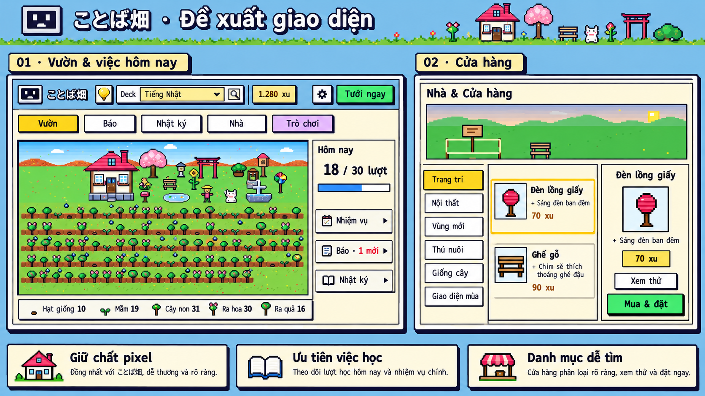
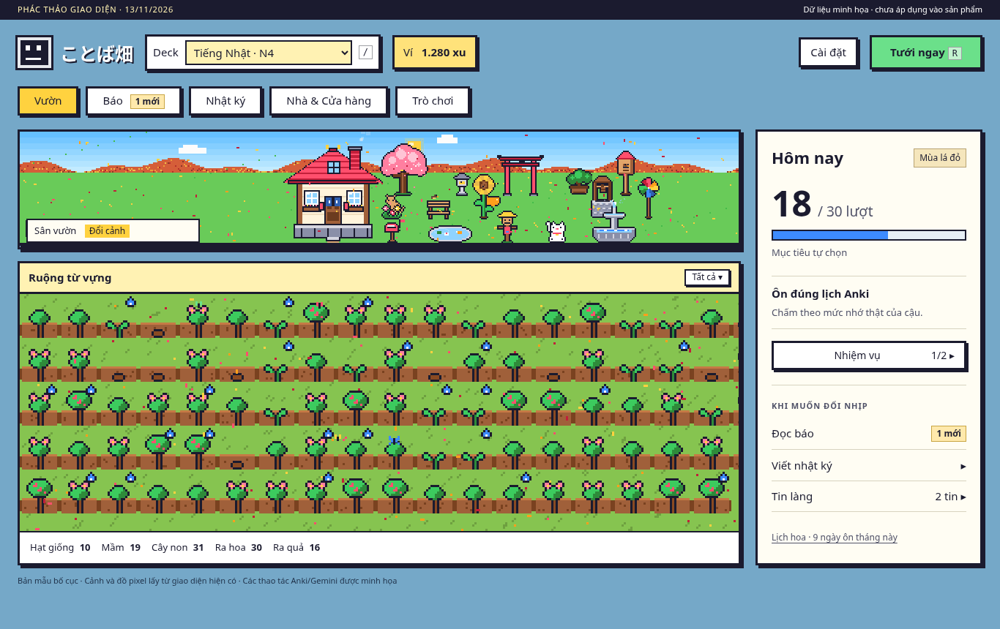
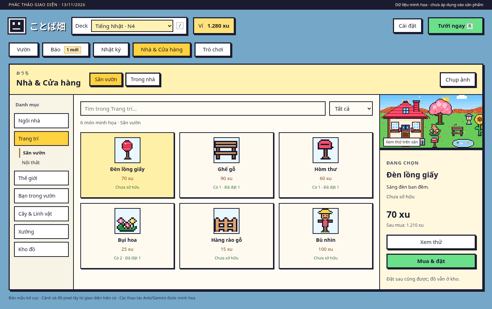
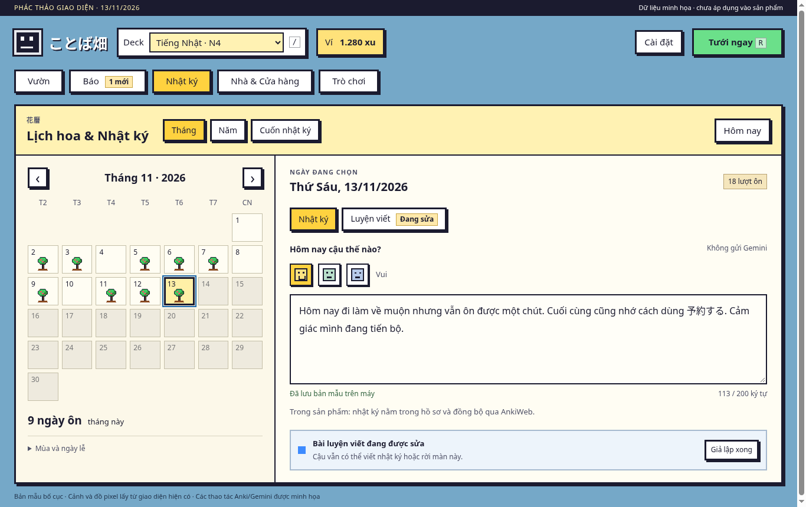
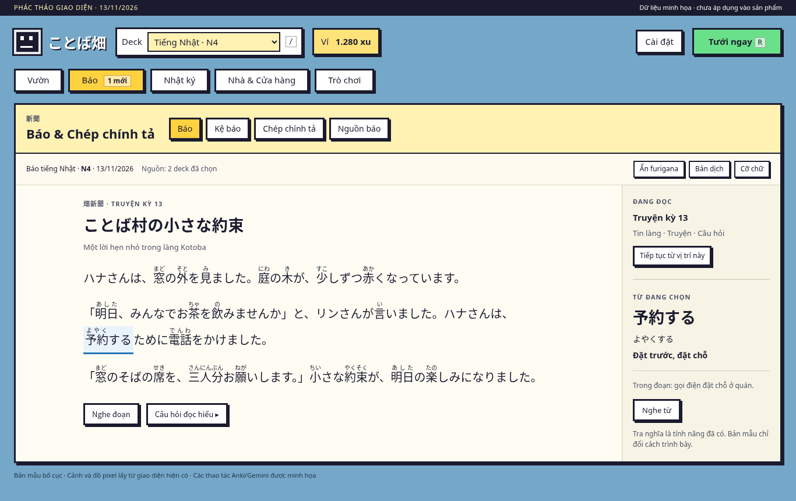

# Đánh giá giao diện và tính năng · Kotoba Batake 1.26.1

Ngày 13/11/2026. Bản nguồn được đánh giá: **1.26.1, commit `6021c579b1062f7e6c707a6e55a9d7feb7a8fa00`**. Đây là phần đánh giá sản phẩm tiếp theo [báo cáo kiểm thử độc lập](../../kiem_thu/audit-2026-11-12/BAO_CAO.md), không phải một đợt sửa mã sản phẩm.

**Nhận định:** vòng “ôn theo Anki → cây phát triển → có xu chăm vườn” có bản sắc và đủ nội dung để dùng lâu. Vấn đề cần giải quyết trước là độ tin cậy và khả năng tìm, hiểu, hoàn thành một việc. Thêm trò chơi hoặc thêm bảng thông báo lúc này sẽ làm giao diện nặng hơn. Nên có một bản sửa ổn định, sau đó một bản tập trung vào trải nghiệm sử dụng, rồi tiếp tục lộ trình 1.27.

Đánh giá dưới đây dựa trên ảnh từ Anki thật, đọc mã và các lỗi đã tái hiện ở báo cáo trước. Nhận xét về nguy cơ gây phân tâm hoặc khuyến khích chấm thẻ sai là **nhận định thiết kế**, chưa có thử nghiệm với người dùng để kết luận tác động thực tế. Không chấm điểm chất lượng Gemini thật vì môi trường kiểm thử bị chặn API.

## 1. Xem phương án cụ thể trước

Ảnh trên diễn đạt hướng hình ảnh. Bốn bản mẫu dưới đây được dựng bằng HTML/CSS để có nhãn, bố cục và trạng thái cụ thể hơn:

| Màn | Ảnh bản mẫu | Thay đổi chính |
|---|---|---|
| Vườn | [01_garden.png](phac_thao/01_garden.png) | Tách Hôm nay khỏi cảnh, ưu tiên ôn, tạo lối vào Báo và Nhật ký |
| Cửa hàng | [02_shop.png](phac_thao/02_shop.png) | Danh mục → tìm/lọc món → thông tin và hành động của món đang chọn |
| Lịch/nhật ký | [03_journal.png](phac_thao/03_journal.png) | Hai tab Nhật ký / Luyện viết; trạng thái lưu và việc nền rõ ràng |
| Đọc báo | [04_reading.png](phac_thao/04_reading.png) | Giảm khung lồng nhau, giữ vùng đọc thoáng, từ đang tra ở bên cạnh |

[Mở mã bản mẫu có thể bấm thử](phac_thao/ban_mau.html). Để chạy từ thư mục repo: `python3 -m http.server 9956 --bind 127.0.0.1`, rồi mở `http://127.0.0.1:9956/docs/danh_gia/ux-2026-11-13/phac_thao/ban_mau.html` trong trình duyệt. Thêm `?screen=shop`, `?screen=journal` hoặc `?screen=reading` để mở từng màn. GitHub chỉ xem mã HTML, không chạy bản mẫu ngay trong trang file.

Bản mẫu có tìm/lọc sáu món minh họa, chọn món, chọn ngày, gõ nhật ký, giả lập bài sửa về, ẩn furigana, mở bản dịch và Tin làng. Không gọi Anki/Gemini hoặc sửa dữ liệu thật; nhật ký bản mẫu chỉ lưu vào localStorage riêng của trình duyệt. Cảnh và đồ pixel dùng hình hiện có trong repo. Số xu, số lượt, bài đọc và kết quả sửa là dữ liệu minh họa. Hình dựng bằng công cụ tạo ảnh có thể khác chi tiết; tên và hành vi đề xuất được xác định bằng tài liệu này.

## 2. Những phần nên giữ

| Phần | Giá trị cụ thể | Điều cần giữ khi cải tiến |
|---|---|---|
| Cây phản ánh trí nhớ thật | Cây dựa trên độ bền FSRS, không đơn thuần tăng cấp vì bấm nhiều | Không để xu, đồ hoặc mini-game đổi lịch FSRS |
| Ôn ngay trong vườn | Có đủ lật thẻ, bốn mức chấm, phím tắt và lịch Anki | Giữ template thẻ; không ép mọi thẻ dùng một kiểu trình bày |
| Thế giới pixel | Nhà, mùa, thú, âm thanh tạo cảm giác trở lại một nơi quen | Viền vuông, bóng cứng, icon pixel; chuyển động có lựa chọn tắt |
| Báo gắn từ đang học | Đưa từ từ deck vào ngữ cảnh, có tra nghĩa, nghe, đọc hiểu, chép | Giữ nguồn báo độc lập với deck đang xem và cùng tuyến truyện giữa các ngôn ngữ |
| Nhật ký riêng với luyện viết | Một bên để lưu kỷ niệm, một bên luyện ngôn ngữ | Nhật ký không gửi Gemini, không gắn xu hay chuỗi mới |
| Trang trí và chế tác | Có chỗ tiêu xu và quyền tự thể hiện lâu dài | Giữ đồ đã sở hữu; Góp ý hình và quyền sửa hình gốc vẫn phân biệt như hiện tại |
| Cài đặt đã có chiều sâu | Có hướng dẫn 3 bước, chế độ giao diện, âm thanh và chuyển cảnh | Làm dễ tìm và ổn định hơn, không làm lại các tính năng này từ đầu |

Khoảng trống trên ruộng lúc chỉ có vài cây là trạng thái tự nhiên, không phải lỗi bố cục. Việc mái nhà bị cắt bớt ở cỡ cảnh/cửa sổ thấp là quyết định hình ảnh đã chốt; báo cáo này không đề nghị đảo ngược. Tốc độ chuyển cảnh 1.26.1 cũng đã được yêu cầu chậm hơn; nên tôn trọng và cải thiện lựa chọn tắt/giảm chuyển động.

## 3. Vườn và điều hướng: cần phân cấp thông tin

**Dẫn chứng:** [màn chính hiện tại](anh_hien_tai/01_vuon.png), [menu cài đặt](anh_hien_tai/07_cai_dat.png). Ở 1366×768, Hôm nay nằm trong góc phải dải sân thấp, đồng thời chứa mục tiêu, chuỗi, nhiệm vụ, báo, Tin làng và cảnh báo cấu hình trường. Các dòng chức năng dùng cỡ 13px, phần danh sách phải cuộn khi chật (`garden.css`, nhóm `.kb-today-list`). Nhật ký/lịch nằm trong menu bánh răng và các lối vào theo ngữ cảnh; Nhà và Trò chơi có nút riêng ở thanh đầu.

**Ảnh hưởng:** một thông báo cấu hình cần xử lý và một tin mùa mang tính thưởng thức đang tranh cùng khoảng nhỏ. Người mới phải học vị trí của nhiều cửa vào trước khi hiểu nên làm gì. Báo và Nhật ký có giá trị lớn nhưng độ dễ tìm thấp hơn Trò chơi.

**Sửa cụ thể:**

1. Giữ thanh đầu gồm thương hiệu, deck, ví, cài đặt và nút xanh **Tưới ngay**. Giữ phím `R`, `/` và cách đếm cây tưới được hiện có; không đổi số cây thành số thẻ vì một note có thể có nhiều thẻ.
2. Thử hàng điều hướng ổn định **Vườn · Báo · Nhật ký · Nhà & Cửa hàng · Trò chơi**. Khi có hàng này thì bỏ các nút Nhà/Trò chơi trùng ở thanh đầu. Báo luôn có lối vào, dù chưa có khóa/số báo.
3. Trên cửa sổ rộng, đưa Hôm nay sang cột khoảng 280–310px bên cạnh cảnh/ruộng, không đè lên nhà. Đầu cột chỉ có tiến độ tự chọn và nhiệm vụ; các hoạt động thêm nằm dưới. Chỉ một nút xanh chính ở thanh đầu.
4. Dùng badge “1 mới” cho báo và số tin cho Tin làng, tránh tô đỏ cả hàng cho thông tin thường lệ. Cảnh báo thiếu trường chỉ hiện khi liên quan đến deck/note đang dùng, có nút xử lý tại chỗ.
5. Giữ mục tiêu 30 lượt là mục tiêu tự chọn, phân biệt với số thẻ còn đến lượt của Anki. Khi hết lượt hôm nay, ghi “Đã xong lượt ôn hiện tại”; không biến việc đạt mục tiêu tự đặt thành điều kiện phải học thêm.

**Tiêu chí:** người mới tìm được ôn, báo và nhật ký từ màn chính mà không phải mở menu cài đặt; chưa có khóa vẫn thấy Báo và biết bước kế tiếp. Trên cửa sổ hẹp, thanh điều hướng xuống hàng, Hôm nay xuống dưới; không ép giữ ba cột. Bản mẫu là một phương án có thêm hàng điều hướng, nên so với phương án nhẹ hơn chỉ đưa Báo/Nhật ký ra ngoài trước khi chốt.

## 4. Nhiệm vụ: tránh tạo động cơ chấm thẻ thiếu trung thực

**Dẫn chứng:** [nhiệm vụ hiện tại](anh_hien_tai/02_nhiem_vu.png) có “Tưới liền 10 cây không bấm ‘Lại’”, “Gieo 10 hạt mới”, “Chơi 1 ván Điền vào câu”; xong cả ba mở quà thêm. Đây là cơ chế có thật trong `garden_core.py`, `QUEST_TEXT` và `_make_quests`, không phải chỉ là cách viết của bản mẫu.

**Rủi ro thiết kế:** né nút Lại có thể được hiểu là chơi tốt hơn, trong khi chấm quên chính xác là thông tin FSRS cần. Nhiệm vụ tăng giai đoạn cây cũng không hoàn toàn nằm trong khả năng chủ động của người học. Một người chỉ muốn ôn có thể thấy phải chơi game để hoàn tất ngày.

**Sửa cụ thể:**

- Thay nhiệm vụ “không bấm Lại” bằng **“Ôn 10 thẻ đến lượt”**, tính mọi mức chấm hợp lệ. Chống bấm lặp bằng sự kiện ôn/thẻ thực tế, không bằng tỷ lệ trả lời đúng.
- Tránh yêu cầu cây nhất định phải lên giai đoạn trong một ngày. Dùng việc đã làm được, còn cây lớn là phản hồi tích cực khi FSRS thực sự thay đổi.
- Đưa trò chơi/báo sang nhóm **“Nếu muốn làm thêm”**, thưởng riêng. Không buộc hoàn thành game để được ghi nhận đã làm xong việc ôn.
- Nhiệm vụ thẻ mới phải tuân số thẻ Anki cho phép hôm nay; không hướng người dùng nới giới hạn chỉ để lấy quà. Khi không còn thẻ phù hợp, đổi mục tiêu hoặc coi việc ôn đã hoàn tất.
- Quy tắc “Hard/Good/Easy cùng xu cơ bản” đang có là điểm tốt. Chưa cần thay toàn bộ nền kinh tế; ưu tiên bỏ điều kiện thưởng nhạy với việc né Lại và thử phản ứng người dùng trước.

**Tiêu chí:** chấm Lại trung thực không làm mất tiến độ nhiệm vụ ôn; Undo thu hồi đúng tiến độ/xu tương ứng; không có thẻ tới lượt thì không ép ôn sớm; đọc, chơi hoặc viết thêm đều là tùy chọn. Đây là đề xuất thay đổi cơ chế, không phải lỗi kỹ thuật thứ mười của audit.

## 5. Nhà & Cửa hàng: tách duyệt món khỏi thao tác của món

**Dẫn chứng:** [cửa hàng hiện tại](anh_hien_tai/03_cua_hang.png) có **11 tab trên một hàng**. Ở 1366×768, vùng cảnh chiếm phần lớn nửa trên, danh sách mới thấy hàng đầu và một phần hàng kế tiếp. Thẻ Ghế gỗ đã sở hữu có thêm trạng thái và “Góp ý hình”, còn món chưa mua chủ yếu có giá/nút Mua, khiến điểm bấm trong lưới không đều. [Kho đồ](anh_hien_tai/11_kho_do.png) đã phân “Trong kho, chưa đặt” và “Đã đặt hết”; nên giữ phân biệt hữu ích này.

**Sửa ít trước:** bổ sung tìm món và bộ lọc **Tất cả / Đã sở hữu / Đủ xu**, giữ vị trí cuộn khi đổi món; đưa Góp ý hình sang phần chi tiết của món. Không cần đổi toàn bộ điều hướng ngay để có lợi ích này.

**Phương án đầy đủ trong bản vẽ:** danh mục trái → lưới món giữa → thông tin/xem thử phải. Cột phải hiển thị tên, tác dụng, số có/đang đặt, giá, số dư sau mua và một hành động chính.

| Nhóm đề xuất | Tab hiện có được giữ bên trong |
|---|---|
| Ngôi nhà | Xây nhà, mở rộng |
| Trang trí | Trang trí sân, Nội thất |
| Thế giới | Vùng mới, Giao diện mùa |
| Bạn trong vườn | Thú nuôi, Album khách |
| Cây & Linh vật | Giống cây, Tủ đồ |
| Xưởng | Xưởng hiện có |
| Kho đồ | Đồ sở hữu, đang đặt/chưa đặt |

Tên nhóm là phương án thử, không phải quyết định sản phẩm mới. Nó giảm hàng tab dài nhưng thêm một cấp chọn; chỉ nên chốt nếu thử tìm đồ cho kết quả dễ hơn. Giữ đúng tên chức năng như “Giao diện mùa” bên trong, tránh đổi thành nhiều thuật ngữ khác nhau.

**Luồng mua/đặt đề xuất:**

1. Chọn Đèn lồng giấy → xem **70 xu**, tác dụng “Sáng đèn ban đêm”, số dư sau mua.
2. **Xem thử** không ghi quyền sở hữu, vị trí hay ví. Đóng xem thử trả cảnh cũ.
3. **Mua & đặt** mua một món rồi vào chế độ đặt. Nếu đã có một món chưa đặt, hành động mặc định là **Đặt từ kho**, có hành động mua thêm riêng để tránh mua nhầm.
4. Đóng chế độ đặt thì món đã mua còn trong kho. Đóng màn không tự hoàn tiền một giao dịch đã thành công. Thất bại mua phải giữ nguyên ví/quyền sở hữu.
5. Thiếu xu ghi **“Thiếu 20 xu”** và vô hiệu hóa nút mua. Đồ nhiều ô cho thấy kích thước và lý do không đặt được, bằng một câu ngắn.

**Tiêu chí:** bấm đúp không mua hai lần; mua xong đóng màn vẫn tìm được đồ trong kho; món không đặt được không làm mất xu/đồ; đổi phòng không áp nhầm món; quyền Góp ý hình/Sửa hình gốc giữ nguyên. Gói mở rộng bếp + phòng ngủ vẫn là một lần mua như thiết kế đã chốt.

## 6. Lịch hoa, Nhật ký và Luyện viết: ưu tiên việc đang làm

**Dẫn chứng:** [màn hiện tại](anh_hien_tai/04_lich_nhat_ky.png) đặt lịch tháng bên trái, bên phải xếp thống kê → nhật ký → luyện viết. Ở 1366×768, luyện viết đã đi xuống dưới vùng nhìn thấy. Nội dung vẫn có thể cuộn; đây là vấn đề phân cấp, không tự nó là lỗi không truy cập được. Tuy nhiên, **F01 đã tái hiện mất chữ đang gõ khi kết quả sửa bài về**, có [ảnh trước/sau và log](../../kiem_thu/audit-2026-11-12/BAO_CAO.md#f01--p1--mất-chữ-nhật-ký-khi-kết-quả-gemini-về).

**Sửa cụ thể:**

- Giữ lịch, mood, nhật ký, luyện viết và cuốn nhật ký. Bên phải dùng hai tab **Nhật ký / Luyện viết**; chọn tab không hủy bản nháp của tab kia.
- Đưa chú giải mùa/ngày lễ vào phần thu gọn thay vì luôn chiếm chiều cao trên lịch; nhãn mùa đang chọn vẫn thấy được.
- Nhật ký có trạng thái **Đang lưu… / Đã lưu trong hồ sơ / Chưa lưu được – Thử lại** và bộ đếm 200 ký tự. Chỉ hiện “Đã lưu” sau xác nhận của Python. Câu “Đồng bộ qua AnkiWeb” mô tả cơ chế, không được coi là bằng chứng vừa đồng bộ thành công.
- Giữ nhãn ngắn **Không gửi Gemini** ngay cạnh Nhật ký; chỉ gửi nội dung luyện viết khi người dùng chọn sửa bài.
- Trong khi AI chạy, hiện một hàng “Đang sửa bài · Có thể rời màn này”. Khi xong, đổi thành “Bài sửa đã sẵn sàng” và badge ở tab. Không tự nhảy tab, kéo trang hay giành focus.
- Về mã, cập nhật riêng vùng bài sửa; tách bản nháp theo ngày và revision. Callback cũ không được dựng lại ô nhật ký từ payload cũ. Khi rời ngày/đóng màn, flush bản nháp và xử lý xác nhận theo đúng hồ sơ.

**Tiêu chí:** gõ nhật ký trong lúc AI xong vẫn giữ nguyên chữ, con trỏ và selection; đổi ngày/tab liên tiếp không lẫn nháp; đóng/mở lại xác nhận bản đã lưu; lỗi lưu không được báo xanh. Bản mẫu có nút **Giả lập xong** để xem cách cập nhật phần bài sửa mà giữ ô nhập; đó không phải bản sửa F01 trong sản phẩm.

## 7. Báo: có giá trị học tập, cần giảm công sức khởi đầu và tiếp tục

**Dẫn chứng:** [màn đọc](anh_hien_tai/05_doc_bao.png) đã có chữ Nhật lớn, furigana, gạch từ và nút nghe; đây là nền đọc khá tốt. Nhiều lớp viền quanh khung tổng, trang báo và từng mục làm phần đọc nặng hơn cần thiết. [Kệ báo](anh_hien_tai/06_ke_bao.png) phân ngày/trạng thái Đã đọc/Mới; metadata một dòng bị rút gọn là chủ ý, không tính là lỗi. [Nguồn báo chưa có khóa](anh_hien_tai/08_nguon_bao.png) bắt đầu bằng hướng dẫn lấy API key; người mới phải cấu hình dịch vụ trước khi thấy giá trị của báo.

**Sửa cụ thể cho đọc:**

1. Giữ cỡ chữ Nhật khoảng **20–22px**, furigana rõ, độ dài dòng hợp lý; không thu nhỏ chữ để nhét thêm bảng. Dùng font CJK đọc dài như hiện có, pixel dành cho tiêu đề/icon và khung.
2. Giảm viền lồng nhau trong nội dung; phân Tin làng/Truyện bằng tiêu đề và khoảng cách. Công cụ ẩn furigana, bản dịch, nghe và cỡ chữ có một vị trí ổn định.
3. Trên màn rộng, thử vùng tra nghĩa cạnh bài để bấm từ mà không che câu đang đọc. Màn hẹp dùng khối/drawer riêng; không cố giữ cột cạnh bài. Không tạo từ điển mới vì tra nghĩa/nghe đã có.
4. Thêm **Tiếp tục đọc** nhớ số báo và điểm gần nhất, theo hồ sơ/ngôn ngữ/số báo. Bản 1.26.1 đặt `stage().scrollTop = 0` khi đổi tab trong `paper.js`; chưa thấy cơ chế lưu bookmark bài đọc. Điểm nhớ nên gắn ID đoạn thay vì chỉ số pixel để chịu được đổi cỡ chữ.
5. Trên kệ, thêm lọc **Chưa đọc / Tất cả**, nhãn trình độ và nút tiếp tục của số đang đọc. Mở chi tiết cho phép xem metadata đầy đủ; không cần bỏ mọi dấu ba chấm trên hàng danh sách.

**Sửa cụ thể cho lần đầu dùng:**

- Cho **Đọc báo mẫu** bằng một số đi kèm, không API, không trừ xu. Mẫu phải cho bấm từ và thử câu hỏi; giọng mẫu có thể là một đoạn có sẵn, không tự gọi dịch vụ.
- Giữ luồng đã có: khóa → chọn ngôn ngữ/trình độ/deck → **Bắt đầu viết**. 1.26.1 đã có trạng thái chờ bắt đầu; không đề xuất “tự viết ngay sau thử khóa”.
- Cấu hình là một khối có tóm tắt ngắn: **Báo tiếng Nhật · N4 · 2 deck đã chọn**. Mở chi tiết mới thấy danh sách. Nhắc ngắn rằng đây là nguồn báo riêng; đổi Deck trên thanh đầu không đổi nguồn này.
- Không khẳng định mọi tài khoản Gemini đều miễn phí. Dùng nhãn “Dùng khóa Gemini của cậu”; phần chi tiết giải thích hạn mức/phí của nhà cung cấp và tách khỏi xu trong vườn.
- Gói báo hiện rõ **giá xu, thời hạn, Tự gia hạn bật/tắt**, thời điểm tính phí khi số báo thành công. Lỗi viết có nút thử lại và giữ báo cũ; không báo như đã nhận số mới.
- Giữ Claude Code là lựa chọn nâng cao chỉ hiện khi đã cấu hình; không đưa thêm một lựa chọn kỹ thuật lên màn đầu.

**Tiêu chí:** chưa có key vẫn trải nghiệm được mẫu; thử key không tự tính phí/viết khi chưa bắt đầu; đổi deck vườn không đổi nguồn báo; đọc nửa bài rồi trở lại đúng số/đoạn; báo chỉ có ở máy khác phải nói thiếu file thay vì hiện như có thể mở. Cần đánh giá chất lượng ngôn ngữ bằng người đọc hoặc bộ mẫu thật; ảnh đẹp và provider giả không chứng minh chất lượng bài AI.

## 8. Ôn thẻ, hướng dẫn và trạng thái không có dữ liệu

**Dẫn chứng:** [màn ôn](anh_hien_tai/09_on_the.png) giữ nội dung thẻ trong iframe, số thẻ còn lại và Lật thẻ/Space. Khoảng trắng phần nội dung chịu ảnh hưởng template thẻ, không nên quy hết cho add-on. [Hướng dẫn 3 bước](anh_hien_tai/10_huong_dan.png) đã tồn tại; cần sửa F08 mở lại hướng dẫn từ các bảng khác bị mất, không cần thêm một onboarding mới.

**Sửa cụ thể:**

- Giữ bốn mức Lại/Khó/Được/Dễ và khoảng ôn hiển thị. Chế độ tập trung đã có nên có đường bật dễ thấy, nhớ trên máy; giữ lựa chọn cảnh/hiệu ứng đầy đủ cho người thích.
- Kết thúc buổi ôn, thêm tóm tắt ngắn **số lượt, xu thực nhận, cây đổi giai đoạn nếu thật sự có**. Không hứa mỗi lần ôn cây sẽ lớn; không thêm phần thưởng làm đổi FSRS. Sau Undo, tóm tắt phải phản ánh số cuối cùng.
- Sửa câu tour “Mỗi thẻ… là một cây”: `garden_core.py` gom theo `nid`, một cây có thể có nhiều thẻ. Dùng “Deck của cậu trở thành một vườn cây”; phần giải thích mở rộng mới nói một note → một cây và thẻ yếu nhất quyết định giai đoạn.
- Với deck rỗng, thêm hành động **Chọn deck khác** vào câu báo hiện có. Với 0 cây tưới được nhưng còn cây héo, đưa phần giải thích phù hợp gần nút ôn: đang chờ vài phút, bị hoãn, đủ giới hạn hôm nay hoặc nằm trong deck lọc. `doneWhy()` đã có logic này; ưu tiên dùng lại thay vì viết một bộ giải thích khác.
- Thiếu trường: giữ việc đoán trường và mẫu xem trước, dẫn thẳng tới loại note cần chỉnh. Không khóa toàn bộ vườn khi một loại note chưa cấu hình.
- Mini-game giữ năm trò hiện có và giới hạn xu. Làm rõ nó không cập nhật lịch ôn; khi thiếu audio/câu ví dụ, chỉ hiện hướng xử lý liên quan, không khiến người dùng nghĩ cả deck bị hỏng.

**Tiêu chí:** note hai mặt vẫn chỉ một cây và câu hướng dẫn không gây kỳ vọng hai cây; hết thẻ hôm nay không tự khuyến khích đổi lịch; tour mở được từ Nhà/Báo/Lịch/Trò chơi; Space/1–4, Undo và ô nhập đáp án tiếp tục hoạt động theo Anki.

## 9. Cửa sổ hẹp, chữ và thao tác bàn phím

**Dẫn chứng lỗi thật:** F05 đo được Tin làng cao vượt đáy và vẫn giữ tọa độ cũ ngoài cửa sổ sau resize từ 1366×860 xuống 720×520; xem [ảnh và số đo trong audit](../../kiem_thu/audit-2026-11-12/BAO_CAO.md#f05--p2--tin-làng-tràn-và-không-bám-cửa-sổ-khi-resize). Đây cần sửa trước stable, khác với việc lịch/cửa hàng cần cuộn thông thường.

**Sửa cụ thể:**

- Bảng nổi có `max-height` theo viewport, cuộn bên trong, giữ nút Đóng thấy được; tính lại vị trí khi resize hoặc đổi thành dialog giữa cửa sổ ở cỡ nhỏ.
- Cột chi tiết cửa hàng chuyển xuống dưới ở màn hẹp; màn nhật ký xếp lịch trên, ô nhập dưới. Không cắt nút mua/lưu vì cố giữ bố cục rộng.
- Giữ viền/bóng pixel cho vùng chính và nút; giảm lớp khung trong cùng một nội dung thay vì làm mọi khung đậm ngang nhau. Tab đang chọn giữ kích thước/viền như tab khác, đổi nền vàng và bổ sung trạng thái truy cập.
- Chữ thân giao diện hướng tới 14–16px; metadata 12–13px dành cho thông tin phụ. Không tuyên bố mọi chữ hiện tại quá nhỏ: màn đọc đang có cỡ chữ phù hợp.
- Có `:focus-visible`, thứ tự Tab hợp lý, Esc đóng lớp trên cùng và focus trở lại nút mở. Nhiều nhãn ARIA/phím tắt đã có; cần kiểm bổ sung bằng bàn phím/screen reader thật, không coi DOM có ARIA là đã đạt toàn bộ khả năng truy cập.
- Vườn dùng canvas với nhãn tổng quát. Có thể thêm lựa chọn **Danh sách cây** bằng chữ với từ/nghĩa/trạng thái/lịch ôn để tra bằng bàn phím. Đây là tính năng mới tùy nhu cầu, không nhất thiết nằm trong bản vá đầu.

**Kiểm bản mẫu:** đã dựng 4 màn ở 1366×860, 1366×768, 1024×700 và 720×520; kết quả đo kích thước được lưu trong [kiem_tra_ban_mau.json](phac_thao/kiem_tra_ban_mau.json). Không tràn ngang ở các cỡ này; cửa sổ thấp/hẹp dùng cuộn dọc. Đây chỉ là kiểm tra HTML đề xuất trong Chromium, không chứng minh các lỗi Qt của sản phẩm đã sửa. [Ảnh hẹp Vườn](phac_thao/720_garden.png), [Cửa hàng](phac_thao/720_shop.png), [Nhật ký](phac_thao/720_journal.png), [Báo](phac_thao/720_reading.png).

## 10. Độ tin cậy phải được người dùng nhìn thấy

Hai lỗi nặng nhất hiện nay là **F01 mất nháp nhật ký** và **F09 việc viết báo của A trừ xu ở B**. F06 còn có thể xóa trạng thái mở phòng/đồ đặt khi chỉ một bản ghi sai kiểu. Không thể giải quyết chúng chỉ bằng vẽ lại nút.

| Tình huống | Phải sửa trong logic | Cách biểu đạt trên giao diện |
|---|---|---|
| AI hoàn tất khi đang nhập | Nháp/revision, cập nhật riêng vùng kết quả, giữ focus | Đã có bài sửa; không thay ô đang gõ |
| Đổi hồ sơ khi viết báo | Gắn công việc/kết quả/thanh toán với chủ sở hữu; hoãn hoặc hủy an toàn khi đóng hồ sơ | Hồ sơ B không hiện việc hay bị trừ xu của A; trở lại A có kết quả/đề nghị thử lại đúng trạng thái |
| Lỗi một món đồ lưu | Kiểm từng bản ghi, giữ phần hợp lệ và trạng thái mở phòng | Thông báo ngắn nếu có món cần phục hồi; không âm thầm xóa nhà |
| Đồng bộ lịch sử ôn | Hủy cache phụ thuộc lịch sử; tính ngày/chuỗi theo lịch địa phương đúng | Tin mốc học và Lịch hoa nhất quán sau đồng bộ |
| Báo/âm thanh chỉ lưu máy này | Phân biệt nội dung cục bộ với tiến độ theo hồ sơ | Giải thích đúng file còn thiếu và cách nối lại, không hứa sync toàn bộ báo |

Nên có đường xuất/khôi phục riêng dữ liệu vườn nếu phát hành cho nhiều người; kiểm tra schema và hồ sơ khi nhập. Anki đã có sao lưu collection, nên hướng dẫn dùng cơ chế đó trước, tránh xây một hệ thống backup phức tạp khi các lỗi ghi dữ liệu còn chưa sửa.

## 11. Có cần thêm tính năng không?

**Đáng bổ sung, theo thứ tự giá trị:**

| Ưu tiên | Bổ sung | Vì sao | Phạm vi tối thiểu |
|---|---|---|---|
| Cao | Báo mẫu không cần API | Cho thấy giá trị trước công đoạn lấy key | Một số ngắn có tra nghĩa/câu hỏi, không trừ xu |
| Cao | Tìm/lọc đồ và Đặt từ kho | Giúp dùng nội dung đã có tốt hơn | Tìm bỏ dấu, trạng thái sở hữu/đang đặt, nút đúng hành động |
| Cao | Trạng thái lưu/việc nền đáng tin | Liên quan trực tiếp hai lỗi P1 | Xác nhận lưu, retry, callback đúng hồ sơ; không dựng lại ô nhập |
| Vừa | Tiếp tục đọc | Giảm công sức quay lại một bài dài | Nhớ hồ sơ/ngôn ngữ/số/đoạn, chịu được đổi cỡ chữ |
| Vừa | Tóm tắt cuối buổi ôn | Giúp hiểu học vừa tác động thế nào | Lượt/xu/cây thay đổi thật, không thêm áp lực |
| Theo nhu cầu | Danh sách cây bằng chữ | Dễ tra cứu và hỗ trợ bàn phím | Từ, nghĩa, trạng thái, ngày ôn; không nhân đôi toàn bộ giao diện |

**Lộ trình 1.27 đã có:** mốc học/kỷ niệm và lịch trời Nhật/歳時記 phù hợp bản sắc, có thể ưu tiên sau ổn định. Cây lấp lánh/quẻ có thể giữ như chi tiết vui tùy chọn. Không thêm chuỗi đọc mới, bảng xếp hạng, vật phẩm mất nếu bỏ ngày, hoặc thưởng buộc phải chơi thêm. Các giai đoạn 1.28–1.29 nên đợi xem hệ điều hướng và hiệu năng với nhiều đồ có chịu được nội dung tăng thêm hay không.

## 12. Thứ tự thực hiện và mức độ release

| Đợt | Phải làm | Điều kiện kết thúc |
|---|---|---|
| **A · Bản vá ổn định** | Sửa 9 lỗi audit; ưu tiên F01, F09 và F06. Sửa F05 và F08 vì chặn luồng giao diện. Các lỗi ngày/chuỗi/cache sửa bằng logic dùng chung | Các test tái hiện đang đỏ chuyển xanh trên hai bản Anki; test sẵn có đạt; gói khớp nguồn |
| **B · Giảm vướng khi dùng** | Điều hướng Báo/Nhật ký, tab nhật ký/luyện viết, trạng thái lưu, tìm/lọc đồ; xem lại nhiệm vụ né Lại | Thử các tác vụ bên dưới, người dùng hiểu đường đi và không mua/chấm sai vì nhãn |
| **C · Nâng trải nghiệm học** | Báo mẫu, tiếp tục đọc, tóm tắt buổi ôn; rồi mốc học/lịch Nhật 1.27 | Kiểm chất lượng bài đọc thật, giá trị sử dụng và khả năng tắt các phần thêm |

**Bản 1.26.1 đang được xét: chưa nên release stable công khai.** 9 lỗi là kết quả đã tái hiện, không phải suy đoán. Bộ audit thêm 838 kỳ vọng khác nhau; UI/vòng đời đã chạy trên Anki 26.9.4 và 23.10.1. Chưa kiểm thực tế Windows/macOS, DPI cao, dịch vụ Gemini thật trong môi trường này hoặc chu trình AnkiWeb thật toàn phần. Có thể giữ bản hiện tại để phát triển/thử trong hồ sơ tạm.

Sau khi sửa A có thể đánh giá lại beta/stable theo kết quả, không cần đợi hoàn thành toàn bộ bản vẽ B/C mới được phát hành. Trước công khai cần có hướng dẫn cập nhật/khôi phục, nói rõ dữ liệu nào sync, Gemini cần cấu hình gì, và xác định giấy phép mã nguồn/tài nguyên nếu muốn người khác sử dụng/phân phối; repo chưa có LICENSE tại lần kiểm này.

Không ước lượng ngày công cứng khi chưa chọn phạm vi bố cục và cách sửa vòng đời công việc. Đổi nhãn/lối vào là nhỏ; quản lý nháp và hồ sơ của việc nền cần thiết kế, kiểm hồi quy kỹ hơn nhiều.

## 13. Các tác vụ nên dùng để duyệt thiết kế và kiểm sau sửa

Đây là **tiêu chí chấp nhận đề xuất**, chưa phải các ca đã đạt trên sản phẩm:

| Mã | Kịch bản | Kết quả cần thấy |
|---|---|---|
| U01 | Hồ sơ mới, deck rỗng | Có Chọn deck khác; không bắt cấu hình báo để ôn |
| U02 | Một note có hai thẻ | Một cây; nhãn hướng dẫn/số không hứa hai cây |
| U03 | Cây héo nhưng Anki chưa cho ôn | Có lý do ngắn, không tự thay lịch |
| U04 | Chấm Lại rồi Undo một lượt | Chấm trung thực được tính nhiệm vụ mới; Undo lùi đúng tiến độ/xu |
| U05 | Người chỉ ôn, không chơi game | Được thấy hoàn tất việc ôn, không có điều kiện game bắt buộc |
| U06 | Sở hữu 100+ món, tìm “den long” | Tìm Đèn lồng, thấy sở hữu/đang đặt và hành động đúng |
| U07 | Còn một món chưa đặt, chọn món đó | Đặt từ kho là hành động mặc định; không mua thêm ngoài ý muốn |
| U08 | Bấm mua hai lần, đóng chế độ đặt | Một giao dịch; món còn trong kho |
| U09 | Xem thử rồi đóng, thiếu xu, ô đặt bị chiếm | Không ghi nhầm ví/vị trí, lý do rõ |
| U10 | Gõ nhật ký lúc bài sửa về ở 0/300/1000ms | Chữ, focus, selection và bản lưu được giữ |
| U11 | Đổi ngày rồi callback ngày cũ về | Kết quả đúng ngày, không ghi đè nháp hiện tại |
| U12 | Viết báo ở A, chuyển B, trả kết quả | B không đổi ví/gói; A xử lý kết quả đúng chủ |
| U13 | Chưa có key, key lỗi, mạng mất | Có mẫu; lỗi có thử lại; không tự bắt đầu/tính phí sai |
| U14 | Đổi deck vườn lúc nguồn báo là hai deck khác | Nguồn báo vẫn đúng lựa chọn riêng và nhãn cho biết điều đó |
| U15 | Đọc nửa bài, đổi cỡ chữ, mở lại | Trở lại đúng số/đoạn, không mặc định là đã làm xong bài tập |
| U16 | Tin làng mở, resize 1366×860 → 720×520 | Bảng trong cửa sổ; cuộn/đóng được, focus hợp lý |
| U17 | Tab/Shift+Tab, Enter, Esc; mở lại tour từ bốn bảng | Không mắc focus, không mất hướng dẫn; Esc chỉ đóng đúng lớp |
| U18 | DST, chuỗi >401 ngày, sync 27→29 ngày, một món lưu sai kiểu | Ngày/chuỗi/tin thống nhất; không tiêu nhầm vé hoặc mất trạng thái phòng |

Nên thử với ít nhất hai nhóm: người dùng mới và người đã có vườn nhiều đồ. Quan sát cách họ tìm ôn, tìm nhật ký, mua/đặt lại một món và tiếp tục bài báo; hỏi họ hiểu “cây khát”, “lượt ôn”, “xu gói báo” là gì. Ghi thời gian/lỗi nhầm trước và sau, thay vì tự đặt tỷ lệ cải thiện khi chưa đo.

## Tham chiếu cho người triển khai

- [body.html](../../../kotoba_batake/web/body.html): thanh đầu, 11 tab Nhà, các bảng Báo/Lịch, thẻ Hôm nay.
- [garden.css](../../../kotoba_batake/web/garden.css): `.kb-today-list`, `.kb-quest-btn`, `.kb-news-pop`, các breakpoint và viền/nút.
- [garden.js](../../../kotoba_batake/web/garden.js): `drawHeader`, `doneWhy`, số `water_now`, trạng thái trường, màn ôn.
- [garden_core.py](../../../kotoba_batake/garden_core.py): gom cây theo `nid`, `reward_for_answer`, `QUEST_TEXT`, `_make_quests`.
- [home.js](../../../kotoba_batake/web/home.js): dựng danh sách món, tab, lưu vị trí cuộn và thao tác Nhà.
- [calendar.js](../../../kotoba_batake/web/calendar.js): `drawDay`, lưu nhật ký, nhận bài sửa; F01 là điểm cần tách vòng đời nháp/kết quả.
- [paper.js](../../../kotoba_batake/web/paper.js): đổi tab, nguồn báo, các bước khóa/cấu hình/bắt đầu, gói xu và vùng đọc.
- [tour.js](../../../kotoba_batake/web/tour.js): hướng dẫn hiện có và câu một thẻ/một cây.
- [PHAT_TRIEN.md](../../../PHAT_TRIEN.md): quyết định đã chốt, lộ trình và giới hạn không tác động FSRS.
- [Báo cáo lỗi, ảnh/log và test tái hiện](../../kiem_thu/audit-2026-11-12/BAO_CAO.md).

Nhánh này chỉ thêm đánh giá, bằng chứng và bản mẫu; không sửa mã `kotoba_batake/`, không đổi gói `.ankiaddon`, và không coi hình vẽ là tính năng đã hoàn thành.
