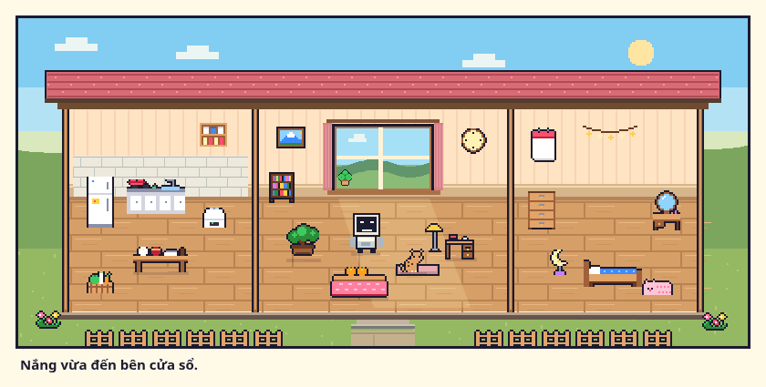

# Một buổi ở nhà · Mô phỏng bằng code

**Mở nhanh:** tải [XEM_THU.html](XEM_THU.html) và mở bằng Chrome/Firefox/Edge trên máy. Một file khoảng 71 KB chứa toàn bộ HTML, CSS, JavaScript và dữ liệu sprite; không cần cài thư viện hoặc có mạng.

Đây là bản mẫu tương tác để duyệt thiết kế “ngôi nhà có sinh hoạt”, tiếp nối đánh giá UX và ý tưởng tham khảo Adorable Home. Toàn bộ cảnh được vẽ bằng **Canvas 2D và JavaScript**, sử dụng snapshot sprite gốc của Kotoba Batake 1.26.1. Không sử dụng ảnh do AI tạo.

## Thử những gì?

1. Chọn **Nắng buổi sáng / Chiều mưa / Một tối ấm** dưới cảnh, hoặc chọn riêng buổi/thời tiết bên phải.
2. Bật/tắt **đệm, bàn đọc sách, đèn, kotatsu, chậu cây**. Đồ vật thay đổi những cảnh/hành vi có thể xuất hiện. Ví dụ bỏ đệm thì Mochi ngồi cạnh cửa thay vì ngủ trên đệm; cảnh đọc ở bàn cần có cả bàn và đèn vào ban đêm.
3. Bấm **Xem một cảnh khác** để xem biến thể đang có với điều kiện hiện tại.
4. Chạm Mochi/StackChan, hoặc dùng hai nút dưới cảnh, để nhận phản ứng ngắn. Các nút là đường thao tác tương đương cho người dùng bàn phím.
5. Bấm **Chuẩn bị trà**: StackChan ghé bếp, sau đó khay trà có mặt trong cảnh. Có thể cất khay trà.
6. **Chụp khoảnh khắc** → **Khoảnh khắc** → **Xem & đặt tên**. Tải PNG gồm cảnh, tên kỷ niệm và ngày. Bản mẫu giữ một ảnh cho mỗi kiểu cảnh; xóa ảnh nếu muốn chụp lại kiểu đó.
7. **Thử về nhà sau buổi ôn** cho xem lời chào và tóm tắt buổi ôn minh họa; số lượt/tiền không được ghi vào Anki.
8. **Dừng chuyển động / Tiếp tục chuyển động**; phím C chụp, A mở album, Esc đóng bảng trên cùng.

Ảnh và lựa chọn lưu bằng các khóa localStorage riêng kb-home-proposal-v1 / kb-home-moments-v1, chỉ ở trình duyệt đang mở. Múi giờ của nhãn ngày là Việt Nam. Nếu trình duyệt không cho lưu, bản mẫu thông báo ảnh chỉ giữ trong phiên và cho tải PNG. Album giới hạn 24 ảnh; không tự xóa ảnh cũ.

## Ảnh chạy thực tế

| Cảnh | Ảnh |
|---|---|
| Chiều mưa | [01_chieu_mua.png](anh/01_chieu_mua.png) |
| Buổi sáng | [02_buoi_sang.png](anh/02_buoi_sang.png) |
| Buổi tối | [03_buoi_toi.png](anh/03_buoi_toi.png) |
| Pha trà | [04_khay_tra.png](anh/04_khay_tra.png) |
| Album bốn khoảnh khắc | [05_album.png](anh/05_album.png) |
| PNG được tải thật từ nút trong album | [06_anh_xuat.png](anh/06_anh_xuat.png) |
| Cửa sổ 390×844 | [07_dien_thoai.png](anh/07_dien_thoai.png) |

Ba gian cùng nền theo phong cách nhà hiện có, chỉ phòng chính có cửa sổ. Renderer thêm hành vi và bố cục sinh hoạt; không thay thiết kế gốc của add-on.

## Mã nguồn

- [index.html](index.html): cấu trúc giao diện.
- [nha.css](nha.css): bố cục pixel, responsive, focus, dialog và hiệu ứng.
- [nha.js](nha.js): renderer, chuyển động, điều kiện cảnh, trà, tương tác và album.
- [sprites.js](sprites.js): 29 sprite nội thất/cảnh và các trạng thái thú trích từ kotoba_batake/web/home.js, nha_art.js, pets.js; nguồn sản phẩm 1.26.1.
- [build_standalone.py](build_standalone.py): đóng các file trên vào XEM_THU.html.

Sau khi sửa bản mẫu, tạo lại file mở trực tiếp:

~~~bash
python3 docs/danh_gia/ux-2026-11-13/mo_phong_ngoi_nha/build_standalone.py
~~~

## Kiểm tra

[Kết quả JSON](kiem_tra.json): **29/29 kiểm tra thao tác**, **15/15 kiểm tra bố cục**, **0 lỗi JS khi chạy** trong Chromium trên Linux. Ba cảnh chính được thử ở 1440×1100, 1366×900, 1024×700, 720×520 và 390×844; không tràn ngang, màn thấp/hẹp dùng cuộn dọc.

Các kiểm tra gồm:

- Thay đồ làm đổi cảnh hợp lệ; đọc buổi tối cần cả bàn và đèn.
- Chạy/dừng chuyển động, phản hồi khi chào thú, pha trà hoàn tất.
- Chụp, chống lưu trùng một kiểu cảnh, album, đổi tên và giữ sau reload.
- Tải PNG thực tế đúng kích thước **840×435**, có khung/chú thích.
- Esc đóng đúng dialog trên cùng khi mở ảnh từ album.
- Ghi localStorage thất bại không báo là đã lưu, không làm mất album đã lưu; bỏ từng bản ghi sai kiểu/ảnh không hợp lệ.
- File HTML tự chứa không có script[src] hay link[href].

Chạy lại bằng [kiem_tra.js](kiem_tra.js), Node 24+ và Chromium. Dùng một profile trình duyệt riêng; bộ kiểm tra xóa các khóa localStorage **của bản mẫu** trong profile đó.

Từ repo, mở một HTTP server:

~~~bash
python3 -m http.server 9956 --bind 127.0.0.1
~~~

Mở Chromium với CDP trong terminal khác:

~~~bash
chromium --headless --no-sandbox --disable-dev-shm-usage --disable-gpu --remote-debugging-port=9955 --user-data-dir=/tmp/kotoba-home-test about:blank
~~~

Rồi chạy:

~~~bash
node docs/danh_gia/ux-2026-11-13/mo_phong_ngoi_nha/kiem_tra.js
~~~

## Phạm vi

Mẫu này để nhìn, bấm và đánh giá ý tưởng. Cảnh dùng điều kiện và câu viết sẵn, không có AI hội thoại. Nút sau buổi ôn là giả lập; không kết nối lịch ôn, ví hoặc hồ sơ Anki, không sửa gói .ankiaddon. Kết quả kiểm tra trên là của bản mẫu, không có nghĩa các lỗi audit của sản phẩm đã được sửa.

Nếu triển khai vào add-on, phần điều kiện/ghi kỷ niệm cần do Python giữ theo đúng hồ sơ; nội dung lưu đồng bộ theo cơ chế của collection. Có thể tích hợp kỷ niệm với Lịch hoa/ảnh vườn thay vì tạo thêm một mục điều hướng riêng như bản mẫu.
