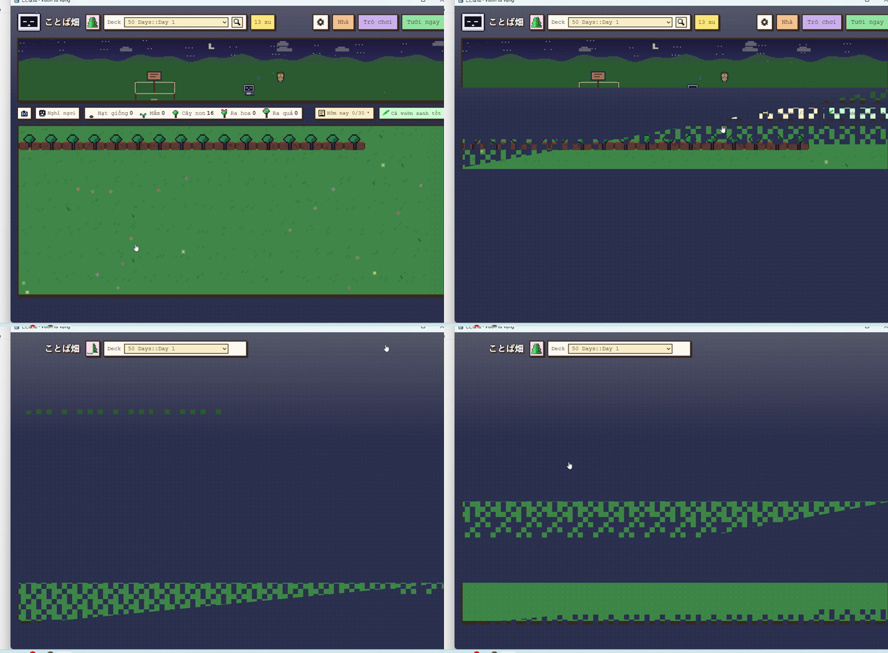

# Vườn vẽ nhẹ — kế hoạch (17/11/2026, **chưa làm**)

Nguồn: báo lỗi đầu tiên sau phát hành — **issue #7** "Cửa sổ vườn chớp trắng / giật khi rê chuột".
Người dùng (chủ dự án) chốt 17/11: **giữ nguyên trước** (42 lượt tải, mới một người gặp), ghi kế hoạch lại; làm khi có thêm báo
hoặc khi người dùng quyết.

## 1. Báo lỗi

- Máy: Windows 11, **AMD Ryzen 7 7435HS** (có GPU tích hợp Radeon) + **NVIDIA RTX 4050 Laptop** (6 GB), RAM 24 GB, màn hình
  **phóng to 125%**. Anki 26.09.4, Qt 6.11.2, add-on 1.31.3. Add-on khác: Fast Word Query 3, Hyper TTS.
- Triệu chứng: rê chuột trong cửa sổ vườn → màn hình chớp trắng; **quạt kêu to**. Anki chưa cài add-on: không giật.
- Đã thử, **không đỡ**: đổi Video driver của Anki, chọn GPU cho `anki.exe` trong Windows, cập nhật driver.

## 2. Đã tìm ra

### 2.1 Video quay màn hình (30 giây, 30 khung/giây)
4 khung lỗi, mỗi lần **đúng 1 khung** (~33 ms) ở giây 6,97 · 18,53 · 23,50 · 27,10. Mỗi khung lỗi là **trang vẽ dở**: chữ và khung
viền (DOM thường) còn, mọi thứ vẽ bằng canvas (dải sân, ruộng, linh vật, biểu tượng) mất hoặc thành mảng ô vuông mép chéo kéo xiên.
Add-on không vẽ hình nào như thế → bộ ghép hình bằng GPU của QtWebEngine đưa ra một khung chưa vẽ xong.

### 2.2 Vì sao đổi Video driver không giúp
Trên Windows, Video driver của Anki chỉ đổi cách Qt vẽ khung cửa sổ (`QQuickWindow.setGraphicsApi`); phần web (Chromium) **vẫn
dùng GPU**. Anki chỉ thêm `--disable-gpu` cho Chromium **trên Linux** (`aqt/__init__.py` `setupGL`, Anki 26.9.4).

### 2.3 Đo trong Anki thật — `tests/anki/do_cpu.sh` (offscreen, tỉ lệ 125%, cửa sổ 1384 × 1018, cửa sổ đang dùng)

| Bản / cài đặt | CPU khi mở vườn (1 nhân = 100%) | Đóng vườn |
|---|---|---|
| 1.31.3 (bản người dùng), mặc định "Chuyển động" | **~110%** (đứng yên 109%, rê chuột 111%) | 0% |
| 1.34.1, mặc định | **~109%** | 0% |
| 1.31.3, Cảnh sân + Ruộng cây "Đứng yên" | **~9%** | 0% |

Lệnh vẽ mỗi giây (1.34.1, mặc định): dải sân `#kb-yard` (1663 × 380 điểm ảnh) **~14.100 `fillRect`** — vẽ lại **toàn bộ** cảnh
~15 lần/giây, ~940 ô mỗi lần (`web/home.js` `loop` → `drawMainYard`); lớp hiệu ứng ruộng `#kb-fx` (1296 × 540) ~6.800 `fillRect`,
~26 lần xoá + vẽ lại/giây (`web/fx.js` `loop` → `drawField`); `requestAnimationFrame` ~90–100 lần/giây (3 vòng lặp riêng: ruộng,
sân, nền mùa). Khi cửa sổ ở nền vẫn vẽ ~5–6 khung/giây.

Máy test không có GPU (Chromium vẽ bằng CPU) nên con số trên máy Windows thật sẽ khác — nhưng **số lần vẽ là như nhau**.

## 3. Vì sao máy mạnh mà vẫn giật

Không phải do máy yếu — **lỗi về phối hợp chứ không về sức**:

1. **Laptop hai GPU**: màn hình nối vào GPU tích hợp (AMD), còn Anki có thể chạy trên NVIDIA. Mỗi khung phải vẽ ở GPU này rồi
   chép sang GPU kia để hiện. Driver / Windows làm việc này không phải lúc nào cũng khớp nhịp → thỉnh thoảng hiện ra khung vẽ dở.
   GPU càng mạnh càng không cứu được, vì lỗi nằm ở chỗ chuyển khung giữa hai GPU.
2. **Vườn là thứ duy nhất trong Anki vẽ liên tục** (~15–30 lần/giây, 2 canvas lớn). Các trang của Anki gần như đứng yên → hầu như
   không có khung nào để lỗi lộ ra. Số khung càng nhiều, càng hay gặp khung hỏng.
3. **Phóng to 125%**: mỗi điểm ảnh của vườn bị kéo thành 1,25 điểm màn hình (không tròn) → trình duyệt phải co giãn thêm mỗi khung.
4. **Quạt kêu**: hơn 1 nhân CPU chạy liên tục + GPU rời bị đánh thức → máy giữ xung nhịp cao. Máy mạnh vẫn nóng nếu bị bắt
   làm việc không ngừng; laptop chơi game thường đặt quạt mạnh tay.

Vì thế cách chữa chắc nhất là **bớt vẽ** — vừa đỡ quạt cho mọi người, vừa bớt cơ hội gặp khung hỏng trên máy hai GPU.

## 4. Cách tạm cho người gặp lỗi (có sẵn, không cần bản mới)

1. ⚙ → **Giao diện & chế độ học…** → kiểu **Dịu mắt** (sân + ruộng đứng yên ở cả 3 chế độ, tắt hạt bay / mưa tuyết). CPU ~9%.
2. Vẫn chớp → tắt GPU của phần web để xác nhận: cmd `setx QTWEBENGINE_CHROMIUM_FLAGS "--disable-gpu"`, thoát hẳn Anki, mở lại.
   Bỏ: `reg delete HKCU\Environment /v QTWEBENGINE_CHROMIUM_FLAGS /f`. (Email đã soạn cho người báo lỗi 17/11.)

Đang chờ người báo lỗi trả lời: Dịu mắt có hết chớp không, `--disable-gpu` có hết không.

## 5. Kế hoạch sửa (đề xuất của Claude — người dùng chưa duyệt)

Mục tiêu: **giữ nguyên hình và chuyển động người dùng thấy**, chỉ bớt việc vẽ thừa. Không đổi lưu trữ (không khoá collection mới,
không đổi config) → không đụng hợp đồng dữ liệu với 1.31.3.

| # | Việc | Ở đâu | Ước lượng |
|---|---|---|---|
| 1 | **Dải sân: vẽ phần tĩnh một lần.** Trời, đồi, sao, nhà, hàng rào, đồ đã đặt vẽ vào canvas ẩn; chỉ vẽ lại khi đổi giờ / thời tiết / cảnh / đồ / cỡ cửa sổ. Mỗi khung: `drawImage` lớp tĩnh + vẽ phần động (linh vật, thú, khách, StackChan, hạt mưa / tuyết, mây trôi) | `web/home.js` `drawOutdoor` / `drawMainYard` | lớn — cần tách hàm vẽ thành 2 lớp, soát mọi vùng / gian nhà |
| 2 | **Không có gì động thì không vẽ.** Mỗi vòng hỏi "có gì đang chuyển động không" (thú đang đi, hạt bay, cây vừa nhảy, bướm…); không có → bỏ khung. Ruộng: chỉ xoá + vẽ `#kb-fx` khi có hiệu ứng | `web/fx.js`, `web/home.js` | vừa |
| 3 | **Một vòng lặp chung** cho ruộng / sân / nền mùa thay vì 3 `requestAnimationFrame` riêng | `fx.js`, `home.js`, `season.js` | nhỏ |
| 4 | **Hạ nhịp khi không dùng**: chuột rời cửa sổ hoặc không bấm / rê 60 giây → ~4 khung/giây; cửa sổ ở nền → 1 khung/giây (nay 5–6) | 3 vòng lặp trên | nhỏ |
| 5 | **Canvas ruộng theo tỉ lệ màn hình** (nay `#kb-canvas` / `#kb-fx` 1296 × 540 không nhân `devicePixelRatio` → bị kéo 1,25 lần) — chỉ làm nếu ảnh trước / sau ở 125% đẹp hơn | `web/garden.js` | nhỏ, cần ảnh so sánh |
| 6 | (tuỳ chọn) ⚙ hiện dòng gợi ý "Máy nóng / màn hình chớp? → Dịu mắt" ở bảng Giao diện + một dòng ở trang Báo lỗi trên web | `web/ui.js`, `site/` | nhỏ |

Không đề xuất: add-on tự đặt `QTWEBENGINE_CHROMIUM_FLAGS` (đổi cả Anki, mọi trang, cần khởi động lại; không phải việc của add-on).

Mục tiêu đo (bằng `tests/anki/do_cpu.sh`): mặc định "Chuyển động" **≤ 30%** một nhân khi vườn mở không thao tác; rê chuột ≤ 40%;
cửa sổ ở nền ≤ 5%; "Đứng yên" giữ ~9%.

## 6. Kiểm thử khi làm

- `tests/anki/do_cpu.sh` trước / sau (mặc định, `still`, `KB_SCALE=1` và `1.25`), ghi số vào báo cáo.
- **Ảnh giống hệt**: chụp dải sân + ruộng ở cùng thời điểm giả (đóng băng `Date.now`, `Math.random`) trước / sau sửa cho mỗi cảnh
  (Sân, các vùng, Trong nhà 3 gian), ngày / chạng vạng / đêm, mưa / tuyết, giao diện mùa, có thú / khách / StackChan — so từng điểm
  ảnh, chỉ chấp nhận khác ở phần động.
- Lớp tĩnh vẽ lại đúng lúc: mua / dời / cất đồ, đổi cảnh ◂ ▸, sang giờ / đổi thời tiết, đổi cỡ cửa sổ, đổi giao diện mùa, Trang trí
  thử (1.34), đổi nền trang Giấy ấm / Trời xanh.
- Các kịch bản cũ có chụp ảnh / đếm điểm ảnh của sân (`e2e_124`, `e2e_130`, `e2e_131`, `e2e_1303`, `e2e_134`…) + `run_all.sh`.
- `run_capnhat.sh` (không đổi dữ liệu nhưng vẫn chạy theo luật sau phát hành).
- Nhờ người báo lỗi (hoặc máy Windows hai GPU) thử bản mới: còn chớp / quạt.

## 7. Câu hỏi cho người dùng (khi bắt đầu làm — hỏi lần lượt)

1. Làm bước 1–4 (giữ nguyên hình, chỉ bớt vẽ) hay chỉ bước 4 (hạ nhịp, nhanh, ít rủi ro) trước?
2. Bước 5 (canvas ruộng theo tỉ lệ màn hình): cần xem ảnh trước / sau ở 125% không?
3. Bước 6: có hiện gợi ý "Dịu mắt" không, hay để người dùng tự tìm?
