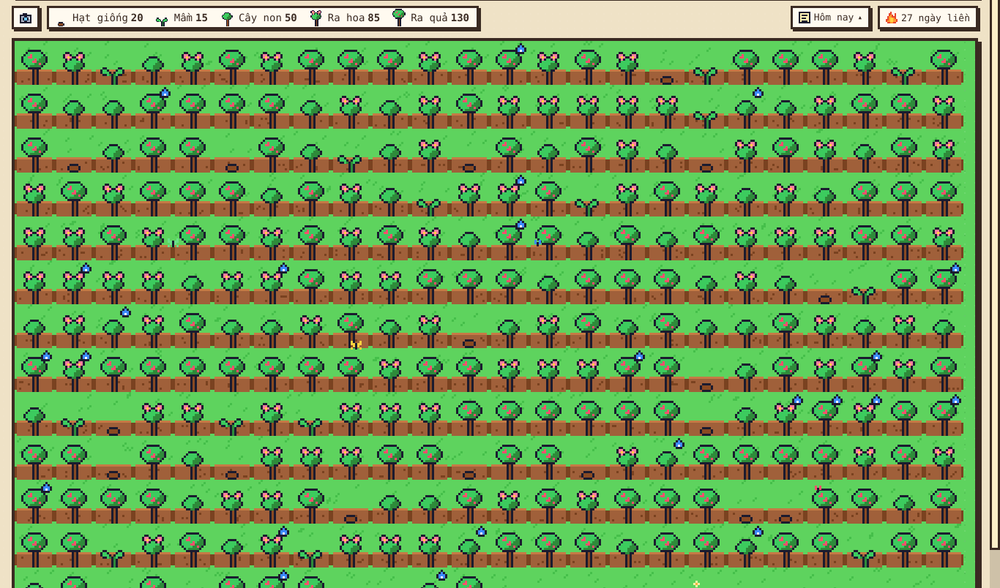
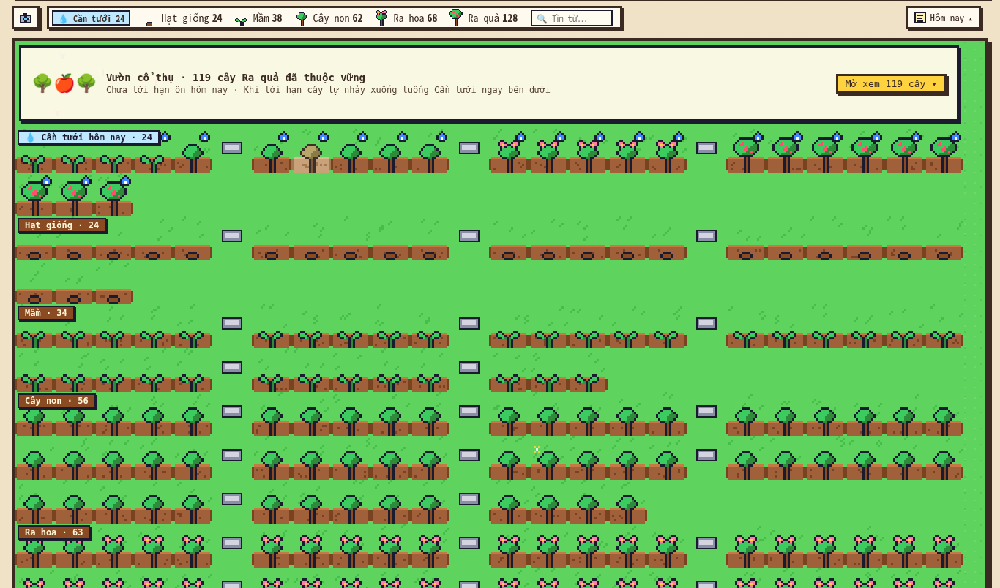
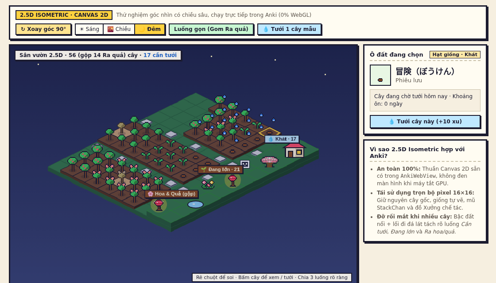
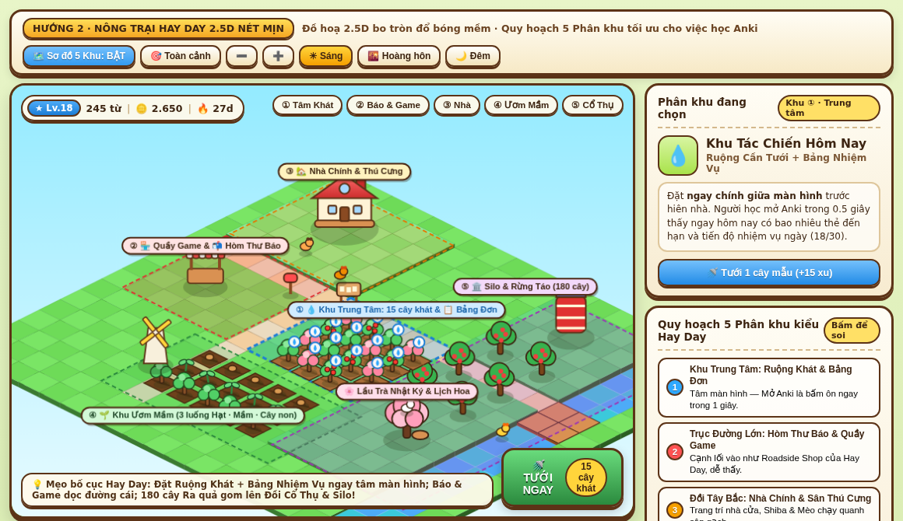
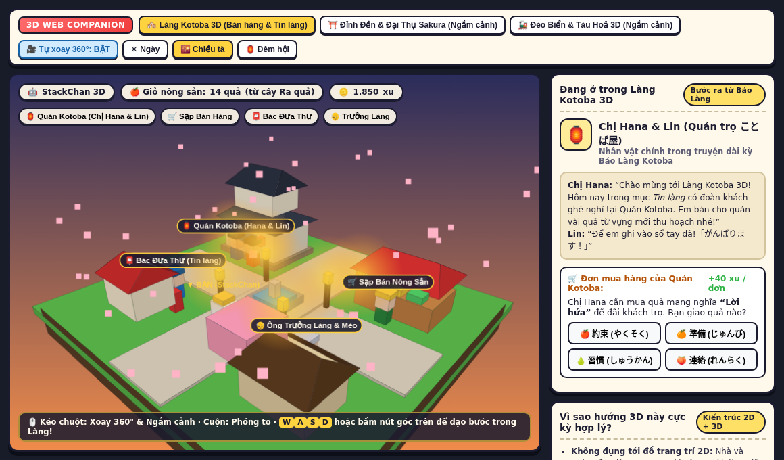
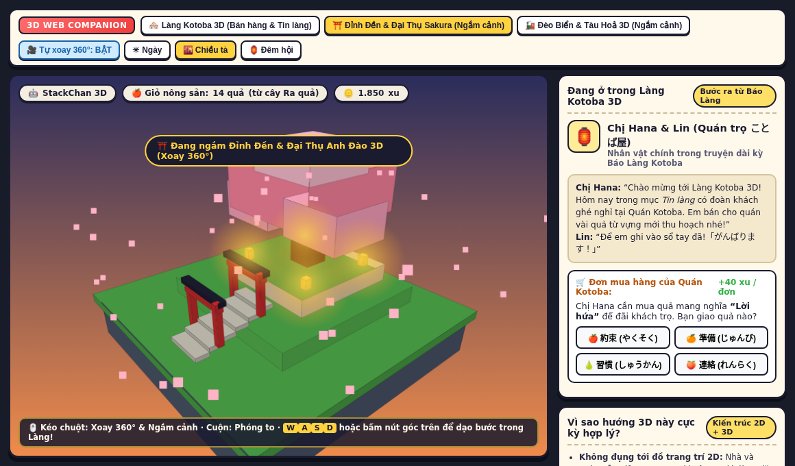

# Kế hoạch: Vườn nhiều cây đỡ rối mắt (`#kb-field`)

Khi deck có nhiều từ (200–500+ cây), ruộng hiện tại xếp cây theo thứ tự tạo thẻ (`order by id` trong `garden_core.build_garden`):
- Đủ 5 giai đoạn (Hạt giống, Mầm, Cây non, Ra hoa, Ra quả) cao thấp và màu sắc khác nhau đứng xen kẽ trên từng hàng.
- Mỗi ô cây đều vẽ mô đất nâu `16×7` sát cạnh nhau tạo thành các vạch nâu dài suốt 22 cột.
- Giọt nước xanh (`thirsty`) rải rác khắp 15–20 hàng khiến mắt phải quét cả ruộng mới biết hôm nay cần tưới bao nhiêu cây.
- Ở các deck học lâu, 50–70% số cây là **Ra quả** chưa tới hạn ôn nhưng vẫn chiếm từng ô riêng lẻ, đẩy các cây đang học xuống dưới màn hình.

Bộ ảnh dưới đây chụp cùng một vườn **320 cây** ở các phương án bố cục khác nhau (mã tạo mẫu: `tests/anki/demo_nhieu_cay.py`, `tests/anki/mock_vuon_gon.js`).

---

## 0. Hiện tại — `vg_00_hien_tai.png`

320 cây xếp theo thứ tự tạo thẻ, xen kẽ đủ 5 giai đoạn, 22 cây dính liền một dải đất nâu mỗi hàng.

---

## 1. Chia luống theo giai đoạn (Biển gỗ / Đá lát / Viền hoa)

Gom cây cùng giai đoạn về một luống (**Ra quả → Ra hoa → Cây non → Mầm → Hạt giống**), hết một giai đoạn thì xuống hàng mới. Không dùng dải đất nâu kéo ngang cả hàng mà dùng một trong 3 kiểu ngăn luống nhẹ nhàng:

- **`vg_01b_bien_go.png` (Khuyên dùng)**: Chỉ cắm biển gỗ nhỏ ở đầu luống, phần cuối luống để nền cỏ xanh tự nhiên tạo khoảng thở.
- **`vg_01c_da_lat.png`**: Thêm hàng đá lát xám nhỏ trên cỏ giữa hai luống.
- **`vg_01d_vien_hoa.png`**: Điểm cụm hoa nhỏ trên cỏ giữa hai luống.

---

## 2. Luống “💧 Cần tưới hôm nay” lên đầu — `vg_02_can_tuoi_len_dau.png`

Tách riêng các cây đang khát (`thirsty`) thành một luống ngay trên cùng (biển xanh nhạt), dưới mới là các cây đã tưới xếp theo giai đoạn. Mở vườn là thấy ngay các cây cần ôn hôm nay trong 1–2 hàng đầu, không còn giọt nước xanh rải rác khắp ruộng.

---

## 3. Bấm thanh chú thích để lọc giai đoạn — `vg_03_loc_ra_hoa.png`

Bấm vào một giai đoạn trên thanh chú thích (`Hạt giống`, `Mầm`, `Cây non`, `Ra hoa`, `Ra quả` hoặc nút `💧 Cần tưới`): các cây khác dịu mờ xuống (`opacity: 0.22`), chỉ giai đoạn đang chọn nổi rõ. Bấm lại để hiện đủ.

---

## 4. Gom cây Ra quả chưa tới hạn vào “Vườn quả / Vườn cổ thụ” — `vg_04_vuon_qua.png`

Các cây **Ra quả** đã thuộc lâu và **chưa tới hạn ôn hôm nay** được gom vào khung **Vườn quả** gọn bằng 2 hàng cây ở đầu ruộng (bấm để mở rộng toàn bộ khi muốn ngắm). Ruộng chính chỉ còn các cây đang học và cây cần tưới hôm nay — chiều cao ruộng giảm gần một nửa, nằm gọn trong một màn hình.

---

## 5. Chia ô luống dọc mỗi 5 cây + Sắp xếp liền mạch không hàng trống — `vg_05_luong_doc_5_cay.png`

Nếu không muốn tách hàng trống giữa các giai đoạn (để tiết kiệm chiều dọc tối đa):
- Sắp xếp liền mạch: **Cần tưới hôm nay → Hạt giống → Mầm → Cây non → Ra hoa → Ra quả**.
- Cứ mỗi **5 cây** trên một hàng thì chừa **1 cột lối đi cỏ có viên đá lát nhỏ** (chia hàng 22 cột thành 4 luống nhỏ: `5 cây · lối đá · 5 cây · lối đá · 5 cây · lối đá · 6 cây`).
- Phá vỡ hoàn toàn cảm giác "vạch đất nâu dài 22 cây", giúp mắt định vị từng cụm 5 cây cực kỳ dễ dàng.

---

## 6. Bản kết hợp khuyên dùng (Tối ưu nhất cho deck lớn) — `vg_06_ket_hop_toi_uu.png`

Kết hợp các điểm mạnh nhất:
1. **Thanh chú thích tương tác**: Thêm pill `💧 Cần tưới N` (bấm để lọc) + ô `🔍 Tìm từ…` (gõ từ để sáng cây cần tìm trên ruộng).
2. **Vườn cổ thụ thu gọn ở đầu ruộng**: Gom các cây `Ra quả` chưa tới hạn ôn vào khung gọn 2 hàng (có nút `Mở xem N cây ▾`).
3. **Luống `💧 Cần tưới hôm nay` ngay bên dưới**: Toàn bộ cây cần ôn nằm gọn trong 1–2 hàng đầu tiên.
4. **Biển gỗ đầu luống + Lối đi đá lát dọc mỗi 5 cây**: Các luống `Hạt giống`, `Mầm`, `Cây non`, `Ra hoa` vừa có biển gỗ rõ ràng, vừa được chia thành từng cụm 5 cây thoáng mắt, toàn bộ vườn 320 cây vừa khít trong 1 màn hình chuẩn `1366×768`.

---

## 7. Thử nghiệm Phương án 2.5D Isometric (Canvas 2D thuần) — `proto_iso_25d.html`

Ngoài bố cục 2D phẳng ở các mục 1–6, có thể dựng hẳn **vườn nổi 2.5D Isometric** bằng **Canvas 2D thuần** (0% WebGL, chạy an toàn trực tiếp trong `AnkiWebView` của QtWebEngine kể cả khi tắt tăng tốc GPU):
- **Tái sử dụng 100% pixel art `16×16` hiện có** (`SPRITES`, `PAL`, `DRY` trong [`web/garden.js`](../../kotoba_batake/web/garden.js) cùng nhà, hoa anh đào, đèn lồng `CHOCHIN`, StackChan trong [`web/home.js`](../../kotoba_batake/web/home.js)) đặt thẳng đứng trên nền ô thoi 2:1 (`54×27px`).
- **Sân nhà trên bậc thềm nâng cao (`elev`)** tách biệt với **3 luống đất nổi** bên dưới (`💧 Khát`, `🌱 Đang lớn`, `🌸 Hoa & Quả (gộp)`) ngăn bằng lối đi đá lát và cắm biển gỗ.
- Hỗ trợ **xoay 4 góc 90°**, chuyển ánh sáng **Sáng / Chiều / Đêm**, chuyển chế độ **Luống gọn / Đủ cây**, di chuột & bấm vào từng cây để xem nghĩa hoặc tưới mẫu.

Xem bản chạy thử tương tác tại [`proto_iso_25d.html`](proto_iso_25d.html):

| Góc nhìn Sáng (mặc định) | Góc nhìn Đêm (xoay 90°) |
| :---: | :---: |
|  |  |

---

## 8. Thử nghiệm Hướng 1: “Pixel Hay Day” (Nông trại sống 2.5D kéo-thả & chạm công trình) — `proto_pixel_hayday.html`

Phát triển từ nền 2.5D Isometric lên mô hình **nông trại tương tác kiểu Hay Day** nhưng **giữ nguyên 100% kho đồ Pixel Art `16×16` hiện có** (`garden.js`, `home.js`, `pets.js`, `craft.js`):
- **Chạm công trình trên bản đồ thay cho menu chữ**:
  - 🏠 **Ngôi nhà chính (Cấp 7, khói bếp bay)**: Bấm mở *Nhà & Trang trí*.
  - 📬 **Hòm thư ở ngã tư đường đất**: Có nhãn nổi `📬 Báo mới!` — bấm mở *Báo & Chép chính tả* (không còn bị ẩn khi thu gọn thẻ `Hôm nay`).
  - 🏪 **Quầy hàng ven đường (Roadside Shop)**: Bấm mở *5 Trò chơi từ vựng*.
  - 📖 **Bàn trà dưới gốc Anh Đào (cánh hoa rơi)**: Bấm mở *Lịch hoa, Nhật ký & Luyện viết*.
  - 🎨 **Giếng cổ & Bàn chế tác**: Bấm mở *Xưởng vẽ 16×16*.
- **Chia thửa có hàng rào gỗ + Đồi Vườn Cổ Thụ (Orchard)**:
  - **Thửa `💧 Cần Tưới`** nằm ngay trung tâm kèm nút lớn **`🚿 TƯỚI NGAY`** cố định ở góc dưới phải (đảm bảo người dùng Anki mở lên là bấm ôn được ngay trong 1 giây).
  - **Thửa `🌱 Đang Lớn`** bên trái có bù nhìn rơm canh ruộng.
  - **Khu `🍎 Vườn Cổ Thụ`** gom 180 cây `Ra quả` đã thuộc vững thành cụm cây đại thụ sum suê (có nút bung/gộp).
- **Thú nuôi đi dạo tự động (`pets.js`)**: Chó Shiba, Mèo tam thể, Thỏ trắng, Gà con và Vịt vàng tự đi lại trên đường đất / ao nước, bấm vào thả tim `❤️`.

Xem bản chạy thử tương tác tại [`proto_pixel_hayday.html`](proto_pixel_hayday.html):

---

## 9. Thử nghiệm Hướng 2: Nông trại Hay Day 2.5D Nét Mịn & Quy hoạch 5 Phân khu — `proto_hayday_25d_min.html`

Bản thử nghiệm đồ hoạ **2.5D nét mịn bo tròn, đổ bóng mềm kiểu Hay Day** kèm **Sơ đồ Quy hoạch 5 Phân khu hợp lý** (có nút `🗺️ Sơ đồ 5 Khu: BẬT/TẮT` ngay trên thanh công cụ để soi ranh giới từng vùng):

1. **Khu ① — Khu Trung Tâm Tác Chiến (`💧 Ruộng Cần Tưới` + `📋 Bảng Nhiệm Vụ Hôm Nay`)**:
   - Đặt **ngay chính diện tâm màn hình** trước hiên nhà và ngã ba đường chính. Người học mở Anki trong 0.5 giây thấy ngay số cây khát hôm nay và tiến độ nhiệm vụ ngày (`18/30`).
2. **Khu ② — Trục Đường Lớn (`🏪 Quầy Hàng Trò Chơi` & `📬 Hòm Thư Đọc Báo`)**:
   - Đặt dọc trục đường sỏi dẫn vào trang trại (đúng vị trí *Roadside Shop* và *Mailbox* kinh điển của Hay Day), giúp tính năng đọc Báo và 5 Trò chơi luôn nổi bật.
3. **Khu ③ — Đồi Tây Bắc (`🏡 Nhà Chính 3 Gian` & `🐕 Sân Thú Cưng`)**:
   - Nằm trên thềm đất cao nhìn xuống toàn trang trại, nơi trang trí nhà cửa và thú cưng chạy nhảy.
4. **Khu ④ — Cánh Đồng Nam (`🌱 Khu Ươm Mầm` & `Cối Xay Gió`)**:
   - Chia thành 3 luống đất xốp gọn gàng cho các từ đang học (`Hạt giống → Mầm → Cây non`) cùng cối xay gió quay đều.
5. **Khu ⑤ — Đồi Đông & Bờ Suối (`🏛️ Silo & Rừng Táo Cổ Thụ` + `🌸 Lầu Trà Nhật Ký`)**:
   - Gom 180+ cây `Ra quả` chưa tới hạn ôn vào **Silo & Rừng Cây Ăn Quả (Orchard)** ở hậu cảnh (giải phóng 70% diện tích đất trồng), cạnh dòng suối xanh có cầu gỗ và **Lầu Trà Anh Đào** để mở Lịch hoa & Nhật ký.

Xem bản chạy thử tương tác tại [`proto_hayday_25d_min.html`](proto_hayday_25d_min.html):

---

## 10. Kiến trúc Hybrid 2D + 3D: Giữ Nhà/Vườn ở 2D, mở rộng 3D cho “Làng Kotoba 3D (Bán hàng & Tin làng)” và “Các vùng ngắm cảnh 3D” — `proto_lang_kotoba_3d.html`

Giải quyết bài toán **đồ trang trí 2D do người dùng đặt trong Nhà & Vườn rất khó tự động ánh xạ sang 3D**:
- **Không gian tuỳ biến (`Nhà` & `Sân vườn`) giữ nguyên 2D trong Anki**: Bảo toàn 100% tương thích với toàn bộ vật phẩm trang trí tường/sàn, thú nuôi và xưởng vẽ pixel `16×16`.
- **Không gian cố định mở bằng Trình duyệt 3D (`3D Web Companion`)**:
  1. **🏘️ Đi vào Làng Kotoba 3D (`ことば村`) — Kết nối trực tiếp với Báo Làng (`畑新聞` / `story_core.py`) & Bán hàng**:
     - Đưa các nhân vật và địa danh vốn chỉ xuất hiện bằng chữ trên mục *Tin làng* và *Truyện dài kỳ* bước ra đời thực dưới dạng một ngôi làng 3D xoay 360° (hoặc điều khiển **StackChan 3D** chạy bằng phím `WASD`):
       - **🏮 Quán trọ Kotoba (`ことば屋`)**: Gặp **chị chủ quán Hana (`はなさん`)** và **cô bé Lin (`リンさん`)** cầm cuốn sổ tay nhỏ.
       - **🛒 Sạp Chợ Phiên (`朝市`)**: Nơi người học đem **trái cây từ vựng thu hoạch từ các cây `Ra quả` ở vườn 2D** vào giao đơn cho dân làng (trả lời nhanh từ vựng theo yêu cầu của khách để bán quả nhận **+40 xu/đơn**).
       - **📮 Trạm Bưu Điện & Bác Đưa Thư (`郵便屋さん`)**: Xem chuyện đang diễn ra trong *Tin làng* mỗi ngày.
       - **👴 Nhà Ông Trưởng Làng (`村長さん`) & Con Mèo Hoang Trắng (`白いのらねこ`)**.
  2. **⛩️ Các vùng 3D mới chỉ dùng để ngắm cảnh (3D Scenic Dioramas)**:
     - Vì người dùng không đặt đồ trang trí 2D ở các vùng này, ta có thể thiết kế sẵn các **kỳ quan 3D cố định** làm phần thưởng mở khoá theo chuỗi ngày học (*streak*) hoặc số cây đạt *Ra quả*:
       - **Đỉnh Đền & Cây Đại Thụ Anh Đào 3D**: Cổng Torii đỏ dẫn lên cây đại thụ toả sáng với mưa cánh hoa Sakura rơi trong không gian 3D.
       - **Đèo Biển & Đoàn Tàu Hoả 3D**: Đoàn tàu 3 toa chạy qua cầu cạn trên vịnh biển xanh dưới ánh hoàng hôn hoặc đèn đêm.

Xem bản chạy thử tương tác tại [`proto_lang_kotoba_3d.html`](proto_lang_kotoba_3d.html):

| 🏘️ Làng Kotoba 3D (Quán Kotoba, Chợ phiên, Bán nông sản) | ⛩️ Đỉnh Đền & Đại Thụ Anh Đào 3D (Vùng ngắm cảnh 360°) |
| :---: | :---: |
|  |  |

