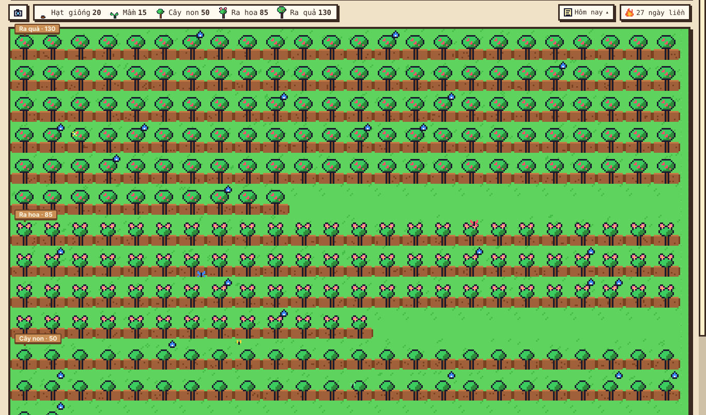
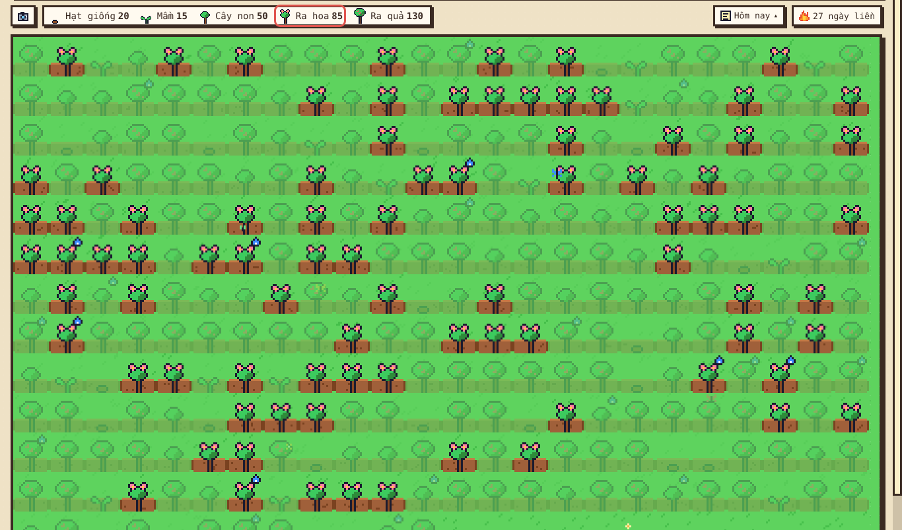
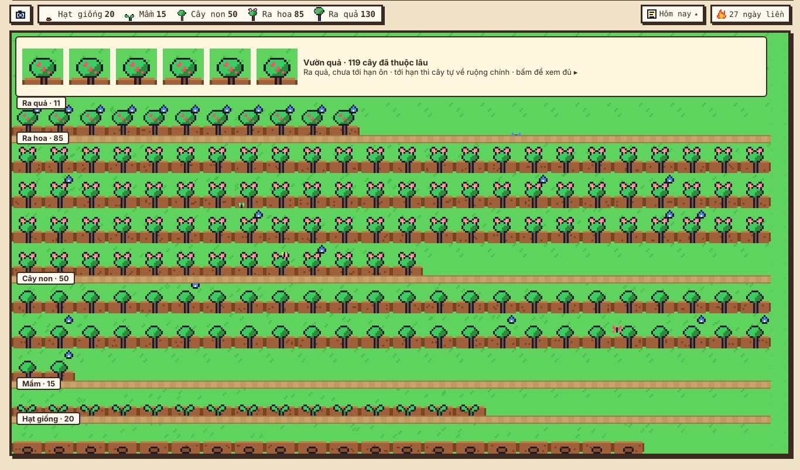

# Kế hoạch: Vườn nhiều cây đỡ rối mắt (`#kb-field`)

Khi deck có nhiều từ (200–500+ cây), ruộng hiện tại xếp cây theo thứ tự tạo thẻ (`order by id` trong `garden_core.build_garden`):
- Đủ 5 giai đoạn (Hạt giống, Mầm, Cây non, Ra hoa, Ra quả) cao thấp và màu sắc khác nhau đứng xen kẽ trên từng hàng.
- Mỗi ô cây đều vẽ mô đất nâu `16×7` sát cạnh nhau tạo thành các vạch nâu dài suốt 22 cột.
- Giọt nước xanh (`thirsty`) rải rác khắp 15–20 hàng khiến mắt phải quét cả ruộng mới biết hôm nay cần tưới bao nhiêu cây.
- Ở các deck học lâu, 50–70% số cây là **Ra quả** chưa tới hạn ôn nhưng vẫn chiếm từng ô riêng lẻ, đẩy các cây đang học xuống dưới màn hình.

Bộ ảnh dưới đây chụp cùng một vườn **320 cây** ở các phương án bố cục khác nhau (mã tạo mẫu: `tests/anki/demo_nhieu_cay.py`, `tests/anki/mock_vuon_gon.js`).

---

## 0. Hiện tại — `vg_00_hien_tai.png`

320 cây xếp theo thứ tự tạo thẻ, xen kẽ đủ 5 giai đoạn, 22 cây dính liền một dải đất nâu mỗi hàng.

---

## 1. Chia luống theo giai đoạn (Biển gỗ / Đá lát / Viền hoa)

Gom cây cùng giai đoạn về một luống (**Ra quả → Ra hoa → Cây non → Mầm → Hạt giống**), hết một giai đoạn thì xuống hàng mới. Không dùng dải đất nâu kéo ngang cả hàng mà dùng một trong 3 kiểu ngăn luống nhẹ nhàng:

- **`vg_01b_bien_go.png` (Khuyên dùng)**: Chỉ cắm biển gỗ nhỏ ở đầu luống, phần cuối luống để nền cỏ xanh tự nhiên tạo khoảng thở.
- **`vg_01c_da_lat.png`**: Thêm hàng đá lát xám nhỏ trên cỏ giữa hai luống.
- **`vg_01d_vien_hoa.png`**: Điểm cụm hoa nhỏ trên cỏ giữa hai luống.

---

## 2. Luống “💧 Cần tưới hôm nay” lên đầu — `vg_02_can_tuoi_len_dau.png`

Tách riêng các cây đang khát (`thirsty`) thành một luống ngay trên cùng (biển xanh nhạt), dưới mới là các cây đã tưới xếp theo giai đoạn. Mở vườn là thấy ngay các cây cần ôn hôm nay trong 1–2 hàng đầu, không còn giọt nước xanh rải rác khắp ruộng.

---

## 3. Bấm thanh chú thích để lọc giai đoạn — `vg_03_loc_ra_hoa.png`

Bấm vào một giai đoạn trên thanh chú thích (`Hạt giống`, `Mầm`, `Cây non`, `Ra hoa`, `Ra quả` hoặc nút `💧 Cần tưới`): các cây khác dịu mờ xuống (`opacity: 0.22`), chỉ giai đoạn đang chọn nổi rõ. Bấm lại để hiện đủ.

---

## 4. Gom cây Ra quả chưa tới hạn vào “Vườn quả / Vườn cổ thụ” — `vg_04_vuon_qua.png`

Các cây **Ra quả** đã thuộc lâu và **chưa tới hạn ôn hôm nay** được gom vào khung **Vườn quả** gọn bằng 2 hàng cây ở đầu ruộng (bấm để mở rộng toàn bộ khi muốn ngắm). Ruộng chính chỉ còn các cây đang học và cây cần tưới hôm nay — chiều cao ruộng giảm gần một nửa, nằm gọn trong một màn hình.

---

## 5. Chia ô luống dọc mỗi 5 cây + Sắp xếp liền mạch không hàng trống — `vg_05_luong_doc_5_cay.png`

Nếu không muốn tách hàng trống giữa các giai đoạn (để tiết kiệm chiều dọc tối đa):
- Sắp xếp liền mạch: **Cần tưới hôm nay → Hạt giống → Mầm → Cây non → Ra hoa → Ra quả**.
- Cứ mỗi **5 cây** trên một hàng thì chừa **1 cột lối đi cỏ có viên đá lát nhỏ** (chia hàng 22 cột thành 4 luống nhỏ: `5 cây · lối đá · 5 cây · lối đá · 5 cây · lối đá · 6 cây`).
- Phá vỡ hoàn toàn cảm giác "vạch đất nâu dài 22 cây", giúp mắt định vị từng cụm 5 cây cực kỳ dễ dàng.

---

## 6. Bản kết hợp khuyên dùng (Tối ưu nhất cho deck lớn) — `vg_06_ket_hop_toi_uu.png`

Kết hợp các điểm mạnh nhất:
1. **Thanh chú thích tương tác**: Thêm pill `💧 Cần tưới N` (bấm để lọc) + ô `🔍 Tìm từ…` (gõ từ để sáng cây cần tìm trên ruộng).
2. **Vườn cổ thụ thu gọn ở đầu ruộng**: Gom các cây `Ra quả` chưa tới hạn ôn vào khung gọn 2 hàng (có nút `Mở xem N cây ▾`).
3. **Luống `💧 Cần tưới hôm nay` ngay bên dưới**: Toàn bộ cây cần ôn nằm gọn trong 1–2 hàng đầu tiên.
4. **Biển gỗ đầu luống + Lối đi đá lát dọc mỗi 5 cây**: Các luống `Hạt giống`, `Mầm`, `Cây non`, `Ra hoa` vừa có biển gỗ rõ ràng, vừa được chia thành từng cụm 5 cây thoáng mắt, toàn bộ vườn 320 cây vừa khít trong 1 màn hình chuẩn `1366×768`.

