# Kế hoạch: Vườn nhiều cây đỡ rối mắt (`#kb-field`)

Khi deck có nhiều từ (200–500+ cây), ruộng hiện tại xếp cây theo thứ tự tạo thẻ (`order by id` trong `garden_core.build_garden`):
- Đủ 5 giai đoạn (Hạt giống, Mầm, Cây non, Ra hoa, Ra quả) cao thấp và màu sắc khác nhau đứng xen kẽ trên từng hàng.
- Mỗi ô cây đều vẽ mô đất nâu `16×7` sát cạnh nhau tạo thành các vạch nâu dài suốt 22 cột.
- Giọt nước xanh (`thirsty`) rải rác khắp 15–20 hàng khiến mắt phải quét cả ruộng mới biết hôm nay cần tưới bao nhiêu cây.
- Ở các deck học lâu, 50–70% số cây là **Ra quả** chưa tới hạn ôn nhưng vẫn chiếm từng ô riêng lẻ, đẩy các cây đang học xuống dưới màn hình.

Bộ ảnh dưới đây chụp cùng một vườn **320 cây** ở các phương án bố cục khác nhau (mã tạo mẫu: `tests/anki/demo_nhieu_cay.py`, `tests/anki/mock_vuon_gon.js`).

---

## 0. Hiện tại — `vg_00_hien_tai.png`

320 cây xếp theo thứ tự tạo thẻ, xen kẽ đủ 5 giai đoạn, 22 cây dính liền một dải đất nâu mỗi hàng.

---

## 1. Chia luống theo giai đoạn (Biển gỗ / Đá lát / Viền hoa)

Gom cây cùng giai đoạn về một luống (**Ra quả → Ra hoa → Cây non → Mầm → Hạt giống**), hết một giai đoạn thì xuống hàng mới. Không dùng dải đất nâu kéo ngang cả hàng mà dùng một trong 3 kiểu ngăn luống nhẹ nhàng:

- **`vg_01b_bien_go.png` (Khuyên dùng)**: Chỉ cắm biển gỗ nhỏ ở đầu luống, phần cuối luống để nền cỏ xanh tự nhiên tạo khoảng thở.
- **`vg_01c_da_lat.png`**: Thêm hàng đá lát xám nhỏ trên cỏ giữa hai luống.
- **`vg_01d_vien_hoa.png`**: Điểm cụm hoa nhỏ trên cỏ giữa hai luống.

---

## 2. Luống “💧 Cần tưới hôm nay” lên đầu — `vg_02_can_tuoi_len_dau.png`

Tách riêng các cây đang khát (`thirsty`) thành một luống ngay trên cùng (biển xanh nhạt), dưới mới là các cây đã tưới xếp theo giai đoạn. Mở vườn là thấy ngay các cây cần ôn hôm nay trong 1–2 hàng đầu, không còn giọt nước xanh rải rác khắp ruộng.

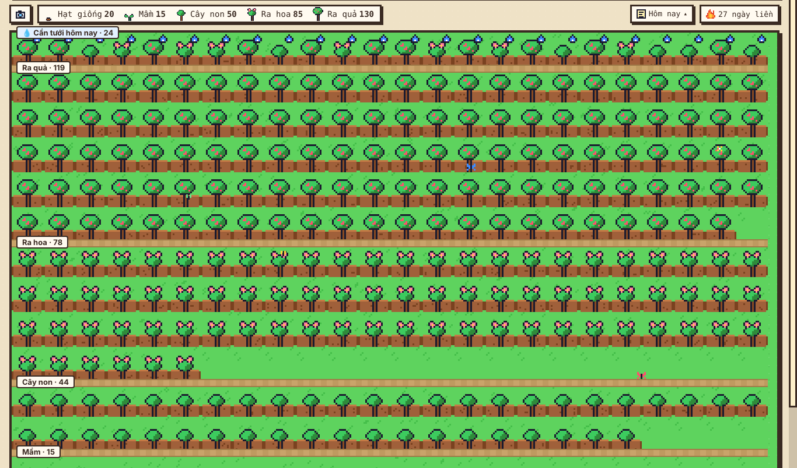

---

## 3. Bấm thanh chú thích để lọc giai đoạn — `vg_03_loc_ra_hoa.png`

Bấm vào một giai đoạn trên thanh chú thích (`Hạt giống`, `Mầm`, `Cây non`, `Ra hoa`, `Ra quả` hoặc nút `💧 Cần tưới`): các cây khác dịu mờ xuống (`opacity: 0.22`), chỉ giai đoạn đang chọn nổi rõ. Bấm lại để hiện đủ.

---

## 4. Gom cây Ra quả chưa tới hạn vào “Vườn quả / Vườn cổ thụ” — `vg_04_vuon_qua.png`

Các cây **Ra quả** đã thuộc lâu và **chưa tới hạn ôn hôm nay** được gom vào khung **Vườn quả** gọn bằng 2 hàng cây ở đầu ruộng (bấm để mở rộng toàn bộ khi muốn ngắm). Ruộng chính chỉ còn các cây đang học và cây cần tưới hôm nay — chiều cao ruộng giảm gần một nửa, nằm gọn trong một màn hình.

---

## 5. Chia ô luống dọc mỗi 5 cây + Sắp xếp liền mạch không hàng trống — `vg_05_luong_doc_5_cay.png`

Nếu không muốn tách hàng trống giữa các giai đoạn (để tiết kiệm chiều dọc tối đa):
- Sắp xếp liền mạch: **Cần tưới hôm nay → Hạt giống → Mầm → Cây non → Ra hoa → Ra quả**.
- Cứ mỗi **5 cây** trên một hàng thì chừa **1 cột lối đi cỏ có viên đá lát nhỏ** (chia hàng 22 cột thành 4 luống nhỏ: `5 cây · lối đá · 5 cây · lối đá · 5 cây · lối đá · 6 cây`).
- Phá vỡ hoàn toàn cảm giác "vạch đất nâu dài 22 cây", giúp mắt định vị từng cụm 5 cây cực kỳ dễ dàng.

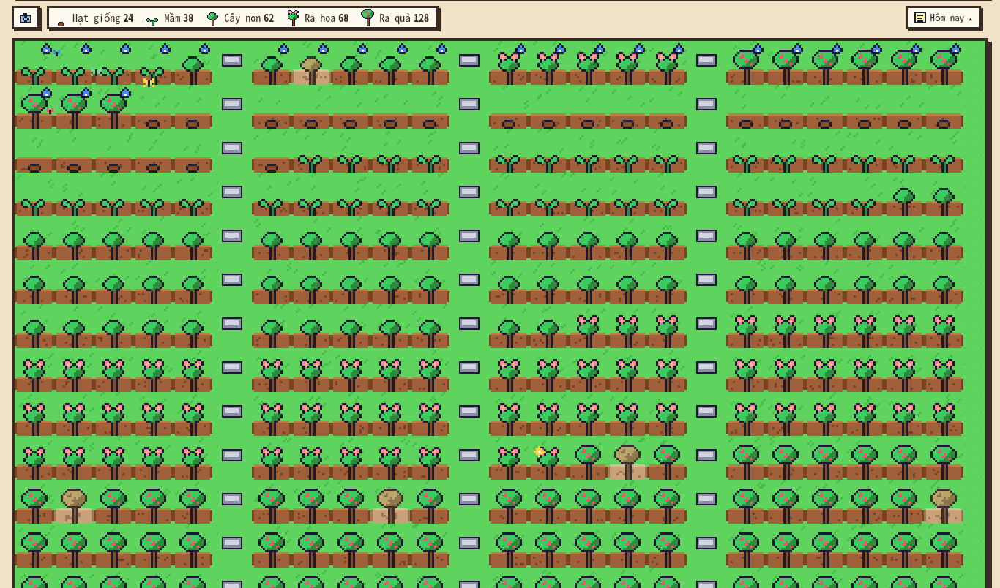

---

## 6. Bản kết hợp khuyên dùng (Tối ưu nhất cho deck lớn) — `vg_06_ket_hop_toi_uu.png`

Kết hợp các điểm mạnh nhất:
1. **Thanh chú thích tương tác**: Thêm pill `💧 Cần tưới N` (bấm để lọc) + ô `🔍 Tìm từ…` (gõ từ để sáng cây cần tìm trên ruộng).
2. **Vườn cổ thụ thu gọn ở đầu ruộng**: Gom các cây `Ra quả` chưa tới hạn ôn vào khung gọn 2 hàng (có nút `Mở xem N cây ▾`).
3. **Luống `💧 Cần tưới hôm nay` ngay bên dưới**: Toàn bộ cây cần ôn nằm gọn trong 1–2 hàng đầu tiên.
4. **Biển gỗ đầu luống + Lối đi đá lát dọc mỗi 5 cây**: Các luống `Hạt giống`, `Mầm`, `Cây non`, `Ra hoa` vừa có biển gỗ rõ ràng, vừa được chia thành từng cụm 5 cây thoáng mắt, toàn bộ vườn 320 cây vừa khít trong 1 màn hình chuẩn `1366×768`.

---

## 7. Thử nghiệm Phương án 2.5D Isometric (Canvas 2D thuần) — `proto_iso_25d.html`

Ngoài bố cục 2D phẳng ở các mục 1–6, có thể dựng hẳn **vườn nổi 2.5D Isometric** bằng **Canvas 2D thuần** (0% WebGL, chạy an toàn trực tiếp trong `AnkiWebView` của QtWebEngine kể cả khi tắt tăng tốc GPU):
- **Tái sử dụng 100% pixel art `16×16` hiện có** (`SPRITES`, `PAL`, `DRY` trong [`web/garden.js`](../../kotoba_batake/web/garden.js) cùng nhà, hoa anh đào, đèn lồng `CHOCHIN`, StackChan trong [`web/home.js`](../../kotoba_batake/web/home.js)) đặt thẳng đứng trên nền ô thoi 2:1 (`54×27px`).
- **Sân nhà trên bậc thềm nâng cao (`elev`)** tách biệt với **3 luống đất nổi** bên dưới (`💧 Khát`, `🌱 Đang lớn`, `🌸 Hoa & Quả (gộp)`) ngăn bằng lối đi đá lát và cắm biển gỗ.
- Hỗ trợ **xoay 4 góc 90°**, chuyển ánh sáng **Sáng / Chiều / Đêm**, chuyển chế độ **Luống gọn / Đủ cây**, di chuột & bấm vào từng cây để xem nghĩa hoặc tưới mẫu.

Xem bản chạy thử tương tác tại [`proto_iso_25d.html`](proto_iso_25d.html):

| Góc nhìn Sáng (mặc định) | Góc nhìn Đêm (xoay 90°) |
| :---: | :---: |
| 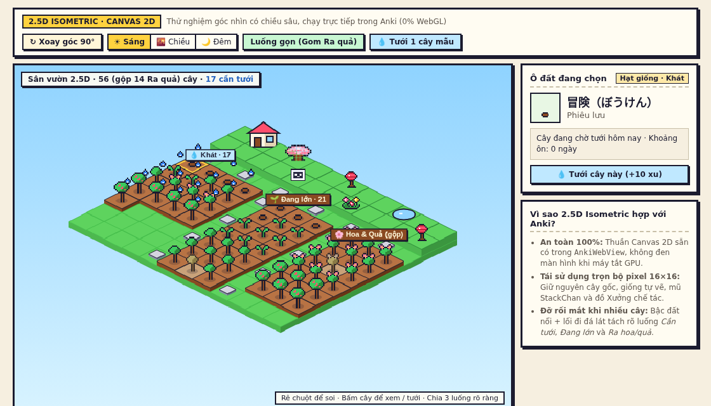 |  |

---

## 8. Thử nghiệm Hướng 1: “Pixel Hay Day” (Nông trại sống 2.5D kéo-thả & chạm công trình) — `proto_pixel_hayday.html`

Phát triển từ nền 2.5D Isometric lên mô hình **nông trại tương tác kiểu Hay Day** nhưng **giữ nguyên 100% kho đồ Pixel Art `16×16` hiện có** (`garden.js`, `home.js`, `pets.js`, `craft.js`):
- **Chạm công trình trên bản đồ thay cho menu chữ**:
  - 🏠 **Ngôi nhà chính (Cấp 7, khói bếp bay)**: Bấm mở *Nhà & Trang trí*.
  - 📬 **Hòm thư ở ngã tư đường đất**: Có nhãn nổi `📬 Báo mới!` — bấm mở *Báo & Chép chính tả* (không còn bị ẩn khi thu gọn thẻ `Hôm nay`).
  - 🏪 **Quầy hàng ven đường (Roadside Shop)**: Bấm mở *5 Trò chơi từ vựng*.
  - 📖 **Bàn trà dưới gốc Anh Đào (cánh hoa rơi)**: Bấm mở *Lịch hoa, Nhật ký & Luyện viết*.
  - 🎨 **Giếng cổ & Bàn chế tác**: Bấm mở *Xưởng vẽ 16×16*.
- **Chia thửa có hàng rào gỗ + Đồi Vườn Cổ Thụ (Orchard)**:
  - **Thửa `💧 Cần Tưới`** nằm ngay trung tâm kèm nút lớn **`🚿 TƯỚI NGAY`** cố định ở góc dưới phải (đảm bảo người dùng Anki mở lên là bấm ôn được ngay trong 1 giây).
  - **Thửa `🌱 Đang Lớn`** bên trái có bù nhìn rơm canh ruộng.
  - **Khu `🍎 Vườn Cổ Thụ`** gom 180 cây `Ra quả` đã thuộc vững thành cụm cây đại thụ sum suê (có nút bung/gộp).
- **Thú nuôi đi dạo tự động (`pets.js`)**: Chó Shiba, Mèo tam thể, Thỏ trắng, Gà con và Vịt vàng tự đi lại trên đường đất / ao nước, bấm vào thả tim `❤️`.

Xem bản chạy thử tương tác tại [`proto_pixel_hayday.html`](proto_pixel_hayday.html):

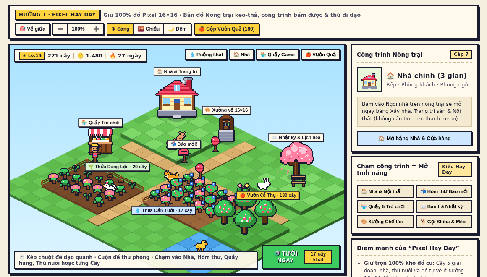

---

## 9. Thử nghiệm Hướng 2: Nông trại Hay Day 2.5D Nét Mịn & Quy hoạch 5 Phân khu — `proto_hayday_25d_min.html`

Bản thử nghiệm đồ hoạ **2.5D nét mịn bo tròn, đổ bóng mềm kiểu Hay Day** kèm **Sơ đồ Quy hoạch 5 Phân khu hợp lý** (có nút `🗺️ Sơ đồ 5 Khu: BẬT/TẮT` ngay trên thanh công cụ để soi ranh giới từng vùng):

1. **Khu ① — Khu Trung Tâm Tác Chiến (`💧 Ruộng Cần Tưới` + `📋 Bảng Nhiệm Vụ Hôm Nay`)**:
   - Đặt **ngay chính diện tâm màn hình** trước hiên nhà và ngã ba đường chính. Người học mở Anki trong 0.5 giây thấy ngay số cây khát hôm nay và tiến độ nhiệm vụ ngày (`18/30`).
2. **Khu ② — Trục Đường Lớn (`🏪 Quầy Hàng Trò Chơi` & `📬 Hòm Thư Đọc Báo`)**:
   - Đặt dọc trục đường sỏi dẫn vào trang trại (đúng vị trí *Roadside Shop* và *Mailbox* kinh điển của Hay Day), giúp tính năng đọc Báo và 5 Trò chơi luôn nổi bật.
3. **Khu ③ — Đồi Tây Bắc (`🏡 Nhà Chính 3 Gian` & `🐕 Sân Thú Cưng`)**:
   - Nằm trên thềm đất cao nhìn xuống toàn trang trại, nơi trang trí nhà cửa và thú cưng chạy nhảy.
4. **Khu ④ — Cánh Đồng Nam (`🌱 Khu Ươm Mầm` & `Cối Xay Gió`)**:
   - Chia thành 3 luống đất xốp gọn gàng cho các từ đang học (`Hạt giống → Mầm → Cây non`) cùng cối xay gió quay đều.
5. **Khu ⑤ — Đồi Đông & Bờ Suối (`🏛️ Silo & Rừng Táo Cổ Thụ` + `🌸 Lầu Trà Nhật Ký`)**:
   - Gom 180+ cây `Ra quả` chưa tới hạn ôn vào **Silo & Rừng Cây Ăn Quả (Orchard)** ở hậu cảnh (giải phóng 70% diện tích đất trồng), cạnh dòng suối xanh có cầu gỗ và **Lầu Trà Anh Đào** để mở Lịch hoa & Nhật ký.

Xem bản chạy thử tương tác tại [`proto_hayday_25d_min.html`](proto_hayday_25d_min.html):

---

## 10. Thị trấn Làng Kotoba 3D phong cách Play Together × Minecraft (WebGL Pixel Voxel 16×16) — `proto_lang_kotoba_3d.html`

Giải quyết bài toán **đồ trang trí 2D do người dùng đặt trong Nhà & Vườn rất khó tự động ánh xạ sang 3D**, đồng thời nâng cấp quy mô Làng từ một mô hình nhỏ thành một **Thị trấn Mở 3D rộng lớn (`96 × 96` khối Voxel) chạy bằng WebGL 60 FPS**:
- **Không gian tuỳ biến (`Nhà` & `Sân vườn`) giữ nguyên 2D trong Anki**: Bảo toàn 100% tương thích với toàn bộ vật phẩm trang trí tường/sàn, thú nuôi và xưởng vẽ pixel `16×16`.
- **Thị trấn Làng Kotoba 3D (`ことば村`) phong cách Play Together × Minecraft**:
  1. **⛏️ Đồ hoạ Voxel Pixel Art `16×16` sắc nét (`gl.NEAREST`)**:
     - Toàn bộ mặt cỏ, đất, đường đá, gạch lát quảng trường caro, gỗ sồi, tường trắng Nhật, cửa giấy Shoji, mái ngói, sạp chợ sọc đỏ/xanh, thùng táo/cam và lá anh đào đều dùng **Texture Atlas `16×16` Pixel Art** chuẩn *Minecraft*.
  2. **🏃 Góc nhìn thứ 3 theo sau nhân vật giống *Play Together* (`WASD` chạy bộ + `Space` nhảy + Xoay chuột 360°)**:
     - Hỗ trợ chuyển đổi 3 góc nhìn: **🏃 Góc nhìn Play Together (Theo sau lưng nhân vật)**, **👁️ Góc nhìn Minecraft (Nhập vai góc nhìn thứ nhất)** và **🦅 Toàn cảnh Thị trấn (Xoay 360°)**.
     - Có **Minimap radar** góc trên phải và **cư dân / học viên đi dạo trên đại lộ kèm bong bóng chat nổi trên đầu**.
  3. **🏘️ 6 Phân khu lớn kết nối trực tiếp với Báo Làng (`畑新聞` / `story_core.py`) & Bán nông sản**:
     - **⛲ Quảng Trường Tháp Đồng Hồ & Đài Phun Nước**: Giao lộ trung tâm với vạch qua đường trắng (*zebra crosswalk*), gặp **Ông Trưởng Làng (`村長さん`)** và các học viên đang trò chuyện.
     - **🏮 Quán Trọ Kotoba (`ことば屋`)**: Toà nhà 2 tầng bề thế có đèn lồng đỏ, cửa Shoji sáng đèn, nơi **Chị Hana (`はなさん`)** và **Lin (`リンさん`)** đứng đón khách.
     - **🛒 Phố Chợ Nông Sản (`ことばマルシェ`)**: Khu siêu thị và các sạp bạt sọc đỏ/xanh chất đầy thùng gỗ đựng táo, cam từ vựng — nơi người học đem quả thu hoạch từ cây `Ra quả` ở vườn 2D vào bán lấy **+50 xu/đơn**.
     - **📮 Bưu Điện Đỏ & Bảng Tin Làng**: Nơi **Bác Đưa Thư (`郵便屋さん`)** phát báo sáng.
     - **⛩️ Đồi Đền Sakura & Cây Đại Thụ (Vùng ngắm cảnh Bắc)**: Qua cầu đá bắc ngang kênh đào xanh, leo bậc thang qua 2 cổng Torii đỏ lên gốc Đại Thụ Anh Đào khổng lồ.
     - **⚓ Bến Cảng Biển, Ngọn Hải Đăng & Tàu Viễn Dương (Vùng ngắm cảnh Nam)**.

Xem bản chạy thử tương tác tại [`proto_lang_kotoba_3d.html`](proto_lang_kotoba_3d.html):

| ⛲ Quảng Trường Plaza & Tháp Đồng Hồ (Góc nhìn Play Together) | 🛒 Phố Chợ Nông Sản `ことばマルシェ` (Bán trái cây từ vựng) |
| :---: | :---: |
|  |  |

---

## 11. Phòng Duyệt Asset 3D trước khi dựng map lớn (MagicaVoxel AO & Viền Pixel) — `proto_duyet_asset_3d.html`

Rút kinh nghiệm từ bản thử nghiệm trên: việc dựng map rộng ngay bằng các khối chữ nhật kéo giãn texture sẽ khiến công trình và nhân vật thô, thiếu chiều sâu. Bước chuẩn xác hơn là **chế tác và duyệt từng bộ Asset 3D theo chuẩn MagicaVoxel** (lưới Voxel `1×1×1` đồng đều + thuật toán đổ bóng góc kẽ **True Per-Vertex Ambient Occlusion** + cửa giấy Shoji/đèn lồng phát sáng) trước khi ghép thành thị trấn:

1. **🏮 Quán Trọ Kotoba (`ことば屋`, 7.566 khối Voxel)**: Mái ngói Nhật 2 tầng, hiên gỗ, cầu thang đá, rèm Noren xanh chàm, cửa Shoji và đèn lồng đỏ phát sáng.
2. **🛒 Sạp Chợ Nông Sản (`ことばマルシェ`)**: Mái bạt sọc đỏ-kem, biển hiệu Trái Táo 3D và 4 thùng gỗ bày đầy táo đỏ, cam, lê, nho tím.
3. **🤖 Bộ 3 Nhân Vật Chibi (`StackChan` · `Chị Hana` · `Lin`, 3.119 khối Voxel)**: Khuôn mặt biểu cảm rõ nét, Chị Hana cầm khay trà xanh, StackChan đội mũ vàng đeo balo, Lin cầm cuốn sổ tay vàng.
4. **⛩️ Đồi Đền & Đại Thụ Sakura**: Bậc thang đá dẫn qua cổng Torii đỏ, đôi đèn đá phát sáng và tán cây anh đào 4 sắc độ kèm cánh hoa bay.
5. **📮 Góc Bưu Điện, Bảng Tin `畑新聞` & Mèo Hoang Trắng**: Hòm thư đỏ Nhật Bản, bảng tin gỗ có mái che và chú mèo trắng ngồi trên ghế băng.
6. **⛲ Tháp Đồng Hồ & Đài Phun Nước Plaza**: Nền gạch caro Play Together, hồ phun bọt trắng và đồng hồ 4 mặt phát sáng.

Bản duyệt tương tác hỗ trợ xoay 360° từng mẫu, chuyển **Voxel Mịn (MagicaVoxel AO)** ↔ **Viền Khối Pixel (Minecraft)**, đổi **Sáng Studio / Chiều Vàng / Đêm Đèn Lồng** và chế độ **Sảnh Trưng Bày Cả 6 Asset** tại [`proto_duyet_asset_3d.html`](proto_duyet_asset_3d.html):

| 🏮 Asset #1: Quán Trọ Kotoba (`7.566 Voxel`) | 🤖 Asset #3: Bộ 3 Nhân Vật Chibi (`3.119 Voxel`) | 🏛️ Sảnh Trưng Bày Cả 6 Asset (`27.315 Voxel`) |
| :---: | :---: | :---: |
| 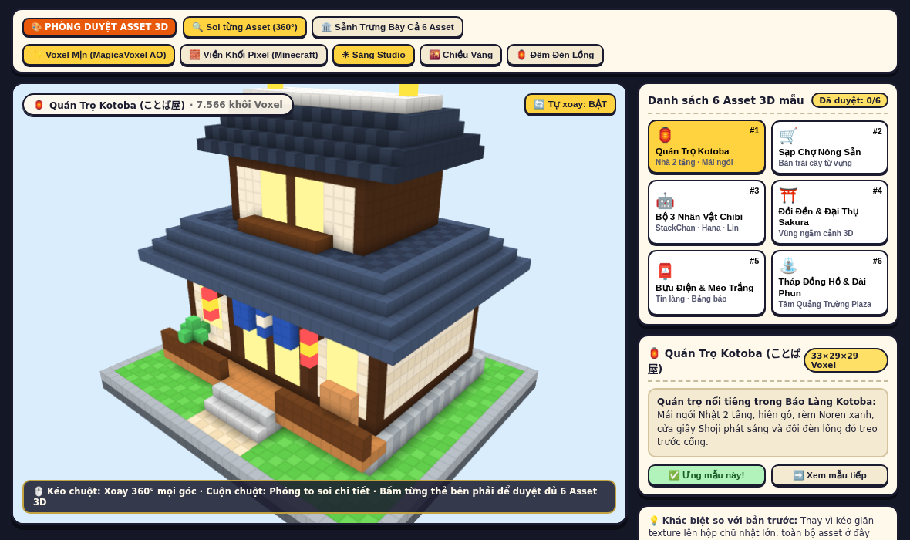 | 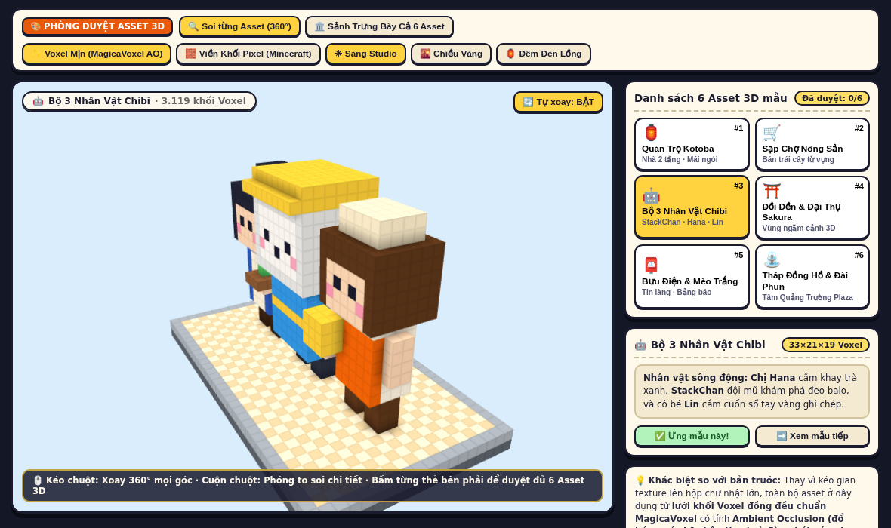 | 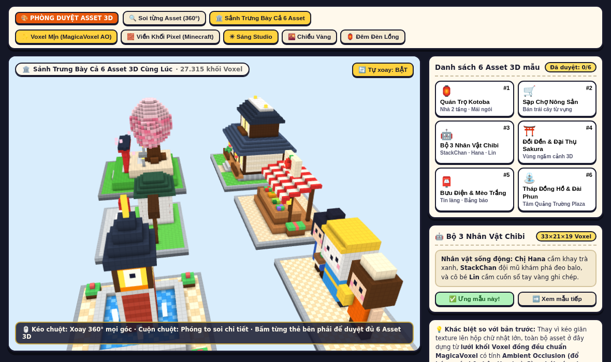 |

---

## 12. So sánh gu Play Together Smooth Low-Poly (Bo tròn mềm + Bóng đổ thật) — `proto_duyet_asset_play_together.html`

Bản đối chiếu trực tiếp gu **Play Together / Animal Crossing** (khối bo tròn mượt `RoundedBox` & `Sphere`, bóng đổ mềm **2D PCF Shadow Map 1024×1024**, ánh sáng bán cầu pastel và độ bóng *Specular/Rim*) đặt cạnh bản **MagicaVoxel AO** ở Mục 11:

- **🤖 Bộ 3 Nhân Vật Chibi Bo Tròn**: Đầu tròn mũm mĩm, mắt long lanh có đốm sáng, má hồng, Chị Hana cầm khay trà, StackChan đeo balo, Lin cầm sổ tay vàng.
- **🏮 Quán Trọ Kotoba Mái Cong**: Cột gỗ trụ tròn, mái ngói Nhật 2 tầng uốn cong mềm mại, đèn lồng đỏ tròn phát sáng.
- **🛒 Sạp Chợ Nông Sản Bo Tròn**: Mái bạt sọc đỏ-kem bo cạnh mềm, trái táo bóng loáng và 3 khay đựng đầy táo, cam, lê tròn xoe.
- **⛩️ Đồi Đền Sakura & Mèo Trắng**: Cổng Torii thanh thoát, tán anh đào tròn bồng bềnh và chú mèo trắng ngồi bên đèn đá.
- **🏘️ Ghép Góc Phố Plaza (`36.416` tam giác mượt)**: Ghép 4 asset quanh đài phun nước tròn giữa sân gạch kem.

Xem bản chạy thử tương tác tại [`proto_duyet_asset_play_together.html`](proto_duyet_asset_play_together.html):

| 🤖 Nhân vật Chibi Bo Tròn | 🏮 Quán Trọ Kotoba Mái Cong | 🏘️ Góc Phố Plaza Play Together |
| :---: | :---: | :---: |
| 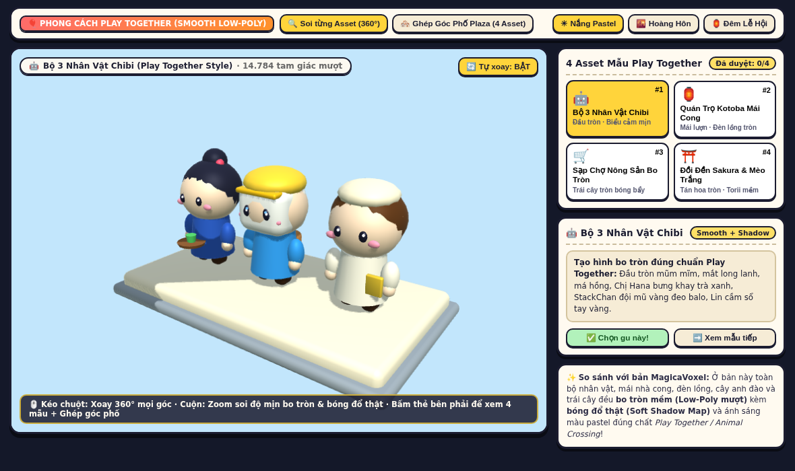 | 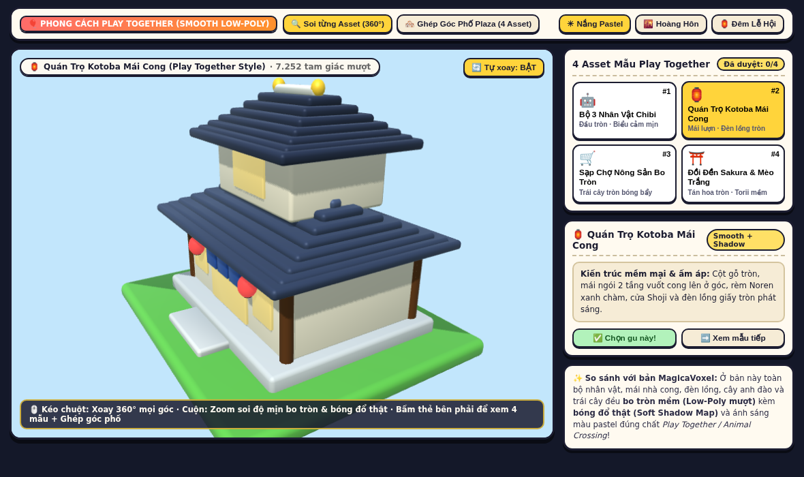 | 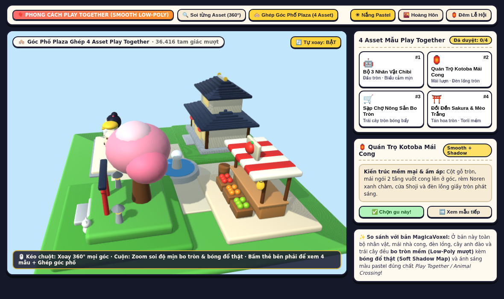 |

---

## 13. Chốt Kế Hoạch Tổng Thể (2D Anki + Làng Kotoba 3D)

Tổng hợp từ các bản thử nghiệm ở Mục 1–12, hướng đi chốt lại là **kiến trúc Lai (Hybrid 2D + 3D)**, phân vai rõ ràng theo điểm mạnh của từng môi trường:

### 13.1. Phân tách nhiệm vụ 2D (trong Anki) vs. 3D (Web Companion)

| Không gian | Công nghệ | Vai trò & Lý do |
| :--- | :--- | :--- |
| **Nhà & Sân vườn cá nhân** (`#kb-field`, `home.js`) | **2D Pixel Art** trong `AnkiWebView` | Bảo toàn 100% kho đồ tự trang trí (`NHA_ITEMS`, `FIND_ITEMS`, `SEASON_ITEMS`), Xưởng vẽ `16×16`, Vùng tự tạo và tốc độ mở Anki tức thì kể cả khi tắt GPU. |
| **Vườn nhiều cây 200–500+ từ** | **2D tối ưu** theo Mục 6 ([`vg_06_ket_hop_toi_uu.png`](vg_06_ket_hop_toi_uu.png)) | Gom cây `Ra quả` chưa tới hạn vào **Vườn cổ thụ**, đẩy luống `💧 Cần tưới hôm nay` lên đầu, chia cụm 5 cây + biển gỗ + ô tìm từ, đưa **Hòm thư / Báo mới** ra vị trí dễ thấy. |
| **Làng Kotoba & Vùng ngắm cảnh** (`ことば村`) | **Web 3D** (duyệt từng Asset trước) | Chỉ dùng 3D cho các khu **không cần ánh xạ đồ 2D của người chơi**: **Quảng trường Làng** (đọc `Báo Làng`, bán nông sản lấy từ vườn 2D, gặp `StackChan`, `Chị Hana`, `Lin`, `Mèo trắng`) và các **Vùng ngắm cảnh** (*Đồi Đền Sakura*, *Bến Cảng*). |

### 13.2. Phong cách đồ hoạ & Quy trình Asset-First
1. **Gu mỹ thuật đã duyệt**: Chọn **Play Together Smooth Low-Poly** (Mục 12 — bo tròn mềm, pastel, bóng đổ PCF 1024×1024) hoặc **MagicaVoxel AO** (Mục 11 — voxel `1×1×1` + Vertex AO). Cả hai đều phải **chế tác và duyệt từng asset độc lập** trước khi ghép cảnh.
2. **Lộ trình 3 giai đoạn gọn nhẹ (phù hợp solo dev)**:
   - **Giai đoạn 1 (1–2 tuần)**: Triển khai làm gọn ruộng `#kb-field` (Mục 6) trong Anki + thử nghiệm **Sự kiện Noel 2026** (Mục 14 bên dưới).
   - **Giai đoạn 2 (3–4 tuần)**: Chế tác 6 asset cốt lõi thành 1 **Quảng trường Làng Kotoba thu gọn** (Quán `ことば屋`, Sạp Chợ, Bưu Điện, Tháp Đồng Hồ, Bộ 3 Nhân Vật, Mèo Trắng), đọc dữ liệu tiến độ từ JSON (`tien_do.json`, `bao_gemini/`).
   - **Giai đoạn 3 (Mở rộng dài hạn)**: Bổ sung các **Vùng ngắm cảnh 3D** (*Đồi Đền Sakura*, *Bến Cảng Hải Đăng*) và tương tác bán quả từ cây `Ra quả`.

---

## 14. Đề xuất Sự kiện Noel: “Xây Thành Phẩm Giáng Sinh Tích Luỹ Mỗi Ngày”

### 14.1. Đánh giá hiện trạng & Lý do nên làm ngay
Trong mã nguồn hiện tại, [`kotoba_batake/season_core.py`](../../kotoba_batake/season_core.py#L161-L163) đã mở chủ đề `"noel"` từ **15/11 đến 31/12** và [`kotoba_batake/event_core.py`](../../kotoba_batake/event_core.py#L81-L82) đã có lời chào đêm **24–25/12**. Tuy nhiên, người học hiện chỉ cần trả `1.000 xu` (hoặc chuỗi 10 ngày) là mở ngay 4 món tĩnh (`xmastree`, `presents`, `sleigh`, `wreath`), **chưa có trải nghiệm tích luỹ từng ngày hướng tới đêm Giáng Sinh**.

**Có nên thêm sự kiện Noel không?** → **Rất nên**, vì 3 lý do:
1. **Đúng tâm lý học đều**: Biến mỗi buổi ôn thẻ từ cuối tháng 11 đến 24/12 thành một công đoạn hữu hình (dựng cây, treo đèn, gói quà) thay vì chỉ tăng một con số.
2. **Tiêu `xu` hợp lý & chống lạm phát**: Kết hợp giữa **điểm ôn mỗi ngày** (nguồn chính) và **đổi thêm bằng `xu`** (cho người học dư xu hoặc bắt đầu muộn) giúp xu có ý nghĩa mà vẫn công bằng.
3. **Dễ chia sẻ cộng đồng**: Đúng ngày 24–25/12, người dùng có một **thành phẩm kỷ niệm mang dấu ấn cá nhân** (ghi lại số lượt ôn / ngày học của riêng họ trong mùa Noel năm đó).

### 14.2. Cơ chế gợi ý: “Dựng Cây Thông / Quả Cầu Tuyết Quảng Trường (`スノードーム 2026`)”

Thay vì đẻ quá nhiều mini-game phức tạp (không kịp tiến độ trước Noel), nên tập trung vào **1 công trình trung tâm tiến hoá qua 5 tầng** từ công sức mỗi ngày:

- **Tài nguyên sự kiện nhẹ (`❄️ Bông Tuyết Ấm` hoặc dùng trực tiếp `xu` mua vật liệu theo ngày)**:
  - **Nguồn chính (học mỗi ngày)**: Ôn tối thiểu 15 thẻ/ngày nhận `+2 ❄️`, hoàn thành mục tiêu ngày (`daily_goal`) nhận thêm `+1 ❄️` (tối đa `3 ❄️/ngày` từ việc học).
  - **Nguồn phụ bằng `xu` (bù ngày lỡ & tiêu xu dư)**: Cho phép dùng `xu` đổi vật liệu trang trí (vd: `30 xu = +1 ❄️`, giới hạn mềm theo ngày hoặc mở tự do từ 18/12) để người vào muộn vẫn kịp hoàn thành trước đêm 24/12 — giữ đúng nguyên tắc **“FOMO lành mạnh”** của [`finds_core.py`](../../kotoba_batake/finds_core.py#L3).
- **Lộ trình 5 tầng nâng cấp thành phẩm (tổng mốc hoàn hảo: `30 ❄️` ≈ 10–15 ngày học)**:
  1. **Tầng 1 (0 → 5 ❄️) — Bệ Gỗ & Nền Tuyết**: Dựng bệ gỗ khắc năm `2026` cùng lớp tuyết nền.
  2. **Tầng 2 (6 → 12 ❄️) — Khung Cây Thông / Ngôi Nhà Bánh Gừng**: Hiện khối cây thông xanh hoặc khung nhà bánh gừng phủ kem trắng.
  3. **Tầng 3 (13 → 19 ❄️) — Quả Châu Từ Vựng & Dây Đèn**: Treo châu nhiều màu, bật dây đèn vàng nhấp nháy vào ban đêm.
  4. **Tầng 4 (20 → 26 ❄️) — Nhân Vật & Thú Cưng Mũ Len**: `StackChan` người tuyết và thú nuôi quàng khăn đỏ quây quần quanh cây.
  5. **Tầng 5 (27 → 30 ❄️) — Ngôi Sao Đỉnh Tháp & Mái Kính Tuyết Rơi**: Hoàn thiện trọn vẹn!
- **Thành phẩm nhận được đúng dịp Noel (24/12 – 31/12)**:
  - Người chơi bấm **“🎁 Đóng gói thành phẩm Noel 2026”** → Nhận **1 Vật Phẩm Kỷ Niệm Vĩnh Viễn** cất trong Kho đồ để bày ở `Nhà` hoặc `Sân vườn` quanh năm:
    - Đạt `30/30 ❄️`: Nhận **Quả Cầu Tuyết Hoàng Kim 2026** (bấm vào lắc tuyết rơi, phát đoạn nhạc hộp âm Giáng Sinh, tooltip ghi *"Kết tinh từ N lượt ôn mùa Noel 2026"*).
    - Đạt `10–29/30 ❄️`: Nhận **Cây Thông Nhỏ / Quả Cầu Tuyết Bạc** (không mất trắng nếu lỡ vài ngày).
  - **Số Báo Làng đặc biệt 24–25/12**: `event_core` & `Báo Làng` có tin chúc mừng từ `Chị Hana` và `StackChan` nhắc tới thành phẩm mà người học tự tay dựng suốt tháng 12.

### 14.3. Kiến trúc kỹ thuật gọn để kịp ra mắt trước Giáng Sinh (ước tính 4–6 ngày)
- **Lưu trữ an toàn**: Tái sử dụng khoá đồng bộ [`kotoba_batake_events`](../../kotoba_batake/finds_core.py#L39) (với nhánh `"noel_2026": {"pts", "days", "xu_spent", "claimed"}`) — không tạo khoá collection mới và giữ tương thích máy chạy bản cũ.
- **Vật phẩm thưởng**: Khai báo trong `FIND_ITEMS` ([`garden_core.py`](../../kotoba_batake/garden_core.py#L339-L376)) để được bảo vệ bởi `keep_foreign_nha` khi đồng bộ AnkiWeb.
- **Điểm nối thông minh với kế hoạch 3D (Mục 13)**: Có thể dựng thêm **1 trang xem 3D mini chỉ riêng “Quả Cầu Tuyết / Cây Thông Noel” xoay 360°** (từ bộ shader Smooth Low-Poly ở Mục 12) làm phần thưởng ngắm thử dịp Noel — vừa kịp deadline 24/12, vừa kiểm chứng trải nghiệm 3D thật trước khi dựng toàn bộ Làng Kotoba!

### 14.4. Bản chạy thử tương tác — [`proto_su_kien_noel_2026.html`](proto_su_kien_noel_2026.html)
- Cho phép bấm **“📚 Ôn 15 thẻ hôm nay (+2 ❄️)”**, **“🎯 Đạt mục tiêu (+1 ❄️)”**, **“🪙 Dùng 30 xu bù tiến độ (+1 ❄️)”** hoặc nhảy nhanh từng **Tầng 1 → 5** để tận mắt xem thành phẩm lớn dần mỗi ngày.
- Hỗ trợ chuyển tức thì giữa **🔮 Quả Cầu Tuyết 3D xoay 360° (có nút Lắc Tuyết Bay)**, **🏡 Góc Sân Anki 2D** và **🎁 Mở Quà Đêm 24/12**:

| Tầng 3 · Quả Châu & Dây Đèn | Tầng 5 · Quả Cầu Tuyết Hoàn Chỉnh | Trong Sân Anki 2D (`ことば畑`) |
| :---: | :---: | :---: |
| 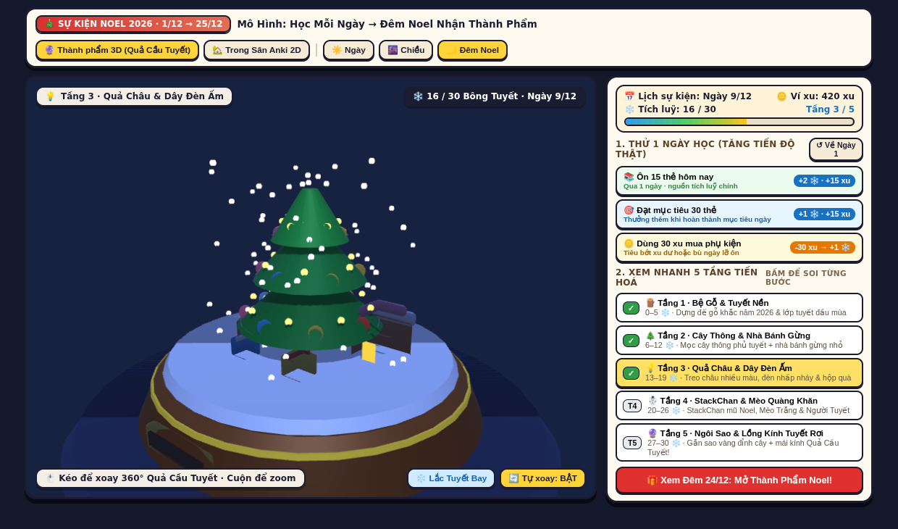 | 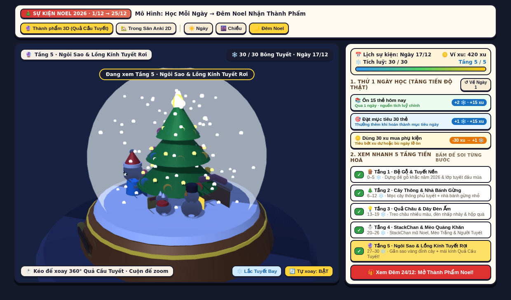 | 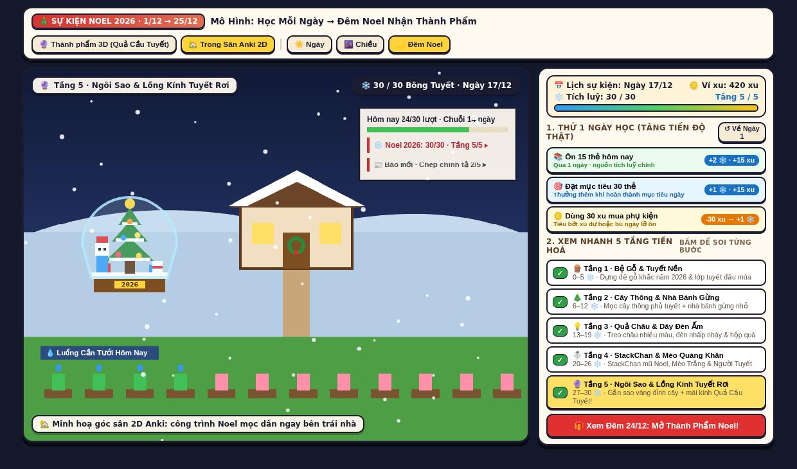 |

### 14.5. Bản chạy thử đúng phong cách Pixel Vườn `ことば畑` — [`proto_su_kien_noel_vuon_pixel.html`](proto_su_kien_noel_vuon_pixel.html)
- Dựng lại **đúng 100% bảng màu, viền đen `#1b1b2f`, thẻ vuông không bo góc (`border-radius: 0`), ngôi nhà phủ tuyết (`drawHouse`), thẻ `Hôm nay`, thú nuôi `Shiba`/`Mèo`/`StackChan` và ruộng cây 5 giai đoạn (`SPRITES[0..4]`)** từ mã nguồn thật của [`garden.css`](../../kotoba_batake/web/garden.css), [`home.js`](../../kotoba_batake/web/home.js) và [`garden.js`](../../kotoba_batake/web/garden.js).
- Cho phép chuyển giữa 2 kiểu thành phẩm (**🔮 Quả Cầu Tuyết** vs **🎄 Cây Thông Đại Sảnh**), thử từng tầng `1 → 5` ngay trên sân vườn, xem thành phẩm bày **🏠 Trong nhà (`160×88`)** sau đêm `24/12`, và mở hộp thoại nhận quà kỷ niệm:

| Sân vườn Pixel (Tầng 5 hoàn chỉnh) | Trong nhà sau 24/12 (`★ Kỷ vật Noel 2026`) | Hộp thoại Đóng gói & Báo Làng 24/12 |
| :---: | :---: | :---: |
| 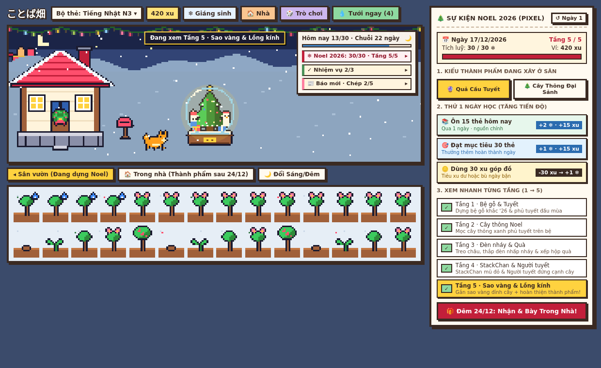 | 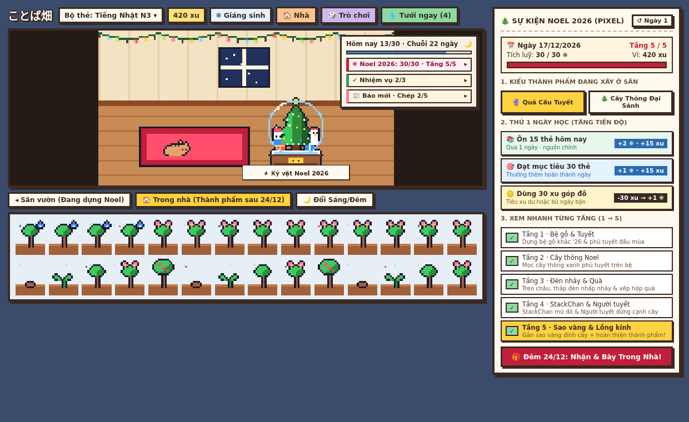 | 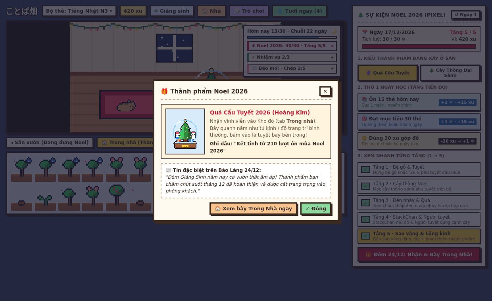 |

### 14.6. Bản chạy thử Mở Rộng: Tự Xếp Đồ Nhà + Tủ Đồ StackChan + Xưởng Vẽ `16×16` — [`proto_noel_tu_trang_tri_stackchan.html`](proto_noel_tu_trang_tri_stackchan.html)
- Kết nối sự kiện tích luỹ Noel thẳng vào 3 hệ thống sẵn có của vườn ([`garden_core.py`](../../kotoba_batake/garden_core.py), [`wear_core.py`](../../kotoba_batake/wear_core.py), [`decor_core.py`](../../kotoba_batake/decor_core.py), [`craft.js`](../../kotoba_batake/web/craft.js)) theo **lộ trình 4 chặng (`5 ❄` → `12 ❄` → `20 ❄` → `30 ❄`)**:
  1. **Tab `🏠 Đồ Nhà`**: Tự chọn `Lò sưởi Noel`, `Bàn Cacao`, `Tất Noel`, `Vòng Hoa`, `Thảm Tuyết Đỏ`, `Cây Thông '26`, `Quả Cầu Tuyết`, đổi tường/sàn rồi bấm thẳng lên từng ô lưới `10×3` trong **Phòng Chính** để tự sắp xếp bố cục phòng ấm cúng theo ý thích.
  2. **Tab `🤖 StackChan`**: Thay `Mũ` (`Mũ Noel`, `Sừng Tuần Lộc`, `Mũ Len` hoặc **tự vẽ mũ `20×8`**), `Cổ` (`Khăn Đỏ`, `Chuông Vàng`, `Nơ Xanh`) và `Vỏ` (`Đỏ–Trắng`, `Xanh Thông–Vàng`, `Bánh Gừng`) — cập nhật đồng bộ tức thì lên **StackChan góc trái**, **StackChan đi chơi trong nhà**, và **ngoài sân tuyết**.
  3. **Tab `🎨 Tự Vẽ 16×16`**: Bảng vẽ pixel có tự động viền đen `#1b1b2f` (kèm 3 mẫu gợi ý *Người tuyết*, *Hộp quà*, *Bánh Noel*) để người học tự chấm món đồ độc bản rồi đặt thẳng vào phòng khách.

| Tab Tự Xếp Đồ Trong Nhà (Lưới `10×3`) | Tab Tủ Đồ & Vẽ Mũ StackChan (`20×8`) | Tab Tự Vẽ `16×16` & Ngoài Sân Đồng Bộ |
| :---: | :---: | :---: |
| 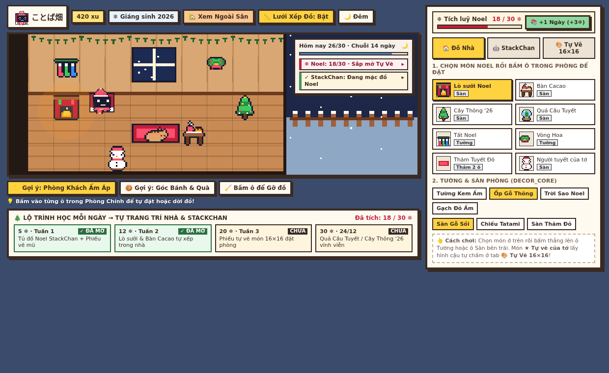 | 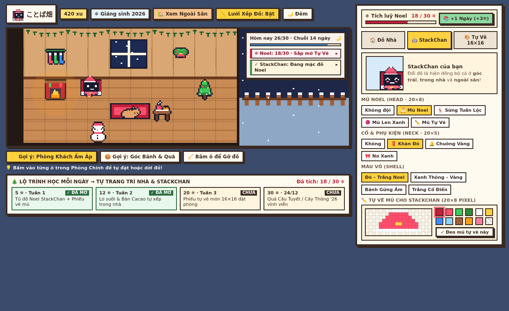 | 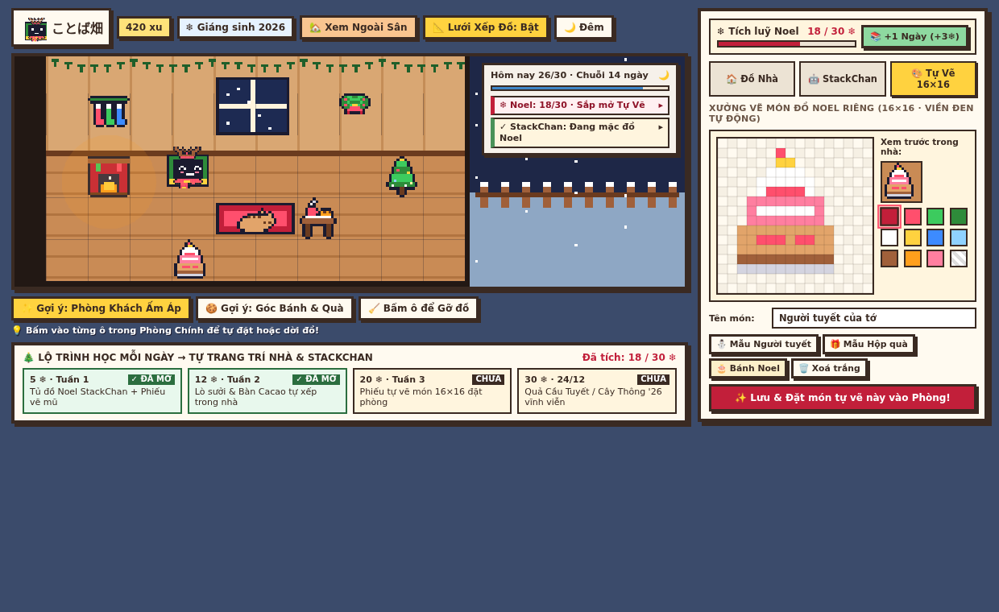 |
