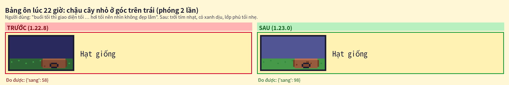
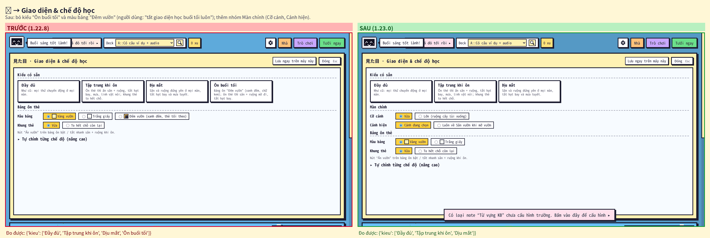
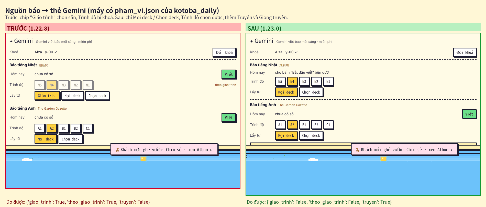
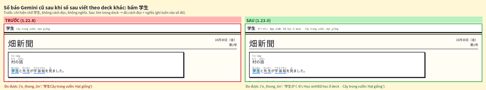
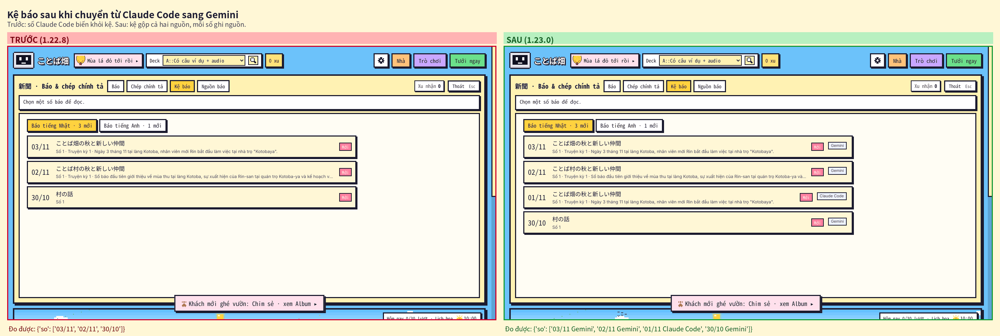
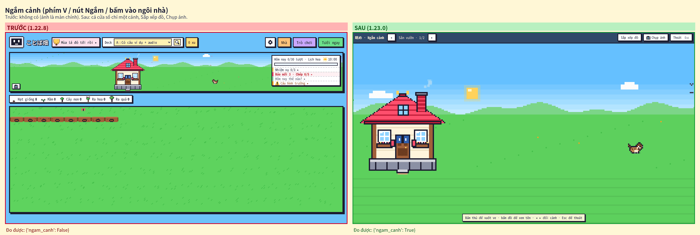

# Kiểm tra ことば畑 1.23.0 — 07/11/2026

Kiểm tra lần cuối sau khi làm bản 1.23.0 (người dùng: "sau khi làm xong kiểm tra lại giao diện, logic, tính năng lại lần cuối"). Anki thật chạy không cửa sổ (Qt offscreen) trong Claude Code trên web, điều khiển bằng CDP; hồ sơ thử mới cho từng kịch bản, không dùng collection học thật.

## 1. Kết quả

| Bộ | Anki 26.9.4 | Anki 23.10.1 (Qt 6.6) |
|---|---|---|
| `tests/run_all.sh` (offline, cả phần cần gói `anki`, có `core/test_123.py` mới) | TẤT CẢ OK | — |
| `e2e_123.js` (mới: báo, KB-01/02/03, giao diện tối, Ngắm cảnh, bản dịch) | **74/74** | **74/74** |
| `e2e.js` · `e2e_tour.js` · `e2e_114` · `e2e_115` · `e2e_116` · `e2e_117` · `e2e_118` · `e2e_119` | 24/24 · 12/12 · 34/34 · 21/21 · 15/15 · 55/55 · 29/29 · 55/55 | `e2e_tour` 12/12 |
| `e2e_120` · `e2e_121` · `e2e_122` · `e2e_1223` · `e2e_1226` · `e2e_1228` | 103/103 · 46/46 · 64/64 · 49/49 · 40/40 · 26/26 | `e2e_1226` 40/40 · `e2e_1228` 26/26 |
| `audit_edge.js` (ít xu, bấm đúp, cửa sổ nhỏ) · `audit_full.js` (1.000.000 xu, mua / dùng mọi thứ) | 58/58 · 180/180 | — |

- Sau các sửa từ lần thử Gemini thật (mục 4, chỉ đổi `ai_core.py` / `story_core.py`), chạy lại trên **gói 1.23.0 cuối** đã giải nén: `run_all.sh` TẤT CẢ OK; Anki 26.9.4 `e2e_123` 74/74 · `e2e` 24/24 · `e2e_119` 55/55 · `e2e_120` 103/103 · `e2e_1223` 49/49 · `e2e_1228` 26/26 (các kịch bản có viết báo Gemini giả).
- `e2e_116` còn 15 kiểm tra (trước 18): bỏ 3 kiểm tra giao diện "Đêm vườn" đã xoá theo yêu cầu.
- Lần chạy đầu `e2e_122` trượt 1/64: nút **Ngắm** mới làm thanh trên của bảng Nhà tràn ở cửa sổ 1024 px → chuyển nút xuống góc khung xem, chạy lại (bảng trên).

## 2. Ba lỗi của báo cáo 06/11 (nhánh `audit/addon-1.22.8-2026-11-06`)

| Mã | Lỗi | 1.23.0 (kiểm trong `e2e_123.js`, Anki thật) |
|---|---|---|
| KB-01 | Gõ nhật ký / luyện viết rồi bấm X ngay → mất phần vừa gõ | Mở lại vẫn còn "NHẬT KÝ ĐÃ LƯU DÒNG VỪA VIẾT" và bản nháp "いい天気です。" |
| KB-02 | Hồ sơ Anki mới nhận xu / nhà của hồ sơ khác | Hồ sơ mới: 0 xu, chưa có nhà, không có tiến độ báo; quay về hồ sơ cũ ví còn nguyên |
| KB-03 | Ôn rồi Undo lặp lại vẫn được cộng xu | 3 vòng ôn + Undo: xu, số lần tưới, revlog về đúng như trước (1.22.8: +9 xu) |

## 3. Ảnh trước / sau (1.22.8 ↔ 1.23.0)

Chụp bằng `tests/anki/shots_123.js` trên cả hai bản, ghép bằng `tests/tools/compare_shots.py … 123`.

Thêm (chỉ bản mới): [chờ "Bắt đầu viết" khi chuyển sang Gemini](123_01_cho_bat_dau_viet.png) · [bản dịch](123_05_ban_dich.png) · [Sắp xếp đồ trên khung lớn](123_12_sap_xep_do.png) · [màn chính cỡ Lớn](123_13_man_chinh_co_lon.png).

## 4. Truyện Gemini thật (`tests/gemini/run_story.py`)

Khoá Gemini thật (gói miễn phí) qua proxy của môi trường test; mỗi lượt 3 số liền (ngày 08 → 10/11, N4, Truyện: Hay hơn, giọng Ấm áp đời thường), thư mục mới mỗi lượt. Từ lượt 3, mọi model Flash đã hết hạn mức miễn phí trong ngày → **chỉ còn Flash-Lite** cho cả nhà văn, biên tập, viết số và soát — trường hợp xấu nhất của người dùng gói miễn phí. Mỗi lượt trượt / lọt lỗi được sửa trước lượt sau:

| Lượt | Lưu được | Thấy gì | Sửa trong 1.23.0 |
|---|---|---|---|
| 1 | 3 / 3 | chữ hiện sai: "開くくと", "優しいしく", "緊張するしていました", "葉ぱ", "召上がって"; kỳ 1–2 mất bản dịch | máy tự sửa dạng từ điển trong ngoặc, `[葉|はっ]ぱ`; kiểm từ gốc khớp chữ viết |
| 2 | 3 / 3 | lượt viết số chép hỏng truyện đã duyệt: "落とした古い手紙を急いで拾い上げました" → "落てしまいました", "驚った", "少困った" (độ giống cả bài vẫn 0,90); bản dịch giữ tên はなさん → bị bỏ | so từng đoạn (`story_diffs`); tên riêng → chữ Latin |
| 3 · 4 | 2 / 3 · 1 / 2 | Flash-Lite để okurigana chỉ trong từ gốc (`{少|すこ|少し}[困|こま]った`); 2 chỗ nhỏ ("し" rơi, thêm "さん") sửa mãi không xong → số không lưu | `_okuri_fill`; máy tự vá chỗ sai chắc chắn (`restore_story`) |
| 5 · 6 | 2 / 3 · 2 / 3 | đổi chữ vô hại (銀の葉 → 銀色の葉, 微笑み → 笑い) chặn cả số; `[今週末|こんしうまつ]` 3 lần sửa không xong | chỗ nhỏ chỉ cảnh báo; lấy cách đọc theo deck |
| 7 · 8 · 9 | 3 / 3 mỗi lượt | lọt "言い直すました", "ぴくせる画", "聞ましたか"; một kỳ 1 rơi về "viết chung" vì từ mới đọc bằng romaji; một bước soát đổi 32 / 43 chữ Hán sang kana | vá đuôi kana trong ngoặc, giữ katakana, 見 → 聞 thành cảnh báo; bỏ từ mới hỏng thay vì cả truyện; chặn mất > 40% chữ Hán |
| 10 | 2 / 3 | đáp án trắc nghiệm: `見` thiếu furigana → Flash-Lite sửa thành `花|hāna` | điền cách đọc chính số đó đã dùng (cùng kana theo sau), bỏ cách đọc romaji |
| **11 — gói 1.23.0** | **3 / 3** | 30 lượt gọi, 99 giây; cả 3 số đủ bản dịch mọi bài; truyện giữ 90–97% chữ Hán của bản đã duyệt; điểm biên tập 2–5 (kỳ 1 "bất ngờ" 2 → viết lại 1 lần) | — |

Truyện của lượt 11 (chữ trơn kèm bản dịch): [truyen_gemini_that.md](truyen_gemini_that.md). Bản viết khi còn model Flash (lượt 2) đều tay hơn: điểm biên tập 3–5, kỳ 1 không phải viết lại. Còn lại thấy được bằng mắt: vài chỗ dùng từ chưa tự nhiên mà biên tập vẫn cho 4 ("朝はとても冷たい" thay vì 寒い), một chỗ đổi từ (玄関 → 入口) máy chỉ cảnh báo.

## 5. Chưa kiểm / giới hạn

- Windows / macOS, máy thật có loa, đồng bộ AnkiWeb giữa hai máy thật: chưa chạy (như các bản trước).
- Anki 23.10.1 chạy với Python 3.13 (bộ cài thật dùng 3.9); cú pháp Python 3.9 kiểm bằng `ast.parse(feature_version=(3, 9))`.
- Gemini thật trong môi trường test đi qua proxy hay báo "máy chủ bận" (503) / cắt luồng: số lượt gọi và thời gian ở mục 4 cao hơn máy người dùng.
- Nhà 3 gian (Bếp · Phòng ngủ) chưa làm: để 1.24 (`KE_HOACH_1_24.md`).
