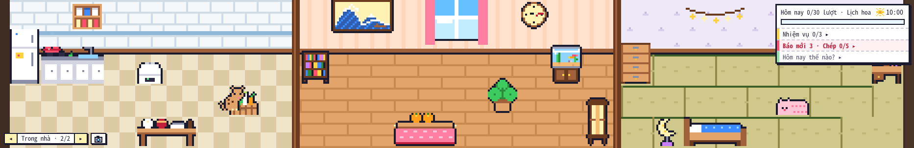
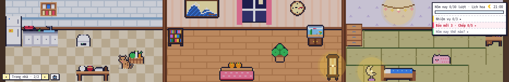
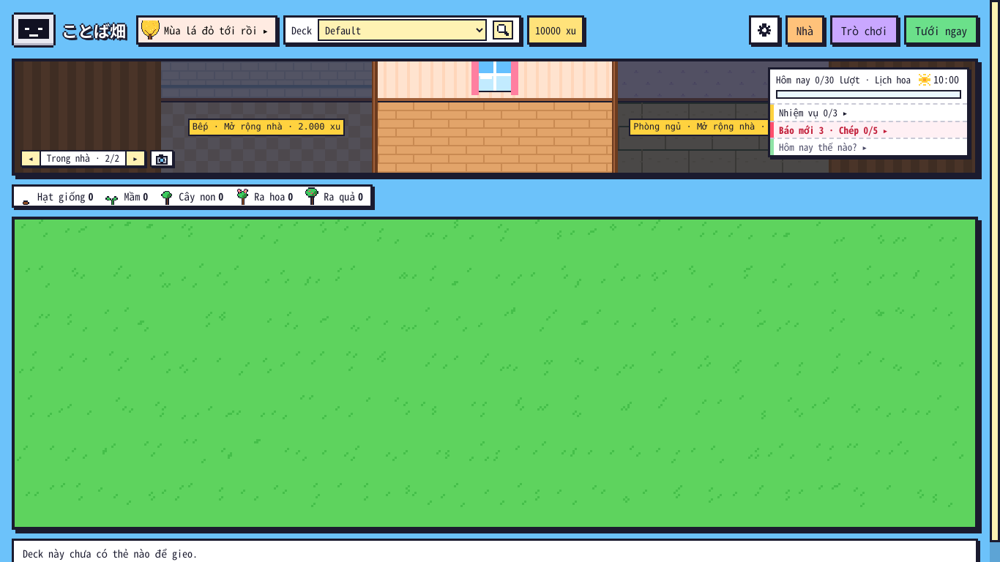
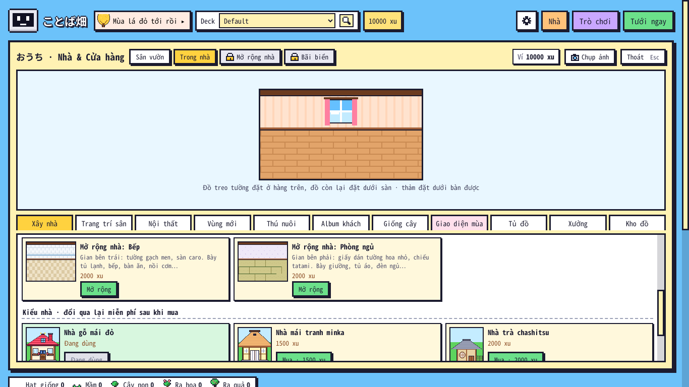

# Kiểm tra ことば畑 1.24.0 — 07/11/2026

Bản 1.24.0: **nhà 3 gian** (Bếp · phòng chính · Phòng ngủ, theo `KE_HOACH_1_24.md` đã xoá) và **bỏ Ngắm cảnh** của 1.23 (người dùng: "phần vùng dưới bị chớp xanh liên tục… tớ thấy cũng không cần thiết"). Anki thật chạy không cửa sổ (Qt offscreen) trong Claude Code trên web, điều khiển bằng CDP; hồ sơ thử mới cho từng kịch bản.

## 1. Kết quả

| Bộ | Anki 26.9.4 | Anki 23.10.1 (Qt 6.6) |
|---|---|---|
| `tests/run_all.sh` (có `core/test_124.py` mới, chạy cả **mã 1.23 thật** lấy từ git) | TẤT CẢ OK | — |
| `e2e_124.js` (mới: nhà 3 gian) | **23/23** | **22/22** (trước khi thêm kiểm tra 1024 px) |
| `e2e.js` · `e2e_tour.js` · `e2e_114` · `e2e_115` · `e2e_116` · `e2e_117` · `e2e_118` · `e2e_119` | 24/24 · 12/12 · 34/34 · 21/21 · 15/15 · 55/55 · 29/29 · 55/55 | `e2e_tour` 12/12 |
| `e2e_120` · `e2e_121` · `e2e_122` · `e2e_1223` · `e2e_1226` · `e2e_1228` · `e2e_123` · `e2e_kit23` | 103/103 · 46/46 · 64/64 · 49/49 · 40/40 · 26/26 · 65/65 · 10/10 | `e2e_1226` 40/40 · `e2e_1228` 26/26 · `e2e_123` 65/65 |
| `audit_edge.js` · `audit_full.js` (1.000.000 xu, mua / dùng mọi thứ, có "Mở rộng nhà") | 58/58 · **182/182** | — |

- `e2e_123` còn 65 kiểm tra (1.23: 74): phần Ngắm cảnh thay bằng kiểm tra đã gỡ (phím V không mở gì, không còn nút Ngắm, bấm ngôi nhà mở Nhà & Cửa hàng).
- Lần chạy đầu `e2e_122` trượt 1/64 ở cửa sổ 1024 px: nút khoá "Mở rộng nhà" mới trên hàng nút cảnh đẩy "Thoát" xuống dòng → bỏ nút đó (gian chưa mở đã có biển giá ở màn chính và thẻ ở tab Xây nhà), hàng nút cảnh tự xuống dòng trong khung của mình (`flex: 1 1 0`) → 64/64; `e2e_124` thêm kiểm tra 1024 px khi có đủ Bếp + Phòng ngủ.
- Lần chạy đầu `e2e_124` trượt 5/22 do chính kịch bản (cuộn trang khi tìm thẻ đồ nên cú bấm rơi ra ngoài khung Bếp; cú bấm "Phòng ngủ" trúng thẻ Hôm nay đè góc phải dải cảnh) — sửa kịch bản, 22/22.
- Lần chạy đầu `audit_full` 178/180: mua hết đồ (thêm 12 món mới) thì phòng chính kín, món tự làm "Gối tím" vào kho thay vì đặt được. Sửa: món trong nhà mới mua / tự làm mà gian đang xem đã kín thì tự sang gian còn chỗ; `audit_full` thêm phần "Mở rộng nhà" (bấm "Mở rộng" ở tab Xây nhà, trừ đúng 2.000 xu mỗi gian) trước khi mua nội thất.
- Lỗi tìm ra khi viết `test_124.py`: lưu gian đã mở bỏ mất gian thứ hai (`home.pop("rooms")` nằm trong vòng lặp) — sửa trước khi đóng gói.

## 2. Nhà 3 gian

Thêm: [bảng Nhà · Bếp](124_bep.png) · [bảng Nhà · Phòng ngủ](124_phong_ngu.png) · [ảnh chụp nguyên nhà cỡ lớn](124_anh_nguyen_nha.png) · [thanh trên ở 1024 px](124_thanh_tren_1024.png) · [cửa sổ 720 × 520](124_cua_so_nho.png).

## 3. Đồng bộ với bản cũ (mã 1.23 thật, `test_124.py`)

1.24 mở Bếp, đặt tủ lạnh + chậu cây trong Bếp → mã 1.23 (git `ba0aa5a`) mở cùng dữ liệu: không thấy Bếp, không thấy tủ lạnh, tưởng 2 chậu cây còn trong kho và đặt cả 2 ra phòng chính, cộng xu, lưu → 1.24 mở lại: Bếp, tủ lạnh còn nguyên; chậu cây vượt số đã có nên chậu ở Bếp về kho (vẫn đúng 2 chậu); xu cộng thêm còn.

## 4. Chưa kiểm / giới hạn

- Windows / macOS, đồng bộ AnkiWeb giữa hai máy thật: chưa chạy (như các bản trước; đồng bộ thử bằng mã 1.23 thật đọc / ghi cùng dữ liệu).
- Thú nuôi ở màn chính vẽ trên đồ đạc (không xếp lớp theo chân đứng như trong một phòng); khách "vành khuyên" chỉ ở bảng Nhà · Trong nhà, không hiện ở cảnh cả nhà.
