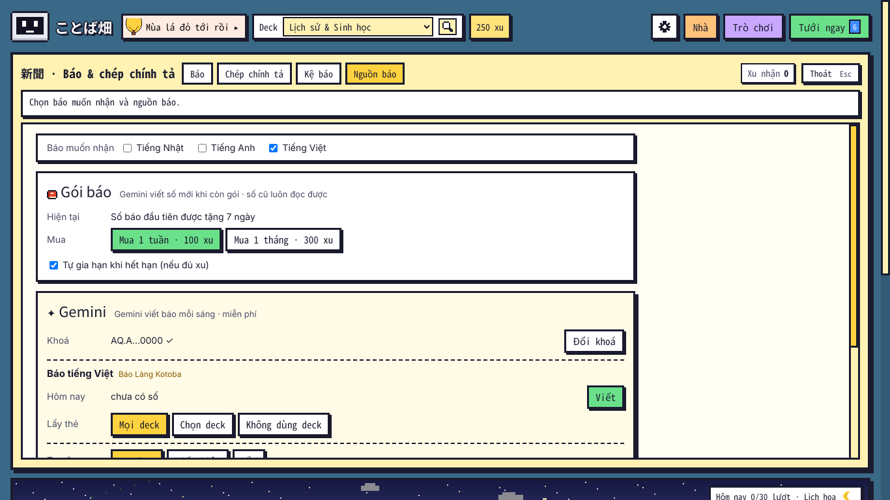
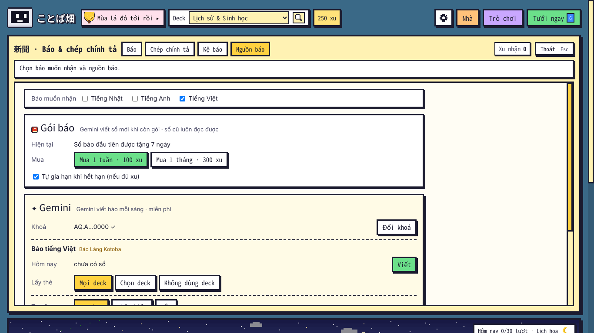
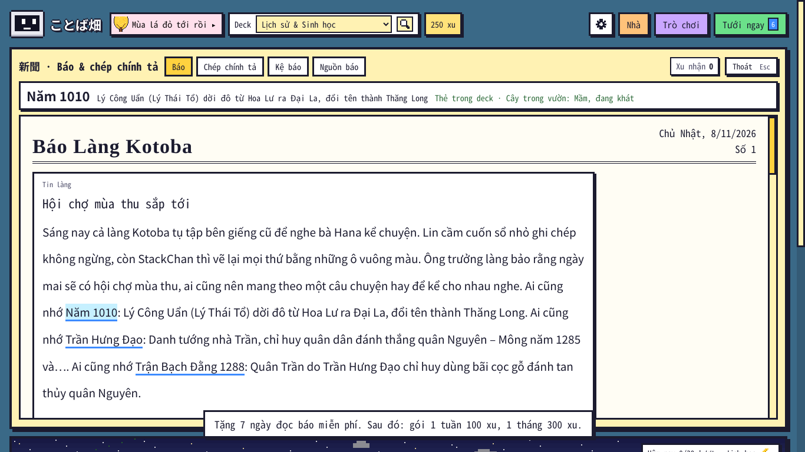
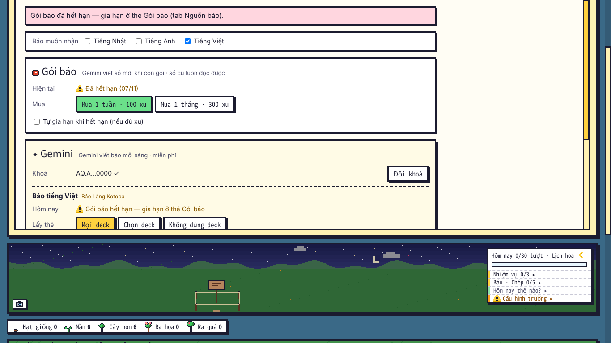
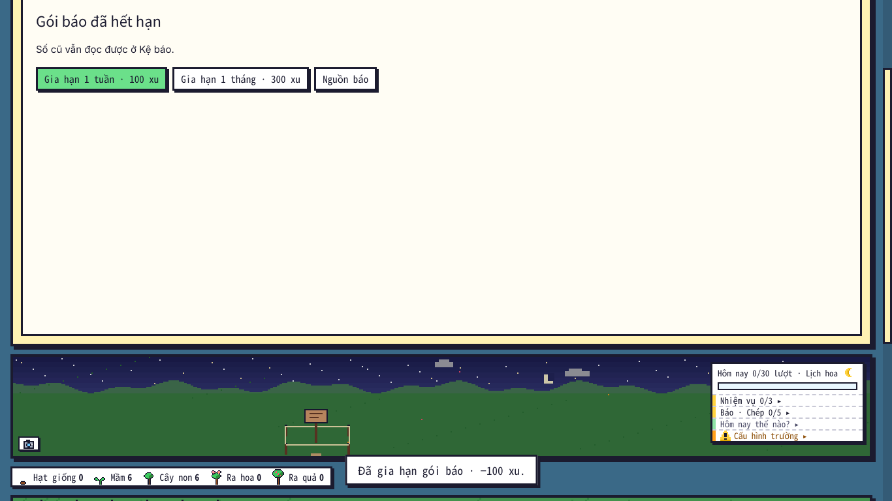
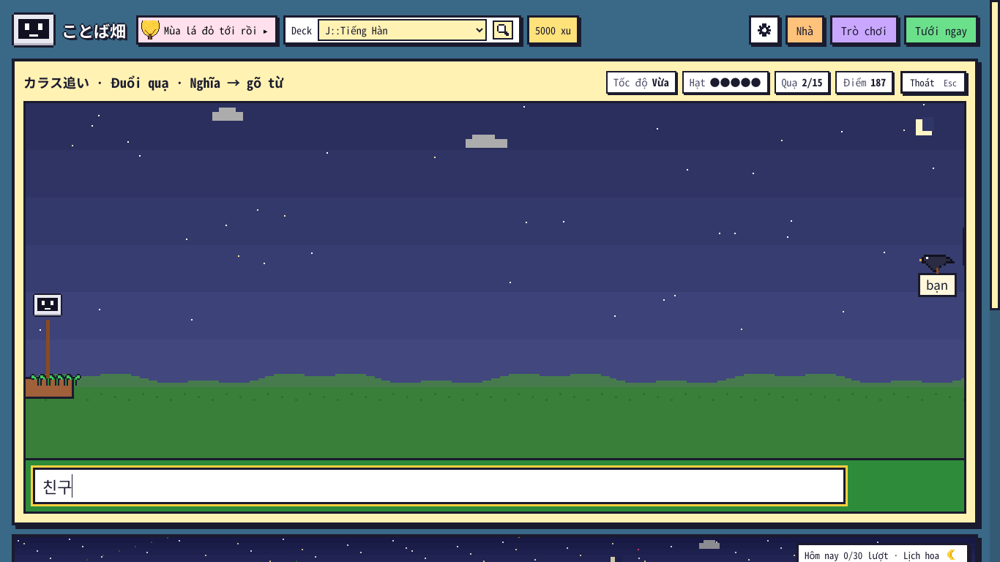

# Kiểm tra ことば畑 1.25.1 — 08/11/2026

Bản 1.25.1 làm theo yêu cầu "trước khi hiện thực thì tớ muốn làm thêm cho những người mà không học tiếng anh và tiếng nhật": **báo tiếng Việt** "Báo Làng Kotoba" (thẻ bất kỳ), báo **không cần deck** (viết theo trình độ), **gói báo mua bằng xu** (1 tuần 100 / 1 tháng 300, tặng 7 ngày, tự gia hạn), **chủ đề truyện chọn nhiều**, Đuổi quạ cho "Ngôn ngữ khác", ẩn Luyện viết / "Chép 0/5" khi không dùng tới. Anki thật chạy không cửa sổ (Qt offscreen), điều khiển bằng CDP; Gemini trong Anki là hàm giả (không gọi mạng); Gemini thật chạy riêng bằng `tests/gemini/run_job.py` (khoá qua proxy của phiên Claude Code trên web).

## 1. Kết quả

| Bộ | Anki 26.9.4 | Anki 23.10.1 |
|---|---|---|
| `tests/run_all.sh` (có `core/test_1251.py` mới — 75 kiểm tra, chạy cả **mã 1.25.0 thật** từ git `1912fb7`) | KẾT_QUA_OFFLINE | — |
| `e2e_1251.js` (mới) | **E2E1251** | **E2E1251_V2310** |
| bộ cũ | KET_QUA_CU | KET_QUA_CU_V2310 |

## 2. Gemini thật (gói miễn phí, 08/11)

| Số báo | Kết quả |
|---|---|
| **Tiếng Việt**, 40 thẻ mẫu (lịch sử, sinh học, địa lý, vật lý, tiếng Hàn; 15 đến hạn), chủ đề Kinh dị nhẹ + Hài | ✓ `gemini-3.6-flash` (flash-latest / 3.8 / 3.7 báo bận 502 → tự đổi), 18 lượt gọi, 398 giây (biên tập chấm 4–5, viết lại một lần). 620 chữ, 11 thẻ được nhắc (10 / 15 thẻ ★), 4 câu hỏi đều hỏi đúng kiến thức của thẻ (Ngô Quyền – Bạch Đằng 938, lục lạp, năm 1010, insulin). Truyện "Tiếng gõ trong đêm đầu đông": bóng trắng bên giếng cạn (rợn nhẹ) + StackChan hiểu nghĩa đen (hài). **Sửa sau khi thử**: Gemini viết lộ số thẻ ra bài ("◆ Thẻ #1: Ngô Quyền …") → máy bỏ, lời nhắc dặn số chỉ nằm trong đánh dấu, kiểm tra báo lỗi nếu còn. |
| **Tiếng Nhật N4, không dùng deck**, chủ đề Kinh dị nhẹ | ✓ 20 lượt gọi, 420 giây; bản đầu 10 lỗi máy → sửa 2 lượt → soát. 522 ký tự (trong khung N4 280–700), 8 từ mới khai báo (夜勤, 下駄, 井戸, 奇妙…) có bảng tra, 25 chỗ bấm tra; truyện "はじめての夜勤": guốc tự quay ra cửa, tiếng gõ ở giếng cũ. Gợi ý cho bước soát (không chặn): chữ Hán khó hơn N4 (温, 召, 掃除, 突然…). |
| **Tiếng Anh B1, không dùng deck**, chủ đề Dễ thương + Hài | ✓ 10 lượt gọi, 100 giây, bản đầu 0 lỗi máy, soát không sửa; 10 từ mới (postcard, apron, pumpkin, cheerful…), 14 chỗ tra. |

Lời nhắc nguyên văn của cả ba báo (và báo không deck): `docs/LOI_NHAC_GEMINI.md`.

## 3. Ảnh (Anki 26.9.4, 1366 × 768)

Thêm: [câu hỏi ôn thẻ](1251_04_cau_hoi.png) · [báo Nhật + báo Việt, Không dùng deck](1251_07_hai_bao.png) · [bảng Trò chơi deck tiếng Hàn](1251_08_tro_choi_han.png) · [Nguồn báo 720 × 520](1251_10_nguon_bao_720.png).

## 4. Đồng bộ với bản cũ

- Gói báo lưu `paper_sub` trong `kotoba_batake_more`; mã 1.25.0 thật (git `1912fb7`) đọc + lưu đè dữ liệu có gói → về 1.25.1 gói còn nguyên (`test_1251.py`). Máy khác còn 1.25.0 thì không chặn viết báo (bản đó không biết gói).
- `gemini_story_tone` vẫn ghi chủ đề đầu tiên cho bản ≤ 1.25.0; `kotoba_batake_paper_src` thêm `"vi"` và `"mode"` (bản cũ giữ khoá lạ khi lưu deck đã chọn).
- Báo tiếng Việt ở thư mục và khoá riêng; bản cũ không thấy (không ảnh hưởng báo Nhật / Anh).

## 5. Chưa kiểm / giới hạn

- Windows / macOS, đồng bộ AnkiWeb giữa hai máy thật: chưa chạy (như các bản trước).
- Gói báo tính theo ngày thật trên máy (như số báo); đổi giờ máy thì gói đổi theo.
- Báo tiếng Việt chỉ nhắc nguyên văn mặt trước ngắn (≤ 40 ký tự) mới được máy tự gạch chân thêm; thẻ dạng câu hỏi dài dựa vào đánh dấu của Gemini.
- `core/test_118.py` trượt 3 kiểm tra khi chạy sát giờ qua ngày của Anki (03:58 UTC) — mã 1.25.0 chưa sửa gì cũng trượt y hệt; chạy lại sau giờ đó thì đạt (kịch bản phụ thuộc giờ, không phải lỗi add-on).
