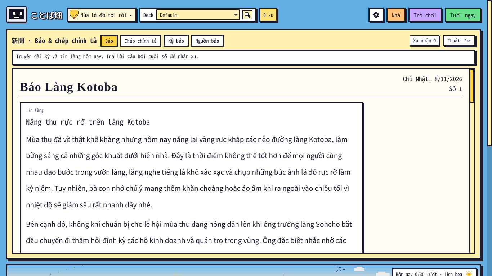
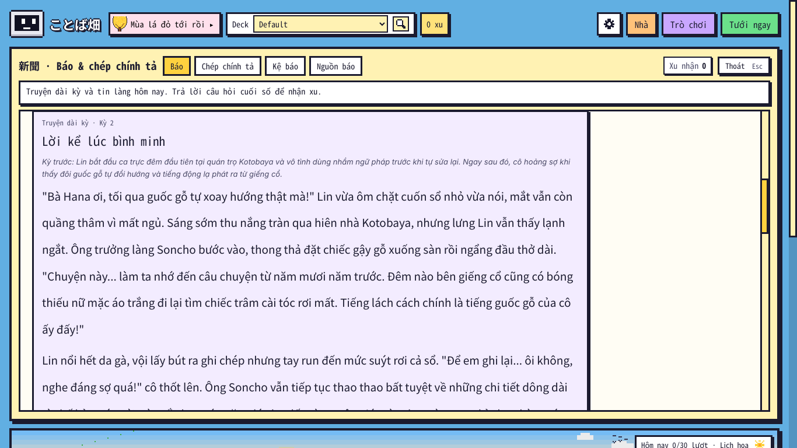
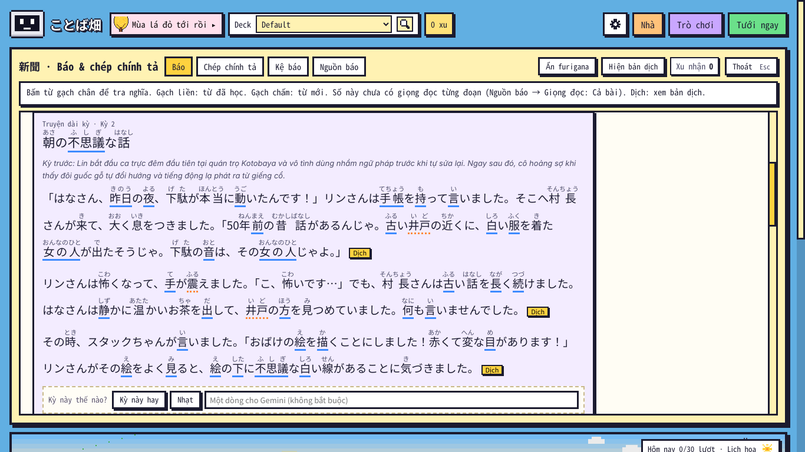
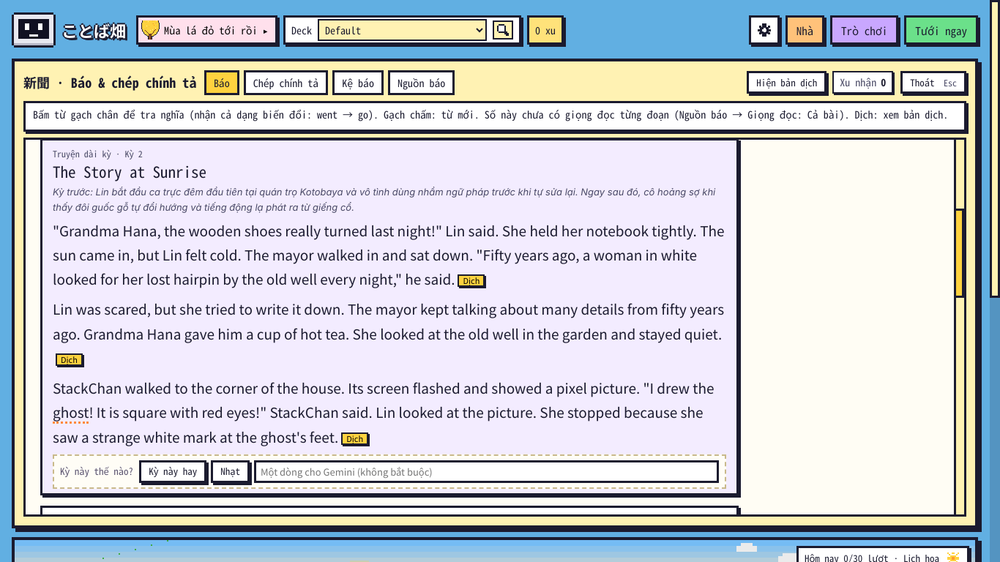
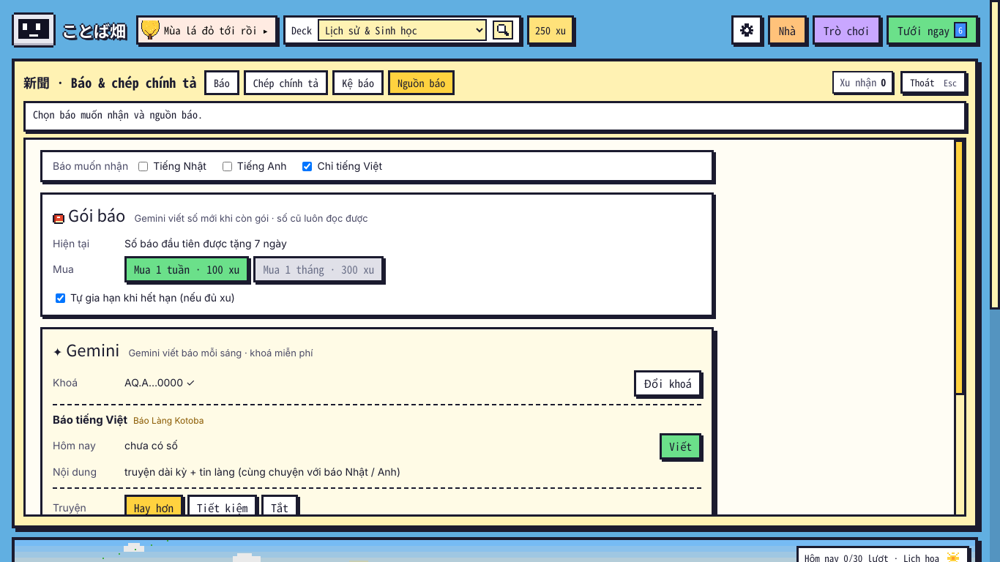

# Kiểm tra ことば畑 1.25.2 "Một làng, một truyện" — 08/11/2026

Bản 1.25.2 làm theo ý người dùng sau khi xem 1.25.1: "báo Tiếng Việt chỉ đơn giản là truyện và tin tức là được, không cần phải theo nội dung deck … quan trọng là câu chuyện hay, để người đọc mong chờ số mới … chỉ cần chọn tối đa 2 ngôn ngữ … đã gọi là báo là nội dung phải tương đương nhau" — phương án **Một làng, một truyện** (người dùng chọn). Mỗi ngày Gemini viết **một bản gốc tiếng Việt** (kỳ truyện + tin làng + mục thứ ba) có thời tiết đúng trời của vườn, nối tiếp kỳ trước và tin mấy số trước; báo Nhật / Anh kể lại theo trình độ, báo tiếng Việt in thẳng bản gốc. Anki thật chạy không cửa sổ (Qt offscreen), điều khiển bằng CDP; Gemini trong Anki là hàm giả; Gemini thật chạy riêng bằng `tests/gemini/run_job.py` (khoá qua proxy của phiên Claude Code trên web).

## 1. Kết quả

| Bộ | Anki 26.9.4 | Anki 23.10.1 |
|---|---|---|
| `tests/run_all.sh` (`core/test_1251.py` viết lại cho truyện chung — bản gốc + 3 báo cùng ngày, thời tiết khớp `sky.js` 80 khung, nối kỳ / nối tin hôm sau, dự phòng khi Gemini bận / kể lại hỏng, chép bộ nhớ truyện cũ, tên gọi; chạy cả mã 1.25.0 thật từ git) | TẤT CẢ OK | — |
| `e2e_1251.js` (Báo muốn nhận: Nhật / Anh hoặc chỉ tiếng Việt; báo tiếng Việt = bản gốc; gói báo; Không dùng deck; Đuổi quạ tiếng Hàn) | **48/48** | **48/48** |
| `e2e.js` · `e2e_tour` · `e2e_114` · `e2e_115` · `e2e_116` · `e2e_117` · `e2e_118` · `e2e_119` | 24/24 · 12/12 · 34/34 · 21/21 · 15/15 · 55/55 · 29/29 · 55/55 | — |
| `e2e_120` · `e2e_121` · `e2e_122` · `e2e_1223` · `e2e_1226` · `e2e_1228` · `e2e_123` · `e2e_kit23` · `e2e_124` · `e2e_125` | 103/103 · 46/46 · 64/64 · 49/49 · 40/40 · 26/26 · 65/65 · 10/10 · 23/23 · 30/30 | `e2e_123` 65/65 |
| `audit_edge.js` · `audit_full.js` (1.000.000 xu, mua / dùng mọi thứ qua giao diện) | 58/58 · **181/181** (ảnh có cờ đo: 0/131) | — |
| `shots_1252.js` (mới — ba báo thật cùng một ngày trong Anki) | OK (5 ảnh, không lỗi JS) | — |

- Lần chạy cả bộ đầu tiên: `e2e_119` trượt 1 kiểm tra (nhãn ô đổi thành "Chỉ tiếng Việt" theo thiết kế mới — sửa test) và `e2e_123` (Gemini giả của test trả JSON không đúng khuôn bản gốc → `ensure_master` ném lỗi lạ, cả lượt viết dừng). **Sửa trong add-on**: bản gốc hỏng vì bất kỳ lỗi nào (trừ khoá sai / hết hạn mức) thì báo tự viết truyện như "Tiết kiệm" cũ, ghi nhật ký "Truyện chung lỗi (…)", không dừng cả số. Chạy lại: đạt.
- Chạy lại `e2e_123` sau đó lộ ra **một lỗi thật**: bấm "Nhạt" ở một số báo cũ (viết trước 1.25.2) khi chưa viết số nào bằng 1.25.2 → nhận xét tạo `bao_chung/truyen.json` chỉ có một dòng → lần viết đầu thấy "đã có truyện chung" nên **không chép truyện cũ sang** → truyện bắt đầu lại từ đầu. **Sửa**: số viết từ truyện chung ghi `"truyen_chung": true` trong `bao.json`; nhận xét của số đó vào truyện chung, của số cũ vào thư mục báo đó (và cả truyện chung nếu kỳ ấy đã được chép sang) — không bao giờ tạo truyện chung từ một nhận xét (`ai.feedback_bases`, 6 kiểm tra mới trong `test_1251.py`).

## 2. Gemini thật — một ngày của làng (09/11/2026, gói miễn phí)

Thứ tự đúng như máy người dùng: báo tiếng Nhật N4 (deck mẫu) viết bản gốc, rồi báo tiếng Anh A2, rồi báo tiếng Việt (chỉ để so — người dùng thật chọn Nhật + Anh **hoặc** chỉ Việt). Chủ đề truyện: Kinh dị nhẹ + Hài. Hôm trước đã có kỳ 1 (guốc gỗ tự xoay ở Quán Kotoba).

| Bước | Kết quả |
|---|---|
| **Bản gốc** (lập mạch → nhà văn → biên tập) | ✓ 8 lượt gọi, 119 giây. Kỳ 2 "Lời kể lúc bình minh" nối đúng kỳ 1: ông trưởng làng kể chuyện cô gái áo trắng bên giếng cổ năm mươi năm trước (rợn nhẹ), StackChan vẽ "bóng ma hình vuông mắt đỏ" (hài), móc câu: vệt trắng lạ dưới chân bóng ma trong tranh. Thời tiết "cả ngày nắng" = trời của vườn hôm đó; 2 tin làng (nắng thu đẹp, trưởng làng đi thăm các quán chuẩn bị lễ hội) + cột của StackChan. Biên tập chấm 4–5 cả 7 tiêu chí, không phải viết lại. |
| **Báo tiếng Nhật N4** | ✓ 12 lượt gọi, 651 giây (nhiều model hết hạn mức trong ngày → tự đổi, xong bằng `gemini-2.5-flash`). Truyện kể lại đủ sự việc + móc câu (はなさん, 村長さん, スタックちゃん, 古い井戸); tin làng kể lại đúng hai tin của bản gốc; cột スタックちゃん. Cảnh báo còn lại (không chặn): lượt viết số chép lệch 2 chỗ của bản kể lại đã duyệt (深いた息 → 大く息 — cả hai đều sai, đúng là 深い息 / 大きく息; 四角い → 変な), chữ Hán 綺麗 / 皆 khó hơn N4. |
| **Báo tiếng Anh A2** | ✓ 9 lượt gọi, 220 giây, kể lại đạt lần đầu, máy kiểm tra 0 lỗi. Cùng chuyện, cùng tin, cột "StackChan's Sunny Day". |
| **Báo tiếng Việt** | ✓ 9 lượt gọi, 80 giây. Truyện = nguyên văn bản gốc; tin làng và cột viết dài hơn từ đúng tin của bản gốc; 3 câu hỏi đọc hiểu (tin, cột, truyện). Không thẻ, không chỗ tra. |

- **Sửa sau khi thử**: Gemini tự đặt tên "Soncho" (phiên âm 村長) cho ông trưởng làng và gọi quán là "Kotobaya" → báo Anh in "Mayor Soncho"; báo Anh gọi bà chủ quán 30 tuổi là "Grandma Hana" (dịch chữ "bà"). Nay lời nhắc dặn ông trưởng làng không có tên riêng, quán là "Quán Kotoba"; bảng tên của bước kể lại ghi "Hana (not "Grandma")" / "không gọi おばあさん"; máy đưa "Soncho" / "Kotobaya" trong bản gốc về đúng tên trước khi lưu và kể lại (`story_core.fix_names_vi`, có test), và sửa luôn phần tiếng Việt của bộ nhớ truyện cũ — "quán trọ Kotobaya" nằm sẵn trong tóm tắt kỳ 1, chính là chỗ Gemini học theo. Ảnh dưới đây là bản Gemini viết **trước** khi sửa (còn "Soncho", "Grandma Hana").
- Một lần `ConnectionResetError` giữa chừng (mạng của máy test) → chạy lại: báo sau đọc lại bản gốc đã lưu, không viết lại truyện.

Số báo thật của ngày này lưu ở `tests/fixtures/ngay_1252/` (bản gốc + 3 số); `shots_1252.js` chép vào Anki để chụp ảnh.

## 3. Ảnh (Anki 26.9.4, 1366 × 768)

Thêm: [Nguồn báo khi chọn Nhật + Anh](1252_nguon_bao.png).

## 4. Đồng bộ với bản cũ

- Bộ nhớ truyện cũ (báo tiếng Nhật, rồi Anh, Việt) được chép một lần sang `user_files/bao_chung/` → truyện nối tiếp, không bắt đầu lại; thư mục cũ giữ nguyên (về 1.25.1 vẫn đọc được).
- Máy đang nhận cả Việt lẫn Nhật / Anh (1.25.1 cho tick 3 ô): `clean_langs` bỏ Việt khi đọc, khoá `gemini_langs` giữ nguyên tới khi người dùng đổi ở "Báo muốn nhận" (về 1.25.1 trước đó thì vẫn thấy 3 ô như cũ).
- Số báo tiếng Việt cũ của 1.25.1 (có chỗ tra thẻ) vẫn đọc được ở Kệ báo.

## 5. Chưa kiểm / giới hạn

- Windows / macOS, đồng bộ AnkiWeb giữa hai máy thật: chưa chạy (như các bản trước). Bản gốc chỉ nằm trên máy này: hai máy cùng tài khoản mỗi máy viết bản gốc riêng.
- Báo tiếng Nhật chép lại bản kể lại đã duyệt đôi khi lệch vài chữ (cảnh báo, không chặn — như 1.23).
- Gemini thật chỉ chạy một ngày (kỳ 2); nối kỳ / nối tin nhiều ngày kiểm bằng Gemini giả trong `test_1251.py`.
