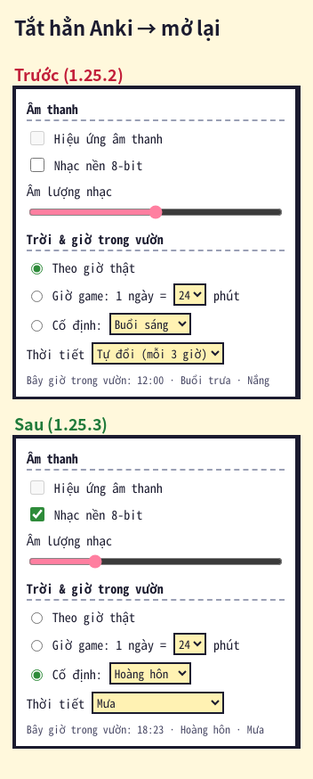
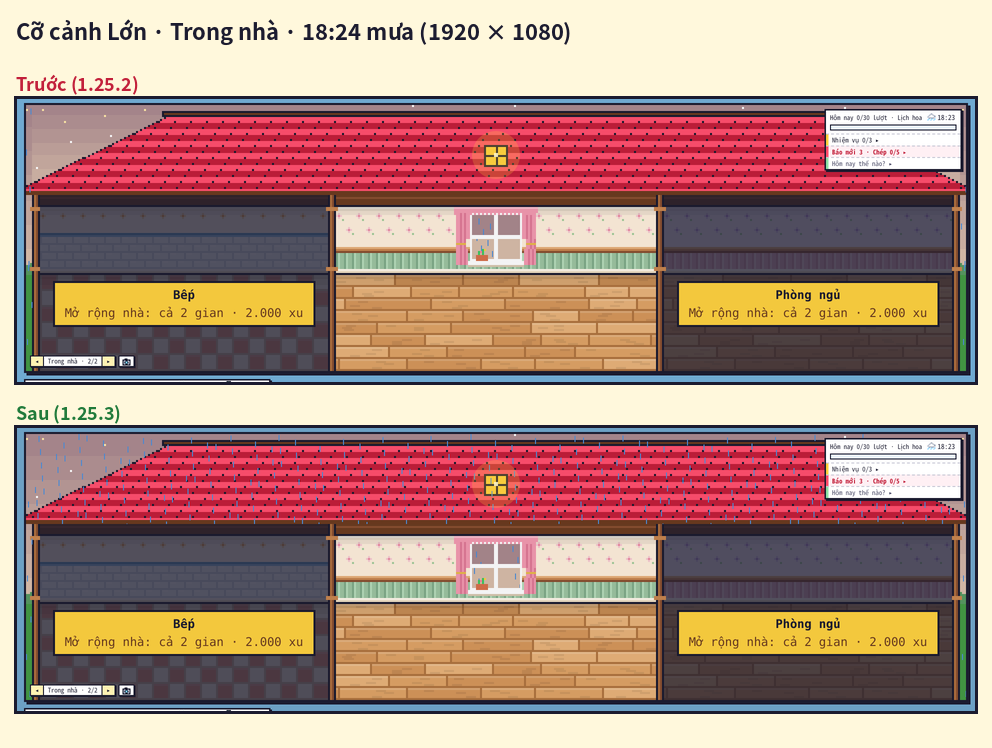

# Kiểm tra 1.25.3 — rà soát, sửa lỗi (10/11/2026)

Yêu cầu: kiểm tra kỹ lại tính năng / giao diện / logic, nghĩ thêm kịch bản ngoài test có sẵn; hai lỗi người dùng tự tìm (trời gần mái ở cỡ Lớn, cài đặt trời / giờ mất khi tắt bật lại); đọc và kiểm chứng nhánh `audit/ra-soat-addon-2026-11-09`; hỏi admin có sửa được thiết kế có sẵn rồi xuất bản lại không.

Môi trường: Linux, Python 3.13, gói `anki` / `aqt` **26.9.4** (Qt 6, QtWebEngine, chạy offscreen), Node 22. Ảnh dưới đây chụp từ Anki thật đang chạy (`tests/anki/e2e_1253.js`), "Trước" là mã 1.25.2 lấy từ git chạy cùng kịch bản.

## Kết quả ngắn

| Mục | Kết luận | Sửa |
|---|---|---|
| Cài đặt ⚙ mất khi tắt Anki (người dùng) | **Đúng** — mọi cài đặt "riêng máy" nằm ở `localStorage`, mà Anki dựng webview bằng profile không lưu (`QWebEngineProfile()` không tên) và đổi cổng máy chủ nội bộ mỗi lần mở | Lưu ở config `prefs` của add-on (`web/prefs.js`) |
| Trời gần mái không đồng bộ ở cỡ Lớn (người dùng) | **Đúng** — dải trời phía trên nhà vẽ với đường chân trời khác hai bên (màu bị nén → khối sáng hơn), mưa chỉ vẽ hai bên | Cùng đường chân trời + mưa / tuyết / chớp cả phía trên mái |
| BUG-01 Undo làm mất Redo | **Đúng** (tái hiện bằng gói `anki`: một lần `set_config` sau Undo là Redo mất) | Phần trả lại xu chờ ghi tới khi Redo không còn dùng được |
| BUG-02 Undo không lùi chuỗi tưới | **Đúng** | Sổ phần thưởng ghi chuỗi trước lượt ôn, Undo trả về |
| BUG-03 Đổi cỡ rồi Esc mất hình | **Đúng** | So hình đang có thay vì chỉ xem lịch sử hoàn tác |
| BUG-04 Chợ sáng chấm sai từ đồng nghĩa | **Đúng** (cùng kiểu: Nghe tìm cây với từ đồng âm 橋 / 箸, Đuổi quạ với từ cùng nghĩa) | Không đưa hai đáp án cùng đúng; Đuổi quạ nhận cả từ cùng chữ trên biển |
| BUG-05 Gợi ý luyện viết giữ từ của nguồn cũ / hồ sơ cũ | **Đúng** | Khoá nhớ tạm có hồ sơ + deck đã chọn, đổi hồ sơ thì xoá |
| BUG-06 Hồ sơ mới lấy ảnh bìa của hồ sơ cũ | **Đúng** | Ảnh vườn theo hồ sơ `anh_vuon/<mã hồ sơ>/` |
| BUG-07 Luật giống sai kiểu chặn vườn | **Đúng** | Kiểm kiểu trước khi so |
| TEST-01 `test_kit.py` lệch số báo thật | **Đúng** | Test bỏ `dich` trên bản sao |
| UI-01 Cỡ Vừa 1366 × 768 không thấy mái | Đúng là vậy, nhưng **theo thiết kế đã chốt ở 1.25** ("thấp quá thì bớt tối đa 12 điểm ảnh xà") | Giữ nguyên |
| GAP-01 Admin sửa mẫu gốc | **Đúng** — chưa có | Chưa làm, hỏi người dùng chọn hướng |
| **Mới**: một món đặt sai kiểu xoá nhà | Fuzz tìm ra: `id` của một món là danh sách → nhà về cấp 0, **lần lưu sau mất nhà + đồ** | Chỉ bỏ món hỏng |
| **Mới**: 5 hàm làm sạch khác ném lỗi với dữ liệu sai kiểu | tủ đồ, món tự làm, vùng tự tạo, nhiệm vụ, cấu hình trường | Kiểm kiểu |
| **Mới**: ô Deck của vườn không được nhớ | Chọn deck rồi đóng vườn (chưa bấm Tưới ngay) → mở lại về deck cũ | Chọn deck = deck hiện tại của Anki |

## 1. Cài đặt mất khi tắt Anki

- Nguyên nhân: `aqt/webview.py` (26.9.4) `_profileForPage` tạo `QWebEngineProfile()` không tên = profile off-the-record (chỉ trong RAM); `mediasrv` mở cổng ngẫu nhiên (origin đổi). Đóng / mở lại cửa sổ vườn trong cùng phiên thì còn (cùng profile), tắt Anki là mất.
- Bị ảnh hưởng (1.25.2): Trời & giờ (`kb-sky`), Nhạc nền (`kb-music`), Âm lượng (`kb-music-vol`), tắt tiếng (`kb-muted`), cảnh màn chính ◂ ▸ (`kb-main-scene`), loại note / kiểu / tốc độ Đuổi quạ, Hiện bản dịch, đã nhắc cấu hình trường (nhắc lại mỗi lần mở Anki), dải chúc mừng hôm nay (chúc lại).
- Các mục khác của ⚙ đã lưu đúng từ trước: Giao diện & chế độ học (config `ui`), Cấu hình trường / Nguồn báo / Lịch hoa (collection).
- Sửa: Python chèn `window.__kbPrefs` (config `prefs`) vào `<head>` trước mọi script; `GardenPrefs` gom thay đổi 250 ms → `prefs:set`. Kiểm bằng cách **tắt hẳn Anki** (`kill_anki.sh`) rồi mở lại cùng thư mục: localStorage trống, ⚙ vẫn đúng.

## 2. Trời phía trên mái ở cỡ Lớn

- Đo ở 1920 × 1080, ×4: trước **32 / 37 hàng** trời sát mép mái khác màu với vườn hai bên, 0 điểm ảnh mưa phía trên nhà; sau **0 hàng lệch**, ~2.250 điểm ảnh mưa.

## 3. Undo / Redo (BUG-01, BUG-02)

- Trước: ôn → Edit → Undo → menu Redo **xám**. Sau: Redo bấm được ("Answer Card"), vườn làm mới vẫn còn Redo, Redo trả đúng xu (không cộng hai lần), Undo rồi ôn thẻ khác thì phần trả lại được ghi cùng lần ghi ví, lần bù xu điện thoại sau đó không trả lại.
- Giới hạn còn lại: lần mở vườn **đầu tiên trong ngày** có ghi ví (tuổi nhà, nhiệm vụ mới, tự cho thú ăn) nên Redo hết như mọi thao tác ghi khác của Anki.
- Chuỗi tưới: Undo lượt thứ 10 → chuỗi 10 → 9, nhiệm vụ chuỗi bỏ hoàn thành; ván trò chơi sau đó không trao lại +20 xu.

## 4. Kịch bản thêm (ngoài test có sẵn)

| Nhóm | Kịch bản | Kết quả |
|---|---|---|
| Lưu cài đặt | Tắt hẳn Anki rồi mở lại; giá trị lạ trong config (chế độ "sao", giờ 99, thời tiết lạ, số phút âm, JSON hỏng); hơn 120 khoá; dải chúc mừng ngày cũ | đúng / về mặc định |
| Dữ liệu sai kiểu | 12 hàm làm sạch × 19 giá trị sai kiểu ở mọi nút (~3.900 lần gọi); `GardenState.load()` + `save()` trên ví thật hỏng từng chỗ (1.375 lần): không ném lỗi, không đổi khoá khác, không mất quá 1 món | đạt (1.25.2: 9 kiểu lỗi, xoá nhà) |
| Trò chơi | 5.600 câu Chợ sáng / Nghe tìm cây với 4 cặp đồng nghĩa + 2 cặp đồng âm | 0 câu hai đáp án đúng (cách cũ: ~750) |
| Xưởng | Vẽ → đổi cỡ → Esc; chỉ đổi cỡ chưa vẽ → Esc | nhắc / đóng ngay |
| Hồ sơ | Hồ sơ mới tinh không thấy ảnh của hồ sơ khác; ảnh cũ về hồ sơ đã có ví; chụp ảnh chỉ vào thư mục hồ sơ đó | đạt |
| Deck | Chọn deck ở ô Deck → đóng / mở lại vườn | còn đúng deck |

## 5. Bộ test

- `tests/run_all.sh` (offline, có `ANKI_PY`): **TẤT CẢ OK** (kể cả `core/test_kit.py` của TEST-01 và bộ mới `core/test_1253.py`).
- Anki thật 26.9.4: `e2e_1253.js` (mới) **26/26**; chạy trên mã 1.25.2: trượt đúng các mục đã sửa (cài đặt sau khi mở lại, trời cỡ Lớn, mưa trên mái, Redo, Esc Xưởng).
- Kịch bản cũ chạy lại trên 1.25.3: xem bảng dưới.

KẾT_QUẢ_UI

## 6. Chưa làm / cần người dùng chọn

- **Admin sửa mẫu gốc (cây, đèn, thú) rồi xuất bản lại**: hiện không có (mẫu gốc là mã trong `web/seeds.js`, `web/home.js`, `web/pets.js`…; Xưởng chỉ sửa món tự làm, mã chia sẻ chỉ cho món tự làm / vùng / giống tự vẽ). Đã đề xuất hướng làm, chờ người dùng chọn.
- UI-01 giữ nguyên theo quyết định 1.25.
