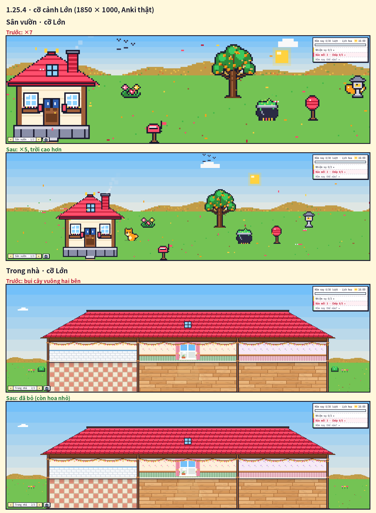

# Kiểm tra 1.25.4 — cỡ cảnh Lớn ×5, bỏ bụi cây vuông (11/11/2026)

Người dùng chọn **A'** trong ảnh phác (`docs/ke_hoach_1_25_4/01_co_lon_3_cach.png`) + "xóa 2 cái ô vuông xanh 2 bên nhà".

- Cỡ Lớn ở 1850 × 1000: điểm ảnh ×7 → **×5**, dải vẫn cao 530 px (trước 532), 30 hàng trời thêm phía trên cảnh. Cỡ Vừa không đổi (×4, không trời thêm).
- Đo trong Anki thật (`e2e_1253.js` mục 7): trời liền một dải qua mép trên cảnh ở mọi cột đo; mưa có ở phần trời thêm; ban đêm phần trời thêm tối như trời trong cảnh; bấm vào hòm thư vẫn trúng; bấm vào phần trời thêm không trúng đồ; Trong nhà không còn màu bụi cây / viền ở 4 điểm đo; Bãi biển trời liền dải.
- Bộ test: `tests/run_all.sh` **TẤT CẢ OK**; Anki 26.9.4: `e2e_1253` 36/36 · `e2e_125` 30/30 · `e2e_121` 46/46 (khách, bấm khách) · `e2e_114` 34/34 (thú) · `e2e_tour` 12/12 · `e2e_123` 65/65 · `audit.js` không lỗi JS, không tràn ngang (4 dòng "cắt 1" ở Kệ báo là tên số báo rút gọn "…", có từ trước).
