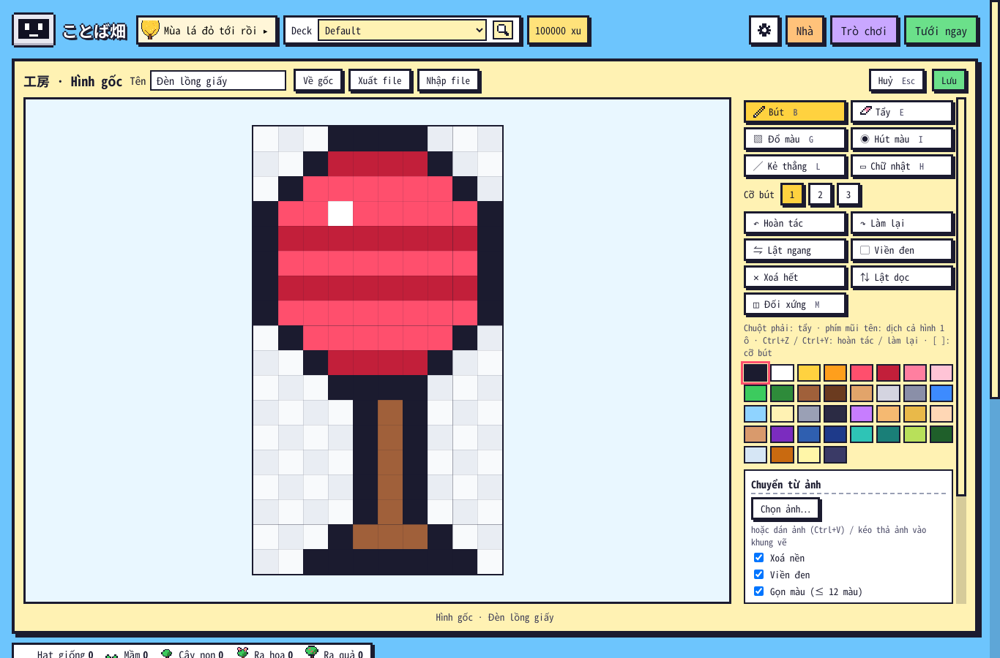

# Kiểm tra 1.25.5 — admin sửa hình gốc rồi ra bản mới (11/11/2026)

Người dùng duyệt ảnh phác `docs/ke_hoach_1_25_4/02_admin_sua_hinh_goc.png`: "Mình đồng ý, nhưng phần chú thích ngắn thôi nhé".

Cách dùng (ngắn):
1. Tools → Add-ons → ことば畑 → Config: `"admin": true`.
2. Nhà → thẻ đồ / Thú nuôi / Giống cây / Album khách → **Sửa hình** → vẽ → **Lưu** (hình đổi ngay, ghi `user_files/mau_sua.json`).
3. **Xuất file** → chép `mau_sua.json` vào thư mục `kotoba_batake/` của repo → `python3 tests/tools/pack.py` → đăng gói. Ai cập nhật cũng nhận, không cần bật admin. File người khác gửi: **Nhập file**.

Kết quả:
- `tests/run_all.sh` **TẤT CẢ OK** (mới: `core/test_1255.py`).
- Anki 26.9.4: `e2e_1255` **34/34** (mới) · `e2e_1253` 36/36 · `e2e_115` 21/21 (Xưởng) · `e2e_116` 15/15 (vẽ vùng) · `e2e_122` 64/64 (giống tự vẽ) · `e2e_114` 34/34 (thú) · `e2e_121` 46/46 (khách) · `e2e_125` 30/30 · `audit_full` **181/181** (mua / dùng mọi thứ, có Xưởng).
- Chưa sửa được: khung động riêng của 5 món (hươu cúi chào, kappa chớp mắt, mũ kabuto loé, tủ lạnh mở, giường) và vài hình dựng từ hình khác lúc nạp (lúa vàng mùa thu, đài phun nước đóng băng).
