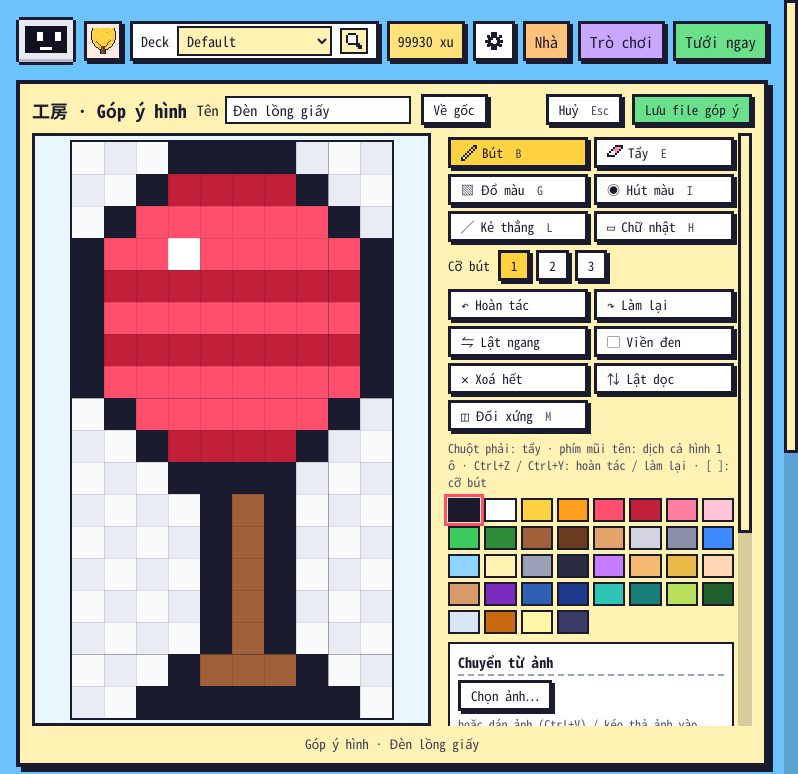

# Góp ý hình 1.25.7 (11/11/2026)

Người dùng hỏi: "sửa như vậy thì người dùng có thể tạo ra đồ tùy ý họ đúng không. hay là cho sửa 1 lần với đồ vật thôi" → chọn hướng 2: "chắc là 2 á" (ai cũng góp ý, chỉ người làm add-on áp + ra bản mới).

## Thay đổi
- Bỏ config `admin` (ai cũng tự bật được rồi vẽ lại đồ có sẵn thành đồ khác miễn phí). Chế độ admin nay bật bằng file trống `user_files/admin` trong thư mục add-on; gói phát hành không có file này, cập nhật add-on vẫn giữ.
- Người dùng thường: thẻ đồ / thú / giống / khách **đã có** trong bảng Nhà có nút **Góp ý hình** → Xưởng "工房 · Góp ý hình" (không có Xuất / Nhập file) → **Lưu file góp ý** → file `gop_y_<nhóm>_<id>.json` (cùng định dạng `mau_sua.json`). Vườn của họ không đổi.
- Người làm add-on: Nhập file góp ý → xem ngay trong vườn → Xuất file → `kotoba_batake/mau_sua.json` → `pack.py` → đăng.
- Không có file admin thì chỉ áp bản đi kèm gói: `user_files/mau_sua.json` bị bỏ qua (chép file sửa vào đó không đổi được vườn; admin xoá file `admin` là thấy đúng như người dùng).

## Kết quả
- `tests/run_all.sh` **TẤT CẢ OK** (`core/test_1255.py`: admin theo file, config `admin` không bật gì, `base:suggest` chạy trước bước kiểm admin, gói không có file `admin`).
- Anki **26.9.4**: `e2e_1255` **48/48** (thêm 8 kiểm tra Góp ý hình: config `"admin": true` không còn tác dụng, bỏ file admin thì bản sửa của máy không áp, nút chỉ ở món đang có, chữ của Xưởng, Lưu khi chưa vẽ → "Chưa sửa gì.", file góp ý chỉ có hình vừa sửa, vườn + bản sửa của máy không đổi, máy admin Nhập file góp ý → hình đổi) · `e2e_1253` 39/39.
- Các bộ có bảng Nhà / Xưởng / thẻ đồ (Anki 26.9.4): `e2e_tour` 12/12 · `e2e_114` 34/34 · `e2e_121` 46/46 · `e2e_122` 64/64 · `e2e_1223` 49/49 · `e2e_124` 23/23 · `e2e_125` 30/30 · `audit_edge` 58/58 · `audit_full` 181/181 — nút mới không làm thẻ tràn ở 720 × 520 → 1920 × 1080.
- Anki **23.10.1**: `e2e_1255` 48/48 · `e2e_1253` 39/39.
- Chưa chạy: Windows / macOS (hộp lưu file của hệ điều hành — test dùng `KB_TEST_FIX_OUT`).
