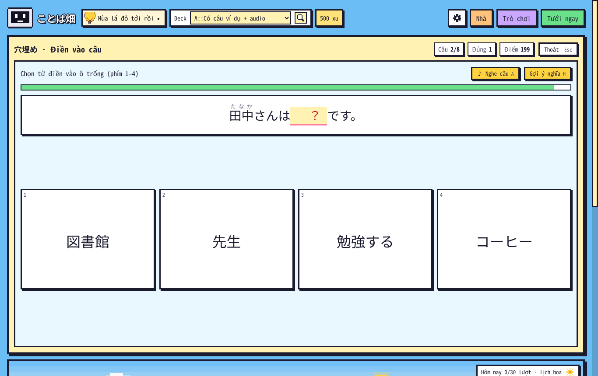
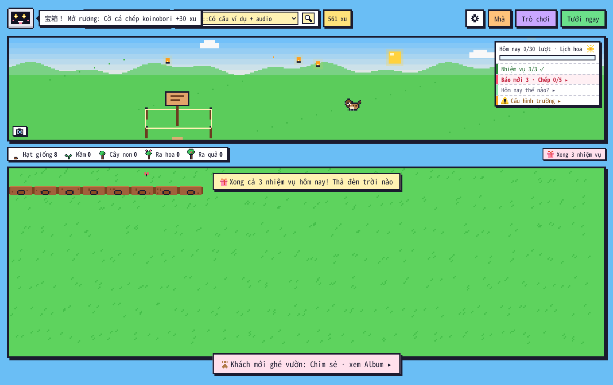

# Kiểm tra lần cuối 1.25.8 (11/11/2026)

Người dùng: "còn gì chưa hiện thực nữa không. và hiện tại kiểm tra thử cho tớ ví dụ bình thường claude sẽ soạn báo cho mình, nhưng hôm khác gemini soạn thì câu chuyện có đồng bộ không, hay là 1 câu chuyện khác. bên trò chơi "Điền từ", ví dụ khi xong 1 câu, thì nếu bấm next thì âm thanh câu cũ vẫn phát khi đã sang câu mới. khi hoàn thành đủ 3 nhiệm vụ thì cái hộp quà xong 3 nhiệm vụ không hiện liền, chuyển deck thì mới hiện đã hoàn thành 3 nhiệm vụ, thả đèn trời. kiểm tra lại tất cả lần cuối".

## 1. Truyện Claude Code ↔ Gemini — trước khi sửa: hai truyện khác nhau

Thử với 8 số báo thật của `kotoba_daily` (kỳ 1–8, 01 → 08/11: ông Ken, chìa khoá, hộp thiếc, túi hạt giống), cho Gemini (giả) viết ngày 09/11 bằng mã 1.25.7:

```
CÁC KỲ ĐÃ ĐĂNG: (chưa có kỳ nào)
HÔM NAY: Thứ Hai, ngày 9/11/2026, mùa thu. Đợt mới bắt đầu từ kỳ 1.
```

Lời nhắc không có chữ nào về truyện của Claude (Ken, hộp thiếc, lá thư…) → Gemini mở một truyện mới từ kỳ 1. Hai bên nhớ ở hai chỗ: Claude ở `kotoba_daily/truyen.md`, Gemini ở `user_files/bao_chung/truyen.json`. Cùng ngày Claude viết báo tiếng Nhật mà Gemini viết báo tiếng Anh cũng là hai chuyện.

**Sửa (1.25.8, bộ kotoba_daily 2.4):**
- Claude → Gemini: trước khi Gemini viết, các kỳ Claude đã đăng được chép vào truyện chung (nguyên văn = bản dịch tiếng Việt, tóm tắt + chỗ bỏ ngỏ từ "Đã xảy ra" của `truyen.md`, tên はな / けん → Hana / Ken). Kết quả cùng thử nghiệm: lời nhắc có "Kỳ 8: Trong hộp thiếc có một túi nhỏ và lá thư Ken-chan viết năm 10 tuổi…", "Đợt mới bắt đầu từ kỳ 9". Claude đã viết hôm nay → báo tiếng Anh kể lại đúng kỳ của Claude.
- Gemini → Claude: add-on ghi các kỳ Gemini viết vào `kotoba_daily/truyen_chung.json`; `pham_vi.py` sáng hôm sau ra "kỳ tiếp theo: 10" + "kỳ 9 đã đăng trong add-on"; cùng ngày (Gemini viết trước cho báo tiếng Anh) → Claude kể lại kỳ 9 thay vì viết kỳ khác.
- Cần chép `tools/`, `prompts/`, `HUONG_DAN.md` mới vào thư mục kotoba_daily. Máy không có thư mục kotoba_daily (không đặt `bao_dir`) thì không nối được.

## 2. Điền vào câu — âm thanh câu cũ

Tái hiện trên 1.25.7 (Anki thật, ghi lại lệnh phát / dừng âm thanh): trả lời → đọc câu ví dụ; bấm **Câu tiếp** → không có lệnh dừng, câu cũ đọc tiếp. Thêm: bấm Câu tiếp trong 350 ms sau khi trả lời thì **đọc luôn câu mới** (lộ đáp án). Chợ sáng (Khách tiếp) cũng không dừng. Sửa: Câu tiếp / Khách tiếp / rời trò chơi giữa chừng đều tắt âm thanh; câu đọc tự động chỉ phát nếu vẫn ở đúng câu đó.



## 3. Huy hiệu "Xong 3 nhiệm vụ"

Tái hiện trên 1.25.7: nhiệm vụ 2/3 → chơi hết 8 câu Điền vào câu → bảng nhiệm vụ 3/3, rương mở, nhưng `data.joy.quests` vẫn `false`, không huy hiệu, không đèn trời; đổi deck mới hiện (đúng như người dùng thấy). Nguyên nhân: trạng thái hiệu ứng thành tích chỉ tính lại khi làm mới cả vườn. Sửa: mọi đường nhận kết quả nhiệm vụ cập nhật luôn; dải chúc mừng để dành tới khi đóng bảng Trò chơi / Báo.



## 4. Lỗi tìm thêm khi kiểm tra lần cuối
| Lỗi | Sửa |
|---|---|
| Bấm Câu tiếp ngay sau khi trả lời → đọc câu mới (lộ đáp án) | câu đọc tự động gắn với câu vừa trả lời |
| Rời Chợ sáng / Lật thẻ giữa chừng (Esc, chọn trò khác) → từ đang đọc không tắt | `clearStage` luôn gửi `game:stop` |
| `GardenUI.mode()` cập nhật 200 ms một lần → vừa đóng bảng xong làm mới vườn thì dải chúc mừng bị để dành nhầm (tìm ra khi chạy lại `e2e_117`) | tính chế độ lúc gọi |
| Dòng "nối N kỳ của báo Claude Code" ghi vào nhật ký lỗi (tìm ra khi chạy lại `e2e_123`) | ghi vào nhật ký viết báo ("Nối 8 kỳ của báo Claude Code vào truyện chung.") |

Ghi chú test: `KeyboardEvent` giả "Escape" (tạo bằng `dispatchEvent`) khi đang chơi làm webview treo trong môi trường test — cả trên 1.25.7. Phím Esc thật (qua `Input.dispatchKeyEvent`) và nút Thoát về menu bình thường ở cả 4 trò (Nghe tìm cây, Đuổi quạ, Lật thẻ, Chợ sáng) → người dùng không gặp; `e2e_1258` dùng phím thật.

## 5. Kết quả
- `tests/run_all.sh` **TẤT CẢ OK** (thêm `core/test_1258.py`: truyện chung hai chiều, `pham_vi.py`, dữ liệu hỏng).
- Anki **26.9.4**, mọi kịch bản (chạy cả bộ, rồi chạy lại các bộ có trò chơi / dải chúc mừng / báo sau lần sửa cuối): `e2e` 24/24 · `e2e_tour` 12/12 · `e2e_114` 34/34 · `e2e_115` 21/21 · `e2e_116` 15/15 · `e2e_117` 55/55 · `e2e_118` 29/29 · `e2e_119` 55/55 · `e2e_120` 103/103 · `e2e_121` 46/46 · `e2e_122` 64/64 · `e2e_1223` 49/49 · `e2e_1226` 40/40 · `e2e_1228` 26/26 · `e2e_123` 65/65 · `e2e_124` 23/23 · `e2e_125` 30/30 · `e2e_1251` 48/48 · `e2e_1253` 39/39 · `e2e_1255` 48/48 · **`e2e_1258` 25/25** · `e2e_kit23` 10/10 · `audit_edge` 58/58 · `audit_full` 181/181 — **0 mục trượt**; `audit.js` không lỗi JS, nhật ký lỗi trống (cảnh báo "cắt 1" ở Kệ báo = tên số rút gọn "…", có từ 1.25.2).
- Anki **23.10.1**: `e2e_1258` 25/25 · `e2e_1255` 48/48 · `e2e_1253` 39/39 · `e2e_117` 55/55 · `e2e_123` 65/65 · `e2e_tour` 12/12.
- `e2e_1258` chạy trên mã 1.25.7: trượt đúng các mục người dùng báo (Câu tiếp không dừng câu cũ, đọc luôn câu mới, Chợ sáng không dừng, huy hiệu / dải chúc mừng / đèn trời không hiện tới khi đổi deck).

## 6. Còn chưa làm
- Lộ trình đã chốt (07/11): **1.26** màn chào khi mở vườn (thú nuôi ra chào lần mở đầu mỗi ngày) + hiệu ứng chuyển cảnh + Bảng tin làng — `KE_HOACH_1_26.md`, làm ảnh phác trước; **1.27** cây lấp lánh, rút quẻ omikuji, lịch trời Nhật + sổ 歳時記, kỷ niệm & mốc học; **1.28** nhặt đồ theo vùng + Hộp sưu tầm, gánh hàng rong; **1.29** Nhạc làng + thêm hiệu ứng.
- Đã bàn, chưa chọn (`PHAT_TRIEN.md` mục 10): số ôn tập cuối tuần (chờ trả lời), radio / podcast, bạn qua thư, hiệu ứng tự chế, làng & hàng xóm, gacha, vé nghỉ giữ chuỗi, Gemini viết lại số hôm nay.
- Giới hạn đã biết: Sửa / Góp ý hình chưa sửa được vài khung động riêng (hươu cúi chào, kappa chớp mắt, mũ kabuto loé, tủ lạnh mở, giường) và hình dựng từ hình khác (lúa vàng mùa thu, đài phun nước đóng băng); ngày Claude Code không viết thì không có báo tiếng Nhật (Gemini không tự viết thay khi nguồn là Claude Code); truyện chung chỉ nối trên máy có thư mục kotoba_daily.
- Chưa chạy: Windows / macOS, đồng bộ AnkiWeb thật, Gemini / giọng đọc thật (proxy của môi trường chặn).
