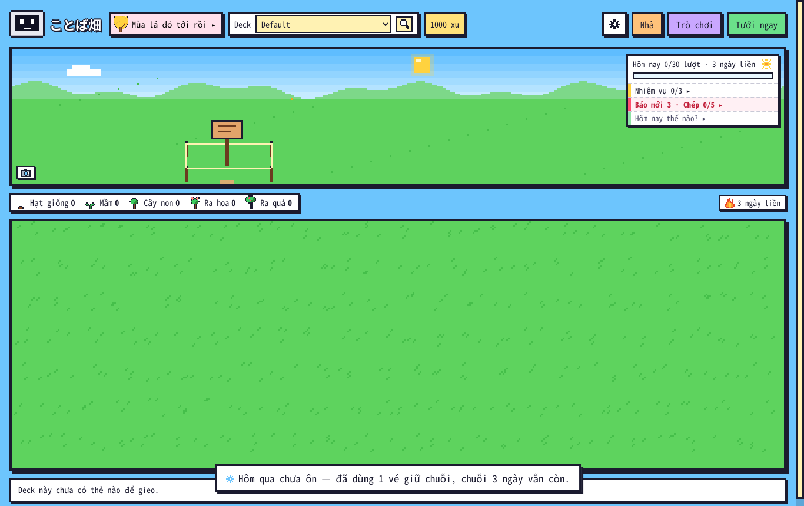
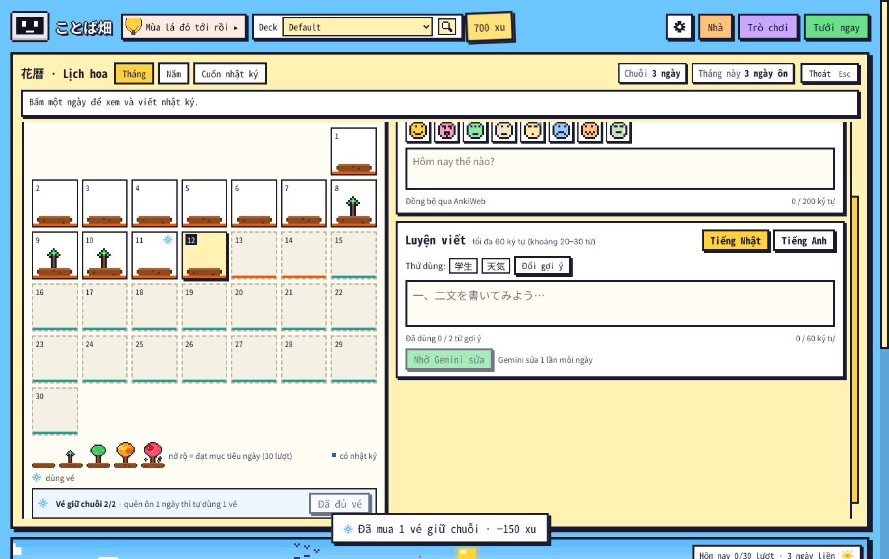
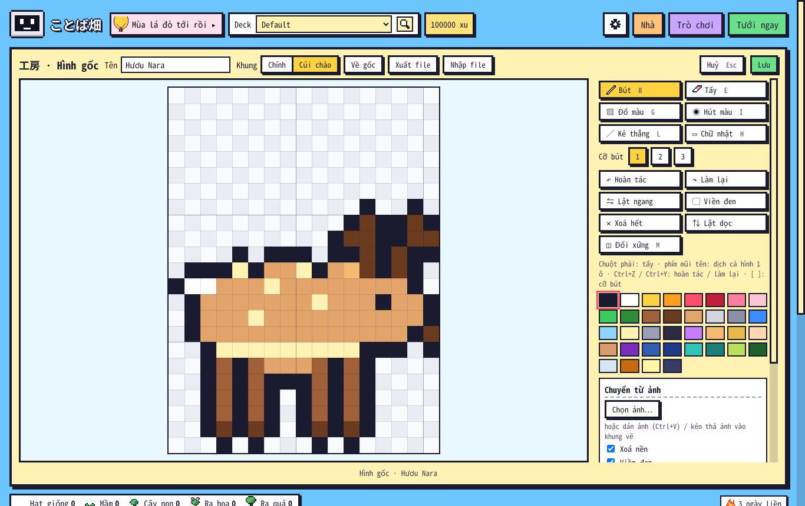
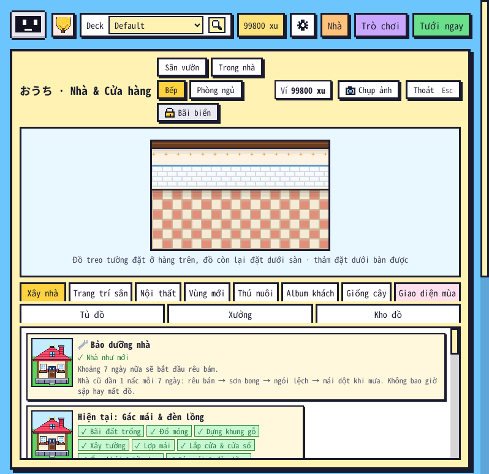

# Kiểm tra 1.25.9 (12/11/2026)

Người dùng: "Góp ý / Sửa hình còn thiếu: vài khung động (hươu cúi chào, kappa chớp mắt, tủ lạnh mở, giường) và vài hình dựng từ hình khác (lúa vàng mùa thu, đài phun nước đóng băng) chưa sửa được. Sửa cái này. Thêm phần giữ chuỗi hoặc đóng băng chuỗi gì đó. Một số lỗi được tìm ra ở nhánh audit/release-review-2026-11-11, kiểm tra lại xem có đúng không, nếu đúng thì sửa. Kiểm tra lại giao diện logic, tính năng lần cuối".

## 1. Vé giữ chuỗi

Lịch hoa → Tháng có dòng **Vé giữ chuỗi n/2**:
- Mua 150 xu một vé, giữ tối đa 2 vé. Thiếu xu thì nút khoá.
- Quên ôn một ngày thì lần mở vườn sau tự dùng 1 vé và hiện thông báo. Ô ngày đó trên lịch có bông tuyết.
- Ngày dùng vé nối chuỗi nhưng không cộng vào số ngày.
- Vé chỉ dùng cho ngày từ hôm mua trở đi.
- Quên nhiều ngày hơn số vé thì chuỗi đứt, vé còn nguyên.
- Không đụng lịch ôn thẻ.

Thử trong Anki thật: ôn 4, 3, 2 ngày trước, quên hôm qua, có 1 vé mua từ trước. Kết quả:
- Mở vườn hiện "Hôm qua chưa ôn — đã dùng 1 vé giữ chuỗi, chuỗi 3 ngày vẫn còn."
- Thẻ Hôm nay ghi "3 ngày liền". Lịch hoa ghi Chuỗi 3 ngày, Dài nhất 3 ngày.
- Làm mới lần nữa không dùng thêm vé.

## 2. Sửa hình / Góp ý hình: khung động và hình dựng từ hình khác

Bảy hình nay có thêm khung trong hàng **Khung** của Xưởng:
- hươu: **Cúi chào**
- kappa: **Chớp mắt**
- mũ kabuto: **Loé sáng**
- tủ lạnh: **Mở cửa**
- giường: **Chăn phồng**
- đài phun nước: **Đóng băng**
- ruộng lúa: **Mùa thu**

Cách làm: các khung này trước đây là hằng riêng trong `rare_art.js`, `nha_art.js`, `home.js`. Nay chúng được gom về một chỗ chung `ALT`, và cảnh đọc từ `ALT` lúc vẽ. Nhờ vậy bản sửa áp vào là cảnh dùng ngay. Định dạng file sửa / góp ý không đổi.

Thử trong Anki thật:
- Vào Nhà → thẻ Hươu Nara → Sửa hình → khung Cúi chào, vẽ 1 điểm rồi Lưu.
- `mau_sua.json` chỉ ghi khung `cui`, cảnh dùng ngay.
- Mở lại vườn, bản sửa vẫn áp.
- Người dùng thường bấm Góp ý hình cũng thấy khung "Đóng băng".

## 3. Lỗi của nhánh `audit/release-review-2026-11-11`

Nhánh audit rà trên **1.25.3**. Mình chạy lại nguyên kịch bản của nhánh (`audit_core.py` 112 ca, `audit_ui.js` 123 ca) trên mã 1.25.8 trước khi sửa: 12 lỗi vẫn còn, F03 đã sửa ở 1.25.6.

| Lỗi | Trên 1.25.8 | Kết luận / sửa |
|---|---|---|
| F01 (P1) Đồ tự làm ở Bếp / Phòng ngủ cất rồi hiện lại | còn (lưu lặp 2 → 3 → 4 chỗ đặt) | **Đúng.** Id `c1`, `c2`… bị coi là món của bản mới hơn. Nay `known_item` nhận món Xưởng; món lạ thật của bản sau vẫn giữ |
| F02 (P1) Luyện viết tiếng Anh 30 từ dài mất chữ | còn (629 → 400 ký tự, cắt giữa từ) | **Đúng.** Nay cắt theo 30 từ trước, trần 1.200 ký tự không cắt giữa từ |
| F03 Đổi cài đặt rồi đóng vườn trong 250 ms | đã sửa ở 1.25.6 | Chạy lại: 0 / 50 / 150 / 350 ms đều lưu |
| F04 Esc lúc bộ gõ đang chọn chữ đóng bảng | còn | **Đúng.** Phím lúc đang chọn chữ không tới phím tắt nào của vườn |
| F05 Trần xu trò chơi 0 hiện "/40" | còn | **Đúng.** 0 là 0 |
| F06 Trời cố định không vào báo | còn | **Đúng.** Chọn trời cố định ở ⚙ thì báo hôm nay ghi đúng trời đó; Tự động như cũ |
| F07 Hàng chờ thông báo mất câu | còn | **Đúng.** Câu tới lúc đang chuyển xếp sau câu đang chờ (B rồi C) |
| F08 Ngôn ngữ của hồ sơ trước | còn | **Đúng.** Gắn theo collection, xoá khi đóng hồ sơ |
| F09 Điểm ảnh món tự làm của hồ sơ khác | còn | **Đúng.** File sao lưu ghi chủ như ví / nhà |
| F10 Trần bù xu 1.000 / ngày theo từng lần đồng bộ | còn (600 + 600 = 1.200) | **Đúng.** Ghi số đã bù trong ngày |
| F11 Lượt ôn giờ tương lai trong hôm nay được tính | còn | **Không phải lỗi.** Lượt đó có thật, sổ bù xu không trả hai lần. Ngày ở tương lai vẫn để tới ngày đó |
| F12 Nhiệm vụ thiếu trường → KeyError | còn | **Đúng** (dữ liệu hỏng / sửa tay). Bỏ nhiệm vụ đó |
| F13 Mốc giai đoạn không tăng dần | còn | **Đúng.** Sai thì về [3, 21, 90] |

Chạy lại kịch bản của nhánh audit sau khi sửa:
- Lõi: **112/112**.
- Giao diện: **119/123**. Bốn mục trượt:
  - U007–U009 (F11): giữ nguyên vì không phải lỗi.
  - U021: kịch bản chờ thứ tự cũ (C rồi B). Hành vi mới là B rồi C, đúng ca U020 "B vẫn đến lượt trước C", không mất câu nào.

## 4. Kết quả

- **Test offline** (`tests/run_all.sh`): **TẤT CẢ OK**. Bộ mới `core/test_1259.py` có 87 kiểm tra. `core/test_1226.py` đổi một mục: `stage_days` [3] nay đọc thành [3, 21, 90].
- **Anki 26.9.4, chạy toàn bộ:**

  | Kịch bản | Kết quả |
  |---|---|
  | `e2e` | 24/24 |
  | `e2e_tour` | 12/12 |
  | `e2e_114` | 34/34 |
  | `e2e_115` | 21/21 |
  | `e2e_116` | 15/15 |
  | `e2e_117` | 55/55 |
  | `e2e_118` | 29/29 |
  | `e2e_119` | 55/55 |
  | `e2e_120` | 103/103 |
  | `e2e_121` | 46/46 |
  | `e2e_122` | 64/64 |
  | `e2e_1223` | 49/49 |
  | `e2e_1226` | 40/40 |
  | `e2e_1228` | 26/26 |
  | `e2e_123` | 65/65 |
  | `e2e_124` | 23/23 |
  | `e2e_125` | 30/30 |
  | `e2e_1251` | 48/48 |
  | `e2e_1253` | 39/39 |
  | `e2e_1255` | 48/48 |
  | `e2e_1258` | 25/25 |
  | **`e2e_1259`** | **36/36** |
  | `e2e_kit23` | 10/10 |
  | `audit_edge` | 58/58 |
  | `audit_full` | 181/181 |

  **0 mục trượt.** `audit.js` không có lỗi JS, nhật ký lỗi trống. Cảnh báo "cắt 1" ở Kệ báo là tên số báo rút gọn "…", đã có từ 1.25.2.
- **Anki 23.10.1:** `e2e_1259` 36/36 · `e2e_1258` 25/25 · `e2e_1255` 48/48 · `e2e_117` 55/55 · `e2e_123` 65/65 · `e2e_tour` 12/12.
- **Sửa thêm khi chạy lần cuối:**
  - Chú giải "dùng vé" của Lịch hoa bị rớt dòng tách khỏi bông tuyết: nay đi cùng nhau. Bông tuyết trong ô ngày chuyển lên góc trên phải cho dễ thấy.
  - Kịch bản `e2e_1259`: nếu khách ghé vườn mở cùng lúc thì thông báo dùng vé xếp hàng sau thông báo khách (đúng hàng chờ đã sửa ở F07). Kịch bản nay chờ tới lượt thay vì chỉ chờ 4 giây.

## 5. Còn chưa làm / chưa thử
- Lộ trình đã chốt:
  - **1.26**: màn chào, chuyển cảnh, Bảng tin làng (`KE_HOACH_1_26.md`, làm ảnh phác trước).
  - **1.27**: cây lấp lánh, rút quẻ, lịch trời Nhật, kỷ niệm học.
  - **1.28**: nhặt đồ theo vùng, gánh hàng rong.
  - **1.29**: Nhạc làng.
- Đã bàn, chưa chọn: số ôn tập cuối tuần, radio / podcast, bạn qua thư, hiệu ứng tự chế, làng & hàng xóm, gacha, Gemini viết lại số hôm nay.
- Chưa thử:
  - Bộ gõ thật của Windows / macOS / Linux (F04 mới thử bằng bộ gõ giả của Chromium).
  - Windows / macOS, đồng bộ AnkiWeb thật (vé giữ chuỗi đi theo khoá `kotoba_batake_more`), Gemini thật.
