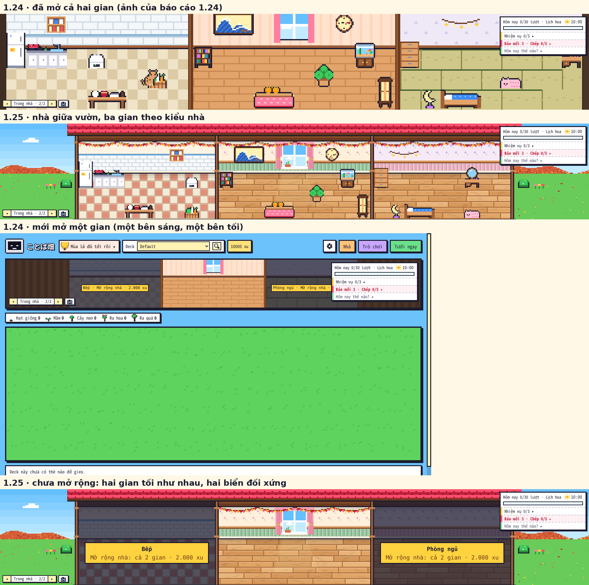
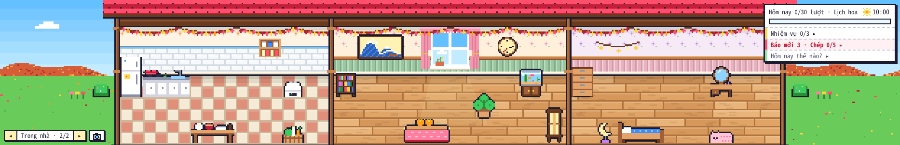
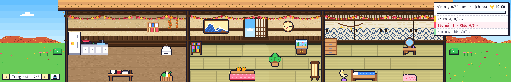
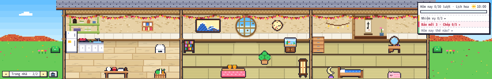
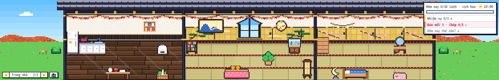
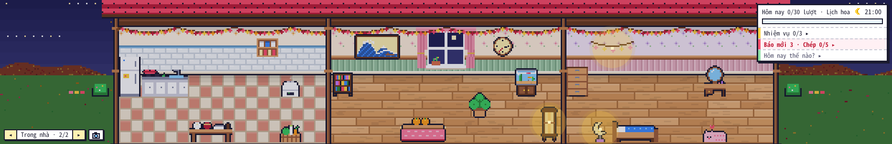
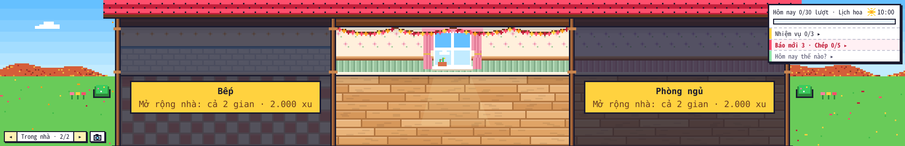
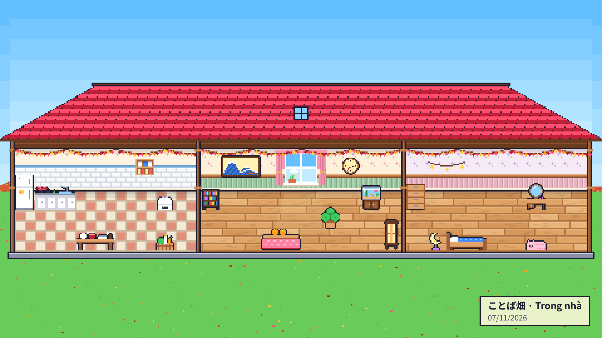

# Kiểm tra ことば畑 1.25.0 — 07/11/2026

Bản 1.25.0: **nhà 3 gian làm lại** sau khi người dùng xem 1.24 trên máy thật — mở rộng nhà **một lần 2.000 xu được cả Bếp lẫn Phòng ngủ**, ba gian **theo kiểu nhà** (nội thất vẽ lại cho 4 kiểu), màn chính "Trong nhà" là **nhà giữa vườn** (bố cục A người dùng chọn qua ảnh phác), ⚙ → Màn chính → **Dây trang trí: Hiện / Ẩn**. Ảnh phác 3 lượt duyệt ở `docs/ke_hoach_1_25/`. Anki thật chạy không cửa sổ (Qt offscreen) trong Claude Code trên web, điều khiển bằng CDP; hồ sơ thử mới cho từng kịch bản.

## 1. Kết quả

| Bộ | Anki 26.9.4 | Anki 23.10.1 (Qt 6.6) |
|---|---|---|
| `tests/run_all.sh` (có `core/test_125.py` mới, chạy cả **mã 1.24 thật** lấy từ git `bc66f66`; `test_124.py` đổi phần mở rộng theo luật mới) | TẤT CẢ OK | — |
| `e2e_125.js` (mới) | **29/29** | **29/29** |
| `e2e_124.js` (đổi: một thẻ Mở rộng, mở cả hai gian) | 23/23 | 23/23 |
| `e2e.js` · `e2e_tour.js` · `e2e_114` · `e2e_115` · `e2e_116` · `e2e_117` · `e2e_118` · `e2e_119` | 24/24 · 12/12 · 34/34 · 21/21 · 15/15 · 55/55 · 29/29 · 55/55 | `e2e_tour` 12/12 |
| `e2e_120` · `e2e_121` · `e2e_122` · `e2e_1223` · `e2e_1226` · `e2e_1228` · `e2e_123` · `e2e_kit23` | 103/103 · 46/46 · 64/64 · 49/49 · 40/40 · 26/26 · 65/65 · 10/10 | `e2e_1226` 40/40 · `e2e_1228` 26/26 · `e2e_123` 65/65 |
| `audit_edge.js` · `audit_full.js` (1.000.000 xu, mua / dùng mọi thứ qua giao diện) | 58/58 · **181/181** (ảnh có cờ đo: 0/131) | — |

- `audit_full` còn 181 kiểm tra (1.24: 182): phần "Mở rộng nhà" nay là **một** lần bấm trừ đúng 2.000 xu và mở cả hai gian (1.24: hai lần, mỗi gian 2.000).
- Lần chạy đầu `e2e_125` trượt 4/29 do chính kịch bản: đo độ sáng gian chưa mở trúng biển giá vàng, đo màu vườn trúng cột tường ngoài (4 điểm ảnh) — dời điểm đo, 29/29. Không có lỗi của add-on.

`e2e_125.js` kiểm: nhà ×3 giữa dải ở 1920 px (lề trái = lề phải 83 điểm ảnh), hai bên là trời / cỏ (đo điểm ảnh), hai gian chưa mở tối như nhau (72 / 65) còn phòng chính sáng (169); bấm Bếp tối → tab Xây nhà, **một** thẻ "Mở rộng nhà: Bếp + Phòng ngủ · 2000 xu" có ảnh nhỏ cả nhà; bấm đúp "Mở rộng" → mở cả hai, chỉ trừ 2.000; thẻ đổi thành "Đã mở" + nút Đến Bếp / Đến Phòng ngủ; 5 ảnh nhỏ nhà 3 gian (4 kiểu khác màu nhau); hai gian sáng sau khi mở; đổi 4 kiểu nhà → cả 6 điểm đo (tường / sàn của 3 gian) đổi theo cả 4 kiểu, không mất gian / xu; bảng Nhà ở Bếp đổi nền theo kiểu; hình nền 1920 × 1080 có trời ở hai góc trên, cỏ ở góc dưới; ⚙ → Màn chính có "Dây trang trí", Ẩn → lưu `ui.deco = "off"`, dải trên cùng ẩn (không chừa 30 px), dây trong nhà mất, mở lại vườn vẫn ẩn, bật lại thì trở lại y như trước; ban đêm vườn tối hẳn còn trong nhà sáng đèn; 1366 / 1024 px ×2, 720 × 520 ×1, nhà giữa, không tràn ngang; nhật ký lỗi add-on trống, không lỗi JS.

## 2. Trước / sau

## 3. Ba gian theo 4 kiểu nhà (màn chính 1920 × 1080)

Thêm: [Cỡ cảnh Lớn: mái đầy đủ](125_co_canh_lon.png) · [nhà chưa xây xong 7 bước](125_nha_chua_xay_xong.png) · [mưa](125_mua.png) · [tuyết](125_tuyet.png) · [cửa sổ 1366 × 768](125_nha_classic_1366.png) · [tab Xây nhà: thẻ Mở rộng nhà](125_the_mo_rong.png) · [thẻ kiểu nhà có ảnh ba gian](125_kieu_nha.png) · [bảng Nhà · Bếp](125_bang_bep.png) · [⚙ → Màn chính → Dây trang trí](125_nut_day_trang_tri.png) · [đã ẩn dây trang trí](125_an_day_trang_tri.png).

## 4. Đồng bộ với bản cũ (mã 1.24 thật, `test_125.py`)

- 1.25 mở rộng nhà, đặt tủ lạnh ở Bếp + giường ở Phòng ngủ → mã 1.24 (git `bc66f66`) đọc: thấy cả hai gian và đồ trong đó; cộng xu, lưu → 1.25 đọc lại: gian, đồ, xu còn nguyên.
- Mã 1.24 mở **một** gian (Phòng ngủ, trừ 2.000) rồi đặt giường → 1.25 đọc: mở cả hai gian, giường còn ở Phòng ngủ, xu giữ nguyên (không hoàn — 1.24 chưa phát hành).

## 5. Chưa kiểm / giới hạn

- Windows / macOS, đồng bộ AnkiWeb giữa hai máy thật: chưa chạy (như các bản trước).
- Thẻ Hôm nay giữ như cũ (người dùng chọn bố cục A, không chọn thu gọn thẻ): ở 1366 px thẻ che mép phải Phòng ngủ.
- Màn hình phóng to lẻ (vd. 125 %): nền ba gian vẽ thẳng mỗi khung thay vì dán từ canvas đệm (đúng hình, chỉ tốn CPU hơn) — chưa đo tốc độ trên máy thật ở chế độ đó.
