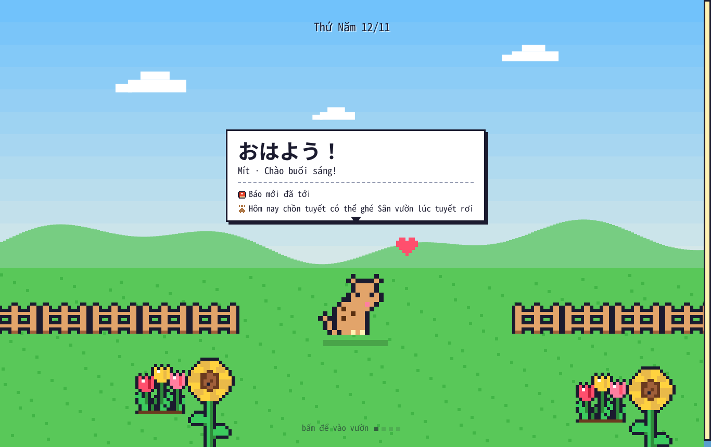
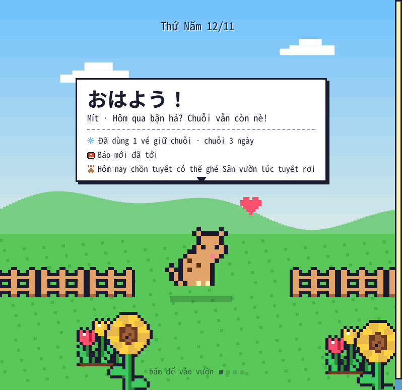
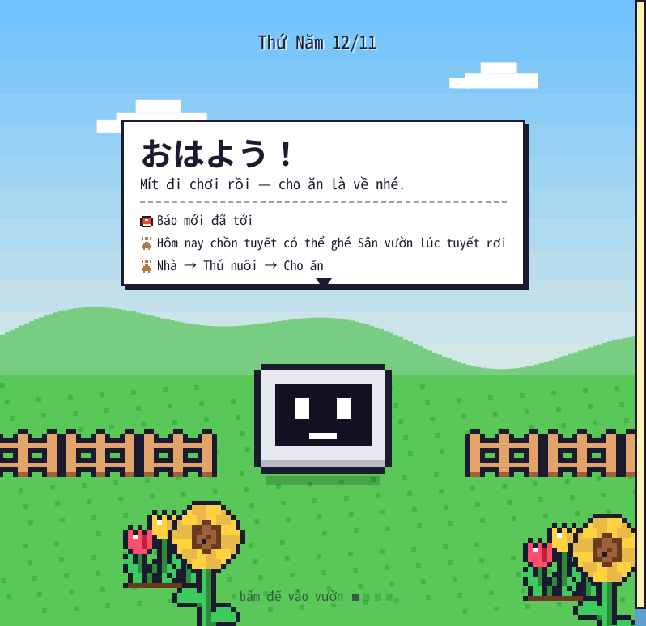
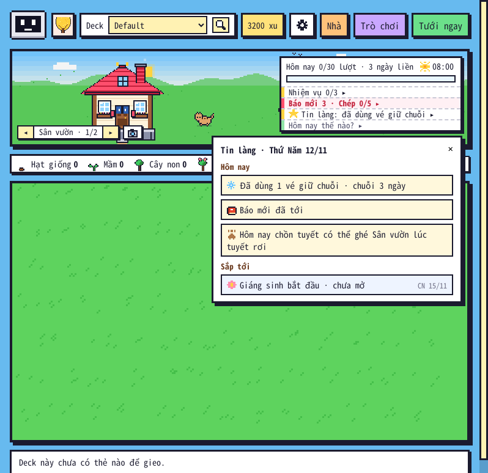

# Kiểm tra 1.26.0 (12/11/2026) — màn chào, chuyển cảnh, Tin làng

Người dùng xem ảnh phác (`docs/ke_hoach_1_26/126_*.png`): "không biết nữa, thử đi". Bản này làm theo các đề xuất trong ảnh: câu chào ngày lễ, màn chào báo vé giữ chuỗi, Tin làng có vé / gói báo, 4 kiểu chuyển cảnh.

## 1. Màn chào khi mở vườn

Màn chào hiện ở lần mở vườn đầu tiên mỗi ngày Anki.
- **Ai chào:** thú thân nhất của bạn. Chưa nuôi thú, hoặc thú đi chơi hết, thì StackChan chào.
- **Câu chào:** theo giờ trong vườn (おはよう！ / こんにちは！ / こんばんは！). Ngày lễ có câu riêng (Tết, お正月, Giáng sinh, Halloween, Trung thu, Thất Tịch).
- **Tin:** kèm 1–3 tin hôm nay.
- **Vào vườn:** tự vào sau ~4 giây; rê chuột lên màn chào thì dừng đếm; bấm hay gõ phím bất kỳ để vào ngay. Phím đó không mở bảng nào, Esc không đóng cửa sổ.

## 2. Chuyển cảnh

Bật / tắt ở ⚙ → Màn chính → Chuyển cảnh. Lớp hiệu ứng không nhận chuột, nên không chặn bấm.
- Màn chào → vườn: vòng tròn khép rồi mở. Mở vườn các lần sau: vòng tròn mở ~0,4 giây.
- Đổi cảnh ◂ ▸: dải lá / cánh hoa / tuyết theo giao diện mùa quét ngang.
- Vào / ra Trong nhà: rèm kéo.
- Mở bảng Nhà / Trò chơi / Báo / Lịch hoa: bật nhẹ.
- Kiểu Dịu mắt: chỉ còn mờ dần. Tắt: đổi ngay, không hiệu ứng.

## 3. Tin làng

- Thẻ Hôm nay có dòng "Tin làng: … ▸". Dòng này chỉ hiện tin chưa có dòng riêng (Báo, thú đói, nhà cần sửa đã có dòng riêng).
- Bấm vào ra bảng gồm hai phần:
  - **Hôm nay:** vé giữ chuỗi vừa dùng, báo mới, mốc ngày có ôn / chuỗi sắp chạm, khách có thể ghé, giao diện mùa, thú / nhà, số vé.
  - **Sắp tới (7 ngày):** giao diện mùa bắt đầu / kết thúc, gói báo hết hạn.

## 4. Kết quả

- **Test offline** (`tests/run_all.sh`): **TẤT CẢ OK**. Bộ mới `core/test_126.py` kiểm ai chào, ngày lễ, tin, ⚙, nối dây và `GardenGreet.mode`.
- **Anki 26.9.4, chạy toàn bộ:**

  | Kịch bản | Kết quả |
  |---|---|
  | `e2e` | 24/24 |
  | `e2e_tour` | 12/12 |
  | `e2e_114` | 34/34 |
  | `e2e_115` | 21/21 |
  | `e2e_116` | 15/15 |
  | `e2e_117` | 55/55 |
  | `e2e_118` | 29/29 |
  | `e2e_119` | 55/55 |
  | `e2e_120` | 103/103 |
  | `e2e_121` | 46/46 |
  | `e2e_122` | 64/64 |
  | `e2e_1223` | 49/49 |
  | `e2e_1226` | 40/40 (sau khi sửa, xem dưới) |
  | `e2e_1228` | 26/26 |
  | `e2e_123` | 65/65 |
  | `e2e_124` | 23/23 |
  | `e2e_125` | 30/30 |
  | `e2e_1251` | 48/48 |
  | `e2e_1253` | 39/39 |
  | `e2e_1255` | 48/48 |
  | `e2e_1258` | 25/25 |
  | `e2e_1259` | 36/36 |
  | **`e2e_126`** | **39/39** |
  | `e2e_kit23` | 10/10 |
  | `audit_edge` | 58/58 |
  | `audit_full` | 181/181 |

  `audit.js`: không có lỗi JS, nhật ký lỗi trống. Cảnh báo "cắt 1" ở Kệ báo là tên số báo rút gọn "…", đã có từ 1.25.2.
- **Anki 23.10.1:** `e2e_126` 39/39 · `e2e_1259` 36/36 · `e2e_1226` 40/40 · `e2e_117` 55/55 · `e2e_123` 65/65 · `e2e_tour` 12/12.
- **Lỗi tìm thấy khi chạy:**
  - **Cửa sổ thấp (1366 × 768) có đủ 4 dòng việc:** thêm dòng Tin làng thì thẻ Hôm nay không vừa, dòng "Cấu hình trường" bị cắt (`e2e_1226`). Sửa: xếp sát rồi vẫn không vừa thì bớt dòng Tin làng (tin đã có trên màn chào). Chạy lại: 40/40.
  - **Đếm tổng số ngày có ôn:** trước đây quét cả lịch sử ôn mỗi lần làm mới vườn. Nay chỉ đếm một lần mỗi ngày.

## 5. Ghi chú
- Kịch bản test cũ chạy với màn chào tắt: add-on test `zz_kbtest` đặt `GREET_TEST_OFF`. `e2e_126` bật lại để kiểm.
- Trong một phiên Anki, trang vườn còn giữ "đã chào hôm nay" ở localStorage, và GardenPrefs đọc chỗ này trước. Vì vậy kịch bản test xoá cả localStorage khi muốn chào lại. Với người dùng thì đây là hành vi đúng: đã chào thì không chào lại trong ngày.
- Chưa thử: Windows / macOS, cửa sổ DPI cao, đồng bộ AnkiWeb thật.
