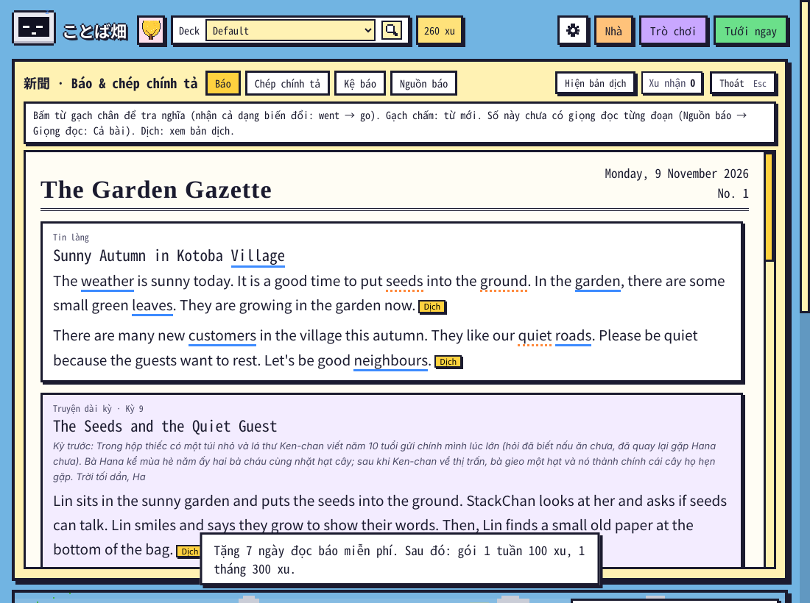
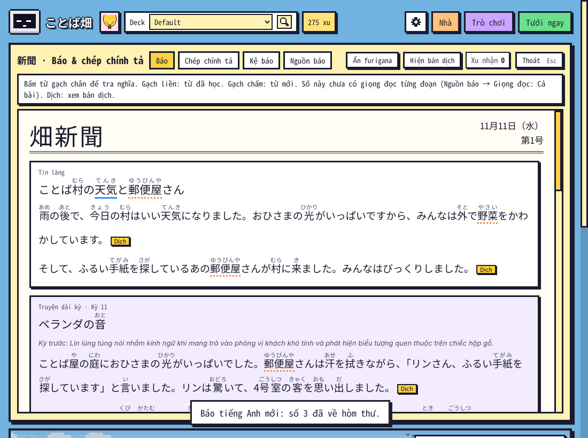
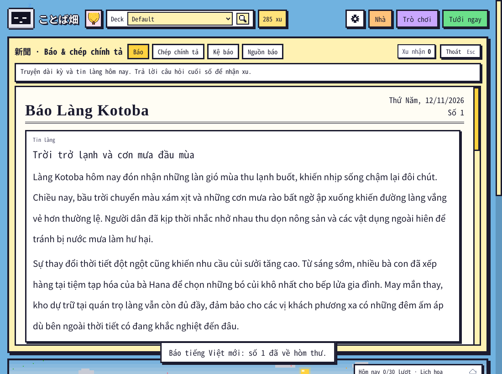
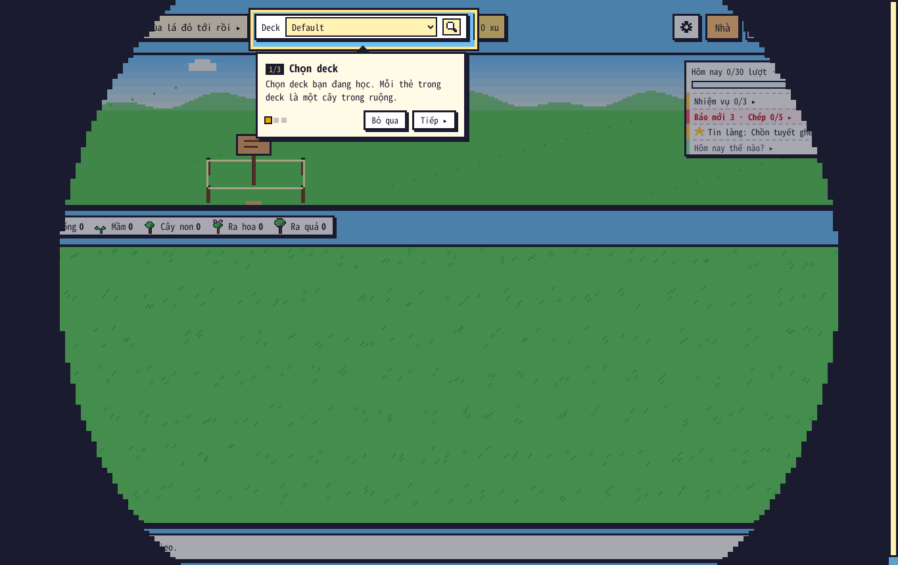
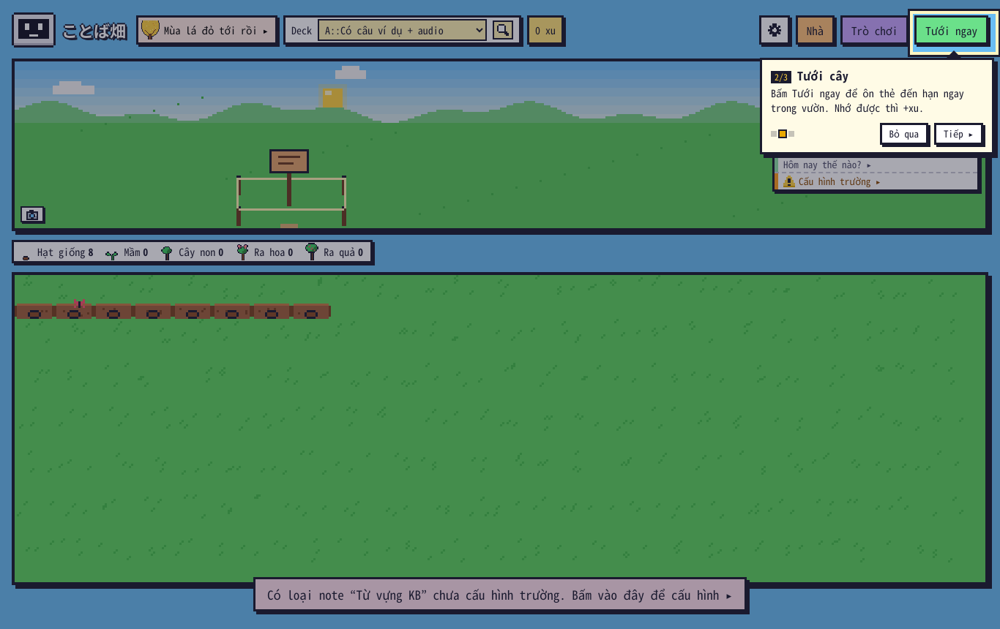
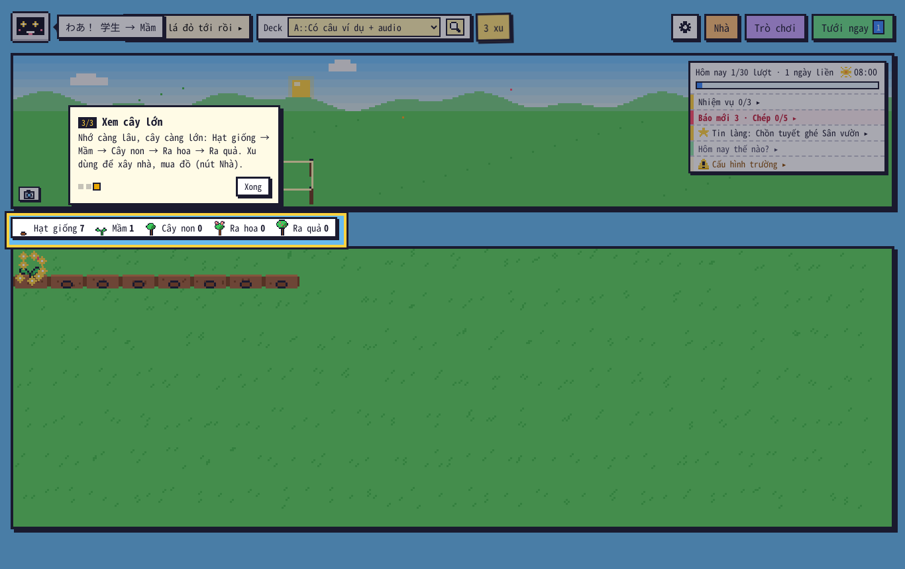

# Kiểm tra 1.26.1 (12/11/2026): Gemini thật nhiều ngày, hướng dẫn người mới, chuyển cảnh chậm hơn

## 1. Gemini thật (khoá gói miễn phí)

Chạy trong **Anki 26.9.4 thật**, đúng đường của add-on: gói báo → truyện chung → kể lại → viết số → sửa → soát → giọng đọc. Chỉ đổi "hôm nay" để đi qua nhiều ngày (`tests/anki/real_gemini.js`). Mỗi số đều mở trong bảng Báo và trả lời đúng hết câu hỏi.

| Ngày | Báo | Kết quả |
|---|---|---|
| 09/11 | Tiếng Anh. Tiếng Nhật vẫn là báo Claude Code (8 số thật, kỳ 1–8) | Gemini nối kỳ 8 của Claude thành **kỳ 9**. Gói thử 7 ngày, không trừ xu. `pham_vi.py` của Claude thấy kỳ 9, kỳ tiếp theo là 10 |
| 10/11 | Nhật N4 + Anh A2 | Anh: kỳ 10. **Nhật: mất số này** (xem 2.2) |
| 11/11 | Nhật + Anh + giọng đọc | Cả hai kỳ 11. Gemini TTS tạo đủ câu chép + bản chậm |
| 12/11 | Chỉ tiếng Việt | Kỳ 12, truyện in đúng nguyên văn bản gốc. 14 lượt gọi. Trả lời đủ câu hỏi: +9 xu |
| 16/11 | Nhật (gói thử đã hết, 13–15/11 không mở Anki) | Kỳ 13 nối đúng. Tự gia hạn −100 xu (294 → 194) **sau khi** số báo viết xong, gói tới 22/11 |
| 17/11 | Nhật + Anh, **mã 1.26.1** (sau khi sửa) | Bản gốc kỳ 14 viết xong. Cả hai báo **chưa ra**: mọi model còn hạn mức đều báo "máy chủ bận" (503) hoặc bị proxy của máy test cắt luồng. Thông báo nay ghi đúng lý do ("Máy chủ Gemini đang bận"). Mỗi model 404 chỉ bị thử một lần cho cả hai báo. Không trừ xu. Trên máy người dùng, add-on tự thử lại ở lần mở vườn sau (cách ≥ 10 phút) |

Tổng cộng 258 lượt gọi chữ cho 5 ngày, không có dòng nào trong nhật ký lỗi. Mọi số đều đọc trong bảng Báo: không tràn ngang, có chỗ tra từ (Anh 11–12, Nhật 7–10), furigana đủ (Nhật 91 chỗ), trả lời đúng được xu.

Ngoài Anki:
- **Luyện viết**: Nhật và Anh, bài ngắn và bài dài. Sửa đúng (寒いでした → 寒かったです, rain → rained…), đúng giới hạn độ dài, mỗi bài 2–3 giây.
- **Một số tiếng Nhật đủ quy trình**: 38 lượt gọi, 13 phút.

Mạch truyện giữ được qua cả hai nguồn. Kỳ 8 của Claude kết ở "dưới đáy túi còn một thứ gì đó". Kỳ 9 của Gemini mở bằng mẩu giấy dưới đáy túi rồi đưa vào một vị khách lạ ôm hộp gỗ. Kỳ 10–11 nối tiếp: chào nhầm kính ngữ, tiếng đục gỗ trong phòng số bốn, người thợ mộc năm xưa.

## 2. Thấy khi thử thật, đã sửa

### 2.1 Gói báo trừ xu trước khi Gemini viết
Trước đây add-on gia hạn (−100 xu) ngay **trước khi** gọi Gemini:
- Gemini lỗi (hết hạn mức, khoá bị thu hồi, mạng) thì mất xu mà không có báo.
- Khoá hỏng hẳn thì tuần nào cũng bị trừ.
- 7 ngày tặng thử bắt đầu cả khi chưa viết được số nào.

**Nay:** add-on chỉ xem gói trước khi viết. Tặng thử hoặc trừ xu khi số báo đã có trong hòm thư. Kiểm bằng Anki thật (`e2e_1261`): Gemini hết hạn mức mọi model → 250 xu vẫn còn 250; lần sau viết được → 150 xu, gói tới hết 6 ngày sau.

### 2.2 Mất báo tiếng Nhật khi chỉ còn model Flash-Lite
Khoá miễn phí: tới chiều thì các model Flash đã hết hạn mức, add-on xuống Flash-Lite. Ngày 10/11:
1. Flash-Lite viết furigana lệch ngoặc (27 lỗi).
2. Lượt sửa không gọi được (model còn lại bận, hết hạn mức hoặc 404).
3. Bản soát lần 2 còn **7 lỗi**.
4. Kết quả "chưa lưu số này", dù truyện chung và bản kể lại tiếng Nhật đã xong.

Gần hết 7 lỗi đó máy tự sửa được. **Nay** máy tự:
- gỡ đánh dấu furigana lọt vào phần tiếng Việt (giải thích câu hỏi, tóm tắt);
- gỡ đánh dấu / bỏ romaji ở "cách viết khác" của câu chép;
- báo số lỗi đúng theo bản gần xong nhất.

Quy tắc "thà không có báo còn hơn báo lỗi" giữ nguyên. Truyện chung của ngày đó không mất: lần thử sau dùng lại bản gốc.

### 2.3 Model Google còn liệt kê nhưng đã ngừng
`gemini-2.5-flash`, `2.5-flash-lite`, `2.5-pro` có trong danh sách model nhưng gọi thì báo 404. Mỗi bước (lập mạch, viết, biên tập, kể lại, sửa, soát) lại thử một lần. Nhật ký còn ghi "Xoá gemini_model trong Config" dù người dùng không đặt gì. Khi mọi model đều hỏng, lỗi hiện ra lại là "Không có model gemini-2.5-pro" (model cuối danh sách), trong khi lý do thật là các model kia bận hoặc hết hạn mức.

**Nay:** bỏ qua model đó 3 ngày; chỉ nhắc Config khi người dùng tự đặt model; mọi model hỏng thì báo lý do thật.

### 2.4 Hai "bà Hana"
- Báo Claude Code: chủ quán ~30 tuổi là **chị Hana**, "bà Hana" là bà 90 tuổi của chị.
- Lời nhắc Gemini: chủ quán là "Bà Hana".

Nối truyện thật ra hai bà Hana trong cùng một kỳ. Đây cũng là gốc của "Grandma Hana" ở báo tiếng Anh trước đây. **Nay** mọi lời nhắc dùng "chị Hana".

### 2.5 Dòng "Kỳ trước" bị cắt giữa chữ
Tóm tắt từ `truyen.md` của Claude dài 400 ký tự, bị cắt cứng ở 300 thành "…Trời tối dần, Ha". **Nay** cắt ở chỗ hết câu và thêm "…".

### 2.6 Chưa sửa (chất lượng nội dung, không phải lỗi mã)
- Kỳ 14 (Flash-Lite) cho StackChan "tìm thấy" lại mẩu giấy dưới đáy túi — chuyện đã xảy ra ở kỳ 9. Báo tiếng Việt (mã cũ) có câu "tiệm tạp hoá của bà Hana", lẫn chủ quán với một người khác.
- Khi chỉ còn Flash-Lite, lời thoại của truyện hay mất dấu ngoặc kép. Biên tập có bắt được nhưng bản viết lại vẫn thiếu.
- Báo tiếng Anh đôi khi viết "Stack-chan" (thay vì StackChan) và "village leader" (thay vì the mayor).

## 3. Hướng dẫn 3 bước cho người mới

Chỉ hồ sơ chưa làm gì trong vườn mới thấy (0 xu, chưa tưới, chưa xây nhà). Người đang dùng cập nhật lên không thấy.
- Hiện **sau** màn chào, kể cả khi màn chào tự đóng sau 4 giây.
- Khung vàng chỉ chỗ cần bấm. Lớp mờ không chặn bấm: bấm thẳng vào ô Deck hay Tưới ngay được.
- Đổi deck → tự sang bước 2. Bấm Tưới ngay → hướng dẫn ẩn trong lúc ôn, đóng bảng ôn → bước 3.
- Esc hoặc Bỏ qua để tắt (Esc không đóng cửa sổ). Xem lại: ⚙ → **Hướng dẫn 3 bước**.

## 4. Chuyển cảnh chậm hơn

| Hiệu ứng | 1.26.0 | 1.26.1 |
|---|---|---|
| Màn chào → vườn (vòng tròn khép + mở) | 260 + 360 ms | 450 + 620 ms |
| Mở vườn (vòng tròn mở) | 400 ms | 650 ms |
| Đổi cảnh ◂ ▸ (dải lá) | 350 ms | 600 ms |
| Vào / ra Trong nhà (rèm) | 350 ms | 760 ms |
| Kiểu Dịu mắt (mờ dần) | 300–380 ms | 480–520 ms |
| Bảng bật nhẹ | 0,15 s | 0,24 s |

Sửa kèm: 1.26.0 dùng lại tên hiệu ứng `kb-pop` cho bảng bật nhẹ, nên bong bóng linh vật, Combo và nút Nhiệm vụ mất kiểu nảy cũ và không theo cài đặt "giảm chuyển động". Nay bảng dùng hiệu ứng riêng.

## 5. Kịch bản sâu trước phát hành

`tests/anki/release_sync.js` (mở Anki ba lần):
1. **Máy 1** làm một ngày bình thường qua đúng các nút của giao diện: ôn 4 thẻ, mua + đặt Ghế gỗ, nuôi + cho mèo ăn, sticker + nhật ký, mua vé giữ chuỗi, mua gói báo, trả lời câu hỏi báo, đổi trời ở ⚙. Rồi thoát Anki.
2. **Máy 1 mở lại**: mọi thứ còn nguyên, cả cài đặt riêng máy. Không chào lại trong ngày.
3. **Máy 2** (Anki + add-on mới cài, không có file sao lưu nào, chỉ có collection chép từ máy 1, như sau khi đồng bộ AnkiWeb): xu, đồ, thú, nhật ký, vé, gói báo, trạng thái đọc báo đều đúng; đủ 9 khoá dữ liệu. Cài đặt riêng máy không theo sang (đúng thiết kế). Có màn chào vì là máy mới.

## 6. Kết quả test

- **Test offline** (`tests/run_all.sh`, cả phần cần gói `anki`): **TẤT CẢ OK**, trên thư mục mã nguồn và trên gói đã đóng. Bộ mới `core/test_1261.py` kiểm các sửa đổi ở mục 2–4, có cả kiểm "mọi file Python biên dịch được". Trong lúc làm, `__init__.py` từng có lỗi thụt dòng mà các test offline cũ không thấy, vì chúng không nạp được aqt.
- **Anki 26.9.4, chạy toàn bộ:**

  | Kịch bản | Kết quả |
  |---|---|
  | `e2e` | 24/24 |
  | `e2e_tour` | 12/12 |
  | `e2e_114` | 34/34 |
  | `e2e_115` | 21/21 |
  | `e2e_116` | 15/15 |
  | `e2e_117` | 55/55 (sau khi cập nhật: ⚙ nay có 7 nút) |
  | `e2e_118` | 29/29 |
  | `e2e_119` | 55/55 |
  | `e2e_120` | 103/103 |
  | `e2e_121` | 46/46 |
  | `e2e_122` | 64/64 |
  | `e2e_1223` | 49/49 |
  | `e2e_1226` | 40/40 |
  | `e2e_1228` | 26/26 |
  | `e2e_123` | 65/65 |
  | `e2e_124` | 23/23 |
  | `e2e_125` | 30/30 |
  | `e2e_1251` | 48/48 (gói báo với cách trừ xu mới) |
  | `e2e_1253` | 39/39 (chạy bằng `run_ui.sh`: kịch bản tự tắt / mở lại Anki) |
  | `e2e_1255` | 48/48 |
  | `e2e_1258` | 25/25 |
  | `e2e_1259` | 36/36 |
  | `e2e_126` | 39/39 |
  | **`e2e_1261`** | **41/41** |
  | `e2e_kit23` | 10/10 |
  | `audit_edge` | 58/58 |
  | `audit_full` | 181/181 |
  | **`release_sync` (máy 1 → mở lại → máy 2)** | **41/41** |

- **Anki 23.10.1** (bản cũ nhất hỗ trợ): `e2e_1261` 41/41 · `e2e_126` 39/39 · `e2e_tour` 12/12 · `e2e_1259` 36/36 · `e2e_117` 55/55 · `release_sync` 41/41.
- **Trên gói đã đóng** (Anki 26.9.4): `e2e_117` 55/55 · `e2e_1261` 41/41 · `e2e_126` 39/39 · `release_sync` 41/41.
- **Gemini thật** (`real_gemini.js`): 19/22. Ba mục trượt: hai là báo tiếng Nhật ngày 10/11 (mục 2.2, đã sửa), một là kịch bản đếm sai thư mục file WAV (đã sửa kịch bản). Phần nối tiếp bằng mã mới (`real_gemini_tiep.js`): 6/8, hai mục trượt vì máy chủ Gemini bận (mục 1).

## 7. Phần chỉ bạn làm được

`KIEM_TRA_MAY_THAT.md` (~10 phút): Windows / macOS, đồng bộ AnkiWeb qua lại với điện thoại, giọng tiếng Nhật của máy.

Hạn chế đã biết: **hai máy tính cùng viết báo Gemini**. Số báo nằm ở thư mục add-on của từng máy (không đồng bộ), nên mỗi máy tự viết số của mình cho cùng một ngày. Trạng thái "đã trả lời" lại đồng bộ, nên máy kia thấy câu đã trả lời trên số báo khác nội dung. Không mất hay nhân đôi xu. Máy tính + điện thoại thì không bị.
