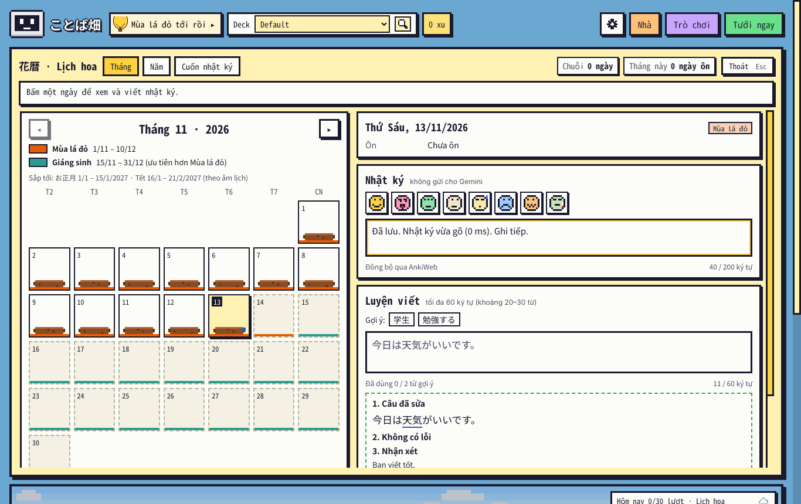
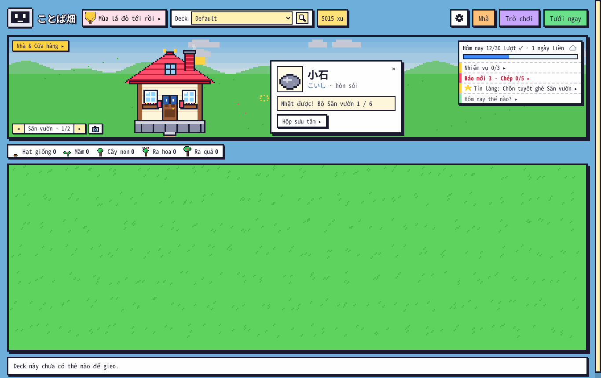
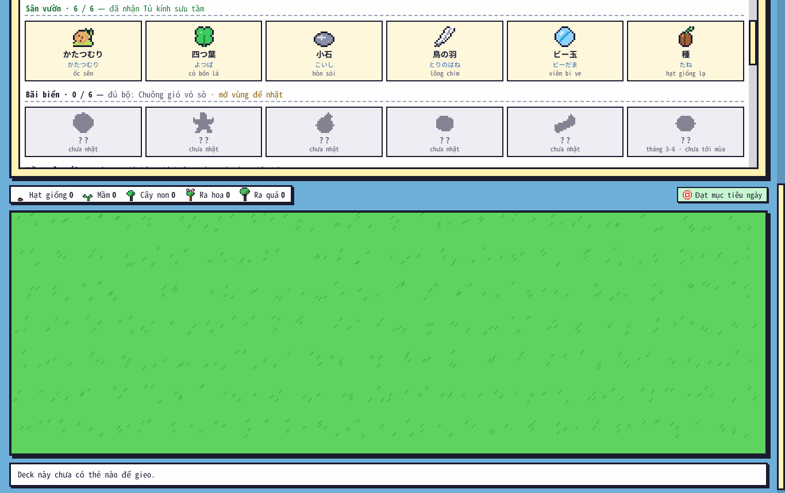
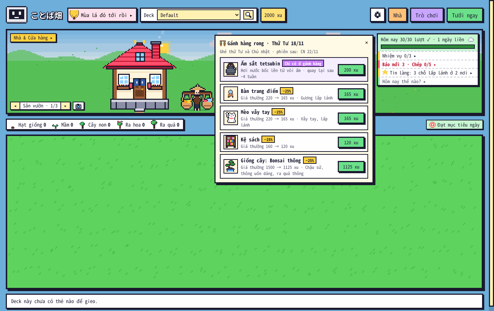

# Báo cáo kiểm thử · ことば畑 1.28.0 · 13/11/2026

**Kết luận: đủ điều kiện phát hành beta / bản cập nhật cho người đang dùng.** 9 lỗi của nhánh `audit/release-review-2026-11-12` đã sửa và mọi kịch bản tái hiện của nhánh đó chuyển xanh trên **Anki 26.9.4** và **23.10.1**; 1.28 (chỗ lấp lánh + Hộp sưu tầm, gánh hàng rong) có bộ test riêng, chạy trong Anki thật. Toàn bộ bộ test cũ chạy lại đều đạt. Phần **chưa kiểm** (cần máy thật của người dùng) ở cuối báo cáo — nên làm trước khi gọi là bản ổn định công khai.

Môi trường: Linux (Ubuntu 24.04, container), Anki **26.9.4** (Python 3.13, Qt 6.12) và **23.10.1** (Python 3.9, Qt 6.6), chạy offscreen, điều khiển webview qua DevTools (`tests/anki/cdp.js`). Mỗi kịch bản một thư mục Anki mới; kịch bản đổi hồ sơ chạy trên hồ sơ tạm. Gemini: lượt viết báo / sửa bài trong test là giả lập (giữ callback để chọn đúng thời điểm hoàn tất); `e2e.js` và `e2e_123.js` gọi được Gemini thật qua proxy của môi trường (prefetch giọng đọc).

## 1. Chín lỗi của nhánh audit 12/11

| Mã | Mức | Lỗi | Sửa | Trước → sau |
|---|---|---|---|---|
| F01 | P1 | Kết quả sửa bài về làm mất chữ nhật ký chưa tự lưu | `calendar.js`: bài sửa chỉ thay khung Luyện viết; dựng lại khung ngày thì lưu ngay chữ đang gõ, dựng bằng chữ đó, giữ con trỏ / focus | 6 ca đỏ → xanh (0 / 300 / 1000 ms) |
| F09 | P1 | Viết báo ở A, chuyển sang B: B bị trừ 100 xu | việc nền ghi chủ (hồ sơ); khác chủ thì ghi chờ, A mở lại mới tính gói | B 600 → 500 xu → **B giữ 600**, A −100 khi mở lại |
| F02 | P2 | Chia ngày 86400 giây sai ở ngày đổi giờ mùa hè | `ngay_core.py`: ngày Anki theo lịch địa phương cho chuỗi, Lịch hoa, tổng ngày, bù xu, vé | 21 ca đỏ → xanh |
| F03 | P2 | Chuỗi dài bị chặn ở 401 | đọc thêm lịch sử khi chuỗi chạm mép cửa sổ | 402 / 500 / 730 / 1000 ngày đúng |
| F05 | P2 | Tin làng tràn đáy, nằm ngoài cửa sổ sau resize | bảng `fixed`, cao tối đa = cửa sổ, cuộn trong bảng, đặt lại khi đổi cỡ | 2 ca đỏ → xanh |
| F06 | P2 | Một bản ghi đồ sai kiểu xoá trạng thái hai gian | kiểm từng bản ghi (`_eid`), lỗi bất ngờ vẫn giữ gian đã mở | 4 ca đỏ → xanh |
| F07 | P2 | Tin mốc học giữ tổng ngày cũ sau đồng bộ | khoá cache có số lượt ôn trước hôm nay, xoá cache ở hook đồng bộ / đóng hồ sơ | 2 ca đỏ → xanh |
| F08 | P2 | Hướng dẫn mở từ bảng khác ẩn mãi | luôn có nhịp chờ bảng đóng | 4 ca đỏ → xanh |
| F04 | P3 | 00:00 chào buổi sáng | 0 giờ là giờ hợp lệ | 1 ca đỏ → xanh |

| Bộ của nhánh audit | Trước (1.26.1) | Sau (1.28.0) · 26.9.4 | Sau · 23.10.1 |
|---|---:|---:|---:|
| `core_audit.py` (lõi, 779 ca) | 750/779 | **779/779** | (thuần Python) |
| `ui_audit.js` | 38/49 | **49/49** | **49/49** |
| `lifecycle_audit.js` | 5/10 | **10/10** | **10/10** |

`core_audit.py` nay nằm trong `run_all.sh` làm kiểm tra hồi quy. Ảnh sau khi sửa: [F01 · chữ còn sau lần lưu kế tiếp](anh/sau_sua_F01_03_after_next_save.png), [F05 · Tin làng sau khi thu cửa sổ 720 × 520](anh/sau_sua_F05_02_news_after_resize_720.png), [F08 · hướng dẫn hiện lại](anh/sau_sua_F08_help_disappeared.png), [F09 · vườn của B vẫn 600 xu](anh/sau_sua_F09_B_charged_for_A_job.png), [F04 · 00:00 chào buổi tối](anh/sau_sua_F04_midnight_says_morning.png) (tên file giữ như bộ audit để dễ so).

**Kịch bản hồi quy mở rộng** (`tests/anki/e2e_128_fix.js`, ngoài các ca của nhánh audit) — **26/26** trên cả 26.9.4 và 23.10.1: việc viết báo xong lúc **không có hồ sơ nào mở** (ghi chờ cho A, mở lại A mới −100 xu / gia hạn, file chờ trống); A → B → A rồi mới xong (tính ngay cho A, B không đổi); bài luyện viết của A xong khi đang ở B (nhật ký B không đổi); bộ gõ đang soạn chữ khi bài sửa về (ô nhật ký giữ nguyên phần tử, chữ, con trỏ, focus); Python gửi lại khung ngày khi chưa tự lưu (chữ còn và lưu được); Hướng dẫn mở từ Nhà; Tin làng qua 4 cỡ cửa sổ; chào ở 0 / 23,98 / 4 / 12 giờ; mua gánh hàng theo bảng của phiên đã qua bị từ chối.

## 2. Tính năng 1.28

| Bộ | Kiểm tra | Kết quả |
|---|---|---|
| `core/test_128.py` (offline) | danh mục, biên lượt ôn, chốt cảnh, bảo hiểm, đủ bộ, theo mùa, 1.000 ngày ngẫu nhiên, gánh hàng 2 năm, dữ liệu hỏng, `EventStore`, ví, **mã 1.26.1 thật (git) lưu đè ví có đồ mới**, Tin làng | **93/93** |
| `anki/e2e_128.js` · Anki 26.9.4 | bấm chuột thật, thẻ Nhặt được!, lệnh giả / bấm đúp, đủ bộ, Album, cửa hàng không bán món riêng, Tin làng dẫn tới, gánh hàng (phiên / mua / giảm giá / giống / thiếu xu / Đặt), 720 × 520, Hộp sưu tầm ở 1024 × 700 + 720 × 520, Lịch hoa, Đứng yên | **72/72** |
| `anki/e2e_128.js` · Anki 23.10.1 | (bản trước khi thêm 2 kiểm tra cửa sổ nhỏ) | **70/70** |
| `anki/release_sync.js` (máy 1 một ngày → tắt / mở Anki → máy 2 chỉ có collection) | thêm 10 lượt ôn "điện thoại" → nhặt chỗ lấp lánh, mua món riêng; máy 1 mở lại / máy 2 vẫn thấy Hộp sưu tầm + món trong kho | **47/47** (12 + 17 + 18) |

Một số chỗ test bắt được và đã sửa trong lúc làm: id quà bộ Sân vườn sai (đủ bộ không tặng được — thêm cơ chế tự tặng lại khi thiếu), cú bấm mở bảng gánh hàng bị chính click đó đóng lại, bảng gánh hàng che người bán (nay mở bên phải chỗ bấm), thẻ "Nhặt được!" còn treo khi đổi cảnh.

| Chỗ lấp lánh → nhặt được | Hộp sưu tầm | Gánh hàng rong |
|---|---|---|
|  |  |  |

Ảnh với bộ thẻ mẫu (cho README): `docs/anh/128_*.png` (`tests/anki/shots_128.js`).

## 3. Toàn bộ bộ test cũ chạy lại trên 1.28.0

`tests/run_all.sh` (offline, `ANKI_PY` = Anki 26.9.4, có `test_128.py` + `core_audit.py`): **TẤT CẢ OK**. Hai kiểm tra đọc mã nguồn được cập nhật vì mã đổi có chủ đích (`test_1261`: `_ai_done` tính gói theo đúng hồ sơ; `test_1253`: thêm một chỗ bấm có độ lệch dọc — chỗ lấp lánh).

| Anki 26.9.4 | Kết quả | Anki 26.9.4 | Kết quả |
|---|---:|---|---:|
| `e2e.js` | 24/24 | `e2e_1228.js` | 26/26 |
| `e2e_tour.js` | 12/12 | `e2e_123.js` | 65/65 |
| `e2e_114.js` | 34/34 | `e2e_124.js` | 23/23 |
| `e2e_115.js` | 21/21 | `e2e_125.js` | 30/30 |
| `e2e_116.js` | 15/15 | `e2e_1251.js` | 48/48 |
| `e2e_117.js` | 55/55 | `e2e_1253.js` (tắt hẳn / mở lại Anki) | 39/39 |
| `e2e_118.js` | 29/29 | `e2e_1255.js` | 48/48 |
| `e2e_119.js` | 55/55 | `e2e_1258.js` | 25/25 |
| `e2e_120.js` | 103/103 | `e2e_1259.js` | 36/36 |
| `e2e_121.js` | 46/46 | `e2e_126.js` | 39/39 |
| `e2e_122.js` | 64/64 | `e2e_1261.js` | 41/41 |
| `e2e_1223.js` | 49/49 | `e2e_kit23.js` | 10/10 |
| `e2e_1226.js` | 40/40 | `audit_edge.js` | 58/58 |
| `audit_full.js` (mua / dùng mọi thứ qua nút, + pha 15 món mới) | 183/183 | `audit.js` (đo bố cục mọi màn, 1366 × 768 + 1024 × 700) | 4 cờ cố ý cũ (dấu "…" ở Kệ báo), không lỗi JS / nhật ký lỗi |

`audit_full.js` / `audit_edge.js` lần đầu trượt 1 kiểm tra mỗi bộ vì kịch bản cũ coi mọi món ở tab Trang trí sân / Nội thất là món bán ở cửa hàng — quà Hộp sưu tầm và món gánh hàng **không bán ở cửa hàng** (đúng thiết kế). Đã chỉnh kịch bản bỏ qua các món đó và thêm pha đặt 15 món mới từ Kho đồ.

**Anki 23.10.1**: `e2e_128` 70/70, `e2e_1261` 41/41, `e2e_126` 39/39, `e2e_tour` 12/12, `e2e_1259` 36/36, `e2e_117` 55/55, `e2e_121` 46/46, `release_sync` 47/47, `ui_audit` 49/49, `lifecycle_audit` 10/10, `e2e_128_fix` 26/26.

Gói `kotoba_batake.ankiaddon` (1.28.0, 62 mục) giải nén ra khớp danh sách file của `kotoba_batake/` (trừ dữ liệu người dùng); `run_all.sh` chạy trên gói đã giải nén: **TẤT CẢ OK**.

## 4. Chưa kiểm — cần máy thật

- Windows / macOS, DPI 125–150 %, bộ gõ tiếng Nhật thật (Microsoft IME / macOS / IBus) khi đang gõ nhật ký lúc bài sửa về.
- Ngày đổi giờ mùa hè trên Windows / macOS (đã kiểm bằng biến `TZ` trên Linux cho New York, Berlin, Lord Howe).
- Đồng bộ AnkiWeb thật máy tính ↔ điện thoại: ôn trên điện thoại rồi đồng bộ → số chỗ lấp lánh trên máy tính tăng theo; nhặt ở máy A, đồng bộ, Hộp sưu tầm ở máy B.
- Đổi hồ sơ thật trong lúc Gemini thật đang viết báo (đã kiểm bằng việc nền giả lập + đổi hồ sơ thật trong Anki).

Danh sách 10 phút cho người dùng: `docs/kiem_thu/1.26.1/KIEM_TRA_MAY_THAT.md` + thêm 4 bước sau:
1. Ôn 10 thẻ (trên điện thoại cũng được, đồng bộ xong mở vườn) → thấy một chỗ lấp lánh, bấm → thẻ "Nhặt được!".
2. Nhà → Album → Hộp sưu tầm: món vừa nhặt có chữ Nhật + cách đọc + nghĩa.
3. Thứ Tư / Chủ nhật: người gánh hàng ở sân (hoặc Ga), mua thử một món rẻ, bấm "Đã mua · Đặt".
4. Đang gõ dở nhật ký thì bấm "Nhờ Gemini sửa" ở Luyện viết và gõ tiếp trong lúc chờ → chữ không mất.
