# Báo cáo kiểm thử + đánh giá phát hành · ことば畑 1.30.0 · 14/11/2026

## Kết luận

**Mức sẵn sàng: phát hành được cho người đang dùng (bản cập nhật / beta), sau khi bạn tự chạy danh sách 10 phút ở mục 6 trên máy thật.** Chưa nên coi là "đã kiểm đủ" cho Windows / macOS vì chưa có máy để thử.

| Tiêu chí | Đánh giá | Căn cứ |
|---|---|---|
| Lỗi chặn phát hành (mất dữ liệu, sai xu, hỏng vườn, Anki bật hộp lỗi) | **Không còn lỗi nào đã biết** | @OFFLINE@; hồi quy Anki thật ở mục 4; bấm bừa @FUZZN@ lệnh; ngẫu nhiên 4.200 thao tác |
| Dữ liệu cũ / máy còn bản cũ | **An toàn** | ví 1.30 qua mã thật 1.23 → 1.28 rồi về 1.30 không mất gì; kịch bản hai máy @REL26@ |
| Lịch FSRS | **Không đụng** | sinh hoạt, tường / sàn không ghi gì vào thẻ, revlog; không có xu thưởng |
| Tương thích Anki | **26.9.4 và 23.10.1 đạt** | bảng mục 4 |
| Tính năng mới đúng ý người dùng | **Chưa biết** | mọi chi tiết thiết kế của 1.30 là Claude chọn, người dùng chưa xem (danh sách ở `PHAT_TRIEN.md` mục 7) |
| Windows / macOS, màn hình DPI cao, AnkiWeb thật | **Chưa kiểm** | chỉ có Linux không màn hình |

Điểm cần biết trước khi phát hành:
- Lần kiểm tra này tìm ra **một lỗi có từ các bản trước**: lệnh nội bộ có tham số JSON sai dạng làm Anki bật hộp lỗi (mục 3, lỗi 1). Người dùng bình thường không tự gửi được lệnh như vậy (trang không bao giờ gửi), nhưng đã sửa để chắc.
- Hai kịch bản cũ **trượt ngẫu nhiên** (không phải lỗi sản phẩm) đã được làm cho chắc (mục 3, lỗi 7–8). Trước đây chúng có thể báo đỏ oan khoảng 1/12 lần chạy hoặc khi chạy test vào ban đêm.

Môi trường: Linux (Ubuntu 24.04, container), Anki **26.9.4** (Python 3.13, Qt 6.12) và **23.10.1** (Python 3.9, Qt 6.6), chạy không màn hình, điều khiển webview qua DevTools (`tests/anki/cdp.js`). Mỗi kịch bản một thư mục Anki mới.

## 1. Bốn việc người dùng giao

| Việc | Đã làm | Kiểm bằng |
|---|---|---|
| 1. Sinh hoạt trong nhà / ngoài nhà theo đồ + giờ | StackChan sống trong nhà: 67 việc (29 trong nhà — ưu tiên ×3, 11 ngoài sân, 27 ở vùng), mỗi việc một câu tiếng Nhật, Sổ sinh hoạt; thú nuôi tìm món ưa thích | `test_130.py`, `test_life.js`, `e2e_130.js` mục 6–11 |
| 2. Thiết kế bên trong nhà + việc riêng của vùng | 12 giấy dán tường + 9 sàn cho từng gian, vẽ mẫu riêng 16×16; mỗi vùng 3–6 việc riêng (tắm biển, tắm suối nước nóng, viếng đền, vớt cá vàng, ngồi thiền, đợi tàu…) | `test_130.py`, `e2e_130.js` mục 1–5, 10 |
| 3. Giao diện ấm cúng, chill | nền kem thay trắng (80 chỗ), vệt nắng, đốm cỏ, ánh đèn vàng buổi tối, bụi nắng ở cửa sổ | `audit.js` (đo bố cục mọi màn), ảnh trước / sau bên dưới |
| 4. Kiểm tra kỹ + thêm kịch bản + đánh giá | 6 bộ test mới (mục 2), 8 lỗi tìm ra và sửa (mục 3), chạy lại toàn bộ bộ cũ (mục 4) | báo cáo này |

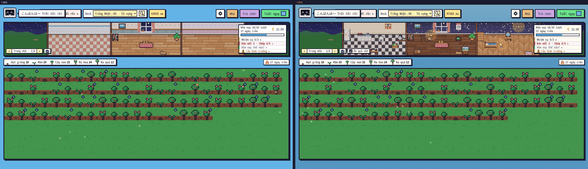

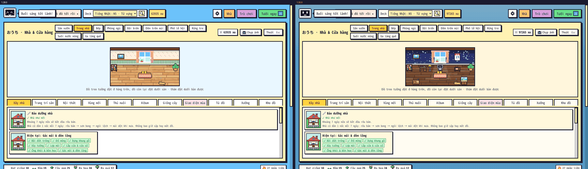

(Ảnh "sau" chụp trên vườn đã mua thêm tường, sàn và vài món nội thất, nên khác ảnh "trước" cả ở đồ đạc chứ không chỉ ở màu nền.)

| 23:00 ngủ trên giường | 7:00 pha trà | Bấm StackChan |
|---|---|---|
| 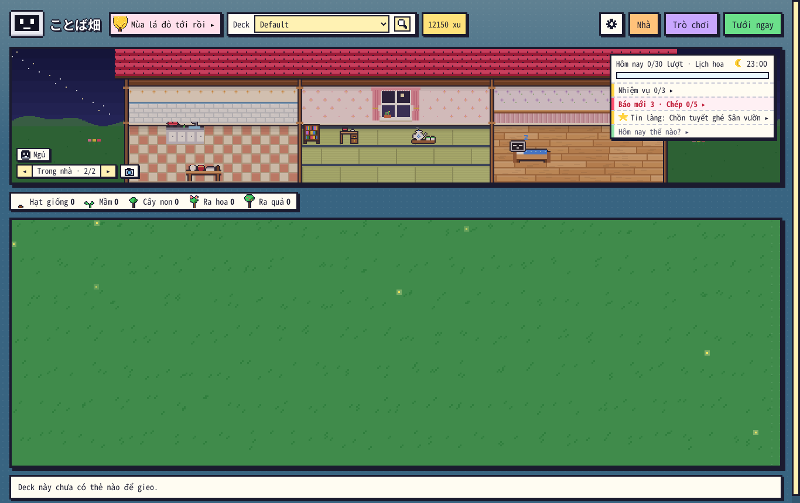 | 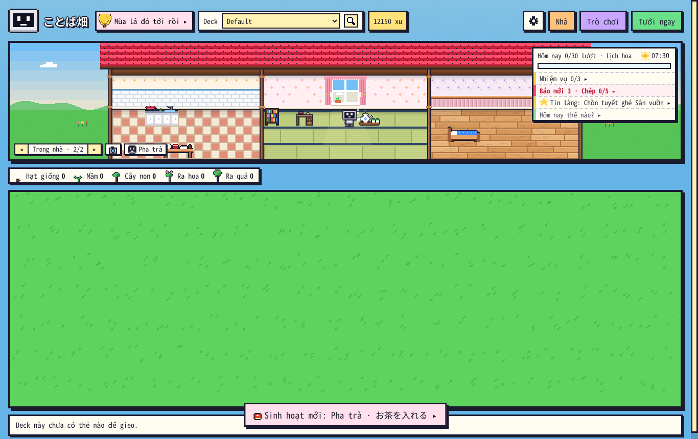 | 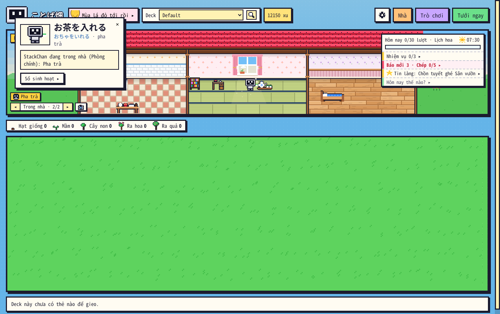 |

| Tắm biển | Tắm suối nước nóng | Sổ sinh hoạt |
|---|---|---|
| 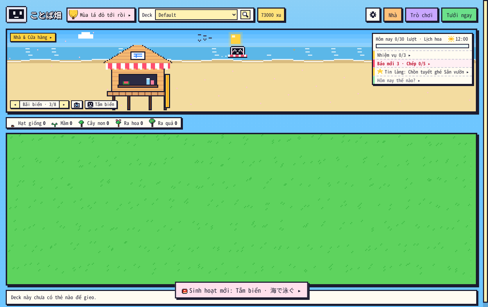 | 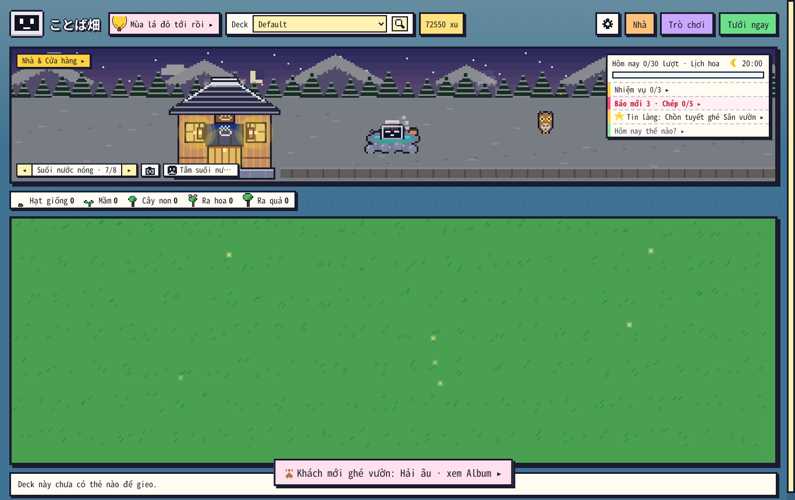 | 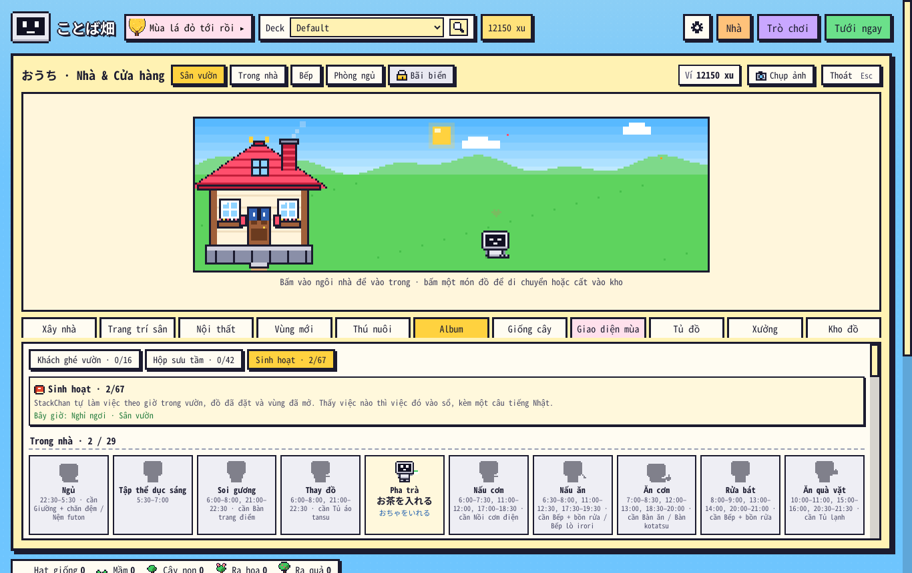 |

| Tường & sàn | Mẫu tự vẽ lát Phòng ngủ | Cửa sổ hẹp 1024 px |
|---|---|---|
| 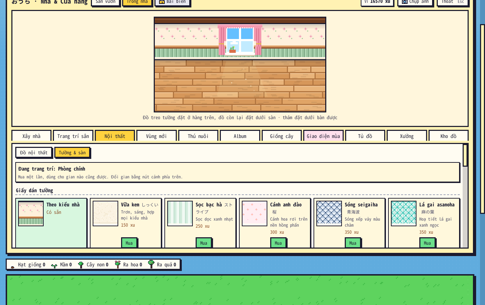 | 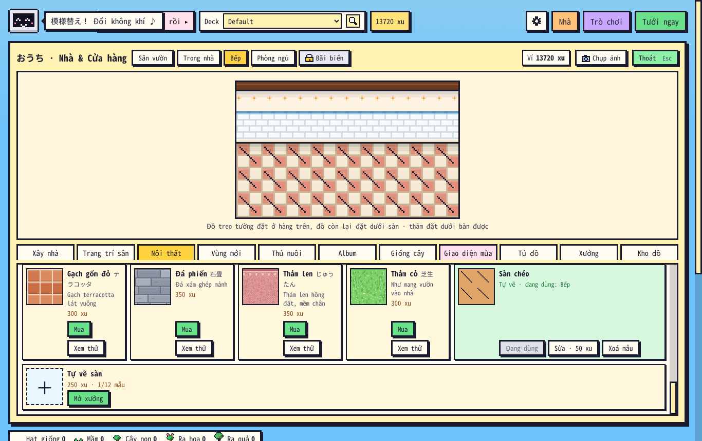 | 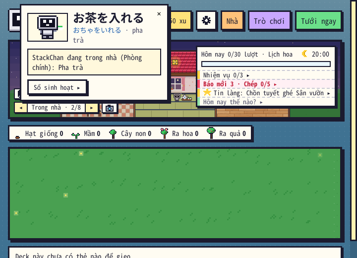 |

## 2. Kịch bản mới (ngoài bộ có sẵn)

| Bộ | Cách kiểm | Kết quả |
|---|---|---|
| `core/test_130.py` (offline) | tường / sàn: danh mục, dữ liệu rác, mua / dùng / gian chưa mở, mẫu tự vẽ, **mã 1.28 thật đọc + lưu ví**; sinh hoạt: 67 việc đủ câu Nhật / hình / món cần, `can_do`, sổ, lịch cả ngày; **tham số sai kiểu** ở mọi hàm nhận JSON từ trang | **133/133** |
| `core/test_life.js` (offline, node) | `life.js` với đồng hồ giả: chọn việc theo giờ / đồ / thời tiết, ưu tiên trong nhà, đi → làm → ghi sổ một lần, không ghi khi không ở màn chính, đồ đổi ô → đi theo, mọi tư thế dựng được | **47/47** |
| `core/test_ngau_nhien.py` (offline) | **12 hạt × 350 thao tác ngẫu nhiên** trên ví thật, sau mỗi thao tác xét bất biến (xu ≥ 0, đặt ≤ có, gian bên mở cả đôi, mẫu đang dùng là mẫu đang có, lưu rồi đọc lại giống hệt) + giá trừ đúng từng xu | **đạt, 0 vi phạm / 4.200 thao tác** |
| `core/test_ban_cu.py` (offline) | ví 1.30 đầy đủ cho **mã thật** của 1.23, 1.24, 1.25, 1.26.1, 1.28 (lấy từ git) đọc → mua → lưu, rồi 1.30 đọc lại | **đạt: không mất món / gian / mẫu / khoá nào** |
| `anki/e2e_130.js` | bấm chuột thật trong Anki: Tường & sàn, Xưởng vẽ mẫu, StackChan theo giờ, thẻ, Sổ, vùng, tắt, Đứng yên, cửa sổ nhỏ, đặt / cất đồ → việc đổi ngay, chip ở 4 cỡ cửa sổ | **76/76** (26.9.4) · @E130_2310@ (23.10.1) |
| `anki/e2e_fuzz.js` — **bấm bừa** | ~1.100 lệnh cầu nối ngẫu nhiên mỗi hạt (id lạ, số âm, JSON hỏng / `null` / mảng, chuỗi 1.800 ký tự, thiếu tham số…); sau mỗi 40 lệnh: không lỗi chưa bắt, Anki không bật hộp lỗi, cửa sổ còn mở, ví hợp lệ, xu không tăng bất thường | lần đầu **4/6 — tìm ra lỗi 1**; sau khi sửa **6/6** với hạt 130, 7 (1.120 lệnh), 2026, 99 (2.400 lệnh) trên 26.9.4 và hạt 130 trên 23.10.1 |
| `anki/release_sync.js` (mở rộng) | máy 1 dùng một ngày (thêm: mở rộng nhà, dán tường Bếp, vẽ mẫu sàn lát Phòng ngủ, ghi Sổ sinh hoạt) → tắt hẳn Anki, mở lại → **máy 2 chỉ có collection** (như sau khi đồng bộ AnkiWeb) | @REL26@ (26.9.4) · @REL2310@ (23.10.1) |

## 3. Lỗi tìm ra trong lúc kiểm tra (đều đã sửa)

| # | Lỗi | Có từ | Tìm bằng | Sửa |
|---|---|---|---|---|
| 1 | Lệnh cầu nối có tham số JSON **không phải đối tượng** (`home:seed:rule:null`, `home:pet:name:[]`, `paper:q:5`, `fields:save:null`…) ném `AttributeError` chưa bắt → **Anki bật hộp lỗi** | các bản trước (8 chỗ) | `e2e_fuzz.js` | `_json_obj` trong `__init__.py`: không phải đối tượng → coi như JSON hỏng (bỏ qua, ghi nhật ký Báo lỗi). `test_130.py` giữ: không còn chỗ `json.loads` rồi `.get` ngay |
| 2 | `craft_save` nhận loại / id sai kiểu (mảng) ném `TypeError` | các bản trước | thử sai kiểu ở lõi | kiểm kiểu → "Cỡ hoặc loại món đồ không hợp lệ" |
| 3 | Thông báo "Sinh hoạt mới" hiện **đè lên nút chấm điểm** lúc đang ôn thẻ (việc được tính là đã thấy dù dải cảnh đang khuất) | 1.30 (lúc làm) | `e2e_130.js` | chỉ tính "đã thấy" khi ở màn chính và cảnh nằm trong khung nhìn; thông báo chỉ hiện ở màn chính |
| 4 | Ngồi lên ghế / mép bồn: hình StackChan không vẽ (toạ độ NaN) | 1.30 (lúc làm) | `test_life.js` | tính chiều cao món từ `bottom − top` |
| 5 | Đặt / cất đồ xong, StackChan **chưa biết** việc mới (phải mở lại vườn); đồ đổi ô thì vẫn đứng cạnh ô cũ | 1.30 (lúc làm) | đọc lại mã | lệnh `home:place / move / take / zone / nha / build / pet / uzone` trả kèm việc làm được; `GardenLife.rethink()` tìm lại chỗ đứng |
| 6 | Ở cửa sổ **1366 × 768 / 1280 × 720** cảnh Trong nhà: chip tên việc nằm đè lên góc dưới trái Bếp, **che StackChan đang ăn cơm ở bàn ăn**; tên việc dài bị cắt chữ ("Tắm suối nư…") | 1.30 (lúc làm) | `audit.js` (cờ "cắt chữ"), chụp ở 6 cỡ cửa sổ | chip lên trên hàng nút khi ở cảnh Trong nhà, chỉ còn hình khi vẫn chạm nhà, rộng tối đa 180 px (tên dài nhất 171 px); `e2e_130` kiểm ở 1024 / 1280 / 1366 / 1920 px |
| 7 | Kịch bản `e2e_121` "đom đóm sáng trên nền tối" trượt ngẫu nhiên (~1/12 lần chạy): chụp một lần, trúng lúc cả đàn đang nhấp nháy dịu | 1.21 (kịch bản) | hồi quy, đo 60 mẫu trên cả 1.28 và 1.30 | kịch bản lấy lúc sáng nhất trong 2,5 giây. Không đổi mã sản phẩm |
| 8 | Kịch bản `e2e_1258` "đèn trời bay" trượt khi máy chạy test đang là **ban đêm** (so màu chính xác, lớp tối ban đêm làm lệch màu) — bản 1.28 cũng trượt y hệt | 1.25.8 (kịch bản) | hồi quy lúc 0:30 | kịch bản giữ trời 10 giờ trước khi đếm màu. Không đổi mã sản phẩm |

Ngoài ra chỉnh trong lúc làm: StackChan che TV / đè món khác → đứng cạnh món, tránh ô có đồ; Đền trên núi và Phố lễ hội thêm việc không cần đồ (Rung chuông đền, Ăn ở quầy hàng) để mở vùng là có việc ngay.

Ba kịch bản cũ được cập nhật vì giao diện đổi **có chủ đích**: `e2e_128` (tab Album nay có ba nút), `e2e_121` (ô ⚙ đổi tên thành "Thú nuôi, khách, StackChan sinh hoạt"), `test_1253.py` (thêm một chỗ bấm có độ lệch dọc).

## 4. Toàn bộ bộ test cũ chạy lại trên 1.30.0

`tests/run_all.sh` (offline, `ANKI_PY` = Anki 26.9.4; gồm `core_audit.py` 779 ca của nhánh audit 12/11): @OFFLINE@.

@BANG_26@

@DONG_2310@

@GOI@

## 5. Rủi ro còn lại

| Rủi ro | Mức | Ghi chú |
|---|---|---|
| Thiết kế 1.30 chưa được người dùng duyệt (StackChan là người ở, 3 phút một việc, giá tường / sàn, nền kem…) | Trung bình | không làm ảnh phác trước; mọi thứ tắt / đổi lại được: ⚙ → Giao diện tắt sinh hoạt, "Theo kiểu nhà" trả gian về cũ. Nền kem không có nút tắt — nếu không thích thì đổi một biến CSS `--kb-paper` |
| Chưa chạy trên Windows / macOS / DPI 125–150 % | Trung bình | hình StackChan vẽ theo ô pixel nguyên như thú nuôi, khách nên ít khả năng nhoè; cần xem bằng mắt |
| Hai máy cùng ghi Sổ sinh hoạt trước khi đồng bộ | Thấp | bản ghi sau thắng; việc bị mất sẽ ghi lại khi thấy lần nữa (không có xu / thưởng gắn với sổ) |
| Máy còn bản ≤ 1.28 | Thấp | không thấy tường / sàn mới và sinh hoạt, dữ liệu vẫn giữ (đã test với mã thật 1.23 → 1.28). Bản ≤ 1.13 chưa test |
| Tốc độ vẽ | Thấp | mỗi khung thêm một nhân vật 24×16 + ≤ 14 hạt; `e2e_1253` (đo tốc độ vẽ cỡ Lớn) @E1253@ |
| Việc theo mùa (hoa anh đào, đào măng, đom đóm, quét lá) chỉ thấy đúng tháng | Thấp (đúng thiết kế) | Sổ ghi gợi ý "Tháng 3–4"; không mất gì khi lỡ |

## 6. Chưa kiểm — cần máy thật (10 phút)

Làm thêm vào danh sách `docs/kiem_thu/1.26.1/KIEM_TRA_MAY_THAT.md`:

1. Cập nhật add-on, mở vườn: xu, đồ đã đặt, thú nuôi, Hộp sưu tầm còn nguyên; nền các bảng màu kem, chữ vẫn rõ.
2. Dải cảnh ◂ ▸ sang **Trong nhà**: thấy StackChan đang làm một việc hợp giờ; chip cạnh nút chụp ảnh ghi tên việc. Bấm vào StackChan → thẻ có câu tiếng Nhật.
3. ⚙ → Trời & giờ trong vườn → **Giờ game: 1 ngày = 6 phút**, để vài phút: buổi sáng pha trà / nấu ăn (nếu có ấm trà / bồn rửa), sau 22:30 StackChan đi tới giường rồi ngủ (cần có giường / futon). Xong đổi lại "Theo giờ thật". (Mục "Cố định: Ban đêm" là 22:00 nên chưa tới giờ ngủ — StackChan còn đọc sách, xem TV.)
4. Nhà → Nội thất → **Tường & sàn**: rê chuột xem thử, mua một mẫu, đổi gian, "Theo kiểu nhà". Thử thẻ "Tự vẽ sàn" → Mở xưởng.
5. Nhà → Album → **Sinh hoạt**: việc vừa thấy đã vào sổ.
6. Một vùng đã mở (Bãi biển ban ngày, Suối nước nóng buổi tối): bấm chip → **Gọi về đây** → StackChan sang làm việc riêng của vùng.
7. Bấm **Tưới ngay**, ôn vài thẻ: không có thông báo "Sinh hoạt mới" chen vào lúc ôn.
8. ⚙ → Giao diện → tắt "Thú nuôi, khách, StackChan sinh hoạt": StackChan và chip biến mất; bật lại thì có lại.
9. Đồng bộ AnkiWeb, mở máy thứ hai (nếu có): tường / sàn và Sổ sinh hoạt đi theo.
10. Windows / macOS (nếu có): hình StackChan nét, không nhoè; thẻ câu tiếng Nhật không tràn khỏi cửa sổ.

Thấy gì lạ: Tools → ことば畑 · Báo lỗi → Chép.
