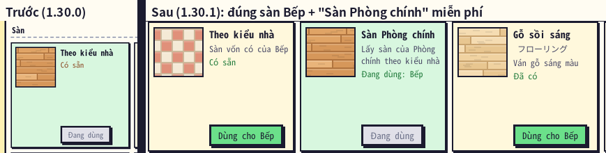
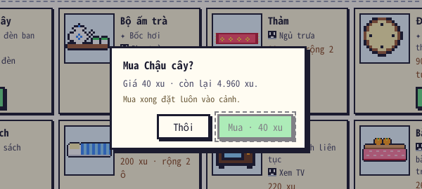
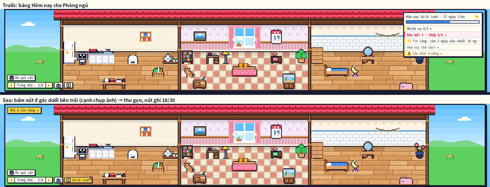
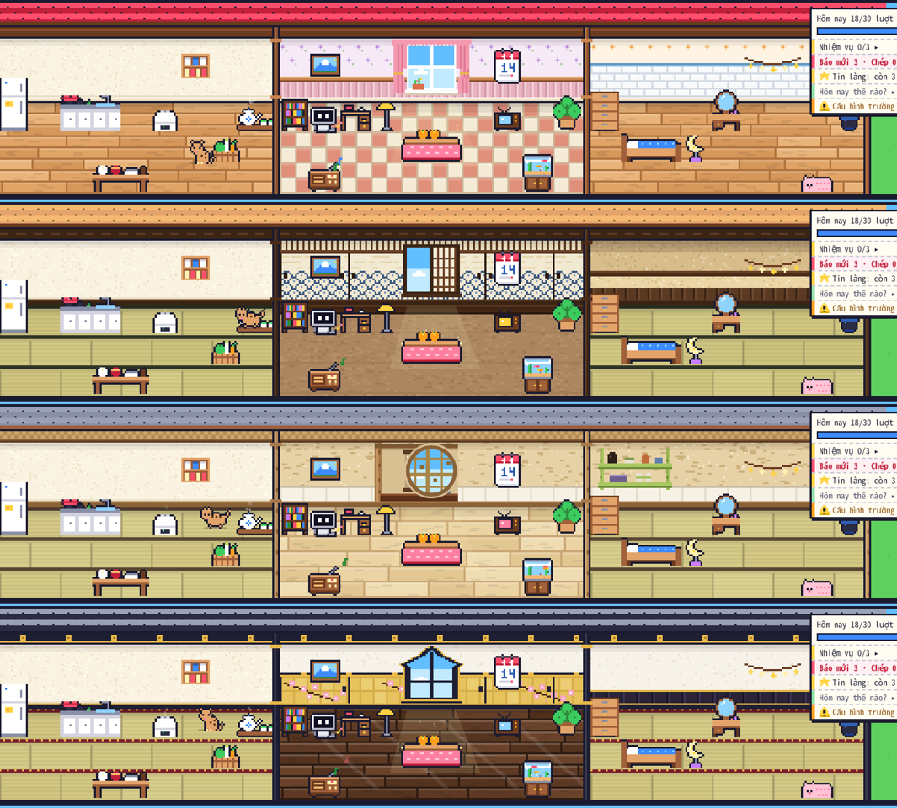

# Báo cáo kiểm thử + việc còn lại trước khi phát hành · ことば畑 1.30.1 · 14/11/2026

## Kết luận

**Về mã: sẵn sàng phát hành** — không còn lỗi đã biết làm mất dữ liệu / sai xu / hỏng vườn; mọi bộ test cũ + mới đều đạt trên gói đã đóng (mục 3). **Còn lại là những việc chỉ bạn làm được** (mục 5): xem 1.30.1 trên máy thật khoảng 10–15 phút, quyết hai chuyện nhỏ (Facebook, email công khai), rồi đăng gói.

Môi trường kiểm: Linux (container), **Anki 26.9.4** (Python 3.13, Qt 6.12), chạy không màn hình, điều khiển webview qua DevTools (`tests/anki/cdp.js`), mỗi kịch bản một thư mục Anki mới. Chưa có Windows / macOS.

## 1. Bảy việc bạn nêu

| Bạn nói | Đã làm | Kiểm bằng |
|---|---|---|
| "mấy con thú có chạy ngang hẳn qua nhà luôn" | Thủ phạm ở sân là **khách ghé vườn** đi bộ (mèo hoang, cáo, hươu…): 1/3 lượt đi vào từ mép trái — hiện ra ngay trên mái nhà — và lúc về đi ngang qua nhà ra mép trái. Nay khách đi bộ vào / về bằng **mép phải** của phần cảnh đang thấy (dải cảnh màn chính rộng thì vào từ ngoài mép, không còn hiện ra giữa đồng cỏ). Trong cảnh **Trong nhà**, thú (nhất là Shiba) chạy một mạch xuyên 3 gian và có thể vào cả gian chưa mở (tối) → nay đi dạo **trong gian đang ở**, thỉnh thoảng mới sang gian bên qua cửa, không vào gian tối. | `test_1301.js` (240 lượt khách, 50 phút thú trong nhà), `e2e_1301.js` mục 6 |
| "báo lỗi, góp ý thêm liên lạc của tớ … email" | Cửa sổ **Báo lỗi** ghi email + nút **Gửi email…** (chép sẵn báo cáo rồi mở chương trình thư); ⚙ có **Góp ý qua email…** + dòng email; lưu file Góp ý hình nhắc gửi qua email; README. Không tự gửi gì lên mạng. | `test_1301.py`, `e2e_1301.js` mục 4 |
| "thêm xác nhận mua đồ … phòng trường hợp double click" | Mọi nút trả xu mở hộp **"Mua …? · Giá N xu · còn lại M xu" [Thôi] [Mua · N xu]**. 0,45 giây đầu mọi lần bấm bị bỏ qua → bấm đúp chỉ mở hộp. Esc / bấm ra ngoài = Thôi, Enter = đồng ý. Có ở: mua đồ, xây nhà, mở rộng nhà, kiểu nhà, vùng, đồ mặc, biểu cảm, +1 cái, tường / sàn, sửa nhà, cho ăn, nhận nuôi, giống cây, mã chia sẻ, giao diện mùa, vé giữ chuỗi, gói báo, gánh hàng rong, Xưởng (tạo / vẽ lại). Tắt được: ⚙ → Giao diện → "Hỏi trước khi trả xu". | `e2e_1301.js` mục 1, 2, 5 (bấm đúp bằng chuột thật) |
| "có nút thu gọn bảng thông báo, tránh chèn giao diện. ở dưới chỗ các thanh trong nhà, ảnh chụp" | Nút mới ở **hàng nút góc dưới bên trái dải cảnh** (sau ◂ Trong nhà ▸ và nút chụp ảnh) + nút **"–"** ngay trên bảng Hôm nay. Thu gọn thì bảng ẩn hẳn, nút ghi số lượt (vd. 18/30) và có chấm đỏ khi có báo mới / quà nhiệm vụ. Nhớ theo máy. | `e2e_1301.js` mục 3 (đo: bảng mở che nhà 91 px ở 1366 × 768, thu gọn 0 px) |
| "sửa cách diễn đạt … (ví dụ 21 ngày có ôn là gì)" | Tin làng: "Học thêm 3 ngày nữa là tròn 100 ngày học", "Hôm nay là ngày học thứ 100!", "Ôn tiếp 2 ngày nữa là tròn 30 ngày liền". Lịch hoa: "Ôn liền · 27 ngày", "Tháng này · **đã ôn 21/30 ngày**", "Liền lâu nhất", "Số ngày đã ôn", "hoa nở rộ: ôn đủ 30 lượt trong ngày". Giao diện mùa: "Đổi 7 ngày ôn liền" (trước ghi "dùng hết chuỗi đang có" — dễ hiểu nhầm là mất chuỗi). Bỏ chữ "add-on" ở Góp ý hình. Đã rà ~1.900 câu chữ trên giao diện + ~130 câu báo lỗi phía Python; phần còn lại đọc ổn. | `test_1301.py`, `test_126.py`, `e2e_120.js`, `e2e_1259.js` |
| "nhà mặc định, sàn bếp khác sàn phòng khách và phòng ngủ … không thay cho bếp được" | Ô **"Theo kiểu nhà"** giờ vẽ đúng nền của gian đang chọn (trước luôn vẽ sàn phòng chính — nên ở Bếp nó ghi "Đang dùng" mà hình lại là sàn gỗ). Thêm các nền vốn có của gian khác, **miễn phí, dùng cho gian nào cũng được**: Tường Phòng chính / Bếp / Phòng ngủ, Sàn Phòng chính / Bếp; đổi kiểu nhà thì các nền này đổi theo. | `test_1301.py`, `e2e_1301.js` mục 2 (đo điểm ảnh sàn Bếp ở màn chính) |
| "cải tiến giao diện … hoàn thiện và chỉnh chu nhất" | Nút Mua khi thiếu xu ghi **"Thiếu N xu"** (trước chỉ xám, phải rê chuột mới biết); tên tiếng Nhật trên thẻ không bị cắt giữa từ (フロ / ーリング); ⚙ gom "Báo lỗi… · Góp ý qua email…" một hàng; hộp hỏi cùng kiểu pixel (viền đen 3 px, bóng cứng); soát bố cục mọi màn ở 1366 × 768 và 1024 × 700 (`audit.js`). | ảnh dưới, `audit.js` |

## 2. Lỗi tìm ra (đều đã sửa)

| # | Lỗi | Có từ | Tìm bằng | Sửa |
|---|---|---|---|---|
| 1 | Ô "Theo kiểu nhà" ở Bếp / Phòng ngủ vẽ nền phòng chính | 1.30.0 | ảnh của bạn | vẽ theo gian đang chọn |
| 2 | Nền vốn có của một gian không dùng được cho gian khác | 1.30.0 (thiếu) | bạn nêu | mẫu nhà miễn phí `w_h…` / `f_h…` |
| 3 | Khách đi bộ hiện ra trên mái nhà, về thì đi ngang qua nhà / công trình | 1.21 | bạn nêu, đọc mã `guests.js` | vào / về mép phải |
| 4 | Ở dải cảnh màn chính rộng (≥ 1366 px), khách hiện ra / biến mất giữa đồng cỏ (mép 256 điểm ảnh, không phải mép đang thấy) | 1.21 | `test_1301.js` | dùng mép phải đang thấy (`visTo`) |
| 5 | Thú trong nhà chạy xuyên 3 gian liên tục và **vào được gian chưa mở rộng** (tối) | 1.24 | mô phỏng 50 phút trong `test_1301.js` | đi theo gian, ~1/12 lần sang gian bên, không vào gian tối |
| 6 | Thú đang sang gian bên mà hết giờ đi thì ngồi / ngủ ngay trên cột ngăn gian; món ưa thích (thảm, gối ôm…) đặt sát cột thì thú nằm lên cột | 1.24 / 1.30 | `test_1301.js` (412 khung; món sát cột: 3.707 khung trên mã 1.30.0) | đủ thời gian đi tới nơi; đang ở cửa thì đi vào hẳn rồi mới nghỉ; chỗ cạnh món ưa thích giữ trong gian của món |
| 7 | Đồng hồ máy lùi (chỉnh giờ) → khách / thú "đi ngược" văng ra xa (bước thời gian âm) | 1.14 / 1.21 | `test_1301.js` (mèo ở x = 686.997) | bước thời gian ≥ 0 |
| 8 | Bảng Hôm nay che Phòng ngủ ở cảnh Trong nhà (cửa sổ ≤ ~1900 px) | 1.25 | bạn nêu | nút thu gọn |
| 9 | Nút "Mua" xám không ghi lý do (thiếu xu) | 1.17 | ảnh của bạn | "Thiếu N xu" |
| 10 | Tên tiếng Nhật trên thẻ bị cắt giữa từ | 1.21 | xem ảnh chụp | không ngắt dòng giữa chữ Nhật |
| 11 | Câu "Mở bằng chuỗi thì dùng hết chuỗi đang có" khiến tưởng mất chuỗi ôn | 1.8 | rà câu chữ | "chuỗi không đứt" |

Không phải lỗi sản phẩm nhưng cần ghi lại cho kịch bản test: phím Esc giả bằng `dispatchEvent` không đặt `cancelable: true` thì Anki đóng cửa sổ vườn (tưởng như trang treo) — đã ghi vào `tests/README.md`.

## 3. Kết quả chạy test

| Bộ | Kết quả |
|---|---|
| `tests/run_all.sh` (offline, 44 bộ, có `test_1301.py` 49/49, `test_1301.js` 11/11) | **TẤT CẢ OK** trên thư mục mã nguồn và trên **gói đã đóng** |
| `audit.js` (đo bố cục mọi màn, 1366 × 768 + 1024 × 700) | lần đầu: nút "–" mới lệch cỡ chữ với nút thời tiết cùng hàng → đã sửa; nhật ký lỗi add-on trống |
| Anki 26.9.4, mã nguồn (trước khi đóng gói) | `e2e_115` 21/21 · `e2e_121` 46/46 · `e2e_114` 34/34 · `e2e_124` 23/23 · `e2e_125` 30/30 · `e2e_130` 76/76 · `audit_full` 183/183 · `audit_edge` 58/58 · `e2e_128` 72/72 · `e2e_fuzz` 6/6 · `e2e_122` 64/64 · `e2e_tour` 12/12 · `e2e_1301` 41/41; `e2e_120` / `e2e_1259` / `e2e_117` trượt đúng 1 mục mỗi bộ **vì đổi chữ cố ý** (chip Lịch hoa, ⚙ thêm nút email) → đã sửa kịch bản |
| Anki 26.9.4, **gói 1.30.1 đã giải nén** | `e2e_1301` 41/41 · `e2e_130` 76/76 · `e2e_126` 39/39 · `e2e_1261` 41/41 · `e2e_121` 46/46 · `e2e_120` 103/103 · `e2e_1259` 36/36 · `e2e_117` 55/55 · `e2e_115` 21/21 · `e2e_114` 34/34 · `e2e_124` 23/23 · `e2e_tour` 12/12 · `audit_full` 183/183 (mua / dùng mọi thứ qua nút) · `audit_edge` 58/58 (ít xu / bấm đúp / cửa sổ nhỏ) · `e2e_128` 72/72 · `e2e_fuzz` 6/6 (bấm bừa) · `release_sync` **58/58** (hai máy) — **tất cả đạt**; nhật ký lỗi add-on trống, không lỗi JS |
| Kịch bản sửa cho chắc | `release_sync.js` đòi Sổ sinh hoạt đúng 1 việc → trượt khi chạy lúc 10:00–17:30 (StackChan thật tự "Ngồi ghế nghỉ" trên ghế vừa đặt); nay so với số việc Python đã ghi |

## 4. Danh sách kiểm tra trên máy thật (khoảng 15 phút)

Làm danh sách 10 phút của 1.30.0 (`docs/kiem_thu/1.30.0/BAO_CAO.md` mục 6) nếu chưa làm, rồi thêm:

1. Nhà → Nội thất → Tường & sàn, chọn **Bếp**: ô "Theo kiểu nhà" là gạch Bếp; bấm **Sàn Phòng chính → Dùng cho Bếp** (không mất xu). Sang Phòng chính thử **Sàn Bếp**. Đổi kiểu nhà (nếu đã mua kiểu khác): sàn đổi theo.
2. Bấm **đúp** thật nhanh vào nút Mua một món rẻ: chỉ hiện hộp hỏi, xu chưa đổi. Bấm Thôi. Bấm Mua lại → Mua: trừ đúng giá, vào chế độ đặt.
3. ⚙ → Giao diện & chế độ học → Màn chính: thấy "Bảng Hôm nay" và "Hỏi trước khi trả xu". Thử tắt hỏi → mua ngay; bật lại.
4. Màn chính, cảnh **Trong nhà**: bấm nút bảng ghi chú ở góc dưới bên trái (cạnh nút chụp ảnh) → bảng Hôm nay ẩn, thấy hết Phòng ngủ; nút ghi số lượt. Tắt Anki, mở lại: vẫn thu gọn. Bấm lại để hiện.
5. ⚙ → **Góp ý qua email…**: máy có mở chương trình thư (Thunderbird) với địa chỉ của bạn không? Nếu bạn quen Gmail trên web thì máy sẽ chỉ chép địa chỉ — báo mình nếu muốn đổi thành mở trang Gmail. Tools → ことば畑 · Báo lỗi → **Gửi email…** tương tự.
6. Để vườn mở vài phút ở Sân vườn ban ngày: khách đi bộ (mèo hoang…) đi vào từ bên phải, không đi qua nhà. Nếu có Shiba / mèo ở trong nhà: thú đi dạo trong một gian, thỉnh thoảng mới sang gian bên.

Thấy gì lạ: Tools → ことば畑 · Báo lỗi → Gửi email….

## 5. Còn gì phải làm trước khi phát hành

**Chỉ bạn làm được / cần bạn quyết:**

| Việc | Vì sao | Mức |
|---|---|---|
| Chạy danh sách mục 4 trên máy thật | máy test không có màn hình, chương trình thư, AnkiWeb thật | cần |
| **Facebook**: gửi đường dẫn nếu muốn thêm | bạn nói "facebook cũng được" nhưng chưa có link — mới thêm email | tuỳ bạn |
| Email `maitrongdung10@gmail.com` sẽ **công khai** trong add-on + README trên GitHub / AnkiWeb | có thể nhận thư rác; nếu muốn có thể dùng một địa chỉ riêng cho góp ý | xác nhận |
| Xem lại các chi tiết 1.30 / 1.30.1 Claude tự chọn (`PHAT_TRIEN.md` mục 7): hộp hỏi có phiền không (có thể tắt ở ⚙), thông báo "Sinh hoạt mới" có dày không, giá tường / sàn | chưa ai duyệt bằng mắt | nên |
| Đồng bộ AnkiWeb thật giữa 2 máy (tường / sàn, sổ sinh hoạt, Hộp sưu tầm) | chỉ giả lập được bằng chép collection (`release_sync.js` 58/58) | nên |
| Windows / macOS / màn hình DPI 125–150 % | chưa có máy | nếu có người thử |
| Đăng AnkiWeb: chỉ tải `kotoba_batake.ankiaddon` (**không** tải `kotoba_batake_test.ankiaddon` — Công cụ test), mô tả + ảnh lấy từ `README.md`; `manifest.json` ghi Anki 23.10 → 26.9.4 | | cần |
| Gộp nhánh vào `main` (PR) và gắn thẻ phiên bản `v1.30.1` | | cần |

**Không còn việc mã nào chặn phát hành.** Việc tiếp theo sau phát hành vẫn là 1.27 (cây lấp lánh, quẻ omikuji, lịch trời Nhật + 歳時記, mốc học — `PHAT_TRIEN.md` mục 10.0).

## 6. Rủi ro còn lại

| Rủi ro | Mức | Ghi chú |
|---|---|---|
| Máy không có chương trình thư mặc định | Thấp | nút Gửi email chỉ chép địa chỉ + nhắc dán vào Gmail; báo cáo vẫn chép / lưu file được như cũ |
| Hộp hỏi làm chậm người mua nhiều đồ một lúc | Thấp | tắt được ở ⚙; Enter để đồng ý nhanh |
| Cửa sổ ≤ ~1100 px: hàng nút góc trái (◂ cảnh ▸, chụp ảnh, thu gọn, chip StackChan) vẫn đè lên góc nhà ngoài sân | Thấp | có từ trước; không che nút bấm nào |
| Bản ≤ 1.30.0 trên máy khác gặp mẫu nhà mới (`w_h…` / `f_h…`) | Rất thấp | 1.30.0 chưa phát hành; bản 1.14–1.28 giữ nguyên khoá `decor` |
