# Báo cáo 1.30.3 · giao diện ấm, câu chữ đồng bộ, kiểm tra ngoài kịch bản có sẵn · 14/11/2026

Bạn nhờ 4 việc: (1) đọc lại mã, kiểm tra chi tiết tính năng / giao diện / logic, **test kỹ hơn ngoài các kịch bản có sẵn**; (2) **giao diện đẹp hơn, chill, ấm**; (3) **câu chữ đồng bộ, đơn giản** — cái nào nhìn là hiểu thì bỏ giải thích; (4) **còn tính năng gì chưa làm**.

## Kết luận

- **Tìm ra 3 lỗi** (đều đã sửa, mục 3), nặng nhất: **mở bảng ⚙ rồi bấm Esc là đóng luôn cả cửa sổ vườn**, và **để vườn mở qua đêm thì sáng hôm sau thẻ Hôm nay / nhiệm vụ / báo Gemini vẫn đứng ở hôm qua**.
- **Giao diện ấm hơn** (mục 1): mực nâu cacao thay xanh đen, nút màu dịu, nền trang màu giấy đổi theo giờ (trời chỉ còn ở trong cảnh), hoa dại nhỏ trên cỏ trống. Mọi màu nay nằm ở **một chỗ** (biến đầu `web/garden.css`) — bạn thấy chưa ưng tông nào thì mình đổi một dòng là xong.
- **Câu chữ** (mục 2): số xu một kiểu viết ("4.860 xu"), thiếu xu luôn "Thiếu N xu", nút huỷ luôn "Huỷ", ~20 câu gợi ý ngắn lại.
- **Nút chuyển nền trang Giấy ấm / Trời xanh** ở ⚙ (sau khi bạn xem ảnh), đêm của Giấy ấm là xanh chàm, không còn xám.
- **Test mới** (mục 4): bấm phím bừa, bấm chuột bừa, đổi cỡ cửa sổ liên tục, đo độ tương phản chữ thật, qua ngày mới, Esc ở từng bảng nổi + một bộ soát ~2.000 câu chữ tự động. Bộ cũ vẫn đạt.
- **Còn chưa làm** (mục 5): 1.27 và 1.29 trong lộ trình, vài đề xuất chờ bạn chọn.
- **Bảng màu mới là mình chọn, bạn chưa xem** — xem ảnh trước / sau ở mục 1 rồi cho mình biết có ưng không.

## 1. Giao diện ấm, chill

| Trước (1.30.2) | Sau (1.30.3) |
|---|---|
| Viền / bóng / chữ màu xanh đen `#1b1b2f` | **Mực nâu cacao** `#3a2a22` — vẫn viền 3 px, bóng cứng, không bo góc |
| Nền trang xanh trời chói `#6ec6ff` | **Hai kiểu, chọn ở ⚙ → Nền trang**: **Giấy ấm** (mặc định) — ngày kem `#efe2c6`, chạng vạng tím hồng, bình minh / hoàng hôn ánh cam, đêm **xanh chàm** `#232a4a`; **Trời xanh** — xanh trời theo giờ như bản cũ |
| Nền bảng vàng chanh `#fff2b3`, nền trò chơi xanh băng | Vàng bơ `#fcefc9`, giấy kem `#fffaf0`, nền trò chơi xanh lá sương `#eaf3ea` |
| Nút xanh lá chói / cam / tím đậm | Xanh bạc hà (Tưới ngay, Mua), cam đào (Nhà), tím oải hương (Trò chơi); 4 nút chấm thẻ dịu cùng tông |
| Ô chọn xanh dương, ô đánh dấu xanh lá, thanh âm lượng hồng | Cùng một màu xanh lá dịu |
| Ô cỏ trống phẳng một màu | Thỉnh thoảng có **bông hoa dại** (trắng / hồng / vàng) hoặc **cỏ ba lá** (chỉ ô không có cây; giao diện mùa có hoa / lá riêng) |
| Bong bóng lời linh vật đè lên tên vườn + chip "Mùa lá đỏ tới rồi" | Bong bóng nằm ngay dưới linh vật |
| Rê chuột: nút đổi màu tức thì | Đổi màu nhẹ trong 0,15 giây (bấm vẫn lún ngay) |

Mọi chữ vẫn đủ tương phản (chuẩn WCAG: chữ thường ≥ 4,5 : 1) — đo trên 11 màn bằng kịch bản mới (mục 4). Hình pixel (nhà, cây, thú…) không đổi.

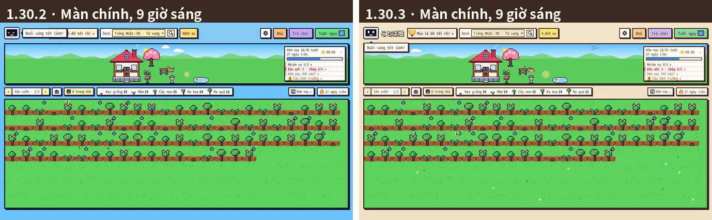

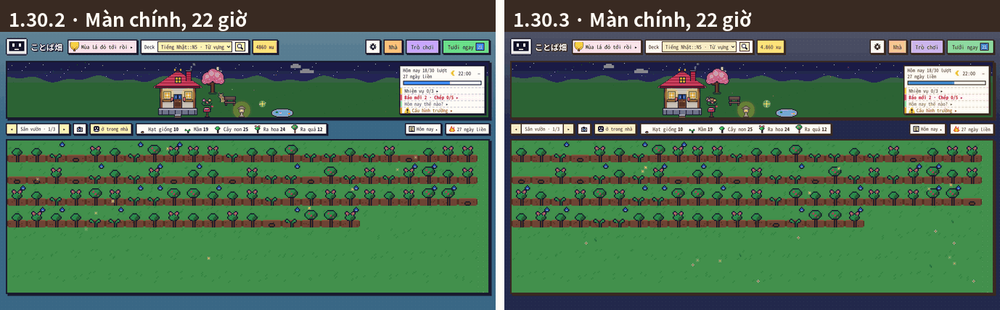

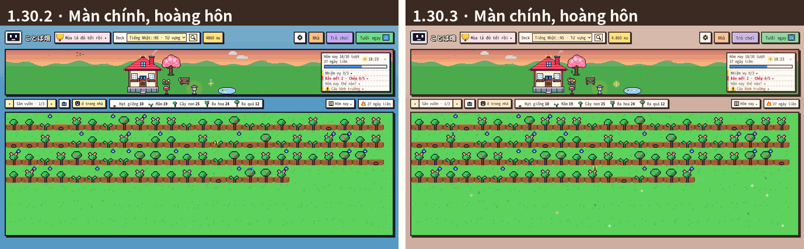

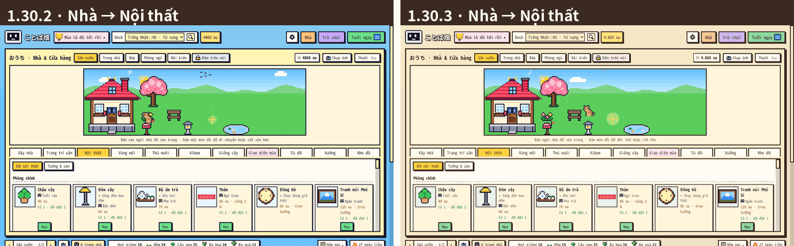

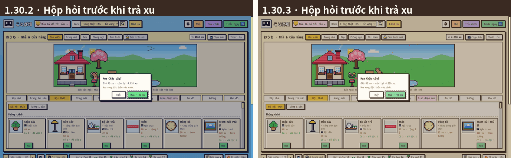

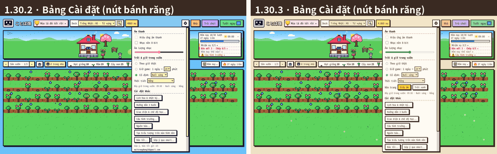

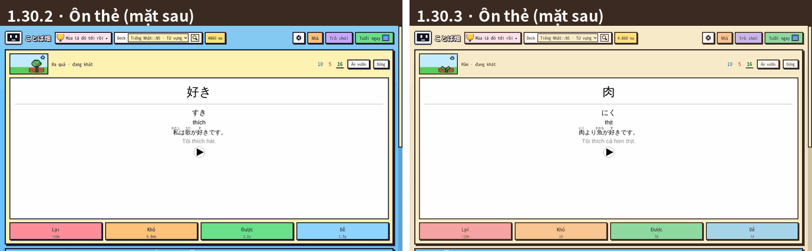

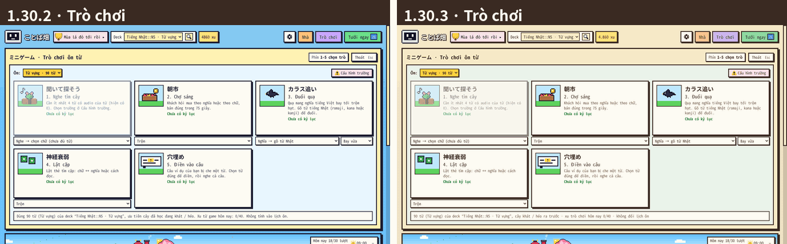

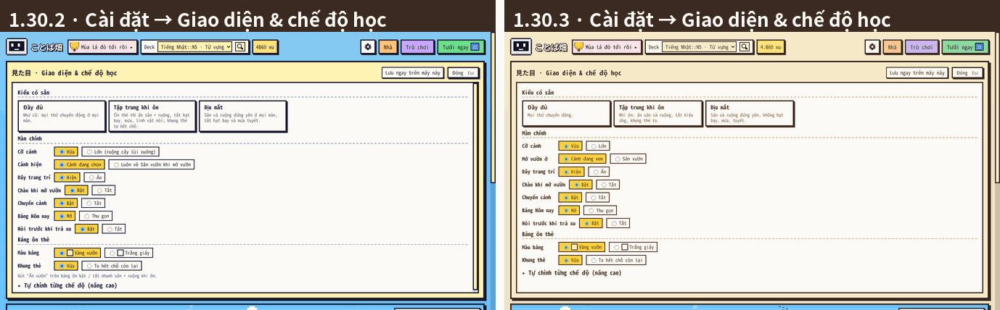

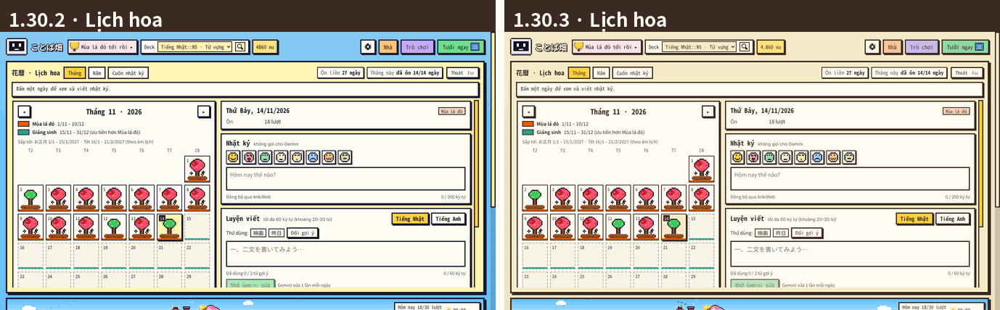

### Nút chuyển nền trang (sau khi bạn xem ảnh: "nền buổi tối màu xám không đẹp, màu xanh cũng đẹp luôn nên làm nút chuyển đổi")

- ⚙ → Trời & giờ trong vườn → **Nền trang: Giấy ấm / Trời xanh**. Nhớ theo máy (như giờ / thời tiết), tắt Anki mở lại vẫn giữ.
- **Giấy ấm** ban đêm nay là **xanh chàm**, lúc chạng vạng đi qua **tím hồng** — không còn xám. (Ảnh ban đêm lần trước còn bị chụp đúng lúc nền đang chuyển màu trong 2 giây nên trông xám hơn thật; nay chụp lại sau khi chuyển xong.)
- **Trời xanh** giữ đúng màu nền của bản cũ; viền nâu, nút dịu, nền bảng kem vẫn như kiểu Giấy ấm.

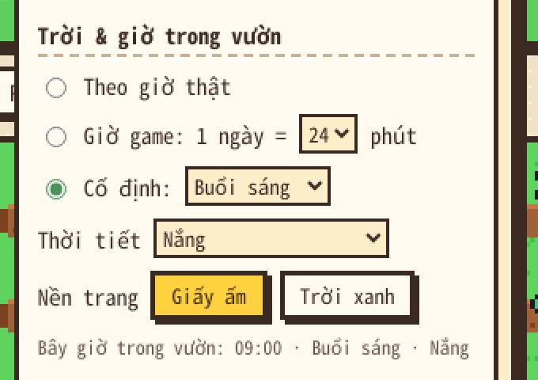

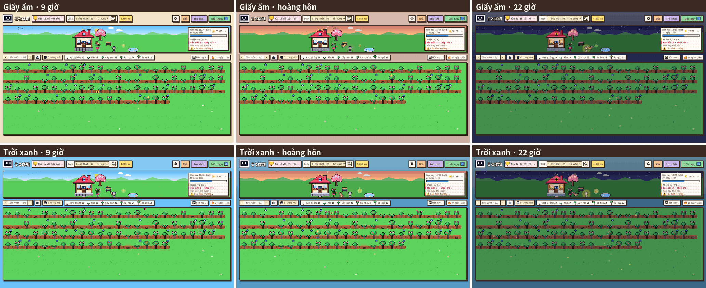

## 2. Câu chữ

| Chỗ | Trước | Sau |
|---|---|---|
| Số xu | thanh trên "4860 xu", hộp hỏi "còn lại 4.820 xu", thẻ "2000 xu" | **"4.860 xu"** ở mọi chỗ |
| Thiếu xu | "Còn thiếu 50 xu" / "Thiếu 50 xu" / "Chưa đủ xu (đang có 120)" / "Chưa đủ xu: cần 1000, đang có 500." | **"Thiếu 50 xu"**; báo lỗi "Thiếu 500 xu (cần 1.000 xu)." |
| Nút huỷ hộp hỏi | "Thôi" (chỗ khác "Huỷ") | **"Huỷ"** |
| Gợi ý cảnh Nhà | "Bấm vào ngôi nhà để vào trong · bấm một món đồ để di chuyển hoặc cất vào kho" | "Bấm ngôi nhà để vào trong · bấm món đồ để dời chỗ hoặc cất kho" |
| … chưa có nhà | "Xây nhà ở tab “Xây nhà” · bấm một món đồ để di chuyển hoặc cất vào kho" (đang đứng ngay tab Xây nhà) | "Chưa có nhà · xây ở tab Xây nhà" |
| … đang đặt đồ | "bấm vào ô trống (xanh) để đặt · Esc để huỷ" / "(Esc để thôi)" | "bấm ô xanh để đặt · Esc: huỷ" |
| Menu Trò chơi | "Dùng 90 từ (Từ vựng) của deck “…”, ưu tiên cây đã học đang khát / héo. Xu từ game hôm nay: 0/40. Không tính vào lịch ôn." | "90 từ (Từ vựng) của deck “…”, cây khát / héo ra trước · xu trò chơi hôm nay 0/40 · không đổi lịch ôn" |
| Thú nuôi | "Cho ăn vài xu mỗi ngày; quên thì bé đi chơi, cho ăn là về. Thân dần: Quen hơi 7 ngày · Thân thiết 21 ngày · Tri kỷ 50 ngày." | "Mỗi ngày cho ăn vài xu. Quên thì bé đi chơi, cho ăn là về." (mức thân thiết ở chú thích rê chuột) |
| Giống cây | "Gieo ở đâu · ưu tiên: tag → loại note → deck (deck con trước rồi tới deck cha)" | "Gieo ở đâu" (thứ tự ở chú thích rê chuột) |
| Xưởng | "Tự vẽ pixel, hoặc chọn một tấm ảnh để tự chuyển thành pixel art rồi sửa lại." | "Tự vẽ, hoặc chọn một tấm ảnh để chuyển thành pixel rồi sửa." |
| ⚙ Giao diện | "Đầy đủ — Như cũ: mọi thứ chuyển động ở mọi màn." · "Lớn (ruộng cây lùi xuống)" · "Cảnh hiện: Cảnh đang chọn / Luôn về Sân vườn khi mở vườn" · dòng giải thích nút Ẩn vườn | "Đầy đủ — Mọi thứ chuyển động." · "Lớn" · "Mở vườn ở: Cảnh đang xem / Sân vườn" · bỏ dòng giải thích (nhìn nút là hiểu) |
| Báo | "Bấm từ gạch chân để tra nghĩa. Gạch liền: từ đã học. Gạch chấm: từ mới." · chip "Xu nhận 0" · "Chọn báo muốn nhận và nguồn báo." | "Bấm từ gạch chân để tra nghĩa · gạch liền: từ đã học · gạch chấm: từ mới" · chip "Xu 0" · "Chọn báo muốn nhận và ai viết báo." |
| Gói báo quá trần | "Gói còn 44 ngày — gần hết rồi hãy gia hạn" | "Gói còn 44 ngày — giữ tối đa 60 ngày phía trước" |
| Nhiệm vụ | "Nhiệm vụ đổi mỗi ngày (theo giờ qua ngày của Anki). Ôn ở màn ôn của Anki cũng được tính." | "Nhiệm vụ đổi mỗi ngày. Ôn ở màn ôn của Anki cũng được tính." |

Soát tự động ~2.000 câu trên giao diện (`tests/core/test_1303.py`): không còn chữ "add-on" (trừ đường dẫn menu Tools → Add-ons), "Thôi", "Mùa & Lễ hội", "nhấn", "click", emoji màu, "Còn thiếu … xu", số xu viết kiểu cũ. Phần còn lại đọc ổn — các bản 1.17.1, 1.19.1, 1.30.1 đã rà gọn từ trước.

## 3. Lỗi tìm ra (đều đã sửa)

| # | Lỗi | Có từ | Tìm bằng | Sửa |
|---|---|---|---|---|
| 1 | **Mở bảng ⚙ (hoặc bấm biểu tượng thời tiết trên thẻ Hôm nay) rồi bấm Esc → cả cửa sổ vườn đóng** (bảng ⚙ không "nhận" phím Esc nên Anki tưởng Esc dành cho cửa sổ) | 1.13 | kịch bản bấm phím bừa (phím thứ 282) | Esc chỉ đóng bảng ⚙; ⚙ mở trên bảng Nhà thì Esc lần 1 đóng ⚙, lần 2 đóng Nhà |
| 2 | **Để cửa sổ vườn mở qua giờ sang ngày của Anki** (vd. để Anki mở qua đêm): thẻ Hôm nay, nhiệm vụ, chỗ lấp lánh, Tin làng, màn chào và **báo Gemini của ngày mới** đứng ở hôm qua tới khi có lượt ôn | từ lâu | đọc mã | Mỗi phút xem ngày Anki đã đổi chưa → dựng lại vườn một lần (Anki đang đồng bộ thì đợi); mở lại cửa sổ đang mở (Ctrl+Shift+K / nút ことば畑) cũng xét ngay; chào ngày mới nếu đang ở màn chính (không chào đè lên bảng đang mở) |
| 3 | Bong bóng lời linh vật đè lên tên vườn + chip giao diện mùa (cắt chữ "…á đỏ tới rồi ▸"), cửa sổ 720 px đè cả ô Deck + xu | từ lâu | xem ảnh chụp, kịch bản đo | bong bóng ở ngay dưới linh vật |

Chạy kịch bản mới trên **bản cũ 1.30.2**: trượt đúng 3 lỗi trên — bong bóng đè ở cả 3 cỡ cửa sổ (1366: tên vườn + chip; 720: chip + ô Deck + xu); không có cơ chế sang ngày; Esc ở ⚙ **và ở nút thời tiết trên thẻ Hôm nay** (mở cùng bảng ⚙) → "CỬA SỔ VƯỜN BỊ ĐÓNG".

## 4. Test "ngoài kịch bản có sẵn"

| Bộ | Kiểm gì | Kết quả |
|---|---|---|
| `tests/anki/e2e_1303.js` (mới, Anki 26.9.4 thật) | **độ tương phản chữ** đo trên chữ thật ở 11 màn (ngày / đêm, ⚙, Nhà 3 tab, hộp hỏi, Trò chơi, Báo, Lịch hoa, Giao diện); bong bóng không đè ở 3 cỡ; **qua ngày mới**; **Esc ở 7 bảng nổi**; **500 phím bừa** (cửa sổ không đóng, không quá một bảng, xu không âm); **300 lần bấm chuột bừa** (mọi lần trừ xu đều qua hộp hỏi); **đổi cỡ cửa sổ 24 lần** 720 × 520 → 2560 × 1440 khi đang mở bảng; cửa sổ rất lớn / rất nhỏ | **49/49** |
| `tests/core/test_1303.py` (mới, offline) | bảng màu (đủ biến, không còn mã màu rời, tương phản tính từ biến), nền trang hai kiểu (chạy `sky.js` thật, quét 96 mốc giờ: Giấy ấm không lúc nào xám đục, Trời xanh như cũ), soát ~2.000 câu chữ, số xu JS = Python, cơ chế qua ngày, Esc ở ⚙, hoa dại | **54/54** |
| `tests/run_all.sh` (45 bộ offline, có bộ mới) | | **TẤT CẢ OK** trên mã nguồn và trên gói đã đóng |
| Kịch bản Anki thật cũ (13 bộ) | e2e_1301 45/45 · e2e_130 76/76 · e2e_122 64/64 · e2e_125 30/30 · e2e_123 65/65 · e2e_1259 36/36 · e2e_128 72/72 · e2e_1251 48/48 · e2e_120 103/103 · e2e_126 39/39 · e2e_117 55/55 · e2e_tour 12/12 · audit_edge 58/58 | **đều đạt** (3 bộ lần đầu trượt vì còn khớp chữ cũ — "Xu từ game", "gần hết", "Còn thiếu" — đã sửa kịch bản) |
| `audit.js` (đo bố cục mọi màn, 1366 × 768 + 1024 × 700, trên gói) | tràn, cắt chữ, nút lệch cỡ / kiểu trong hàng | chỉ 4 cờ cố ý cũ (dấu "…" ở Kệ báo), như 1.30.2; nhật ký lỗi trống |
| Báo trên gói | `e2e_kit23` (dòng gợi ý "· ▶ để nghe"), `e2e_119` | 10/10 · 55/55 |
| Gói `kotoba_batake.ankiaddon` 1.30.3 (giải nén) | `run_all.sh` + `e2e_1303` + `e2e_1301`; sau khi thêm nút Nền trang: `run_all.sh` + `e2e_1303` + `e2e_1253` (cài đặt trời còn sau khi tắt Anki) + `e2e_117` + `e2e_tour` + `audit.js` | **TẤT CẢ OK** · 41/41 · 45/45; lần 2: TẤT CẢ OK · 49/49 · 39/39 · 55/55 · 12/12 · chỉ 4 cờ cố ý cũ |

Test cũ phải sửa theo chữ mới (không phải lỗi): `test_1225`, `test_122`, `test_125`, `test_128`, `test_130`, `test_1251` ("Thiếu N xu"), `audit_edge`, `e2e_122` / `e2e_125` ("5.000 xu", "2.000 xu"), `e2e_123` ("Mở vườn ở"), `e2e_128`, `e2e_1251`, `e2e_1259`.

## 5. Còn chưa làm

**Đã chốt trong lộ trình (07/11), chưa làm:**

| Bản | Nội dung |
|---|---|
| **1.27** (việc tiếp theo) | **Cây lấp lánh** (vài cây đến hạn phát sáng, tưới thì có quà nhỏ), **rút quẻ omikuji** mỗi ngày, **lịch trời Nhật** (trăng thật theo ngày, 24 tiết khí 二十四節気, mưa sao băng, sổ 歳時記), **kỷ niệm & mốc học** (100 ngày học, 1.000 lượt…). Ảnh phác cũ (07/11) cần vẽ lại trên giao diện mới cho bạn duyệt trước. |
| **1.29** | **Nhạc làng** — tự soạn chuông làng 8–16 nốt, phát ở màn chào / báo mới / đủ mục tiêu; nhạc nền theo buổi — + **thêm hiệu ứng** (nắng xiên buổi sáng, sương sớm, gió thổi lá, bụi lấp lánh khi mua / đặt đồ, vòng sáng khi cây lên giai đoạn, đom đóm theo mùa, pháo hoa nhỏ khi xong 3 nhiệm vụ). |

**Đề xuất chờ bạn chọn** (`docs/de_xuat/1.28/DE_XUAT_TINH_NANG.md`):
- **Báo mẫu không cần khoá** — người mới đọc thử một số báo trước khi lấy khoá Gemini (nên làm trước khi công khai).
- Đổi nhiệm vụ "Tưới liền 10 cây không bấm Lại" thành "Ôn 10 thẻ đến lượt" (nhiệm vụ cũ có thể khiến né nút Lại — FSRS cần chấm thật).
- Thú đi dạo mang **bưu thiếp** về (một từ đã học hôm qua + câu ví dụ), **tóm tắt tuần**, **bữa sáng ở Bếp**, **đọc tiếp báo** đúng chỗ đang đọc.

**Ý tưởng cũ chưa làm** (`PHAT_TRIEN.md` mục 10): radio / podcast, đĩa nhạc của bạn, bạn qua thư, số ôn tập cuối tuần, hiệu ứng tự chế, làng & hàng xóm, Gemini viết lại số hôm nay, thêm lễ (Setsubun, Hinamatsuri…), vùng tự tạo có việc riêng cho StackChan.

**Trước khi công khai** (không phải tính năng): đường dẫn Facebook (chưa có), file LICENSE cho repo, thử Windows / macOS / đồng bộ AnkiWeb thật, ảnh giới thiệu ở `README.md`: đã chụp lại 18 ảnh chính (vườn, ôn thẻ, Nhà, trò chơi, báo, Lịch hoa, Xưởng, 8 giao diện mùa, các vùng) theo bảng màu mới; ảnh 1.24–1.30 (nhà 3 gian, StackChan, Hộp sưu tầm…) và video `docs/video/tour.*` còn bảng màu cũ — chụp lại khi bạn đã chốt màu.

## 6. Bạn xem giúp (khoảng 5 phút)

1. Mở vườn ban ngày và buổi tối (⚙ → Trời & giờ → Cố định): nền trang màu giấy, viền nâu, nút dịu — **có thấy ấm / dễ chịu hơn không?** Chưa ưng chỗ nào (đậm quá, nhạt quá, muốn nền xanh trời như cũ…) thì nói mình, đổi rất nhanh.
2. Bấm ⚙ rồi Esc: chỉ bảng ⚙ đóng, vườn vẫn mở.
3. Mua một món: hộp hỏi có "Huỷ", số xu "4.860 xu".
4. Nếu tiện: để Anki + vườn mở qua giờ sang ngày (mặc định 4:00 sáng), sáng ra thấy thẻ Hôm nay về 0 và màn chào ngày mới.
