# Báo cáo 1.31.0 · chỉ nút "Nhà & Cửa hàng" mở cửa hàng, đồ tự vẽ cho StackChan, chuỗi từ lúc cài · 14/11/2026

Bạn nhờ 5 việc: (1) chỉ vào Nhà & Cửa hàng khi bấm mục "Nhà & Cửa hàng"; (2) thêm phần thiết kế đồ cho StackChan; (3) StackChan đang sinh hoạt có đổi đồ được không; (4) kiểm tra kỹ + thêm test, kịch bản ngoài bộ có sẵn; (5) kiểm tra chuỗi khi mới cài — chuỗi của Anki có "dính" vào chuỗi của ことば畑 không, mới cài thì chuỗi phải là 0.

## Kết luận

- **Chuỗi: có dính** — bản cũ đếm chuỗi bằng cả lịch sử ôn của Anki, nên ai đã ôn Anki 40 ngày liền thì vừa cài ことば畑 đã thấy "41 ngày liền". **Đã sửa**: chuỗi tính từ lúc cài, mới cài là **0**, ôn lượt đầu tiên là 1 ngày (mục 1).
- **Bảng Nhà chỉ mở bằng nút "Nhà & Cửa hàng ▸"** (cùng nút Nhà trên cùng và phím N). Bấm cỏ, nhà, gian trong nhà, vùng không mở gì nữa. Bấm thú nuôi / khách thì hiện thẻ nhỏ có nút vào xem (mục 2).
- **Tự vẽ đồ cho StackChan**: Tủ đồ → Tự vẽ → Mũ / Mặt / Cổ (vẽ thẳng lên hình StackChan ở Xưởng) hoặc Vỏ (chọn hai màu) (mục 3).
- **StackChan đang sinh hoạt mặc cùng bộ đồ** với StackChan góc trái — cả đồ có sẵn lẫn đồ tự vẽ. Câu hỏi "có làm được không": **được, đã làm** (mục 3).
- **Test mới**: kịch bản Anki thật `e2e_131` (chuột / phím thật, có cả **cài mới hoàn toàn** trên một collection đã ôn lâu), bộ offline `test_131.py` + `test_131.js`, thêm vào bộ thao tác ngẫu nhiên và ma trận "máy khác còn bản cũ" (mục 4). Bộ cũ chạy lại đều đạt (sau khi sửa 4 kịch bản cũ theo cách bấm mới).
- **Mọi chi tiết (giá, lưới vẽ, thẻ nhỏ, cách tính chuỗi cho người đã dùng bản cũ) là mình chọn, bạn chưa xem** — xem ảnh bên dưới rồi cho mình biết chỗ nào muốn đổi.

## 1. Chuỗi ngày khi mới cài

| Trước (≤ 1.30.3) | Sau (1.31.0) |
|---|---|
| Đếm chuỗi bằng cả lịch sử ôn của collection: cài vào máy đã ôn Anki 40 ngày liền → "41 ngày liền" ngay | Đếm từ **lúc ことば畑 chạy lần đầu** trên collection: cài mới → **0**; ôn một lượt sau đó → **1 ngày liền** |

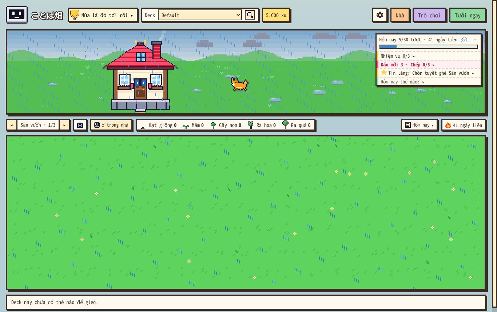

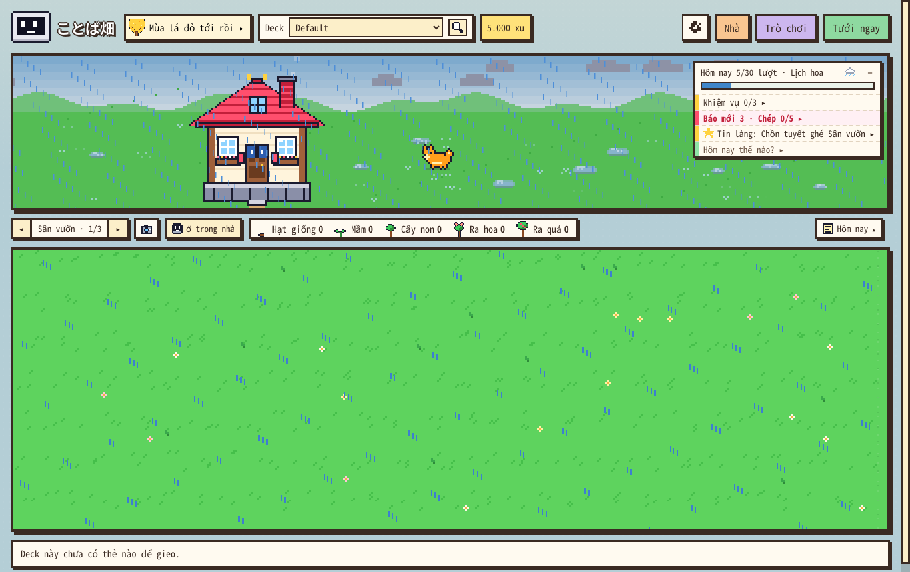

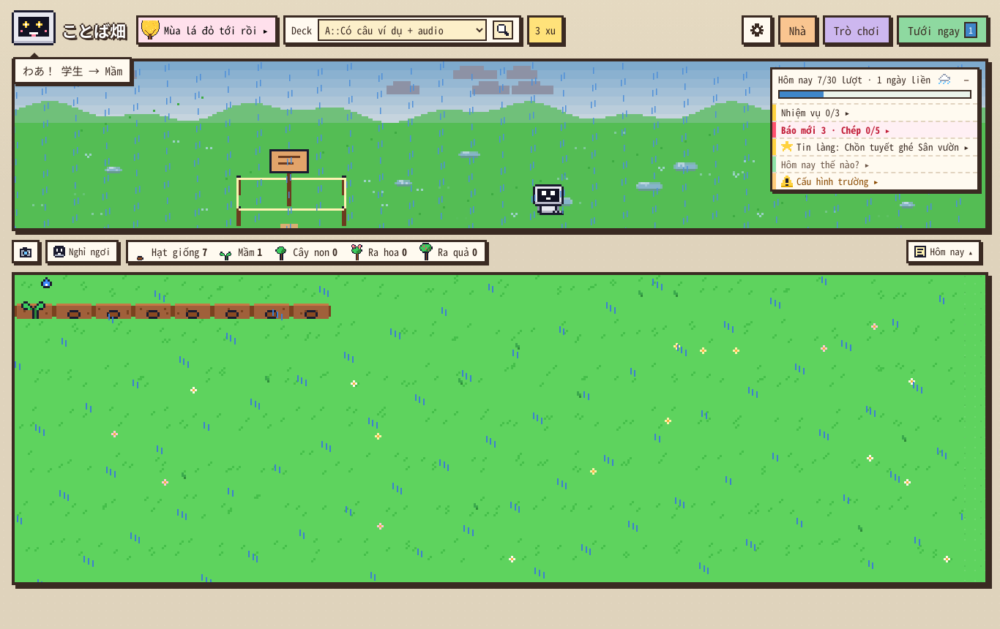

- **Ngày cài**: chỉ lượt ôn **sau** khi cài mới tính (sáng ôn trên Anki, chiều mới cài thì vẫn 0 tới lượt ôn đầu tiên).
- **Người đã dùng bản cũ** (như bạn): chuỗi tính từ lần đầu ことば畑 chạy trên collection (lúc lập sổ bù xu điện thoại, có từ 1.11) — giữ phần đã ôn từ khi có ことば畑, bỏ phần trước đó. Bạn có thể thấy chuỗi ngắn lại **một lần** khi cập nhật.
- **Đồng bộ**: mốc nằm trong collection (đồng bộ AnkiWeb), ghi một lần. Máy thứ hai / cài lại add-on dùng lại mốc cũ, không về 0.
- Áp cho **mọi chỗ là chuỗi**: thẻ Hôm nay, Lịch hoa (Ôn liền, Liền lâu nhất), Tin làng, màn chào, Giao diện mùa "Đổi 7 ngày ôn liền", vé giữ chuỗi, hiệu ứng mốc chuỗi.
- **Không đổi** (vì là lịch sử thật, không phải chuỗi): số lượt hôm nay, hoa trên Lịch hoa, "Số ngày đã ôn", Tin làng "tròn 100 ngày học". Bù xu điện thoại vốn đã không trả xu cho lượt ôn trước khi cài (kịch bản mới kiểm lại: không bù).

## 2. Chỉ nút "Nhà & Cửa hàng" mở cửa hàng

| Trước | Sau |
|---|---|
| Bấm **bất kỳ đâu** trên dải cảnh → bảng Nhà & Cửa hàng (chữ "Nhà & Cửa hàng ▸" chỉ để trang trí) | Chữ đó là **nút**: chỉ bấm đúng nút (hoặc nút **Nhà** trên cùng, phím **N**) mới mở |
| Trong nhà: bấm gian nào mở bảng Nhà ở gian đó | Bấm gian không mở gì; gian chưa mở rộng vẫn có chú thích "mở rộng nhà ở tab Xây nhà" |
| Bấm thú → mở thẳng tab Thú nuôi; bấm khách → mở thẳng Album | Thú nhảy lên + **thẻ nhỏ** (tên, no / đói, nút **Thú nuôi ▸**); khách → thẻ nhỏ (tên Nhật, ngày gặp, nút **Album khách ▸**). Esc / bấm ra ngoài để đóng |

Hòm thư vẫn mở Báo, StackChan vẫn mở thẻ sinh hoạt, chỗ lấp lánh vẫn nhặt được. Nút vẫn chỉ hiện khi rê chuột lên cảnh (giữ ý "không nút nào đè lên cảnh" của 1.30.2).

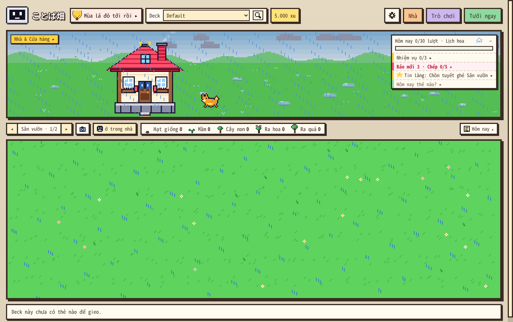

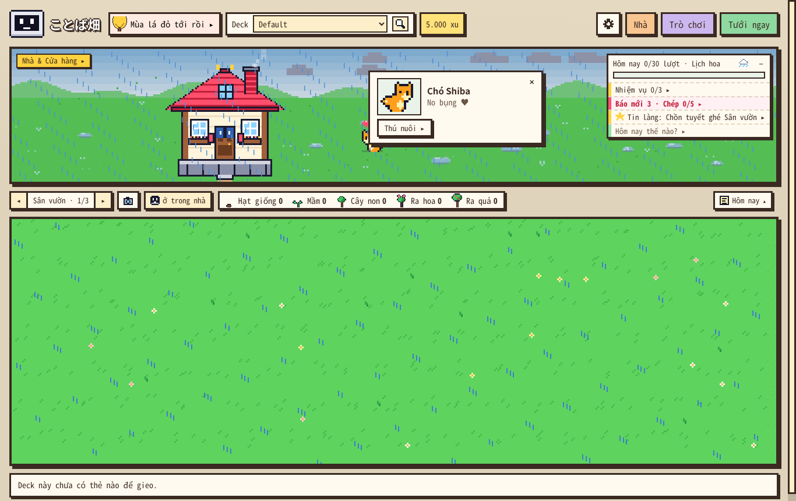

## 3. Đồ tự vẽ cho StackChan, StackChan sinh hoạt mặc đồ

- **Ở đâu**: Nhà → **Tủ đồ** → phần **Tự vẽ**: nút **Mũ · Mặt · Cổ · Vỏ** (tab Xưởng cũng có lối vào "Tự vẽ đồ cho StackChan").
- **Mũ / Mặt / Cổ**: Xưởng mở **lưới đặt đúng chỗ trên thân StackChan** (Mũ 20 × 8, Mặt 20 × 9, Cổ 20 × 5). Ô trống thấy **hình mờ của StackChan** để biết vẽ tới đâu. Bên phải xem trước **cả hai StackChan** (góc trái + đang sinh hoạt). Đủ công cụ của Xưởng (bút, đổ màu, đối xứng, chuyển từ ảnh…).
- **Vỏ**: chọn **màu thân** và **màu viền dưới** trong bảng màu.
- **Giá**: Mũ / Mặt / Cổ **200 xu**, Vỏ **150 xu**; vẽ lại / đổi màu **50 xu**, đổi tên miễn phí; tối đa **12 món**; hỏi trước khi trả xu. Tạo xong **mặc luôn**. Mỗi món có Mặc / Cởi, Sửa, Xoá (bấm hai lần).
- **StackChan sinh hoạt mặc cùng bộ**: đầu StackChan sinh hoạt nhỏ hơn nên 13 món có sẵn có bản vẽ nhỏ riêng, món tự vẽ thì tự thu nhỏ. Nằm giường chỉ thấy đồ trên mặt, ngâm suối (khăn trên đầu) bỏ mũ, bơi (phao) bỏ đồ ở cổ.
- Đồ tự vẽ lưu cùng ví (đồng bộ AnkiWeb). Máy còn bản cũ không thấy đồ tự vẽ (chỗ đó trống) nhưng không xoá — về 1.31 lại thấy đủ.

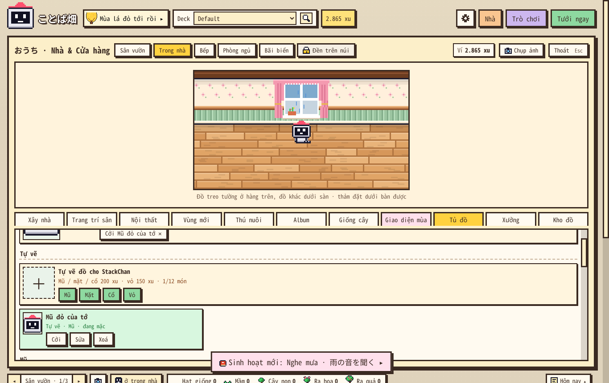

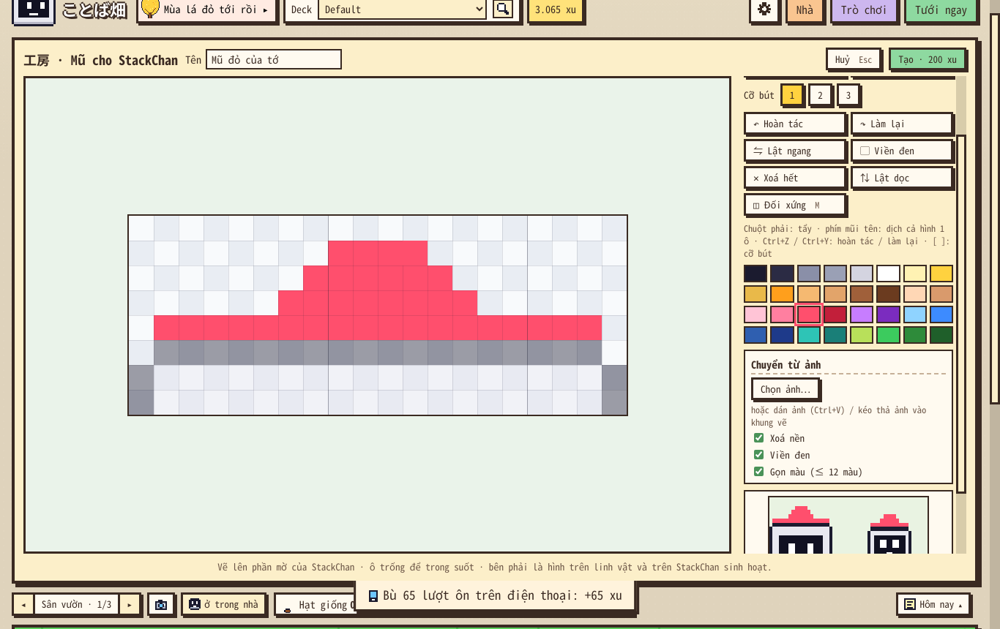

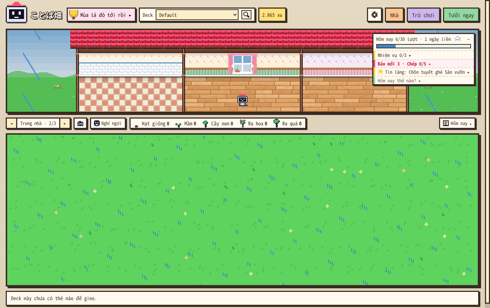

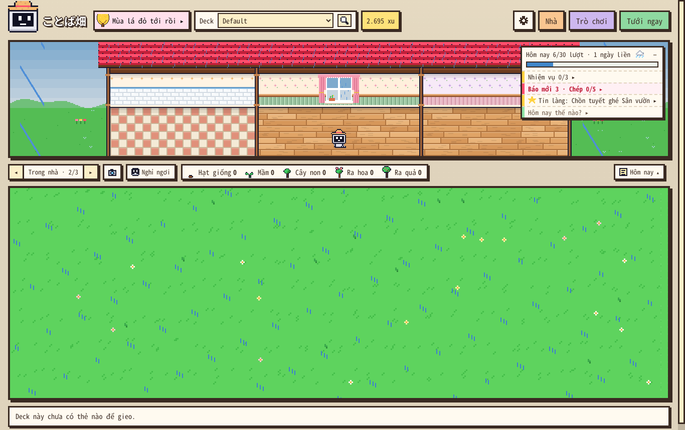

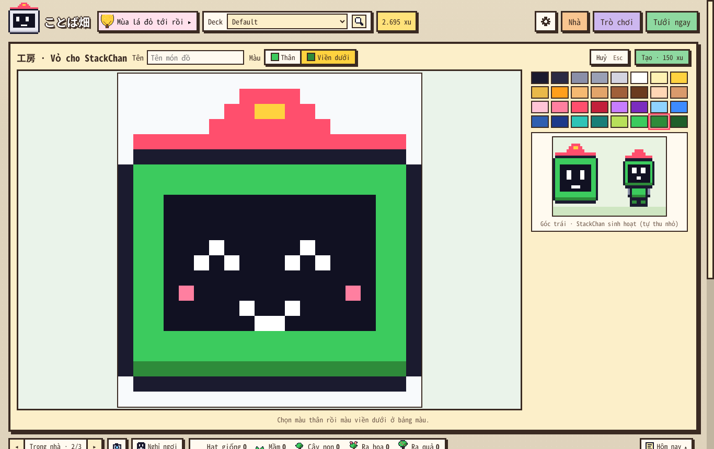

## 4. Kiểm tra

**Kịch bản mới, Anki thật** (`tests/anki/e2e_131.js`, bấm chuột / phím thật): **89/89** trên Anki 26.9.4 và **89/89** trên Anki 23.10.1 (bản thấp nhất add-on hỗ trợ).

| Phần | Kiểm tra |
|---|---|
| Bấm cảnh | Cỏ trống, ngôi nhà, giữa sân, trời, 3 gian Trong nhà, Bãi biển → **không** mở bảng Nhà; nút "Nhà & Cửa hàng ▸" là nút bấm, hiện khi rê chuột, đủ cao (128 × 25 px), mở đúng cảnh; phím N, nút Nhà vẫn mở; bấm Shiba / Cò trắng → thẻ nhỏ, Esc / bấm ra ngoài đóng thẻ mà cửa sổ vẫn mở, nút trong thẻ → đúng tab và đúng thẻ |
| Chuỗi | Collection có 40 ngày ôn liền + 5 lượt sáng nay: cách cũ "41 ngày liền", mở hồ sơ lần đầu → **0**, lượt hôm nay vẫn 5, ôn sau khi cài → "1 ngày liền", Lịch hoa tháng + năm, mở hồ sơ lại không đổi mốc, người đã dùng bản cũ → 11 ngày, Giao diện mùa "Đổi 7 ngày ôn liền" theo chuỗi mới |
| Cài mới hoàn toàn | Xoá mọi dữ liệu ことば畑 (10+ khoá trong collection + file sao lưu), lịch sử ôn còn 41 ngày: chuỗi 0, 0 xu, **không bù xu** cho lượt ôn cũ, có hướng dẫn 3 bước, Tin làng không nhắc chuỗi; ôn thẻ đầu tiên trong vườn (R → Space → 3) → "1 ngày liền", có xu |
| Đồ tự vẽ | Tủ đồ / Xưởng có lối vào; lưới Mũ 20 × 8 có hình mờ; vẽ bằng chuột thật; xem trước hai StackChan; cửa sổ 1024 × 640 không tràn; hỏi trước 200 xu; mặc luôn; linh vật + StackChan sinh hoạt ngoài sân / trong nhà đội mũ (đếm điểm ảnh trên màn hình); đổi tên miễn phí; vẽ lại 50 xu; Mũ rơm thay mũ tự vẽ, StackChan sinh hoạt đội Mũ rơm; vỏ hai màu 150 xu; xoá; 11 lệnh sai dạng không làm hỏng gì |

**Bộ offline** (`tests/run_all.sh`, 37 bộ): **TẤT CẢ OK** trên mã nguồn và trên gói `.ankiaddon` đã đóng. Mới: `test_131.py` (chuỗi trên collection giả bằng sqlite thật, đồ tự vẽ, mã thật của 1.30.3 lấy từ git đọc + lưu vườn có đồ tự vẽ → không mất gì), `test_131.js` (43 kiểm tra vẽ đồ trong node: 13 bản vẽ nhỏ, thu nhỏ, 8 tư thế). Bộ thao tác ngẫu nhiên (12 hạt × 350 thao tác) thêm vẽ / mặc / xoá đồ tự vẽ; ma trận "máy khác còn bản cũ" thêm 1.30.3.

**Bộ cũ, Anki thật 26.9.4** (33 kịch bản): đều đạt — `e2e` 24/24, `e2e_tour` 12/12, `e2e_114` 34/34, `e2e_116` 15/15, `e2e_117` 55/55, `e2e_118` 29/29, `e2e_119` 55/55, `e2e_120` 103/103, `e2e_121` 47/47, `e2e_122` 64/64, `e2e_1223` 49/49, `e2e_1226` 40/40, `e2e_1228` 26/26, `e2e_123` 66/66, `e2e_124` 26/26, `e2e_1251` 39/39, `e2e_1253` 48/48, `e2e_1255` 25/25, `e2e_1258` 36/36, `e2e_1259` 39/39, `e2e_126` 41/41, `e2e_1261` 41/41, `e2e_128` 72/72, `e2e_130` 76/76, `e2e_1301` 45/45, `e2e_1303` 49/49 (bấm phím / chuột bừa), `e2e_fuzz` 6/6 (bấm bừa ~1.100 lệnh, có lệnh đồ tự vẽ), `e2e_kit23` 10/10, `audit_edge` 58/58, `audit_full` 183/183, `e2e_115` 21/21 + `e2e_125` 31/31 (chạy lại sau khi đổi theo cách bấm mới), `e2e_128_fix` 26/26 (qua `run_ui_audit.sh`). Anki 23.10.1: `e2e_tour` 12/12, `e2e_124` 26/26, `e2e_130` 76/76.

Năm kịch bản cũ đổi theo cách bấm mới (trước đó chúng kiểm "bấm sân / gian là mở Nhà"): `e2e_115`, `e2e_121`, `e2e_123`, `e2e_124`, `e2e_125`.

**Lỗi tìm ra khi kiểm tra** (đã sửa): nút "Nhà & Cửa hàng ▸" mới làm bị **dẹt, chữ bị cắt** — thấy qua ảnh chụp của kịch bản mới (một dòng CSS viết sai thứ tự). Nay kịch bản đo chiều cao nút và bộ offline soát thứ tự CSS.

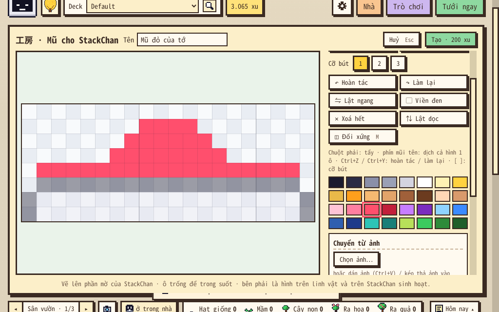

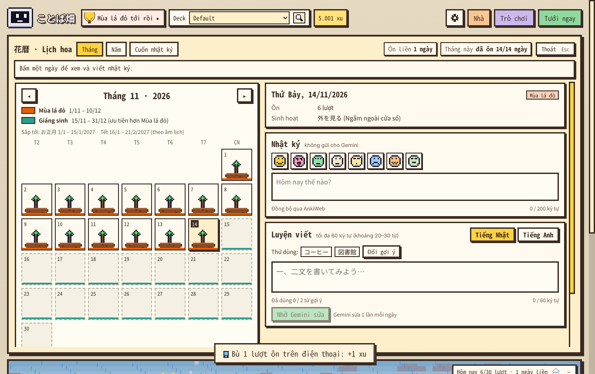

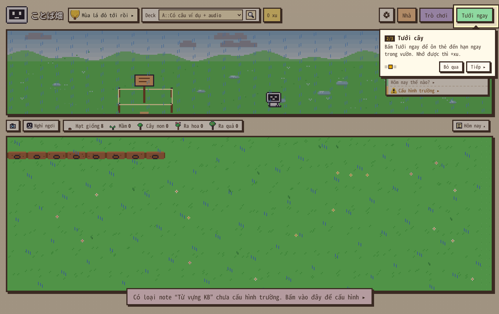

## 5. Còn lại / cần bạn xem

- Mọi chi tiết ở mục 1–3 là mình chọn. Đặc biệt: **người đã dùng bản cũ** chuỗi tính từ lúc lập sổ bù xu (lần đầu ことば畑 chạy) — nếu bạn muốn ai cập nhật cũng về 0 thì đổi được.
- "Số ngày đã ôn" / "tròn 100 ngày học" vẫn đếm cả lịch sử Anki (đó là tổng ngày đã học, không phải chuỗi). Nếu muốn cả các số này cũng tính từ lúc cài thì báo mình.
- Danh sách kiểm tra trên máy thật của 1.30.1 / 1.30.3 vẫn còn (`docs/kiem_thu/1.30.1/BAO_CAO.md` mục 4), thêm: mở vườn → rê chuột lên cảnh thấy nút "Nhà & Cửa hàng ▸", bấm cỏ không mở; Tủ đồ → Tự vẽ → Mũ, vẽ thử rồi xem StackChan trong nhà; thẻ Hôm nay ghi số ngày liền đúng ý bạn.
- Việc tiếp theo trong lộ trình vẫn là **1.27** (cây lấp lánh, quẻ, lịch trời Nhật, mốc học).
