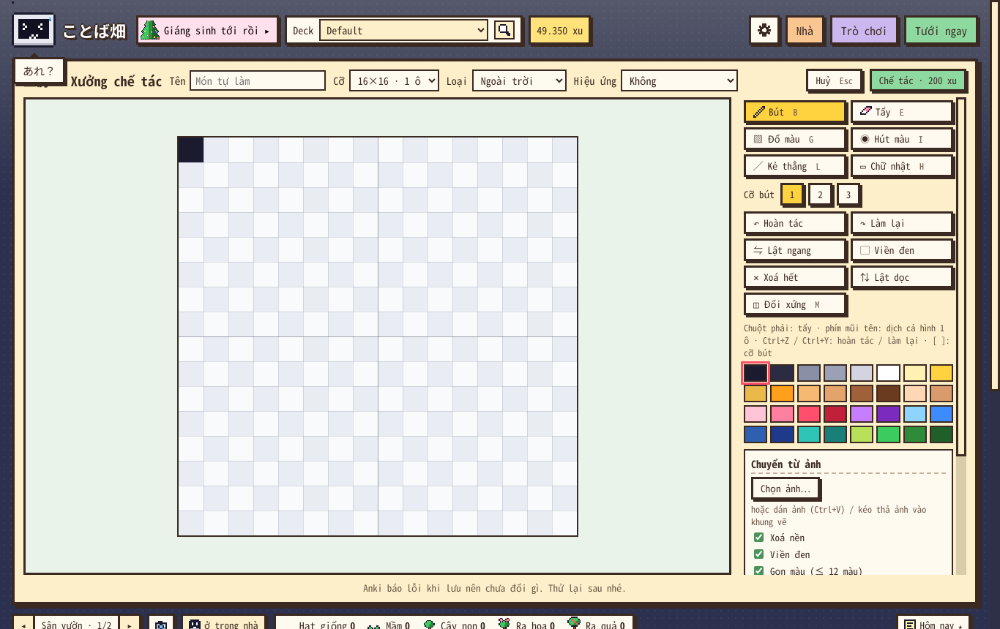
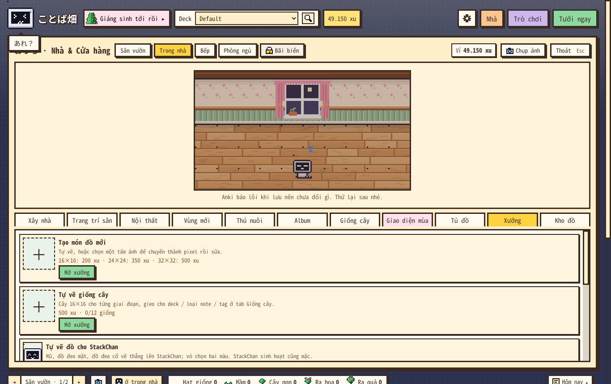
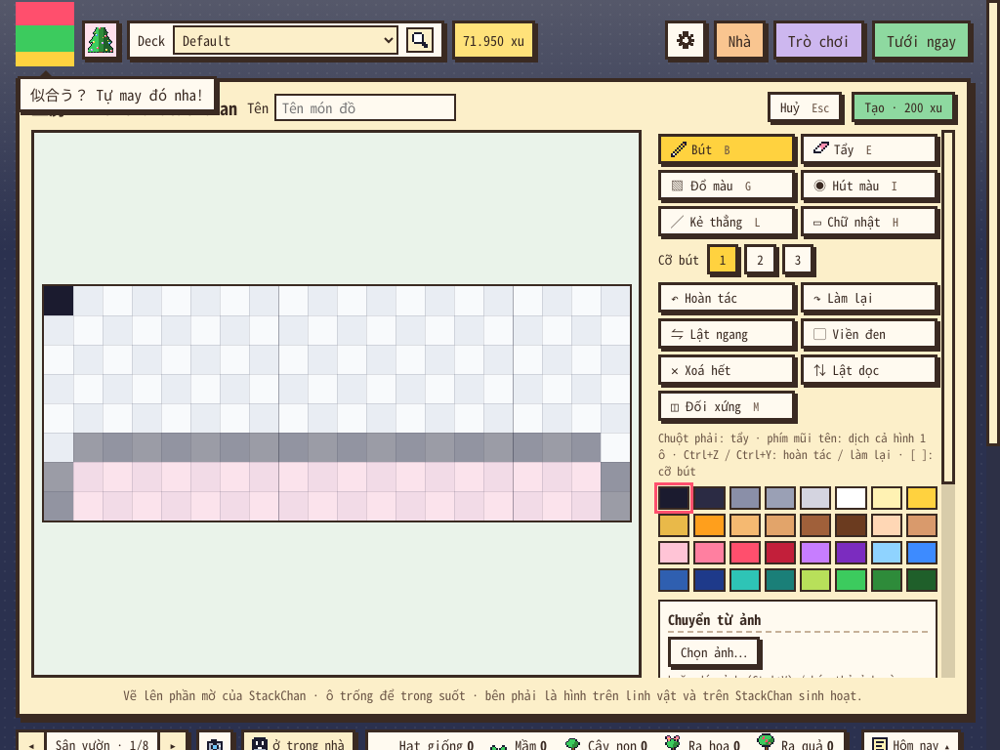
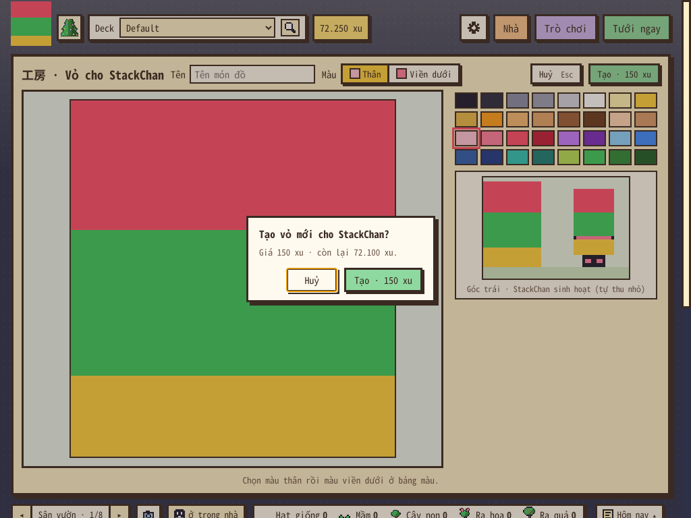
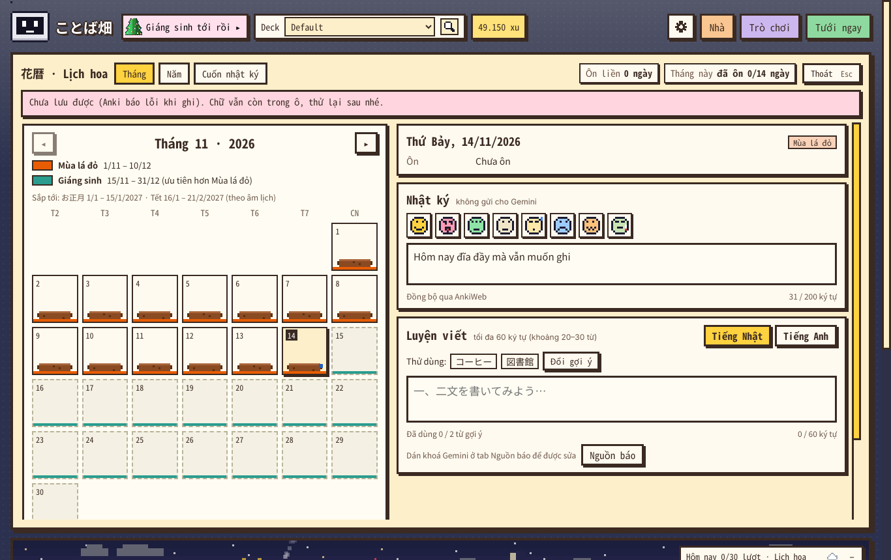
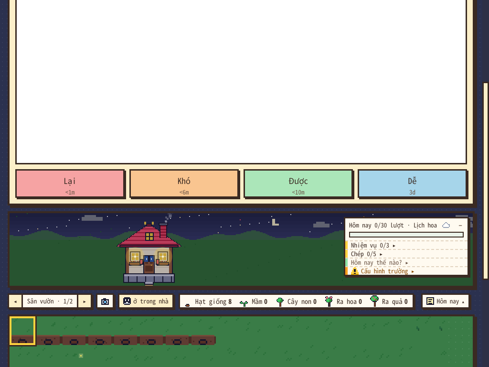

# Kiểm tra + sửa lỗi 1.31.1 · 15/11/2026

Người dùng: "giúp tớ kiểm tra lại kỹ code, logic, giao diện tính năng của add-on này. kiểm tra thật kỹ tạo thêm nhiều kịch bản
để test ngoài test có sẵn. xác nhận và sửa thêm các lỗi ở nhánh audit/release-review-1.31-2026-11-147. đặc biệt các lỗi về dữ
liệu phải check kỹ".

Nhánh thật là **`audit/release-review-1.31-2026-11-14`** (báo cáo `docs/kiem_thu/audit-1.31-2026-11-14/BAO_CAO.md` +
`CHOT_LAN_CUOI.md` của nhánh đó): 8 nhóm lỗi F01–F08 (2 P1, 6 P2) + 1 rủi ro thiết kế R01. Nhánh audit chỉ có báo cáo và test,
chưa sửa mã. Bộ test của audit đã đưa vào repo ở `tests/audit_20261114/`.

## 1. Xác nhận 8 lỗi — trước / sau khi sửa

Chạy test của audit trên **mã 1.31.0** (commit `240c7c3`) rồi trên **1.31.1**, Anki 26.9.4 / Qt 6.12 (không màn hình, chuột /
phím thật qua CDP). Lõi + lưu trữ chạy thêm trên **Anki 23.10.1 / Python 3.9**.

| Bộ test của audit | 1.31.0 | 1.31.1 | Lỗi liên quan |
|---|---:|---:|---|
| `core_audit.py` (dữ liệu sai kiểu, xu, điểm ảnh, mã thật 1.30.3) | 2.043 / 2.047 | **2.047 / 2.047** (cả 23.10.1) | F04 |
| `deep_storage_audit.py` (lỗi ghi collection Anki thật ở từng khoá, trigger SQLite) | 81 / 112 | **172 / 172** (cả 23.10.1)\* | F06 |
| `ui_audit.js` (4 cỡ cửa sổ, 11 tab Nhà, 9 chế độ Xưởng, hộp hỏi bằng phím, trả lời lưu về muộn, Esc lưới trống) | 178 / 188 | **191 / 191**\* | F01, F02, F05 |
| `deep_ui_audit.js` (xoá khoá lúc đang thử, mua khi lưu lỗi, chấm thẻ lỗi, Undo / Redo) | 12 / 16 | **18 / 18**\* | F06, F07, F08 |
| `lifecycle_audit.js` (đổi hồ sơ Anki thật) | 6 / 7 | **7 / 7** | F03 |

\* Số ca thay đổi vì vài ca của audit giả định **hành vi cũ** và được chỉnh cho đúng hành vi mới (giữ nguyên ý kiểm "không báo
thành công giả"): lưu lỗi nay **báo lỗi** thay vì trả "đã lưu" (deep storage: thêm kiểm "lỗi thì collection y như trước" +
"câu lỗi cho người dùng"; ca SQLite chấp nhận hàm ném lỗi); khoá không đổi không còn bị ghi nên lỗi ghi khoá đó không chạm tới
(ca "fault-reached" chỉ đòi khi thao tác thật sự đổi khoá); Tab không ra được nền nên ca "Enter ở nền" viết lại thành ba ca (focus
ở Huỷ + Enter = không mua, ép focus ra nền → tự về hộp, focus ở Mua + Enter = mua đúng một lần); Xưởng không đóng khi lưu lỗi
(+ ca bấm Lưu lại sau khi hết lỗi trừ đúng 150 xu); chấm lại sau lỗi ghi được một lượt nên Dừng → Tưới ngay là lượt thứ hai.

| ID | Mức | Lỗi (đã tái hiện trên 1.31.0) | Sửa ở 1.31.1 |
|---|---|---|---|
| F06 | P1 | Anki ghi lỗi một khoá → ví đã trừ xu mà món / hình vẽ không lưu, giao diện vẫn báo xong; làm mới là mất món | `backup_core.commit_config`: ghi mọi khoá của một lần lưu, **khoá không đổi bỏ qua**, ví **sau cùng**; lỗi → trả các khoá đã ghi về như cũ (khoá chưa có thì xoá) + `StoreError` ("Anki báo lỗi khi lưu nên chưa đổi gì. Thử lại sau nhé."). Điểm ảnh lưu cùng lần với xu. Xưởng giữ bản vẽ, Lưu lại được |
| F01 | P1 | Trả lời lưu của lần trước đóng Xưởng đang vẽ món khác → mất bản vẽ | Mỗi lần mở Xưởng là một phiên; lệnh lưu mang mã `rid`, Python trả lời / báo lỗi kèm mã; chỉ đóng đúng phiên đã gửi |
| F02 | P2 | Tab ra nút ở nền mờ, Enter ở đó vẫn mua món đang hỏi; Esc không trả focus; Esc của bộ gõ đóng hộp | Tab / Shift+Tab chỉ giữa Huỷ ↔ Mua, focus ra nền tự về nút Mua, Enter chỉ mua ở nút Mua, đóng hộp trả focus, phím của bộ gõ bỏ qua |
| F07 | P2 | Bấm Xoá khoá Gemini lúc đang thử → kết quả thử lưu lại khoá vừa xoá | `_ai["key_gen"]` tăng khi xoá; kết quả của lần thử cũ báo "Đã xoá khoá trong lúc thử nên khoá không được lưu" |
| F05 | P2 | Esc khi chuột còn trên lưới Mũ / Mặt / Cổ trống → lỗi JS `pxRows` | Không vẽ khi Xưởng đã đóng; `pxRows` bù ô trống |
| F03 | P2 | Hồ sơ B viết nhật ký cùng tháng ghi đè file sao lưu nhật ký của A | **Mọi** file sao lưu (không chỉ nhật ký) ở `user_files/ho_so/<mã hồ sơ>/` + `ho_so.txt` |
| F04 | P2 | Máy còn 1.30.3 mua Mũ rơm khi 1.31 đang đội mũ tự vẽ → cả hai "đang mặc", mũ tự vẽ che món vừa mua | Đọc ví: đồ có sẵn thắng (lần thay gần nhất), đồ tự vẽ vẫn trong tủ; lưu lại thì hết mâu thuẫn |
| F08 | P2 | Chấm thẻ lỗi (chưa ghi) → bấm chấm lại không gửi gì, phải Dừng rồi Tưới ngay | Revlog của thẻ chưa đổi → trả thẻ + `reviewRetry` (nút chấm dùng lại được); đã đổi → sang thẻ kế tiếp (không chấm hai lần) |

| Xưởng: lưu lỗi → giữ bản vẽ, báo lỗi | Mua đồ: ví không ghi được → không trừ xu |
|---|---|
|  |  |

| F01: trả lời cũ về, Xưởng (Mũ) vẫn mở với nét vẽ | F02: 5 lần Tab — focus ở nút Huỷ trong hộp |
|---|---|
|  |  |

## 2. Lỗi tự tìm thêm khi rà mã (ngoài 8 lỗi của audit)

Rà mọi chỗ ghi dữ liệu (`set_config`, file sao lưu) và mọi chỗ gọi hàm lưu:

1. **Sao lưu của mọi kho bị hồ sơ khác ghi đè** (cùng họ F03): `state.json`, `more.json`, `nha.json`, `craft_px.json`,
   `paper*.json`, `guests.json`, `life.json`, `events.json` đều là một file cho mọi hồ sơ trên máy → nay theo hồ sơ.
2. **Báo nuốt lỗi ghi** (cùng họ F06): `PaperState.save` chỉ in lỗi → câu trả lời không lưu mà vẫn cộng xu (trả lời lại được
   cộng lần nữa). Nay báo lỗi, không cộng xu.
3. **Nhật ký lưu lỗi → Anki bật hộp lỗi + mất chữ đang giữ**: `_cal_save` không bắt lỗi ghi, còn bỏ bản "giữ chữ để lưu nốt khi
   đóng" (KB-01) **trước** khi lưu; trang lại coi chữ đã lưu nên không gửi lại. Nay: báo "Chưa lưu được (Anki báo lỗi khi ghi).
   Chữ vẫn còn trong ô…" trong bảng, giữ bản để lưu nốt, chữ đã chép ra file sao lưu của hồ sơ, lần rời ô sau gửi lại.
4. **Móc Undo đánh dấu "đã trả xu" trước khi ghi ví** → ghi lỗi thì phần trả lại của lượt vừa Undo bị bỏ. Nay chỉ đánh dấu sau
   khi ví đã ghi được.
5. **Sổ bù xu điện thoại và ví không cùng một lần lưu** → ghi lỗi giữa chừng có thể "đã bù" mà xu chưa vào ví. Nay cùng một lần.
6. **Cấu hình trường**: lỗi ghi → hộp lỗi của Anki. Nay "Không lưu được cấu hình." trong bảng.
7. **Trả lời "đã lưu" của món chế tác cũ** về khi đang vẽ món khác → bật chế độ đặt đồ phía dưới Xưởng. Nay không bật.
8. **Xuất PDF cuốn nhật ký lớn để lại bản sao nhật ký**: cuốn năm nhiều ảnh (> 1,8 MB) được ghi ra
   `user_files/journal/_xuat_pdf.html` để Qt mở, nhưng không bao giờ xoá — bản sao nhật ký riêng tư nằm lại trên máy, dùng chung
   mọi hồ sơ. Nay xoá ngay khi xuất xong.

| Nhật ký lúc Anki ghi lỗi: báo trong bảng, chữ còn trong ô | Chấm thẻ lỗi: nút chấm vẫn dùng được |
|---|---|
|  |  |

## 3. Kịch bản mới (ngoài bộ test có sẵn và bộ của audit)

- **`tests/core/test_1311.py`** (python thường + collection Anki thật nếu có; trong `run_all.sh`): `backup_core` (đường dẫn theo
  hồ sơ, `ho_so.txt`, file chung cũ đúng chủ / sai chủ / hỏng, hai hồ sơ không ghi đè); `commit_config` (khoá không đổi không ghi,
  lỗi khoá thứ ba → hai khoá trước về như cũ, không trả về được → báo "partial", khoá không đọc được giá trị cũ); **ma trận lỗi ghi
  118 ca trên 34 thao tác của ví** — mua đồ sân / nội thất, mở vùng, kiểu nhà, đồ mặc, mặc / cởi, biểu cảm, đồ StackChan (tạo / vẽ
  lại / đổi tên / xoá), món chế tác (tạo / vẽ lại / nhân bản / xoá), mẫu tường / sàn, giấy dán tường, giống cây, vùng tự tạo, thú
  nuôi, hạt giống, vé giữ chuỗi, gói báo, đặt / dời / cất đồ, nhặt đồ, ôn thẻ, mục tiêu ngày, trò chơi; mỗi khoá thao tác đó đổi
  × lỗi một lần / lỗi mãi: **luôn StoreError + collection y như trước + móc Undo chưa chạy**; không lỗi → đọc lại khớp; sổ bù xu
  + ví; F04 bốn chỗ + chỗ khác không bị đụng; sao lưu theo hồ sơ của nhật ký / album / sổ sinh hoạt / Hộp sưu tầm / báo; nhật ký
  lỗi ghi → chữ ra file; soát mã F01 / F02 / F05 / F07 / F08. Đạt trên Anki 26.9.4 (Python 3.13), 23.10.1 (Python 3.9) và không
  có gói anki.
- **`tests/anki/e2e_1311.js`** (Anki thật, 42 kiểm tra): F01 ở **ba chế độ Xưởng** (món chế tác, mẫu sàn, mũ StackChan): trả
  lời giữ lại rồi phát sau khi Huỷ + vẽ Mặt → Xưởng còn mở, nét vẽ còn, không kẹt "Đang lưu…", lần lưu cũ trừ xu đúng một lần,
  không bật chế độ đặt đồ; lỗi của lần lưu cũ về muộn không đụng phiên mới; hộp hỏi của phiên đã đóng không tạo món; F06 qua
  giao diện (lỗi ghi điểm ảnh khi chế tác → giữ bản vẽ, Lưu lại trừ đúng 200 xu; ví lỗi khi mua nội thất → không trừ xu, bảng
  Nhà báo lỗi); nhật ký lúc đĩa đầy (báo, chữ còn trong ô, ra file sao lưu, rời ô lần nữa là lưu, **đóng vườn vội lúc vẫn lỗi
  → chữ gõ dở vẫn ra file**); sao lưu ở `user_files/ho_so/<mã>/` có chủ + `ho_so.txt`, không ghi file chung; F04 qua giao diện;
  bấm Lưu 4 lần liền chỉ tạo một món; thiếu xu → Xưởng giữ bản vẽ.

## 4. Kết quả chạy lại toàn bộ

Mỗi kịch bản Anki thật chạy trong **một hồ sơ mới** (`tests/audit_20261114/run_ui_audit.sh`, cấu hình fixture như lần chạy của
audit: `KB_AUDIT_BASELINE=1`; `e2e.js` / `e2e_120.js` / `e2e_123.js` qua `baseline_provider.js` — không gọi Gemini thật).

| Bộ | Anki 26.9.4 (Python 3.13, Qt 6.12) | Anki 23.10.1 (Python 3.9, Qt 6.6) |
|---|---|---|
| `tests/run_all.sh` (offline + phần cần gói anki) | **49 bộ TẤT CẢ OK** trên mã nguồn **và** trên gói đã đóng (giải nén) | `test_1311.py`, `core_audit.py` 2.047 / 2.047, `deep_storage_audit.py` 172 / 172 |
| Bộ UI của audit | `ui_audit` 191 / 191, `deep_ui_audit` 18 / 18, `lifecycle_audit` 7 / 7 | 191 / 191, 18 / 18, 7 / 7 |
| `e2e_1311.js` (mới) | **42 / 42** | **42 / 42** |
| 34 kịch bản cũ | **1.586 / 1.586**: `e2e` 24, `e2e_tour` 12, `e2e_114` 34, `e2e_115` 21, `e2e_116` 15, `e2e_117` 55, `e2e_118` 29, `e2e_119` 55, `e2e_120` 103, `e2e_121` 47, `e2e_122` 64, `e2e_1223` 49, `e2e_1226` 40, `e2e_1228` 26, `e2e_123` 66, `e2e_124` 26, `e2e_125` 31, `e2e_1251` 48, `e2e_1253` 39, `e2e_1255` 48, `e2e_1258` 25, `e2e_1259` 36, `e2e_126` 39, `e2e_1261` 41, `e2e_128` 72, `e2e_128_fix` 26, `e2e_130` 76, `e2e_1301` 45, `e2e_1303` 49, `e2e_131` 89, `e2e_fuzz` 5, `e2e_kit23` 10, `audit_edge` 58, `audit_full` 183 | `e2e_131` 89 / 89, `e2e_124` 26 / 26, `e2e_130` 76 / 76, `e2e_tour` 12 / 12 |

Trong lúc chạy lại phát hiện và đã xử lý:

- `e2e_130` trượt 1 ca ở lần đầu: tôi đã cho mọi lệnh lưu của Xưởng đọc tham số bằng `_json_obj` nên lệnh `craft:tile:` sai dạng bị
  ghi vào nhật ký lỗi (trước: hàm lõi từ chối bằng câu cho người dùng, không ghi nhật ký). Đã trả về như cũ (`json.loads`, hàm lõi
  từ chối) → 76 / 76.
- `e2e_131` trượt đúng 5 ca **cả trên mã gốc 1.31.0** khi chạy lúc ~2 giờ sáng: cảnh có lớp màu đêm nên đếm điểm ảnh "đỏ" không
  khớp, StackChan ngủ gật, và điểm "bấm ra chỗ khác" có lúc rơi đúng lên thẻ nhỏ (thẻ đặt cạnh con thú). Lỗi của **kịch bản**
  (audit cũng ghi nhận bài này lúc đạt lúc trượt trên 23.10.1) — sửa kịch bản: cố định 10 giờ sáng, chọn điểm bấm nằm ngoài thẻ
  → 89 / 89 trên cả hai bản Anki.
- `core/test_121.py`, `test_120.py`, `test_122.py` (collection thật) đọc file sao lưu ở chỗ cũ → cập nhật sang thư mục hồ sơ.
  Các test "soát mã" của 1.30 / 1.30.1 / 1.31 theo mã mới của `_on_craft` / `commit` (cùng ý kiểm).

## 5. Còn lại / cần người dùng quyết

- **R01 — thư viện báo Gemini dùng chung mọi hồ sơ Anki trên máy** (chưa sửa, cần quyết định): hồ sơ A có số báo hôm nay thì
  hồ sơ B (deck khác, có khi là người khác trong nhà) mở Báo **đọc số của A** (viết từ từ vựng của A, tiếp truyện của A) và **không
  tự viết số của mình** hôm đó. Collection / ví / nhật ký vẫn tách đúng. Hai hướng: (a) tách thư mục báo + bộ nhớ truyện theo hồ
  sơ (mỗi hồ sơ một tờ báo riêng, tốn lượt Gemini gấp đôi nếu cả hai cùng dùng); (b) giữ "một làng một tờ báo trên một máy" và ghi
  rõ ở tab Nguồn báo. Claude nghiêng về (a) nếu máy có nhiều người dùng chung.
- Lỗi ghi chỉ thử bằng giả lập (thay `set_config`, trigger SQLite) — chưa thử đĩa đầy thật. Anki không có giao dịch chung cho
  add-on: nếu chính lần trả về cũng lỗi thì báo "Đóng vườn rồi mở lại để xem xu và đồ đã đúng chưa" (thứ tự ghi bảo đảm không trừ
  xu mà chưa có món).
- File sao lưu dùng chung cũ (≤ 1.31.0) vẫn nằm ở `user_files/` (không tự xoá — có thể là bản cứu duy nhất của một hồ sơ).
- Chưa thử trên máy thật Windows / macOS, DPI 125–150 %, bộ gõ thật, trình đọc màn hình (bẫy focus của hộp hỏi), AnkiWeb thật —
  danh sách kiểm tra máy thật ở `docs/kiem_thu/1.30.1/BAO_CAO.md` mục 4 vẫn dùng được.
