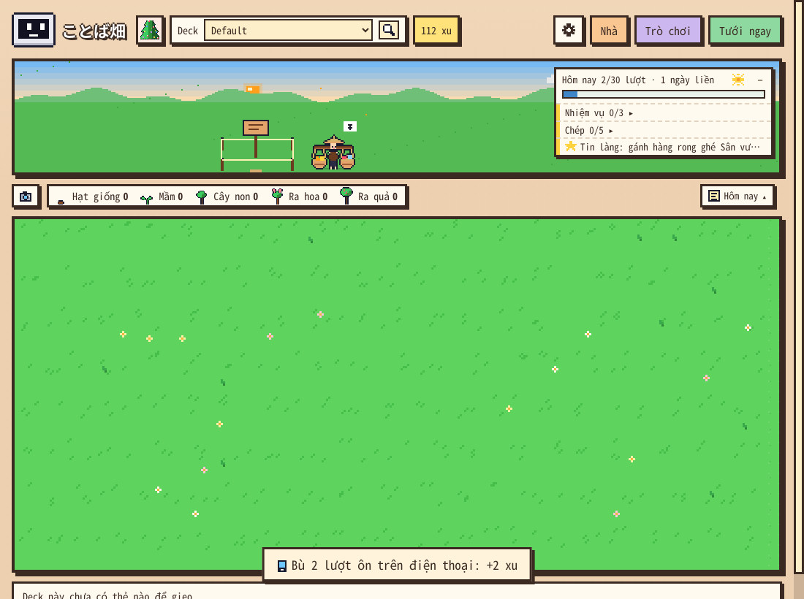

# Kiểm tra lần cuối trước phát hành · 1.31.2 · 15/11/2026

Người dùng: "tớ nghĩ là tớ sẽ release phiên bản đầu tiên của add-on này cho người dùng. vậy nên, hãy giúp tớ kiểm tra lại
code, giao diện, tính năng, logic lần cuối. test kỹ hơn, tìm các kịch bản, test ngoài những test đã có sẵn, đặc biệt các lỗi
có thể gây mất dữ liệu."

Mốc ban đầu (mã 1.31.1): `run_all.sh` 49 bộ đều đạt. Lần này không lặp lại các bộ có sẵn mà thử những hướng chưa ai thử:
**đồng bộ thật** (máy chủ đồng bộ của chính Anki, chạy cục bộ), thẻ bị đổi ở chỗ khác lúc đang ôn, collection đóng giữa
chừng, làm hỏng từng nút dữ liệu, collection lớn.

## 1. Tóm tắt các lỗi tìm được (đều đã sửa ở 1.31.2)

| # | Mức | Lỗi | Gặp khi nào |
|---|---|---|---|
| D1 | **P1 — mất dữ liệu** | Đồng bộ làm vườn quay về bản cũ: mất đồ vừa mua, nhật ký vừa viết, xu | Dùng **máy tính + điện thoại**: ôn trên điện thoại khi chưa đồng bộ trước, rồi mới đồng bộ |
| D2 | **P1 — mất dữ liệu** | Ngày đầu cài: mọi dữ liệu vườn bị xoá khỏi collection (ví lấy lại được từ file sao lưu; nhật ký, album, sổ thì không) | Như D1, khi bản cấu hình điện thoại đang giữ có từ trước lúc cài add-on |
| D3 | P1 | Máy tính thứ hai vừa cài add-on lập một vườn trống rồi đè vườn thật | Collection của máy đó chưa đồng bộ lúc add-on chạy lần đầu |
| D4 | P2 | Bảng ôn kẹt hộp lỗi "không lưu được câu trả lời", bấm chấm lại là hiện tiếp, phải bấm Dừng | Thẻ đang hiện trong vườn vừa được chấm ở cửa sổ ôn của Anki, vừa đồng bộ về từ điện thoại, hoặc bị xoá |
| D5 | P2 | Bị trừ xu oan sau khi chọn "Download from AnkiWeb" | Có lượt ôn chưa đẩy lên, rồi tải cả collection về |
| D6 | P2 | Hộp lỗi "không dựng được khu vườn" / hộp lỗi của Anki giữa lúc đồng bộ toàn bộ | Vườn đang mở khi Anki tải cả collection lên / về |
| D7 | P2 | Bản sao lưu nhật ký của cả tháng bị thay bằng "tháng chỉ có hôm nay" | Viết nhật ký đúng lúc collection không đọc được |
| D8 | P2 — mất dữ liệu | Một bản ghi đồ bị hỏng làm mất **toàn bộ** đồ mới + vùng mới | Dữ liệu hỏng một chỗ (đĩa lỗi, bản sau ghi khác kiểu) |
| D9 | phòng ngừa | Phần dữ liệu đọc lỗi bị thay bằng giá trị mặc định, lần lưu sau ghi đè luôn | Mọi lỗi đọc chưa lường trước |

## 2. D1 – D3: đồng bộ làm mất dữ liệu vườn

### Tái hiện (Anki 26.9.4 thật + add-on 1.31.1 + máy chủ đồng bộ thật của Anki + một "điện thoại")

| Bước | Máy tính | Điện thoại |
|---|---|---|
| 1 | Chơi vườn: **120 xu, 2 ghế, nhật ký "Dòng nhật ký MỚI…"** → đồng bộ | |
| 2 | | Ôn 2 thẻ **khi chưa đồng bộ trước**, rồi bấm đồng bộ |
| 3 | Đồng bộ lại → **112 xu, 1 ghế, nhật ký quay về chữ cũ** | |

Cùng kịch bản đó với 1.31.2: **124 xu (122 + bù 2 lượt ôn của điện thoại), 2 ghế, nhật ký mới còn nguyên**; lần đồng bộ
sau điện thoại nhận lại bản mới.

### Vì sao

Mọi dữ liệu của vườn nằm trong **cấu hình collection** để AnkiWeb đồng bộ. Tài liệu của dự án vẫn ngầm hiểu Anki đồng bộ
theo từng khoá. Thử nghiệm (và câu SQL trong tầng dưới của Anki: `select key, val from config`, `delete from config`) cho
thấy Anki đồng bộ cấu hình **nguyên khối**: lúc đồng bộ, bên nào có collection sửa sau cùng — **kể cả chỉ ôn một thẻ** —
thì gửi toàn bộ cấu hình của mình và bên kia thay hết. Thẻ và lượt ôn thì vẫn gộp từng dòng như thường.

Điện thoại không chạy add-on nên chỉ giữ hộ bản dữ liệu vườn nó tải về lần trước. Nó chỉ nhận bản mới khi đồng bộ lúc
**không có gì mới của nó**. Ai quen "mở điện thoại là ôn luôn, xong mới bấm đồng bộ" thì ngày nào cũng đẩy bản cũ lên.

### Cách sửa

1. **Dấu phiên bản** — mỗi lần vườn ghi dữ liệu thì đóng một dấu nhỏ `kotoba_batake_rev` (thời điểm + mã máy) đi cùng dữ
   liệu. Dấu sau luôn lớn hơn dấu của bản nó sửa, kể cả khi đồng hồ máy chạy chậm. Điện thoại không sửa dữ liệu vườn nên
   bản nó giữ hộ luôn mang dấu cũ.
2. **Chụp trước, so sau** (`sync_core.py`) — trước mỗi lần đồng bộ, máy tính chụp lại dữ liệu vườn. Đồng bộ xong, nếu bản
   mang về **cũ hơn** (dấu nhỏ hơn, không có dấu, không còn khoá nào, hoặc là vườn trống của một máy vừa cài) thì ghi lại
   bản vừa chụp; lần đồng bộ kế tiếp đẩy nó lên máy chủ. Bản mang về mới hơn hoặc không rõ nguồn thì **giữ nguyên**, không
   bao giờ đè dữ liệu lạ. Không hiện thông báo (người dùng không cần làm gì); có một dòng "Đồng bộ" trong Báo lỗi.
   Trong lúc Anki đang đồng bộ, vườn không ghi gì (lệnh của trang bị bỏ qua, kết quả Gemini vừa về thì đợi) — một lần ghi
   chen vào lúc đó sẽ đóng dấu "mới nhất" lên chính bản cũ vừa mang về.
3. **Không ghi gì vào collection trước lần tự đồng bộ lúc mở Anki** — Anki gọi add-on *trước* khi tự đồng bộ; lập mốc
   chuỗi / sổ bù xu lúc đó trên một collection chưa đồng bộ là biến máy này thành bên "mới hơn" (D3). Nay các việc đó đợi
   đồng bộ xong.

Chỉ đụng các khoá `kotoba_batake_*`. Thẻ, lịch ôn, lượt ôn do Anki tự gộp như cũ. Tắt được bằng `sync_guard: false` ở
Tools → Add-ons → Config. Các trường hợp đặc biệt đã xử lý: khôi phục bản sao lưu của Anki (giữ bản vừa khôi phục, vì đó
là ý người dùng), đăng nhập tài khoản AnkiWeb khác (không đụng vườn của tài khoản đó), chơi vườn trước khi đăng nhập rồi tải
collection của điện thoại về (vườn còn), đồng bộ lúc add-on bị tắt / chế độ an toàn (lần mở hồ sơ sau trả lại).

**Cách sửa này là Claude chọn, người dùng chưa xem.**

## 3. Các lỗi khác

- **D4 — thẻ đổi ở chỗ khác lúc đang ôn.** Anki từ chối chấm trên trạng thái cũ (đúng), nhưng đường "chấm lại" của 1.31.1
  trả lại đúng thẻ đó nên hộp lỗi hiện mãi. Nay vườn so thẻ với collection trước khi chấm; thẻ đã đổi / bị xoá → một dòng
  báo ngắn "Thẻ này vừa được ôn hoặc sửa ở chỗ khác — sang thẻ kế tiếp." rồi lấy thẻ kế tiếp. Thêm: người dùng chọn deck khác
  ở cửa sổ chính giữa chừng thì bảng ôn vẫn lấy thẻ của deck đang xem trong vườn.
- **D5 — sổ Undo sau đồng bộ.** Đồng bộ xong Anki xoá lịch sử Undo, nhưng sổ phần thưởng của add-on còn. Sau "Download from
  AnkiWeb" các lượt ôn chưa đẩy lên biến mất, sổ tưởng người dùng vừa Undo nên trừ xu. Nay bỏ sổ sau mỗi lần đồng bộ.
- **D6 — collection đang đóng.** Lúc tải cả collection, Anki đóng collection trong khi trang vườn vẫn chạy. Nay vườn bỏ
  qua các lệnh lúc đó (đồng bộ xong tự dựng lại); nhật ký thì báo "Chưa lưu được", chữ vẫn trong ô.
- **D7 — bản sao lưu nhật ký.** Không đọc được collection thì chép chữ vào bản sao lưu đang có của tháng, không đè.
- **D8 — một bản ghi hỏng.** Tìm bằng cách làm hỏng **từng nút** của từng khoá lưu (3.735 lượt). Một bản ghi đồ đặt có `id`
  sai kiểu làm hàm gộp phần mở rộng ném lỗi, lỗi bị nuốt, lần lưu sau ghi đè → mất hết đồ mới + vùng mới. Nay chỉ mất đúng
  bản ghi hỏng.
- **D9 — lưới an toàn.** Phần nào đọc lỗi bất ngờ thì vườn **từ chối lưu** ("Dữ liệu vườn đọc chưa trọn nên chưa lưu thay đổi
  này…") thay vì ghi giá trị mặc định đè lên dữ liệu thật. Vườn tạm chỉ xem, dữ liệu trong collection còn nguyên.

Đã xem và **không thấy lỗi**: khoá Gemini (gửi bằng header, không vào báo cáo lỗi), nội dung deck đưa vào trang (đều qua
`textContent` / `html.escape`; riêng mặt thẻ chạy mã của mẫu thẻ như màn ôn của Anki), gói đóng (không `__pycache__`, không
`meta.json`, không file admin, `user_files/` chỉ có README), mở hồ sơ lần hai không ghi gì vào collection, mở Anki sang ngày
mới không làm collection "mới hơn", hiệu năng với 8.000 note + 60.000 lượt ôn (dựng vườn 72 ms, chuỗi ngày 25 ms).

## 4. Cần người dùng thử trên máy thật trước khi phát hành (khoảng 10 phút)

Máy chủ đồng bộ đi kèm Anki dùng cùng mã phía máy khách với AnkiWeb, nhưng AnkiWeb thật + AnkiDroid / AnkiMobile thật thì
chưa thử được ở đây.

1. Máy tính: cài 1.31.2, mở Anki (để tự đồng bộ), mở vườn, mua một món rẻ, viết một dòng nhật ký. Đóng Anki (tự đồng bộ).
2. Điện thoại: mở AnkiDroid / AnkiMobile, **đừng bấm đồng bộ**, ôn 2–3 thẻ, rồi mới bấm đồng bộ.
3. Máy tính: mở Anki (tự đồng bộ), mở vườn → món vừa mua và dòng nhật ký **phải còn**; có dòng "Bù N lượt ôn trên điện thoại".
4. Tools → ことば畑 · Báo lỗi → dòng **Đồng bộ** ghi "đã trả lại 1 lần" (nếu điện thoại đã đè) hoặc "0 lần" (điện thoại đã có bản mới).
5. Đóng Anki, bấm đồng bộ trên điện thoại (không ôn), rồi lặp lại bước 2–3 một lần nữa: lần này không còn gì phải trả lại.

Nếu bước 3 mất món / mất nhật ký: gửi lại nội dung Báo lỗi + file `user_files/ho_so/<mã>/dong_bo.json` và
`dong_bo_bi_de.json` trong thư mục add-on.

## 5. Kịch bản mới (ngoài bộ test có sẵn)

- **`tests/dong_bo/test_dong_bo.py`** (74 kiểm tra, trong `run_all.sh` khi có `ANKI_PY`): máy chủ đồng bộ thật của Anki chạy
  cục bộ + các máy là collection Anki thật. Luật đồng bộ của Anki (để biết ngay nếu bản Anki sau đổi luật); tắt lớp giữ → mất;
  điện thoại đè 4 ngày liền; ngày đầu cài; hai máy tính luân phiên 6 phiên (không lần trả lại nào); máy thứ hai lập vườn
  trống; ghi lẻ sau lần đồng bộ lúc đóng; đồng hồ chậm 4 phút; đồng bộ toàn bộ; chơi trước khi đăng nhập; đổi tài khoản; máy
  còn bản cũ; chế độ an toàn; khôi phục bản sao lưu; **ngẫu nhiên**: một máy tính + điện thoại bừa (3 hạt × 28 bước — không
  lần ghi nào của máy tính bị mất), hai máy tính đúng cách (không mất, không trả lại), hai máy tính + điện thoại bừa (không
  lỗi, hội tụ, không trả lại qua lại).
- **`tests/anki/e2e_1312.js`** qua `tests/dong_bo/run_e2e.sh` (47 kiểm tra, Anki thật nối máy chủ đồng bộ thật, tự mở lại
  Anki 4 lần, có máy tính thứ hai): D1, tắt `sync_guard` → lỗi cũ hiện lại, D5, D4 (3 kiểu), D6, ghi đúng lúc đang đồng bộ
  (bị từ chối / xếp hàng tới khi so xong), mở hồ sơ không ghi collection (ngày mới + khi đã có lượt ôn), máy tính thứ hai
  nhận vườn thật rồi chơi tiếp, máy một mở lại thấy đủ.
- **`tests/core/test_1312.py`** (115 kiểm tra, python thường, trong `run_all.sh`): dấu phiên bản, bảng quyết định 18 nhánh,
  chụp / so / trả lại với collection giả (lỗi ghi giữa chừng → không nửa nọ nửa kia), D7, **fuzz khoanh vùng 3.735 lượt**
  (D8), D9, soát mã nối dây.

## 6. Kết quả chạy lại toàn bộ

Mọi kịch bản Anki thật chạy trên **gói đã đóng** (giải nén), mỗi kịch bản một hồ sơ mới
(`tests/audit_20261114/run_ui_audit.sh`, `KB_AUDIT_BASELINE=1`; `e2e` / `e2e_120` / `e2e_123` qua `baseline_provider.js`,
không gọi Gemini thật).

| Bộ | Anki 26.9.4 (Python 3.13, Qt 6.12) | Anki 23.10.1 (Python 3.9, Qt 6.6) |
|---|---|---|
| `tests/run_all.sh` (offline + phần cần gói anki) | **51 bộ TẤT CẢ OK** trên mã nguồn **và** trên gói (49 bộ cũ + `test_1312.py` + `test_dong_bo.py`) | `test_1312.py` 115 / 115, `test_dong_bo.py` 74 / 74 |
| `core/test_1312.py` (mới) | **115 / 115** | 115 / 115 |
| `dong_bo/test_dong_bo.py` (mới, máy chủ đồng bộ thật) | **74 / 74** | **74 / 74** (luật đồng bộ của Anki 23.10.1 cũng y như vậy) |
| `anki/e2e_1312.js` (mới, Anki thật + máy chủ đồng bộ thật) | **47 / 47** | **47 / 47** |
| Bộ UI của audit 14/11 | `ui_audit` 191 / 191, `deep_ui_audit` 18 / 18, `lifecycle_audit` 7 / 7 | 191 / 191, 18 / 18, 7 / 7 |
| `e2e_1311.js` | 42 / 42 | 42 / 42 |
| 34 kịch bản cũ | **1.586 / 1.586**: `e2e` 24, `e2e_tour` 12, `e2e_114` 34, `e2e_115` 21, `e2e_116` 15, `e2e_117` 55, `e2e_118` 29, `e2e_119` 55, `e2e_120` 103, `e2e_121` 47, `e2e_122` 64, `e2e_1223` 49, `e2e_1226` 40, `e2e_1228` 26, `e2e_123` 66, `e2e_124` 26, `e2e_125` 31, `e2e_1251` 48, `e2e_1253` 39, `e2e_1255` 48, `e2e_1258` 25, `e2e_1259` 36, `e2e_126` 39, `e2e_1261` 41, `e2e_128` 72, `e2e_128_fix` 26, `e2e_130` 76, `e2e_1301` 45, `e2e_1303` 49, `e2e_131` 89, `e2e_fuzz` 5, `e2e_kit23` 10, `audit_edge` 58, `audit_full` 183 | `e2e_131` 89 / 89, `e2e_130` 76 / 76, `e2e_124` 26 / 26, `e2e_tour` 12 / 12 |

Ghi chú khi chạy lại:

- Hai ca của bộ test cũ phải sửa vì **luật mới**: `test_119.py` và `test_1311.py` đếm đúng những khoá được ghi — nay mỗi lần
  ghi có thêm dấu `kotoba_batake_rev`. Thêm ca "không khoá nào đổi → không ghi gì, kể cả dấu".
- `e2e_126.js` trượt 2 ca **cả trên mã gốc 1.31.1** vì hôm nay là Chủ nhật: kịch bản chỉ chờ tiêu đề "Thứ …" và không tính
  ngày có gánh hàng rong (tin "Cho ăn" nhường chỗ ở màn chào; câu chào của StackChan vẫn nhắc cho ăn). Lỗi của kịch bản, đã
  sửa cho đúng mọi ngày trong tuần → 39 / 39.
- Lần chạy đầu của `e2e_1312.js` trượt 4 ca do cách giả lập trong chính kịch bản (giả "collection đóng" chưa đóng tầng dưới của
  Anki; giả "ngày mới" bằng cách dời mốc tạo collection làm lệch ngày của sổ bù xu) — sửa kịch bản. Việc dời mốc tạo collection
  lại cho thấy một điều có thật: đồng bộ thường cũng mang `crt` của máy khác về, nên luật "collection khác" phải xét **cả**
  `crt` lẫn `scm` (đã sửa trong `sync_core`).
- Anki 23.10: `sync_login` trả về thông tin đăng nhập không kèm địa chỉ máy chủ → bộ test tự gắn lại (không liên quan add-on).

## 7. Còn lại / giới hạn / cần người dùng quyết

- **Hai máy tính cùng chơi vườn khi chưa đồng bộ**: bản ghi sau thắng, phần của máy kia mất (không gộp từng món). Để Anki
  tự đồng bộ khi mở và khi đóng thì không gặp. Nếu muốn gộp thật sự (xu cộng dồn, đồ gộp lại) thì là việc lớn, chưa làm.
- **Hai máy tính + điện thoại hay ôn trước khi đồng bộ**: nếu điện thoại đè máy chủ đúng lúc máy A vừa đẩy lên mà máy B
  chưa kịp nhận, B chơi tiếp trên bản nó đang có → phần của A mất. Kịch bản ngẫu nhiên cho thấy hai máy vẫn hội tụ về một
  bản và không trả lại qua lại, nhưng có thể thiếu vài dòng.
- **Chọn "Download from AnkiWeb"**: thẻ và lượt ôn theo máy chủ, nhưng dữ liệu vườn vẫn giữ bản mới của máy này.
- **R01** (thư viện báo Gemini dùng chung mọi hồ sơ trên máy) vẫn chờ người dùng quyết — `docs/kiem_thu/1.31.1/BAO_CAO.md` mục 5.
- Chưa thử: AnkiWeb thật, AnkiDroid / AnkiMobile thật, Windows / macOS, Anki 23.10.1 cho bản này (môi trường lần này chỉ có
  Anki 26.9.4 trên Linux không màn hình).
- Danh sách kiểm tra máy thật cũ (`docs/kiem_thu/1.30.1/BAO_CAO.md` mục 4) vẫn dùng được.
