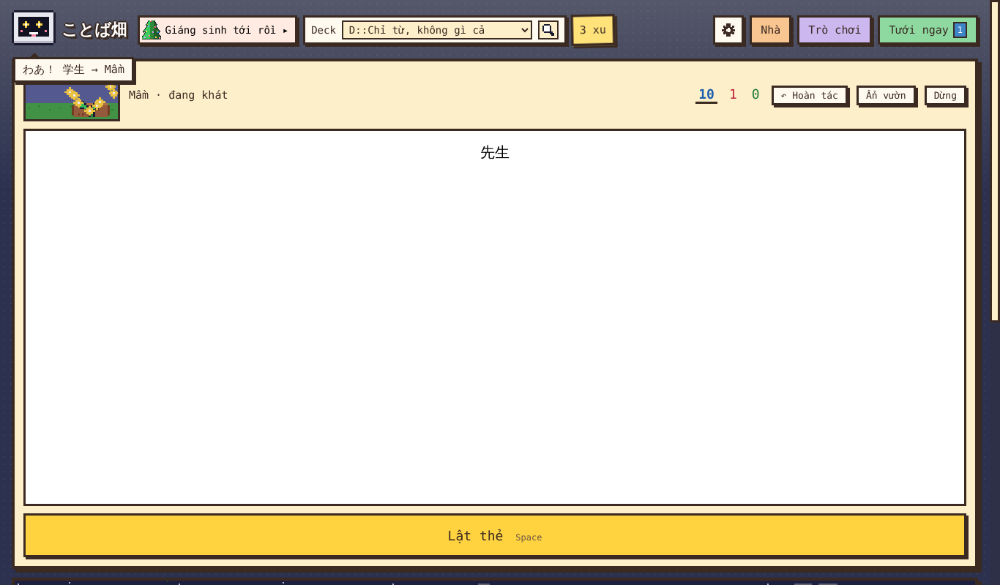
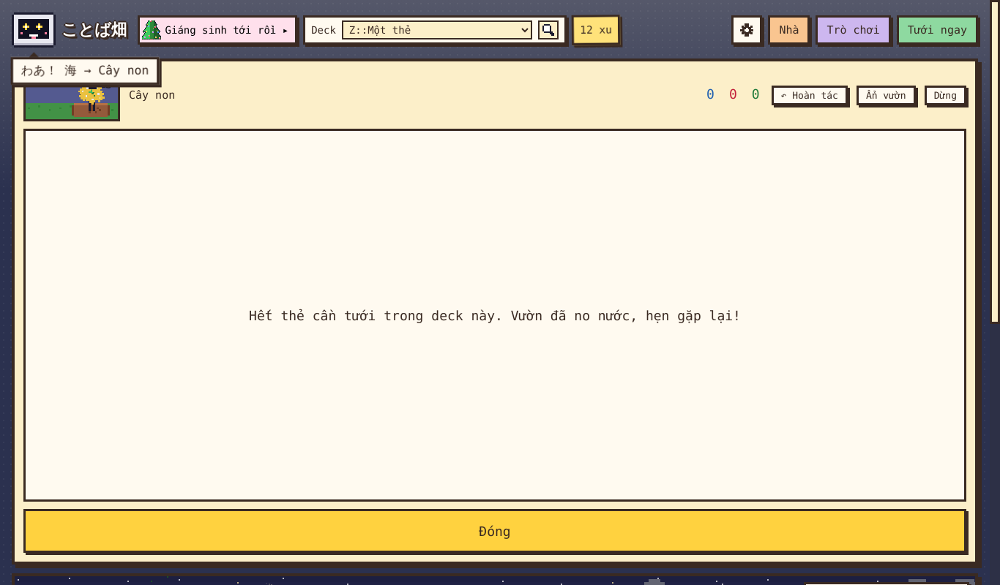

# Báo cáo 1.31.4 — Ctrl+Z trong bảng ôn, nhận đúng deck tiếng Trung, cập nhật không mất dữ liệu (16/11/2026)

Bản đầu tiên sau khi phát hành công khai 1.31.3 (tối 15/11). Người dùng: "có người góp ý là thêm phím tắt Ctrl Z cho thẻ … làm 1.31.4 đi. nhưng nhớ hiện tại bây giờ đã phát hành addon rồi, nên khi update đảm bảo dữ liệu người dùng không bị mất nhé".

## 1. Đã làm

| | Trước (1.31.3) | Nay (1.31.4) |
|---|---|---|
| Chấm nhầm khi ôn trong vườn (Tưới ngay) | phải sang cửa sổ chính của Anki → Edit → Undo | **Ctrl+Z** (macOS: ⌘Z) hoặc nút **"↶ Hoàn tác"** ngay trong bảng ôn; thẻ vừa chấm hiện lại mặt trước, xu của lượt đó trả lại; hoàn tác được nhiều lượt liền, cả ở màn "Hết thẻ" |
| Sau lượt chấm có sửa note / chấm thẻ ở chỗ khác / đổi deck | (không có Ctrl+Z trong vườn) | Ctrl+Z ở vườn **không hoàn tác nhầm** thao tác kia — báo "Không có lượt chấm nào để hoàn tác." |
| Deck tiếng Trung dùng loại note "Basic" | bị đoán là deck chữ Hán **tiếng Nhật** → trò chơi tìm cách đọc kana, gõ pinyin ở Đuổi quạ bị chấm sai, từ tiếng Trung lọt vào báo tiếng Nhật | nhận là **"Ngôn ngữ khác"**; deck tiếng Nhật (kể cả deck chỉ chữ Hán) đoán y như cũ |

Chi tiết Claude chọn (người dùng chưa xem): nút chỉ hiện khi có lượt để hoàn tác; câu báo nằm trong bảng ôn dưới tên giai đoạn của chậu (bản đầu dùng thông báo nổi — đè lên nút Lật thẻ nên đã đổi); không có Redo trong vườn (Redo vẫn ở Edit của cửa sổ chính); Ctrl+Z chỉ có tác dụng khi bảng ôn đang mở.

## 2. Dữ liệu khi cập nhật (yêu cầu của người dùng)

- **Bản này không đổi gì của phần lưu trữ.** So với gói 1.31.3 đã phát hành (`e64eb22`): 58 / 66 file giống hệt từng byte (mọi kho lưu, sao lưu, đồng bộ, báo, nhật ký…); `config.json` giữ nguyên (không thêm / bỏ mục cấu hình); `garden_core.py` = bản cũ + đúng một hàm; `fields_core.py` chỉ đổi phần đoán ngôn ngữ; `__init__.py` không thêm / bỏ chỗ ghi dữ liệu nào (`core/test_1314.py` mục 1 kiểm tự động).
- Đổi cách đoán ngôn ngữ chỉ ảnh hưởng loại note **chưa lưu** ở Cấu hình trường; lựa chọn đã lưu giữ nguyên, lựa chọn deck của báo không bị lọc. 92 mẫu deck không phải tiếng Trung (chữ Hán N5 / N4, 1.693 từ tiếng Nhật của dữ liệu thử, tiếng Hàn, Anh, Việt) cho **đúng kết quả như mã 1.31.3 thật**.
- **Thử đúng đường cập nhật trong Anki thật** (`tests/anki/run_capnhat.sh`): Anki với gói 1.31.3 đã phát hành → ôn 3 thẻ trong vườn, xây nhà, mua / đặt đồ, mở Bãi biển, nuôi mèo, tường anh đào, mũ rơm, viết nhật ký, sổ sinh hoạt, ⚙ Mưa → cài đè gói 1.31.4 bằng trình quản lý add-on của Anki (cùng đường với *Install from file* / *Check for Updates*) → đóng Anki → mở lại:
  - 11 / 11 khoá dữ liệu trong collection giữ nguyên nội dung, 48 / 48 file trong `user_files/` không đổi, cấu hình add-on (⚙, khoá Gemini, mục tiêu ngày…) giữ nguyên;
  - vườn hiện đúng 93.124 xu, đồ trên sân, nhật ký, Mưa; ôn 1 thẻ rồi Ctrl+Z trên dữ liệu cũ: xu / lượt ôn về như trước.
- Máy chưa cập nhật (còn 1.31.3) đồng bộ AnkiWeb với máy đã cập nhật: `core/test_ban_cu.py` thêm 1.31.3 — mã 1.31.3 thật đọc, dùng, lưu vườn đầy đủ rồi bản mới đọc lại không mất gì.
- Anki giữ thư mục `user_files/` khi cài đè (`AddonManager._install` chuyển ra `files_backup` rồi trả lại; file trùng tên trong gói bị bỏ qua) — gói chỉ có `user_files/README.txt`.

## 3. Kết quả test

| Bộ | Kết quả |
|---|---|
| `core/test_1314.py` (mới, `ANKI_PY`) | 38 / 38 (không có gói anki: 26 / 26) |
| `core/test_ban_cu.py` (+ 1.31.3) | tất cả OK (7 bản cũ) |
| `tests/run_all.sh` (`ANKI_PY` = aqt 26.9.4) | KQ_RUNALL |
| `anki/e2e_1314.js` (mới, Anki 26.9.4 thật) | KQ_1314 |
| `anki/run_capnhat.sh` + `e2e_capnhat.js` (mới, 1.31.3 → 1.31.4) | KQ_CAPNHAT |
| Kịch bản cũ có ôn thẻ / Undo (Anki 26.9.4): `e2e.js`, `e2e_117.js`, `e2e_118.js`, `e2e_1253.js`, `e2e_1226.js`, `e2e_123.js` | KQ_CU |

## 4. Nên thử trên máy thật (5 phút)

1. Cài đè 1.31.4 lên 1.31.3 đang dùng (Tools → Add-ons → *Install from file…*, hoặc khi đã đăng AnkiWeb: *Check for Updates*), khởi động lại Anki, mở vườn: xu, đồ, nhật ký, ⚙ như cũ.
2. Tưới ngay → chấm một thẻ → **Ctrl+Z**: thẻ vừa chấm hiện lại, số xu trên cùng giảm lại đúng số vừa cộng.
3. Chấm lại thẻ đó: xu cộng lại đúng một lần.
4. (macOS) thử ⌘Z; (Windows) thử với bộ gõ tiếng Việt đang bật.
5. Có deck tiếng Trung: mở ⚙ Cấu hình trường — loại note của deck đó ghi "Ngôn ngữ khác" (nếu trước đây đã bấm Lưu với "Tiếng Nhật" thì đổi tay).
