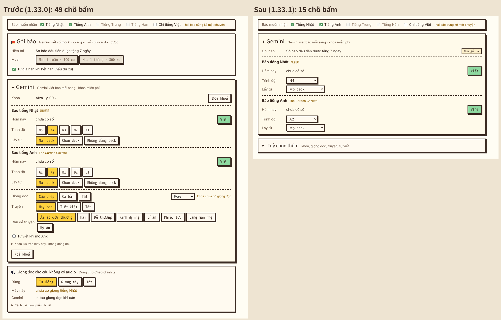
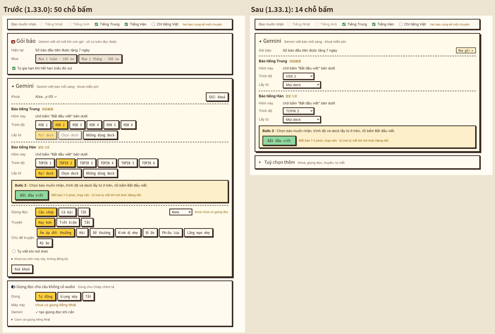
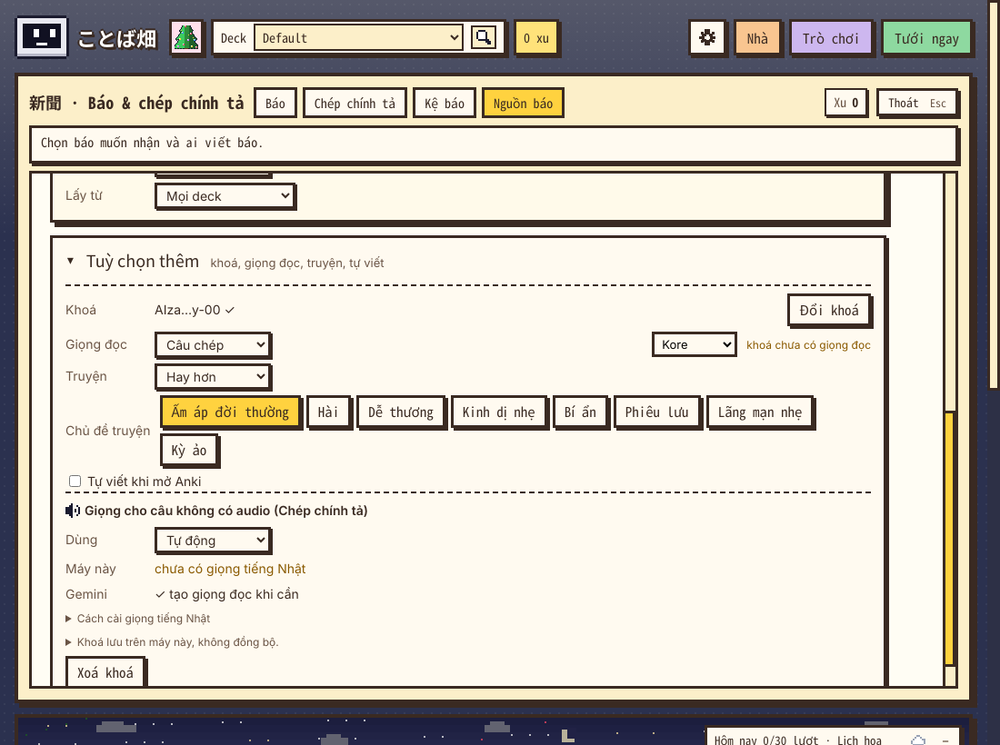
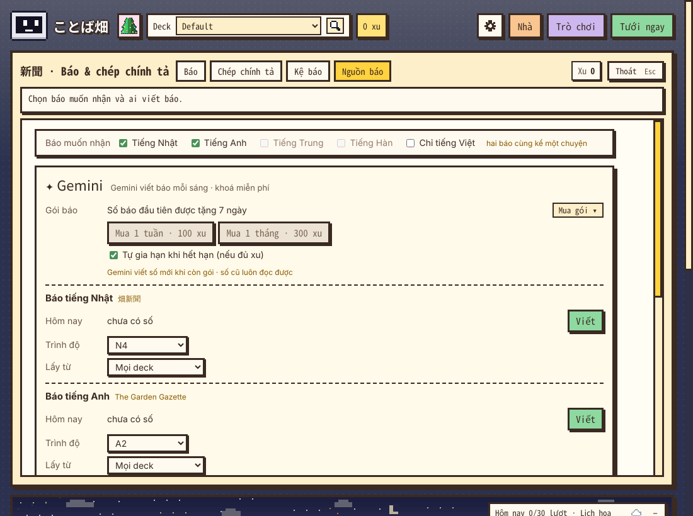

# Báo cáo kiểm thử 1.33.1 — kiểm tra lần cuối, Import .colpkg, tab Nguồn báo gọn hơn

Người dùng (17/11, sau 1.33.0): "hãy giúp tớ kiểm tra lại code, giao diện UI, tính năng, logic lần cuối. test kỹ hơn, tìm
các kịch bản, test ngoài những test đã có sẵn, đặc biệt các lỗi có thể gây mất dữ liệu. giúp tớ test thật kỹ nha. có cần
cải tiến gì nữa không vì hiện tại bên set up báo hơi nhiều nút". Chi tiết kỹ thuật: PHAT_TRIEN.md mục 2.6z13.
**Cách sửa và cách bày tab Nguồn báo là Claude chọn, bạn chưa xem.**

## 1. Tóm tắt

- Chạy lại **toàn bộ test có sẵn** trên 1.33.0 trước khi sửa: 60 bộ offline đều qua.
- Tìm kịch bản **ngoài bộ có sẵn**: các thao tác của chính Anki thay / đóng collection mà chưa bản nào thử — File → Import
  .colpkg, File → Export .colpkg, "Mở bản sao lưu", Tools → Check Database, xoá deck / loại note đang được vườn dùng.
- Tìm ra **3 lỗi** (cùng một chỗ: **Import .colpkg** khi đang dùng vườn), có **2 lỗi làm sai / mất dữ liệu** — đã sửa.
- **Tab Nguồn báo gọn lại**: khi có 2 báo, từ **49 → 15** chỗ bấm (14 khi vừa dán khoá), chiều dài còn chưa nửa. Không bỏ
  tính năng nào, không đổi cấu hình / dữ liệu.
- Không đổi phần lưu trữ (khoá collection + `config.json` giống hệt 1.33.0) → cập nhật từ 1.31.3 / 1.33.0 an toàn.

## 2. Lỗi tìm ra (đã sửa)

"File → Import" một file `.colpkg` là cách nhiều người dùng để **khôi phục bản sao lưu** hoặc **chuyển collection sang máy
khác**. Khác với "Đổi hồ sơ" hay "Mở bản sao lưu", Anki chỉ đóng collection rồi mở collection mới — không báo cho add-on là
hồ sơ đóng / mở. Tái hiện trong Anki 26.9.4 thật (kịch bản `tests/anki/e2e_1331.js` chạy trên mã 1.33.0):

| # | Lỗi | Mức | Tái hiện |
|---|---|---|---|
| A | **Trừ xu khỏi ví vừa khôi phục.** Vườn nhớ các lượt ôn vừa làm (để Undo trả xu). Bản sao lưu không có các lượt đó → vườn tưởng bạn vừa Undo → trừ xu (cả xu mục tiêu ngày / nhiệm vụ / chuỗi nếu có) | **Mất dữ liệu** | ôn 4 thẻ trong vườn → Import bản sao lưu 100 xu → vườn làm mới → còn **88 xu** |
| B | **Vườn quay về bản trước khi Import.** Lần mở Anki sau, lớp giữ dữ liệu khi đồng bộ (1.31.2) thấy bản của máy "mới hơn" bản vừa nhập → trả lại vườn cũ. Thẻ là bản sao lưu, vườn thì không — và nếu bạn khôi phục bản sao lưu chính vì vườn bị hỏng thì lần mở sau nó hỏng lại | **Sai dữ liệu** (chỉ người đã đồng bộ AnkiWeb) | Import bản 100 xu → mở lại hồ sơ → **200 xu** (bản trước Import) |
| C | **Hộp lỗi khi chấm thẻ.** Bảng ôn đang mở giữ thẻ của collection đã đóng | Hộp lỗi | chấm thẻ ngay sau Import → `ReferenceError` |

**Cách sửa**: khi collection bị thay lúc hồ sơ đang mở, vườn làm như "Mở bản sao lưu" của Anki (quyết định 1.31.2: khôi
phục bản sao lưu thì theo ý bạn) — giữ dữ liệu vườn vừa nhập, bỏ mọi thứ nhớ tạm của collection cũ (không ghi lượt Undo cũ
sang collection mới), vườn dựng lại, bảng ôn lấy thẻ của collection mới. Bản sao lưu từ trước khi cài ことば畑 (chưa có vườn)
thì lần mở sau vẫn trả lại vườn của máy — không mất vườn.

**Đã thử, không có lỗi**: Export .colpkg khi vườn đang mở; Check Database (mọi khoá dữ liệu vườn giữ nguyên); xoá deck đang
là nguồn báo + xoá loại note đã cấu hình tiếng Hàn (vườn và tab Nguồn báo vẫn mở được); "Mở bản sao lưu" của Anki và lớp giữ
dữ liệu khi điện thoại đè bản cũ (1.31.2) vẫn như cũ.

## 3. Tab Nguồn báo gọn hơn

Ảnh: trái là 1.33.0, phải là 1.33.1 (cùng trạng thái, chụp trong Anki thật).

| Trước | Sau |
|---|---|
| Trình độ: 5–6 nút mỗi báo | 1 ô thả xuống |
| Lấy từ: 3 nút mỗi báo | 1 ô thả xuống (Mọi deck / Chọn deck… / Không dùng deck) |
| Thẻ Gói báo riêng, 2 nút mua + ô Tự gia hạn luôn hiện | 1 dòng "Gói báo · Dùng thử · còn 5 ngày [Gia hạn ▸]" trong thẻ Gemini — bấm mới hiện nút mua + Tự gia hạn; **hết hạn thì mở sẵn** |
| Khoá, Đổi khoá, Giọng đọc (3 nút + giọng), Truyện (3 nút), Chủ đề truyện (8 nút), Tự viết, Xoá khoá, thẻ "Giọng đọc cho câu không có audio" (3 nút) luôn hiện | Gom vào khối **Tuỳ chọn thêm** (thu gọn sẵn, bấm để mở; nhớ mở / đóng); chọn-một là ô thả xuống, Chủ đề truyện vẫn là nút (chọn nhiều) |

Hằng ngày chỉ còn: **Báo muốn nhận** + mỗi báo **Hôm nay (Đọc / Viết) · Trình độ · Lấy từ**. Khi mở "Tuỳ chọn thêm" và
"Gói báo":

Muốn trở lại kiểu hàng nút ở chỗ nào thì chỉ cần đổi `pick(` thành `chips(` ở chỗ đó trong `web/paper.js`.

## 4. Kết quả test

| Bộ | Kết quả |
|---|---|
| `tests/run_all.sh` (offline + collection Anki thật, `ANKI_PY` = Anki 26.9.4) | **61 bộ — TẤT CẢ OK** (thêm `core/test_1331.py`; trên mã 1.33.0 bộ này trượt 21 ca) |
| `tests/anki/e2e_1331.js` (mới) | Anki 26.9.4: **43 / 43**; Anki 23.10.1: **40 / 40** (phần "Mở bản sao lưu" của Anki bỏ qua — Anki 23.10 chỉ làm việc đó từ màn chọn hồ sơ, kịch bản không giả lập được; đường đó không đổi ở bản này). Bấm bừa tab Nguồn báo 120 thao tác × 3 hạt: cấu hình luôn hợp lệ. Trên mã 1.33.0: trượt ở lỗi A rồi dừng vì lỗi C |
| Mọi kịch bản Anki thật (Anki 26.9.4, trên **gói đã đóng**, mỗi kịch bản một hồ sơ mới) | **47 kịch bản — 2.200 / 2.200 kiểm tra** (gồm `audit_full` 183, `audit_edge` 58, bộ UI audit 191 + 18 + 7, đồng bộ thật `e2e_1312` 47, cài đè 19). Chạy 2 luồng song song thì `e2e_1253` (1 ca về môi trường: localStorage của webview) và `e2e_1322` (1 ca câu chữ, xem dưới) trượt 1 ca; chạy riêng thì đạt trọn, **giống hệt trên mã 1.33.0** |
| Cài đè **1.31.3 (đã phát hành) → 1.33.1** (`run_capnhat.sh`, trình quản lý add-on của Anki) | **19 / 19**: không mất khoá collection nào (12), 48 file trong `user_files/` y nguyên, cấu hình giữ nguyên, 93.124 xu / đồ / nhật ký / cài đặt ⚙ còn đủ, Ctrl+Z, deck tiếng Trung cấu hình ở bản cũ được nhận đúng |
| Anki 23.10.1 (bản cũ nhất hỗ trợ) | `e2e_1331` 40/40, `e2e_133` 77/77, `e2e_1251` 49/49, `e2e_119` 55/55, `e2e_1223` 49/49, `e2e_123` 66/66, `e2e_1322` 40/40 |
| Gói `kotoba_batake.ankiaddon` | khớp từng byte với thư mục `kotoba_batake/` |

**Một điểm nhỏ có từ trước (không sửa)**: trên Anki 23.10, bấm Edit → Undo ở cửa sổ chính *ngay* sau khi đóng cửa sổ
Sửa thẻ thì thẻ trong vườn vẫn dựng lại đúng chữ cũ, chỉ dòng nhắc ghi "Đã lưu thẻ." thay vì "Thẻ vừa được sửa." (lần lưu cuối
của trình sửa bản 23.10 về muộn). Chỉ là câu chữ, dữ liệu đúng; trượt y hệt trên mã 1.33.0.

## 5. Việc của bạn

1. Xem tab Nguồn báo mới trên máy thật (Báo → Nguồn báo; mở thử "Tuỳ chọn thêm" và dòng Gói báo). Thấy chỗ nào khó tìm thì
   nói tớ — đổi lại từng chỗ rất nhanh.
2. Các việc còn chờ từ trước vẫn còn: chọn tên báo Trung / Hàn (`docs/kiem_thu/1.33/BAO_CAO.md` mục 1), câu hỏi R01 (báo
   Gemini riêng từng hồ sơ hay chung cả máy), thử AnkiWeb + điện thoại thật (`docs/kiem_thu/1.31.2/BAO_CAO.md` mục 4).
3. Hạn chế đã biết thêm: **đổi tên hồ sơ Anki** làm mất liên kết tới bản sao lưu theo hồ sơ trong `user_files/ho_so/` (dữ
   liệu trong collection không sao; chỉ lớp dự phòng) — chưa sửa, PHAT_TRIEN.md mục 9.
