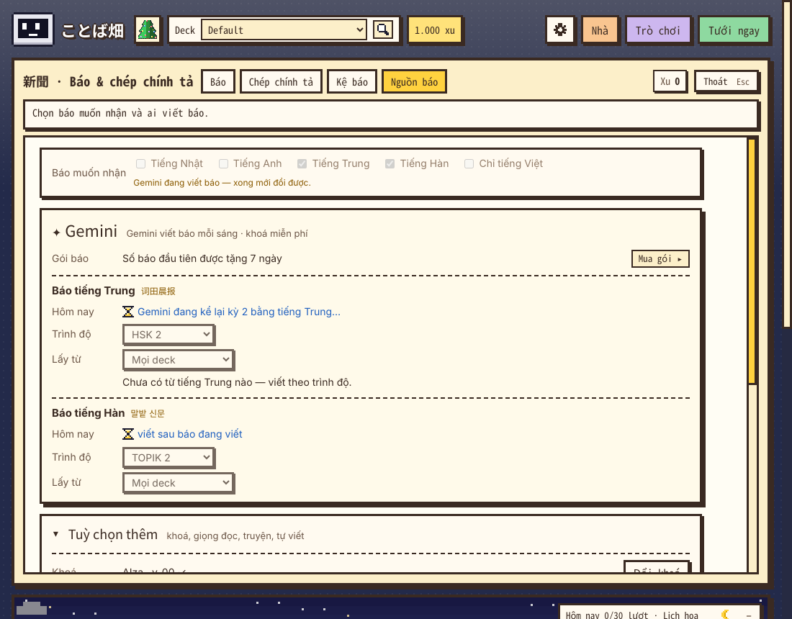
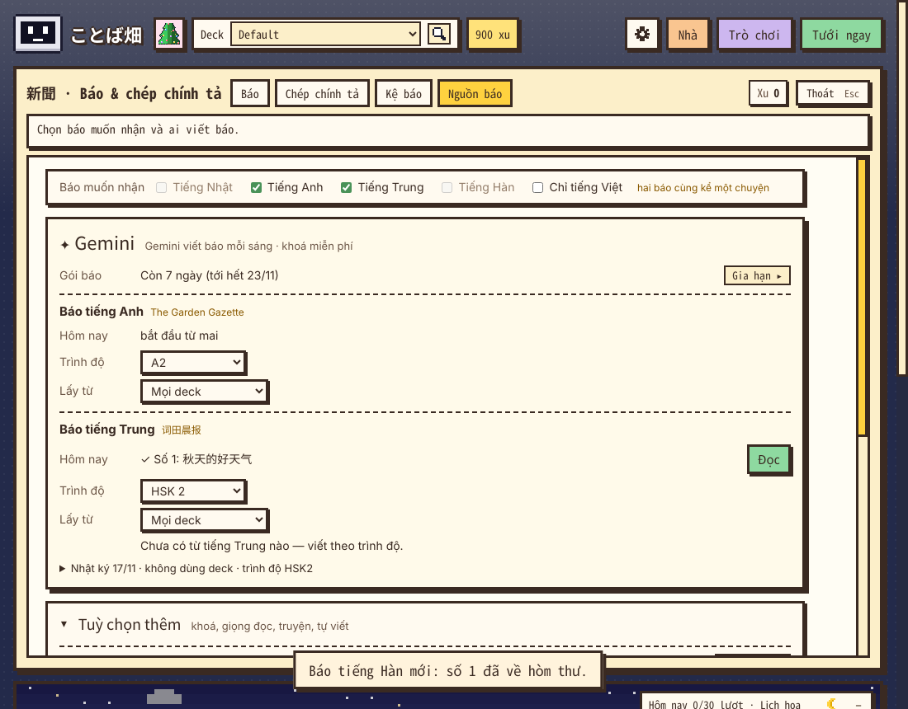
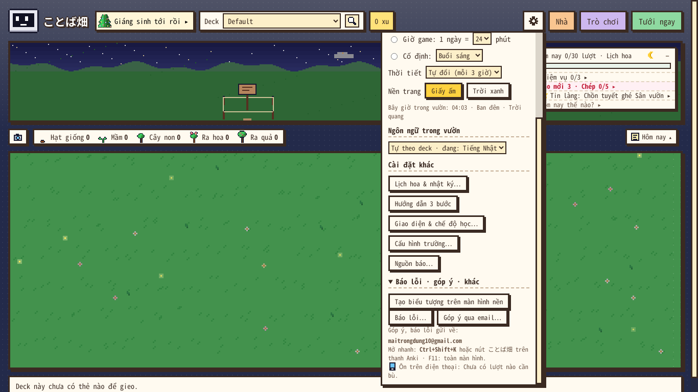
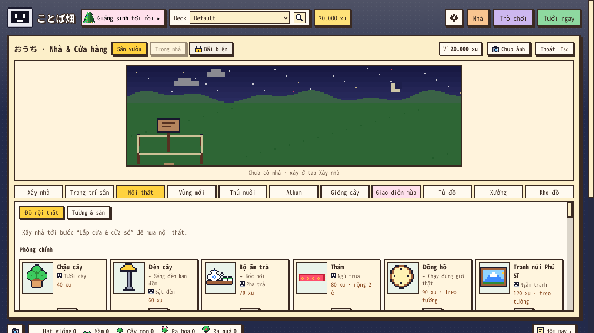
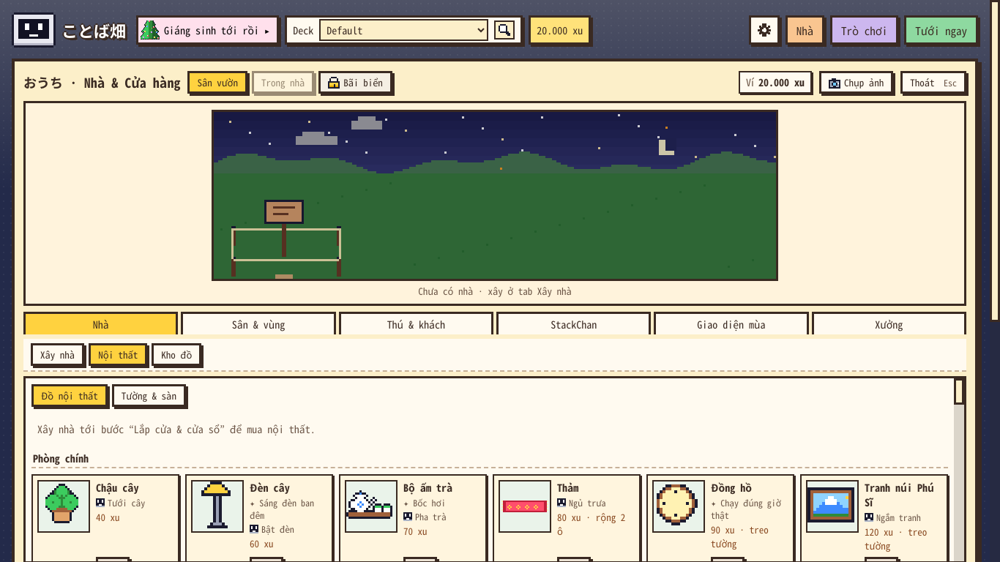

# Báo cáo 1.33.2 — việc chạy song song, câu chữ gọn, bớt nút

Người dùng (17/11, sau 1.33.1): "ví dụ hành động gemini đang viết báo đi. xong người dùng lại bỏ 1 tick ngôn ngữ để chọn
ngôn ngữ khác thì lúc đó sẽ xử lý sao và nên xử lý sao nhỉ. tìm thử các trường hợp khác đi … hay là để 1 hành động song song
đó chạy xong mới thao tác. ví dụ đang viết báo thì không được chọn đổi ngôn ngữ báo. viết xong rồi thì được chọn, nhưng số
đó để ngày mai. rà lại những chỗ diễn đạt dài dòng … chỗ nào nhiều nút hoặc nhiều thao tác quá cũng rút gọn bớt giống bên
báo nhé." Chi tiết kỹ thuật: PHAT_TRIEN.md mục 2.6z14. **Làm theo đúng hướng bạn đề xuất; chi tiết Claude chọn.**

## 1. Đang viết báo mà đổi ngôn ngữ — trước và nay

Tái hiện trong Anki thật (Gemini giả, mỗi lượt gọi chậm 2–3 giây): đang viết báo tiếng Trung (báo Hàn xếp sau), bỏ tick
Trung rồi tick Anh.

| | Trước (1.33.1) | Nay (1.33.2) |
|---|---|---|
| Báo đang viết | Gemini **vẫn viết xong** báo Trung (tốn 3 lượt gọi, gói báo vẫn bắt đầu tính) nhưng báo Trung **không còn hiện** ở Kệ báo | Ô Báo muốn nhận **khoá** trong lúc viết, một dòng: "Gemini đang viết báo — xong mới đổi được." |
| Báo vừa tick | Báo Anh chờ "Bắt đầu viết" — bấm là viết thêm một số ngay trong ngày (tốn thêm lượt) | Viết xong rồi mới tick được; báo Anh ghi **"bắt đầu từ mai"**, mai tự viết như mọi báo |
| Hôm nay chưa viết số nào | — | Tick báo mới thì như cũ: chọn trình độ / deck rồi bấm "Bắt đầu viết" |

## 2. Các trường hợp "đang chạy một việc mà bấm việc khác"

Nguyên tắc chung (theo ý bạn): **việc đang chạy chạy cho xong; thứ làm đổi việc đó thì khoá tới khi xong, kèm một câu nói vì
sao**; thứ không đụng tới việc đó thì vẫn làm được.

| Đang chạy | Bạn bấm | Trước | Nay |
|---|---|---|---|
| Gemini viết báo (cả hàng chờ của "Bắt đầu viết") | bỏ / tick báo, Trình độ, Lấy từ, Truyện, Chủ đề truyện, Giọng đọc | đổi được; số đang viết vẫn theo cái cũ, không nói gì | **khoá** + "Gemini đang viết báo — xong mới đổi được." |
| như trên | Đổi khoá, Xoá khoá, Dùng Claude Code / Gemini | đổi được giữa chừng | **khoá** tới khi xong |
| như trên | Viết (báo khác), Bắt đầu viết lần nữa | bấm được, báo "Gemini đang bận, thử lại sau." | nút khoá; báo xếp hàng ghi "viết sau báo đang viết" |
| như trên | Tạo giọng đọc | báo **sai**: "Không còn giọng đọc nào cần tạo." | khoá, nói đúng lý do |
| như trên | Dịch số này (ở số báo cũ) | "Gemini đang bận, thử lại sau." | "Gemini đang viết báo — xong rồi bấm lại." |
| như trên | Tự viết khi mở Anki, giọng cho câu chép, mua gói báo, đọc báo, ôn thẻ, chơi | được | **vẫn được** (không đụng số đang viết) |
| Anki đang đồng bộ | Mua, Tưới ngay, chấm thẻ, trò chơi… | **không có gì xảy ra, không có câu nào** (tưởng hỏng); chấm thẻ làm bảng ôn **kẹt** | "Anki đang đồng bộ — xong rồi bấm lại nhé."; đồng bộ xong chấm lại được |
| Gemini sửa bài luyện viết | sửa bài, đổi ngôn ngữ luyện viết | đã khoá từ 1.20 ("Bài đã gửi…") | như cũ, câu ngắn hơn |
| Đang lưu lượt chấm thẻ | Ctrl+Z, phím E, chấm tiếp | đã chặn (1.31.x) | như cũ |
| Cửa sổ Sửa thẻ đang mở | ôn tiếp, đóng vườn, đổi hồ sơ | đã xử lý (1.32.2) | như cũ |
| Xưởng đang lưu | đóng Xưởng, vẽ tiếp | đã xử lý (1.31.1) | như cũ |
| Gemini viết báo | đổi hồ sơ, tắt Anki | đã xử lý (1.28: tính gói báo đúng hồ sơ) | như cũ |
| File → Import .colpkg | — | sửa ở 1.33.1 | như cũ |

## 3. Câu chữ rút gọn

Chỉ sửa câu **hiện sẵn trên màn hình** (chú thích khi rê chuột được phép dài hơn). Ví dụ:

| Trước | Sau |
|---|---|
| Quạ mang nghĩa bay tới trộm hạt. Gõ đúng từ (mặt trước của thẻ) để đuổi. Không tính hoa thường, dấu câu. | Quạ mang nghĩa bay tới. Gõ đúng từ để đuổi. |
| Nghe rồi gõ lại câu bằng chữ Hàn. Không tính dấu câu; sai chỗ cách chữ vẫn tính đúng. Enter để kiểm tra. | Nghe rồi gõ lại bằng chữ Hàn · Enter để kiểm tra. |
| Bấm từ gạch chân để tra nghĩa (nhận cả dạng biến đổi: went → go). Gạch chấm: từ mới. | Bấm từ gạch chân để tra nghĩa · gạch chấm: từ mới |
| Thường mất 10–60 giây. Có thể đóng bảng hoặc làm việc khác — xong sẽ có thông báo. | Thường 10–60 giây · đóng bảng được, xong sẽ báo. |
| Khách ghé tuỳ đồ đã đặt, vùng, mùa, giờ và thời tiết. Không phải cho ăn, vắng nhà không mất gì. | Khách ghé tuỳ đồ đã đặt, vùng, mùa, giờ và thời tiết. |
| Mỗi số: Gemini viết truyện → biên tập chấm → viết cả số → máy kiểm tra → Gemini sửa → soát lần 2. Còn lỗi thì… | Máy kiểm tra từng số, còn lỗi thì không đưa vào hòm thư. Hết lượt miễn phí thì mai viết tiếp. |

Tổng cộng 42 câu (danh sách đầy đủ trong `tests/core/test_1332.py` mục 5 và lịch sử git).

## 4. Bớt nút

| Bảng | Trước | Nay |
|---|---|---|
| Nguồn báo (2 báo) | 49 | 15 (đã làm ở 1.33.1) |
| ⚙ Cài đặt | 28 | 21 — Tạo biểu tượng, Báo lỗi, Góp ý, email, phím tắt, ôn trên điện thoại gom vào dòng thu gọn **"Báo lỗi · góp ý · khác"**; 5 nút hay dùng vẫn ở ngoài |
| Chép chính tả | 29 | giữ: đó là 5 câu × (Nghe, Chậm, ô gõ, Kiểm tra) — chính là bài làm |
| Xưởng | 87 | giữ: bảng màu + công cụ vẽ |
| Cấu hình trường | 25 | giữ: biểu mẫu, đã dùng ô thả xuống |

**Bảng Nhà (11 tab) — cần bạn chọn.** Tớ thử gộp thành 6 nhóm (Nhà · Sân & vùng · Thú & khách · StackChan · Giao diện mùa ·
Xưởng). Hàng tab ngắn hơn, nhưng thành 3 tầng (nhóm → tab con → "Đồ nội thất / Tường & sàn") và phải bấm nhiều hơn để tới
đúng chỗ. Tớ nghiêng về **giữ nguyên 11 tab** (một lần bấm là tới); cách bày này bạn đã chốt từ 1.17 nên tớ không tự đổi.

Hiện tại:

Ảnh phác gộp 6 nhóm (chỉ là ảnh, chưa làm):

## 5. Kết quả test

_đang điền_
