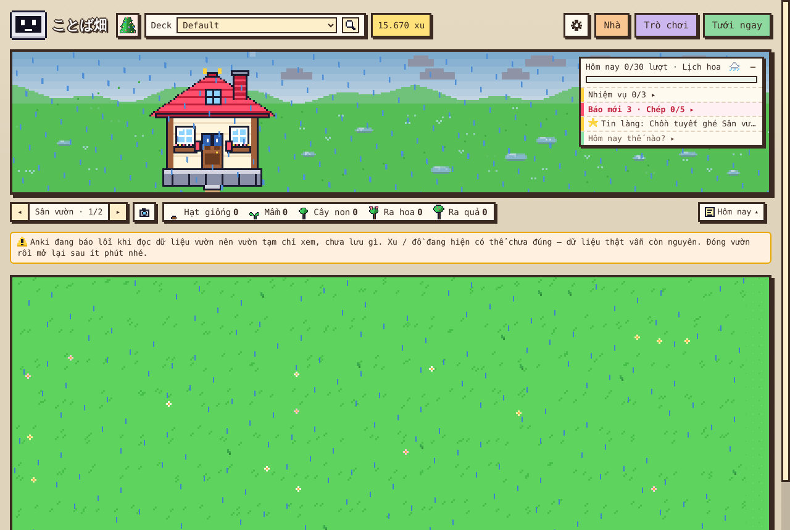
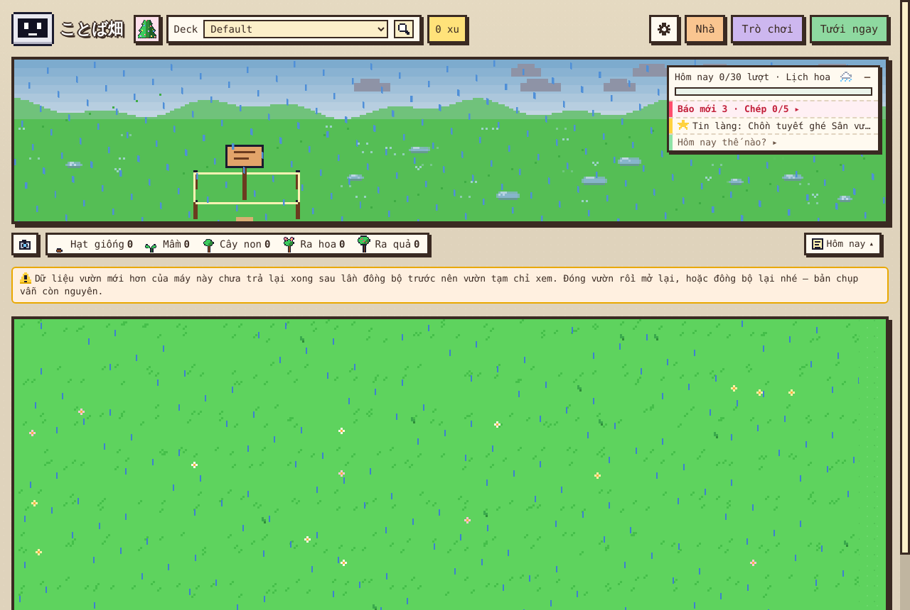

# Báo cáo 1.33.3 — sửa lỗi audit 17/11 + chữ không lẫn ngôn ngữ (17/11/2026)

Người dùng: "kiểm tra lại giúp tớ code mới xem phần ngôn ngữ đang có bị lẫn ngôn ngữ khác vào chưa (chợ sáng, sinh hoạt câu
nói stack-chan). kiểm chứng và sửa một số lỗi được tìm ra ở nhánh audit-1.33.2-2026-11-17. tìm thêm xem còn lỗi nào nữa
không, tạo thêm các kịch bản và test ngoài các test đã có sẵn, ưu tiên các lỗi làm mất dữ liệu, UI".
Chi tiết kỹ thuật: PHAT_TRIEN.md mục 2.6z15. **Cách sửa Claude chọn, người dùng chưa xem.**

## 1. Chữ có lẫn ngôn ngữ khác không

Quét trong Anki thật (`tests/anki/e2e_1333_ngonngu.js`): 4 deck (Nhật / Anh / Trung / Hàn) × 6 chế độ Ngôn ngữ trong vườn.
Mỗi cặp: bấm StackChan 14 lần, chấm thẻ 10 lần (câu khen / an ủi), xong lượt, gọi StackChan về, bấm thẻ sinh hoạt + mở Sổ
sinh hoạt, chơi Chợ sáng (bán đúng / bán sai / để khách chờ hết kiên nhẫn), Lật cặp. Ghi lại **~1.200 chữ khác nhau** hiện ra
ở bong bóng StackChan, bong bóng khách, kết quả trò chơi, thẻ / Sổ sinh hoạt, tên và tiêu đề trò chơi.

| Tìm thấy (trên 1.33.2) | Ví dụ | Sửa |
|---|---|---|
| StackChan nói câu **chỉ có tiếng Việt** khi đang chọn tiếng Anh / Trung / Hàn | chọn Tiếng Trung, bấm StackChan: "Tưới cây thôi!", "Giỏi quá!" (7 câu như vậy, 64 lần trong lượt quét) | chỉ bốc câu có bản dịch; "Chỉ tiếng Việt" vẫn đủ các câu tiếng Việt |
| Chợ sáng: khách hỏi tiếng của deck mà **cảm ơn bằng tiếng Việt** | khách hỏi 「学生」ください！ rồi đáp "Cảm ơn nha!" | khách cảm ơn bằng tiếng của deck |
| **Tiêu đề bảng Trò chơi** theo Ngôn ngữ trong vườn, còn tên trò theo deck | vườn tiếng Trung, deck tiếng Nhật: 小游戏 · Trò chơi ôn từ trên menu toàn tên tiếng Nhật | tiêu đề theo deck như tên trò; đổi sang Chỉ tiếng Việt khi menu đang mở thì vẽ lại ngay |
| Câu thưởng chỉ có tiếng Việt | "Xong nhiệm vụ: …", "Đọc xong số báo! +3 xu" | thêm できた！ (đổi theo ngôn ngữ) như "目標達成！ Xong mục tiêu…" |

Sau khi sửa: **0 chữ của ngôn ngữ khác** (kana / chữ Hán / Hangul) ở mọi cặp, **0 câu chỉ có tiếng Việt** khi chọn tiếng
nước ngoài. Sinh hoạt (thẻ khi bấm StackChan, Sổ sinh hoạt 67 việc) **không lẫn** ở cả 5 ngôn ngữ.

Giữ như cũ (đúng cách chơi): khách Chợ sáng hỏi **theo nghĩa / Hán Việt** thì hỏi bằng tiếng Việt ("Ở đây có “xe buýt”
không?") vì nghĩa trong deck là tiếng Việt; trong lúc chơi, bong bóng StackChan nói tiếng của deck đang chơi.

**Cần bạn xem**: ở chế độ **Tiếng Nhật**, StackChan trước đây xen các câu tiếng Việt ("Không sao, lần sau nhớ!"). Theo đúng
"không lẫn ngôn ngữ", nay chế độ Tiếng Nhật cũng chỉ nói tiếng Nhật (câu tiếng Việt vẫn có ở Chỉ tiếng Việt). Muốn giữ kiểu
cũ cho Tiếng Nhật thì sửa một dòng.

## 2. Lỗi của nhánh audit — tái hiện rồi sửa

Đã gộp nhánh `audit/release-review-1.33.2-2026-11-17` (test + minh chứng). Chạy lại các bộ của audit trên 1.33.2 trước khi
sửa — **ra đúng như báo cáo audit**: lỗi đọc 6/21, phục hồi 37/45, giao diện 42/53, vòng 2 16/20, ôn cùng giây 3/7.

| ID | Lỗi | Sửa | Sau khi sửa |
|---|---|---|---|
| F01 (P1) | Anki đọc lỗi một khoá → coi như "chưa có" / lấy file sao lưu cũ → lần lưu sau **ghi đè dữ liệu thật** (mất mèo, mất đồ, mất ngày đã đọc báo, ví lùi 100 xu) | đọc lại một lần; vẫn lỗi → khoá đó "hỏng": vườn vẫn mở để xem, **mọi thao tác ghi từ chối** với câu đúng lý do; áp cho mọi kho (ví, nhà, đồ tự vẽ, điểm ảnh, khách, sinh hoạt, Hộp sưu tầm, báo, Cấu hình trường, deck nguồn báo, nhật ký) | lỗi đọc **21/21**¹ |
| F06 (P1) | Trả lại dữ liệu sau đồng bộ bị lỗi ghi → đồng bộ lại / cộng xu / viết nhật ký đè mất **bản chụp tốt** | giữ bản chụp tốt kèm dấu "đang chờ"; lần đọc / ghi / đồng bộ / mở hồ sơ sau **trả lại trước**; vẫn lỗi → chặn thao tác, báo "chưa trả lại xong…"; tự khôi phục bản sao lưu của Anki thì bỏ chờ | phục hồi **45/45** |
| F02 (P2) | Ghi tiến độ (câu báo đã trả lời, chỗ đã nhặt) xong mà ghi ví lỗi → **mất xu thưởng**, thử lại không được | tiến độ + xu ghi **cùng một lần**: lỗi ở bất kỳ khoá nào → không đổi gì, làm lại được | giao diện 52/53¹ |
| F02 mở rộng | Anki tắt đột ngột giữa sổ bù xu và ví → **mất xu của lượt ôn** | sổ bù xu nhớ bản trước lần lưu; đọc thấy sổ đi trước ví → dùng bản trước, lượt đó được bù **đúng một lần** | phục hồi 45/45 (cả 4 điểm dừng) |
| F07 (P2) | Gánh hàng rong: trừ xu xong, ghi "đã mua" lỗi → báo lỗi, mua lại **bị trừ lần hai** | xu + món + "đã mua" ghi cùng một lần | vòng 2 **20/20** |
| F03 (P2) | Bỏ tick báo đã viết rồi tick báo khác → viết được **ngay hôm nay** (trái luật "báo mới từ mai") | xét **mọi** báo đã viết xong hôm nay | 9 ca "từ mai" đạt |
| F04 (P2) | Xoá khoá Gemini → **không đọc được báo cũ** Anh / Trung / Hàn / Việt dù còn trên máy | báo đã có trên máy đọc được không cần khoá (khoá chỉ để viết số mới) | 4 ca đạt |
| F05 (P2) | Thẻ được chấm ở chỗ khác **trong cùng giây** → vườn không nhận ra, báo lỗi chấm lại mãi | so đủ các cột lịch ôn + revlog lúc thẻ hiện ra (không chỉ "lần sửa" tính theo giây) | ôn cùng giây: các ca sản phẩm đạt²; `e2e_1333` ca trùng giây đạt |
| P3 | Đóng cửa sổ Sửa thẻ rồi Undo ở cửa sổ chính → báo "Đã lưu thẻ." thay vì "Thẻ vừa được sửa." | lần lưu của cửa sổ Sửa đã tới trước lúc đóng → hết chờ | `e2e_1322` 40/40 |

¹ Hai ca **đối chứng** của audit được viết cho cách lưu cũ, nay đổi nghĩa (không phải lỗi):
- *Nhật ký từ chối khi đọc lỗi một lần* — nay đọc lại được nên **giữ cả tháng và lưu luôn dòng mới** (tốt hơn); đọc lỗi kéo
  dài thì vẫn từ chối, tháng không đổi (`test_1333`).
- *Hộp sưu tầm: "đã nhặt" phải còn khi ghi quà lỗi* — nay "đã nhặt" và quà lưu cùng một lần, lỗi thì không đổi gì, chỗ lấp
  lánh vẫn còn để nhặt lại; ca chính "thử lại không mất quà" vẫn đạt.

² Ca đối chứng "hai trạng thái trong cùng giây" phải làm mới vườn rồi chấm thẻ trong chưa tới một giây; ở máy test này
làm mới mất hơn một giây nên không tạo được tình huống (kết quả ghi `same_second: false`, 4 lần chạy). Các ca sản phẩm đều
đạt; `e2e_1333` phần 4 tạo đúng tình huống bằng cách đặt `cards.mod` trùng giây.

### Giao diện khi vườn tạm chỉ xem (trước: không báo gì, ví hiện 0 xu như mất hết)

## 3. Lỗi tìm thêm (ngoài audit)

| Lỗi | Sửa |
|---|---|
| Đọc lỗi thì thao tác báo **sai lý do**: "Thiếu 1.000 xu", "chưa có thú này" (vì đang đọc ra ví 0 xu) | báo đúng: "Anki báo lỗi khi đọc dữ liệu vườn…" / "chưa trả lại xong…" |
| Thông báo cũ khi dữ liệu đọc hỏng bảo "Mở Báo lỗi" cả khi chỉ là Anki đọc lỗi thoáng qua | dòng cảnh báo cố định, câu theo lý do (đọc lỗi / chờ trả lại / dữ liệu hỏng) |
| Sổ bù xu đọc lỗi đúng lúc lập **mốc chuỗi ngày** → mốc thành "bây giờ": chuỗi ngày của người dùng cũ bị cắt, và mốc này còn là "dòng" dữ liệu của lớp giữ dữ liệu khi đồng bộ | đọc lỗi thì để lần sau |
| Dấu phiên bản đọc lỗi → đoán dấu mới có thể **nhỏ hơn** dấu đang có (đồng hồ máy khác chạy nhanh) → bản mới trông như bản cũ khi đồng bộ | đọc lại; vẫn lỗi thì không đóng dấu |
| Cấu hình trường / deck nguồn báo đọc lỗi → lưu một loại note **xoá cấu hình mọi loại note khác** | như F01 |
| Đổi sang Chỉ tiếng Việt khi menu Trò chơi đang mở: tên trò / tiêu đề chưa đổi | vẽ lại menu |

## 4. Kịch bản test mới (ngoài các test có sẵn)

| Bộ | Nội dung | Kết quả |
|---|---|---|
| `core/test_1333.py` (Anki 26.9.4 + 23.10.1) | đọc lỗi **kéo dài** ở từng kho × từng thao tác: không ghi, collection + file sao lưu không đổi một byte; trả lại sau đồng bộ lỗi 6 đường; lưu chung một lần × lỗi ở từng khoá; **tiến trình con dừng giữa hai lần ghi** (4 điểm × 3 lượt ôn); **mã thật 1.31.3** chạy xen; soát mã | **83 / 83** cả hai bản Anki |
| ↳ thử ngẫu nhiên có đối chứng | vườn A bị lỗi đọc / ghi ngẫu nhiên, vườn B không lỗi chỉ làm lại thao tác A làm được — sau mỗi bước hai vườn phải khớp từng byte (3 hạt × 260 thao tác, 13 loại thao tác) | khớp; **trên mã 1.33.2 trượt ngay** (đọc lỗi một lần khi lưu đồ tự vẽ → mất các món tự vẽ khác) |
| `anki/e2e_1333.js` | giao diện khi đọc lỗi / còn chờ trả lại / đọc lỗi thoáng qua; thẻ chấm ở chỗ khác trùng giây | **18 / 18** |
| `anki/e2e_1333_ngonngu.js` | quét chữ lẫn ngôn ngữ (mục 1) | **5 / 5** |

## 5. Bộ test có sẵn + bộ của audit

| Bộ | Kết quả |
|---|---|
| `tests/run_all.sh` (aqt 26.9.4, **64 bộ**, có `test_1333` + `audit_20261117/recovery_round2.py`) | **TẤT CẢ OK** (lần đầu đỏ 3 bộ soát đúng nguyên văn đoạn mã vừa sửa: `test_1311`, `test_1312`, `test_1332` → cập nhật kỳ vọng; trang web chung cần `node site/tools/xuat_hinh.js` cho số bản mới) |
| Bộ của audit, Anki 26.9.4 **và** 23.10.1 | lỗi đọc 20/21 (ca đối chứng nhật ký, mục 2 ¹) · phục hồi **45/45** · giao diện 52/53 (ca đối chứng Hộp sưu tầm ¹) · vòng 2 **20/20** · ôn cùng giây 6/7 (ca đối chứng thời gian ²) |
| `e2e_1333.js` (thêm ca F05 không phụ thuộc tốc độ máy: đặt `cards.mod` trùng giây) | **18 / 18**; trên mã 1.33.2: mất mèo + ví / file sao lưu bị ghi đè ngay ở phần 1 |
| Kịch bản Anki thật cũ có liên quan | `e2e_1322` **40/40** (trước 39/40) · `e2e_128` 72/72 · `e2e_133` 77/77 · `e2e_1332` 36/36 · `e2e_132` 39/39 · `e2e_132b` 20/20 · `e2e_1314` 53/53 · `e2e_1331` 43/43 · `e2e_1311` 42/42 · `e2e_fuzz` 6/6 · `e2e_131` 89/89 · `e2e_130` 75/76 (chip sinh hoạt bị cắt chữ — trượt y hệt trên mã gốc vì máy test thiếu phông, đã ghi ở báo cáo 1.31.4 / 1.32) |
| Đồng bộ bằng máy chủ đồng bộ thật của Anki (`e2e_1312`) | **47 / 47** (audit đo 46/47) |
| `run_capnhat.sh` 1.31.3 (đã phát hành) → 1.33.3, cài đè trong Anki thật | **19 / 19** — mọi khoá collection, mọi file `user_files/`, cấu hình add-on giữ nguyên |

## 6. Lưu trữ

- Ví (`kotoba_batake_state`) thêm `mob: {"n"}`, sổ bù xu (`kotoba_batake_mobile`) thêm `n` + `prev`. Bản ≤ 1.33.2 không
  đọc hai khoá phụ này và bỏ chúng khi tự lưu — đã thử bằng mã 1.31.3 thật xen kẽ: không sai xu.
- File `user_files/ho_so/<mã>/dong_bo.json` (của máy, không đồng bộ) có thêm `"pending": true` khi còn chờ trả lại.
- Không thêm khoá collection mới, không đổi `config.json`.
- Giới hạn còn lại: Anki tắt đúng giữa sổ bù xu và ví, rồi **máy khác còn bản cũ** đồng bộ và chạy trước khi máy này mở lại
  → bản cũ coi sổ là đúng, mất xu của lượt đó (1 lượt). Máy này mở lại trước thì đúng.

## 7. Nên thử trên máy thật

1. Chọn từng chế độ Ngôn ngữ trong vườn → bấm StackChan vài lần; Trò chơi → Chợ sáng với deck tiếng Anh / Trung.
2. Ở chế độ Tiếng Nhật: StackChan không còn xen câu tiếng Việt — giữ như vậy hay trả lại?
3. Gánh hàng rong (thứ Tư / Chủ nhật), nhặt chỗ lấp lánh, trả lời câu hỏi báo: như cũ.
