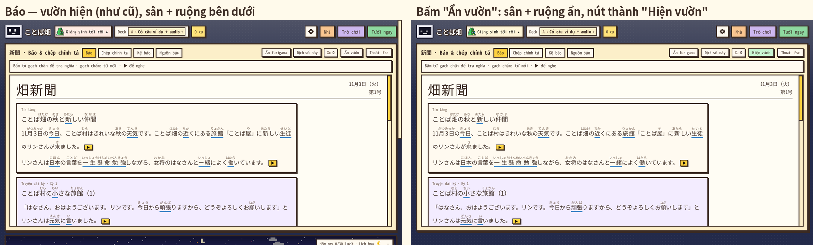
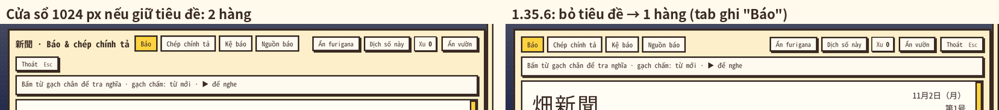
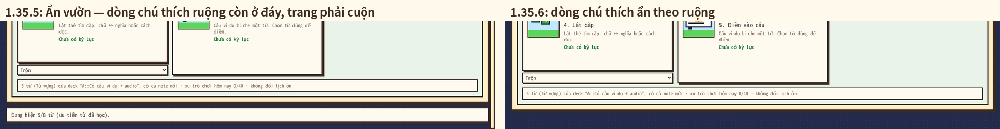

# 1.35.6 — nút "Ẩn vườn / Hiện vườn" trên bảng Báo (19–20/11)

Người dùng: "giúp tớ thêm phần báo có mục ẩn vườn, hiện vườn nhé. sau đó test kỹ thêm, vì đây là bản release cuối rồi."

**Cách bày Claude chọn, người dùng chưa xem trên máy thật.** Không đổi lưu trữ / config / file Python nào (test so với 1.35.5
từng byte) — cập nhật đè từ 1.31.3 hay 1.35.5 đều giữ nguyên dữ liệu.

## 1. Đã làm

| | |
|---|---|
| **Nút** | Bảng 新聞 có nút **Ẩn vườn** ngay trước nút Thoát (cùng kiểu với nút của bảng ôn và bảng Trò chơi). Bấm → sân + ruộng ẩn, khung báo cao kín cửa sổ (cửa sổ 1850 × 1130: 760 → 880 px; 1920 × 1080: 760 → 830 px; cửa sổ thấp hơn ~1.010 px thì khung báo vốn đã kín cửa sổ), nút thành **Hiện vườn**. Bấm lại → về như cũ. |
| **Dùng chung với Trò chơi** | Như nút của Trò chơi (1.35.3), nút đổi chế độ "Trò chơi & báo" ở ⚙ → Giao diện: ẩn ở Báo thì Trò chơi / Lịch hoa cũng ẩn và ngược lại; hai nút luôn cùng chữ. Bảng ôn (chế độ "Khi ôn thẻ") và màn chính không đổi. Nhớ qua lần mở lại Báo và lần đóng / mở cửa sổ vườn (lưu ở `config.json` → `ui.panel`, giá trị có từ 1.14 — bản 1.31.3 đọc được). |
| **Không làm gián đoạn** | Bài đang đọc không vẽ lại, giữ nguyên chỗ đang cuộn; đang gõ chép chính tả mà bấm nút thì ô gõ vẫn giữ con trỏ và chữ, gõ tiếp được ngay. |

## 2. Test kỹ tìm thêm (đã sửa)

1. **Hàng trên cùng của tab Báo xuống dòng ở cửa sổ ~1024–1110 px.** Tab Báo (Ẩn furigana + Hiện bản dịch + Xu) cần
   ~1.044 px; bản 1.35.5 vừa khít cửa sổ 1024 px (thừa 2 px), thêm nút là thành 2 hàng (36 → 75 px), khung báo bị đẩy xuống.
   Sửa (`paper.js fitTop`): bỏ tiêu đề "新聞 · Báo & chép chính tả" khi nhờ đó hàng bớt được một hàng — các tab ngay cạnh
   đã ghi "Báo / Chép chính tả / Kệ báo / Nguồn báo"; không bớt được (cửa sổ rất hẹp) thì giữ như 1.35.5.

   

   **Đo thật, không đặt ngưỡng px**: font giao diện là font của máy (DotGothic16 không đi kèm gói) nên bề rộng chữ khác nhau
   giữa Windows / macOS / Linux. Hai lần thử trước bị test bắt: (a) ngưỡng 1110 px cố định — với font kiểu mono ở cửa sổ ~700 px
   hàng thành 3 dòng; (b) chỉ bỏ phần chữ Việt để còn 新聞 — chế độ Ngôn ngữ trong vườn dịch nguyên cụm "新聞 · …" nên ở tiếng
   Anh / Trung / Hàn / Đức / Pháp / Việt chữ 新聞 không còn được dịch (`core/test_132.py` đỏ). Phụ: cửa sổ ~800 px, tab Kệ báo /
   Nguồn báo nay một hàng (1.35.5: hai).
2. **Dòng "Đang hiện N/M từ (ưu tiên từ đã học)." còn nằm dưới bảng lúc Ẩn vườn.** Đây là chú thích của ruộng (`#kb-note`,
   hiện khi deck nhiều từ hơn `max_plants`, hoặc "Deck này chưa có thẻ nào để gieo."). Ruộng ẩn mà dòng này vẫn hiện dưới
   bảng Báo / Trò chơi / **bảng ôn** → trang dài hơn cửa sổ 22–40 px, phải cuộn (có từ nút Ẩn vườn của bảng ôn 1.14 và của
   Trò chơi 1.35.3; Anki thật, 1.35.5: trang 790 / 768 px). Sửa: ruộng ẩn thì dòng này ẩn theo; ruộng hiện thì như cũ.

   

## 3. Test

| Test | Kết quả |
|---|---|
| `core/test_1356.py` (offline): so với 1.35.5 — cùng 78 file, mọi `.py` / `config.json` giống hệt, 29 khoá collection như cũ, body.html = 1.35.5 + nút, garden.css chỉ thêm dòng; `clean_ui` của 1.35.6 + **1.31.3 đã phát hành** giữ `ui.panel` Ẩn; soát mã | 23/23 (mã 1.35.5: đỏ 11) |
| `core/test_1356.js` (Chromium, mã add-on thật): `ui:set`, lớp `kb-ui-*`, hai nút cùng chữ, mousedown, khung báo 12 chiều cao × ẩn / hiện, **4.716 bố cục hàng trên cùng** (131 bề ngang 700 → 2000 px × 6 kiểu font × 6 trạng thái nút), 7 tiếng của Ngôn ngữ trong vườn | 15/15 |
| `anki/e2e_1356.js` (Anki 26.9.4 thật): mục 1 + 2, 4 tab, chuột thật, Esc, ⚙, bảng ôn, Lịch hoa, 5 cỡ cửa sổ × ẩn / hiện × 4 tab (so hàng trên cùng với bố cục 1.35.5) | 36/36; `ANKI_WEBSCALE=1.25` 36/36; Anki 23.10.1 36/36 |
| `anki/e2e_1356b.js` (ngoài bộ test): bấm vội 40 lần xen đổi tab, đổi cỡ 12 lần liền + 720 × 520, Anki chế độ tối (tương phản 11,5), cỡ cảnh Lớn + Giáng sinh, tiếng Anh ở 1024 px, Tưới ngay / Nhà khi Báo đang ẩn vườn | 16/16; `ANKI_WEBSCALE=1.25` 16/16; 23.10.1 16/16 |
| `tests/run_all.sh` trên gói đã giải nén (aqt 26.9.4) | **74 bộ, TẤT CẢ OK** |
| Anki 26.9.4, **58 kịch bản** (mọi `anki/e2e*.js` + `audit*.js` trừ trình riêng), 3 luồng | **2.427 / 2.428** — ca trượt `e2e_1253` "localStorage trống sau khi mở lại" là điều kiện môi trường test (trượt y hệt ở 1.35.3 / 1.35.4 / 1.35.5) |
| `audit.js` (bố cục 91 màn hình ở 1366 × 768 + 1024 × 700) | giống hệt 1.35.5 (chỉ khác số nút); dòng tóm tắt của Kệ báo cắt bằng "…" là có sẵn, cố ý |
| `audit_20261114/run_ui_audit.sh` | `e2e_128_fix` 26/26, `ui_audit` 191/191, `deep_ui_audit` 18/18, `lifecycle_audit` 7/7 |
| Anki 23.10.1 | `e2e_1353` 23/23, `e2e_1354` 75/75, `e2e_1354b` 35/35, `e2e_1355` 25/25 |
| `e2e_1355z.js` (`ANKI_WEBSCALE=1.25`) | 10/10 |
| Máy chủ đồng bộ thật (`dong_bo/run_e2e.sh`) | 47/47 |
| `run_capnhat.sh` 1.31.3 đã phát hành → 1.35.6 (cài đè bằng trình quản lý add-on của Anki) | 19/19 |

## 4. Câu hỏi cho người dùng

Lịch hoa (và Cấu hình trường) cũng thuộc chế độ "Trò chơi & báo" nên **ẩn vườn theo** khi cậu bấm Ẩn vườn ở Báo / Trò chơi,
nhưng chưa có nút riêng để hiện lại (phải về Báo / Trò chơi hoặc ⚙ → Giao diện). Có muốn thêm nút như vậy cho Lịch hoa không?

## 5. Xem trên máy thật

1. Báo → **Ẩn vườn**: sân + ruộng bên dưới biến mất, khung báo kéo tới gần đáy cửa sổ, không phải cuộn trang; **Hiện vườn**
   về như cũ.
2. Ẩn vườn ở Báo → Thoát → Trò chơi: vườn cũng ẩn, nút ghi "Hiện vườn".
3. Thu cửa sổ Anki còn ~1000 px: hàng trên cùng của Báo vẫn một hàng (tiêu đề bảng tạm ẩn, tab "Báo" vẫn sáng); kéo rộng ra
   → tiêu đề hiện lại.
4. Chép chính tả: đang gõ dở thì bấm Ẩn / Hiện vườn → gõ tiếp được ngay.
