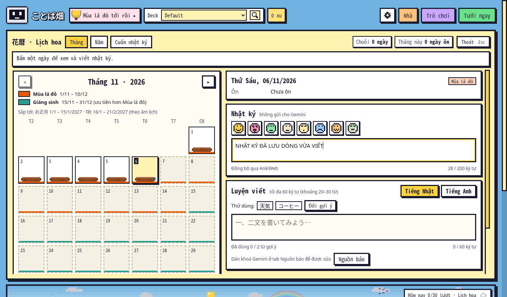
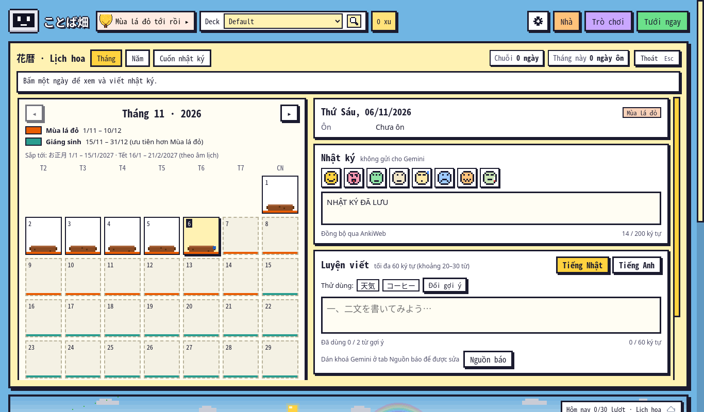
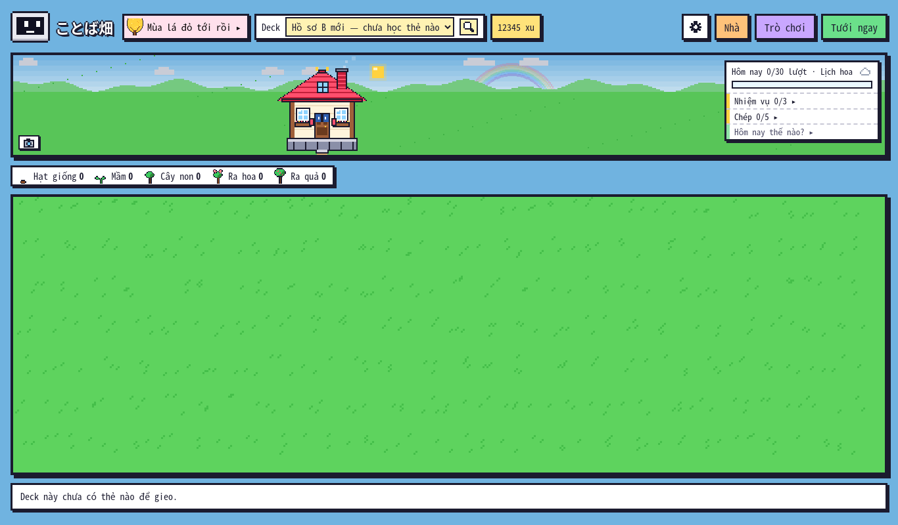
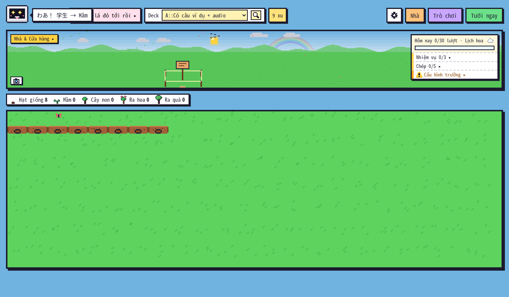
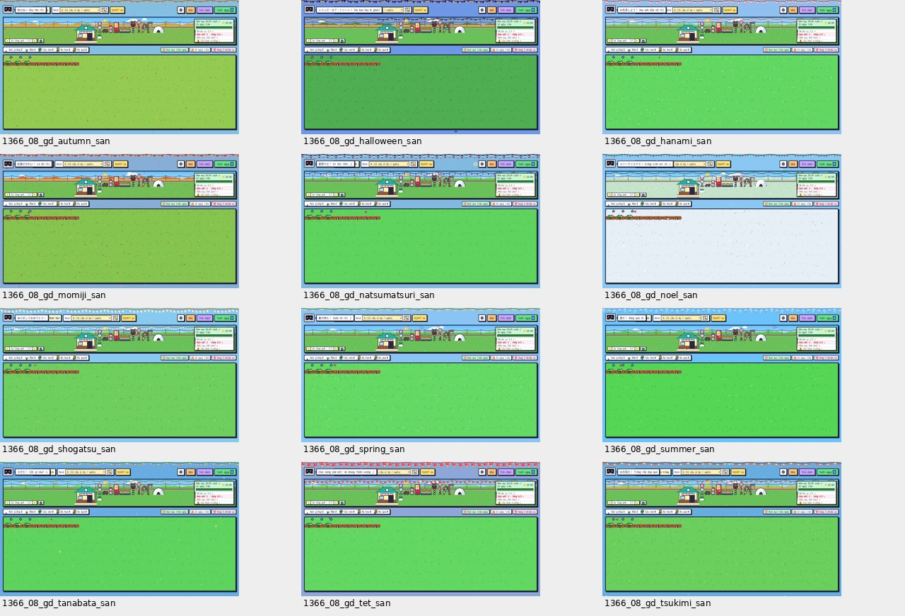
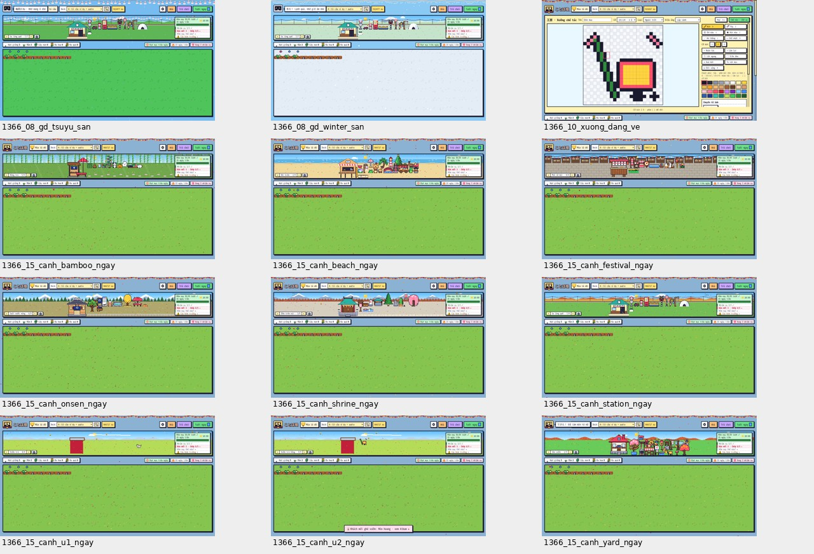

# Kiểm tra ことば畑 1.22.8 — 06/11/2026

**Có 3 lỗi đã tái hiện. Chưa sửa mã nguồn.** Nhánh báo cáo: `audit/addon-1.22.8-2026-11-06`, xuất phát từ `57b89e147efae860b9ee36849dc5f83ca915baa1`.

| Mã | Ưu tiên | Lỗi | Anki đã tái hiện |
| --- | --- | --- | --- |
| KB-01 | Cao | Đóng cửa sổ vườn trước khi tự lưu làm mất chữ vừa nhập trong nhật ký/luyện viết | 26.9.4 và 23.10.1 |
| KB-02 | Vừa | Hồ sơ Anki mới nhận xu và cấp nhà từ hồ sơ trước | 26.9.4 và 23.10.1 |
| KB-03 | Vừa | Hoàn tác lượt ôn không hoàn tác xu; ôn rồi Undo lặp lại vẫn kiếm thêm xu | 26.9.4 và 23.10.1 |

Các lỗi trên xuất hiện trong kiểm tra bổ sung dù bộ hồi quy hiện có chạy đạt. Mỗi lỗi có thao tác tái hiện, ảnh gốc và số liệu bên dưới. Không coi kiểm tra tự động đạt là bằng chứng rằng mọi kịch bản đều không có lỗi.

## 1. Môi trường và tính nguyên vẹn

- Gói kiểm tra: `kotoba_batake.ankiaddon`, phiên bản **1.22.8**; giải nén trực tiếp từ gói trong commit gốc, không dùng bản mã đang sửa.
- SHA-256 của gói trước/sau kiểm tra: `d1baeedadf9c158a22eb053a0be325474d184f0b392962f07215d6be770f2b38`.
- Môi trường chính: Linux x86_64, Python 3.13.5, Anki 26.9.4, PyQt6/Qt 6.12.0, QtWebEngine 6.140.0, Node 24.22.1.
- Đối chiếu: Python 3.9.25, Anki 23.10.1, Qt/QtWebEngine 6.6.0.
- Giao diện chạy trong **Anki thật**, Qt offscreen; điều khiển chuột, bàn phím và chụp webview bằng CDP. Hồ sơ mới cho từng kịch bản; không dùng collection học thật.
- Bộ mua sắm cấp **1.000.000 xu cho dữ liệu mẫu**, sau đó mua qua nút giao diện và đối chiếu giá với số xu thực bị trừ. Đã tiêu 93.283 xu trong lần kiểm tra này.
- Không sửa gói add-on, mã nguồn ứng dụng, các test có sẵn, README hay tài liệu phát triển. Nhánh chỉ thêm báo cáo, ảnh, log, dữ liệu đo và công cụ tái hiện trong thư mục này.
- [Manifest và kết quả từng lần chạy](evidence/data/manifest.json). Không đưa khóa API hoặc các file collection vào nhánh báo cáo.

## 2. KB-01 — Mất chữ khi đóng cửa sổ vườn trước lần tự lưu

**Kết quả mong đợi:** đóng bình thường bằng nút X phải giữ phần vừa nhập, hoặc cho người dùng biết còn nội dung chưa lưu.

**Thao tác tái hiện:**

1. Mở vườn → Lịch hoa → ngày hôm nay.
2. Ghi `NHẬT KÝ ĐÃ LƯU`, đợi tự lưu.
3. Gõ thêm ` DÒNG VỪA VIẾT`.
4. Trong khoảng dưới 1,5 giây sau lần gõ cuối, bấm X đóng **cửa sổ vườn**, rồi mở lại.
5. Phần vừa gõ thêm biến mất. Với ô Luyện viết, đóng trước khoảng 0,8 giây cũng làm mất bản nháp vừa nhập.

Trong công cụ tái hiện, bước 4 gọi `GardenDialog.close()`: cùng đường `closeEvent` với đóng cửa sổ thông thường, không kết thúc tiến trình hay giả lập mất điện. Khoảng đợi trước ảnh là 100 ms; thời gian chụp và gửi lệnh đóng cộng thêm vào đó.

| Trường hợp | Vừa hiển thị trước khi đóng | Sau khi mở lại |
| --- | --- | --- |
| Nhật ký, đóng ngay | `NHẬT KÝ ĐÃ LƯU DÒNG VỪA VIẾT` | `NHẬT KÝ ĐÃ LƯU` |
| Luyện viết, đóng ngay | `いい天気です。` | Rỗng |
| Nhật ký, đợi 2 giây rồi đóng | Toàn bộ dòng mới | Giữ nguyên — đối chứng đạt |
| Luyện viết, chỉ đóng bảng Lịch hoa | `テスト` | Giữ nguyên — đối chứng đạt |

**Trước khi đóng:**



**Sau khi mở lại: mất phần “DÒNG VỪA VIẾT”:**



Ảnh bản nháp luyện viết: [trước](evidence/images/audit_extra_evidence/draft-close-fast-before.png) và [sau](evidence/images/audit_extra_evidence/draft-close-fast-after.png).

**Bằng chứng:** [số liệu](evidence/data/audit_extra_evidence-findings.json), [log tái hiện](evidence/logs/audit_extra_evidence-result.log), [lặp lại trên hồ sơ khác](evidence/data/audit_extra_repeat-findings.json), [đối chiếu Anki 23.10.1](evidence/data/audit_extra-23.10.1-findings.json).

**Vị trí liên quan trong gói:** `web/calendar.js:363` đặt hẹn lưu nhật ký 1.500 ms, bản nháp ở khoảng dòng 464–487 đặt hẹn 800 ms. `GardenCal.close()` gọi `flushAll()`, nhưng `__init__.py:2635` (`GardenDialog.closeEvent`) dọn webview mà không gọi đường lưu này. Đây là kết quả quan sát và đối chiếu mã; chưa thay đổi xử lý đóng/lưu.

**Tác động:** người dùng đóng vườn ngay sau khi viết có thể mất nội dung mà không thấy thông báo lỗi. Đã lặp lại trên ba hồ sơ sạch ở 26.9.4 và thêm một lần ở 23.10.1.

## 3. KB-02 — Xu và nhà bị mang sang hồ sơ Anki mới

**Kết quả mong đợi:** hồ sơ chưa học gì có tiến độ riêng, không tự nhận ví và nhà của một collection khác.

**Thao tác tái hiện:**

1. Trong hồ sơ thử A, chuẩn bị ví 12.345 xu và nhà cấp 7. Hai giá trị được cấp qua dữ liệu mẫu, không sửa logic mua/xây.
2. Chọn đổi hồ sơ Anki, tạo một hồ sơ B hoàn toàn mới, chưa có thẻ.
3. Mở vườn trong B.
4. B đang có **12.345 xu và nhà cấp 7**, dù collection B có **0 note**.

| Hồ sơ | Số note | Xu | Cấp nhà |
| --- | ---: | ---: | ---: |
| A: `Test` | 123 | 12.345 | 7 |
| B: `Audit_New_Profile`, vừa tạo | 0 | **12.345** | **7** |

**Hồ sơ B mới, không có cây nhưng đã có xu và nhà hoàn chỉnh:**



[Ảnh hồ sơ A trước khi đổi](evidence/images/audit_extra_evidence/profile-a-progress.png). Tên deck “Hồ sơ B mới — chưa học thẻ nào” được đặt trong dữ liệu thử để dễ nhận biết ảnh; tên profile và số note thực được đọc riêng trong JSON.

**Bằng chứng:** mục `new-profile-progress` trong [JSON](evidence/data/audit_extra_evidence-findings.json), [lần lặp lại độc lập](evidence/data/audit_extra_repeat-findings.json), [Anki 23.10.1](evidence/data/audit_extra-23.10.1-findings.json).

**Vị trí liên quan:** `garden_core.py:2598` (`GardenState.migrate`) lấy `user_files/state.json` khi collection chưa có ví; `__init__.py:3021` gọi migrate mỗi lần mở hồ sơ. Đường dẫn sao lưu ở `__init__.py:48` dùng chung theo thư mục add-on, không theo profile. Hồ sơ mới thỏa điều kiện chuyển dữ liệu cũ nên nhận ví của hồ sơ trước.

**Giới hạn kết luận:** đã xác nhận xu và cấp nhà. Không suy rộng rằng mọi nội dung nhật ký hay dữ liệu học đều bị sao chép. Đây không phải thử đồng bộ AnkiWeb giữa hai máy.

## 4. KB-03 — Ôn rồi Undo lặp lại vẫn được cộng xu

**Kết quả mong đợi:** hoàn tác câu trả lời không để lại phần thưởng có thể nhận lặp vô hạn cho cùng lượt ôn bị hủy.

**Thao tác tái hiện:**

1. Trong hồ sơ sạch, mở deck có thẻ mới, ghi nhận ví 0 xu và `revlog` chưa có lượt ôn.
2. Tưới ngay → lật thẻ → chọn Được.
3. Dừng ôn, dùng **Edit → Undo Answer Card** của Anki.
4. Lặp lại ôn cùng thẻ và Undo thêm hai lần.

Kịch bản gọi `mw.undo()`, chính là hàm nối với menu Undo của Anki; không xóa `revlog` bằng SQL. Truy vấn SQL chỉ đọc số lượt để đối chiếu.

| Sau thao tác | Số dòng revlog | Xu | Bộ đếm waters |
| --- | ---: | ---: | ---: |
| Ban đầu | 0 | 0 | 0 |
| Ôn lần 1 | 1 | 3 | 1 |
| Undo lần 1 | **0** | **3** | **1** |
| Ôn + Undo lần 2 | **0** | **6** | **2** |
| Ôn + Undo lần 3 | **0** | **9** | **3** |

Mỗi lần trong mẫu này có +1 xu ôn đúng và +2 xu lên Mầm. Sau Undo, thẻ trở lại trạng thái trước khi ôn nên lần ôn kế tiếp lại nhận cả phần thưởng lên giai đoạn.

**Ảnh sau ba vòng: góc trên có 9 xu, thẻ Hôm nay ghi 0/30 lượt, cây trở lại Hạt giống:**



**Bằng chứng:** mục `review-undo` và `review-undo-three-cycles` trong [JSON](evidence/data/audit_extra_evidence-findings.json), [log từng vòng](evidence/logs/audit_extra_evidence-result.log), [Undo trên Anki 23.10.1](evidence/data/audit_extra-23.10.1-findings.json).

**Vị trí liên quan:** `garden_core.py:2654` (`record_answer`) cộng xu/bộ đếm, `__init__.py:1733` xử lý trả lời trong vườn. Ví lưu qua `col.set_config` mặc định không được hoàn tác cùng câu trả lời. Chưa có xử lý khôi phục phần thưởng theo Undo trong gói đang kiểm tra.

**Giới hạn kết luận:** đã kiểm tra lượt ôn trong vườn; không khẳng định đã kiểm tra vòng lặp này trên mọi màn hình ôn và mọi bản Anki. Lịch ôn/revlog đã Undo đúng; lỗi được ghi ở phần thưởng của add-on.

## 5. Phạm vi đã chạy và kết quả đạt

### Logic offline, dữ liệu thật và tương thích dữ liệu cũ

**16 bộ core đạt**, tổng 915 dòng kiểm tra đạt, trên cả Anki 26.9.4 và 23.10.1. Không có bộ core nào bị bỏ vì thiếu gói `anki`. Các file JavaScript trong `web/` cũng qua `node --check`.

[Log core](evidence/data/core-summary.json) · [Core trên 23.10.1](evidence/data/core-23.10.1-summary.json).

Bảy nhánh thử chạy **mã cũ thật** cũng đạt: add-on 1.15, 1.16, 1.18, 1.19, 1.19.1, 1.20 và 1.21. Gói được đọc bằng `git show COMMIT:kotoba_batake.ankiaddon`, giải nén riêng; không checkout/reset repo. Những lần này có thêm 19 kiểm tra so với chạy không truyền mã cũ. [Commit nguồn và kết quả](evidence/data/core-compat-summary.json).

### Các kịch bản giao diện có kiểm tra điều kiện

| Kịch bản trên Anki 26.9.4 | Đạt/tổng |
| --- | ---: |
| `e2e.js` — báo, chép chính tả, audio mẫu và giọng máy giả lập | 24/24 |
| `e2e_tour.js` — phím tắt, bảng chức năng, ôn thẻ thật | 12/12 |
| `e2e_114.js` | 33/33 |
| `e2e_115.js` | 21/21 |
| `e2e_116.js` | 18/18 |
| `e2e_117.js` | 55/55 |
| `e2e_118.js` | 29/29 |
| `e2e_119.js` | 55/55 |
| `e2e_120.js` — nhật ký, luyện viết, kết quả sửa bài, PDF | 103/103 |
| `e2e_121.js` | 46/46 |
| `e2e_122.js` | 64/64 |
| `e2e_1223.js` | 49/49 |
| `e2e_1226.js` — bấm vội, chế độ tối, config sai kiểu, đóng/mở hồ sơ | 40/40 |
| `e2e_1228.js` — nguồn báo, ẩn/hiện Claude Code | 26/26 |
| `audit_full.js` — mua/dùng mọi nhóm đồ và giao diện | 180/180 |
| `audit_edge.js` — xu ít, giới hạn, thao tác trùng, cửa sổ nhỏ | 58/58 |
| **Tổng các lần hoàn tất ở trên** | **813/813** |

Trên **Anki 23.10.1/Qt 6.6.0**, chạy thêm `e2e_tour` **12/12**, `e2e_118` **29/29**, `e2e_1228` **26/26**. Ba lỗi KB-01/02/03 vẫn tái hiện trên bản này.

Các lần thất bại ban đầu được giữ nguyên log; xem mục 7 trước khi diễn giải bảng kết quả.

### Ma trận chức năng và kịch bản

| Nhóm | Kịch bản đã kiểm tra |
| --- | --- |
| Vườn/FSRS | 5 giai đoạn, khát/héo, FSRS bật/tắt, thẻ học chờ, bị hoãn/tạm ngưng, deck lọc, giới hạn học/ngày, thẻ anh em, ngôn ngữ Nhật/Anh/khác, deck trống/bị xóa/tên dài |
| Ôn thẻ | Lật/chấm thật, revlog và xu, Dừng/Esc/đổi deck ngay khi đang lưu, không trả xu hai lần, chế độ sáng/tối, khôi phục sau đổi hồ sơ; thêm Undo để tìm KB-03 |
| Xu/mục tiêu/nhiệm vụ | Không đủ/thiếu 1/vừa đủ/0/rất nhiều xu, giới hạn xu trò chơi, thưởng ngày, rương và đồ hiếm, bù lượt điện thoại theo dữ liệu revlog, bấm trả xu trùng |
| Nhà và đồ | 7 bước xây, 3 kiểu nhà, sửa nhà, toàn bộ nhóm sân/nội thất, 6 vùng và đồ từng vùng, đặt/di chuyển/cất, sân kín chỗ, Kho đồ và đồ hiếm |
| Thú/khách | Nhận nuôi, đặt tên, cho ăn, tự ăn, đổi nơi ở, đi chơi/quay lại, khách theo giờ/mùa/thời tiết, Album khách |
| Giao diện mùa | Cả 14 giao diện, mở bằng xu/chuỗi, quà, dùng/xem thử/Tự động/Tắt, cảnh ngày/đêm/mưa/tuyết, nhạc theo mùa; đo cảnh đầy đồ |
| Tủ đồ | Mua/mặc/cởi, slot, biểu cảm, hiện trên StackChan |
| Xưởng | Công cụ vẽ/hoàn tác/làm lại/đối xứng, 3 cỡ, chuyển ảnh, giữ nhóm màu, hiệu ứng, sửa/đổi tên/+1/xóa, vùng tự tạo, giống cây tự vẽ, luật deck/note/tag |
| Mã chia sẻ | Xuất/đọc lại món/vùng/giống; mã rỗng/sai phiên bản/sai ký tự/quá dài/bom nén; đổi mã sau xem trước; giá khi làm và giới hạn số mẫu |
| Trò chơi | Nghe tìm cây, Chợ sáng, Đuổi quạ, Lật cặp, Điền vào câu; pool theo loại note/ngôn ngữ, đúng/sai/hoàn thành/dừng/đổi deck, thưởng và kỷ lục trong các suite hiện có |
| Báo/chép | Báo Nhật/Anh, kệ báo/tra từ/đọc/chấm, audio mẫu, audio cũ bị lồng WAV, bản chậm, câu/từ từ deck, giọng dự phòng; chọn nguồn/deck, chưa có khóa, chờ Bắt đầu viết |
| Lịch/nhật ký | Tháng/năm, ngày quá khứ/tương lai, sticker, 200 ký tự, gợi ý, Nhật 60 ký tự/Anh 30 từ, tự lưu/chuyển bảng; gửi/sửa/lỗi mạng/hết lượt giả lập, thông báo, sách/PDF; thêm đóng X để tìm KB-01 |
| Cấu hình/dữ liệu | Trường theo loại note, dữ liệu sai kiểu, NaN/vô cực, giữ khóa lạ của bản sau, đọc/ghi bản sao lưu và tương thích bảy bản cũ; thêm tạo hồ sơ mới để tìm KB-02 |

### Deck lớn và thẻ gõ đáp án

Kiểm tra bổ sung tạo **5.000 note** trong collection thử. Đặt `max_plants=400` hiển thị đúng 400/5.000; đặt 5.000 hiển thị đủ 5.000, không tràn ngang, không có lỗi Python/JS. Thời gian riêng hàm `build_garden` ở lần xác nhận: **55,8 ms** và **287,5 ms**. Đây là số đo trên máy cloud, không phải cam kết FPS hay tốc độ trên laptop người dùng.

Thẻ `{{type:Answer}}`: nhập `café & crème` đúng và `cafe cream` sai, lật bằng Enter và kiểm tra phần so sánh đáp án. Cả hai tình huống hoạt động. [Dữ liệu và sự kiện phím](evidence/data/audit_stress_confirm-findings.json) · [Ảnh đúng](evidence/images/audit_stress_confirm/type-correct.png) · [Ảnh sai](evidence/images/audit_stress_confirm/type-wrong.png).

## 6. Bằng chứng giao diện

Đo 3 nhóm ảnh: **130** ảnh trong `audit_full`, **63** ảnh trong `audit_edge` và **90** ảnh trong `audit`. JSON của hai nhóm sau có thêm một mục lỗi/số liệu không phải ảnh.

- `audit_full`: 0/130 ảnh có cờ tràn ngang/cắt chữ/ngoài khung/hàng hoặc kiểu nút lệch/lỗi JS theo tiêu chí của công cụ đo.
- `audit_edge`: không có cờ tương ứng trong 63 ảnh; thử 720×520, 1093×560, 1920×1080 cùng các cỡ của luồng chính.
- `audit`: 4 ảnh có cờ cắt một dòng tóm tắt ở Kệ báo. Đã xem ảnh và đối chiếu CSS: đây là dòng metadata rút gọn bằng dấu “…”, đã được tài liệu repo ghi là có chủ ý; **không tính thành lỗi mới**.
- Đã xem trực tiếp các ảnh lỗi, ảnh tổng hợp 14 mùa/các cảnh, và các màn đại diện. Số đo tự động không thay thế việc đánh giá mọi chuyển động/âm thanh bằng mắt và tai.





[Toàn bộ ảnh mua sắm](evidence/images/audit_full/) · [Ảnh tình huống biên](evidence/images/audit_edge/) · [Ảnh rà bố cục](evidence/images/audit/) · [Ảnh nhật ký/PDF](evidence/images/e2e_120-offline/).

Các ảnh PNG là ảnh chụp gốc, không vẽ thêm nội dung hay che lỗi. `contact-*.jpg` chỉ ghép thu nhỏ để xem nhanh; mở PNG tương ứng khi cần đọc chữ. Dữ liệu đo: [full](evidence/data/audit_full-audit_full.json), [edge](evidence/data/audit_edge-audit_edge.json), [bố cục](evidence/data/audit-audit.json).

## 7. Kết quả chưa đạt ban đầu và giới hạn

**Giữ riêng lỗi môi trường/test với ba lỗi add-on ở đầu báo cáo:**

1. `e2e.js` lần đầu **23/24**, thất bại ở yêu cầu nhật ký lỗi phải trống. Khóa giả trong fixture khiến TTS nền gọi ra Gemini dù `KB_REAL_GEMINI=0`; proxy trả 403. [Log gốc](evidence/logs/e2e-result.log).
2. `e2e_120.js` hai lần dừng giữa chừng, chưa có tổng kết. Nhánh sửa bài được giả lập, nhưng trước khi tới hàm giả lập, ứng dụng còn lấy danh sách model qua mạng; journal ghi lỗi `mất mạng`, phần tử `.kb-cal-wait` biến mất khiến test đọc `null.textContent`. [Lần đầu](evidence/logs/e2e_120-result.log) · [Lần lặp](evidence/logs/e2e_120-repeat-result.log). Không tính các bước sau điểm dừng là đã chạy ở hai lần này.
3. Lần chạy hoàn tất dùng **hồ sơ thử riêng**, lưu sẵn danh sách model vào cache hỗ trợ của ứng dụng và đặt trạng thái TTS đã hết lượt trong ngày để không gọi TTS thật. Không sửa source hoặc bỏ assertion. Khi đó `e2e.js` đạt **24/24**, `e2e_120.js` đạt **103/103**, bao gồm toàn bộ nhánh Gemini giả lập của test. [Log e2e offline](evidence/logs/e2e-offline-result.log) · [Log nhật ký offline](evidence/logs/e2e_120-offline-result.log).
4. Probe thẻ gõ đáp án ban đầu chờ Enter bị timeout: lệnh CDP chỉ phát keydown/keyup, thiếu keypress. Đã ghi sự kiện và gửi Enter có ký tự `\r`; thao tác hoạt động, không quy thành lỗi add-on. [Log probe ban đầu](evidence/logs/audit_stress-result.log) · [Log đã kiểm tra sự kiện](evidence/logs/audit_stress_confirm-result.log).

**Chưa xác minh:** Gemini thật (viết báo, chất lượng nội dung, TTS thật); tên miền `generativelanguage.googleapis.com` chưa được cho phép trong chính sách mạng của instance. Biến `GEMINI_API_KEY` hiện có nhưng không dùng khóa thật trong các fixture tự động. Không tự đổi cấu hình môi trường hoặc xuất bản lại môi trường.

Chưa chạy Windows/macOS, thiết bị âm thanh/giọng hệ điều hành thật, đồng bộ AnkiWeb giữa hai máy thật, hoặc đủ mọi phiên bản Anki nằm giữa 23.10.1 và 26.9.4. Kiểm tra tương thích dữ liệu cũ bằng mã thật không thay thế phép thử đồng bộ qua AnkiWeb. Không thử mọi tổ hợp của tất cả deck/add-on bên thứ ba, DPI, múi giờ, trạng thái dữ liệu hỏng và mất điện. Báo cáo không cam kết bao phủ vô hạn; phạm vi thực tế được ghi ở trên.

## 8. Chạy lại bằng chứng mà không sửa ứng dụng

Các file trong `repro/` chỉ là công cụ chẩn đoán; không được nạp vào add-on. Chúng tạo hồ sơ thử ở thư mục kết quả, bỏ `GEMINI_API_KEY` khỏi môi trường con và kết thúc đúng nhóm tiến trình do chính công cụ tạo. Không gọi `kill_anki.sh` để tránh tắt một Anki khác.

Trong cloud workspace hiện tại, sau khi có venv và bản giải nén đã mô tả ở mục 1:

```bash
cd /workspace/kotoba-anki
python3 docs/kiem_thu/2026-11-06/repro/runner.py 3 \
  /workspace/kotoba-anki/docs/kiem_thu/2026-11-06/repro/audit_extra_evidence.js
```

Lệnh chạy KB-01/02/03 kèm đối chứng, lặp Undo ba vòng, lưu `findings.json`, log và ảnh vào `/workspace/kotoba-audit-results/audit_extra_evidence`. Bộ dựng hồ sơ dùng thư mục mới do `tempfile.mkdtemp` tạo; không trỏ vào hồ sơ đang học.

Chạy lại hai suite cần cache offline:

```bash
KOTOBA_AUDIT_OFFLINE_CACHE=1 KOTOBA_AUDIT_SUFFIX=-offline \
python3 docs/kiem_thu/2026-11-06/repro/runner.py 4 e2e.js e2e_120.js
```

Các lệnh này thực sự đã được thực thi trong quá trình kiểm tra. Kết quả gốc của lần audit được lưu trong nhánh này; chạy lại tại máy khác cần điều chỉnh đường dẫn venv/source ở đầu `runner.py`. Công cụ tái hiện thăm dò ghi kết quả quan sát, không tự coi hiện tượng lỗi là pass/fail; phải đọc `findings.json` theo các giá trị mong đợi ở mục 2–4.
