# Rà soát ことば畑 1.25.2 — 09/11/2026

## Phạm vi và kết luận

Kiểm tra mã nguồn, giao diện Anki thật, bộ test có sẵn và các tình huống bổ sung. **Không sửa mã nguồn, không đóng gói lại add-on.** Nhánh này chỉ chứa báo cáo, ảnh chụp và nhật ký kiểm thử.

- Bản chính được kiểm tra: **1.25.2**, commit **`472b3bc9416f8cbf2516b254a98eb2ce2ecf34fc`** của `origin/master`.
- Nhánh báo cáo: **`audit/ra-soat-addon-2026-11-09`**.
- Môi trường: Linux, Anki **26.9.4**, Python **3.13.5**, QtWebEngine, Node **24.22.1**. Ảnh chụp từ Anki đang chạy, không phải ảnh thiết kế hay ảnh dựng minh họa.
- So sánh **49 file** trong thư mục nguồn với gói `kotoba_batake.ankiaddon`: **khớp toàn bộ**. SHA-256 gói: `2de02aa146ef57881af697979ae7dd6604772f8cca207b8be0132b9f3512df46` ([log](logs/package-match.json)).
- Checkout ban đầu của môi trường là 1.23.0 (`8647fac`). Sau khi đối chiếu GitHub, đã tạo worktree riêng từ bản mới nhất và **tái hiện lại toàn bộ phát hiện dưới đây trên 1.25.2**. Ảnh/log đính kèm trong thư mục này là của **1.25.2**.

**Phát hiện: 6 lỗi P2 trong luồng sử dụng, 1 lỗi P3 khi dữ liệu lưu sai kiểu; thêm 1 khoảng trống tính năng về admin và 1 lỗi fixture của bộ test.** P2: ảnh hưởng thao tác/kết quả thông thường; P3: cần điều kiện dữ liệu bất thường. Những lần gọi Gemini bị proxy chặn được ghi riêng, không tính là lỗi sản phẩm.

| Mã | Mức | Kết quả |
|---|---|---|
| BUG-01 | P2 | Undo lượt ôn làm mất khả năng Redo của Anki |
| BUG-02 | P2 | Undo không lùi chuỗi tưới, chơi một ván không thắng vẫn nhận lại thưởng nhiệm vụ |
| BUG-03 | P2 | Đổi cỡ bản vẽ làm mất cảnh báo Esc, đóng Xưởng là mất hình chưa lưu |
| BUG-04 | P2 | Chợ sáng chấm sai từ đồng nghĩa hợp lệ |
| BUG-05 | P2 | Đổi deck nguồn vẫn gợi ý từ cũ; cache còn theo sang hồ sơ khác |
| BUG-06 | P2 | Hồ sơ mới dùng ảnh bìa nhật ký của hồ sơ trước |
| BUG-07 | P3 | Luật giống cây sai kiểu khiến không dựng được vườn |
| GAP-01 | Thiếu tính năng | Chưa có admin sửa mẫu gốc và xuất bản lại từ giao diện |
| TEST-01 | Bộ test | `test_kit.py` phụ thuộc số báo thật đã thay đổi |
| UI-01 | Quan sát thiết kế | Dải Trong nhà ở cỡ Vừa/cửa sổ rộng cắt mất mái |

## GAP-01 — Admin có sửa cây, đèn, con vật có sẵn rồi xuất bản lại được không?

**Hiện chưa làm được từ giao diện add-on, kể cả chủ máy/chủ repo.** Không có tài khoản/vai trò admin, màn quản trị thư viện mẫu hay thao tác phát hành bản sửa mẫu gốc. Mua/sở hữu một món không mở thêm quyền sửa hình của món đó.

| Loại thiết kế | Làm được hiện tại | Giới hạn đã xác minh |
|---|---|---|
| Giống cây có sẵn | Mua, gieo cho deck/loại note/tag, trộn giống | Không mở hình gốc trong Xưởng; không có Sửa/Mã chia sẻ |
| Đèn có sẵn, như đèn lồng giấy/đèn đá/đèn cây | Mua, đặt, di chuyển, cất; có hiệu ứng riêng | Không sửa sprite/hiệu ứng gốc, không xuất thiết kế gốc |
| 6 thú nuôi có sẵn | Nhận nuôi, đặt tên, cho ăn, đổi chỗ ở | Không vẽ lại hình/animation, không tạo loài thú mới trong Xưởng |
| Món tự tạo, ví dụ tự vẽ một chiếc đèn | Tạo → sửa tên/hiệu ứng miễn phí → sửa hình 50 xu → xuất **Mã chia sẻ** | Là một mẫu riêng; không thay thế đèn gốc cho tất cả người dùng |
| Giống cây tự vẽ | Vẽ 5 giai đoạn, tối thiểu 3; sửa, gieo, xuất mã | Tạo 500 xu, sửa hình 50 xu, tối đa 12 giống |
| Vùng tự tạo | Sửa công trình/cảnh nền/tên/màu, xuất mã | Không phải cơ chế phát hành bản cập nhật thư viện gốc |

Đã chạy trọn luồng món tự tạo: tạo 16×16 trừ **200 xu**; đổi tên trừ **0**; sửa hình trừ **50**; nhập lại mã trừ **200**, hình sau nhập **khớp hình đã xuất**. Mã chia sẻ là dữ liệu sao chép cho người nhận tạo một mẫu mới; không có liên kết cập nhật mẫu đã nhập, số phiên bản hay nút xuất bản tới mọi người.

Thử xuất mã các id gốc `ine`, `lamp`, `neko` đều trả **“Không tìm thấy thiết kế này.”** `GardenState.share_code()` chỉ xuất món tự làm `c…`, vùng `u…` và giống tự vẽ `g…`. `craft_save()` chỉ sửa id tồn tại trong `craft.items`. Muốn thay mẫu gốc trong bản phát hành hiện phải sửa nguồn tương ứng (`web/seeds.js`, `web/home.js`/các file art, `web/pets.js` và metadata Python), rồi đóng gói/phát hành add-on. **Không thực hiện các thay đổi đó trong đợt kiểm tra này.**

Đây là khoảng trống so với nhu cầu admin nêu trong yêu cầu; không quy thành lỗi của một chức năng đã được quảng bá là có.

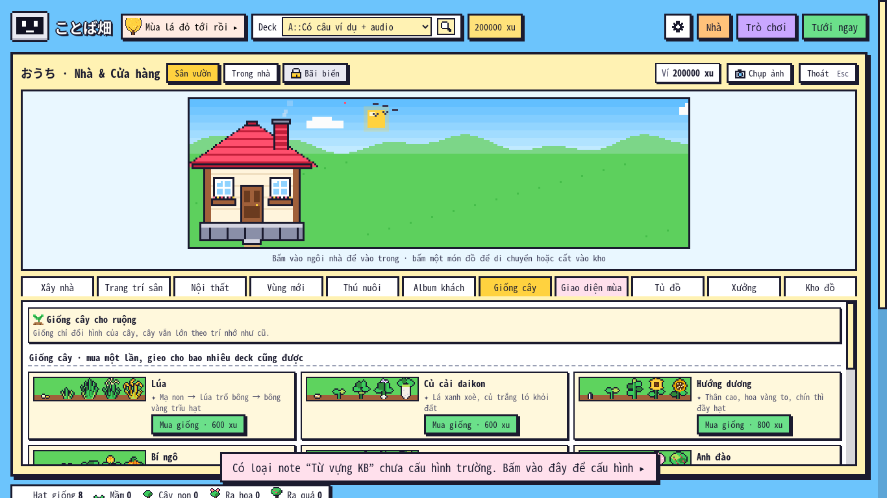
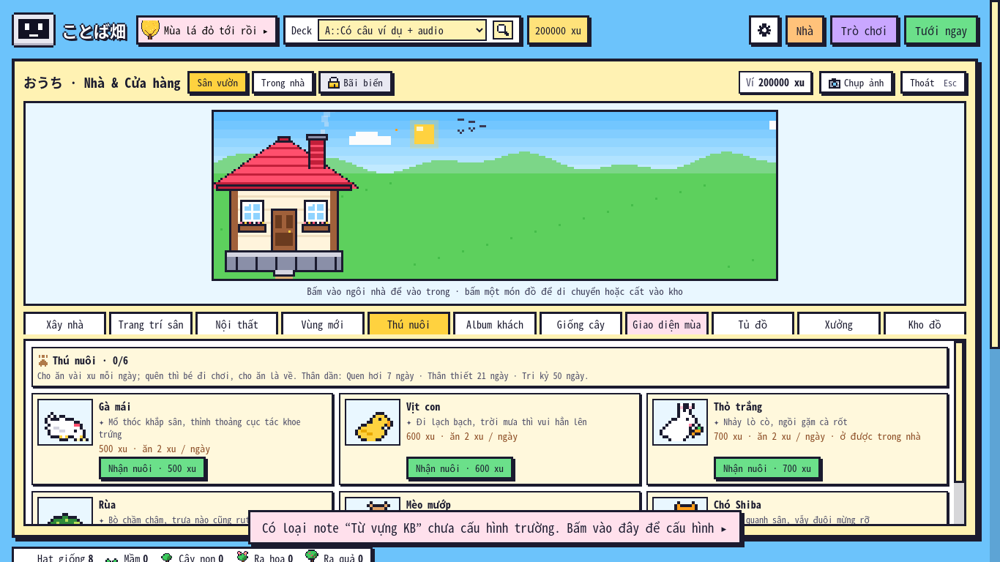
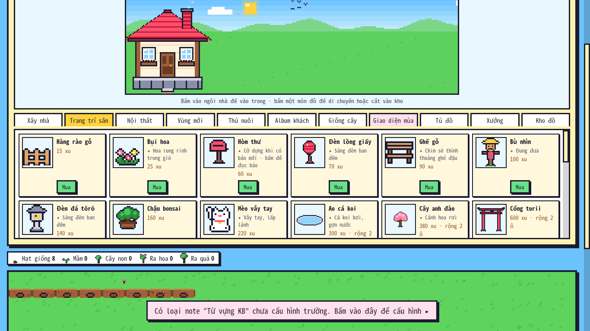
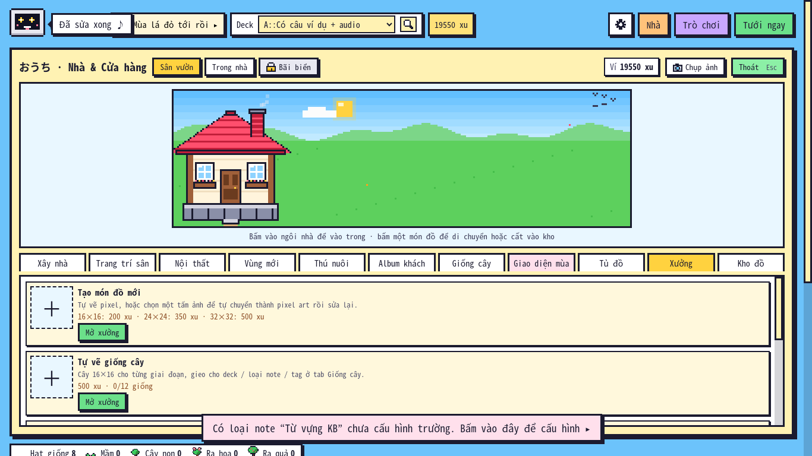

Bằng chứng: [log vòng đời thiết kế](logs/design-lifecycle.json). Mã nguồn: [`craft_save`](../../../kotoba_batake/garden_core.py) và [`share_code`](../../../kotoba_batake/garden_core.py), phần `renderList`/`itemCard` của [`home.js`](../../../kotoba_batake/web/home.js).

## BUG-01 — Undo làm mất Redo của Anki

**Bước tái hiện**

1. Ôn một thẻ trong vườn, chấm Được/Dễ rồi Dừng.
2. Dùng **Edit → Undo Answer Card** của Anki.
3. Mở lại menu Edit: **Redo bị vô hiệu hóa**. Lượt ôn đã Undo không thể làm lại bằng Redo.

Kỳ vọng: Undo/Redo của Anki tiếp tục hoạt động; phần thưởng add-on đi theo lịch sử thao tác tương ứng.

Đã tách nguyên nhân bằng cùng collection: gọi `mw.col.undo()` trực tiếp thì `undo_status()` **có** `redo: "Answer Card"`; ngay sau `st.save(st.load())` thì trường `redo` **biến mất**. Hook `_on_undo` gọi `check_undo` → `STATE.undo_answer` → lưu các khóa cấu hình. Đây là tác động của việc lưu ví sau Undo, không phải do không còn lịch sử Anki để Redo.

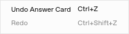

Bằng chứng: [so sánh trạng thái Redo trước/sau lưu ví](logs/redo-isolate.json), [lượt ôn/Undo/Redo thực tế](logs/undo-redo.json). Nguồn: [`check_undo`](../../../kotoba_batake/__init__.py#L699), [`_on_undo`](../../../kotoba_batake/__init__.py#L720), [`_write` và `save`](../../../kotoba_batake/garden_core.py#L2822).

## BUG-02 — Undo không lùi chuỗi tưới, thưởng nhiệm vụ bị trả lại sai

**Bước tái hiện**

1. Trên hồ sơ test mới, ôn 10 thẻ mới liên tiếp bằng Được. Nhiệm vụ **“Tưới liền 10 cây không bấm Lại”** hoàn thành.
2. Undo lượt thứ 10. Nhiệm vụ bị gỡ hoàn thành và xu thưởng bị thu lại.
3. Kiểm tra tiến độ: `new` đã về **9**, nhưng `streak` và `streak_cur` vẫn là **10**. Undo thêm một lượt cũng không làm hai số đó giảm.
4. Vào Chợ sáng, không bán đúng món nào và để hết giờ. Không ôn thêm thẻ.
5. Nhiệm vụ chuỗi tưới lại hoàn thành và nhận **+20 xu**, dù lượt ôn đã bị Undo.

Đã tái hiện ván hết giờ bằng bộ đếm thời gian của trò chơi (`skipTime`, cùng đường kết thúc ván); kết quả ván là 0 điểm/không thắng. Log ghi số lượt ôn không đổi trước/sau nhưng ví tăng 20 xu. Không có thao tác sửa ví giữa hai ảnh dưới đây.

Kỳ vọng: tiến độ chuỗi và trạng thái nhiệm vụ phản ánh các lượt ôn còn hiệu lực. Chơi một ván không thắng không khôi phục nhiệm vụ tưới đã Undo.

Nguyên nhân: `undo_reward()` giảm `due/new/stage` nhưng không phục hồi `streak/streak_cur`. Sự kiện game sau đó chạy `_settle_quests()` và trao lại thưởng theo số 10 cũ.

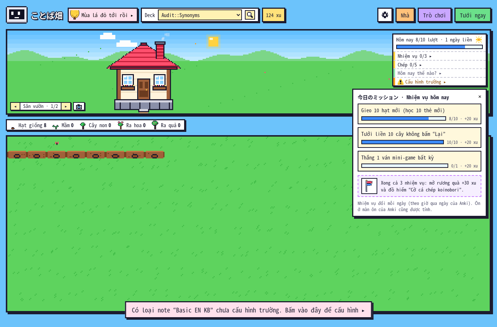
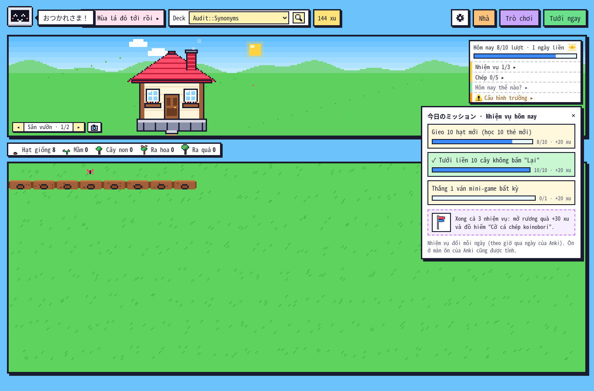

Bằng chứng: [trước/sau ván chơi, delta 20 xu](logs/quest-after-undo.json), [lịch sử lần Undo đầu](logs/undo-redo.json). Nguồn: [`undo_reward`](../../../kotoba_batake/garden_core.py#L2488), [`quest_event`](../../../kotoba_batake/garden_core.py#L2936).

## BUG-03 — Đổi cỡ bản vẽ rồi Esc làm mất hình chưa lưu

**Bước tái hiện**

1. Nhà → Xưởng → Mở xưởng; vẽ một hình trên lưới 16×16.
2. Đổi cỡ sang **24×24**. Hình vẫn còn trên lưới.
3. Bấm **Esc một lần**.
4. Xưởng đóng ngay, không có cảnh báo. Mở lại thì tên và hình trống.

Kỳ vọng: giống trường hợp vừa vẽ nhưng chưa đổi cỡ, lần Esc đầu phải cảnh báo trước khi bỏ bản vẽ.

Đối chứng: không đổi cỡ thì Esc lần đầu giữ Xưởng mở và hiện **“Bấm Esc lần nữa để bỏ, không lưu hình này.”** Bản vẽ tái hiện có **64 pixel khác trong suốt** trước Esc, `undo=0` sau đổi cỡ, và **0 pixel** khi mở lại.

Nguyên nhân: sự kiện đổi cỡ xóa `undo/redo`; `edited()` chỉ dựa vào lịch sử undo, không xét hình/tên hiện tại khác bản ban đầu.

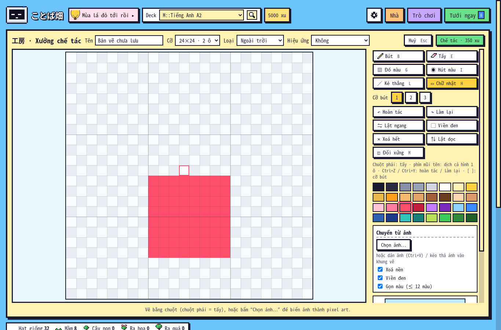
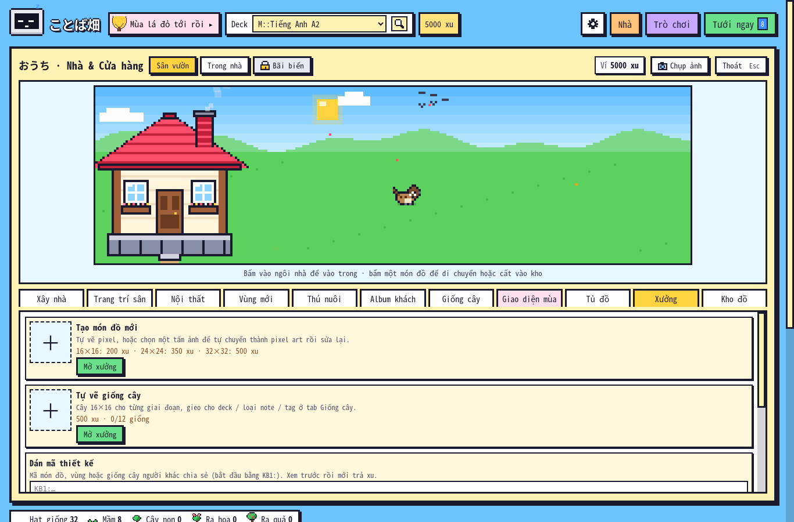

Bằng chứng: [trước Esc/sau Esc/mở lại](logs/design-probe.json), [đối chứng Esc bình thường](logs/design-lifecycle.json). Nguồn: [`edited`](../../../kotoba_batake/web/craft.js#L50), [handler đổi cỡ](../../../kotoba_batake/web/craft.js#L947).

## BUG-04 — Chợ sáng chấm sai từ đồng nghĩa hợp lệ

**Dữ liệu test:** deck tiếng Anh có `shop = cửa hàng`, `store = cửa hàng`, cùng các cặp `big/large`, `small/little`, `begin/start`. Đây là các note thật trong collection test, không thay dữ liệu trò chơi trong DOM.

**Bước tái hiện**

1. Mở Trò chơi → Chợ sáng → **Nghĩa → Từ**.
2. Đợi câu hỏi có nghĩa của một cặp đồng nghĩa. Trong ảnh 1.25.2, khách hỏi **“to lớn”**, có cả **big** và **large** trong các thùng.
3. Chọn `big` khi đáp án nội bộ là `large`.

Thực tế: `big` bị tô hồng/chấm sai, khách nói **“えっ、違うよ…”**, không tăng số đã bán. Sau khi lộ đáp án, chính giao diện ghi cả `big = to lớn` và `large = to lớn`.

Kỳ vọng: không đưa hai đáp án cùng hợp lệ vào một câu, hoặc công nhận các lựa chọn đúng với câu hỏi đang hiển thị.

Nguyên nhân: `choices()` chỉ tránh trùng chữ của **mặt đáp án**, không tránh các từ có cùng **mặt câu hỏi**. `choose()` so id note thay vì ý nghĩa hiển thị.

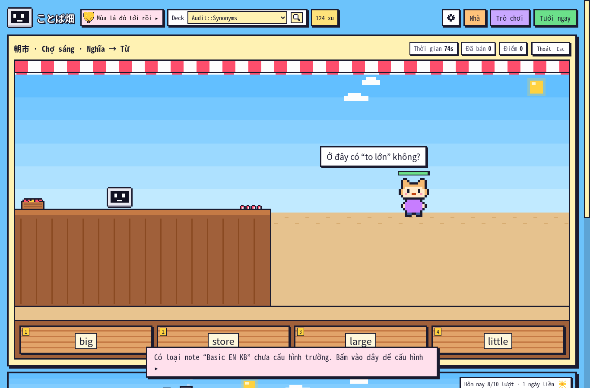
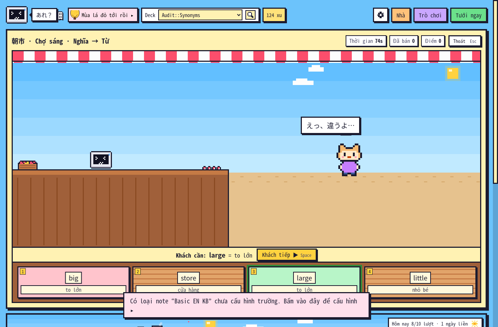

Bằng chứng: [câu hỏi, options, lựa chọn và kết quả](logs/synonyms.json). Nguồn: [`choices`](../../../kotoba_batake/web/games.js#L693), [`newCustomer`/`choose`](../../../kotoba_batake/web/games.js#L1412).

## BUG-05 — Gợi ý luyện viết giữ từ của nguồn cũ

**Bước tái hiện**

1. Chọn deck tiếng Anh A làm nguồn, mở Lịch hoa → luyện viết tiếng Anh để nạp gợi ý.
2. Đóng Lịch hoa. Ở Nguồn báo, chọn một deck B có từ hoàn toàn khác.
3. Mở lại Lịch hoa trong cùng ngày.

Thực tế đã ghi nhận: deck A là `F::Tiếng Anh Basic`, gợi ý **child, stop**. Sau đổi sang `Audit::Synonyms` (chỉ có **store, large, start, little, small, big, shop, begin**), gợi ý vẫn là **child, stop**. Đường lưu nguồn được gọi đúng qua `_on_ai("decks:…")`, cùng handler của các checkbox; log đối chiếu với `words.pick()` đọc mới từ collection xác nhận B không có hai từ đó.

Kỳ vọng: gợi ý/từ được tính là đã học phải theo nguồn đang chọn. Cache phải được tách theo hồ sơ và làm mới khi nguồn thay đổi.

Mở thêm hồ sơ **AuditEmpty** với 0 note trong cùng phiên: `_hints(..., "en", ...)` vẫn trả **child, stop** từ hồ sơ trước. Trường hợp hồ sơ trống không hiện khung tiếng Anh nên đây là bằng chứng ở lớp dữ liệu; lỗi giao diện đổi nguồn ở trên đã tái hiện trực tiếp.

Nguyên nhân: `_words_cache` chỉ dùng khóa `(ngày, ngôn ngữ)`, thiếu collection/nguồn; handler lưu deck và hook đổi hồ sơ không xóa cache này.

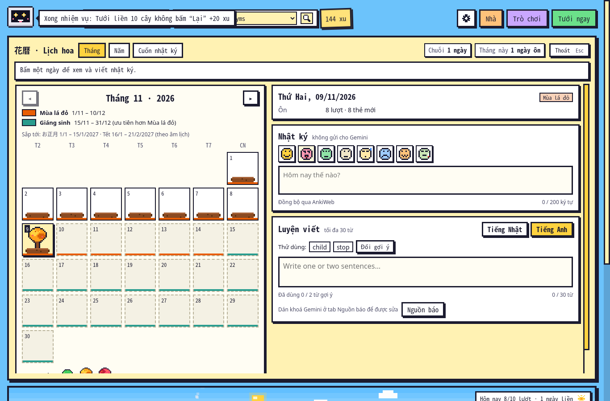
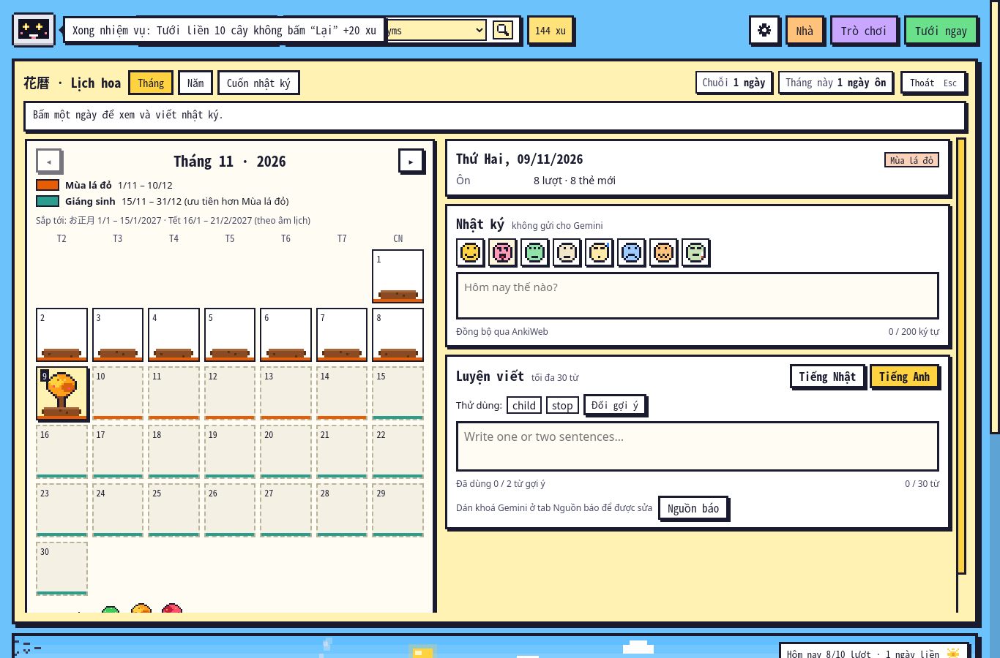

Bằng chứng: [nguồn mới và tập từ kỳ vọng](logs/source-cache.json), [cache còn ở hồ sơ 0 note](logs/photo-b.json). Nguồn: [`_words_for`](../../../kotoba_batake/__init__.py#L1436), [lưu nguồn](../../../kotoba_batake/__init__.py#L2508), [đóng hồ sơ](../../../kotoba_batake/__init__.py#L3661).

## BUG-06 — Hồ sơ mới lấy ảnh bìa vườn của hồ sơ trước

**Bước tái hiện**

1. Hồ sơ A có nhà/đồ và đã có ảnh vườn tự chụp trong tháng. Mở Cuốn nhật ký để xem bìa.
2. File → Switch Profile → tạo/mở hồ sơ B mới tinh.
3. Mở vườn B: **0 note, 0 xu, nhà cấp 0**.
4. Lịch hoa → Cuốn nhật ký: bìa B vẫn hiện **ngôi nhà của A**.

Chuẩn bị test dùng ảnh từ chính `GardenHome.snapshot()` của A, lưu bằng `journal.save_photo()` như đường tự chụp của sản phẩm; không ghép hay sửa ảnh. Hai hồ sơ đều được mở bằng Profile Manager của Anki trong cùng tiến trình.

Ảnh A và ảnh mà `cal_book()` trả cho B có **cùng SHA-256**, ghi trong hai log. B còn nhận `photo_due=false`, nên không chụp ảnh riêng ngay để thay ảnh nhầm. Chưa khẳng định các hồ sơ được cách ly hoàn toàn chỉ vì ví/nhà/tiến độ báo đã được tách đúng.

Kỳ vọng: ảnh bìa thuộc từng hồ sơ, hoặc hồ sơ mới dùng hình mặc định của chính nó.

Nguyên nhân: `PHOTO_DIR = user_files/anh_vuon` dùng chung cho add-on; tên ảnh chỉ có ngày. `month_photo()` và `photo_due()` không xét hồ sơ/collection.

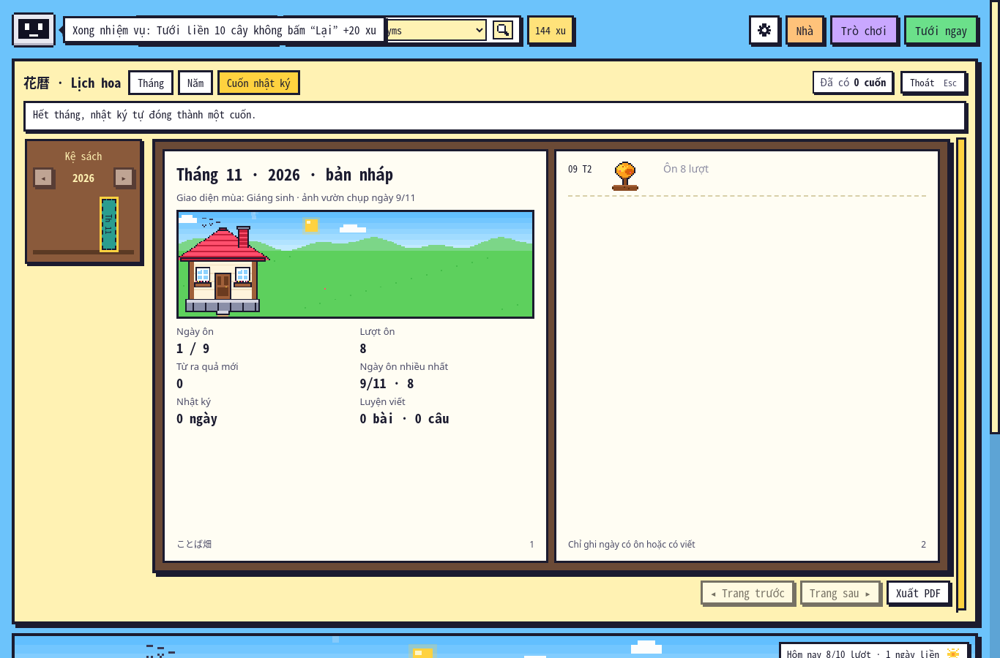
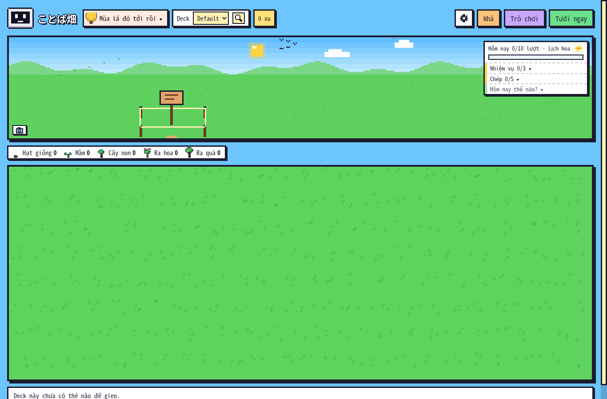
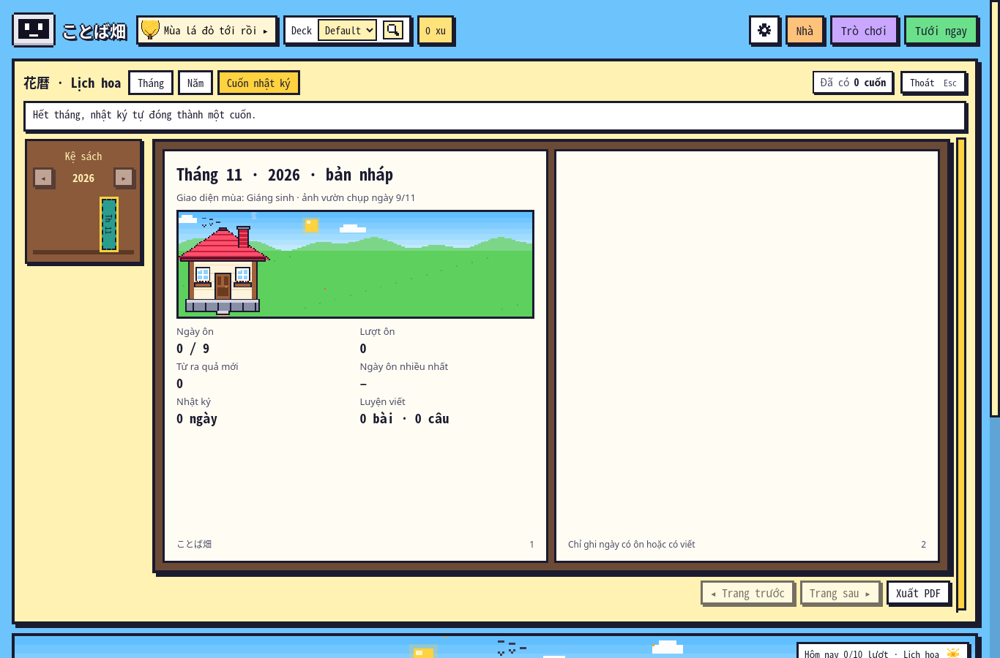

Bằng chứng: [hồ sơ A](logs/photo-a.json), [hồ sơ B](logs/photo-b.json). Nguồn: [`PHOTO_DIR`](../../../kotoba_batake/__init__.py#L1329), [`photo_due`](../../../kotoba_batake/journal_core.py#L1257), [`month_photo`](../../../kotoba_batake/journal_core.py#L1281).

## BUG-07 — Luật giống cây sai kiểu chặn dựng vườn

**Điều kiện:** dữ liệu collection bị sai kiểu, ví dụ sau nhập/sửa dữ liệu hoặc migration hỏng. Chưa tìm thấy thao tác UI thông thường tự tạo dữ liệu này, vì vậy xếp **P3**, không gộp với các lỗi dùng hàng ngày.

Trên hồ sơ test riêng, giữ nguyên các dữ liệu khác và đặt giá trị `kotoba_batake_more.seeds.kind.vocab` thành `[]` thay vì id giống. Gọi refresh/mở vườn.

Thực tế: hộp lỗi **“không dựng được khu vườn — TypeError("unhashable type: 'list'")”**. Các bước bù xu/nhà và dựng vườn đều thất bại. Không có cơ chế bỏ riêng luật hỏng để tiếp tục sử dụng. Đã khôi phục nguyên dữ liệu sau test.

Kỳ vọng: hàm làm sạch dữ liệu từ chối giá trị sai kiểu và chỉ bỏ luật hỏng.

Nguyên nhân: `_clean_seeds` kiểm tra `value in ok` với `ok` là set trước khi kiểm tra kiểu của value. `GardenState.load()` không bắt lỗi quanh `more.clean_more()`/`share.clean_myseeds()`. Bộ dữ liệu bổ sung còn tái hiện cùng kiểu ngoại lệ ở luật giống tự vẽ; không tính mỗi giá trị rác thành một lỗi riêng.

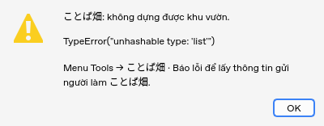

Bằng chứng: [fault injection và nhật ký](logs/corrupt-state.json), [78 tình huống dữ liệu sai kiểu](logs/extra-core.json). Nguồn: [`_clean_seeds`](../../../kotoba_batake/more_core.py#L254), [`clean_myseeds`](../../../kotoba_batake/share_core.py#L70).

## TEST-01 — Test bộ kotoba_daily lệch fixture

`tests/run_all.sh` trên 1.25.2 hiện **không xanh toàn bộ**. Lỗi được tái hiện khi chạy riêng `tests/core/test_kit.py`.

- `test_kit.py:70–72` đọc **số báo thật `kotoba_daily/bao/2026-11-01/bao.json`** và giả định số này chưa có `dich`, phải trả 4 lỗi thiếu bản dịch.
- Commit `472b3bc` đã thêm bản dịch cho các số cũ. File ngày 01/11 hiện có bản dịch ở đủ 4 bài.
- Vì vậy kiểm tra **“số cũ chưa có dich → chỉ báo lỗi bản dịch (4 bài)”** thất bại; đây là giả định fixture đã lỗi thời, không chứng minh bộ kiểm tra bản dịch của sản phẩm bị sai.
- Các tình huống cố ý xóa/sửa bản dịch trên bản sao test vẫn chạy được. Không sửa test/fixture trong nhánh báo cáo này.

Bằng chứng: [offline tổng](logs/latest-offline.log), [chạy lại test_kit riêng](logs/test-kit-retry.log).

## UI-01 — Cảnh Trong nhà cỡ Vừa không thấy mái ở cửa sổ rộng

Ảnh suite 1.25 cho thấy ở **1366×768**, dải Trong nhà cỡ Vừa chỉ còn phần tường/sàn, mái nằm ngoài mép trên; ở **720×560** thì lại thấy mái. Phần này không gây lỗi JS/tràn DOM nên phép đo bố cục không bắt được.

`home.js` chọn scale tối thiểu 2 khi bề ngang đủ rộng và đặt đáy nhà vào dải thấp (`Sh`, `hy` ở khoảng dòng 3291–3293). Tài liệu có chủ ý cho cắt bớt phần xà khi khung thấp, nên **ghi riêng để duyệt hình, không tính vào 7 lỗi đã xác nhận**. Ảnh cũng cho thấy thẻ Hôm nay che một phần gian bên phải theo bố cục hiện tại.

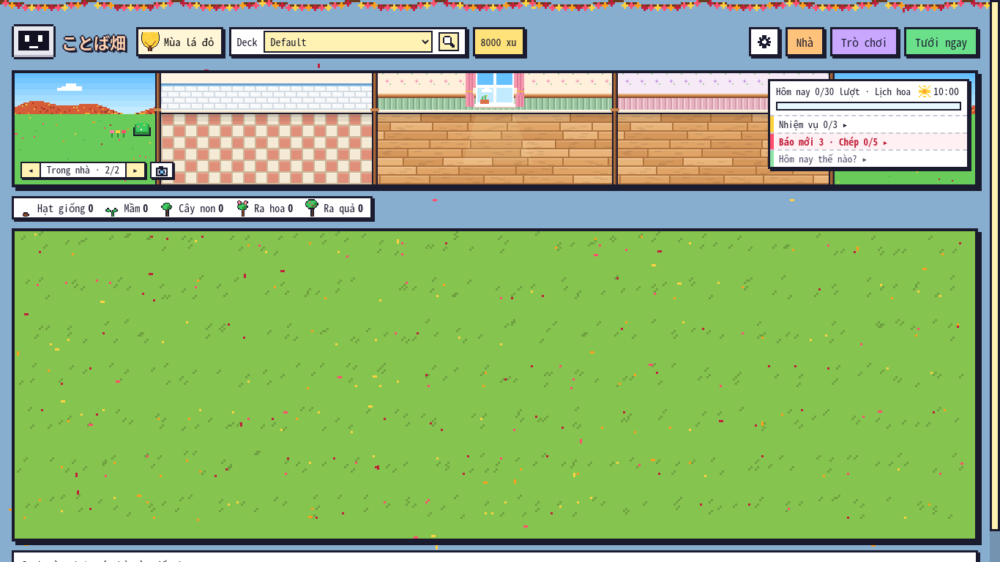
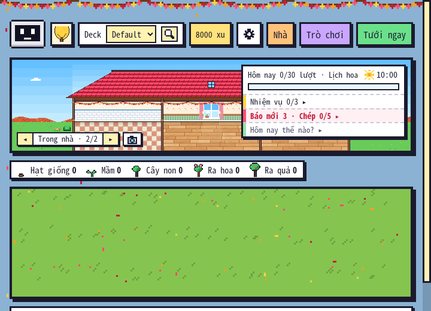

## Ma trận kiểm thử và giới hạn của kết quả

Các lượt kiểm tra đều dùng **hồ sơ/collection có dữ liệu mẫu riêng**, không mở collection học thật của người dùng. Cấp xu/chuẩn bị trạng thái chỉ phục vụ điều kiện đầu vào; các lỗi thao tác được xác minh qua UI/handler của sản phẩm. Các bài giả lập Gemini được ghi rõ là giả lập.

Lượt audit mua/đặt đồ đầy đủ đạt **181/181**, chụp **131 màn**; JSON đo được **0 tràn ngang, 0 phần tử ngoài khung ngang, 0 lỗi JS**. Audit tình huống khó/cửa sổ nhỏ đạt **58/58**. Những số này không phủ nhận các lỗi logic và clipping trong canvas nêu ở trên.

| Nhóm | Kịch bản đã chạy |
|---|---|
| Vườn/deck/FSRS | Deck Nhật/Anh/Hàn, note khác cấu trúc, ruby/ngoặc, deck trống/đã xóa/lọc/tên dài; cây 5 giai đoạn, khát/héo, giới hạn ngày, thẻ anh em, thẻ học chưa tới lượt, FSRS bật/tắt |
| Ôn/xu/nhiệm vụ | Ôn thực sự ghi revlog; Dừng/Esc/đổi deck khi câu trả lời đang lưu; bù lượt ôn ngoài add-on; mục tiêu ngày; nhiệm vụ/rương; Undo lặp; **Undo tại mốc 10, Redo, sự kiện game sau Undo** |
| Nhà/cửa hàng | Các bước xây, kiểu nhà, sửa nhà; mua/đặt/di chuyển/cất; ít xu/0 xu/vừa đủ/nhiều xu; bấm đúp; hết ô; kho lớn; đồ hiếm; vùng mua và vùng tự tạo |
| Nhà ba gian 1.25 | Mở rộng 2 gian một lần, giá, mua trùng, gian chưa mở, đồ sàn/tường giữa các gian, kiểu nhà, thú trong nhà, ảnh nguyên nhà, ẩn dây trang trí |
| Thú/khách/giống/mùa | 6 thú, đói/cho ăn/tự cho ăn/đặt tên/chuyển cảnh; album khách; giống mua/tự vẽ, luật deck/loại/tag; 14 giao diện mùa và quà, xem thử/tự động/tắt |
| Xưởng/design | Bộ công cụ vẽ, 3 cỡ/3 loại, đối xứng/hoàn tác/làm lại/lật/viền, chuyển ảnh; tạo/sửa/đổi tên/giá; 5 giai đoạn giống cây; vùng/cảnh nền; mã đúng/sai/đổi mã sau xem trước; giới hạn số mẫu; **đổi cỡ rồi đóng, kiểm tra quyền sửa mẫu gốc** |
| Trò chơi | 5 trò, chế độ theo loại/ngôn ngữ, điều kiện thiếu trường/âm thanh, ghi xu không ghi FSRS; **deck từ đồng nghĩa có câu hỏi mơ hồ** |
| Báo/chép chính tả | Nhật/Anh/Việt, nguồn Claude Code/Gemini, kệ nhiều nguồn, bảng tra nghĩa, dịch ẩn/hiện, câu hỏi/chép/giọng đọc fixture, dừng/chậm, phím tắt; đếm tiến độ theo nguồn |
| Báo 1.25.2 | Bản gốc chung → kể lại Nhật/Anh → in bản Việt; dự phòng khi lỗi; phản hồi Hay/Nhạt; tên nhân vật; thời tiết; không dùng deck; chọn Nhật/Anh hoặc chỉ Việt; gói thử/mua/gia hạn/thiếu xu/trần 60 ngày |
| Lịch/nhật ký | Tháng/năm, nhật ký/sticker, giới hạn luyện viết, đóng nhanh, kết quả sửa nền giả lập, sách/PDF; **đổi nguồn và đổi hồ sơ, đối chiếu cache/ảnh** |
| Giao diện | Bộ audit chụp/đo bố cục, cửa sổ 1366×768, 1024×700, 720×520, 1093×560, 1920×1080; tối/sáng, ngày/đêm/mưa/tuyết, cảnh đầy đồ; đọc ảnh để phân biệt cảnh báo máy đo và lỗi thực tế |
| Đóng gói/dữ liệu | Nguồn ↔ gói 49 file; 99 vòng mã chia sẻ (3 cỡ × 3 loại × 11 hiệu ứng); 80 cấu hình ngẫu nhiên kiểm tra chuẩn hóa lặp; 78 tình huống dữ liệu sai kiểu; 78 kiểm tra gói báo/ngày năm nhuận/nhà/kho bổ sung |

**Các kiểm tra bổ sung đạt:** 99/99 vòng xuất/nhập hình; 80/80 chuẩn hóa cấu hình lặp; 78/78 ranh giới ngày/gói báo/nhà/kho ([log](logs/extra-1252.json)). Trong 78 dữ liệu sai kiểu, có 18 ngoại lệ trực tiếp ở các hàm chuẩn hóa; một số được lớp gọi ngoài bắt lại. BUG-07 chỉ kết luận tác động chặn vườn đã được tái hiện, không coi 18 ngoại lệ là 18 lỗi sản phẩm.

**Kết quả từng suite có sẵn:** xem [bảng tổng hợp](logs/suites-summary.md.txt) và các log `.out` trong [logs](logs/). Không sửa assertion để biến test đỏ thành xanh. `audit.js` là phép đo/chụp, không phải suite có số assertion pass/fail; không quy các nút icon nhỏ hay chữ cố ý có dấu “…” thành lỗi chỉ dựa vào cảnh báo máy đo.

**Suite có phụ thuộc mạng ngoài phần giả lập:** `e2e.js` đạt **23/24** và `e2e_123.js` đạt **63/65**; các assertion đỏ là yêu cầu nhật ký lỗi trống sau một lời gọi TTS bị proxy chặn. `e2e_120.js` cũng dừng vì `fix_start()` gọi `client.models()` trước `journal.run_fix()` mà test đã giả lập. [Nhật ký sửa bài](logs/e2e120-model-discovery-error.json) xác nhận lỗi **403**, không phải lỗi hàm sửa bài. Đã chạy bản sao test ngoài repo, chỉ bổ sung danh sách model giả vào fixture và đổi đường dẫn import; **giữ nguyên assertion và delay mock 4 giây**, đạt **103/103**, bao gồm chạy nền, lỗi/quota, thông báo, sách và xuất PDF thật. Xem [diff harness](logs/e2e120-model-fixture-diff.txt) và [stdout](logs/e2e_120_models_fixture.out). Mã test gốc và mã sản phẩm đều không đổi.

**Phần chưa xác minh trực tiếp:** chưa xác minh Gemini thật/Google TTS; các lời gọi khám phá model/TTS trong test bị proxy môi trường từ chối (`Tunnel connection failed: 403 Forbidden`). Phát âm thanh trong test Anki được ghi nhận qua `av_player`, chưa nghe chất lượng qua loa. Không chạy lại trên Windows/macOS, các bản Anki cũ, đồng bộ AnkiWeb thật hoặc mạng thật bị ngắt giữa lúc sync. Các test compatibility/đồng bộ dùng collection và giả lập cục bộ, không thay cho xác nhận trên các môi trường đó. Kết quả này là một đợt kiểm tra rộng có bằng chứng, không phải bảo đảm không còn mọi lỗi có thể xảy ra.

## Cách đối chiếu

```bash
git checkout audit/ra-soat-addon-2026-11-09
git diff --name-status 472b3bc..HEAD
# Chỉ có docs/kiem_thu/2026-11-09/…

ANKI_PY=/path/to/python-with-anki-26.9.4 bash tests/run_all.sh
# Chạy UI bằng tests/anki/run_ui.sh theo tests/README.md trên hồ sơ test riêng.
```

Thư mục `anh/` giữ ảnh gốc; `logs/` giữ kết quả/metadata và stdout test. Bước tái hiện bằng tay của từng lỗi ở ngay mục tương ứng. Không kèm bản add-on đã sửa, không thay đổi nhánh `master`, không xuất bản lại mẫu nào.
