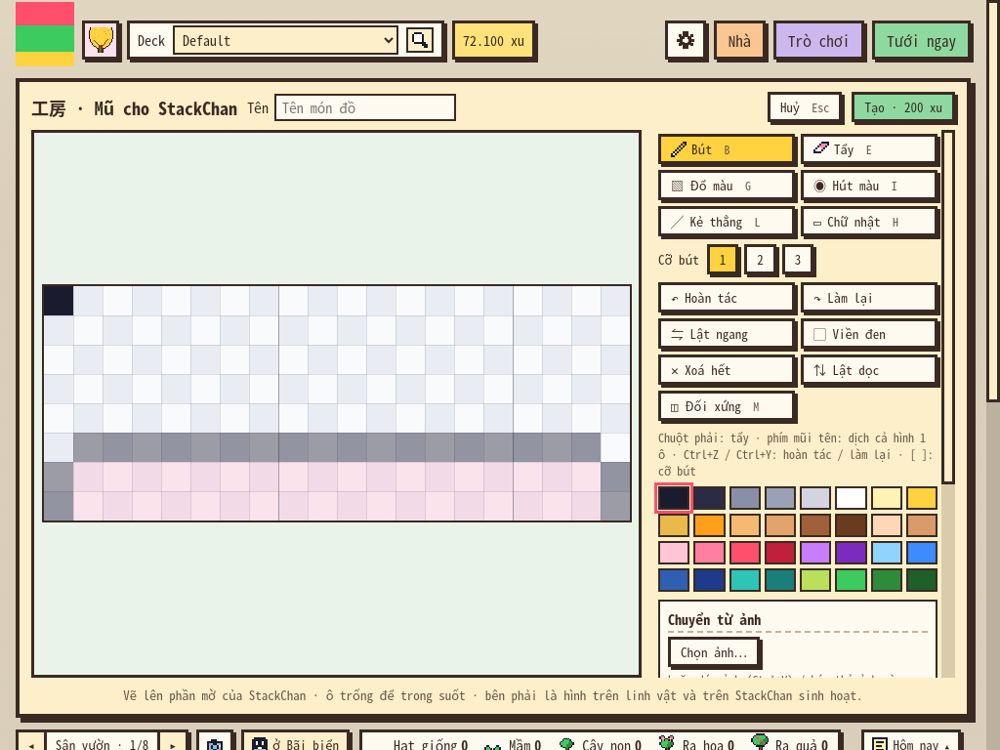
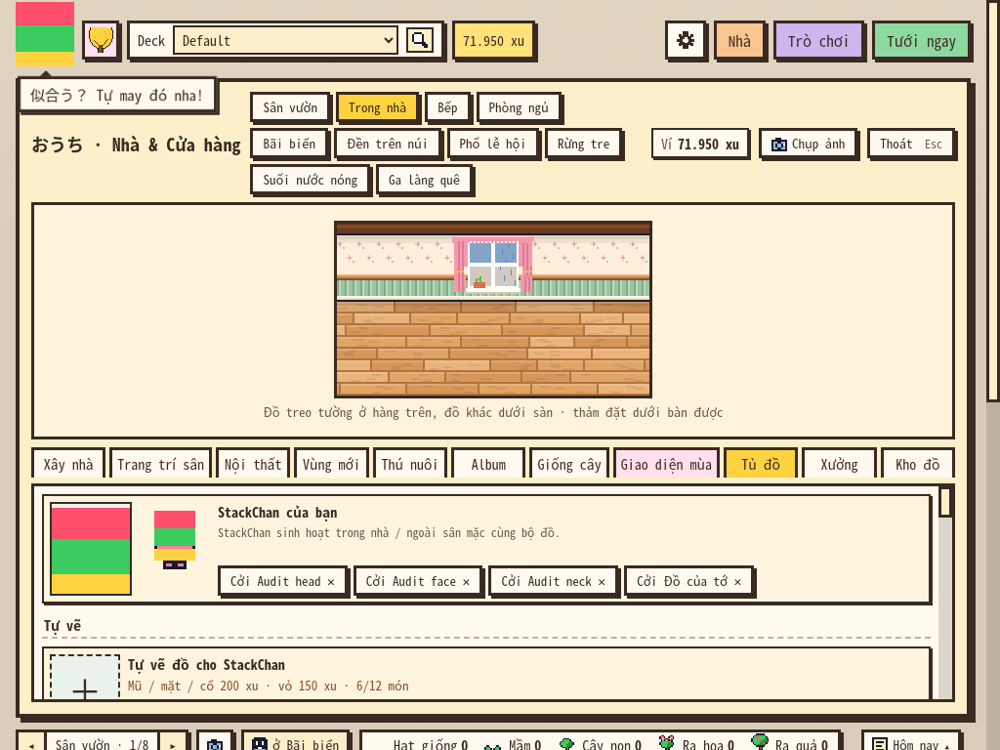
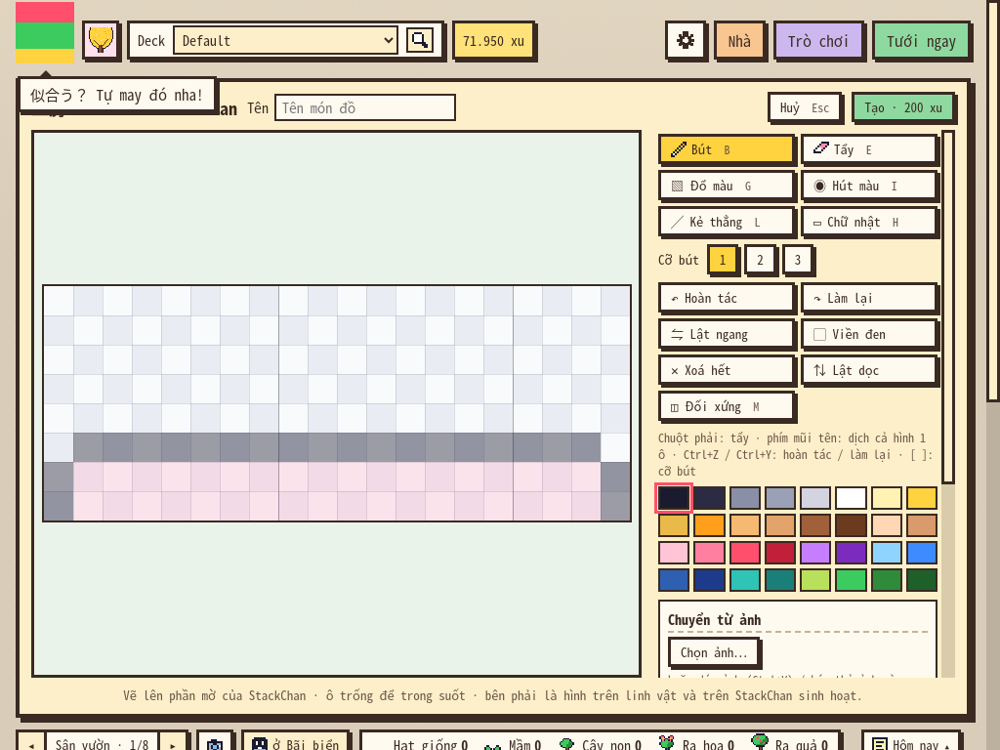
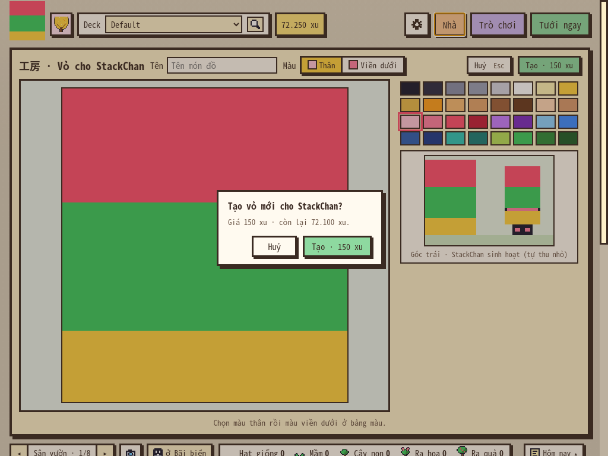
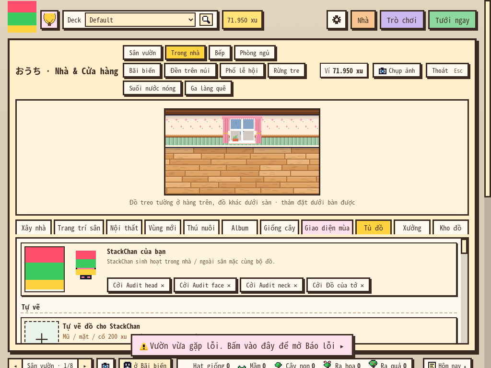

# Rà soát độc lập ことば畑 1.31.0 · 14/11/2026

**Cập nhật vòng chốt:** xem [CHOT_LAN_CUOI.md](CHOT_LAN_CUOI.md). Kiểm sâu thêm 256 ca đã xác minh thêm 3 nhóm lỗi; tổng hiện là **8 nhóm: 2 P1, 6 P2**. Kết luận vẫn **chưa phát hành stable**.

**Kết quả vòng đầu bên dưới:** đã xác minh **5 nhóm lỗi: 1 P1 và 4 P2**, cùng một rủi ro về phạm vi dữ liệu báo giữa các hồ sơ. Lỗi đáng ưu tiên nhất là phản hồi lưu cũ có thể đóng phiên vẽ mới và làm mất bản nháp. Hộp xác nhận cũng có đường thao tác bàn phím trừ xu khi nút đang được focus nằm ngoài hộp.

Nhánh audit chỉ thêm **báo cáo, bằng chứng và test tái hiện**. Chưa sửa mã sản phẩm, đổi luật chơi, tăng phiên bản hay đóng lại gói phát hành. Các assertion trượt được giữ để dùng kiểm lại bản sửa.

## 1. Phiên bản, phạm vi và kết quả

- Repository: `dungmt2808/kotoba-anki`.
- Commit kiểm tra: **`240c7c333ea2580d0389d2c790995a64ea9b4914`**, `master` tại lúc bắt đầu audit.
- Nhánh báo cáo: **`audit/release-review-1.31-2026-11-14`**.
- Gói `kotoba_batake.ankiaddon`: 63 file, **khớp byte với toàn bộ mã nguồn được đóng gói**, không thiếu file được git quản lý. SHA-256: `e642a044a4d2f4d2dad882da34151104dfa323d6dd2d2a635ccd1fc5249ec46c`.
- Môi trường: Linux; **Anki 26.9.4 / Python 3.13.5 / Qt 6.12.0** và **Anki 23.10.1 / Python 3.12.14 / Qt 6.6.3 / PyQt 6.6.1**.
- UI chạy trong **Anki/QtWebEngine thật, chế độ offscreen**, điều khiển chuột/phím qua CDP. Collection, hồ sơ, ví, nhật ký và báo đều là dữ liệu test riêng; không sử dụng hồ sơ học của người dùng.

| Kiểm tra | Kết quả | Bằng chứng |
|---|---|---|
| Bộ offline có sẵn `tests/run_all.sh`, gồm các bài cần Anki thật | **37 bộ đạt**, không bỏ phần Anki; hồi quy audit 12/11 **779/779** | [baseline-core.log](logs/baseline-core.log) |
| Các kịch bản UI cũ trên Anki 26.9.4 | **32/32 kịch bản**, **1.345/1.345 assertions** | [baseline-ui-summary.json](logs/baseline-ui-summary.json), [log từng bài](logs/baseline-ui/) |
| Core mới: dữ liệu hỏng, xu, điểm ảnh, hai phiên bản cùng sửa tủ đồ | **2.043/2.047**; 4 assertion trượt cùng thuộc **F04** | [core-audit.json](logs/core-audit.json) |
| UI mới trên Anki 26.9.4 | **178/188**; trượt thuộc **F01, F02, F05** | [ui-26.json](logs/ui-26.json), [ui-26.log](logs/ui-26.log) |
| UI mới trên Anki 23.10.1 + Qt 6.6.3 | **178/188**, cùng các lỗi như bản mới | [ui-23.json](logs/ui-23.json), [ui-23.log](logs/ui-23.log) |
| Đổi hồ sơ thật, Anki 26.9.4 | **6/7**; trượt **F03** | [lifecycle-26.json](logs/lifecycle-26.json) |
| Đổi hồ sơ thật, Anki 23.10.1 | **6/7**, cùng **F03** | [lifecycle-23.json](logs/lifecycle-23.json) |

Tổng bộ bổ sung: **2.437 kiểm tra, 2.411 đạt, 26 trượt**. Số assertion trượt không phải số lỗi độc lập: cùng lỗi được kiểm ở nhiều chỗ mặc đồ, nhiều phiên bản và bằng cả trạng thái lẫn nhật ký JavaScript. Các bộ mới không có mục `harness/...` trượt.

Trong bộ cũ, `e2e.js`, `e2e_120.js`, `e2e_123.js` dùng **model discovery/TTS giả lập cục bộ**, giữ nguyên assertions. Các bài sinh báo/sửa bài khác có phần tự giả lập provider như thiết kế sẵn của chúng. **Không coi những kết quả này là thử Gemini thật.** Không gửi request bằng khoá thật trong audit này.

Lần chuẩn bị đầu dùng runner audit cũ đặt `gemini_key=""`, `mobile_coins=False`, làm bốn bài cũ thiếu điều kiện fixture; một bài khác rơi vào cổng `10080` mà Node Fetch chặn. Đã chạy lại bằng khoá giả/bù xu đúng fixture và cổng hợp lệ, **không sửa assertions hay mã sản phẩm**. Giữ [kết quả lần đầu](logs/baseline-first-summary.json) và [log thiết lập sai](logs/baseline-setup/) để phân biệt với lỗi sản phẩm. Bộ `e2e_1253` tự khởi động lại Anki được chạy riêng và đạt **39/39**.

**Riêng bài cũ `e2e_131` trên Anki 23.10.1 có độ ổn định chưa đạt:** lần đầu dừng **23/25** sau lỗi thẻ thú/timeout; lần chạy thêm chỉ ghi nhận phần tử dưới con trỏ, không đổi assertions, đạt **89/89**; lần lặp nguyên trạng đạt **88/89**, trượt chú thích khi rê lên khách đang chuyển động. Giữ cả [log lần đầu](logs/compat-23-first.log), [log có đo con trỏ](logs/compat-23-pointer.log), [log lặp nguyên trạng](logs/compat-23-repeat.log). Chưa có tái hiện ổn định để thêm một lỗi sản phẩm độc lập; **không báo bộ UI cũ trên 23.10.1 đã xanh hoàn toàn**. Cần ổn định việc bắt tọa độ/đồng hồ cho các bài có nhân vật chuyển động, rồi chạy lại khi xác nhận hỗ trợ bản cũ.

### Những tình huống đã mở rộng

- **1.428** biến thể cấu trúc JSON sai kiểu tại từng trường lồng trong ví, đồ tự vẽ, điểm ảnh, nhà, thú và dữ liệu phụ: đọc trạng thái và dựng catalog không vỡ.
- Tiền **0, giá − 1, đúng giá, giá + 1, nhiều xu** cho cả Mũ/Mặt/Cổ/Vỏ; thiếu xu không thay đổi ví hay điểm ảnh; đổi tên miễn phí; sửa hình đúng 50 xu; xoá dọn điểm ảnh và món đang mặc.
- Mọi màu và **từng ô** trên ba lưới đồ StackChan qua mã hoá/giải mã; seed cố định `20261114` để tái lập.
- **160 kiểm tra bố cục** mỗi phiên bản: 720×520, 1024×768, 1366×768, 1920×1080; 11 tab Nhà; chín chế độ Xưởng. Không gắn nhãn lỗi cho hàng cảnh có chủ ý cuộn ngang hoặc panel dùng thanh cuộn trang ở cửa sổ thấp. Các nút thiết yếu và lưới trong ma trận đều đạt.
- Xác nhận mua bằng Tab, Enter, Esc; focus sau khi huỷ; sự kiện IME; bản nháp mới nhận phản hồi lưu của phiên trước; Esc khi con trỏ còn trên lưới trống.
- Hai hồ sơ thật cùng ghi nhật ký trong một tháng; collection độc lập và file sao lưu độc lập được kiểm riêng.
- **Mã thật của 1.30.3** mua đồ thay thế ở bốn chỗ mặc, sau khi 1.31 đã mặc món tự vẽ. Khác test cũ chỉ cộng xu/mua nội thất rồi kiểm dữ liệu còn nguyên.
- Các bài có sẵn kiểm thêm ôn thẻ/Undo/Redo, chuỗi khi cài mới, xu điện thoại, trò chơi, nhà/vùng, thú/khách/sinh hoạt, sưu tầm, vé, gói báo, báo/tra từ/chép chính tả, lịch/nhật ký/sửa bài, cấu hình trường, hướng dẫn và thao tác ngẫu nhiên.

## 2. Các lỗi đã xác minh

P1 = mất nội dung người dùng trong một luồng hợp lệ; cần sửa trước stable. P2 = lỗi thao tác, logic hoặc độ tin cậy đáng kể. Mức độ dưới đây dựa vào tác động và điều kiện tái hiện, không dựa riêng số test trượt.

| ID | Mức | Vấn đề | Điều kiện |
|---|---|---|---|
| **F01** | **P1** | Phản hồi lưu cũ đóng phiên Xưởng mới, mất bản nháp | Người dùng đóng phiên đang lưu rồi bắt đầu vẽ tiếp trước khi nhận phản hồi |
| **F02** | **P2** | Focus thoát hộp xác nhận; Enter ở nút nền vẫn mua món đang hỏi | Dùng bàn phím Tab/Enter |
| **F03** | **P2** | Hồ sơ B ghi đè file sao lưu nhật ký của A | Hai hồ sơ cùng có nhật ký trong một tháng |
| **F04** | **P2** | Cùng chỗ mặc có cả món sẵn lẫn món tự vẽ; món mới mua bị món cũ che | Máy khác còn 1.30.3, rồi quay lại 1.31 |
| **F05** | **P2** | Esc trong lưới Mũ/Mặt/Cổ trống gây lỗi JS | Con trỏ còn trên lưới khi đóng Xưởng |

### F01 — Phản hồi lưu cũ làm mất bản vẽ mới

**Tái hiện:** mở Xưởng → tạo Vỏ → xác nhận lưu. Khi lệnh đã lưu nhưng thông báo kết quả chưa về trang, bấm Huỷ, mở vẽ Mũ mới và tô một ô. Phát thông báo lưu Vỏ cũ về.

**Mong đợi:** chỉ hoàn tất giao dịch Vỏ cũ; phiên vẽ Mũ hiện tại vẫn mở và giữ nguyên bản nháp.

**Thực tế:** Xưởng Mũ bị đóng, tab Tủ đồ hiện ra. Lúc đó điểm ảnh còn trong biến JS cũ, nhưng **mở lại Mũ thì thành lưới trống**; chưa có đường khôi phục bản nháp. Test không suy diễn mất nội dung chỉ từ việc panel đóng: đã kiểm bước mở lại.

**Nguyên nhân:** [`GardenCraft.savedWear`](../../../kotoba_batake/web/craft.js#L1292) gọi `close()` vô điều kiện theo trạng thái editor hiện tại. Không có mã phiên vẽ/mã request để đối chiếu phản hồi. Các callback `savedTile/saved/savedZone` cũng có kiểu đóng tương tự và nên được rà soát khi sửa.

**Bằng chứng:** `save-race/first-command-committed-and-response-held`, `save-race/old-response-keeps-new-editor`, `save-race/reopening-recovers-unsaved-draft` trong [ui-26.json](logs/ui-26.json) và [ui-23.json](logs/ui-23.json).

| Bản nháp Mũ mới đã có nét | Phản hồi Vỏ cũ về, Xưởng bị đóng | Mở lại: nét đã mất |
|---|---|---|
|  |  |  |

**Cách sửa đề nghị:** mỗi lần mở editor có mã phiên; mỗi lệnh lưu mang mã request/thiết kế. Callback chỉ đổi trạng thái lưu và đóng đúng editor đã gửi lệnh đó. Chặn hoặc xử lý rõ việc chuyển phiên khi đang lưu; giữ bản nháp nếu phiên hiện tại khác. Không dùng việc tăng thời gian chờ làm giải pháp.

**Giới hạn minh chứng:** test giữ thông báo `_js` rồi phát lại để chọn đúng thứ tự callback. Phần lưu, trừ xu, callback và giao diện là mã thật. Đây là lỗi thứ tự phản hồi được mô phỏng, không khẳng định mọi lần lưu thực tế đều trễ.

### F02 — Modal xác nhận không giữ focus, có thể mua ngoài ý định

**Tái hiện bằng phím thật:** mở tạo Vỏ, bấm Tạo, chờ hết guard 450 ms. Bấm Tab sáu lần: focus tới **nút Nhà ở nền mờ**, nằm ngoài modal. Bấm Enter.

**Thực tế:** vẫn tạo Vỏ và **ví 72.250 → 72.100 xu**. Handler Enter coi mọi focus trừ nút Huỷ là đồng ý. Esc đóng hộp nhưng cũng không trả focus về nút mở hộp. Ngoài ra, Esc có `isComposing=True/keyCode=229` vẫn đóng hộp — hiện được xác minh bằng sự kiện IME giả lập, chưa thử bộ gõ hệ điều hành thật.

**Nguyên nhân:** [`ui.js:274`](../../../kotoba_batake/web/ui.js#L274) cho Tab đi tự do, Enter gọi xác nhận theo phép kiểm “không phải nút Huỷ”; [`askClose`](../../../kotoba_batake/web/ui.js#L246) không khôi phục focus.

**Bằng chứng:** `confirmation/tab-remains-in-modal`, `confirmation/enter-outside-does-not-spend`, `confirmation/cancel-restores-trigger-focus` trong JSON UI cả hai bản.



**Cách sửa đề nghị:** giữ Tab/Shift+Tab trong modal hoặc dùng cơ chế dialog tương đương; làm nền không nhận focus; nhớ/khôi phục nút gọi; Enter chỉ xác nhận khi focus ở nút xác nhận; bỏ qua phím đang composition. Giữ guard chống bấm đúp và kiểm giá ở Python.

### F03 — File sao lưu nhật ký không tách hồ sơ

**Tái hiện:** hồ sơ A ghi `Synthetic private diary in profile A`; chuyển sang B, ghi nhật ký cùng tháng. Cả hai dùng `user_files/journal/YYYY_MM.json`. B ghi xong thì file trước của A chứa nội dung B.

**Điều đã kiểm rõ:** collection B ban đầu không có nhật ký A; mở lại A thì **nhật ký chính vẫn đúng**. Lỗi nằm ở **file sao lưu cục bộ**, không phải ghi nhầm nhật ký chính hay mất dữ liệu collection trong lần chạy này. Nếu cần dùng bản sao lưu để cứu dữ liệu A, bản đó đã bị thay.

**Nguyên nhân:** [`JournalStore._backup_path`](../../../kotoba_batake/journal_core.py#L447) chỉ có năm/tháng; [`_backup`](../../../kotoba_batake/journal_core.py#L499) thay cùng file, không có owner như ví/điểm ảnh.

**Bằng chứng:** `diary/profile-B-does-not-overwrite-A-backup` có `same_file=true`, `backup_A_exists=false`; `diary/profile-A-collection-still-correct` vẫn đạt. Xem [lifecycle-26.json](logs/lifecycle-26.json), [lifecycle-23.json](logs/lifecycle-23.json).

**Cách sửa đề nghị:** `journal/<profile_key>/YYYY_MM.json`, kèm owner/version. Khi chuyển dữ liệu cũ không tự gán file chung cho mọi hồ sơ; giữ file cũ cho đến khi xác định được chủ. Thêm kiểm tra xuất/khôi phục theo đúng hồ sơ.

### F04 — Xung đột đồ đang mặc khi máy khác chưa cập nhật

**Tái hiện bằng hai phiên bản thật:** 1.31 tạo/mặc Mũ tự vẽ `w1` → mã 1.30.3 mua Mũ rơm `straw` → 1.31 đọc lại. Kết quả:

```json
{"wear.on.head":"straw", "more.mywear.on.head":"w1"}
```

Cả hai đánh dấu đang mặc. [`walletWear`](../../../kotoba_batake/web/fx.js#L204) ghép `mine.on` sau nên **mũ tự vẽ thắng**; món sẵn vừa mua ở máy cũ bị che. Cùng lỗi với Mặt, Cổ và Vỏ. Thiết kế tự vẽ không bị xoá.

**Nguyên nhân:** bản cũ giữ khoá `mywear` nhưng không biết cần cởi nó khi mua món sẵn. [`GardenState.load`](../../../kotoba_batake/garden_core.py#L2855) đọc hai nguồn riêng, không giải quyết mâu thuẫn đang mặc.

**Bằng chứng:** bốn mục `mixed-version/{head,face,neck,shell}/one-item-per-slot` trong [core-audit.json](logs/core-audit.json). Mã cũ lấy từ `36bb57b`, không phải bản giả viết lại. Đây là kiểm luân phiên dữ liệu bằng mã thật; không gọi AnkiWeb thật.

**Cách sửa đề nghị:** chuẩn hoá “mỗi chỗ chỉ một món” khi đọc/di trú, có quy tắc ưu tiên rõ để giữ ý định thay đồ gần nhất; vẫn giữ thiết kế trong kho. Nếu chưa hỗ trợ máy khác phiên bản, hướng dẫn phải yêu cầu cập nhật mọi máy trước khi thay đồ, và có cảnh báo xung đột dễ hiểu. Tài liệu hiện đã khuyên cập nhật mọi máy; điều đó giảm phạm vi ảnh hưởng nhưng chưa làm trạng thái mâu thuẫn tự hồi phục.

### F05 — Đóng lưới đồ trống bằng Esc phát sinh lỗi JavaScript

**Tái hiện không cần trì hoãn callback:** Tủ đồ → Tự vẽ Mũ → để trống, đưa chuột trên lưới → Esc → đưa chuột ra ngoài. Lặp với Mặt/Cổ. Cả Anki 23.10.1 và 26.9.4 đều báo:

```text
TypeError: Cannot read properties of undefined (reading 'replace')
  at pxRows (home.js:1149)
  at drawPreview (craft.js:661)
  at draw (craft.js:528)
  at HTMLCanvasElement.<anonymous> (craft.js:1199)
```

**Nguyên nhân:** `close()` tắt `wearMode`; sự kiện [`pointerleave`](../../../kotoba_batake/web/craft.js#L1199) sau đó vẫn gọi `draw()`. Preview thông thường nhận mảng không vuông 20×8/20×9/20×5 nhưng xử lý như 16×16. [`pxRows`](../../../kotoba_batake/web/home.js#L1142) không bảo vệ trường hợp đó. Vỏ là trường hợp đối chứng không phát lỗi này.

**Bằng chứng:** ba mục `workshop/empty-{head,face,neck}/escape-no-js-exception` và stack trong JSON UI cả hai bản. Đây là lỗi riêng với F01, vì mở editor trống rồi Esc cũng tái hiện được.



**Cách sửa đề nghị:** không xử lý vẽ/preview khi editor đã đóng; chỉ dùng đúng kích thước/chế độ còn hiệu lực. Thêm bảo vệ dữ liệu trống ở hàm trim và giữ test đóng panel khi con trỏ vẫn ở canvas.

## 3. Rủi ro thiết kế cần chốt: thư viện báo dùng chung giữa các hồ sơ

Hồ sơ A có số hôm nay mang tiêu đề tổng hợp `SYNTHETIC PROFILE A ONLY`; hồ sơ B mới hoàn toàn, **0 note**, vẫn đọc số đó. `ai_start("manual", ..., "ja")` của B trả `False` vì số hôm nay của A đã tồn tại trong cùng thư mục. Nội dung/bộ nhớ truyện nằm ở các đường dẫn `AI_DIR*` dùng chung; trạng thái đọc và gói báo lại thuộc collection.

Xem `paper/observed-machine-wide-library` trong JSON lifecycle và [ảnh hồ sơ B](anh/R01_bao_chung_ho_so.png).

Đây là **hành vi đã xác minh**, nhưng tài liệu chưa cam kết file báo riêng theo hồ sơ, nên không tự thêm nó vào số lỗi P1/P2 ở trên. Cần quyết định sản phẩm: nếu báo phải cá nhân hoá theo bộ thẻ mỗi hồ sơ, tách thư viện/truyện/tác vụ theo owner. Nếu chủ ý “một làng trên một máy”, cần nói rõ trong phần chọn nguồn báo và mô tả giới hạn theo hồ sơ. Không diễn giải kết quả này thành rò rỉ qua mạng hoặc giữa tài khoản AnkiWeb.

## 4. Đánh giá release và việc nên làm

**Hiện tại: No-go cho stable; chưa cần thêm gameplay để đủ điều kiện release.** Bộ tính năng đã đủ lớn; các lỗ hổng còn lại nằm ở vòng đời editor, thao tác tiền và độ tin cậy dữ liệu phụ.

1. **Sửa F01, F02 và F05 trước**: không mất bản nháp khi phản hồi về lệch phiên; mọi đường đồng ý mua đều đúng focus; đóng Xưởng trống không tạo lỗi. Chạy lại bộ mới và yêu cầu các ca này đạt trên cả hai bản Anki.
2. **Tách backup nhật ký theo hồ sơ (F03)** và kiểm một vòng lưu → tắt Anki → mở lại → khôi phục vào đúng hồ sơ. Không chỉ kiểm rằng file được tạo.
3. **Giải quyết F04 hoặc giới hạn hỗ trợ rõ ràng**: kiểm bốn chỗ mặc khi dữ liệu đi qua bản cũ; không để hai món cùng “đang mặc”. Chốt phạm vi báo theo hồ sơ ở mục 3.
4. **Đóng gói release candidate sau khi sửa**, kiểm source/gói tiếp tục khớp và chạy lại test trên bản giải nén. Nhánh audit này không tạo gói ứng viên mới.
5. **Thử trên máy thật trước stable**: Windows/macOS, DPI 125–150%, bộ gõ Nhật/Việt, phát giọng máy/âm thanh, chọn/dán/kéo ảnh, PDF; đồng bộ AnkiWeb thật giữa hai máy có ví/đồ tự vẽ/nhật ký/chuỗi. Dùng thêm checklist đã có ở [1.30.1](../1.30.1/BAO_CAO.md#4-danh-sách-kiểm-tra-trên-máy-thật-khoảng-15-phút).

Sau khi các lỗi trên được xử lý, phù hợp phát **beta giới hạn** để kiểm máy thật và nâng cấp từ bản cũ. Chưa đủ bằng chứng để gọi stable chỉ vì bộ test cũ xanh.

### Những cải thiện đáng thêm, theo thứ tự

| Ưu tiên | Cải thiện | Lý do |
|---|---|---|
| Trước stable | Trạng thái đang lưu/đã lưu/lưu lỗi, bảo vệ bản nháp Xưởng khi chuyển phiên | Giảm mất công và làm luồng F01 dễ hiểu |
| Trước stable | Focus/điều hướng bàn phím đúng cho các hộp thoại | Bảo vệ quyết định mua, giúp người không dùng chuột |
| Sớm sau sửa lỗi | Xuất/khôi phục bản sao lưu theo hồ sơ, có ngày và owner rõ | Có cách cứu dữ liệu cụ thể, kiểm chứng được |
| Sau beta | Dự thảo Xưởng cục bộ và khôi phục sau đóng nhầm/tắt Anki | Người dùng có thể vẽ lâu; không nên mất toàn bộ nét |
| Sau ổn định | CI chạy bộ lõi + UI tối thiểu ở hai đầu phiên bản hỗ trợ; giữ seed/log khi thất bại | Bắt lại lỗi vòng đời và tránh test theo thời gian bị bỏ sót |

Lộ trình **1.27** (cây lấp lánh, omikuji, lịch trời Nhật, mốc học) và **1.29** (nhạc làng, hiệu ứng) vẫn chưa hiện thực theo [PHAT_TRIEN.md mục 10.0](../../../PHAT_TRIEN.md#100-lộ-trình-đã-chốt-0711--126--128-xong-còn-127-và-129-130-làm-chen-theo-yêu-cầu-1411). Không cần đưa chúng vào đợt sửa để release. Repo hiện chưa có `LICENSE`; nên chốt giấy phép trước công khai. Email liên hệ đã có, thiếu Facebook không phải lỗi chặn release.

## 5. Giới hạn và cách chạy lại

- Hai đầu phiên bản Anki đã được chạy, nhưng **không phải mọi bản trung gian hay mọi hệ điều hành**. Desktop native không khởi động qua công cụ điều khiển desktop do lỗi sandbox; ảnh là capture của webview Anki thật trong offscreen, không phải kiểm GNOME/Windows/macOS thật.
- Chưa thử provider Gemini/giọng đọc thật, quota thực tế, chất lượng nội dung AI, AnkiWeb thật, bộ gõ hệ điều hành hay DPI hệ điều hành. Những bài mô phỏng không thay thế các kiểm tra này.
- File backup bị ghi đè đã kiểm riêng với collection chính còn nguyên. Không phóng đại thành mất nhật ký chính.
- Nút Huỷ chủ ý bỏ bản vẽ hiện đóng ngay; được ghi nhận là hành vi hiện tại và đề xuất cải thiện, không tính riêng thành lỗi đã chứng minh.
- Không gửi email, issue hay thông báo ra ngoài. Chỉ commit/push các tài liệu và test theo yêu cầu.

Xem [hướng dẫn test mới](../../../tests/audit_20261114/README.md). Các script từ chối chạy với hồ sơ không có dấu hiệu hồ sơ tạm, dùng key giả, giữ JSON/log/ảnh kể cả khi test trượt. [environment.json](logs/environment.json) ghi phiên bản và kiểm tính nhất quán gói; [SHA256SUMS](logs/SHA256SUMS) kiểm các file minh chứng.
