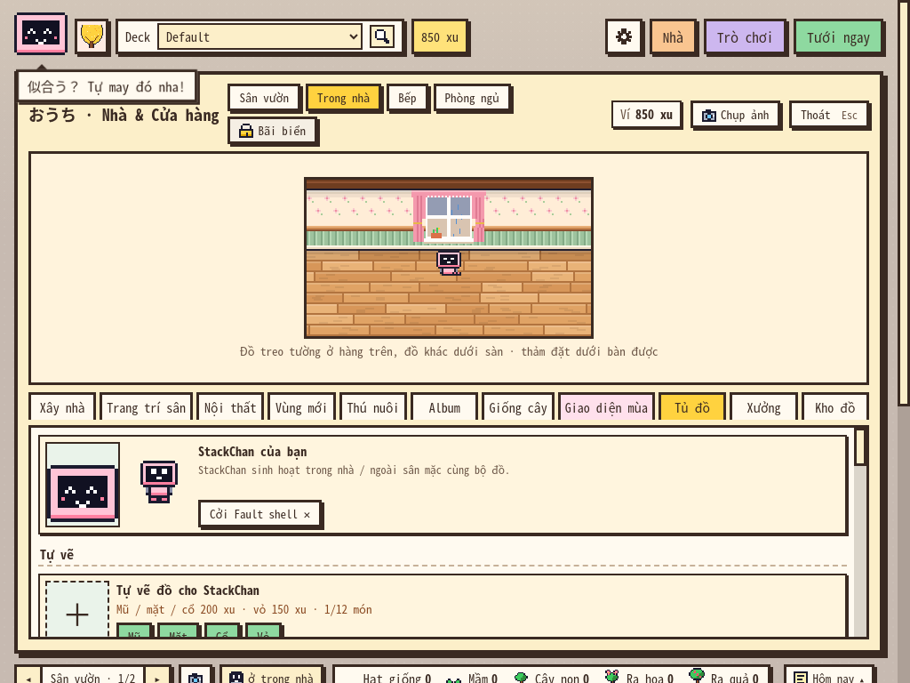
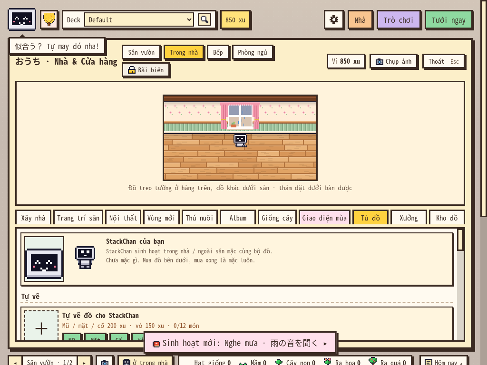
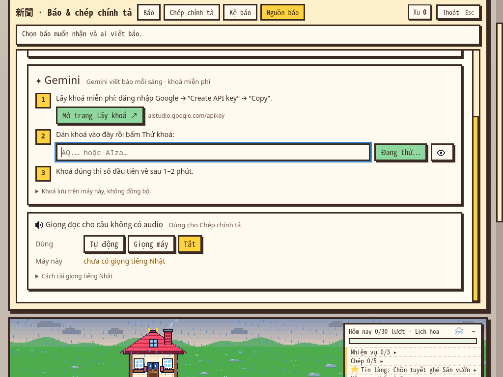
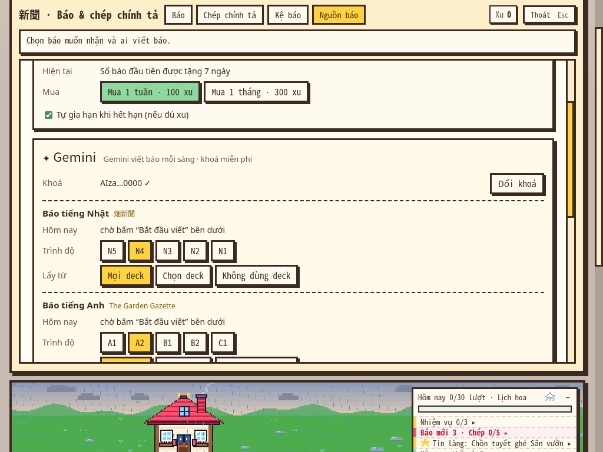

# Chốt rà soát sâu — ことば畑 1.31.0

**Kết luận cuối: chưa phát hành stable.** Vòng sâu xác minh thêm **3 nhóm lỗi**, nâng tổng lên **8 nhóm: 2 P1, 6 P2**. Hai việc cần ưu tiên nhất là bảo vệ bản nháp Xưởng (**F01**, đã báo) và không báo lưu thành công khi dữ liệu chỉ được ghi một phần (**F06**, mới). Cần sửa cả việc callback kiểm tra khoá có thể lưu lại khoá người dùng vừa xoá (**F07**).

Mã sản phẩm vẫn ở **`240c7c333ea2580d0389d2c790995a64ea9b4914`**; `master` chưa có thay đổi sửa lỗi so với [vòng đầu](BAO_CAO.md). Nhánh này tiếp tục chỉ chứa báo cáo, test và minh chứng. Không dùng kết quả kiểm thử để khẳng định các lỗi đã được sửa.

## 1. Phần kiểm tra thêm

Chạy trong hồ sơ/collection tạm trên hai môi trường đã dùng ở vòng đầu: **Anki 26.9.4 / Qt 6.12.0** và **Anki 23.10.1 / Qt 6.6.3**. Không gọi Gemini thật, không làm đầy ổ đĩa thật, không dùng collection học của người dùng.

| Bộ bổ sung | 26.9.4 | 23.10.1 | Ý nghĩa |
|---|---:|---:|---|
| Lỗi ghi dữ liệu, collection Anki thật; mua/sửa/lưu/đọc/đóng/mở lại | **81/112** | **81/112** | 31 ca trượt mỗi bản cùng thuộc F06 |
| UI, callback muộn, phục hồi chấm thẻ, Undo/Redo đạt thưởng | **12/16** | **12/16** | 4 ca trượt mỗi bản thuộc F06/F07/F08 |
| Tổng **256 kiểm tra mới** | **93/128** | **93/128** | **186 đạt, 70 trượt**; cùng lỗi được kiểm ở nhiều điểm ghi và hai bản Anki |

Không có ca `harness/...` lỗi trong kết quả cuối. Các nhóm mới có ca đối chứng thành công và ca xác nhận rằng lỗi đã thực sự được đưa vào đúng vị trí. Không tính số assertion trượt thành số lỗi độc lập.

Bằng chứng: [storage-26.json](logs/deep/storage-26.json), [storage-23.json](logs/deep/storage-23.json), [ui-26.json](logs/deep/ui-26.json), [ui-23.json](logs/deep/ui-23.json). Log chữ cùng tên nằm trong [logs/deep](logs/deep/).

### Đối chiếu lại 5 lỗi đã báo

- Chạy lại core vòng đầu: **2.043/2.047**, vẫn đúng bốn ca xung đột đồ mặc **F04**.
- Chạy lại UI vòng đầu trên 26.9.4: **178/188**, vẫn các ca **F01/F02/F05**, không có lỗi thiết lập.
- Chạy lại đổi hồ sơ trên 26.9.4: **6/7**, vẫn lỗi backup nhật ký **F03**.

Các log/JSON kiểm lại có tiền tố `recheck-` trong [logs/deep](logs/deep/). Vòng đầu đã tái hiện các lỗi UI và vòng đời trên cả hai đầu phiên bản. Không chạy lại toàn bộ 32 bài cũ vì mã sản phẩm không đổi; kết quả **37 bộ lõi đạt và 1.345/1.345 assertions UI trên 26.9.4** của vòng trước vẫn được lưu nguyên cùng giới hạn kiểm chứng.

## 2. F06 — P1: ghi collection lỗi nhưng vẫn báo đã lưu

### Tình huống người dùng thấy

1. Có 1.000 xu, tạo Vỏ tự vẽ giá 150 xu.
2. Cho đúng một lần ghi `kotoba_batake_more` gặp lỗi I/O ở API `Collection.set_config`.
3. UI đóng Xưởng, hiện món `Fault shell` đang mặc, ví còn 850 xu.
4. Làm mới vườn: món đó **biến mất**, ví vẫn **850 xu**.

| UI vừa báo tạo xong | Sau làm mới |
|---|---|
|  |  |

Không chỉ kiểm bằng trạng thái UI: test đọc collection ngay sau thao tác cho thấy `ids=[]`, trong khi dữ liệu được trả cho UI là `ids=["w1"]`. Bộ core còn **đóng rồi mở lại collection từ đĩa**, xác nhận trạng thái lỗi vẫn tồn tại.

### Tác động tới công sức vẽ

Mũ có sẵn đang là `160r` (đỏ). Người dùng vẽ lại thành `160g` (xanh) và trả 50 xu. Nếu ghi `kotoba_batake_px` lỗi, hàm vẫn trả thành công và xu giảm **800 → 750**, nhưng điểm ảnh đọc lại vẫn **`160r`**. Bản vẽ mới chưa được lưu vào collection dù editor được phép coi là đã xong.

Xem `persistence/hat-edit/kotoba_batake_px/one-shot/no-false-success`; trường `actual_pixels`, `expected_edited_hat`, số xu và thông báo lỗi đều nằm trong JSON.

### Nguyên nhân và phạm vi

[`GardenState._write`](../../../kotoba_batake/garden_core.py#L3014) bắt lỗi `set_config`, chỉ `print`, rồi tiếp tục. [`save`](../../../kotoba_batake/garden_core.py#L3031) ghi nhiều khoá riêng; [`save_px`](../../../kotoba_batake/garden_core.py#L3091) cũng nuốt lỗi. Bởi vậy ví có thể đã trừ tiền trong khi metadata/điểm ảnh chưa được ghi. Lần đọc sau ưu tiên cấu hình collection hợp lệ nhưng cũ, nên bản backup mới trên máy không tự khắc phục được.

Đã kiểm: Vỏ mới, Mũ mới, sửa Mũ cũ, mẫu sàn, nội thất và gói báo; lỗi một lần hoặc liên tục tại các điểm ghi liên quan. **Không phải mọi lỗi ở mọi khoá đều làm mất dữ liệu**: các lần ghi không đổi dữ liệu và lỗi chỉ ở file backup được kiểm riêng. Khi **chỉ backup lỗi mà collection vẫn ghi được**, mua Mũ vẫn lưu bền và test đạt.

Đây là **mô phỏng lỗi I/O tại biên lưu của collection thật**, không phải minh chứng ổ đĩa của người dùng đã đầy hoặc Anki đang hỏng. Nó chứng minh đường xử lý lỗi hiện không bảo toàn cam kết “đã lưu”. Bản backup đôi khi còn dữ liệu mới để cứu bằng tay; không coi đó là một luồng phục hồi tự động đã có.

Đã đối chứng thêm bằng **lỗi từ SQLite thật**: trigger trong collection tạm chỉ từ chối ghi `kotoba_batake_more`; không thay `Collection.set_config` ở Python. Backend trả `SqliteFailure / ConstraintViolation`, add-on vẫn báo thành công và để ví **850 xu**, danh sách đồ **rỗng**. Gỡ trigger thì mua/lưu bình thường lại. Ca `persistence/sqlite-trigger/no-false-success` tái hiện trên cả hai bản Anki, cho thấy vấn đề không chỉ do thay hàm Python. Trigger chỉ tồn tại trong collection test bị xoá sau lần chạy.

**Cần sửa trước stable:** không trả thành công khi ghi dữ liệu chính thất bại; gom các phần của giao dịch vào cơ chế commit/rollback phù hợp; chỉ cập nhật UI thành công sau khi lưu được toàn bộ phần liên quan. Nếu lỗi, giữ bản vẽ và cho thử lại, không trừ xu riêng lẻ. Phân biệt rõ “lưu chính thất bại” với “backup thất bại nhưng dữ liệu chính đã lưu”.

## 3. F07 — P2: xoá khoá bị phản hồi kiểm tra cũ hoàn tác

**Luồng đã tái hiện qua UI:** đang có khoá cũ → bắt đầu kiểm tra khoá mới → lúc còn “Đang thử…” bấm **Xoá khoá** và xác nhận lần hai → config thực sự rỗng → phản hồi kiểm tra khoá mới trả thành công → khoá mới lại xuất hiện trong config.

| Sau khi xoá, khoá đã rỗng | Phản hồi cũ về: khoá lại được lưu |
|---|---|
|  |  |

`key-race/delete-actually-clears-config` đạt; `key-race/late-success-does-not-restore-deleted-key` trượt với `actual=true`. Chỉ dùng khoá tổng hợp; không in khoá thật trong log.

**Nguyên nhân:** [`ai_test_key.done`](../../../kotoba_batake/__init__.py#L1163) luôn gọi `save_config(gemini_key=key)` khi kết quả thành công. Nhánh [`ai:forget`](../../../kotoba_batake/__init__.py#L3137) xoá cấu hình nhưng không vô hiệu hoá yêu cầu đang kiểm tra. Nút xoá trong UI vẫn dùng được lúc `testing=True`.

**Phạm vi kết luận:** khoá bị lưu lại trên máy trái với lựa chọn xoá. Test không khẳng định khoá đã bị thu hồi ở Google, bị lộ cho người khác hay đã phát sinh request mới; tự viết báo được tắt trong fixture.

**Cần sửa:** gắn generation/request ID cho kiểm tra khoá. Xoá khoá phải huỷ hiệu lực mọi callback cũ; phản hồi chỉ được ghi khi request còn hiện hành. Kiểm thêm việc thay khoá/đổi nguồn/đóng bảng trong lúc đang thử.

## 4. F08 — P2: chấm thẻ lỗi rồi không chấm lại được ngay

Cho thao tác chấm thẻ trong `CollectionOp` thật thất bại một lần trước khi ghi. Add-on báo “không lưu được câu trả lời”; revlog và ví đều không thay đổi — phần này **đúng**. Sau đó các nút chấm vẫn hiện, nhưng bấm lại **không gửi lượt chấm mới**. Dừng rồi mở Tưới ngay lại thì chấm được đúng một lượt.

**Bằng chứng:** `review-failure/no-review-or-money-recorded`, `review-failure/backend-unblocked-and-warning` và `review-failure/stop-start-is-a-working-recovery` đạt; `review-failure/clicking-rating-can-retry` trượt. Test ghi cảnh báo Qt thành chữ để không chặn runner; mã xử lý lỗi và trạng thái màn ôn là mã sản phẩm thật.

**Nguyên nhân:** [`Garden.rate`](../../../kotoba_batake/web/garden.js#L921) đặt `waiting=true`; phía Python đã đặt `_card=None`. Callback [`failed`](../../../kotoba_batake/__init__.py#L2700) chỉ mở `_busy` và hiện cảnh báo, không đưa thẻ và trạng thái JS trở lại chỗ có thể chấm.

**Cần sửa:** sau thất bại, đưa UI về trạng thái thử lại hợp lệ hoặc tải lại thẻ còn chờ từ scheduler và nói rõ cần làm gì. Chỉ cho retry khi đã xác định thao tác trước chưa ghi, tránh chấm hai lần nếu lỗi xảy ra sau commit. **Cách tránh tạm thời đã xác minh:** Dừng → Tưới ngay. Chưa thấy mất lịch ôn trong kịch bản này.

## 5. Những phần kiểm sâu cho kết quả đúng

- **Undo/Redo ở đúng lượt nhận cả hai loại thưởng:** từ 9 lên 10 lượt ôn, đạt mục tiêu ngày + hoàn thành một nhiệm vụ; ví **1.000 → 1.038 → Undo 1.000 → Redo 1.038**. Số lượt, số lần tưới, cờ thưởng ngày, tiến độ và trạng thái nhiệm vụ đều trở lại đúng; Redo vẫn dùng được. Không báo lỗi chỉ vì object có thêm các trường tiến độ bằng `0`: những trường đó tương đương trường chưa ghi.
- **Kết quả luyện viết về sau khi bản nháp đã đổi:** bỏ kết quả cũ, giữ nguyên bản nháp mới.
- **Chấm thẻ thất bại trước commit:** không tự cộng xu, không tạo revlog; khi Dừng/mở lại chỉ ghi đúng một lượt thành công.
- **Backup lỗi nhưng collection tốt:** không báo nhầm thành mất dữ liệu chính; món đồ và điểm ảnh vẫn còn sau đọc lại.
- Năm nhóm lỗi vòng đầu vẫn tái hiện đúng điều kiện; không phát hiện lỗi thiết lập mới trong các lần đối chiếu cuối.

## 6. Bảng chốt release

| Nhóm | Mức | Trước khi stable |
|---|---|---|
| F01: phản hồi cũ làm mất bản nháp Xưởng | P1 | Sửa, kiểm mã phiên/request và khôi phục bản nháp |
| F06: lưu một phần nhưng báo thành công | P1 | Sửa đường commit/lỗi; không mất xu/nét vẽ khi lưu hỏng |
| F02: Enter ở nền xác nhận mua | P2 | Sửa focus, phím và khôi phục focus |
| F07: phản hồi cũ lưu lại khoá vừa xoá | P2 | Vô hiệu hoá callback cũ sau thao tác xoá |
| F05: Esc trên lưới trống gây lỗi JS | P2 | Không vẽ editor đã đóng; bảo vệ dữ liệu không vuông |
| F03: backup nhật ký bị hồ sơ khác ghi đè | P2 | Backup theo owner và kiểm phục hồi đúng hồ sơ |
| F04: hai món cùng chỗ mặc sau qua bản cũ | P2 | Chuẩn hoá xung đột hoặc giới hạn nâng cấp rõ ràng |
| F08: chấm lỗi rồi UI không retry được | P2 | Có trạng thái phục hồi rõ; tránh ghi trùng khi thử lại |

**Thứ tự làm:** F01/F06 → F02/F07/F05 → F03/F04/F08 → chạy lại các ca thất bại → đóng release candidate → kiểm máy thật. Chưa cần thêm gameplay. Nên giữ phạm vi bản sửa hẹp để kết quả audit còn đối chiếu được.

Các rủi ro đã ghi ở vòng đầu vẫn còn: thư viện báo dùng chung giữa hồ sơ cần chốt thiết kế; một bài cũ với nhân vật chuyển động trên Anki 23.10.1 chưa ổn định; Windows/macOS, DPI/bộ gõ thật, AnkiWeb và Gemini thật chưa được kiểm ở môi trường này. Đây là giới hạn của kết luận, không phải chứng nhận không còn lỗi khác.

Sau khi sửa và các tiêu chí trên đạt, có thể phát beta giới hạn để kiểm máy thật. **Với đúng commit đang kiểm tra, kết luận cuối vẫn là No-go cho stable.**

Mã test: [deep_storage_audit.py](../../../tests/audit_20261114/deep_storage_audit.py), [deep_ui_audit.js](../../../tests/audit_20261114/deep_ui_audit.js); [cách chạy](../../../tests/audit_20261114/README.md). Hash minh chứng tiếp tục nằm trong [SHA256SUMS](logs/SHA256SUMS).
