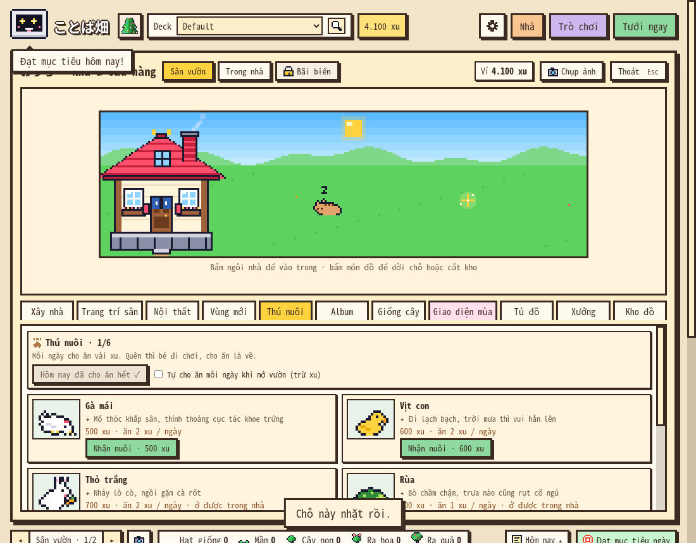
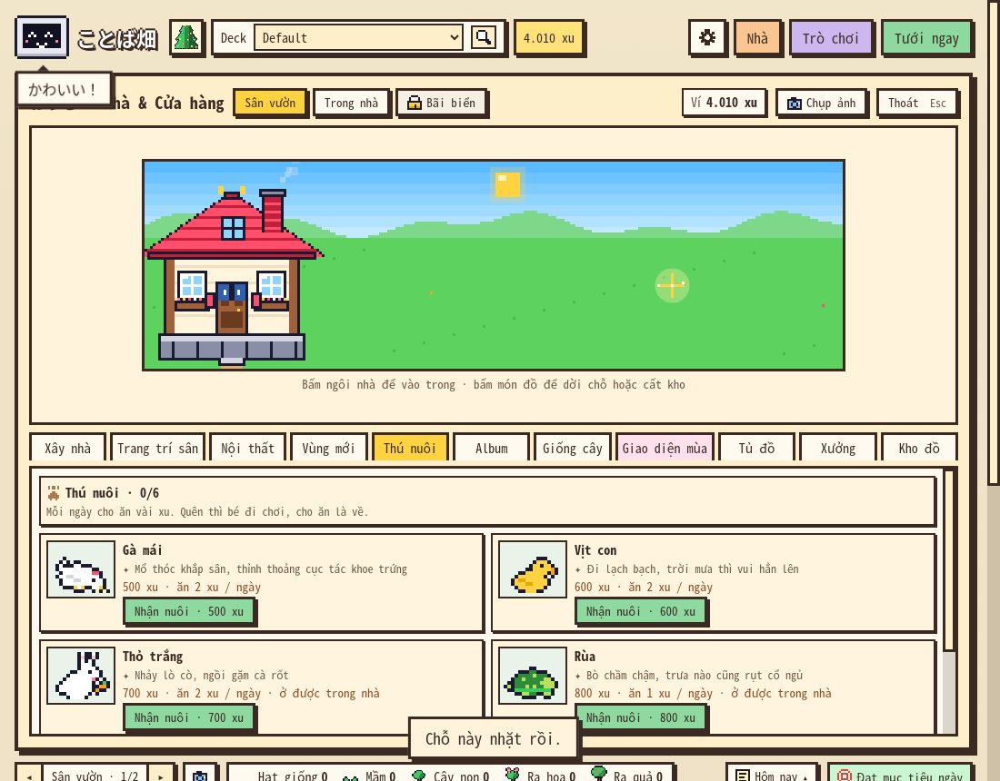
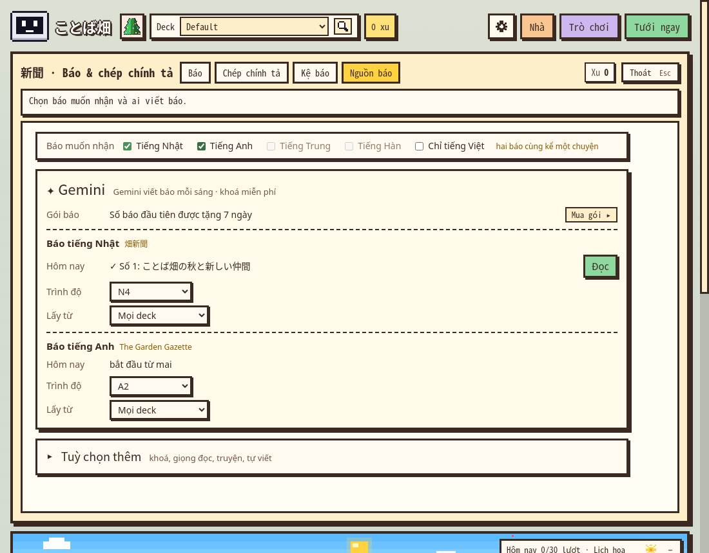
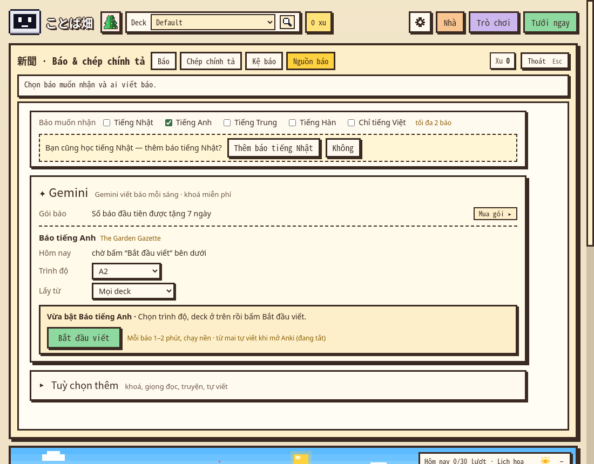
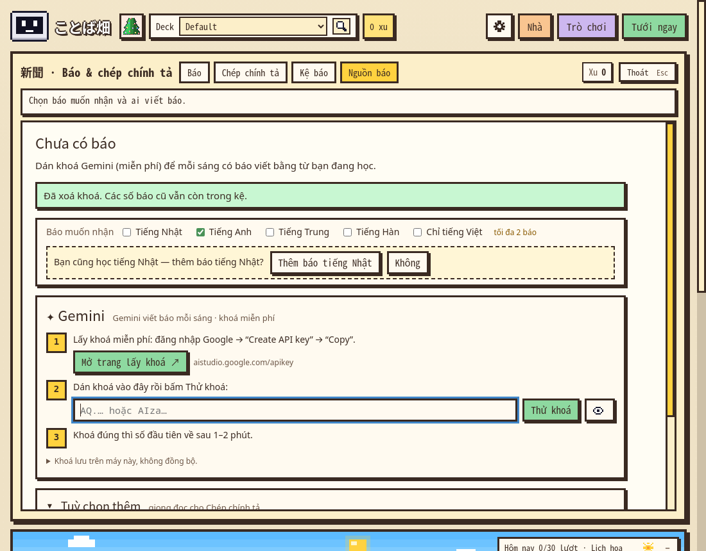

# Kiểm tra độc lập 1.33.2 · 17/11/2026

**Kết luận: chưa nên phát hành rộng bản 1.33.2 này.** Đã xác nhận 5 lỗi chính, gồm **1 lỗi P1 có thể ghi đè dữ liệu vườn** và 4 lỗi P2. Bộ test hiện có xanh không loại trừ các lỗi này. Ưu tiên một bản vá, kiểm lại các ca đỏ bên dưới rồi mới tiếp tục thêm tính năng.

| ID | Mức | Vấn đề | Điều kiện |
|---|---|---|---|
| F01 | **P1 — chặn release** | Lỗi đọc bị coi là dữ liệu trống/cũ; lần lưu tiếp theo làm mất dữ liệu | API đọc collection ném lỗi; đã thử lỗi một lần và kéo dài |
| F02 | P2 | Đã ghi tiến độ nhưng chưa trả xu; thử lại không nhận được xu | Lỗi ghi ví sau khi tiến độ báo/nhặt trùng đã lưu |
| F03 | P2 | Bỏ tick rồi đổi báo làm mất quy tắc “từ mai” | Thao tác checkbox bình thường sau khi đã có báo hôm nay |
| F04 | P2 | Xóa khóa Gemini khiến báo cũ Anh/Trung/Hàn/Việt không đọc được | Thao tác Xóa khóa bình thường; file báo vẫn tồn tại |
| F05 | P2 | Thẻ đổi trong cùng giây không được nhận ra; chấm lại lỗi lặp | Hai trạng thái thẻ khác nhau có cùng `cards.mod` |

P1 cần sửa trước phát hành. P2 nên sửa trong cùng đợt vì ảnh hưởng phần thưởng, quyền đọc nội dung đã có và luồng ôn chính. Các phát hiện chưa được sửa trong nhánh audit.

## 1. Bản đã kiểm tra và cách kiểm

- Repository: `dungmt2808/kotoba-anki`, nhánh gốc `master` tại **`9ef5272f6af34c78168d2b8851259add29bf2561`**, bản **1.33.2**. Đã xác minh lại remote khi chốt; vẫn là commit này.
- Nhánh kết quả: **`audit/release-review-1.33.2-2026-11-17`**. Nhánh bổ sung test, báo cáo và minh chứng; không thay đổi mã sản phẩm hay gói cài đặt.
- Gói `.ankiaddon`: **74 file**, khớp từng byte với nguồn, không thiếu file nguồn cần đóng gói. SHA-256: `00c39bf1ef2d4524407f7eb9e82ae46fe3dfee2b3ab1250c19656f96cbd9514c` — [kiểm tra gói](minh_chung/package-check.json).
- Linux, Python **3.12.14**, Node **24.22.1**; Anki **26.09.4 / Qt 6.12.0** và **23.10.1 / Qt 6.6.3** trong hai môi trường riêng. Múi giờ `Asia/Ho_Chi_Minh` — [môi trường mới](minh_chung/environment26.json), [môi trường cũ](minh_chung/environment23.json).
- Collection, hồ sơ, nhật ký, thẻ, báo và xu đều là dữ liệu tổng hợp. Các ca mới chạy trên **gói đã giải nén**, với collection Anki và QtWebEngine thật.
- Lỗi I/O được đưa vào API `get_config`/`set_config`; không làm đầy hay phá ổ đĩa thật. Đây là chứng minh hành vi **khi có lỗi**, chưa phải phép đo tần suất lỗi I/O ngoài thực tế.
- Các ca mới không gọi Gemini thật. Thử lịch viết báo chỉ giữ lại tác vụ nền để đếm việc được tạo; không giả kết quả của logic chọn báo, đọc/lưu hoặc trả thưởng. Ca F05 dùng scheduler Anki thật; chỉ thu câu cảnh báo thay cho mở modal để runner tiếp tục được.

## 2. Kết quả kiểm thử

| Bộ kiểm tra | Kết quả lần chạy này | Minh chứng |
|---|---|---|
| `tests/run_all.sh`, nguồn | **62 mục chạy, exit 0**, `TỔNG: TẤT CẢ OK` | [log nguồn](minh_chung/baseline-source.log) |
| `tests/run_all.sh`, gói giải nén | **62 mục chạy, exit 0**, `TỔNG: TẤT CẢ OK` | [log gói](minh_chung/baseline-package.log) |
| 39 kịch bản UI cũ, mỗi bài một hồ sơ mới, Anki 26.09.4 | **1.633 / 1.637 assertion**; 36 bài xanh, 3 bài có assertion trượt | [tổng hợp từng bài](minh_chung/regression-summary.json), [log từng bài](minh_chung/regression/) |
| UI audit cũ: bố cục / lưu lỗi / đổi hồ sơ | **191/191 + 18/18 + 7/7** | [UI](minh_chung/ui-baseline.log), [lưu lỗi](minh_chung/deep-ui.log), [hồ sơ](minh_chung/lifecycle.log) |
| `e2e_1332` có sẵn | **36/36 trên mỗi bản Anki** | [26.09.4](minh_chung/e2e-1332-26.log), [23.10.1](minh_chung/e2e-1332-23.log) |
| Đồng bộ Anki thật qua máy chủ cục bộ, `e2e_1312` | **46/47**, assertion trượt là thời điểm hiện thông báo; các kiểm tra giữ dữ liệu đạt | [log đồng bộ](minh_chung/sync-real.log) |
| Cài đè thật **1.31.3 → 1.33.2**, đóng/mở Anki | **19/19**: 5 trước + 14 sau; giữ khóa, file, xu, nhật ký, cấu hình | [trước](minh_chung/upgrade-before.log), [sau](minh_chung/upgrade-after.log) |
| **Storage audit mới** | **6/21 trên mỗi bản Anki**; 15 assertion tái hiện F01 | [26.09.4](minh_chung/storage26.json), [23.10.1](minh_chung/storage23.json) |
| **UI/logic audit mới** | **42/53 trên mỗi bản Anki**; 11 assertion tái hiện F01–F04 | [26.09.4](minh_chung/ui26.json), [23.10.1](minh_chung/ui23.json) |
| **Ôn cùng giây — ca mới** | **3/7 trên mỗi bản Anki**; 4 assertion tái hiện F05 | [26.09.4](minh_chung/review26.json), [23.10.1](minh_chung/review23.json) |

**81 assertion mới trên mỗi bản Anki**, tổng **162 lượt kiểm tra**: 102 đạt, 60 trượt. Các assertion trượt lặp cùng 5 nguyên nhân; **không phải 60 lỗi độc lập**. Không có lỗi thiết lập `harness/...` trong kết quả cuối của các bộ mới. Các kiểm tra đối chứng, gồm không gọi mạng và không có exception JavaScript, đều đạt.

Các nhóm ngoài test có sẵn gồm: đọc lỗi thay vì chỉ ghi lỗi/làm sạch dữ liệu; sao lưu cục bộ cũ hơn collection; thay báo qua lựa chọn rỗng và qua tiếng Việt; xóa khóa rồi đọc kho báo; trả thưởng lỗi rồi thử lại; mua đồ khi một kho khác đọc lỗi; đổi thẻ cùng giây; zoom 100/125/150% và tên deck rất dài. Các mức zoom được thử ở 1024×768 và 1366×768; bộ UI cũ còn kiểm 720×520 và 1920×1080.

### Các assertion cũ trượt được phân loại riêng

Không sửa assertions cũ để làm xanh kết quả:

1. **`e2e_1223`: 47/49 khi chạy cùng các bài khác; chạy lại có quan sát: 49/49.** Hàm giả `_fake_start` có thể ghi “đã bắt đầu” ngay cả lúc chưa có khóa. [Trace](minh_chung/startup-trace.json) ghi `key_present: false` đi cùng `calls_to_stub`; khi đã có khóa và đang chờ xác nhận, không có lời gọi. Hai đối chứng mới dùng **`ai_start` thật** xác nhận không có job khi thiếu khóa và sau lần thử khóa đầu tiên. Đây là độ ổn định của test/tác vụ hẹn giờ, chưa phải bằng chứng Gemini thật tự viết trái ý người dùng. [Log chạy lại](minh_chung/trace-1223.log).
2. **`e2e_132b`: 19/20.** Chỉ album khách và bản sao lưu album đổi. Bài test cho các khách ngày gặp gần nhất là ngày trước, rồi mở vườn đủ lâu để khách tự ghé và ghi ngày hôm nay. Bất biến “mọi byte không đổi” đã bao gồm một tính năng có chủ ý ghi dữ liệu khi xem vườn. Nên cố định/điều khiển khách trong fixture của bài này.
3. **`e2e_1322`: 39/40; sai khác UI mức P3.** Nội dung thẻ đã Undo đúng, đúng thẻ và không mất dữ liệu; dòng trạng thái còn “Đã lưu thẻ.” thay vì “Thẻ vừa được sửa.”. `_edit_wait` có thể còn `True` khi `_note_changed` trả về sớm vì nội dung chưa đổi. Chạy lại riêng vẫn **39/40** — [log lần chạy lại](minh_chung/edit-1322-rerun.log). Không xếp cùng F05 — F05 là lỗi chấm và kẹt thẻ thực sự. [Log gốc](minh_chung/regression/e2e_1322.log).
4. **`e2e_1312`: 46/47.** Bài kiểm thông báo sau 500 ms, trong khi thông báo quan trọng trước đó có hàng chờ. Đối chứng mới xác nhận backend phát đúng câu “Thẻ này vừa được ôn hoặc sửa ở chỗ khác…”. Không suy từ một lần đọc toast quá sớm thành lỗi đồng bộ dữ liệu. [Đối chứng](minh_chung/review26.json), case `notification/backend-emits-card-changed-message`.

Không chạy `e2e_1253.js` với helper cũ vì nó dừng mọi tiến trình Anki của các bài khác. Việc giữ cấu hình qua khởi động lại vẫn được kiểm trong bài cài đè thật. Các runner của audit chỉ dừng tiến trình thuộc hồ sơ thử của mình.

## 3. Các lỗi đã xác nhận

### F01 · P1 · Lỗi đọc có thể ghi đè dữ liệu thật bằng mặc định hoặc bản sao lưu cũ

**Vị trí:** [GardenState._read_more](../../../kotoba_batake/garden_core.py#L2996) và các hàm `_read_ext`, `_read_season`, `_read_nha`, `_read`; [GuestStore._raw](../../../kotoba_batake/guest_core.py#L208), [LifeStore._raw](../../../kotoba_batake/life_core.py#L348), [EventStore.raw](../../../kotoba_batake/finds_core.py#L370), [PaperState.load](../../../kotoba_batake/paper_core.py#L701).

`except Exception` biến lỗi đọc thành `None`/`{}`. `load()` tạo dữ liệu mặc định hợp lệ, không có cờ `_damaged`, rồi thao tác tiếp theo ghi dữ liệu đó vào collection và bản sao lưu. `_damaged` hiện bảo vệ lỗi xử lý dữ liệu ở các bước merge/clean, chưa bảo vệ lỗi đọc API bị nuốt trước đó.

**Tái hiện cụ thể trong Anki thật:**

1. Có nhà và một mèo đã mua; mở tab Thú nuôi.
2. Cho đúng lần đọc `kotoba_batake_more` tiếp theo ném `OSError`.
3. Gửi thao tác mua ghế qua cầu nối thật `home:buy:bench`.
4. Ghế mua được, nhưng `more.pets` từ `{"neko": ...}` thành `{}`. Tab Thú nuôi từ 1/6 thành 0/6; không có báo dữ liệu đọc hỏng.

| Trước thao tác | Sau thao tác |
|---|---|
|  |  |

Ma trận core cũng tái hiện mất đồ ở EXT/SEASON/NHA, thú và đồ tự vẽ ở MORE, album khách, sổ sinh hoạt và Hộp sưu tầm. Với sao lưu cục bộ cũ, tiến độ báo mất ngày `2026-11-16`; ví mong đợi **97.046 xu**, thực tế **96.946 xu**. Các ca đã thử cả đọc lỗi một lần và lỗi kéo dài. Nhật ký là đối chứng tốt: `strict=True` từ chối ghi tháng chưa đọc được và giữ dữ liệu cũ.

**Minh chứng:** [storage26.json](minh_chung/storage26.json), các case `read-failure/...`; [ui26.json](minh_chung/ui26.json), `read-failure/UI/buy-must-retain-unrelated-pet`. Kết quả tương tự trên 23.10.1. Việc mô phỏng bản vừa đồng bộ dùng ghi cấu hình collection thật mà cố ý giữ bản sao lưu cũ, không phải một lần AnkiWeb thật.

**Cần sửa:** phân biệt ba trạng thái “không có khóa”, “đọc được”, “đọc thất bại”. Trạng thái cuối phải chặn thao tác ghi, không cập nhật bản sao lưu/dấu mới lên dữ liệu suy ra từ mặc định. Áp dụng đồng nhất cho mọi store. Sau sửa phải thử lại cả đọc lỗi một lần, kéo dài, sao lưu cũ và mở lại hồ sơ; các mục không liên quan phải còn nguyên.

### F02 · P2 · Xu thưởng bị mất khi ghi tiến độ thành công nhưng ghi ví lỗi

**Vị trí:** [GardenDialog._on_paper](../../../kotoba_batake/__init__.py#L3635), [GardenDialog._on_find](../../../kotoba_batake/__init__.py#L4189).

**Báo:** ví 1.000 xu → trả lời đúng câu hỏi +2 → tiến độ đã lưu `q["0"] = 1`, `coins = 2` → chặn lần ghi ví. Giao diện báo lỗi. Hết lỗi, trả lời lại: câu đã được tính `first=False`, ví vẫn **1.000**, thay vì **1.002**.

**Nhặt trùng:** ghi `picked=[1,2]` trước, rồi ghi +3 xu lỗi. Thử lại và làm mới vườn vẫn **1.000**, thay vì **1.003**. Không còn quyền nhặt lại chỗ đó.

**Minh chứng:** [ui26.json](minh_chung/ui26.json), `rewards/paper/retry-eventually-pays-correct-answer` và `rewards/duplicate/retry-eventually-pays`; [bản cũ](minh_chung/ui23.json) cũng trượt.

Đã kiểm đối chứng quà đủ bộ: quà có thể tạm chưa vào kho khi lưu lỗi, nhưng `finds_view` tự cấp lại khi refresh. **Quà này không bị mất vĩnh viễn**, nên không tính thành lỗi riêng. Xu hiện chưa có cơ chế bù tương đương.

**Cần sửa:** ghi tiến độ và ví trong cùng lần commit có rollback, hoặc lưu một khoản thưởng chờ có ID ổn định rồi đối soát sau khi thử lại/mở hồ sơ. Phải bảo đảm vừa không mất thưởng, vừa không trả hai lần. Bao gồm tiến độ nhiệm vụ liên quan trong kịch bản thử lại.

### F03 · P2 · Bỏ tick báo đã viết rồi chọn báo khác cho viết ngay hôm nay

**Vị trí:** [nhánh `ai:set:langs`](../../../kotoba_batake/__init__.py#L3693). `_wrote_today(before)` chỉ xét các báo đang được chọn ngay trước thao tác; `later` cũng bị lọc theo lựa chọn mới.

1. Báo Nhật hôm nay đã có.
2. Bỏ tick Nhật → lựa chọn rỗng.
3. Tick Anh → `before=[]`, kiểm “đã viết hôm nay” trả sai; `gemini_later={}`, `waiting=["en"]`.
4. Hiện nút **Bắt đầu viết**. Bấm nút tạo **1 job** ngay hôm nay, trái quy tắc đã chốt “báo mới từ mai”.

Đường đi Nhật → Chỉ tiếng Việt → Trung và bỏ tick/tick lại báo đang hẹn ngày mai cũng làm mất giới hạn. Đối chứng giữ tick Nhật rồi thêm Anh thì hẹn ngày mai đúng.

| Giữ Nhật rồi thêm Anh | Bỏ Nhật rồi chọn Anh |
|---|---|
|  |  |

**Minh chứng:** [ui26.json](minh_chung/ui26.json), nhóm `tomorrow/...`; ngày hẹn trong lần chạy là **18/11/2026**. Chỉ job được tạo, không gọi Gemini thật.

**Cần sửa:** xét số đã hoàn thành hôm nay trên toàn bộ các báo liên quan, độc lập với checkbox hiện tại; giữ quy tắc trong suốt các lần đổi/bỏ chọn. Kiểm thêm đóng/mở vườn và sang ngày mới.

### F04 · P2 · Xóa khóa làm khóa luôn quyền đọc báo cũ ở bốn ngôn ngữ

**Vị trí:** [_library](../../../kotoba_batake/__init__.py#L216) trả `None` cho Anh/Trung/Hàn/Việt nếu thiếu khóa, dù thư mục báo đã có.

1. Có ít nhất một số báo đã lưu, Kệ báo đọc được.
2. Mở Nguồn báo → Tuỳ chọn thêm → Xóa khóa, xác nhận.
3. Thông báo nói “Các số báo cũ vẫn còn trong kệ”. Nhưng `_paper_index` chuyển thành `enabled=False`, `issues=[]`, trong khi trên đĩa vẫn có **1 số**. Mở Kệ báo đưa về phần thiết lập.



**Minh chứng:** [ui26.json](minh_chung/ui26.json), `archive/{en,zh,ko,vi}/readable-after-removing-key`. Báo Nhật là đối chứng: đường gộp kho cũ của tiếng Nhật vẫn liệt kê được số đã lưu. **File không bị xóa**; đây là lỗi quyền truy cập nội dung cục bộ, không phải mất file.

**Cần sửa:** đọc thư viện có sẵn không phụ thuộc khóa API. Khóa chỉ cần để tạo nội dung/giọng mới. Kiểm đọc, câu hỏi, audio đã có, tiến độ và đóng/mở Anki khi không còn khóa.

### F05 · P2 · Thẻ được chấm ở nơi khác trong cùng giây gây vòng lặp lỗi

**Vị trí:** [_card_changed](../../../kotoba_batake/__init__.py#L2758) chỉ so `cards.mod` theo giây; [nhánh chấm thất bại](../../../kotoba_batake/__init__.py#L3153) dùng lại phép so đó để quyết định trả thẻ cũ cho chấm lại.

Ca mới tạo thẻ thật, mở trong vườn rồi dùng scheduler Anki chấm thẻ đó ở đường khác ngay trong cùng giây. Không đặt giả `mod` trong ca lỗi chính:

```text
cached.mod == current.mod
cached.reps = 0; current.reps = 1
_card_changed(cached) == False
```

Chấm từ vườn: backend trả `InvalidInput()`. Add-on trả lại đúng cache thẻ cũ và nói “Bấm chấm lại để thử lần nữa”. Bấm lại: thêm một cảnh báo `InvalidInput()`, vẫn cùng thẻ. Phải Dừng/mở lại luồng ôn để phục hồi. Revlog giữ **1 lượt**: Anki đã chặn lần chấm dư; chưa thấy lịch ôn bị ghi hai lần trong ca này.

**Minh chứng:** [review26.json](minh_chung/review26.json), [review23.json](minh_chung/review23.json), nhóm `race/...`; [ảnh thẻ bị trả lại](anh/review_same_second_stale.png). Cả hai bản Anki có cùng 4 assertion trượt. Cảnh báo được thu nguyên văn để không chặn runner bằng modal.

**Cần sửa:** lưu dấu trạng thái khi đưa thẻ ra màn hình, gồm lịch/reps hoặc revlog, thay vì chỉ `mod` theo giây. Khi backend từ chối vì trạng thái đã đổi, đọc lại/đi tiếp; chỉ cho thử lại cùng trạng thái khi chắc chưa có thay đổi. Giữ đối chứng lỗi ghi tạm thời để vẫn thử lại được khi thẻ thực sự chưa đổi.

## 4. Đánh giá code, giao diện và tính năng

- **Nền tảng đang có điểm tốt:** dữ liệu chia khóa để tương thích bản cũ; commit nhiều khóa có rollback; sao lưu theo hồ sơ; có bảo vệ đồng bộ và kiểm cài đè. Những luồng này đã vượt qua nhiều kiểm tra thực tế trong đợt này.
- **Điểm yếu cần ưu tiên:** chính sách đọc lỗi không thống nhất giữa các store; giao dịch nhiều kho chỉ bao phủ một phần các thao tác trả thưởng; dấu thay đổi thẻ quá thô. Đây là các điểm chung nên sửa tập trung.
- **Giao diện:** không thấy tràn ngang trong ma trận bố cục/zoom mới và tên deck dài. Các luồng Nhà, Xưởng, trò chơi, báo, Lịch hoa, cấu hình và phím tắt có độ phủ hồi quy tốt. Phần báo đang có lỗi hành vi F03/F04; dòng trạng thái sau Undo cũng nên làm nhất quán như mục 2. Bảng Nhà 11 tab vẫn cần người dùng mới tìm hiểu nhiều; ảnh phác 6 nhóm đã có trong báo cáo 1.33.2, quyết định bố cục còn chờ người dùng xem.
- **Bảo trì:** `__init__.py` và `home.js` rất lớn. Nên tách quản lý tác vụ báo, giao dịch phần thưởng và giao thức cầu nối thành các thành phần nhỏ, có kiểm thử theo hành vi. Bộ test theo phiên bản có nhiều kiểm tra wiring/chuỗi nguồn; bổ sung các bất biến đọc → sửa → lưu → thử lại và cạnh tranh callback đem lại giá trị rõ hơn việc chỉ tăng số test.

## 5. Điều kiện release và đề xuất tiếp theo

1. **Sửa F01 trước**, bảo toàn cả collection và bản sao lưu khi một kho đọc lỗi. Giữ nguyên dữ liệu người dùng đã có.
2. Sửa F02–F05; chạy lại **81 assertion mới trên cả hai bản Anki**, rồi bộ hồi quy và cập nhật đè. Thử cả retry, khởi động lại và đồng bộ sau lỗi.
3. Làm ổn định các test hẹn giờ/khách/thông báo đã nêu; CI phải thu assertion trượt, không chỉ tin exit code. Một số script cũ có thể exit 0 dù in dấu trượt.
4. Trước phát hành rộng, làm một lượt trên máy người dùng: bộ gõ, cửa sổ sửa note, âm thanh, đóng/mở Anki, AnkiWeb + điện thoại thật. Đợt này kiểm Linux và máy chủ đồng bộ cục bộ; chưa xác minh Windows/macOS, loa/giọng máy thực, API Gemini thật hay chất lượng ngôn ngữ với người bản ngữ. Chưa đo hiệu năng trên collection hàng chục nghìn note.

**Tính năng nên ưu tiên sau bản vá:**

| Ưu tiên | Đề xuất | Lợi ích |
|---|---|---|
| Cao | Màn hình xem/khôi phục bản sao lưu theo hồ sơ, có ngày và xem trước | Người dùng có đường tự cứu dữ liệu khi cần |
| Cao | Đối soát phần thưởng chờ, phục hồi sau lỗi/khởi động lại | Chấm dứt dạng lỗi F02, giữ số xu nhất quán |
| Vừa | Tìm kiếm/lọc đồ trong Kho/Cửa hàng; xem thử cách gom nhóm Nhà | Giảm số thao tác khi danh mục ngày càng lớn |
| Vừa | CI tự động: core + UI trọng yếu + cập nhật từ gói đã phát hành; giữ log/ảnh khi trượt | Phát hiện lỗi trước khi đóng gói |

Ưu tiên bản vá độ tin cậy trước đợt mở rộng tiếp theo. Thư viện báo Gemini dùng chung nhiều hồ sơ là **rủi ro thiết kế đã biết**, được lifecycle audit xác nhận; cần chốt riêng nếu muốn cách ly nội dung theo hồ sơ. Không tự tính lại thành lỗi mới của đợt này.

## 6. Chạy lại

Hướng dẫn đầy đủ và yêu cầu môi trường: [tests/audit_20261117/README.md](../../../tests/audit_20261117/README.md). Các bộ mới **cố ý trả exit 1 khi lỗi còn tái hiện**, không được gắn vào `run_all.sh` rồi đổi kỳ vọng thành hành vi lỗi để làm xanh.

Minh chứng gồm JSON đầy đủ, log hồi quy, ảnh chụp thật và [bảng SHA-256 các file](minh_chung/SHA256SUMS.txt). Log văn bản được bỏ khoảng trắng cuối dòng; giá trị, assertion, thông báo lỗi và kết quả được giữ. Ảnh không chỉnh sửa.
