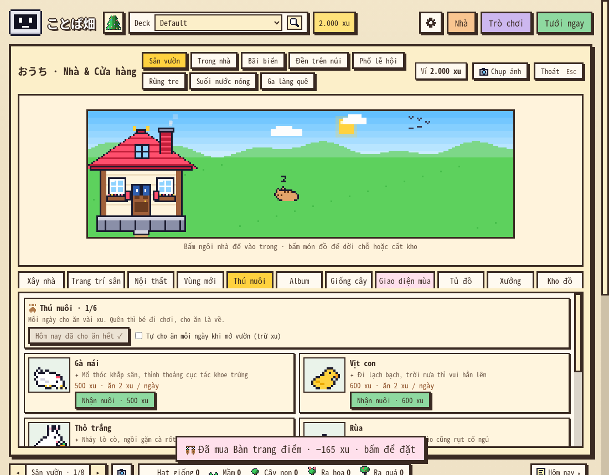
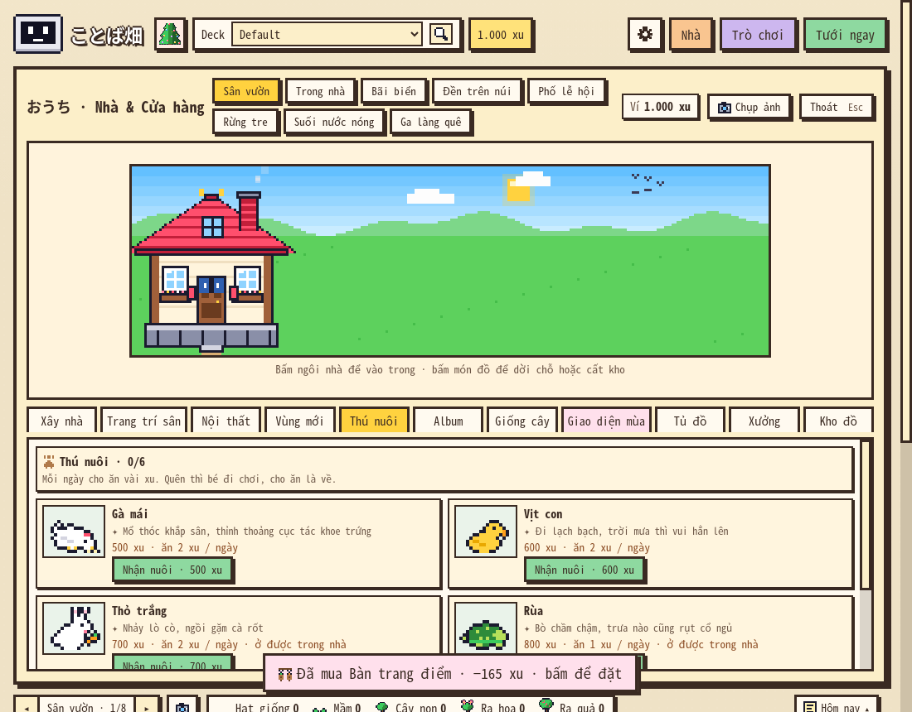
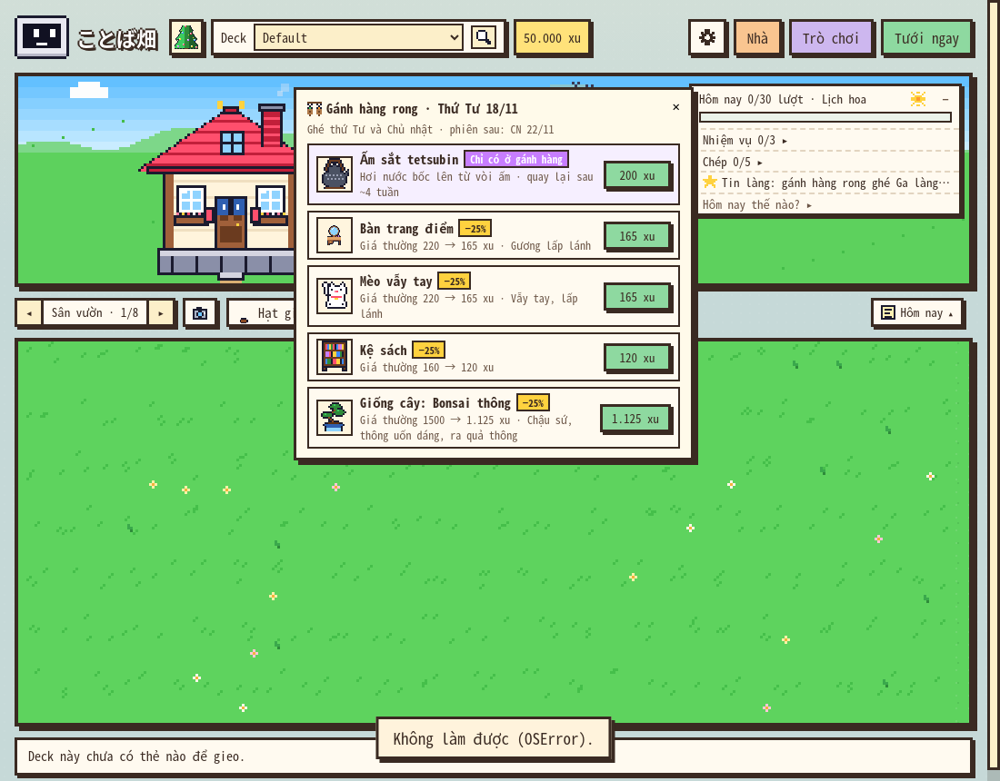
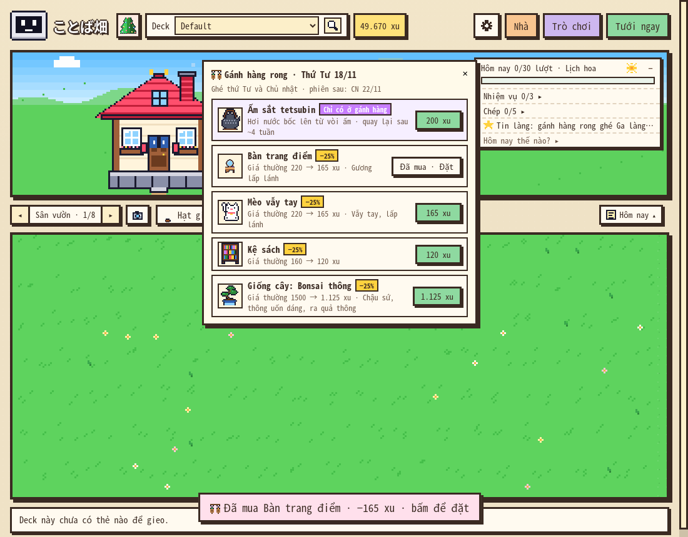

# Kiểm tra sâu bổ sung · 17/11/2026

**Kết luận giữ nguyên: chưa release 1.33.2.** Vòng 2 tìm thêm **F06 (P1)** ở việc khôi phục sau lỗi đồng bộ, **F07 (P2)** ở thao tác mua hàng, và một trường hợp mới của **F02** khi tiến trình dừng giữa hai lần ghi. Tổng hợp hai vòng: **7 lỗi chính, gồm 2 P1 và 5 P2**; còn sai khác nhãn UI mức P3 đã ghi ở [báo cáo chính](BAO_CAO.md).

Nguồn/gói vẫn là **1.33.2 tại `9ef5272f6af34c78168d2b8851259add29bf2561`**. Không sửa mã sản phẩm. Các kết quả vòng 1 được giữ để đối chiếu; vòng này kiểm các chuỗi thất bại → thử lại → mở lại mà các ca lỗi đơn lẻ chưa bao phủ.

## Kết quả vòng 2

| Bộ mới | Anki 26.09.4 | Anki 23.10.1 | Minh chứng |
|---|---:|---:|---|
| `recovery_round2.py`: khôi phục lỗi ở ba khóa × ba cách tiếp tục, đọc snapshot lỗi, dừng tiến trình ở các ranh giới ghi | **37/45** | **37/45** | [26](minh_chung/vong2/recovery26.json), [23](minh_chung/vong2/recovery23.json) |
| `ui_round2.js`: mua qua nút + xác nhận thật, lỗi sổ phiên, retry bằng nút, hooks đồng bộ thật, 10.000 note/5.000 cây | **16/20** | **16/20** | [26](minh_chung/vong2/ui26.json), [23](minh_chung/vong2/ui23.json) |
| Tổng | **53/65** | **53/65** | [Tổng hợp](minh_chung/vong2/summary.json) |

**65 assertion riêng, chạy trên hai bản = 130 lượt**, 106 đạt, 24 trượt. Mỗi bản có cùng 12 case trượt, không có lỗi `harness/...`. Các kiểm tra đối chứng và JavaScript/network đều đạt. Cộng vòng 1 là **146 assertion riêng mỗi bản, 292 lượt chạy**, 208 đạt/84 trượt. Các case đỏ giữ kỳ vọng đúng, không đổi sang chấp nhận hành vi lỗi.

Collection và scheduler Anki là thật; chỉ dùng hồ sơ tạm, dữ liệu tổng hợp. Việc tải cấu hình cũ được mô phỏng bằng thay các khóa trong collection thật rồi gọi các hook/logic sản phẩm. **Không khẳng định vòng 2 là một lần AnkiWeb/điện thoại thật.** Lỗi ghi được đưa vào API; ca dừng tiến trình dùng `os._exit(73)` trong **tiến trình con riêng**, sau khi một lần `set_config` thật đã trả về, không để Python chạy rollback. Không làm hỏng ổ đĩa hoặc dừng Anki cá nhân. Không gọi Gemini thật.

## F06 · P1 · Lỗi khôi phục đồng bộ có thể làm mất bản chụp tốt

**Vị trí:** [before_sync](../../../kotoba_batake/sync_core.py#L227), [write_record](../../../kotoba_batake/sync_core.py#L199), [_apply](../../../kotoba_batake/sync_core.py#L239), [_on_sync_finished](../../../kotoba_batake/__init__.py#L5330).

### Kịch bản lỗi khôi phục rồi bấm Đồng bộ lại

1. Vườn cũ: **1.000 xu**, chưa nuôi mèo, nhật ký cũ.
2. Vườn mới: **2.000 xu**, có mèo, nhật ký mới. `before_sync` chụp bản mới vào `dong_bo.json`.
3. Collection nhận bản cũ hơn. Trong lúc `after_sync` trả lại bản mới, cho **một lần ghi lỗi**. Hàm trả `failed`, rollback về bản vừa mang về; bản chụp **2.000 xu vẫn còn**. Đây là hành vi đối chứng đang làm đúng.
4. Hết lỗi, bấm Đồng bộ lại. `before_sync` chụp thẳng collection đang giữ **bản 1.000 xu**, ghi đè `dong_bo.json` tốt. Không có cờ giữ “bản mới đang chờ trả lại”.
5. Sau lần thử lại và mở lại collection, `on_open` thấy collection giống bản chụp mới bị ghi đè nên trả `keep`. Kết quả **1.000 xu, không mèo, nhật ký cũ**.

| Trước lỗi | Sau Đồng bộ lại |
|---|---|
|  |  |

Ảnh là cùng hồ sơ thử, có các thông báo từ kịch bản mua hàng chạy trước đó; đối chiếu dữ liệu bằng JSON của case `sync-retry/new-data-survives-retry`.

**Đã thử ba điểm lỗi:** khóa ví `kotoba_batake_state`, kho mở rộng `kotoba_batake_more`, nhật ký tháng `kotoba_batake_journal_2026_11`. Cả ba đều mất khả năng tự phục hồi sau retry.

### Hai đường khác cũng làm mất khả năng phục hồi

- **Sửa vườn sau lỗi:** thay vì đồng bộ lại, thực hiện cộng 1 xu rồi mở lại. Thao tác ghi lên bản cũ đóng dấu mới hơn; `on_open` giữ bản cũ đó. Mong đợi 2.001 xu + mèo + nhật ký mới, thực tế 1.001 xu và dữ liệu cũ. Các lần lưu có thể tiếp tục làm lùi cả những file sao lưu theo từng kho.
- **Đọc snapshot trước đồng bộ lỗi:** đã có `dong_bo.json` tốt, nhưng `state_of` của lần chụp mới ném lỗi → `before_sync` trả `None`. `after_sync(..., None)` sau đó ghi bản cũ vừa về đè file tốt; mở lại không phục hồi.

**Đối chứng quan trọng:** nếu đóng/mở collection ngay sau lỗi khôi phục, **trước khi retry hoặc sửa vườn**, bản mới còn phục hồi được. Test không coi mọi lần khôi phục lỗi là mất dữ liệu. Vấn đề là chuỗi thao tác tiếp theo làm mất bản cần dùng để phục hồi.

Minh chứng chi tiết: các case `restore/.../sync-again/...`, `restore/.../edit-after-failure/...`, `snapshot-read-error/...` trong [recovery26.json](minh_chung/vong2/recovery26.json); thao tác nối dây của ứng dụng trong [ui26.json](minh_chung/vong2/ui26.json). Cả hai bản Anki cho cùng kết quả.

**Mức độ:** P1. Dữ liệu mới đã từng được lưu đúng, nhưng một lỗi ghi tạm thời làm chuỗi retry/mở lại chuyển sang giữ bản cũ. Không khẳng định mọi bản sao lưu khác đều bị xóa; có thể còn khả năng cứu bằng tay nếu file khác chưa bị ghi lại. Cơ chế tự khôi phục hiện không giữ được dữ liệu trong chuỗi đã tái hiện.

**Hướng sửa:** giữ bản chụp tốt cùng trạng thái “khôi phục chưa xong”; không cho `before_sync` hoặc nhánh thiếu snapshot ghi đè nó bằng một bản đã biết là cũ. Trước khi cho thao tác vườn/việc nền ghi tiếp, phải phục hồi hoặc giữ chế độ chỉ đọc. Cần thông báo rõ khi khôi phục chưa thành công, kiểm lại retry, mở lại và ghi phát sinh sau lỗi. Giữ nguyên hành vi chấp nhận bản sao lưu khi chính người dùng chủ ý khôi phục; không để lớp bảo vệ đè ngược lựa chọn đó.

## F07 · P2 · Thử lại mua ở gánh hàng sau lỗi lưu bị trừ xu hai lần

**Vị trí:** [_on_find, nhánh `ped:buy`](../../../kotoba_batake/__init__.py#L4208). `STATE.buy_at`/`seed_buy_at` lưu ví và đồ trước; `EVENTS.save` ghi sổ phiên sau. Một lần commit nhiều khóa của ví không bao gồm khóa sổ phiên.

Kịch bản dùng nút mua và hộp xác nhận thật. Chỉ giả lập ngày có phiên **thứ Tư 18/11/2026** qua `cal_today`; không thay đồng hồ máy hoặc lịch ôn. Món thử là **Bàn trang điểm**, ô `d1`, giá giảm **165 xu**:

| Bước | Ví thật | Số món thật | Sổ đã mua | Giao diện |
|---|---:|---:|---|---|
| Trước mua | 50.000 | 0 | Chưa | Hiện 50.000 xu |
| Mua, sau đó ghi sổ phiên lỗi một lần | **49.835** | **1** | **Chưa** | “Không làm được (OSError).”, vẫn hiện **50.000 xu**, nút giá 165 còn mua được |
| Hết lỗi, bấm mua lại và xác nhận | **49.670** | **2** | Đã mua | Báo đã mua một lần |

Minh chứng: nhóm `merchant/...` trong [ui26.json](minh_chung/vong2/ui26.json) và [ui23.json](minh_chung/vong2/ui23.json). Sau khi lần thứ hai ghi được sổ phiên, gửi thêm yêu cầu trùng thì bị chặn — đây là đối chứng, lỗi không phải mọi lần bấm đúp đều mua hai lần.

**Hướng sửa:** ví, đồ và sổ phiên cần cùng commit/rollback hoặc có giao dịch chờ với ID ổn định để retry cùng yêu cầu không mua thêm. Khi đã trả xu mà bước sau lỗi, phản hồi UI phải cập nhật đúng trạng thái đã lưu, không để nút mua lại như chưa thanh toán. Cùng nhóm thiếu giao dịch liên kho với F02, nhưng đây là luồng mua và trừ xu, không phải bỏ sót thưởng.

## F02 mở rộng · Dừng tiến trình giữa sổ bù xu và ví

**Vị trí:** [GardenState.save](../../../kotoba_batake/garden_core.py#L3141) ghi `MOBILE_KEY` trước `CONFIG_KEY`; [settle_mobile](../../../kotoba_batake/garden_core.py#L2659) chỉ bù phần revlog chưa có trong sổ; [record_desktop](../../../kotoba_batake/garden_core.py#L2700) đánh dấu phần đã trả.

1. Tạo collection thật có một thẻ, ví **1.000 xu** và sổ bù xu.
2. Trong tiến trình con, dùng scheduler Anki chấm **Được**, tạo **1 revlog thật**.
3. Bắt đầu trả thưởng bình thường. Ngay sau `set_config(MOBILE_KEY, ...)` thật trả về, gọi `os._exit(73)` trước bước ghi ví.
4. Mở lại collection ở tiến trình khác. Revlog vẫn có 1 lượt, sổ ghi `all=1, ok=1`, ví vẫn **1.000**.
5. Gọi `mobile_catch_up`: trả `None`, không bù. Ví mong đợi **1.001** nhưng vẫn **1.000**; revlog không đổi.

**Đối chứng:** không dừng tiến trình, dừng sau ghi ví, hoặc dừng sau ghi dấu phiên bản đều giữ **1.001 xu**. Chỉ điểm dừng giữa hai kho tái hiện thiếu thưởng. Đây là phép thử dừng tiến trình thật, không phải chỉ ném `OSError` để mã rollback có cơ hội chạy.

Minh chứng: `process-stop/kotoba_batake_mobile/review-is-paid-after-recovery` trong [recovery26.json](minh_chung/vong2/recovery26.json), [log đầy đủ](minh_chung/vong2/recovery26.log). Không tạo ID lỗi mới vì đây vẫn là thiếu nhất quán giữa bằng chứng “đã trả” và ví của F02.

Hướng sửa giao dịch cần bao phủ cả khởi động lại, không chỉ rollback exception trong cùng tiến trình. Kiểm thêm sổ nhiệm vụ/mục tiêu ngày để không tạo dấu “đã trả” trước khi ví đã nhận.

## Kiểm tra dương tính với 10.000 note

Đã thêm **10.000 note thật** bằng `Collection.add_notes`, mở vườn theo deck đó và thử:

| Cửa sổ / zoom | Số cây | Canvas cuối | Anki 26.09.4 / 23.10.1 |
|---|---:|---:|---|
| 1366×768 / 100% | 400 | 1296×1020 | Đạt / Đạt |
| 720×520 / 100% | 5.000 | 648×25020 | Đạt / Đạt |
| 720×520 / 150% | 5.000 | 378×42900 | Đạt / Đạt |
| 1920×1080 / 100% | 5.000 | 1836×8880 | Đạt / Đạt |

Mỗi lần xác nhận tổng vẫn là **10.000 note**, số cây theo đúng giới hạn, điểm ảnh cuối canvas có alpha 255 và xuất PNG được; không chỉ kiểm canvas có khai báo chiều cao. Không có exception JS, không gọi Gemini, không phát sinh revlog khi xem.

Số đo backend refresh trong lần chạy này khoảng **83–710 ms** trên 26.09.4 và **104–326 ms** trên 23.10.1. Số đo từ gửi refresh tới assertion khoảng **0,3–2,4 giây**, gồm giao tiếp test, chờ layout và xuất PNG, hai phiên chạy song song; **không dùng để kết luận bản Anki nào nhanh hơn hay bảo đảm FPS**. Chưa thử 50.000 note/chạy dài trên phần cứng người dùng. Chi tiết trong mục `metrics` của các file UI JSON.

## Cần làm trước release

1. Sửa **F01/F06**: read/restore lỗi không được tạo mặc định hoặc mất bản chụp tốt; chặn ghi trên bản đang chờ khôi phục.
2. Sửa giao dịch liên kho **F02/F07**, có thử lại và phục hồi sau dừng tiến trình. Không chỉ bắt exception rồi cho UI tiếp tục.
3. Sửa F03–F05 và nhãn UI P3 đã ghi; chạy lại cả hai vòng audit, bộ hồi quy, cài đè và đồng bộ thật.
4. Ưu tiên tính năng phục hồi/xem bản sao lưu theo hồ sơ và lịch sử giao dịch. Điều kiện release hiện phụ thuộc khả năng phục hồi và tính nhất quán của các luồng đang có.

Lệnh tái hiện: [README của audit](../../../tests/audit_20261117/README.md#vòng-2--phục-hồi-sau-lỗi-và-collection-lớn). Mọi minh chứng đều dùng dữ liệu tổng hợp. Log chỉ bỏ khoảng trắng cuối dòng; ảnh không chỉnh sửa.
