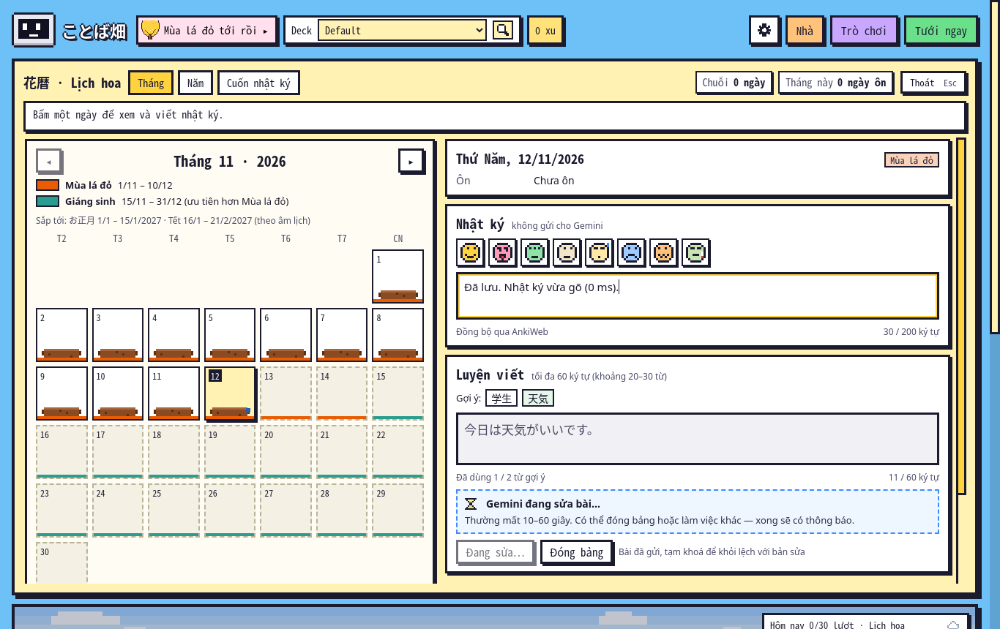
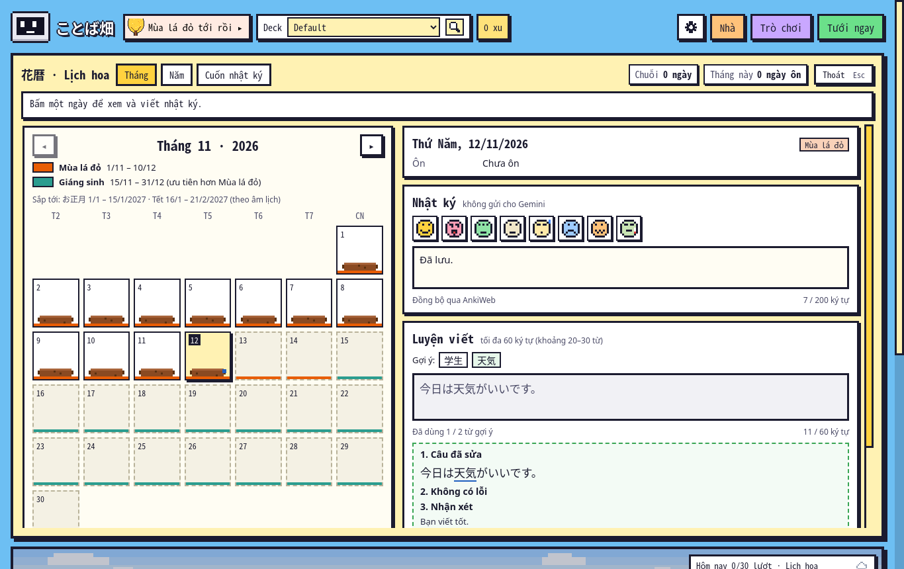
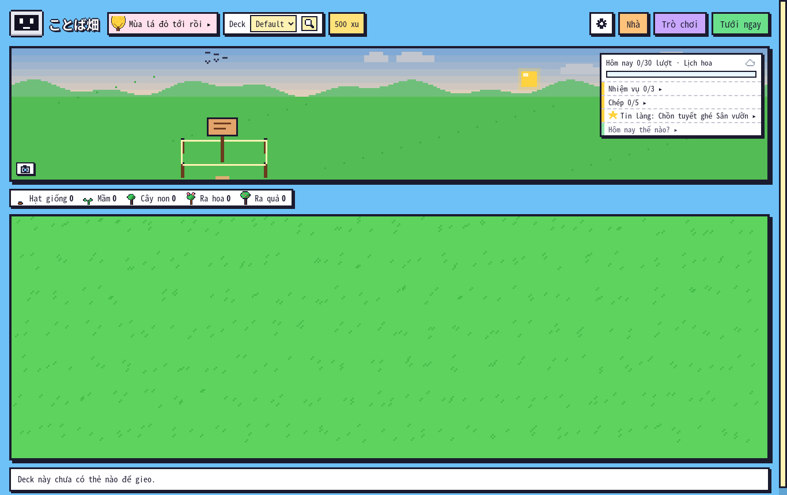
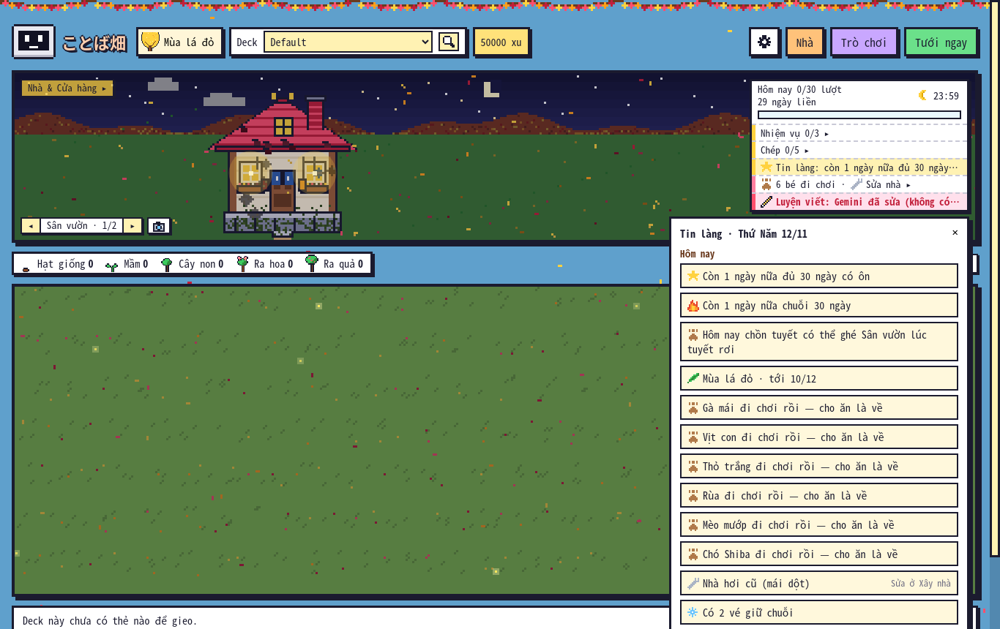
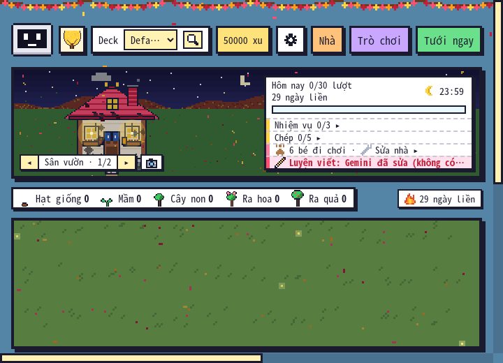
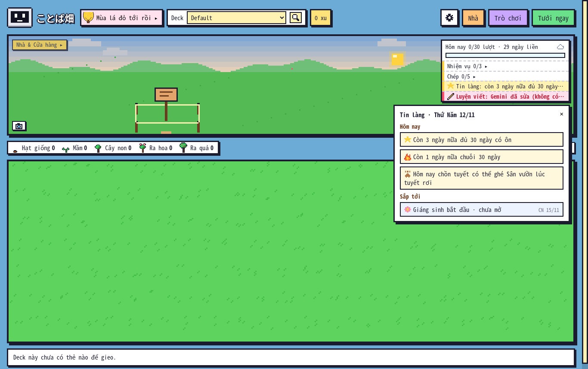
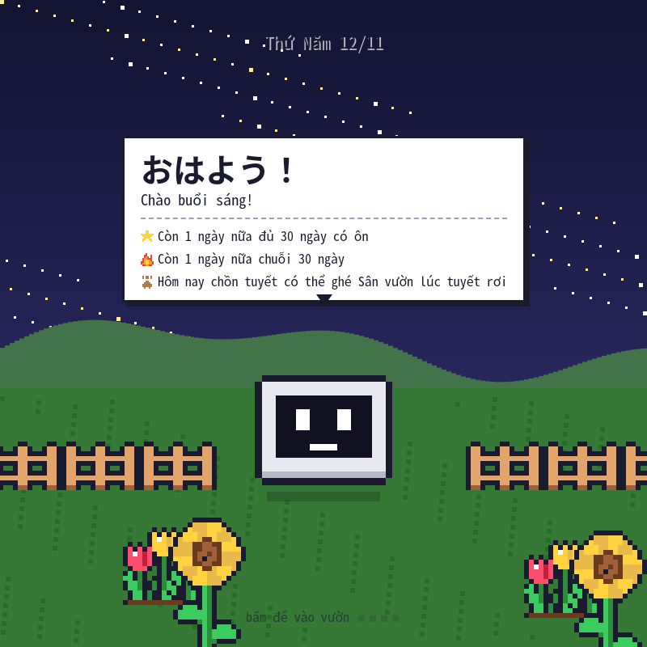

# Rà soát độc lập Kotoba Batake · 12/11/2026

**Kết luận: chưa nên phát hành stable công khai bản 1.26.1.** Có **9 lỗi đã tái hiện: 2 P1, 6 P2, 1 P3**. Hai lỗi P1 làm mất chữ nhật ký đang gõ và trừ xu của hồ sơ khác khi việc nền hoàn tất. Nên sửa chúng trước khi mở rộng tính năng 1.27.

## Bản được kiểm tra và phương pháp

- Bản cuối được đánh giá: **1.26.1**, commit [`6021c579b1062f7e6c707a6e55a9d7feb7a8fa00`](https://github.com/dungmt2808/kotoba-anki/commit/6021c579b1062f7e6c707a6e55a9d7feb7a8fa00), `master` trên GitHub tại thời điểm đối chiếu. Workspace ban đầu là 1.26.0 (`33a80df`); sau khi thấy bản mới trên remote, đã kiểm lại các phát hiện trên 1.26.1. Kết luận dưới đây dùng bằng chứng của **1.26.1**.
- Linux; Anki **26.9.4 / Python 3.13.5 / Qt 6.12.0** và **23.10.1 / Python 3.9.25 / Qt 6.6.0**. Giao diện chạy trong Anki thật bằng QtWebEngine offscreen, điều khiển qua DevTools, có ảnh chụp.
- Đọc code Python, cầu nối Python–JS, lưu trữ theo hồ sơ, tính ngày/chuỗi, vé, gói báo, công việc nền, chào/chuyển cảnh/hướng dẫn, bố cục và bộ kiểm thử. Chạy test sẵn có; thêm ba bộ kiểm tra độc lập và giữ nguyên các kỳ vọng đúng để lỗi hiện thành test đỏ.
- Tất cả thay đổi dữ liệu diễn ra trong **profile tạm**, gồm chuyển hồ sơ thật trong Anki. Các ca Gemini giữ callback và trả kết quả giả lập để chọn chính xác thời điểm hoàn tất; phần xử lý kết quả, collection và giao diện vẫn là code sản phẩm.
- Mọi file trong gói `.ankiaddon` khớp mã nguồn 1.26.1. Gói chỉ có `user_files/README.txt` trong phần dữ liệu người dùng. SHA-256 gói: `f9874b96e8caa03d2d7d174aa58549f8804c4b305568a1fe5b7f51aa212bf6b0`.
- Nhánh audit chỉ thêm test, báo cáo và bằng chứng; không sửa hành vi sản phẩm hoặc đóng lại gói.

P1 = mất nội dung/ghi vào sai hồ sơ, cần sửa trước release; P2 = lỗi logic hoặc luồng/giao diện đáng kể; P3 = lỗi hiển thị nhỏ. Số test trượt không phải số lỗi độc lập.

## Kết quả kiểm thử

| Bộ kiểm tra bổ sung | Kết quả | Diễn giải |
|---|---:|---|
| Lõi, Python + SQLite, seed `20261112` | **750/779** | 29 ca đỏ cùng ba gốc lỗi: DST 21, chuỗi dài 4, dữ liệu phòng hỏng 4 |
| Giao diện 1.26.1 trên Anki 26.9.4 | **38/49** | 11 ca đỏ: mất chữ 6, cache sau sync 2, lời chào 1, Tin làng 2 |
| Giao diện 1.26.1 trên Anki 23.10.1 | **38/49** | Tái hiện cùng các lỗi |
| Vòng đời 1.26.1 trên Anki 26.9.4 | **5/10** | Hướng dẫn từ bốn bảng bị mất; hoàn tất ở sai hồ sơ trừ sai ví |
| Vòng đời 1.26.1 trên Anki 23.10.1 | **5/10** | Tái hiện cùng các lỗi |

**838 kỳ vọng bổ sung khác nhau** (779 lõi + 49 giao diện + 10 vòng đời); 59 kỳ vọng giao diện/vòng đời được chạy trên cả hai bản Anki. Các bộ bổ sung không có lỗi `harness/...`. Hai ca Escape của hướng dẫn qua Chromium đều đạt; không coi đó là lỗi.

Các bộ sẵn có và lần chạy lại được tổng hợp ở phần cuối báo cáo. Log và JSON của các bộ bổ sung nằm trong [`logs/`](logs/). File JSON ghi từng kỳ vọng, kết quả thực tế và mã phát hiện; test đỏ là bằng chứng lỗi chưa sửa.

## Các phát hiện

| Mã | Mức | Lỗi | Phạm vi đã tái hiện |
|---|---|---|---|
| F01 | **P1** | Kết quả sửa bài về làm mất chữ nhật ký chưa tự lưu | Hai bản Anki, 0/300/1000 ms |
| F09 | **P1** | Viết báo ở A, chuyển sang B: B bị trừ 100 xu | Chuyển profile thật, hai bản Anki |
| F02 | P2 | Chia ngày bằng 86400 giây làm sai lịch/chuỗi, dùng nhầm vé khi đổi giờ mùa | New York, Berlin, Lord Howe |
| F03 | P2 | Chuỗi ôn dài bị chặn ở 401 ngày | 402/500/730/1000 ngày |
| F05 | P2 | Tin làng vượt đáy và nằm ngoài cửa sổ sau resize | 1366×860 → 720×520 |
| F06 | P2 | Một bản ghi đặt đồ sai kiểu xoá trạng thái mở hai gian sau lưu | Bếp và Phòng ngủ, `id: []`/`{}` |
| F07 | P2 | Tin mốc học giữ tổng ngày cũ sau khi đồng bộ revlog | 27 → 29 ngày |
| F08 | P2 | Mở Hướng dẫn từ một bảng khác khiến hướng dẫn ẩn mãi | Trò chơi, Lịch hoa, Nhà, Báo |
| F04 | P3 | Trời cố định 00:00 nhưng chào buổi sáng | Hai bản Anki |

### F01 · P1 · Mất chữ nhật ký khi kết quả Gemini về

**Các bước:** mở Lịch hoa, gửi bài luyện viết; trong lúc chờ, gõ tiếp nhật ký; để kết quả về trước khoảng tự lưu 1,5 giây; tiếp tục gõ rồi chờ lưu.

**Mong đợi:** giữ nguyên nhật ký và vị trí nhập, chỉ cập nhật phần bài sửa.

**Thực tế:** `Đã lưu. Nhật ký vừa gõ (0 ms).` lập tức thành `Đã lưu.`. Gõ tiếp ` Ghi tiếp.` rồi lưu chỉ còn `Đã lưu. Ghi tiếp.`; đoạn vừa nhập đã mất trong cả collection. Tái hiện ở độ trễ **0, 300, 1000 ms**. Ca đối chứng **1800 ms** (nhật ký đã tự lưu) giữ được nội dung.





**Nguyên nhân:** [`calendar.js:667`](../../../kotoba_batake/web/calendar.js#L667) nhận `calFix` rồi gọi `onView`/`drawDay`; `R.textContent = ""` thay ô nhập bằng bản `cal_day` chưa chứa nháp. Timer/bộ nhớ `cal:keep` không bảo vệ được khi lần nhập tiếp theo thay cả timer lẫn nháp cũ.

**Hướng sửa:** chỉ cập nhật khối bài sửa, hoặc gộp nháp mới nhất theo revision trước khi dựng lại phần ngày; giữ focus/selection. Chỉ gọi lưu rồi lập tức dựng lại từ payload cũ chưa đủ an toàn.

**Bằng chứng:** `diary/*/preserve-visible-text`, `diary/*/preserve-after-next-save` trong [`ui-26.json`](logs/ui-26.json) và [`ui-23.json`](logs/ui-23.json); [ảnh sau lần lưu kế tiếp](anh/F01_03_after_next_save.png).

### F09 · P1 · Công việc của A trừ xu của B

**Điều kiện:** hai hồ sơ có gói báo hết hạn và bật tự gia hạn. A có 250 xu; B có 600 xu.

**Các bước:** ở A bắt đầu viết báo; 1.26.1 chưa trừ xu vì đợi viết thành công; chuyển profile sang B trong khi việc nền còn chạy; hoàn tất kết quả viết của A; kiểm tra B rồi trở lại A.

**Mong đợi:** công việc phải gắn với hồ sơ khởi tạo. Không được lấy xu hoặc gia hạn gói của B cho yêu cầu của A.

**Thực tế:** **B: 600 → 500 xu**, gói của B được gia hạn. **A: vẫn 250 xu**, gói A vẫn hết hạn. Cả Anki 26.9.4 và 23.10.1 cho cùng kết quả.



**Nguyên nhân:** callback ở [`__init__.py:1471`](../../../kotoba_batake/__init__.py#L1471) gọi `paper_sub_ensure(date)`; `STATE` lấy collection hiện tại qua `mw.col`, không có định danh hồ sơ khởi chạy. Công việc nền dùng `uses_collection=False`, nên đổi profile không bị giữ lại. Đây là nhánh tính phí mới ở 1.26.1.

**Hướng sửa:** lưu owner/profile và ngữ cảnh thanh toán khi bắt đầu; khi callback chạy chỉ ghi vào đúng owner. Nếu hồ sơ đã đóng, hoãn áp kết quả/thanh toán tới lúc mở lại hoặc huỷ đúng cách. Không giữ collection đã đóng để tiếp tục ghi; không đọc ví hiện tại làm ví của việc cũ.

**Bằng chứng:** `billing/A-completion-must-not-charge-B`, cùng trạng thái B khi hoàn tất và A sau khi mở lại trong [`lifecycle-26.json`](logs/lifecycle-26.json), [`lifecycle-23.json`](logs/lifecycle-23.json). Đổi hồ sơ dùng `mw.unloadProfileAndShowProfileManager()` và `mw.pm.load()` thật; chỉ kết quả nhà cung cấp AI được giả lập. Kỳ vọng không ép cách sửa phải trừ A ngay: huỷ/hoãn việc cũ cũng hợp lệ nếu không làm đổi B.

### F02 · P2 · Sai ngày tại DST, vé bị tiêu cho ngày đã ôn

**Tái hiện cụ thể:** múi giờ `America/New_York`, ngày Anki 01/11/2026, giờ đổi ngày 04:00; có lượt ôn **31/10 lúc 04:30 EDT** và **01/11 lúc 12:00 EST**. Đây là hai ngày ôn liên tiếp.

**Thực tế:** `review_days` trả `{0, -2}` thay vì `{0, -1}`; Lịch hoa đưa lượt 31/10 sang **30/10**; chuỗi chỉ còn 1. Có một vé mua từ 30/10 thì `freeze_settle` dùng vé cho **31/10**, tồn vé **1 → 0**, dù ngày đó đã ôn.

```json
{"case":"time/DST/must-not-spend-ticket-on-reviewed-day",
 "actual":{"used":["2026-10-31"],"stock":0},
 "expected":{"used":[],"stock":1}}
```

**Nguyên nhân:** [`garden_core.py:1805`](../../../kotoba_batake/garden_core.py#L1805), `review_day_total`, và [`journal_core.py:141`](../../../kotoba_batake/journal_core.py#L141) dùng một mốc cutoff rồi chia cố định 86400 giây cho mọi ngày. Ngày địa phương quanh DST có thể dài 23/25 giờ, hoặc lệch 30 phút ở Lord Howe.

**Hướng sửa:** dùng ranh giới ngày Anki theo lịch địa phương tại từng ngày/offset phù hợp; dùng chung một hàm phân ngày cho lịch, tổng ngày, chuỗi và việc bù/giữ chuỗi. Không vá riêng dòng hiển thị.

**Bằng chứng:** 21 ca đỏ F02 trong [`core-audit.json`](logs/core-audit.json). Ma trận 337 ca kiểm cả hai đợt đổi giờ ở New York, Berlin, Lord Howe, có UTC/Việt Nam/Nhật làm đối chứng. Oracle dùng `ZoneInfo` và ngày địa phương, không dùng lại phép chia của add-on. Chưa mô phỏng một lượt đồng bộ AnkiWeb thật qua DST.

### F03 · P2 · Chuỗi dài bị giảm còn 401

**Các bước:** tạo lịch sử mỗi ngày ôn một lượt trong 500 ngày liên tiếp rồi đọc `daily_stats`.

**Thực tế:** `streak = 401`, trong khi `review_day_total = 500`. Các lịch sử 402, 730 và 1000 ngày cũng chỉ còn 401. Số người dùng nhìn thấy và các mốc chuỗi 500/730/1000 không còn đúng.

**Nguyên nhân:** [`garden_core.py:1809`](../../../kotoba_batake/garden_core.py#L1809) giới hạn tập ngày ở `start - 400 * 86400` rồi dùng tập đó để tính toàn bộ chuỗi. Đây là giới hạn truy vấn, không phải đứt chuỗi thật.

**Hướng sửa:** tính chuỗi bằng lịch sử đủ dài hoặc truy vấn tới chỗ đứt đầu tiên; phân biệt cửa sổ thống kê với chuỗi liên tiếp. Kiểm lại chuỗi có vé qua các mốc dài.

**Bằng chứng:** `streak/consecutive-402-days`, `500`, `730`, `1000` trong [`core-audit.json`](logs/core-audit.json). Các ca 399/400/401 đạt, giúp xác định đúng ranh giới.

### F05 · P2 · Tin làng tràn và không bám cửa sổ khi resize

**Các bước:** có sáu thú đi chơi, nhà cần sửa, hai vé và gói báo sắp hết; mở Tin làng bằng nút nhìn thấy ở 1366×860; thu cửa sổ xuống 720×520 khi bảng còn mở.

**Thực tế trên Anki 26.9.4:** bảng có rect **[914, 295, 1324, 970]** ở cửa sổ cao 860. Phần dưới vượt khoảng 110 px; overflow nội bộ là `visible`, buộc cuộn cả trang. Sau resize, rect vẫn ở x=914 trong cửa sổ rộng 720: **cả bảng nằm ngoài khung nhìn**. Escape vẫn đóng được bảng và giữ cửa sổ vườn; đó là đường thoát, không giải quyết bố cục.





**Nguyên nhân:** [`greet.js:347`](../../../kotoba_batake/web/greet.js#L347) chỉ đặt toạ độ lúc mở; không có giới hạn chiều cao/cuộn nội bộ hoặc cập nhật theo resize cho bảng tin.

**Hướng sửa:** giới hạn theo viewport, cho nội dung bảng cuộn, giữ đầu bảng/nút đóng truy cập được; tính lại vị trí khi resize/zoom/scroll hoặc đóng bảng khi đổi bố cục.

**Bằng chứng:** `news/rich-popup-fits-1366x860`, `news/open-popup-follows-window-resize`, kèm rect thực trong [`ui-26.json`](logs/ui-26.json); tái hiện trên 23.10.1. Không dùng bấm vào nút đang ẩn để tạo ca này.

### F06 · P2 · Một bản ghi đồ sai kiểu làm mất hai gian

**Các bước:** nhà đã mở Bếp/Phòng ngủ và có một món tự làm đặt hợp lệ; chèn thêm đúng một bản ghi `{"id":[],"x":7,"y":2}` vào danh sách đặt đồ của một gian; tải trạng thái rồi thực hiện một lần cộng xu/lưu bình thường. Làm lại với `id: {}`.

**Mong đợi:** bỏ qua bản ghi hỏng, giữ các gian đã mua và món đặt hợp lệ.

**Thực tế:** khi đọc, `rooms` thành `[]`, mọi chỗ đặt ở hai gian bị xoá khỏi trạng thái. Lần lưu tiếp ghi trạng thái rỗng vào `nha.json`/khoá NHA. Quyền sở hữu món đồ vẫn có thể còn trong kho; phần bị mất là **trạng thái mở rộng và chỗ đặt**.

**Nguyên nhân:** [`garden_core.py:864`](../../../kotoba_batake/garden_core.py#L864) thử `e.get("id") in cat` trước khi kiểm kiểu string; list/dict gây `TypeError`. Catch bao quanh toàn bộ `attach_nha` ở [dòng 2733](../../../kotoba_batake/garden_core.py#L2733) thay cả hai gian bằng rỗng. Đường lưu sau đó biến phục hồi tạm thành xoá dữ liệu đã lưu.

**Hướng sửa:** kiểm kiểu từng entry và bỏ riêng entry lỗi; giữ phần hợp lệ và cấu hình mở gian. Dữ liệu đọc lỗi không nên tự ghi đè sạch dữ liệu gốc; giữ bản sao phục hồi.

**Bằng chứng:** bốn ca `rooms/one-bad-id/{kitchen,bedroom}-{list,dict}` trong [`core-audit.json`](logs/core-audit.json), có kiểm cả trước/sau lần lưu. Đây là **thử chịu dữ liệu hỏng**, không khẳng định giao diện bình thường hiện tạo được `id: []`.

### F07 · P2 · Tin mốc học không cập nhật sau sync

**Các bước:** mở vườn với 27 ngày ôn quá khứ; thêm hai ngày lịch sử khác như dữ liệu vừa đồng bộ về; gọi hook `_on_sync_finished()` thật.

**Thực tế:** DB đếm **29**, cache vẫn **27**; Tin làng vẫn `Còn 3 ngày nữa đủ 30 ngày có ôn`. Xoá cache rồi refresh cho đúng `Còn 1 ngày nữa…` mà không đổi dữ liệu.



**Nguyên nhân:** [`__init__.py:1598`](../../../kotoba_batake/__init__.py#L1598) chỉ dùng `(collection.path, ngày Anki)` làm cache key; hook sync không làm mất cache khi lịch sử trước hôm nay thay đổi.

**Hướng sửa:** invalidation sau sync, thay đổi revlog/khôi phục dữ liệu, và vòng đời hồ sơ; vẫn có thể giữ cache trong các lần render không đổi lịch sử.

**Bằng chứng:** `history/cache-invalidate-on-sync`, `history/news-updates-on-sync` và ca đối chứng sau reset trong [`ui-26.json`](logs/ui-26.json), [`ui-23.json`](logs/ui-23.json). Dữ liệu sync được mô phỏng bằng revlog + hook; không gọi AnkiWeb.

### F08 · P2 · Hướng dẫn mở từ bảng khác bị ẩn mãi

**Các bước:** mở Trò chơi; bấm ⚙ → Hướng dẫn 3 bước; đóng Trò chơi và đợi. Lặp lại từ Lịch hoa, Nhà và Báo.

**Thực tế:** `GardenTour._state()` trả `step: 0, shown: false`; hướng dẫn vẫn không hiện sau khi bảng kia đã đóng. Không có báo lỗi cho người dùng.

**Nguyên nhân:** [`tour.js:103`](../../../kotoba_batake/web/tour.js#L103) vào `go(0)` khi `busy()` thì chỉ `hide()`. Interval gọi `tick()` chỉ được tạo trong `draw()`, nên lần mở này không có ai gọi lại để hiện hướng dẫn. Nhánh `render` thấy `step >= 0` cũng trả về.

**Hướng sửa:** đóng các bảng trước khi mở hướng dẫn, hoặc luôn khởi động cơ chế đợi/tick kể cả khi còn bận; bảo đảm huỷ/đổi bước không để lịch chạy cũ.

**Bằng chứng:** bốn ca `tour/help-from-*/visible-after-panel-closes` trong [`lifecycle-26.json`](logs/lifecycle-26.json), [`lifecycle-23.json`](logs/lifecycle-23.json); [ảnh sau khi đóng bảng](anh/F08_help_disappeared.png).

### F04 · P3 · 00:00 chào buổi sáng

**Các bước:** đặt Trời & giờ → Cố định 00:00; xoá mốc đã chào của ngày thử rồi mở lại vườn vào ngày thường.

**Thực tế:** `GardenSky.state().hour = 0`, nhưng lời chào là **おはよう！ / Chào buổi sáng!**. Các mốc 00:30, 01:00, 03:59 lại chào buổi tối đúng.



**Nguyên nhân:** [`greet.js:127`](../../../kotoba_batake/web/greet.js#L127) dùng `st.hour || 9`, nên giá trị hợp lệ `0` thành `9`.

**Hướng sửa:** chỉ lấy mặc định khi thiếu/không phải số, không khi số bằng 0. Kiểm cả giờ cố định và đúng thời điểm 00:00 ở chế độ giờ thật/game.

**Bằng chứng:** `greeting/hour-0/words` trong [`ui-26.json`](logs/ui-26.json), [`ui-23.json`](logs/ui-23.json); có 11 mốc giờ đối chứng quanh 0/4/11/18.

## Điều đang hoạt động tốt và giới hạn

- 360 cấu hình vé đối chiếu với oracle độc lập đều đạt: số vé 0–2, ngày mua, các chỗ hổng, chạy lặp không dùng vé thêm. F02 là lỗi phân ngày đầu vào, không phải mọi logic vé đều sai.
- Các ca số dư 0/thiếu 1/vừa đủ/dư 1 cho vé, món tự làm, giống cây và gói báo đạt; thao tác bị từ chối không làm đổi trạng thái. Trần hai vé, trần xu qua nhiều trò và trần 0 ngày sau đạt.
- Mã chia sẻ giữ đúng pixel với ba cỡ/ba loại và đầu vào ngẫu nhiên; mã lỗi, quá dài, quá giới hạn giải nén bị từ chối trong các ca bổ sung.
- Escape cho Tin làng và hướng dẫn qua Chromium giữ cửa sổ vườn mở. Các bộ giao diện bổ sung không ghi lỗi JS hoặc lỗi add-on; điều này **không** đồng nghĩa không có lỗi logic (F01/F09 diễn ra im lặng).
- Chưa xác nhận Windows/macOS, DPI/zoom thiết bị thật, giọng máy thật, trải nghiệm âm thanh/hiệu năng trên máy cấu hình thấp, và đồng bộ AnkiWeb qua thiết bị thật. Đồng bộ collection mô phỏng và hook không thay thế các bài đó.
- Gemini thật không được xác nhận trong lượt audit này: môi trường chặn request tới dịch vụ bằng proxy 403. Không dùng các thất bại mạng này để kết luận chất lượng sinh báo/TTS của add-on; các kịch bản nhà cung cấp giả vẫn kiểm được nhánh xử lý và thời điểm bất đồng bộ.

## Cần làm trước release và có cần thêm tính năng không

1. **Sửa F01 và F09 trước**. Tiêu chí nhận: nội dung nhật ký còn nguyên ở cả bốn mốc thời gian; công việc nền luôn gắn đúng hồ sơ, hồ sơ B không bị đổi ví/gói khi việc A hoàn tất. Kiểm thêm đóng hồ sơ khi callback về và mở lại sau đó.
2. Sửa phân ngày/chuỗi (F02/F03), phục hồi dữ liệu phòng (F06), rồi invalidation và bố cục (F05/F07/F08). F04 là sửa nhỏ nên làm cùng đợt ổn định.
3. Chuyển các ca audit liên quan thành regression test sau khi sửa, giữ kỳ vọng; khóa ngày/giờ và phiên bản dependency trong CI. Ca async nên điều khiển callback bằng điều kiện, không dựa vào `sleep` cố định rồi đếm trạng thái chớp nhoáng.
4. Chạy smoke trên Windows/macOS và DPI 125%/150%; một lượt AnkiWeb thật từ máy tính sang điện thoại và ngược lại; giọng máy và thao tác đóng/mở Anki thật. Ghi rõ phần nào còn chưa qua thay vì gom thành “tất cả OK”.
5. **Chưa cần thêm gameplay để đủ điều kiện release.** Bộ tính năng hiện tại đã lớn và có mục tiêu học rõ. Các bổ sung hữu ích hơn lúc này: xuất/khôi phục sao lưu theo từng hồ sơ; trạng thái “đã lưu/đang lưu/lưu lỗi”; quản lý công việc nền có owner, trạng thái và huỷ; chẩn đoán lỗi im lặng có thể kiểm chứng. Đây là đề xuất, không có trong nhánh triển khai.
6. Trước công khai mã, chốt LICENSE và mô tả rõ Gemini dùng khoá của người dùng, báo/âm thanh nào đồng bộ hoặc chỉ ở máy. Các mục 1.27–1.29 đã có lộ trình nên để sau đợt sửa ổn định, không cần mở thêm phạm vi cho bản này.

Sau khi hai lỗi P1 được sửa và các kiểm tra chấp nhận trên đạt, có thể phát **beta giới hạn** để kiểm máy thật. Chỉ gọi **stable** khi phần lưu dữ liệu/đúng hồ sơ/phân ngày và kiểm tra máy thật đã được xác nhận.

## Chạy lại và bằng chứng

Xem [`tests/audit_20261112/README.md`](../../../tests/audit_20261112/README.md). Các script từ chối dùng hồ sơ thật; dùng `ANKI_PY` trỏ Python có Anki/Qt phù hợp.

```bash
python3 tests/audit_20261112/core_audit.py kotoba_batake --out /tmp/core.json
bash tests/audit_20261112/run_ui_audit.sh kotoba_batake /tmp/ui
bash tests/audit_20261112/run_ui_audit.sh kotoba_batake /tmp/lifecycle \
  "$PWD/tests/audit_20261112/lifecycle_audit.js"
```

Các JSON/log trong [`logs/`](logs/) là đầu ra của mã chưa sửa; dự kiến lệnh trả `1`. Không đổi assertion thành kiểm “đúng lỗi cũ” để lấy test xanh.

## Toàn bộ test sẵn có trên 1.26.1

Chạy test ngày **12/11/2026**, hoàn thiện báo cáo ngày **13/11/2026**. `tests/run_all.sh` chạy đủ **27 bộ lõi** (cả phần cần Anki): **TẤT CẢ OK**. Các lần UI dùng hồ sơ mới cho từng kịch bản. Không gộp kết quả có provider giả với kết quả nguyên trạng.

| Anki 26.9.4 · kịch bản | Nguyên trạng | Đối chiếu provider cục bộ |
|---|---|---|
| `e2e.js` | 23/24 đạt | 24/24 đạt |
| `e2e_tour.js` | 12/12 đạt | — |
| `e2e_114.js` | 34/34 đạt | — |
| `e2e_115.js` | 21/21 đạt | — |
| `e2e_116.js` | 15/15 đạt | — |
| `e2e_117.js` | 55/55 đạt | — |
| `e2e_118.js` | 29/29 đạt | — |
| `e2e_119.js` | 55/55 đạt | — |
| `e2e_120.js` | Dừng vì lỗi của kịch bản đọc DOM null | 103/103 |
| `e2e_121.js` | 46/46 | — |
| `e2e_122.js` | 64/64 | — |
| `e2e_1223.js` | 49/49 | — |
| `e2e_1226.js` | 40/40 đạt | — |
| `e2e_1228.js` | 26/26 đạt | — |
| `e2e_123.js` | 63/65 đạt | 65/65 đạt |
| `e2e_124.js` | 23/23 đạt | — |
| `e2e_125.js` | 30/30 đạt | — |
| `e2e_1251.js` | 48/48 đạt | — |
| `e2e_1253.js` | 39/39 đạt | — |
| `e2e_1255.js` | 48/48 đạt | — |
| `e2e_1258.js` | 25/25 đạt | — |
| `e2e_1259.js` | 36/36 | — |
| `e2e_126.js` | 39/39 | — |
| `e2e_1261.js` | 41/41 | — |
| `e2e_kit23.js` | 10/10 đạt | — |
| `audit_edge.js` | 58/58 đạt | — |
| `audit_full.js` | 181/181 | — |
| `audit.js` | Nhật ký lỗi trống; 4 cờ rút gọn tiêu đề có chủ ý | — |

**Phân loại các ngoại lệ:**

- `e2e` (23/24) và `e2e_123` (63/65): tổng cộng ba kiểm tra nhật ký lỗi trượt do prefetch giọng Gemini gặp **proxy 403 Forbidden**. Khi chỉ thay model discovery/prefetch bằng provider cục bộ, giữ nguyên assertion và fallback giọng máy: lần lượt **24/24, 65/65**.
- `e2e_120`: lần nguyên trạng dừng tại bước đọc `.kb-cal-wait.textContent` sau khi trạng thái đã đổi, nên không có tổng đạt hợp lệ. Lần dùng provider cục bộ chạy đủ **103/103**. Không tính lần dừng là lỗi sản phẩm, cũng không coi lần provider cục bộ là đã kiểm Gemini thật.
- `audit_full`: **181/181**, **0/131** ảnh có cờ đo; `audit_edge`: **58/58**, **0/64** mẫu đo có cờ. `audit.js` có 4 cờ chỉ cùng dòng metadata Kệ báo được rút gọn bằng dấu `…` ở hai độ rộng; không có lỗi JS hoặc nhật ký lỗi add-on.
- Một lượt bổ sung bị lỗi kết nối DevTools tới webview vừa bị huỷ khi mở/đóng nhanh; đã thêm retry ở khâu tìm target, chạy lại đủ **49 ca**, không còn `harness/...`. Chỉ các lần chạy đủ được dùng trong bảng phát hiện.

**Anki 23.10.1:** `e2e_1261` **41/41**, `e2e_126` **39/39**, `e2e_tour` **12/12**, `e2e_1259` **36/36**, `e2e_117` **55/55**. Hai bộ bổ sung 49/10 ca cũng đã chạy trên bản này như bảng đầu báo cáo.

**Luồng một ngày → tắt/mở Anki → máy thứ hai:** `release_sync` **41/41** (10 + 15 + 16). “Máy thứ hai” là bản cài/profile mới, chỉ nhận collection chép từ máy đầu, không nhận file sao lưu add-on. Đây là kiểm mô phỏng chuyển collection, không phải đồng bộ AnkiWeb thật.

Dữ liệu: [tóm tắt máy đọc](logs/baseline-ui-summary.json), [log UI nguyên trạng](logs/baseline-ui.log), [log tương thích](logs/compat-ui.log), [log chuyển collection](logs/release-sync.log), [đo giao diện đầy đủ](logs/audit_full.json). Provider cục bộ: [`provider_stub.js`](../../../tests/audit_20261112/provider_stub.js); các log đối chiếu cũng có trong `logs/`.
