# Rà soát trước phát hành — ことば畑 1.25.3

**Bản dựng lại ngày 11/11/2026. Không sửa mã ứng dụng.**

Mã được kiểm tra: commit `1984446d6917192426510c4cd685e2797641defd`, phiên bản 1.25.3. Nhánh `master` đã có thay đổi sau commit này; các kết luận dưới đây chỉ áp dụng cho commit nêu trên, chưa chứng minh tình trạng của bản mới hơn.

File của lượt kiểm tra trước không còn trong workspace. Báo cáo này được dựng lại từ danh sách phát hiện đã ghi nhận, kèm **kịch bản, log và ảnh mới**. Không dùng lại con số 217 ca / 415 ảnh của lượt trước làm kết quả cho bản dựng lại. Các ca chưa chạy lại được ghi rõ, không coi là đã xác nhận mới.

**Đã hoàn tất bản dựng lại:** 235 ca bổ sung, 179 PASS / 56 FAIL / 0 ERROR, quy về 13 phát hiện độc lập. Ảnh và dữ liệu nằm cùng báo cáo trong Git để tải cả nhánh được.

## Kết quả hiện có

- Bộ offline có sẵn: `tests/run_all.sh`, dùng Python có Anki 26.09.4, kết thúc **TỔNG: TẤT CẢ OK**. [Log](logs/offline-existing.log).
- 112 kịch bản lõi bổ sung: **72 PASS, 40 FAIL, 0 ERROR**. Nhiều ca FAIL cùng tái hiện một lỗi ở các phòng / cỡ / cách chia đợt khác nhau, không phải từng lỗi độc lập. [JSON đầy đủ](logs/core-extra.json), [script chạy lại](kich_ban/audit_core.py).
- 123 ca giao diện / tích hợp bổ sung: 107 PASS / 16 FAIL / 0 ERROR. [JSON](logs/ui-extra.json), [script](kich_ban/audit_ui.js).
- Ma trận giao diện gồm 44 ca Nhà (11 tab × 4 cỡ), 28 ca màn chức năng (7 màn × 4 cỡ), 28 ca cảnh mùa (14 giao diện × ngày/đêm). PASS chỉ chứng minh điều kiện đo trong từng ca, không chứng minh mọi nội dung / tương tác của màn đó.

## Danh sách phát hiện

P1: cần xử lý trước phát hành rộng; P2: nên xử lý trong đợt ổn định; P3: lỗi giới hạn / cấu hình / diễn đạt. Phân loại là đánh giá kỹ thuật cho phiên bản này.

### F01 · P1 · Đồ tự làm trong Bếp / Phòng ngủ xuất hiện lại sau khi cất

[Mã liên quan](../../../kotoba_batake/garden_core.py#L791) · [Dữ liệu các ca](logs/core-extra.json) / [ca UI](logs/ui-extra.json)

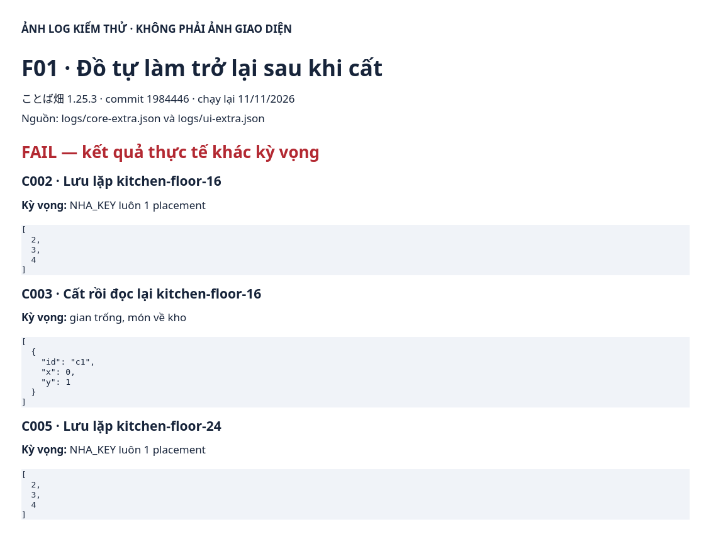

*Ảnh trên là log của kịch bản chạy thật, không phải ảnh giao diện.*

**Đã tái hiện lại:** 12 tổ hợp 2 gian × đồ sàn / tường × cỡ 16/24/32. Lưu lặp làm dữ liệu placement thô tăng `2 → 3 → 4`; cất xong đọc lại vẫn có món ở chỗ cũ. Đối chứng ở sân / phòng chính không tái hiện.

**Cách tái hiện:** xây xong và mở rộng nhà; tạo một món nội thất trong Xưởng; đặt ở Bếp hoặc Phòng ngủ; cất vào kho; đóng / mở lại cảnh. Kiểm tra thêm `kotoba_batake_nha.places` sau mỗi lần lưu.

**Kỳ vọng:** cất là bỏ placement, món có trong kho; lưu lặp không thêm bản sao.

**Nguyên nhân:** `garden_core.py:keep_foreign_nha` coi mọi id ngoài `CATALOG` là dữ liệu của phiên bản tương lai. Id `c1`, `c2` của Xưởng cũng ngoài `CATALOG`, nên placement cũ được ghép trở lại.

**Đề xuất sửa:** phân biệt mẫu tự làm hiện tại với id thực sự chưa hiểu (truyền danh mục đầy đủ / tập id craft hiện tại vào hàm giữ dữ liệu); tránh ghép placement đã biết và chống nhân đôi. Giữ khả năng đọc dữ liệu bản mới hơn. Test lại đặt → di chuyển → cất → lưu → mở lại và máy cũ lưu đè.

### F02 · P1 · Luyện viết tiếng Anh hợp lệ bị mất chữ khi lưu

[Mã liên quan](../../../kotoba_batake/journal_core.py#L350) · [Dữ liệu các ca](logs/core-extra.json) / [ca UI](logs/ui-extra.json)

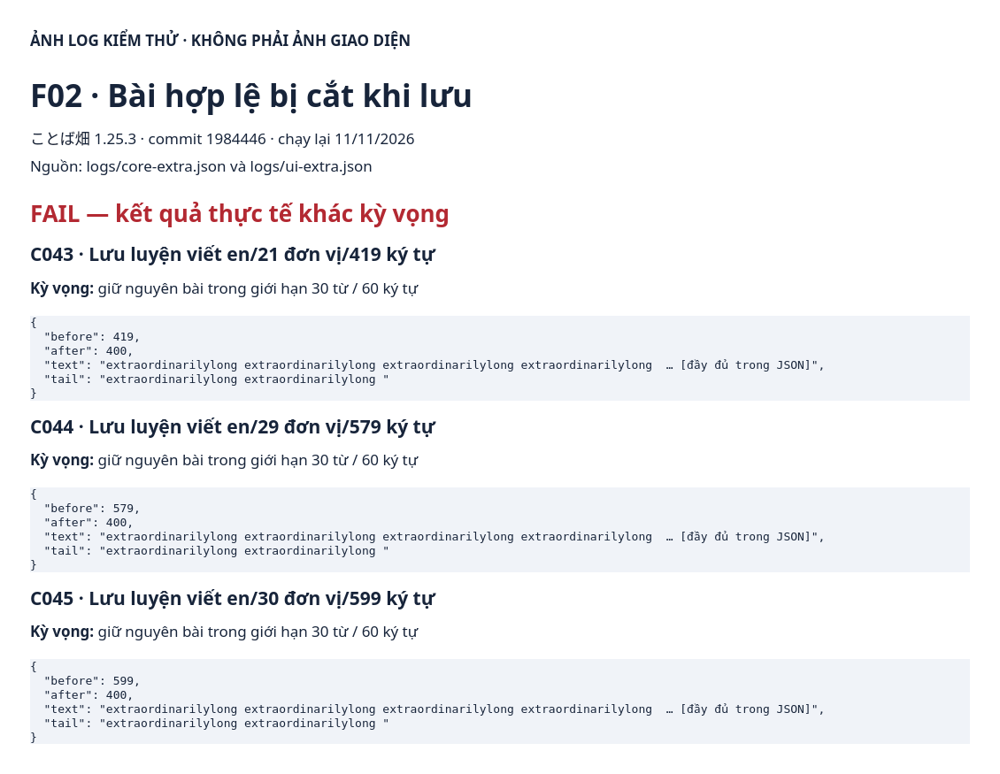

*Ảnh trên là log của kịch bản chạy thật, không phải ảnh giao diện.*

**Đã tái hiện lại:** 21, 29 và 30 từ dài (419/579/599 ký tự) bị còn 400 ký tự. Thêm ca 30 từ `internationalization` (629 ký tự): bị cắt ở chữ `i` của từ thứ 20. Bài 20 từ / 399 ký tự và Nhật 60 ký tự giữ nguyên.

**Cách tái hiện:** nhập tối đa 30 từ tiếng Anh sao cho tổng dài hơn 400 ký tự; rời ô / đóng rồi mở Lịch hoa. Bài có thể kết thúc giữa một từ.

**Nguyên nhân:** `journal_core.py:clean_writing` gọi `clean_line(..., 400)` trước khi cắt theo giới hạn 30 từ. Giao diện đếm từ nhưng lưu trữ còn trần ký tự độc lập.

**Đề xuất sửa:** thống nhất quy tắc nhập và lưu; với tiếng Anh cắt theo từ trước, đặt giới hạn dung lượng phù hợp và công khai nếu cần. Đừng âm thầm cắt giữa từ. Kiểm tra cả `goc`, bài đã sửa và luồng gửi Gemini.

### F03 · P2 · Cài đặt có thể mất khi đóng cửa sổ trong 250 ms

[Mã liên quan](../../../kotoba_batake/web/prefs.js#L34) · [Dữ liệu các ca](logs/core-extra.json) / [ca UI](logs/ui-extra.json)

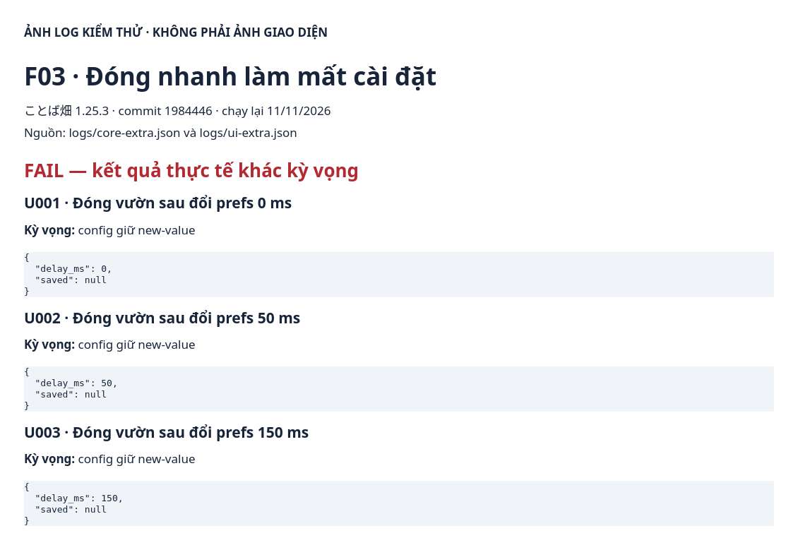

*Ảnh trên là log của kịch bản chạy thật, không phải ảnh giao diện.*

**Đã xác nhận lại trong QtWebEngine thật:** đóng sau 0 / 50 / 150 ms không ghi config; chờ 350 ms giữ được. Flush chủ động là đối chứng PASS. `web/prefs.js` gom thay đổi trong 250 ms; `pagehide` / `beforeunload` không bảo đảm chạy trước khi Qt hủy webview.

**Tái hiện:** đổi thời tiết / âm lượng rồi đóng vườn ngay (<250 ms), mở lại và đọc config `prefs`. So với chờ >500 ms và dùng `GardenPrefs.flush()`.

**Đề xuất sửa:** flush có xác nhận ở vòng đời đóng Qt / cầu nối, hoặc ghi ngay các cài đặt ít thay đổi; kiểm tra đóng vườn, thoát Anki và đổi hồ sơ. Không chỉ thêm một sự kiện DOM nữa.

### F04 · P2 · Esc trong lúc gõ IME có thể đóng bảng

[Mã liên quan](../../../kotoba_batake/web/calendar.js#L995) · [Dữ liệu các ca](logs/core-extra.json) / [ca UI](logs/ui-extra.json)

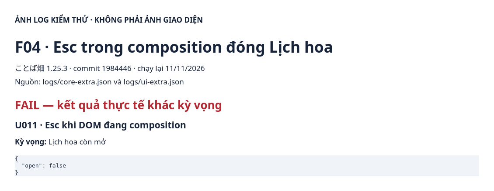

*Ảnh trên là log của kịch bản chạy thật, không phải ảnh giao diện.*

**Đã xác nhận lại bằng sự kiện DOM composition trong QtWebEngine:** Lịch hoa đóng khi nhận Esc có `isComposing=true`; **chưa kiểm chứng bộ gõ thật của Windows / macOS / Linux**. `calendar.js:onKey` kiểm tra Esc trước loại ô nhập và trạng thái composition.

**Tái hiện:** mở Nhật ký / Luyện viết, bắt đầu composition, gửi Esc với `isComposing=true`. Kỳ vọng Esc hủy chọn chữ trước, không đóng bảng / làm mất ngữ cảnh nhập.

**Đề xuất sửa:** chặn phím tắt khi đang composition (`isComposing`, trạng thái composition và tương thích mã 229 khi cần); kiểm tra ở bảng Lịch hoa, Xưởng, tìm deck và màn ôn. Xác nhận lại với bộ gõ hệ điều hành trước khi kết luận đã sửa.

### F05 · P3 · Trần xu game bằng 0 nhưng menu hiển thị 40

[Mã liên quan](../../../kotoba_batake/web/games.js#L1016) · [Dữ liệu các ca](logs/core-extra.json) / [ca UI](logs/ui-extra.json)

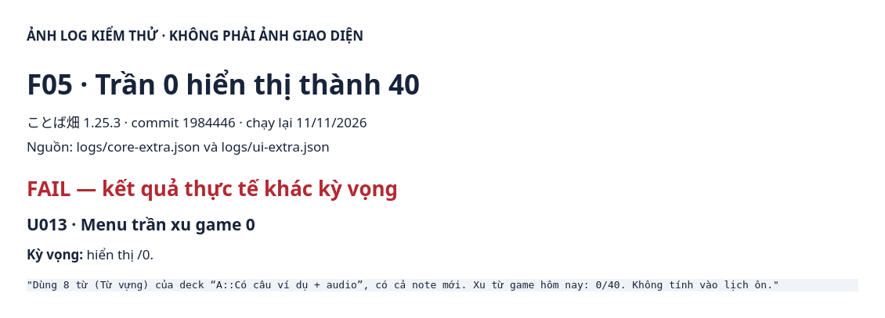

*Ảnh trên là log của kịch bản chạy thật, không phải ảnh giao diện.*

**Đã xác nhận lại trên giao diện:** cấu hình 0 hiện `0/40`; 1 / 40 / 200 hiện đúng. `games.js` dùng `(d.fx && d.fx.game_daily_coins) || 40`, làm giá trị 0 hợp lệ rơi về 40. Kỳ vọng hiển thị 0 và khớp việc Python không trả xu.

**Đề xuất sửa:** chỉ dùng mặc định khi thiếu / sai kiểu, giữ 0; thử các giá trị 0, 1, 40, 200.

### F06 · P2 · Thời tiết trong dữ liệu gửi viết báo có thể khác vườn

[Mã liên quan](../../../kotoba_batake/__init__.py#L1187) · [Dữ liệu các ca](logs/core-extra.json) / [ca UI](logs/ui-extra.json)

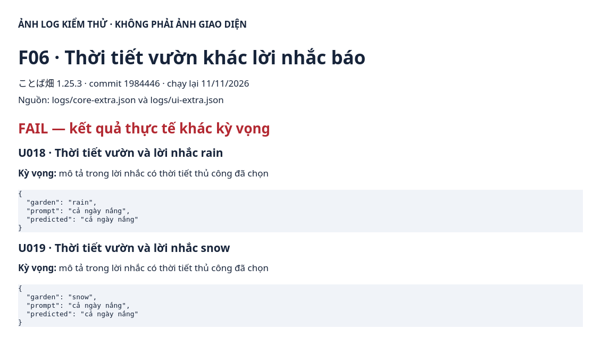

*Ảnh trên là log của kịch bản chạy thật, không phải ảnh giao diện.*

**Đã xác nhận lại:** cảnh được đặt mưa / tuyết nhưng `_village_weather` trả `cả ngày nắng`; nắng là đối chứng PASS. Chọn tuyết / mưa cố định ở vườn rồi đối chiếu `_village_weather(date)` / `thoi_tiet` gửi tác vụ báo. Hàm lấy thời tiết tính theo ngày, chưa đọc lựa chọn thủ công của người dùng.

**Đề xuất sửa:** xác định một nguồn thời tiết thống nhất cho cảnh và lời nhắc báo; gửi snapshot tại lúc bắt đầu tác vụ, có quy tắc rõ cho số báo ngày cũ / máy khác. Không cần gọi Gemini thật để kiểm tra dữ liệu đầu vào.

### F07 · P2 · Hàng chờ thông báo có thể đánh mất thông báo

[Mã liên quan](../../../kotoba_batake/web/garden.js#L1110) · [Dữ liệu các ca](logs/core-extra.json) / [ca UI](logs/ui-extra.json)

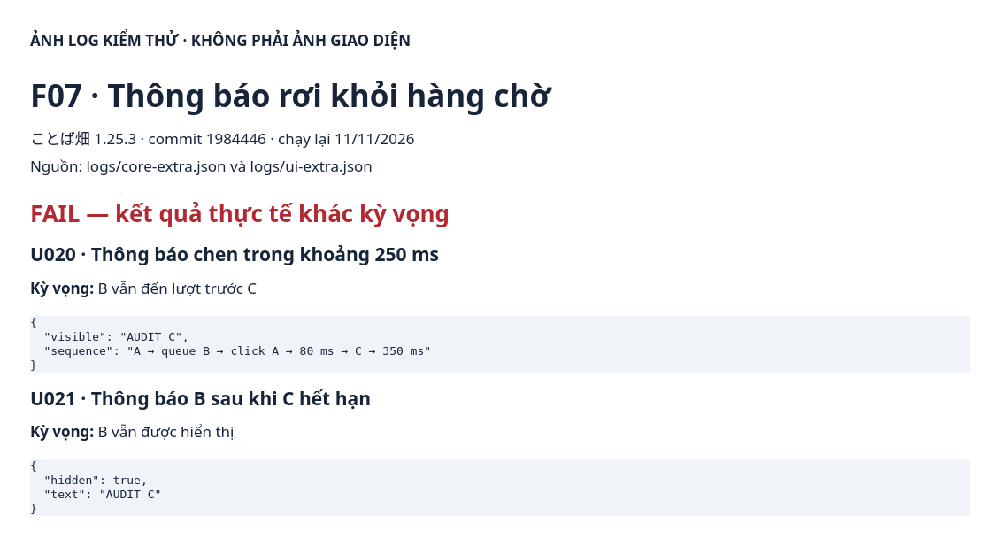

*Ảnh trên là log của kịch bản chạy thật, không phải ảnh giao diện.*

**Đã xác nhận lại:** sau A, B đã xếp hàng, C chen trong 80 ms; chỉ C hiện và sau khi C hết hạn B vẫn không trở lại. `garden.js:toastNext` lấy một phần tử khỏi hàng chờ rồi chờ 250 ms mới hiện. Thông báo mới chen vào khoảng này gọi `showToast`, xóa timer đã giữ phần tử trước đó.

**Tái hiện:** hiện A bấm được, xếp B sau A; bấm A; trong 100 ms hiện C; đợi qua 250 ms. B phải còn lượt xuất hiện.

**Đề xuất sửa:** coi khoảng chuyển tiếp là trạng thái đang bận; chỉ lấy phần tử khỏi hàng khi hiển thị thật, dùng một bộ điều phối timer và giữ giới hạn hàng chờ.

### F08 · P2 · Cache ngôn ngữ dùng chung khi đổi hồ sơ

[Mã liên quan](../../../kotoba_batake/__init__.py#L1546) · [Dữ liệu các ca](logs/core-extra.json) / [ca UI](logs/ui-extra.json)

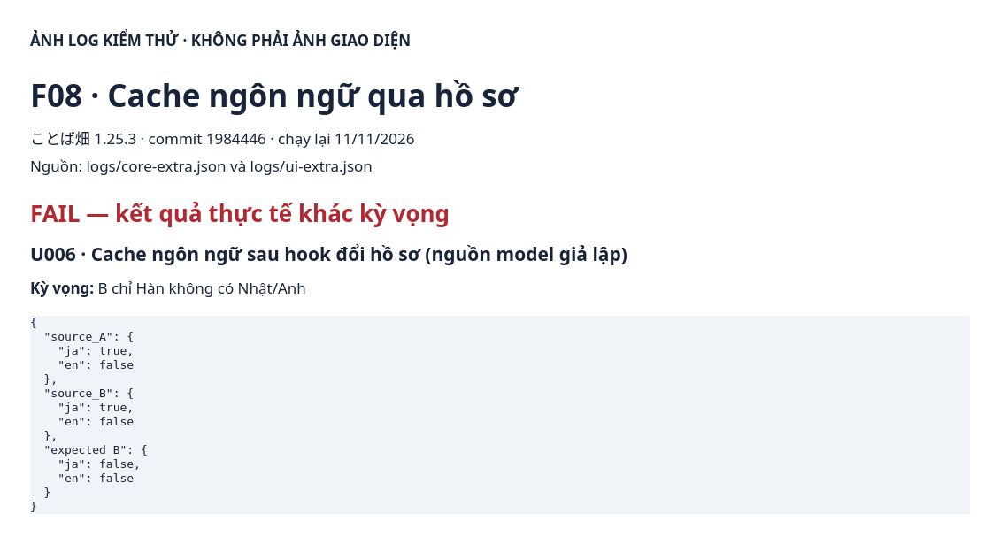

*Ảnh trên là log của kịch bản chạy thật, không phải ảnh giao diện.*

**Đã xác nhận lại ở kiểm thử tích hợp có kiểm soát:** thay nguồn `model_infos` Nhật → Hàn, gọi hook đóng hồ sơ thật; B vẫn nhận `ja=true`. Chưa thay thế thử đổi hai hồ sơ người dùng bằng UI. `_lang_presence` cache kết quả 60 giây trong biến module `_presence`, không gắn định danh collection. Hồ sơ chỉ có tiếng Hàn có thể nhận trạng thái Nhật / Anh của hồ sơ vừa đóng.

**Đề xuất sửa:** gắn cache với đường dẫn / định danh collection, hủy khi đổi hồ sơ và thay đổi mapping; kiểm tra A có Nhật → B chỉ Hàn và chiều ngược lại.

### F09 · P2 · Kho điểm ảnh dự phòng của hồ sơ khác được đọc vào hồ sơ mới

[Mã liên quan](../../../kotoba_batake/garden_core.py#L2900) · [Dữ liệu các ca](logs/core-extra.json) / [ca UI](logs/ui-extra.json)

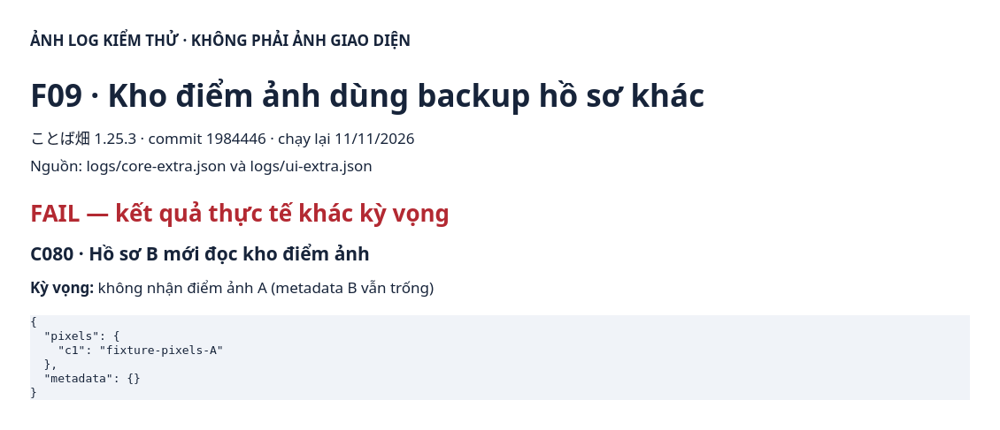

*Ảnh trên là log của kịch bản chạy thật, không phải ảnh giao diện.*

**Đã tái hiện lại:** A ghi `craft_px.json`; B có ví riêng nhưng chưa có `PX_KEY`, `load_px()` trả điểm ảnh của A. Metadata craft của B vẫn trống, nên **chưa chứng minh B thấy / sở hữu được món A trên giao diện**.

**Nguyên nhân:** `GardenState.load_px` luôn đọc file dự phòng dùng chung khi collection không có `PX_KEY`, thiếu kiểm tra chủ sở hữu như ví và các kho khác.

**Đề xuất sửa:** tách backup theo hồ sơ hoặc gắn chủ sở hữu; chỉ nhập backup khi điều kiện migration hợp lệ. Test hồ sơ mới, mất khóa riêng, import backup và khôi phục dữ liệu cũ.

### F10 · P2 · Trần bù xu 1000/ngày áp dụng theo từng đợt

[Mã liên quan](../../../kotoba_batake/garden_core.py#L2445) · [Dữ liệu các ca](logs/core-extra.json) / [ca UI](logs/ui-extra.json)

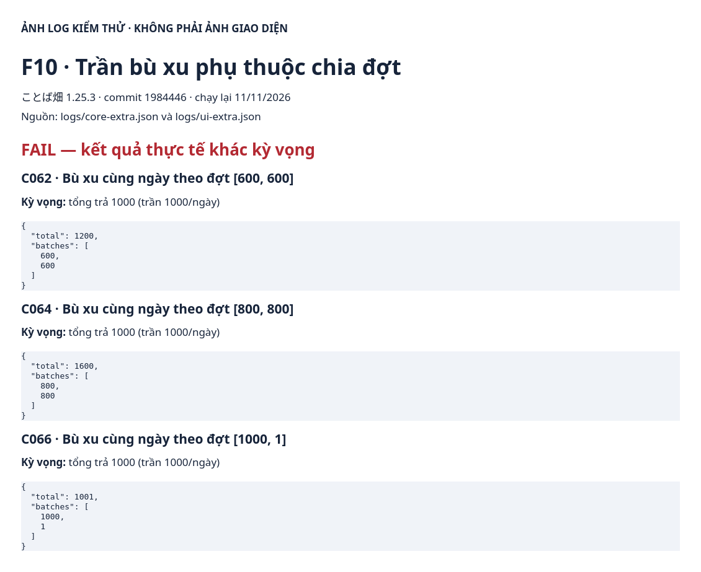

*Ảnh trên là log của kịch bản chạy thật, không phải ảnh giao diện.*

**Đã tái hiện lại:** `[600,600] → 1200`, `[800,800] → 1600`, `[1000,1] → 1001` trong cùng ngày. Một đợt 1500 bị chặn 1000 đúng; gọi lặp không có lượt mới không trả thêm.

**Nguyên nhân:** `settle_mobile` lấy `min(delta['ok'], MOBILE_DAY_CAP)` mỗi lần, không trừ phần trần đã dùng trong ngày.

**Đề xuất sửa:** lưu / tính lượng đã trả theo ngày, giới hạn phần còn lại; quy tắc phải độc lập cách chia lần đồng bộ. Thử Undo, nhiều máy, ngày cũ và mục tiêu ngày để tránh sửa sai sổ xu.

### F11 · P2 · Revlog tương lai trong ngày được tính vào lượt đã ôn

[Mã liên quan](../../../kotoba_batake/garden_core.py#L2404) · [Dữ liệu các ca](logs/core-extra.json) / [ca UI](logs/ui-extra.json)

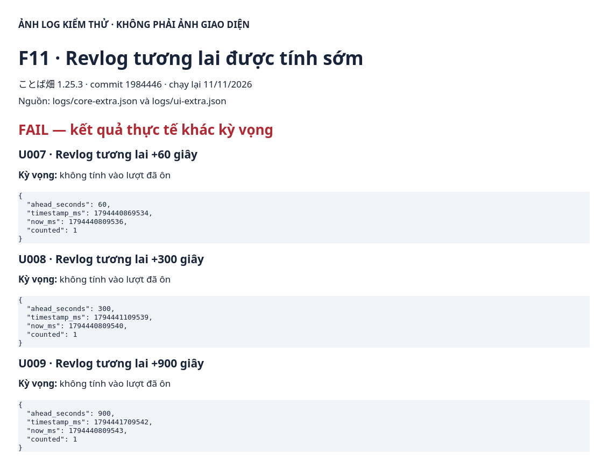

*Ảnh trên là log của kịch bản chạy thật, không phải ảnh giao diện.*

**Đã xác nhận lại bằng collection Anki thật:** 3 timestamp ở tương lai +60 / +300 / +900 giây trong cùng ngày đều được đếm. Dòng được xóa trong `finally` sau mỗi ca. `revlog_by_day` bỏ ngày tương lai (`rel > 0`) nhưng không bỏ thời điểm tương lai còn trong hôm nay.

**Đề xuất sửa:** xác định chính sách đồng hồ lệch và giới hạn timestamp so với hiện tại; chưa đến thời điểm thì hoãn trả, không đánh dấu đã xử lý. Kiểm tra sát giờ đổi ngày Anki và đồng hồ hai máy lệch nhau.

### F12 · P3 · Nhiệm vụ thiếu trường bắt buộc gây KeyError

[Mã liên quan](../../../kotoba_batake/garden_core.py#L2275) · [Dữ liệu các ca](logs/core-extra.json) / [ca UI](logs/ui-extra.json)

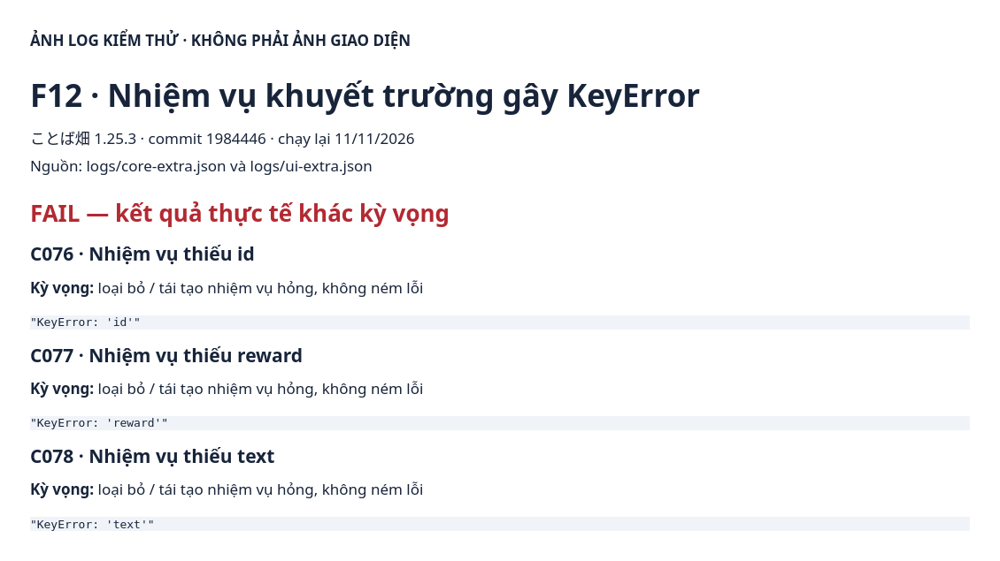

*Ảnh trên là log của kịch bản chạy thật, không phải ảnh giao diện.*

**Đã tái hiện lại:** `_clean_quest` nhận nhiệm vụ thiếu `id` / `reward` / `text`; `quest_view` hoặc `_settle_quests` ném `KeyError`. Cần dữ liệu hỏng / sửa tay / bản cũ, không phải đường tạo nhiệm vụ bình thường.

**Đề xuất sửa:** kiểm tra đầy đủ schema, loại và biên của các trường trước khi nhận; tái tạo nhiệm vụ lỗi mà không mất ví / nhà / thưởng đã trả. Thêm test trên dữ liệu collection bị khuyết trường.

### F13 · P3 · Config mốc giai đoạn không buộc tăng dần

[Mã liên quan](../../../kotoba_batake/garden_core.py#L1041) · [Dữ liệu các ca](logs/core-extra.json) / [ca UI](logs/ui-extra.json)

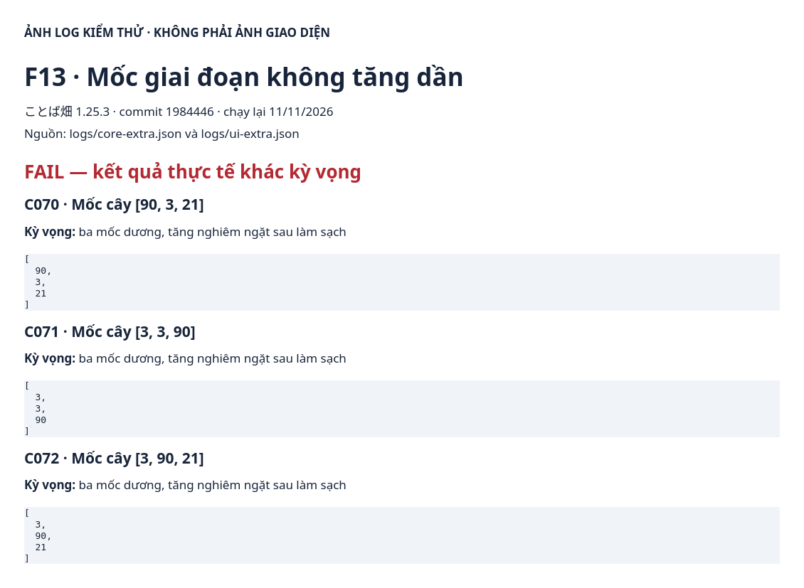

*Ảnh trên là log của kịch bản chạy thật, không phải ảnh giao diện.*

**Đã tái hiện lại:** `[90,3,21]`, `[3,90,21]`, `[3,3,90]` qua `merged_config` nguyên trạng. Giai đoạn có thể nhảy hoặc không bao giờ xuất hiện. Cần chỉnh config thủ công.

**Đề xuất sửa:** nhận đúng 3 số dương tăng nghiêm ngặt; sai thì dùng mặc định và báo ngắn trong cấu hình. Test cả FSRS và fallback `ivl`.

## Đánh giá giao diện và điều kiện phát hành

Phong cách pixel, bảng màu và cảnh mùa có cá tính rõ. Các nhóm nhà, báo, nhật ký tạo cảm giác thành quả học tập. Điểm cần kiểm tra kỹ trước release là mật độ chức năng đối với người mới, đường tìm tác vụ trong 11 tab Nhà, nhãn / trạng thái khi không có deck hoặc chưa có khóa, độ vừa cửa sổ thấp, phím tắt và độ tương phản khi tối.

Ưu tiên cải tiến: hướng dẫn ngắn theo tác vụ đầu tiên (chọn deck → ôn → xem cây), gợi ý nhóm chức năng / tìm món trong Nhà, phân biệt nút chính và phụ, luôn có dấu hiệu đã lưu cho nơi dễ mất dữ liệu. Các thay đổi bố cục nhà / cỡ cảnh đã được người dùng chốt trong `PHAT_TRIEN.md` không bị coi là lỗi chỉ vì khác sở thích người đánh giá.

**Trước release:** xử lý hai P1; xử lý cài đặt / cache hồ sơ / hàng chờ; chạy lại hồi quy với bản sẽ đóng gói; một vòng dùng thật nhiều ngày và kiểm thử Windows / macOS. Chưa đánh dấu release ready chỉ vì các test có sẵn đều qua.

## Phạm vi chưa chứng minh

- Windows / macOS, bộ gõ IME thật, màn hình DPI cao và nhiều màn hình.
- AnkiWeb thật / AnkiDroid / AnkiMobile, xung đột hai máy, khôi phục backup thật.
- Gemini thật, hạn mức / retry / model đang phục vụ / chất lượng nội dung dài ngày. Test giả lập không thay thế xác nhận dịch vụ thật.
- Độ bền khi Anki / máy bị kill giữa ghi file, dùng liên tục nhiều ngày, tải dữ liệu rất lớn.
- Các thay đổi trên `master` sau commit được rà soát.

## Chạy lại và đọc minh chứng

Script trong `kich_ban/` chỉ tạo dữ liệu giả trong `/tmp`; không dùng hồ sơ cá nhân. Python: `/workspace/kotoba-dev/venv/bin/python` (Anki 26.09.4, Qt 6.12.0), Node 24.22.1, Linux Qt offscreen. Sửa đường dẫn Python theo máy của người chạy.

```bash
ANKI_PY=/path/to/venv/bin/python bash tests/run_all.sh
/path/to/venv/bin/python docs/kiem_thu/release-audit-2026-11-11/kich_ban/audit_core.py "$PWD"
ANKI_PY=/path/to/venv/bin/python bash docs/kiem_thu/release-audit-2026-11-11/kich_ban/run_extra.sh
ANKI_PY=/path/to/venv/bin/python bash docs/kiem_thu/release-audit-2026-11-11/kich_ban/run_regression.sh
QT_QPA_PLATFORM=offscreen /path/to/venv/bin/python docs/kiem_thu/release-audit-2026-11-11/kich_ban/finalize_report.py
```

Mỗi ca có id, hành động, kỳ vọng, kết quả thực tế và trạng thái trong JSON. Ảnh log sẽ được ghi rõ là ảnh log; ảnh sản phẩm lấy từ QtWebEngine thật. Không dùng hình dựng làm minh chứng giao diện đã chạy.

<!-- GENERATED -->

## Hồi quy với các kịch bản UI có sẵn

| Script có sẵn | PASS | FAIL |
|---|---|---|
| `e2e_tour.js` | 12 | 0 |
| `e2e_117.js` | 55 | 0 |
| `e2e_125.js` | 30 | 0 |
| `e2e_1251.js` | 48 | 0 |

[Log hồi quy](logs/ui-existing.log) · [Lệnh chạy lại](kich_ban/run_regression.sh). Những kiểm tra này không cộng vào 235 ca bổ sung. Không sửa các script gốc. Log lần gọi runner ban đầu có tên file nhập sai `e2e_1252.js` (file không có); đã sửa danh sách gọi, dùng đường dẫn ảnh tuyệt đối và chạy lại bốn script hiện có. Không coi lỗi gọi runner là lỗi sản phẩm. [Log lần gọi đầu](logs/ui-launcher-first-attempt.log).

## Ảnh giao diện minh chứng và đánh giá

**F01 · Bếp sau thao tác cất, món vẫn ở gian**

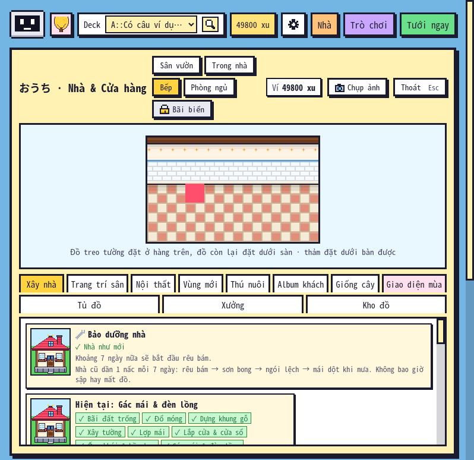

**F02 · trước lưu: 30 / 30 từ**

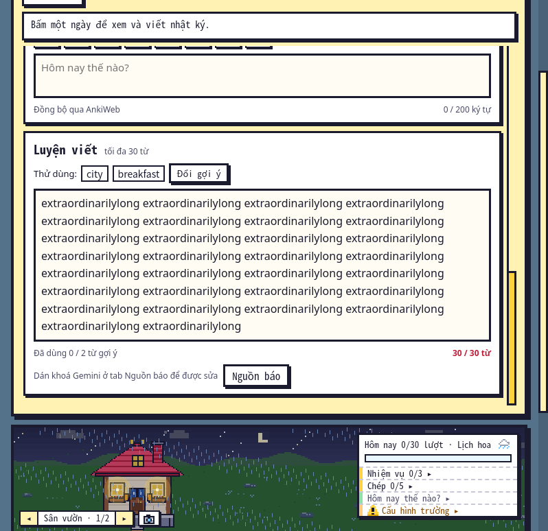

**F02 · mở lại: chỉ còn 20 / 30 từ**

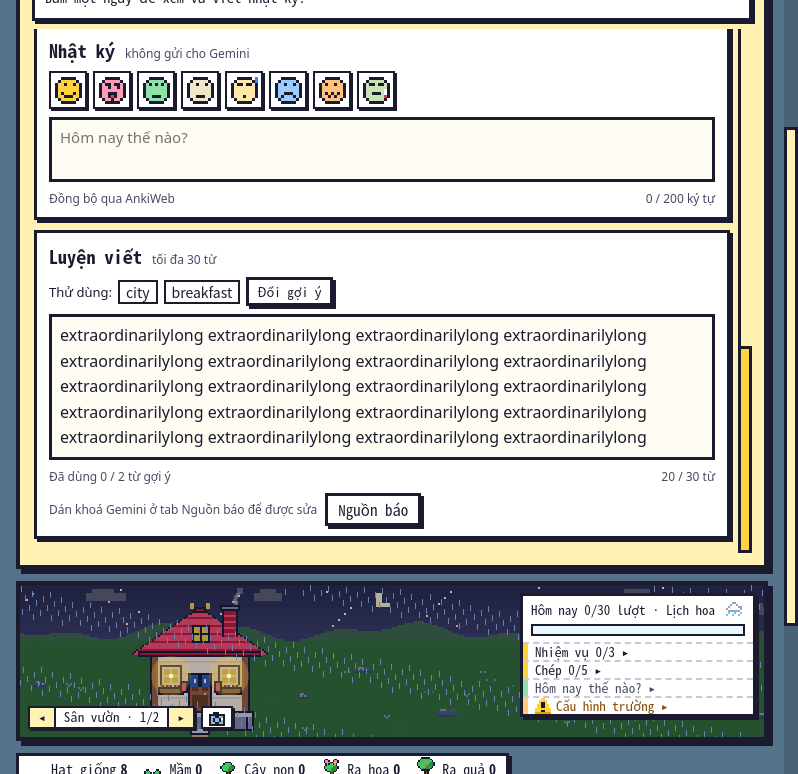

**F04 · ô Nhật ký đang nhận composition trước Esc**


**F04 · sau Esc bảng đã đóng**

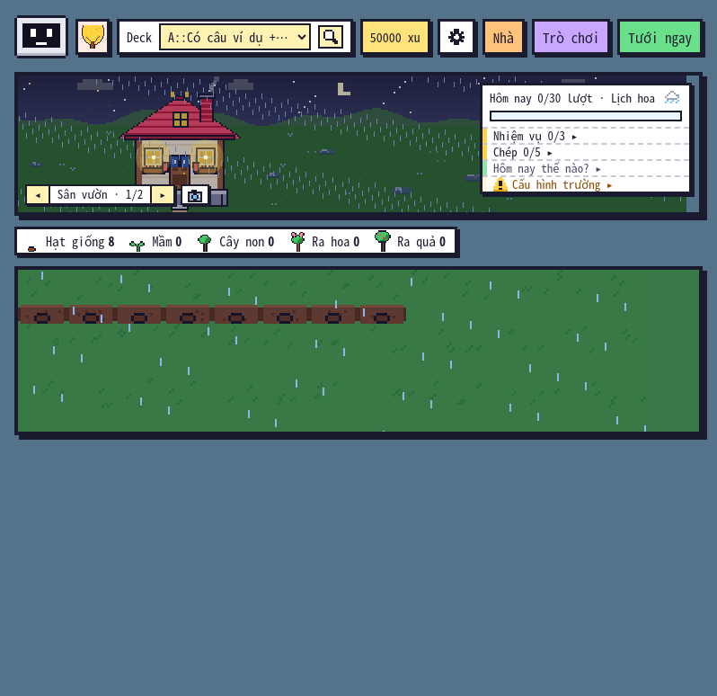

**F05 · menu hiện trần 40 dù cấu hình 0**

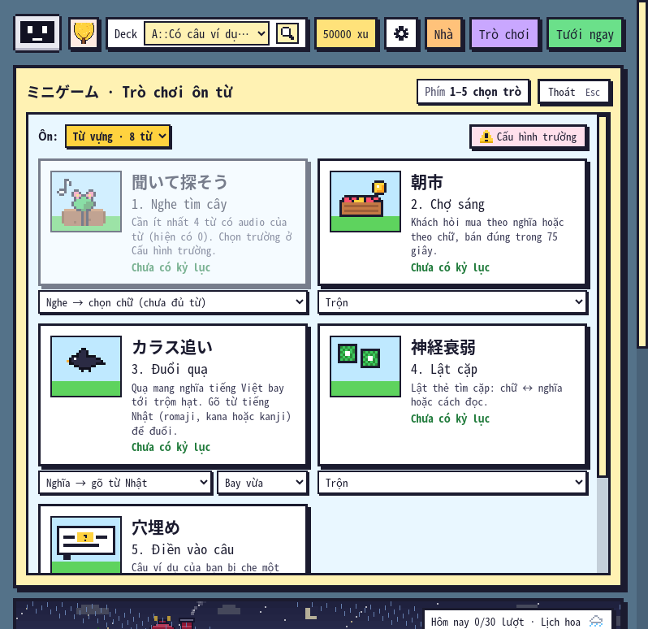

**F06 · cảnh tuyết thủ công; log đối chiếu lời nhắc ở trên**

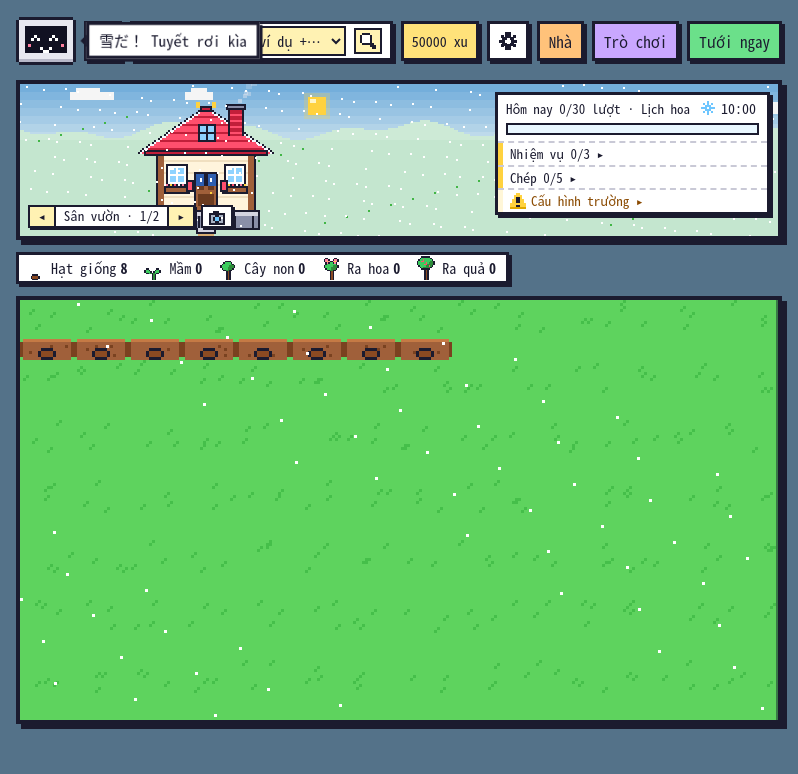

**F07 · C hiện thay B đã xếp hàng**

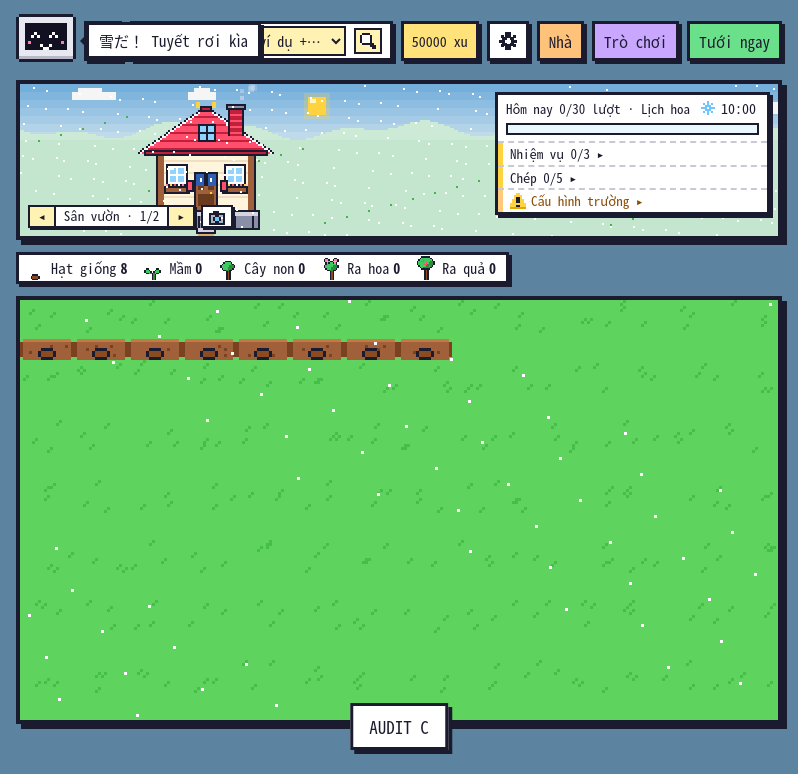

**Nhà 720×520 · 11 tab xuống hai hàng, phần danh sách ngắn**

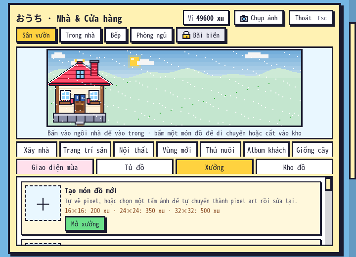

**Nhà 1366×768 · Kho đồ**

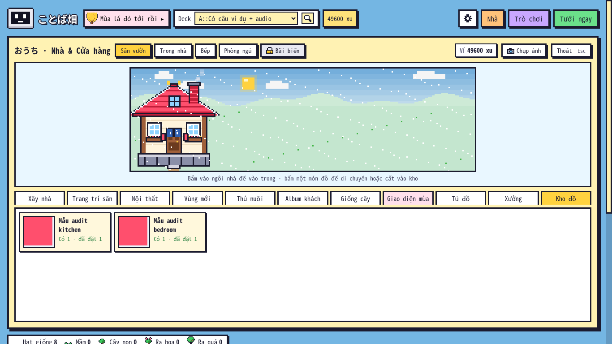

**Màn cấu hình trường 1024×640**

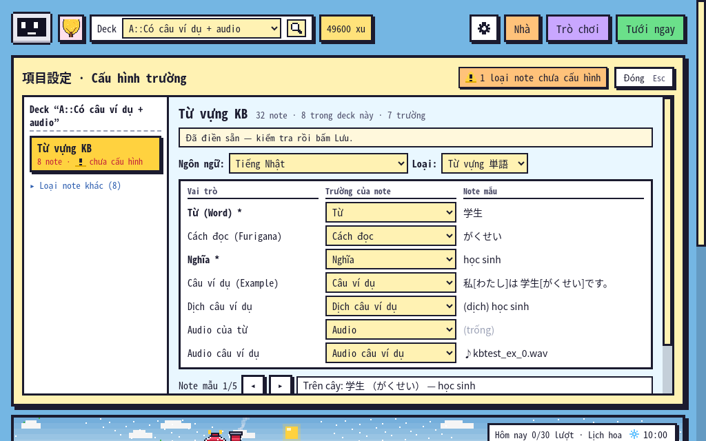

**Lịch hoa 1920×1080**

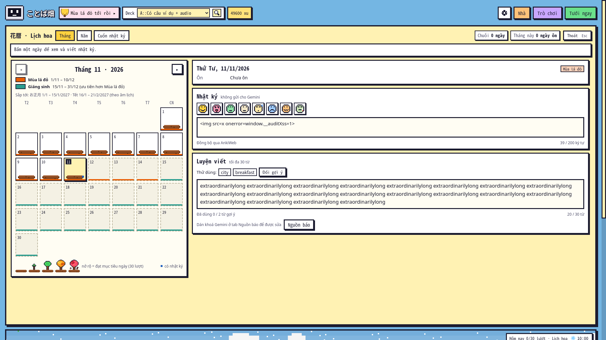

**Giao diện mùa Xuân ban ngày**

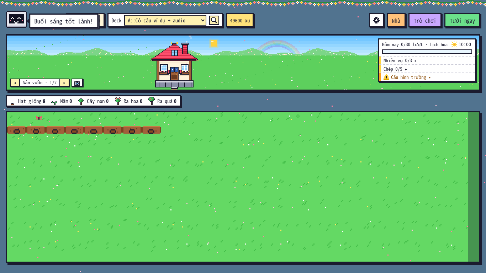

**Giao diện mùa Đông ban đêm**

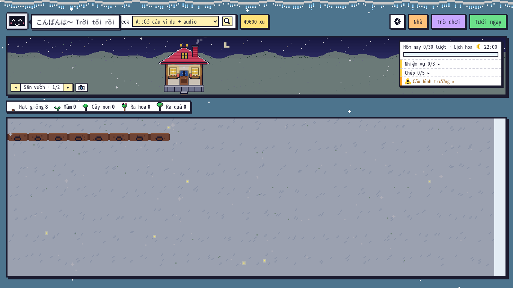

### Nhận xét qua ảnh và phép đo

| Mục | Đánh giá | Cải tiến nên cân nhắc |
|---|---|---|
| Bản sắc | Màu, khung pixel, nhà và mùa đồng nhất; ngày/đêm có khác biệt rõ | Giữ cách vẽ và tên gọi nhất quán khi thêm màn mới |
| Cửa sổ nhỏ | 11 tab vẫn thấy được ở 720×520, không tràn ngang; tab xuống 2 hàng, vùng danh sách ngắn | Tìm món / nhóm tab theo tác vụ; thử lại Windows scale 125–200% trước khi chốt |
| Người mới | Chọn deck, Nhà, Trò chơi, báo, Lịch hoa cùng xuất hiện từ đầu; cấu hình trường là một bước nhận thức nữa | Hướng dẫn 3 bước ngắn, một hành động chính mỗi trạng thái trống |
| Dữ liệu nhập | Nhật ký và Luyện viết phân tách; giới hạn được hiện nhưng lưu chưa nhất quán (F02) | Sửa mất dữ liệu trước; thêm xác nhận đã lưu nhẹ, không thêm hộp thoại liên tục |
| Thông báo | Có liên kết mở tác vụ, nhưng lỗi hàng chờ và toast có thể che nội dung phía dưới | Sửa F07; xem vị trí và cách đóng bằng bàn phím, ưu tiên thông báo quan trọng |
| Bàn phím / IME | Có phím tắt và Esc, nhưng F04 làm hỏng thao tác gõ chọn chữ | Thử bộ gõ thật và quản lý focus khi đóng / mở bảng |
| Khả năng tiếp cận | Chưa có kiểm định WCAG / screen reader, chưa đo tương phản toàn bộ trạng thái | Kiểm tra focus nhìn thấy, nhãn icon, zoom 200%, giảm chuyển động, chữ Nhật / Việt trên từng OS |

Không đề xuất thay đổi bố cục nhà đã chốt chỉ vì sở thích. Ảnh offscreen và phép đo tràn ngang không thay thế thử cảm giác sử dụng bằng chuột / bàn phím trong nhiều ngày.

## Các ca phải bổ sung trên bản release (CHƯA CHẠY trong môi trường này)

| ID | Kịch bản | Kỳ vọng cần xác nhận |
|---|---|---|
| M01 | Cài mới từ AnkiWeb, không có khóa Gemini / không deck | Mở được, hướng dẫn đúng, không gọi mạng |
| M02 | Nâng từ 1.22 / 1.23 / 1.24 trên backup hồ sơ thật | Giữ ví, nhà, Xưởng, báo, nhật ký và mapping |
| M03 | Windows 11 + Microsoft Japanese IME, Esc / Enter / đổi bảng | Không mất composition, không kích hoạt phím tắt nhầm |
| M04 | macOS + Japanese IME, trackpad, Retina | Bố cục và thao tác đúng |
| M05 | Linux IBus / Fcitx, tiếng Việt Telex và tiếng Nhật | Gõ, lưu, phím tắt không xung đột |
| M06 | Windows scale 125 / 150 / 200%, cửa sổ laptop thấp | Không mất nút quan trọng; cuộn tới mọi chức năng |
| M07 | macOS / Windows giọng TTS thật, không có giọng, audio bị lỗi | Phát đúng / báo lỗi rõ; không treo |
| M08 | Gemini thật: khóa AIza / AQ, 401 / 403 / 429 / timeout | Không lộ khóa, retry / chờ đúng, không tính thành công giả |
| M09 | Báo Nhật + Anh + Việt nhiều ngày, từ vựng, bản dịch, truyện | Nội dung đúng phạm vi, liên tục và an toàn khi thiếu dữ liệu |
| M10 | Hết gói báo, ít xu, bật / tắt tự gia hạn, tick thêm ngôn ngữ | Không thu hai lần, không tự gọi khi chưa cho bắt đầu |
| M11 | Tắt mạng giữa tác vụ AI, đóng vườn, khởi động lại | Giữ bản nháp / trạng thái đúng, không có tác vụ ma |
| M12 | Gửi luyện viết và viết báo cùng lúc | Không mất kết quả / thông báo; hạn mức từng loại đúng |
| M13 | Đồng bộ AnkiWeb A → điện thoại → A | Lượt ôn / xu / mục tiêu không trùng, FSRS giữ nguyên |
| M14 | Hai máy viết nhật ký cùng tháng rồi đồng bộ khác thứ tự | Hành vi xung đột đúng tài liệu, không nhận nhầm hồ sơ |
| M15 | Hai máy khác phiên bản chỉnh nhà / Xưởng rồi đồng bộ | Không mất món lạ, không hồi sinh món đã cất |
| M16 | Giờ máy lệch ±1h / ±1 ngày, đổi timezone, DST | Ngày Anki và trần xu không sai; lượt tương lai được hoãn |
| M17 | Dùng vườn qua mốc đổi ngày Anki khi đang ôn / viết | Nhiệm vụ, thưởng và nhật ký chuyển ngày đúng |
| M18 | Collection 100k+ note, nhiều template / deck lọc / media | Mở và đổi deck ở thời gian chấp nhận; không treo UI |
| M19 | Xưởng đầy 60 mẫu, nhiều vùng / giống, mã chia sẻ lớn | Có thể tìm, sửa, xóa; báo giới hạn rõ |
| M20 | Kill Anki giữa lưu, đĩa đầy, thư mục chỉ đọc | Không ghi file nửa chừng / mất ví; khôi phục hợp lý |
| M21 | Backup / restore hồ sơ, đổi tên / đường dẫn hồ sơ | Ảnh, quota, cache và dữ liệu riêng đúng chủ |
| M22 | Zoom 200%, chỉ bàn phím, screen reader | Mọi hành động chính truy cập được, nhãn / focus rõ |
| M23 | Chế độ tối, giảm chuyển động, tắt hiệu ứng / âm thanh | Chữ đọc được, tắt đúng ở mọi màn |
| M24 | Đóng / mở liên tiếp và dùng thật 7 ngày | Không tích lũy timer / rò bộ nhớ / tác vụ nền |
| M25 | Gói .ankiaddon cuối khớp mã đã test, cài trên Anki cũ nhất hỗ trợ | Không thiếu asset / lỗi API; kết quả áp dụng đúng gói phát hành |

Các ca M01–M25 là kế hoạch kiểm thử, **không được cộng vào số PASS**.

## Thứ tự ổn định trong 1–2 tuần

1. Hai ngày đầu: F01 / F02 và hồi quy vòng đời dữ liệu; không thêm tính năng trước khi ngăn mất chữ và phục hồi đồ sai.
2. Ngày 3–5: F03 / F07 / F08 / F09, rồi F06 / F10 / F11; test lại đóng nhanh, hai hồ sơ và nhiều đợt đồng bộ.
3. Ngày 6–8: kiểm thử OS / IME / DPI, cài gói thật, các luồng Gemini và đồng bộ thật trong bảng M.
4. Phần thời gian còn lại: dùng thử có giám sát với vài người mới, ghi chỗ bối rối, đóng băng chức năng và chạy hồi quy trên đúng gói phát hành.

Điều kiện đề xuất để giới thiệu rộng: không còn P1, lỗi dữ liệu / hồ sơ đã xử lý hoặc có quyết định rõ, các luồng cài mới–ôn–đồng bộ–mở lại chạy được trên nền tảng hỗ trợ. Đây là đề xuất ưu tiên, không phải xác nhận phiên bản mới trên master đã đạt.

## Danh mục đầy đủ các ca bổ sung đã chạy

Kết quả FAIL thể hiện kỳ vọng chưa đạt. Chi tiết đầu vào / đầu ra đầy đủ nằm trong JSON; bảng rút gọn để tìm id và tái hiện. Các biến thể cùng một lỗi không được tính thành lỗi độc lập.

| ID | Kịch bản | Kỳ vọng | Kết quả | Phát hiện |
|---|---|---|---|---|
| C001 | Đặt mẫu kitchen-floor-16 | 1 món đặt, sở hữu 1 | PASS |  |
| C002 | Lưu lặp kitchen-floor-16 | NHA_KEY luôn 1 placement | FAIL | F01 |
| C003 | Cất rồi đọc lại kitchen-floor-16 | gian trống, món về kho | FAIL | F01 |
| C004 | Đặt mẫu kitchen-floor-24 | 1 món đặt, sở hữu 1 | PASS |  |
| C005 | Lưu lặp kitchen-floor-24 | NHA_KEY luôn 1 placement | FAIL | F01 |
| C006 | Cất rồi đọc lại kitchen-floor-24 | gian trống, món về kho | FAIL | F01 |
| C007 | Đặt mẫu kitchen-floor-32 | 1 món đặt, sở hữu 1 | PASS |  |
| C008 | Lưu lặp kitchen-floor-32 | NHA_KEY luôn 1 placement | FAIL | F01 |
| C009 | Cất rồi đọc lại kitchen-floor-32 | gian trống, món về kho | FAIL | F01 |
| C010 | Đặt mẫu kitchen-wall-16 | 1 món đặt, sở hữu 1 | PASS |  |
| C011 | Lưu lặp kitchen-wall-16 | NHA_KEY luôn 1 placement | FAIL | F01 |
| C012 | Cất rồi đọc lại kitchen-wall-16 | gian trống, món về kho | FAIL | F01 |
| C013 | Đặt mẫu kitchen-wall-24 | 1 món đặt, sở hữu 1 | PASS |  |
| C014 | Lưu lặp kitchen-wall-24 | NHA_KEY luôn 1 placement | FAIL | F01 |
| C015 | Cất rồi đọc lại kitchen-wall-24 | gian trống, món về kho | FAIL | F01 |
| C016 | Đặt mẫu kitchen-wall-32 | 1 món đặt, sở hữu 1 | PASS |  |
| C017 | Lưu lặp kitchen-wall-32 | NHA_KEY luôn 1 placement | FAIL | F01 |
| C018 | Cất rồi đọc lại kitchen-wall-32 | gian trống, món về kho | FAIL | F01 |
| C019 | Đặt mẫu bedroom-floor-16 | 1 món đặt, sở hữu 1 | PASS |  |
| C020 | Lưu lặp bedroom-floor-16 | NHA_KEY luôn 1 placement | FAIL | F01 |
| C021 | Cất rồi đọc lại bedroom-floor-16 | gian trống, món về kho | FAIL | F01 |
| C022 | Đặt mẫu bedroom-floor-24 | 1 món đặt, sở hữu 1 | PASS |  |
| C023 | Lưu lặp bedroom-floor-24 | NHA_KEY luôn 1 placement | FAIL | F01 |
| C024 | Cất rồi đọc lại bedroom-floor-24 | gian trống, món về kho | FAIL | F01 |
| C025 | Đặt mẫu bedroom-floor-32 | 1 món đặt, sở hữu 1 | PASS |  |
| C026 | Lưu lặp bedroom-floor-32 | NHA_KEY luôn 1 placement | FAIL | F01 |
| C027 | Cất rồi đọc lại bedroom-floor-32 | gian trống, món về kho | FAIL | F01 |
| C028 | Đặt mẫu bedroom-wall-16 | 1 món đặt, sở hữu 1 | PASS |  |
| C029 | Lưu lặp bedroom-wall-16 | NHA_KEY luôn 1 placement | FAIL | F01 |
| C030 | Cất rồi đọc lại bedroom-wall-16 | gian trống, món về kho | FAIL | F01 |
| C031 | Đặt mẫu bedroom-wall-24 | 1 món đặt, sở hữu 1 | PASS |  |
| C032 | Lưu lặp bedroom-wall-24 | NHA_KEY luôn 1 placement | FAIL | F01 |
| C033 | Cất rồi đọc lại bedroom-wall-24 | gian trống, món về kho | FAIL | F01 |
| C034 | Đặt mẫu bedroom-wall-32 | 1 món đặt, sở hữu 1 | PASS |  |
| C035 | Lưu lặp bedroom-wall-32 | NHA_KEY luôn 1 placement | FAIL | F01 |
| C036 | Cất rồi đọc lại bedroom-wall-32 | gian trống, món về kho | FAIL | F01 |
| C037 | Đối chứng cất mẫu ở yard/ground | món biến khỏi cảnh | PASS |  |
| C038 | Đối chứng cất mẫu ở room/floor | món biến khỏi cảnh | PASS |  |
| C039 | Đối chứng cất mẫu ở room/wall | món biến khỏi cảnh | PASS |  |
| C040 | Lưu luyện viết en/1 đơn vị/19 ký tự | giữ nguyên bài trong giới hạn 30 từ / 60 ký tự | PASS | F02 |
| C041 | Lưu luyện viết en/19 đơn vị/379 ký tự | giữ nguyên bài trong giới hạn 30 từ / 60 ký tự | PASS | F02 |
| C042 | Lưu luyện viết en/20 đơn vị/399 ký tự | giữ nguyên bài trong giới hạn 30 từ / 60 ký tự | PASS | F02 |
| C043 | Lưu luyện viết en/21 đơn vị/419 ký tự | giữ nguyên bài trong giới hạn 30 từ / 60 ký tự | FAIL | F02 |
| C044 | Lưu luyện viết en/29 đơn vị/579 ký tự | giữ nguyên bài trong giới hạn 30 từ / 60 ký tự | FAIL | F02 |
| C045 | Lưu luyện viết en/30 đơn vị/599 ký tự | giữ nguyên bài trong giới hạn 30 từ / 60 ký tự | FAIL | F02 |
| C046 | Lưu luyện viết ja/1 đơn vị/1 ký tự | giữ nguyên bài trong giới hạn 30 từ / 60 ký tự | PASS | F02 |
| C047 | Lưu luyện viết ja/59 đơn vị/59 ký tự | giữ nguyên bài trong giới hạn 30 từ / 60 ký tự | PASS | F02 |
| C048 | Lưu luyện viết ja/60 đơn vị/60 ký tự | giữ nguyên bài trong giới hạn 30 từ / 60 ký tự | PASS | F02 |
| C049 | Lưu luyện viết en/30 đơn vị/629 ký tự | giữ nguyên bài trong giới hạn 30 từ / 60 ký tự | FAIL | F02 |
| C050 | Cắt đúng đơn vị ja/61 | không vượt giới hạn, không cắt giữa từ | PASS |  |
| C051 | Cắt đúng đơn vị ja/120 | không vượt giới hạn, không cắt giữa từ | PASS |  |
| C052 | Cắt đúng đơn vị en/31 | không vượt giới hạn, không cắt giữa từ | PASS |  |
| C053 | Cắt đúng đơn vị en/60 | không vượt giới hạn, không cắt giữa từ | PASS |  |
| C054 | Bù xu cùng ngày theo đợt [999] | tổng trả 999 (trần 1000/ngày) | PASS | F10 |
| C055 | Bù lặp [999] | không trả thêm xu | PASS |  |
| C056 | Bù xu cùng ngày theo đợt [1000] | tổng trả 1000 (trần 1000/ngày) | PASS | F10 |
| C057 | Bù lặp [1000] | không trả thêm xu | PASS |  |
| C058 | Bù xu cùng ngày theo đợt [1001] | tổng trả 1000 (trần 1000/ngày) | PASS | F10 |
| C059 | Bù lặp [1001] | không trả thêm xu | PASS |  |
| C060 | Bù xu cùng ngày theo đợt [1500] | tổng trả 1000 (trần 1000/ngày) | PASS | F10 |
| C061 | Bù lặp [1500] | không trả thêm xu | PASS |  |
| C062 | Bù xu cùng ngày theo đợt [600, 600] | tổng trả 1000 (trần 1000/ngày) | FAIL | F10 |
| C063 | Bù lặp [600, 600] | không trả thêm xu | PASS |  |
| C064 | Bù xu cùng ngày theo đợt [800, 800] | tổng trả 1000 (trần 1000/ngày) | FAIL | F10 |
| C065 | Bù lặp [800, 800] | không trả thêm xu | PASS |  |
| C066 | Bù xu cùng ngày theo đợt [1000, 1] | tổng trả 1000 (trần 1000/ngày) | FAIL | F10 |
| C067 | Bù lặp [1000, 1] | không trả thêm xu | PASS |  |
| C068 | Bù xu cùng ngày theo đợt [400, 400, 400] | tổng trả 1000 (trần 1000/ngày) | FAIL | F10 |
| C069 | Bù lặp [400, 400, 400] | không trả thêm xu | PASS |  |
| C070 | Mốc cây [90, 3, 21] | ba mốc dương, tăng nghiêm ngặt sau làm sạch | FAIL | F13 |
| C071 | Mốc cây [3, 3, 90] | ba mốc dương, tăng nghiêm ngặt sau làm sạch | FAIL | F13 |
| C072 | Mốc cây [3, 90, 21] | ba mốc dương, tăng nghiêm ngặt sau làm sạch | FAIL | F13 |
| C073 | Mốc cây [21, 3, 90] | ba mốc dương, tăng nghiêm ngặt sau làm sạch | FAIL | F13 |
| C074 | Mốc cây [0, 21, 90] | ba mốc dương, tăng nghiêm ngặt sau làm sạch | PASS | F13 |
| C075 | Mốc cây [3, 21, 90] | ba mốc dương, tăng nghiêm ngặt sau làm sạch | PASS | F13 |
| C076 | Nhiệm vụ thiếu id | loại bỏ / tái tạo nhiệm vụ hỏng, không ném lỗi | FAIL | F12 |
| C077 | Nhiệm vụ thiếu reward | loại bỏ / tái tạo nhiệm vụ hỏng, không ném lỗi | FAIL | F12 |
| C078 | Nhiệm vụ thiếu text | loại bỏ / tái tạo nhiệm vụ hỏng, không ném lỗi | FAIL | F12 |
| C079 | Điểm ảnh hồ sơ A | đọc đúng PX_KEY của A | PASS |  |
| C080 | Hồ sơ B mới đọc kho điểm ảnh | không nhận điểm ảnh A (metadata B vẫn trống) | FAIL | F09 |
| C081 | Config daily_goal=9 | 10 | PASS |  |
| C082 | Config daily_goal=10 | 10 | PASS |  |
| C083 | Config daily_goal=10000 | 10000 | PASS |  |
| C084 | Config daily_bonus=-1 | 0 | PASS |  |
| C085 | Config daily_bonus=0 | 0 | PASS |  |
| C086 | Config daily_bonus=100 | 100 | PASS |  |
| C087 | Config daily_bonus=101 | 100 | PASS |  |
| C088 | Config game_daily_coins=-1 | 0 | PASS |  |
| C089 | Config game_daily_coins=0 | 0 | PASS |  |
| C090 | Config game_daily_coins=200 | 200 | PASS |  |
| C091 | Config game_daily_coins=201 | 200 | PASS |  |
| C092 | Config max_plants=0 | 1 | PASS |  |
| C093 | Config max_plants=1 | 1 | PASS |  |
| C094 | Config max_plants=5000 | 5000 | PASS |  |
| C095 | Config max_plants=5001 | 5000 | PASS |  |
| C096 | Config music_volume=-0.1 | 0 | PASS |  |
| C097 | Config music_volume=0 | 0 | PASS |  |
| C098 | Config music_volume=1 | 1 | PASS |  |
| C099 | Config music_volume=1.1 | 1 | PASS |  |
| C100 | Prefs 0 khóa | tối đa 120, giữ khóa mới nhất và làm sạch lặp ổn định | PASS |  |
| C101 | Prefs 1 khóa | tối đa 120, giữ khóa mới nhất và làm sạch lặp ổn định | PASS |  |
| C102 | Prefs 119 khóa | tối đa 120, giữ khóa mới nhất và làm sạch lặp ổn định | PASS |  |
| C103 | Prefs 120 khóa | tối đa 120, giữ khóa mới nhất và làm sạch lặp ổn định | PASS |  |
| C104 | Prefs 121 khóa | tối đa 120, giữ khóa mới nhất và làm sạch lặp ổn định | PASS |  |
| C105 | Prefs 1000 khóa | tối đa 120, giữ khóa mới nhất và làm sạch lặp ổn định | PASS |  |
| C106 | Nhật ký làm sạch '<script>alert(1)</script' | giới hạn 200, không ký tự điều khiển, idempotent | PASS |  |
| C107 | Nhật ký làm sạch 'Cà phê 日本語' | giới hạn 200, không ký tự điều khiển, idempotent | PASS |  |
| C108 | Nhật ký làm sạch 'a\x00b\n c' | giới hạn 200, không ký tự điều khiển, idempotent | PASS |  |
| C109 | Nhật ký làm sạch 'xxxxxxxxxxxxxxxxxxxxxxxx' | giới hạn 200, không ký tự điều khiển, idempotent | PASS |  |
| C110 | Nhật ký làm sạch '' | giới hạn 200, không ký tự điều khiển, idempotent | PASS |  |
| C111 | Nhật ký làm sạch 'a\r\nb' | giới hạn 200, không ký tự điều khiển, idempotent | PASS |  |
| C112 | Nhật ký làm sạch 'a\t b' | giới hạn 200, không ký tự điều khiển, idempotent | PASS |  |
| U001 | Đóng vườn sau đổi prefs 0 ms | config giữ new-value | FAIL | F03 |
| U002 | Đóng vườn sau đổi prefs 50 ms | config giữ new-value | FAIL | F03 |
| U003 | Đóng vườn sau đổi prefs 150 ms | config giữ new-value | FAIL | F03 |
| U004 | Đóng vườn sau đổi prefs 350 ms | config giữ new-value | PASS | F03 |
| U005 | Prefs flush chủ động | config đã nhận giá trị | PASS |  |
| U006 | Cache ngôn ngữ sau hook đổi hồ sơ (nguồn model giả lập) | B chỉ Hàn không có Nhật/Anh | FAIL | F08 |
| U007 | Revlog tương lai +60 giây | không tính vào lượt đã ôn | FAIL | F11 |
| U008 | Revlog tương lai +300 giây | không tính vào lượt đã ôn | FAIL | F11 |
| U009 | Revlog tương lai +900 giây | không tính vào lượt đã ôn | FAIL | F11 |
| U010 | Bài tiếng Anh 30 từ qua giao diện đóng/mở | giữ nguyên 599 ký tự, 30 từ | FAIL | F02 |
| U011 | Esc khi DOM đang composition | Lịch hoa còn mở | FAIL | F04 |
| U012 | Nhật ký chứa chuỗi HTML | hiện chữ nguyên, không chạy mã | PASS |  |
| U013 | Menu trần xu game 0 | hiển thị /0. | FAIL | F05 |
| U014 | Menu trần xu game 1 | hiển thị /1. | PASS |  |
| U015 | Menu trần xu game 40 | hiển thị /40. | PASS |  |
| U016 | Menu trần xu game 200 | hiển thị /200. | PASS |  |
| U017 | Thời tiết vườn và lời nhắc sunny | mô tả trong lời nhắc có thời tiết thủ công đã chọn | PASS | F06 |
| U018 | Thời tiết vườn và lời nhắc rain | mô tả trong lời nhắc có thời tiết thủ công đã chọn | FAIL | F06 |
| U019 | Thời tiết vườn và lời nhắc snow | mô tả trong lời nhắc có thời tiết thủ công đã chọn | FAIL | F06 |
| U020 | Thông báo chen trong khoảng 250 ms | B vẫn đến lượt trước C | FAIL | F07 |
| U021 | Thông báo B sau khi C hết hạn | B vẫn được hiển thị | FAIL | F07 |
| U022 | Cất đồ tự làm kitchen qua state thật | không còn id c1 | FAIL | F01 |
| U023 | Cất đồ tự làm bedroom qua state thật | không còn id c2 | FAIL | F01 |
| U024 | Bố cục Nhà build 720×520 | 11 tab thấy được, đúng tab, không tràn trang | PASS |  |
| U025 | Bố cục Nhà yard 720×520 | 11 tab thấy được, đúng tab, không tràn trang | PASS |  |
| U026 | Bố cục Nhà room 720×520 | 11 tab thấy được, đúng tab, không tràn trang | PASS |  |
| U027 | Bố cục Nhà zone 720×520 | 11 tab thấy được, đúng tab, không tràn trang | PASS |  |
| U028 | Bố cục Nhà pet 720×520 | 11 tab thấy được, đúng tab, không tràn trang | PASS |  |
| U029 | Bố cục Nhà guest 720×520 | 11 tab thấy được, đúng tab, không tràn trang | PASS |  |
| U030 | Bố cục Nhà seed 720×520 | 11 tab thấy được, đúng tab, không tràn trang | PASS |  |
| U031 | Bố cục Nhà season 720×520 | 11 tab thấy được, đúng tab, không tràn trang | PASS |  |
| U032 | Bố cục Nhà wear 720×520 | 11 tab thấy được, đúng tab, không tràn trang | PASS |  |
| U033 | Bố cục Nhà craft 720×520 | 11 tab thấy được, đúng tab, không tràn trang | PASS |  |
| U034 | Bố cục Nhà inv 720×520 | 11 tab thấy được, đúng tab, không tràn trang | PASS |  |
| U035 | Bố cục Nhà build 1024×700 | 11 tab thấy được, đúng tab, không tràn trang | PASS |  |
| U036 | Bố cục Nhà yard 1024×700 | 11 tab thấy được, đúng tab, không tràn trang | PASS |  |
| U037 | Bố cục Nhà room 1024×700 | 11 tab thấy được, đúng tab, không tràn trang | PASS |  |
| U038 | Bố cục Nhà zone 1024×700 | 11 tab thấy được, đúng tab, không tràn trang | PASS |  |
| U039 | Bố cục Nhà pet 1024×700 | 11 tab thấy được, đúng tab, không tràn trang | PASS |  |
| U040 | Bố cục Nhà guest 1024×700 | 11 tab thấy được, đúng tab, không tràn trang | PASS |  |
| U041 | Bố cục Nhà seed 1024×700 | 11 tab thấy được, đúng tab, không tràn trang | PASS |  |
| U042 | Bố cục Nhà season 1024×700 | 11 tab thấy được, đúng tab, không tràn trang | PASS |  |
| U043 | Bố cục Nhà wear 1024×700 | 11 tab thấy được, đúng tab, không tràn trang | PASS |  |
| U044 | Bố cục Nhà craft 1024×700 | 11 tab thấy được, đúng tab, không tràn trang | PASS |  |
| U045 | Bố cục Nhà inv 1024×700 | 11 tab thấy được, đúng tab, không tràn trang | PASS |  |
| U046 | Bố cục Nhà build 1366×768 | 11 tab thấy được, đúng tab, không tràn trang | PASS |  |
| U047 | Bố cục Nhà yard 1366×768 | 11 tab thấy được, đúng tab, không tràn trang | PASS |  |
| U048 | Bố cục Nhà room 1366×768 | 11 tab thấy được, đúng tab, không tràn trang | PASS |  |
| U049 | Bố cục Nhà zone 1366×768 | 11 tab thấy được, đúng tab, không tràn trang | PASS |  |
| U050 | Bố cục Nhà pet 1366×768 | 11 tab thấy được, đúng tab, không tràn trang | PASS |  |
| U051 | Bố cục Nhà guest 1366×768 | 11 tab thấy được, đúng tab, không tràn trang | PASS |  |
| U052 | Bố cục Nhà seed 1366×768 | 11 tab thấy được, đúng tab, không tràn trang | PASS |  |
| U053 | Bố cục Nhà season 1366×768 | 11 tab thấy được, đúng tab, không tràn trang | PASS |  |
| U054 | Bố cục Nhà wear 1366×768 | 11 tab thấy được, đúng tab, không tràn trang | PASS |  |
| U055 | Bố cục Nhà craft 1366×768 | 11 tab thấy được, đúng tab, không tràn trang | PASS |  |
| U056 | Bố cục Nhà inv 1366×768 | 11 tab thấy được, đúng tab, không tràn trang | PASS |  |
| U057 | Bố cục Nhà build 1920×1080 | 11 tab thấy được, đúng tab, không tràn trang | PASS |  |
| U058 | Bố cục Nhà yard 1920×1080 | 11 tab thấy được, đúng tab, không tràn trang | PASS |  |
| U059 | Bố cục Nhà room 1920×1080 | 11 tab thấy được, đúng tab, không tràn trang | PASS |  |
| U060 | Bố cục Nhà zone 1920×1080 | 11 tab thấy được, đúng tab, không tràn trang | PASS |  |
| U061 | Bố cục Nhà pet 1920×1080 | 11 tab thấy được, đúng tab, không tràn trang | PASS |  |
| U062 | Bố cục Nhà guest 1920×1080 | 11 tab thấy được, đúng tab, không tràn trang | PASS |  |
| U063 | Bố cục Nhà seed 1920×1080 | 11 tab thấy được, đúng tab, không tràn trang | PASS |  |
| U064 | Bố cục Nhà season 1920×1080 | 11 tab thấy được, đúng tab, không tràn trang | PASS |  |
| U065 | Bố cục Nhà wear 1920×1080 | 11 tab thấy được, đúng tab, không tràn trang | PASS |  |
| U066 | Bố cục Nhà craft 1920×1080 | 11 tab thấy được, đúng tab, không tràn trang | PASS |  |
| U067 | Bố cục Nhà inv 1920×1080 | 11 tab thấy được, đúng tab, không tràn trang | PASS |  |
| U068 | Màn garden 720×520 | không tràn ngang toàn trang | PASS |  |
| U069 | Màn calendar 720×520 | không tràn ngang toàn trang | PASS |  |
| U070 | Màn games 720×520 | không tràn ngang toàn trang | PASS |  |
| U071 | Màn settings 720×520 | không tràn ngang toàn trang | PASS |  |
| U072 | Màn paper 720×520 | không tràn ngang toàn trang | PASS |  |
| U073 | Màn fields 720×520 | không tràn ngang toàn trang | PASS |  |
| U074 | Màn craft 720×520 | không tràn ngang toàn trang | PASS |  |
| U075 | Màn garden 1024×640 | không tràn ngang toàn trang | PASS |  |
| U076 | Màn calendar 1024×640 | không tràn ngang toàn trang | PASS |  |
| U077 | Màn games 1024×640 | không tràn ngang toàn trang | PASS |  |
| U078 | Màn settings 1024×640 | không tràn ngang toàn trang | PASS |  |
| U079 | Màn paper 1024×640 | không tràn ngang toàn trang | PASS |  |
| U080 | Màn fields 1024×640 | không tràn ngang toàn trang | PASS |  |
| U081 | Màn craft 1024×640 | không tràn ngang toàn trang | PASS |  |
| U082 | Màn garden 1366×768 | không tràn ngang toàn trang | PASS |  |
| U083 | Màn calendar 1366×768 | không tràn ngang toàn trang | PASS |  |
| U084 | Màn games 1366×768 | không tràn ngang toàn trang | PASS |  |
| U085 | Màn settings 1366×768 | không tràn ngang toàn trang | PASS |  |
| U086 | Màn paper 1366×768 | không tràn ngang toàn trang | PASS |  |
| U087 | Màn fields 1366×768 | không tràn ngang toàn trang | PASS |  |
| U088 | Màn craft 1366×768 | không tràn ngang toàn trang | PASS |  |
| U089 | Màn garden 1920×1080 | không tràn ngang toàn trang | PASS |  |
| U090 | Màn calendar 1920×1080 | không tràn ngang toàn trang | PASS |  |
| U091 | Màn games 1920×1080 | không tràn ngang toàn trang | PASS |  |
| U092 | Màn settings 1920×1080 | không tràn ngang toàn trang | PASS |  |
| U093 | Màn paper 1920×1080 | không tràn ngang toàn trang | PASS |  |
| U094 | Màn fields 1920×1080 | không tràn ngang toàn trang | PASS |  |
| U095 | Màn craft 1920×1080 | không tràn ngang toàn trang | PASS |  |
| U096 | Cảnh mùa tet lúc 10h | đúng giao diện, canvas có hình, không lỗi JS mới | PASS |  |
| U097 | Cảnh mùa tet lúc 22h | đúng giao diện, canvas có hình, không lỗi JS mới | PASS |  |
| U098 | Cảnh mùa noel lúc 10h | đúng giao diện, canvas có hình, không lỗi JS mới | PASS |  |
| U099 | Cảnh mùa noel lúc 22h | đúng giao diện, canvas có hình, không lỗi JS mới | PASS |  |
| U100 | Cảnh mùa shogatsu lúc 10h | đúng giao diện, canvas có hình, không lỗi JS mới | PASS |  |
| U101 | Cảnh mùa shogatsu lúc 22h | đúng giao diện, canvas có hình, không lỗi JS mới | PASS |  |
| U102 | Cảnh mùa tsukimi lúc 10h | đúng giao diện, canvas có hình, không lỗi JS mới | PASS |  |
| U103 | Cảnh mùa tsukimi lúc 22h | đúng giao diện, canvas có hình, không lỗi JS mới | PASS |  |
| U104 | Cảnh mùa halloween lúc 10h | đúng giao diện, canvas có hình, không lỗi JS mới | PASS |  |
| U105 | Cảnh mùa halloween lúc 22h | đúng giao diện, canvas có hình, không lỗi JS mới | PASS |  |
| U106 | Cảnh mùa momiji lúc 10h | đúng giao diện, canvas có hình, không lỗi JS mới | PASS |  |
| U107 | Cảnh mùa momiji lúc 22h | đúng giao diện, canvas có hình, không lỗi JS mới | PASS |  |
| U108 | Cảnh mùa tanabata lúc 10h | đúng giao diện, canvas có hình, không lỗi JS mới | PASS |  |
| U109 | Cảnh mùa tanabata lúc 22h | đúng giao diện, canvas có hình, không lỗi JS mới | PASS |  |
| U110 | Cảnh mùa natsumatsuri lúc 10h | đúng giao diện, canvas có hình, không lỗi JS mới | PASS |  |
| U111 | Cảnh mùa natsumatsuri lúc 22h | đúng giao diện, canvas có hình, không lỗi JS mới | PASS |  |
| U112 | Cảnh mùa tsuyu lúc 10h | đúng giao diện, canvas có hình, không lỗi JS mới | PASS |  |
| U113 | Cảnh mùa tsuyu lúc 22h | đúng giao diện, canvas có hình, không lỗi JS mới | PASS |  |
| U114 | Cảnh mùa hanami lúc 10h | đúng giao diện, canvas có hình, không lỗi JS mới | PASS |  |
| U115 | Cảnh mùa hanami lúc 22h | đúng giao diện, canvas có hình, không lỗi JS mới | PASS |  |
| U116 | Cảnh mùa spring lúc 10h | đúng giao diện, canvas có hình, không lỗi JS mới | PASS |  |
| U117 | Cảnh mùa spring lúc 22h | đúng giao diện, canvas có hình, không lỗi JS mới | PASS |  |
| U118 | Cảnh mùa summer lúc 10h | đúng giao diện, canvas có hình, không lỗi JS mới | PASS |  |
| U119 | Cảnh mùa summer lúc 22h | đúng giao diện, canvas có hình, không lỗi JS mới | PASS |  |
| U120 | Cảnh mùa autumn lúc 10h | đúng giao diện, canvas có hình, không lỗi JS mới | PASS |  |
| U121 | Cảnh mùa autumn lúc 22h | đúng giao diện, canvas có hình, không lỗi JS mới | PASS |  |
| U122 | Cảnh mùa winter lúc 10h | đúng giao diện, canvas có hình, không lỗi JS mới | PASS |  |
| U123 | Cảnh mùa winter lúc 22h | đúng giao diện, canvas có hình, không lỗi JS mới | PASS |  |
